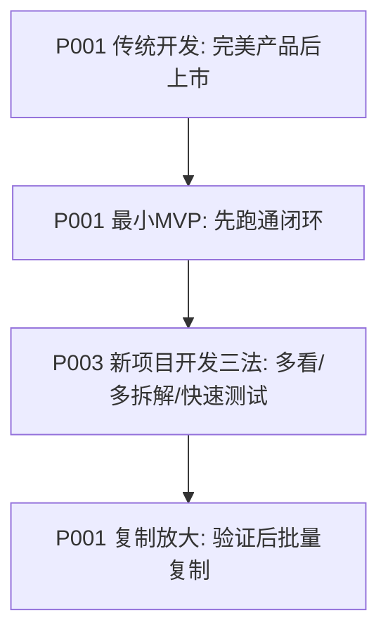

# 第 27 章 商业模式的验证与复制
作者：龙哥

## 学习目标

- 理解最小MVP闭环的核心定义、关键性质与适用边界
- 掌握产品定位五维拆解法的分析框架并能应用于新项目开发
- 理解信息差即金钱的商业本质，能识别并消除信息差创造机会
- 掌握私域高客单与咨询SOP表格的转化方法论
- 理解风口周期判断与项目生命周期管理在项目决策中的作用
- 能运用截流开店、全域获客矩阵等方法构建低成本获客体系
- 理解向有结果的人学习与加盟赋能模式的价值与边界
- 掌握投放投产比实测与避开经验固化招聘的实操经验

## 27.1 生活类比

想象创业验证过程是一场**野外探险**。最小MVP闭环，就是先造一条独木舟过河，而非一开始就造航母；选品决定论，就像种子决定收成，选好种子才能省一半心；信息差即金钱，就像你知道一条别人不知道的捷径，这就是你的商业价值；风口周期判断，就是早起的鸟儿有虫吃，在别人还在观望时入场；加盟赋能，则是把加盟店变成直营店的克隆体，把成功模式复制粘贴。就像探险家需要先验证路线可行再带大部队出发，创业者也需要先跑通最小闭环再复制放大。

## 27.2 概念地图

第27章 商业模式的验证与复制
├── 验证思维
│   ├── 最小MVP闭环           —— 先挣1块钱，再复制放大
│   │   └── 低成本/快速/可复制/闭环导向 —— P001
│   └── 产品好省一半心（选品决定论）  —— 好产品自带转化力
│       └── 自转化/高复购/品牌背书  —— P001
├── 机会识别
│   ├── 信息差即金钱           —— 中介费是伪概念
│   │   └── 可消除性/高价值/市场切入点 —— P002
│   ├── 风口周期判断           —— 高流量低商业化阶段入场
│   │   └── 窗口期/可预测/非持久   —— P003
│   └── 存量消费时代判断        —— 行业洗牌中的机会
│       └── 周期切换/传统煎熬/新模式窗口 —— P002
├── 获客与转化
│   ├── 私域高客单（金饭碗）     —— 用户为专业而来，用专业变现
│   │   └── 价值匹配/时间价值/信任溢价 —— P001
│   ├── 咨询SOP表格           —— 把回复模板化作转化提效器
│   │   └── 标准化/可复制/迭代性  —— P001
│   ├── 截流开店               —— 蹭竞争对手的势
│   │   └── 低成本/精准性/强对比  —— P002
│   └── 全域获客矩阵            —— 多平台撒网捕鱼
│       └── 广泛覆盖/主动出击/平台差异化 —— P002
├── 团队与放大
│   ├── 加盟赋能一条龙          —— 让合伙人成为你的克隆体
│   │   └── 标准化交付/低门槛赋能/多方共赢 —— P001
│   ├── 避开经验固化的招聘       —— 白纸比老手更值钱
│   │   └── 思维可塑性/成本优势/文化适配 —— P002
│   └── 项目生命周期管理（1+1+1矩阵） —— 让多个灶台同时开火
│       └── 有限性/可复制性/组合效应 —— P003
└── 学习与决策
├── 向有结果的人学习          —— 付费买经验，复制再创新
│   └── 结果导向/付费杠杆/复制+创新 —— P001, P003
├── 产品定位五维拆解          —— 做菜前先定菜系
│   └── 定位/用户/价值/竞对/本地化 —— P003
├── 投放投产比实测           —— 用数据而非感觉选渠道
│   └── 数据驱动/本地优先/差异化 —— P002
└── 不把鸡蛋放一个篮子里       —— 保住基本盘
    └── 抗风险/基本盘优先/动态调整 —— P001

## 27.3 最小MVP闭环 —— 先挣1块钱，再复制放大

### 为什么需要这个概念？

创业/副业最怕一上来就追求完美、投入大量资源开发产品，结果发现市场并不买单，沉没成本巨大。传统"先开发后售卖"的流程周期长、风险高，不适合个人和小团队。我们需要用最低成本、最快速度验证"产品—流量—销售—交付"的完整链路是否成立。只有先证明能挣到钱，才值得投入更多资源去放大。

### 核心定义

**最小MVP闭环**是指用最小可行产品（MVP）跑通"产品→流量→销售→交付"四个环节的完整商业闭环。核心是先挣1块钱，用最简单的方式验证商业模型成立，再复制放大，而非一开始就追求完美。

### 关键性质

最小MVP闭环具有四大关键性质：低成本，用最小成本验证，不投入大额资金；快速，用最快速度完成第一单交易，获得真实反馈；可复制，验证成功的模型可以无限复制放大；闭环导向，必须跑通全链路，而非只做产品或只做流量。

### 典型例子

夕子花2万注册公司从线上美业做起，通过私域诊断+医用产品搭配完成"产品—流量—销售—交付"闭环，月利润从1-2万做到5万+。老杨用MVP方法论快速测试TikTok睡播项目，快速验证可行后批量复制。

> "1.做生意从自己身边资源入手，从挣1块钱开始，选一个天花板比较高的，持续3——5年。" ——《E1WGd70YLoaHGfxAYJTc4WoFnsd.md》
> "2.跑通自己的生意环节，最小mvp（产品——流量—销售—交付）" ——《E1WGd70YLoaHGfxAYJTc4WoFnsd.md》
> "5.3 测试。快速测试，快速看到结果，产品方法论MVP真是让各行各业都能大放异彩啊。" ——《FCiidWBeJoLOT1xreYnc9Se4nOf.md》

### 方法演进图

上图展示了商业验证方法的演进路径：从传统的"完美产品后上市"转向"最小MVP先跑通闭环"，再结合"多看、多拆解、快速测试"的新项目开发三法，最终实现验证后的批量复制放大。

### 多源对照

| 维度 | P001（夕子/美业） | P003（老杨/TikTok） |
|------|-------------------|----------------------|
| MVP产品形态 | 微信诊断+医美面膜/口服产品 | 自动化睡播直播间（程序控制设备） |
| 流量获取 | 知乎/小红书内容引流 | TikTok平台免费推荐流量 |
| 销售转化 | 私域1对1咨询+SOP成交 | 直播间打赏礼物即时变现 |
| 交付履约 | 发货产品+持续皮肤诊断 | 程序自动触发声光效果 |
| 验证周期 | 半年从千粉到月入5万 | 2天起量、5天破2000在线 |
| 复制放大路径 | 加盟赋能一条龙（脚本/课程/SOP） | 1+1+1矩阵（盈利/开发/知识付费） |

#### 共识

两者均主张"先跑通闭环、再复制放大"，反对重资产前置投入，强调快速试错与可复制性。

#### 分歧

夕子的MVP侧重"人货场"私域闭环（重服务、重产品、长周期复购）；老杨的MVP侧重"人货场"直播闭环（重自动化、重流量、即时变现、短周期迭代）。

### 边界条件

MVP验证的是商业模式可行性，不等于产品最终形态；挣1块钱只是起点，还需持续迭代和优化；对于需要大量前期投入的行业（如重资产制造业），MVP方法论需要调整适用。

---

## 27.4 产品好省一半心 —— 选品决定论

### 为什么需要这个概念？

很多创业者以为销售能力是成败关键，投入大量精力在推广上，却忽略了产品本身。产品不好，销售再努力也事倍功半，复购率低。我们需要建立"选品重于销售"的认知，从源头解决转化难题。

### 核心定义

**选品决定论**：好产品自带转化力，能省掉一半销售精力，后续回购率也高。选品需满足用户需求且涵盖面齐全（祛痘、美白、抗衰等多功效）。

### 关键性质

选品决定论包含三大关键性质：自转化，好产品本身就具备成交能力，不需要过度推销；高复购，深挖用户需求的产品能形成持续复购；品牌背书强化，与医院等专业机构合作的产品，信任度更高。

### 典型例子

夕子选品遵循三要素：深挖需求涵盖面齐全、口服保养趋势（客户粘性强）、与医院合作强背书，从而做到高复购。胖龟找房发现"0中介费"是用户核心痛点，产品定位精准，截流开店即可获客。

> "所以选品很关键，产品好省了一半的心，后续回购率也高。" ——《E1WGd70YLoaHGfxAYJTc4WoFnsd.md》
> "1.深挖用户需求，最好涵盖面齐全：比如说不仅祛痘、还有美白、抗衰等等" ——《E1WGd70YLoaHGfxAYJTc4WoFnsd.md》
> "2.口服保养是趋势，一个人一单接受了某个品牌的口服，不会轻易更换牌子的" ——《E1WGd70YLoaHGfxAYJTc4WoFnsd.md》
> "3.尽量能跟医院合作的产品，品牌背书这块强" ——《E1WGd70YLoaHGfxAYJTc4WoFnsd.md》

### 美业选品三要素表

下表总结了夕子在线上美业实践中提炼的选品三大核心要素，来源于《E1WGd70YLoaHGfxAYJTc4WoFnsd.md》。

| 要素 | 说明 | 典型案例 |
|------|------|----------|
| 深挖需求、涵盖面齐全 | 产品不仅解决单一痛点，还覆盖美白、抗衰等多维需求 | 祛痘+美白+抗衰组合套装 |
| 口服保养为趋势 | 口服产品客户粘性强，一旦接受品牌不易更换 | 胶原蛋白肽、抗糖丸 |
| 医院合作背书 | 与三甲医院/医生合作，专业信任度极高 | "医生共创""医院同款" |

### 边界条件

"好产品"需结合目标客群的真实需求，而非开发者自认为的好；选品再好也需配合基础的流量和交付能力，不能完全替代运营；快消品与高客单产品对选品的依赖程度不同。

---

## 27.5 私域高客单 —— 端着金饭碗别讨饭

### 为什么需要这个概念？

私域流量很宝贵，但很多人却把私域用户当"韭菜"，做低价值社群团购，浪费了高价值用户。私域用户因专业而来，理应服务高客单、技术型需求，而非做低价值社群团购。需要重新定位私域用户的价值，避免"端着金饭碗讨饭"。

### 核心定义

**私域高客单**：私域用户因专业价值而聚集，应提供高客单价、高技术含量的服务或产品，而非低价值的泛品团购。核心是"用户为专业而来，就用专业变现"。

### 关键性质

私域高客单包含三大关键性质：价值匹配，高专业用户匹配高客单产品，形成良性循环；时间价值，私域用户的交流时间成本高，更要服务高价值需求；信任溢价，基于专业信任，用户愿意为更高价值的产品付费。

### 典型例子

夕子曾兼做社群团购（吃喝拉撒），被私域老师点醒"端着金饭碗在讨饭"，转而专注高客单的皮肤问题解决方案，客单价和利润率显著提升。一个私域老师3000粉变现300万，关键在于后端高客单变现产品。

> "私域老师有句话点醒了我：“端着金饭碗在讨饭。”当时我兼着一个社群团购业务，就是吃喝拉撒的这些，我私域的用户更多奔着我专业，看皮肤来的，我居然做这种事情，真的在讨饭。" ——《E1WGd70YLoaHGfxAYJTc4WoFnsd.md》
> "私域的用户需要花费时间和精力去交流，这种需要技术的事情，就应该收高客单。" ——《E1WGd70YLoaHGfxAYJTc4WoFnsd.md》
> "一个私域老师3000粉变现300万，这个跟她后端变现产品有很大的关系。" ——《E1WGd70YLoaHGfxAYJTc4WoFnsd.md》

### 边界条件

高客单需建立在真实专业能力之上，否则难以持续；不是所有私域用户都适合高客单，需区分用户层级；高客单不等于高价低质，需匹配等值的交付。

---

## 27.6 咨询SOP表格 —— 把回复模板化作转化提效器

### 为什么需要这个概念？

私域咨询量大时，每次输入同样的回答会消耗时间且回复质量不稳定。客服/合伙人的回复能力参差不齐，影响转化率。需要一套标准化的回复流程，确保转化效率可复制。

### 核心定义

**咨询SOP表格**：梳理现有咨询中的标准作业流程，固定回复模板并不断完善，以加快回复速度、提升客单价和成交率，并能复制给合伙人使用。

### 关键性质

咨询SOP表格具有三大关键性质：标准化，将优秀话术固化为模板，保证底线质量；可复制，可复制给团队成员，整体提升转化效率；迭代性，需根据实战反馈不断补充和优化。

### 典型例子

夕子梳理现有咨询的SOP表格并不断完善，回复客户信息变快，且将整套SOP复制给联创合伙人后，她们的客单价、成交率、利润率均得到提升。

> "梳理了现有咨询中的sop表格，目前也不断在完善，有了这个表格，我回复客户信息也比较快。" ——《E1WGd70YLoaHGfxAYJTc4WoFnsd.md》
> "当然目前这一套我都复制给了我的联创合伙人，她们的客单价、成交率、利润率都上来了。" ——《E1WGd70YLoaHGfxAYJTc4WoFnsd.md》

### 边界条件

SOP模板需持续更新，避免僵化；标准化可能牺牲部分个性化服务，需在高客单场景中灵活运用；依赖使用者执行，若执行不到位则效果打折。

---

## 27.7 信息差即金钱 —— 中介费是伪概念

### 为什么需要这个概念？

传统行业中存在大量因信息不对称而产生的中间环节，这些环节未必创造真实价值。许多人把"信息差"当作理所当然的收费理由，却未意识到一旦信息透明化，该费用即可被取消。识别并消除信息差，往往能创造巨大的商业机会。

### 核心定义

**生意的本质是信息差**，即你知道而别人不知道的路径或信息，可以转化为商业价值。"中介费伪概念"是指：中介费之所以能收取，本质是买卖双方不知道对方联系方式形成的信息差，一旦信息透明化该费用即可被取消。

### 关键性质

信息差即金钱包含三大关键性质：可消除性，信息差不是天然存在的，可以被技术或模式创新消除；高价值，消除信息差能直接降低用户成本，创造巨大用户价值；市场切入点，识别信息差是发现创业机会的重要方式。

### 典型例子

胖龟找房发现买房/租房者不知道业主电话是中介费存在的根源，以"0中介费"为切口切入市场，快速获客并获百万级融资。买房用户跳单的深层动机是想省掉高额中介费，说明中介服务不值所收费用。

> "生意的本质就是信息差，在互联网里也存在大量的信息差生意。以这个信息差为市场的切入点我们创办了胖龟找房的 1.0——没有中介费的个人房屋分享平台。" ——《PglAdRMiIoVTRyxc4Q3cw8hvnWf.md》
> "我们不收中介费，是因为中介费本身就是个伪概念！为什么说是伪概念，因为是智商税，中介费为什么要收？就是因为买房及租房者不知道售房及出租转让业主的联系电话！" ——《PglAdRMiIoVTRyxc4Q3cw8hvnWf.md》
> "回想一下买房的用户为什么要私下找我成交？...其实就是想省掉高额的中介费，中介提供的价值不值得收取这么高的费用。" ——《PglAdRMiIoVTRyxc4Q3cw8hvnWf.md》

### 多源对照

#### 共识

三份素材均认同：**商业本质是解决信息不对称**，消除信息差能创造价值。夕子通过私域专业诊断消除"皮肤问题怎么解决"的信息差；老杨通过直播玩法消除"怎么在TikTok玩转娱乐直播"的信息差；胖龟找房通过平台消除"房东电话怎么联系"的信息差。

#### 分歧

| 维度 | P001（夕子/美业） | P002（胖龟/房产） | P003（老杨/TikTok） |
|------|-------------------|-------------------|----------------------|
| 信息差类型 | 专业知识差（怎么护肤） | 联系方式差（房东电话） | 玩法/技术差（直播搭建） |
| 变现方式 | 高客单产品+服务 | 会员费+返佣+代办费 | 打赏收入+知识付费 |
| 护城河 | 专业能力+品牌背书 | 平台数据+线下网络 | 技术壁垒+运营SOP |

---

## 27.8 向有结果的人学习 —— 付费买经验，复制再创新

### 为什么需要这个概念？

闭门造车的学习效率极低，自己摸索需要付出大量时间和试错成本。成功者已经验证过的路径和方法，直接学习可以大幅降低风险。需要打破"免费思维"，理解付费学习的价值。

### 核心定义

**向有结果的人学习**是指：通过与已经取得成果的人或社群链接，付费购买其验证过的经验和方法论，然后复制并创新，而非闭门造车。

### 关键性质

向有结果的人学习包含三大关键性质：结果导向，只向有真实结果的人学习，而非空谈理论者；付费杠杆，用金钱换时间，降低试错成本；复制+创新，先复制成功打法，再结合自身情况创新。

### 典型例子

夕子付费加入生财星球、玩赚星球，又付费私域老师，学到的"高客单""剧本人设"等策略直接复制落地，实现从月利润1-2万到5万+的跃升。老杨通过多看、多拆解国内外直播，复制并本地化"睡播"玩法，成功开发新项目。

> "4.赚钱，向有结果的人学习，复制再创新" ——《E1WGd70YLoaHGfxAYJTc4WoFnsd.md》
> "不断付费学习,付费最有价值的两个星球，一个是生财星球，一个是玩赚星球。" ——《E1WGd70YLoaHGfxAYJTc4WoFnsd.md》
> "5.1 多看。看尽天下电影，心中自然无马。国内的直播和国外的直播都要看，很多国内的玩法老外都不吃。" ——《FCiidWBeJoLOT1xreYnc9Se4nOf.md》
> "5.2 多拆解。拆多了，看到一个直播间，大体就知道怎么玩了。" ——《FCiidWBeJoLOT1xreYnc9Se4nOf.md》

### 多源对照

| 维度 | P001（夕子/美业） | P003（老杨/TikTok） |
|------|-------------------|----------------------|
| 学习对象 | 生财星球、玩赚星球、私域老师 | 国内外直播间（抖音、映客、Twitch、TikTok） |
| 学习方式 | 付费加入社群/私教，系统化课程 | 多看（刷直播）、多拆解（像素级模仿）、快速测试 |
| 核心收获 | 高客单定位、剧本人设、私域SOP、加盟赋能体系 | 睡播玩法本地化、自动化控制、1+1+1矩阵模式 |
| 创新点 | 结合医美背景做"专业看脸"差异化 | 将Twitch睡播移植TikTok并程序化、区分静播/热播 |

#### 共识

均强调"向有结果的人学习"而非闭门造车，通过付费（金钱/时间）获取验证过的方法论，核心动作是"复制再创新"。

#### 分歧

### 边界条件

需辨别"有结果的人"是否真实可靠，避免被割韭菜；付费学习需结合自身资源禀赋，不能盲目照搬；复制不等于抄袭，需要结合自身情况进行本地化创新。

---

## 27.9 风口周期判断 —— 在"高流量低商业化"阶段入场

### 为什么需要这个概念？

同样的项目，不同时期进入，结果截然不同。在平台成熟期进入，竞争激烈、流量昂贵，很难做出成绩。需要建立对平台和行业周期的判断力，在窗口期入场。

### 核心定义

平台发展遵循"高流量低商业化"（早期）到"低流量高商业化"（成熟期）的演进路径。在平台早期高流量低商业化阶段入场，是普通人最轻松的切入窗口。

### 关键性质

风口周期判断包含三大关键性质：窗口期，早期阶段竞争小、流量便宜，机会窗口有限；可预测，参照国内抖音、映客花椒的发展路径，可预判TikTok等新兴平台的演化节奏；非持久，窗口期通常持续约2年左右，之后竞争加剧。

### 核心主张

> "回观抖音的发展路径，第一阶段就是高流量低商业化阶段，这时候要做的并不一定要跟平台的指向，而是要看清平台的现状。按照抖音、映客花椒的发展路线图，初级阶段娱乐直播至少可以做2年的时间，在这段时间里面，不需要对某个项目进行深度的运营和挖掘，就可以赚到一桶金。对于大部分想要在tiktok上赚到钱的小伙伴，娱乐直播是最简单也是最容易拿到结果的方向。" ——《FCiidWBeJoLOT1xreYnc9Se4nOf.md》

### 典型例子

老杨判断TikTok处于类似抖音早期的"高流量低商业化"阶段，主攻娱乐直播（睡播），单小时均100美金、峰值在线4.2万，验证了窗口期的价值。

### 边界条件

平台政策变化可能加速或延长窗口期，需持续关注；窗口期入场仍需好的项目和执行，并非躺赚；不同赛道的窗口期长短不同。

---

## 27.10 项目生命周期管理 —— 让多个灶台同时开火

### 为什么需要这个概念？

任何项目都有生命周期，内容同质化或平台管控会使其衰退。单一项目收入不稳定，一旦衰退则整体收入归零。需要建立持续造血的项目组合，而非依赖单一项目。

### 核心定义

**项目生命周期理论**：所有娱乐直播（及多数互联网）项目在无升级情况下生命周期约2-6个月，因此必须具备项目开发运营能力以不断升级迭代。**"1+1+1"项目矩阵**：1个在盈利、1个在开发、1个做知识付费，实现现金流、储备、溢价的良性循环。

### 关键性质

项目生命周期管理包含三大关键性质：有限性，项目有明确的生命周期，需预见性管理；可复制性，新项目开发需可复制、快速执行，以持续迭代；组合效应，多个项目并行，降低单一项目衰退的风险。

### 典型例子

老杨为娱乐直播项目设计"1+1+1矩阵"：1个在盈利（睡播）、1个在开发（新玩法）、1个做知识付费（卖课/方案），实现持续造血。

> "有模式，我称之为1+1+1，1个在盈利，1个在开发，1个在知识付费" ——《FCiidWBeJoLOT1xreYnc9Se4nOf.md》
> "同一个项目在不升级的情况下生命周期从2-6个月不等，所以在开发项目时必须要可复制，快速执行，门槛能有多高拔多高，不过也要看自己的人员配备现状。" ——《FCiidWBeJoLOT1xreYnc9Se4nOf.md》
> "因为所有的项目都会有内容同质化或者平台管控的时候，这个时候没有项目开发运营能力，就不能升级项目，不能开发新项目，结果就被淘汰。" ——《FCiidWBeJoLOT1xreYnc9Se4nOf.md》

### 1+1+1 矩阵结构表

下表展示了老杨提出的"1+1+1项目矩阵"三个槽位的角色、目标与典型动作，来源于《FCiidWBeJoLOT1xreYnc9Se4nOf.md》。

| 槽位 | 角色 | 目标 | 典型动作 |
|------|------|------|----------|
| 1个在盈利 | 现金奶牛 | 稳定现金流 | 睡播项目、成熟带货号 |
| 1个在开发 | 成长引擎 | 未来增量 | 新玩法测试、新赛道调研 |
| 1个在知识付费 | 溢价放大 | 高毛利变现 | 卖课/方案/社群、赋能合伙人 |

### 边界条件

项目矩阵需考虑团队精力与资源分配，避免摊子过大；并非所有项目都只有2-6个月生命周期，需结合行业判断；知识付费需有真材实料，才能持续运转。

---

## 27.11 产品定位五维拆解 —— 做菜前先定菜系

### 为什么需要这个概念？

开发新项目时，很多人凭感觉照搬模仿，缺乏系统分析。盲目照搬容易水土不服，无法本地化。需要一套标准化的产品定位分析框架，确保方向正确。

### 核心定义

**产品定位五维拆解法**：将产品经理思维简化为五个维度——产品定位、用户群体、用户价值、竞对分析、本地化策略，用于指导新项目的开发设计。

### 关键性质

产品定位五维拆解法包含三大关键性质：结构化，五个维度覆盖产品设计的核心决策点；前置性，在项目开发前完成分析，避免方向性错误；本地化导向，特别强调对目标市场的适配（如TikTok对海外用户）。

### 典型例子

老杨在开发睡播项目前，用"产品狗定势思维"从五个维度拆解：产品定位是什么？用户群体是谁？如何给用户带来价值？竞对在哪里？如何本地化？从而成功设计出差异化玩法。

> "我把产品狗的那套定势思维简化一下直接拿过来了，我想，大家在开发新项目的时候，不妨也从这几个方面来想一想。" ——《FCiidWBeJoLOT1xreYnc9Se4nOf.md》
> "1）睡播的产品定位是什么？2）睡播的用户群体是谁？3）如何给用户带来价值 4）竞对在哪里？5）如何本地化" ——《FCiidWBeJoLOT1xreYnc9Se4nOf.md》

### 五维拆解框架表

下表以老杨开发睡播项目为例，展示五维拆解的核心问题与具体应用，来源于《FCiidWBeJoLOT1xreYnc9Se4nOf.md》。

| 维度 | 核心问题 | 睡播项目案例 |
|------|----------|--------------|
| 产品定位 | 我们要做什么具体产品/服务？ | 静播/热播两种娱乐直播形态 |
| 用户群体 | 目标用户是谁？画像是什么？ | <15岁（出力）+ 15-25岁（付费主体） |
| 用户价值 | 为用户解决什么痛点？带来什么价值？ | 解压/恶搞/互动/打赏成就感 |
| 竞对分析 | 现有竞对是谁？优缺点是什么？ | 全球仅4个早期玩家，玩法简陋 |
| 本地化 | 面向不同地区需做哪些调整？ | 欧美用户喜静播，东南亚用户爱热播 |

### 边界条件

五维拆解是框架而非公式，需结合行业特性灵活应用；分析需要数据支撑，凭空臆测会失真；本地化需深入了解目标市场文化，否则易出错。

---

## 27.12 截流开店 —— 蹭竞争对手的势

### 为什么需要这个概念？

线下获客成本高，从零开始聚拢客流难度大、周期长。竞争对手已经通过长期经营积累了稳定客流，直接"借"比"造"更高效。需要一种低成本、精准的线下引流策略。

### 核心定义

**蹭流截流开店**：将店开在传统中介店隔壁，利用对方门店的自然客流，以具有吸引力的差异化门头标语（如"0中介费"）截流用户，只做引流和转化。

### 关键性质

截流开店具有三大关键性质：低成本，无需自己引流，借用对方客流；精准性，过往客户均是精准的目标用户；强对比，门头标语直接对比，凸显自身优势。

### 典型例子

胖龟找房在洛阳涧西区销售冠军中介店隔壁开"0中介费"门店，截流大量顾客，导致对标门店销售额接连下降，店员不敢带客到店洽谈。

> "传统的中介店会有大量的客户到店，我们只需要在隔壁开一家小店，很小的一家店，就会有源源不断的客流通过我们店铺门前。只用做好引流跟转化就行了。" ——《PglAdRMiIoVTRyxc4Q3cw8hvnWf.md》
> "用互联网的专有名词，就是蹭，蹭其他中介的流量，然后通过我们的门头标语：买二手房，租房，\"0\"中介费。来吸引用户到店，以达到截流的目的。" ——《PglAdRMiIoVTRyxc4Q3cw8hvnWf.md》
> "我们在这个店的隔壁开了一家店，门头就是“0 中介费”。自从开了店以后，截流隔壁门店好多顾客，导致这家门店销售额接连下降，店员也不敢带顾客去店里面谈了。" ——《PglAdRMiIoVTRyxc4Q3cw8hvnWf.md》

### 效果验证表

下表对比了胖龟找房在涧西区销售冠军中介店隔壁开设"0中介费"门店前后的关键指标变化，来源于《PglAdRMiIoVTRyxc4Q3cw8hvnWf.md》。

| 指标 | 截流前 | 截流后 | 变化 |
|------|--------|--------|------|
| 对标门店销售额 | 基准值 | 接连下降 | 负向冲击 |
| 对标门店员工行为 | 正常带看 | 不敢带客进店 | 心理威慑 |
| 自身客流 | 无 | 源源不断 | 正向获客 |

### 边界条件

竞对门店需有足够的客流支撑，否则截流效果有限；需要自身有显著差异化优势（如真的0中介费）；注意商业伦理和潜在的法律纠纷风险。

---

## 27.13 全域获客矩阵 —— 多平台撒网捕鱼

### 为什么需要这个概念？

单一获客渠道存在天花板和平台依赖风险。不同平台的用户群体和特性各异，单一渠道难以覆盖所有潜在客户。需要通过多渠道组合，增大触达概率，降低单一渠道失效的风险。

### 核心定义

**全域获客矩阵**：通过抖音/快手/小红书（发帖+评论区私聊）、58/安居客（拼室友）、转转/咸鱼（求租广场）、豆瓣/🧣/知乎（超话、小组）等自媒体平台矩阵发掘有效客户的方法，强调主动出击而非坐等上门。

### 关键性质

全域获客矩阵具有三大关键性质：广泛覆盖，多平台布局，最大化流量入口；主动出击，从"坐等"变为"主动私聊"潜在客户；平台差异化，不同平台采用不同内容和互动策略。

### 典型例子

胖龟找房在抖音搜索"上海租房"，进热点评论区找有租房欲望的人私聊；在转转/咸鱼求租广场发帖；在🧣/豆瓣租房超话发帖回复，实现多平台获客。

> "打开抖音，搜索 上海租房，找热点回复量最高的几个，点开评论区，找回复 博主：这个多少钱，这个还在吗，徐汇区某某还有房子吗，等等一系列的有租房欲望的人，那就给人私聊，破冰建立联系取得租房需求。" ——《PglAdRMiIoVTRyxc4Q3cw8hvnWf.md》
> "转转，咸鱼，这些APP比较有意思，在主菜单上直接就有租房的模块，点开租房，找到求租广场..." ——《PglAdRMiIoVTRyxc4Q3cw8hvnWf.md》
> "豆瓣，🧣，知乎，这一类的APP，比如🧣，有各地的租房超话，#杭州租房超话#上海租房超话，进入讨论组内，进行发帖，回复..." ——《PglAdRMiIoVTRyxc4Q3c4cw8hvnWf.md》

### 渠道矩阵对照表

下表梳理了胖龟找房实践的全域获客矩阵，按平台类型列出典型平台、核心玩法与关键动作，来源于《PglAdRMiIoVTRyxc4Q3cw8hvnWf.md》。

| 平台类型 | 典型平台 | 玩法 | 核心动作 |
|----------|----------|------|----------|
| 短视频/内容平台 | 抖音/快手/小红书 | 发帖+评论区私聊 | 搜热点词→进评论区→找意向评论→私聊破冰 |
| 垂直分类平台 | 58/安居客 | 拼室友/求租板块 | 发帖/回复求租帖→引流私域 |
| 闲置交易平台 | 转转/咸鱼 | 求租广场 | 发布/回复求租信息→私聊转化 |
| 社区/讨论平台 | 豆瓣/🧣/知乎 | 超话/小组 | 进城市租房超话→发帖回复→私信 |

### 边界条件

多平台运营需要投入较多时间和精力，需评估产出比；需熟悉各平台规则，避免违规封号；主动出击需注意沟通方式，避免引起反感。

---

## 27.14 加盟赋能 —— 让合伙人成为你的克隆体

### 为什么需要这个概念？

单打独斗的收入有天花板，难以规模放大。自己跑通的成功模式，仅靠亲力亲为无法快速复制到更多市场。需要一套标准化的赋能体系，让合伙人能快速复制自己的成功。

### 核心定义

**加盟赋能一条龙**：通过为合伙人提供现成脚本（改人设即可使用）、拍摄剪辑SOP、专业课程、私域朋友圈搭建和聊天SOP，实现"脚本、案例共享"的重复-复制-重复模式，让合伙人快速上手。

### 关键性质

加盟赋能一条龙具有三大关键性质：标准化交付，将个人能力产品化为SOP，可大规模复制；低门槛赋能，让缺乏经验的合伙人也能快速上手；多方共赢，品牌方、加盟商、终端用户均获益。

### 典型例子

夕子为加盟商提供：现成脚本（标红处改为人设信息）、录制视频的SOP、3条视频的剪辑、价值6980的问题肌看脸课程（含小群喂饭教程）、朋友圈搭建和聊天SOP；有孕妈店主加入不到一周即卖出家居水光。

> "所以我现在给到合作伙伴，直接是现成的脚本（在标红的地方改为自己的人设信息即可），给到录制视频的sop，以及提供3条视频的剪辑。你拿来就可以直接发布，相当于公域账号直接有了。" ——《E1WGd70YLoaHGfxAYJTc4WoFnsd.md》
> "3.问题性肌肤专业看脸端：价值6980的课程赠送，有小群服务，不会看的皮肤发群里，品牌方会告知你是什么，怎么搭配，相当于喂饭教程。" ——《E1WGd70YLoaHGfxAYJTc4WoFnsd.md》
> "4.私域端：基础的朋友圈搭建，聊天sop都会给到，也会辅助群发售。" ——《E1WGd70YLoaHGfxAYJTc4WoFnsd.md》
> "有个孕妈店主，加入联创不到一个礼拜就成功卖出去家居水光了。" ——《E1WGd70YLoaHGfxAYJTc4WoFnsd.md》

### 赋能四大模块表

下表汇总了夕子为联创合伙人提供的加盟赋能四大模块内容与核心价值，来源于《E1WGd70YLoaHGfxAYJTc4WoFnsd.md》。

| 模块 | 内容 | 价值 |
|------|------|------|
| 公域流量端 | 现成脚本（改人设即可发）、拍摄SOP、3条视频剪辑 | 账号冷启动0门槛 |
| 专业技能端 | 6980元看脸课程+小群喂饭教程 | 解决"不会诊断/搭配"痛点 |
| 私域转化端 | 朋友圈搭建、聊天SOP、群发售辅助 | 标准化成交流程 |
| 产品供应端 | 医生/博士创立品牌、医院背书 | 核心竞争力护城河 |

### 边界条件

赋能体系需基于已被验证的盈利模型，否则是"带人跳坑"；过度标准化可能限制合伙人个性化发挥；加盟模式需有品牌和供应链作为支撑，否则难以持续。

---

## 27.15 不把鸡蛋放一个篮子里 —— 保住基本盘

### 为什么需要这个概念？

依赖单一收入渠道风险极高，一旦外部环境变化（如广告市场下滑），收入会断崖式下跌。很多博主/创业者All in单一平台或单一变现方式，抗风险能力极弱。需要有基本盘思维，构建多元化的收入结构。

### 核心定义

**变现渠道不能单一**：不能完全依赖某单一渠道（如接广告）度日，必须有一个基本盘（如淘宝店、实体店或项目）作为稳定收入来源和兜底。

### 关键性质

不把鸡蛋放一个篮子里包含三大关键性质：抗风险，多收入来源，降低单一渠道崩溃的冲击；基本盘优先，基本盘是稳定收入来源，其他为增量；动态调整，根据市场变化，主动调整收入结构。

### 典型例子

2024年大量美妆博主因品牌投放转向直播间而广告收入锐减，被迫停更；而夕子自身一年不接广告，靠自身业务即可覆盖，因她有基本盘（自建品牌、实体店）。

> "这里也提醒各位美妆护肤博主，变现渠道不要太单一了，不能完全依赖于接广告。得有个基本盘，比如有家淘宝店铺，有家实体店，或者有项项目。" ——《E1WGd70YLoaHGfxAYJTc4WoFnsd.md》
> "因为原来依赖的单一广告收入渠道下滑，甚至没了，不得不停更。为爱发电的少，人人都要吃饭，长期也亏不起。" ——《E1WGd70YLoaHGfxAYJTc4WoFnsd.md》
> "2024年一年都没有广告，不是没有广告找，是不感兴趣。自身业务就够吃了，当然有个现状是品牌投广告的越来越少，很多是直接投到直播间了，要产出。" ——《E1WGd70YLoaHGfxAYJTc4WoFnsd.md》

### 收入结构对比表

下表对比了单一渠道依赖型博主与多元基本盘型创业者（夕子）的收入结构与抗风险表现，来源于《E1WGd70YLoaHGfxAYJTc4WoFnsd.md》。

| 类型 | 单一渠道依赖者 | 多元基本盘者（夕子） |
|------|----------------|----------------------|
| 主收入 | 品牌广告 | 自有品牌/实体店/项目 |
| 抗风险性 | 极弱（广告断即死） | 强（自有业务兜底） |
| 2024年表现 | 大量停更 | 全年不接广告也能覆盖 |
| 谈判筹码 | 无 | 有（不差钱，选品牌） |

### 边界条件

多元化会分散精力，需平衡投入产出；基本盘的选择需与自身核心能力协同；在资源有限时，先稳固基本盘再拓展新渠道。

---

## 27.16 避开经验固化的招聘 —— 白纸比老手更值钱

### 为什么需要这个概念？

招聘有经验的人不一定带来效率，固化的思维模式可能成为转型的阻碍。新业务模式往往需要新思维，旧经验的"正确"反而是负担。需要识别候选人的思维可塑性，而非只看经验。

### 核心定义

**团队招聘避坑**：招有固化思维的行业老手不如招刚毕业大学生，因为前者难以转变旧的业务思维（如"推荐房子"转为"会员转化"），而白纸更易塑造。

### 关键性质

避开经验固化的招聘包含三大关键性质：思维可塑性，白纸更容易接受和适应新业务模式；成本优势，刚毕业大学生的人力成本通常更低；文化适配，更容易融入和认同新型企业文化。

### 典型例子

胖龟找房初期招聘房产销售老手，发现其固化思维太重，只想着推荐房子而非会员转化；转而招聘刚毕业大学生，培训效果显著改善。

> "一开始我们在线下招聘的时候偏向于找寻一些从事过相关房产行业的销售人员...这波人有个严重的问题，固化思维太重，难以改变思维，销售的重点只是推荐房子，而非会员的转化。" ——《PglAdRMiIoVTRyxc4Q3cw8hvnWf.md》
> "后来我们把招聘重点放到了刚毕业的大学生身上..." ——《PglAdRMiIoVTRyxc4Q3cw8hvnWf.md》

### 对比表

下表对比了行业老手（固化思维）与白纸大学生（可塑性强）在业务理解、思维转型、人力成本、执行标准化、长期产出五个维度的差异，来源于《PglAdRMiIoVTRyxc4Q3cw8hvnWf.md》。

| 维度 | 行业老手（固化思维） | 白纸大学生（可塑性强） |
|------|----------------------|------------------------|
| 业务理解 | 快（懂行规） | 慢（需培训） |
| 思维转型 | 难（推荐房子→会员转化） | 易（无包袱） |
| 人力成本 | 高 | 低 |
| 执行标准化 | 差（有自己一套） | 好（照SOP做） |
| 长期产出 | 受限于旧模式 | 随业务成长 |

### 边界条件

并非所有岗位都适合招聘无经验者，专业性强或风险高的岗位仍需经验；招聘白纸需要投入更多培训成本和时间；需要成熟的培训体系支撑，否则白纸难以胜任。

---

## 27.17 投放投产比实测 —— 用数据而非感觉选渠道

### 为什么需要这个概念？

营销预算有限，投错渠道等于浪费金钱和时间。凭感觉或听别人推荐选择渠道，缺乏客观依据。需要用真实数据进行渠道效率对比，把每一分钱花在刀刃上。

### 核心定义

**投放渠道投产比实测**：通过真实对比抖音、本地自媒体、汽车广播等渠道的投入产出数据，揭示不同渠道的价值排序，指导预算配置（本案例结论：抖音>本地自媒体>汽车广播）。

### 关键性质

投放投产比实测包含三大关键性质：数据驱动，以投产比为准绳，而非主观感觉；本地优先，做本地项目投放必投本地渠道；差异化，不同渠道对不同业务的有效性差异巨大。

### 典型例子

胖龟找房投放效果排序：抖音推广效果最优，带来4000+粉丝、100+付费会员（获客成本600/名，投产比不错）；本地自媒体次之；汽车广播投入2w水花都看不到。

> "以此 抖音推广>本地自媒体>汽车广播...汽车广播这个板块不建议大家做，薅羊毛的客户比较多~...投抖音的时候如果你是做本地项目，一定要投本地一定要投本地..." ——《PglAdRMiIoVTRyxc4Q3cw8hvnWf.md》
> "品牌营销这部分营销推广直接带来了 4000+的粉丝，付费会员大概在 100 多名，获客成本大概在 600 左右一名，投产比还不错。" ——《PglAdRMiIoVTRyxc4Q3cw8hvnWf.md》
> "汽车广播这个板块不建议大家做，薅羊毛的客户比较多~。这个版块我们大概扔进去 2w，水花都看不到。" ——《PglAdRMiIoVTRyxc4Q3cw8hvnWf.md》

### 实测数据对比表

下表呈现了胖龟找房在品牌营销与招商推广中对抖音本地推、本地自媒体、汽车广播三个渠道的实测投产比对比，来源于《PglAdRMiIoVTRyxc4Q3cw8hvnWf.md》。

| 渠道 | 投入 | 粉丝增长 | 付费会员 | 获客成本 | 投产比评价 |
|------|------|----------|----------|----------|------------|
| 抖音本地推 | 不详 | 4000+ | 100+ | ~600元/名 | 还不错 ✅ |
| 本地自媒体 | 不详 | 次之 | 次之 | 较高 | 一般 ⚠️ |
| 汽车广播 | 2万 | 无水花 | 无 | 无穷大 | 不建议 ❌ |

### 边界条件

投产比数据受行业、地域、时间影响，结论不能绝对化；需持续测试与复盘，动态调整渠道策略；渠道效果可能在规模放大后衰减，需预留预判。

---

## 27.18 设计中的取舍

### 为什么不直接造完美产品再上市？

因为"完美"是主观的，市场才是唯一的试金石。先开发完美产品再上市，周期长、成本高、风险大，一旦市场不买单，所有投入打水漂。MVP方法论主张"先跑通闭环，再迭代完美"，用真实交易验证需求。

### 为什么要在竞对隔壁开店而不是另辟蹊径？

另辟蹊径需要自己教育市场、培育客流，成本高、周期长、不确定性大。竞对隔壁开店，客流已有、需求已验证、信任已建立，只需用差异化优势（0中介费）做截流转化，是典型的"借力打力"。

### 为什么招白纸大学生不招行业老手？

新业务模式（会员制、私域转化）与传统模式（推房拿佣金）思维冲突。老手的"经验"在新模式下变成"固化思维"的负资产；白纸虽需培训，但思维可塑、成本更低、更易标准化复制。

### 这种设计的 trade-off 是什么？

| 设计选择 | 收益 | 代价/风险 |
|----------|------|-----------|
| MVP先行 | 低成本验证、快速试错 | 产品粗糙、体验不完美、可能错失高端客群 |
| 截流开店 | 极低获客成本、精准流量 | 依赖竞对客流、易引发纠纷、被动受制于竞对选址 |
| 全域矩阵 | 覆盖面广、抗单渠道风险 | 运营复杂度高、人力成本大、需懂多平台规则 |
| 招白纸大学生 | 思维可塑、成本低、易标准化 | 前期培训投入大、业务上手慢、专业度短板明显 |
| 单一基本盘 | 专注度高、资源集中 | 单点故障风险极高、议价能力弱 |
| 多元基本盘 | 抗风险、谈判筹码足 | 精力分散、管理复杂、可能陷入平庸 |

---

## 27.19 动手练习

### 练习 1：设计你的最小MVP闭环

选择你身边的一个资源或技能（如专业知识、手艺、人脉等），回答：

1. 你的产品/服务是什么？目标客户是谁？
2. 你打算如何获取第一批流量（至少列出2种渠道）？
3. 你的销售转化路径是怎样的？
4. 你如何交付？交付成本是多少？
5. 跑通闭环后，你计划如何复制放大？

**思考题**：
- 如果你的MVP验证失败，你会如何调整？
- 哪些环节最容易成为瓶颈？为什么？

### 练习 2：用五维拆解法分析一个新项目

选择一个你感兴趣的赛道（如AI绘画、本地生活、知识付费），用产品定位五维拆解法回答：

1. 产品定位：你打算做什么具体产品/服务？
2. 用户群体：目标用户是谁？画像是什么？
3. 用户价值：你为用户解决什么痛点？带来什么价值？
4. 竞对分析：现有竞对是谁？他们的优缺点是什么？
5. 本地化：如果面向海外/不同地区，你需要做哪些调整？

**思考题**：
- 如果五维中某一维无法回答，说明什么问题？
- 如何通过数据调研而不是凭空臆测来完善这五个维度？

### 练习 3：识别并消除一个信息差

观察你身边的一个行业或场景，尝试：

1. 找出该行业存在的信息不对称环节（如中介费、信息费、代理费等）
2. 分析这个信息差存在的原因是什么？
3. 设想一种模式可以消除这个信息差，并让用户受益
4. 设计这个新模式的盈利方式（不是收取原本的信息差费用，而是新的价值创造）

**思考题**：
- 消除信息差后，原本的中间环节是否还有存在价值？
- 如何避免你的新模式成为新的信息差？

### 练习 4：为你的私域设计咨询SOP表格

假设你是某垂直领域的个人IP（如护肤顾问、健身教练、理财规划师），请：

1. 列出用户咨询频率最高的5个问题
2. 针对每个问题写出你的标准化回复话术
3. 设计一个追问环节（如询问肤质、饮食习惯、预算等）以提升需求挖掘深度
4. 设计一个转化话术：如何自然引导用户从咨询到购买/预约
5. 设计一个售后话术：如何引导复购或转介绍

**思考题**：
- SOP表格如何兼顾标准化与个性化？
- 如果合作伙伴照搬你的SOP效果不佳，可能是什么原因？

### 练习 5：制作一张投放渠道投产比对比表

假设你有一个本地生活项目（如家政服务、美容美发），营销预算有限，请：

1. 列出至少3个可投放的渠道（如抖音本地、朋友圈广告、本地👸号、电梯广告）
2. 为每个渠道设计一个可追踪的投放参数（如专属二维码、优惠码）
3. 设定评估指标：获客成本、咨询量、到店率、成交率、客单价
4. 投放一周后，制作一张对比表并分析最优渠道

**思考题**：
- 如果最优渠道在你的规模放大后效果衰减，你会如何应对？
- 除了付费投放，还有哪些零成本的渠道可以测试？

### 练习 6：设计一个加盟赋能体系

假设你已将某个业务跑通并月入5万，想开放加盟放大规模，请：

1. 列出该业务中成功的关键能力（至少5项）
2. 将每项关键能力转化为可以标准化的SOP或工具
3. 设计一个加盟商的培训流程（从签约到独立运营）
4. 设计加盟商的考核指标（如回本周期、月均营收、客户满意度）
5. 评估：哪些能力适合标准化赋能？哪些难以复制？

**思考题**：
- 如何在标准赋能与加盟商个性化发挥之间取得平衡？
- 如果你的加盟商失败率较高，你如何定位问题并优化体系？

---

## 27.20 本章小结

这一章中我们学习了如何验证商业模式并将其复制放大。首先从最小MVP闭环出发，理解用最低成本跑通"产品—流量—销售—交付"全链路的核心逻辑；其次掌握选品决定论，认识到好产品自带转化力能省一半心力；接着理解信息差即金钱的商业本质，学会识别并消除信息不对称创造机会；然后深入私域高客单与咨询SOP表格两大转化利器，解决"端着金饭碗讨饭"的定位偏差与转化效率问题；随后通过风口周期判断与项目生命周期管理，建立在窗口期入场与持续造血的动态视角；再掌握截流开店与全域获客矩阵两大低成本获客体系；最后理解向有结果的人学习、加盟赋能、避开经验固化招聘、投放投产比实测、不把鸡蛋放一个篮子里等组织与决策层面的关键经验。

本章我们一起学习了以下概念：

| 概念 | 解释 |
|------|------|
| 最小MVP闭环 | 用最小可行产品跑通'产品—流量—销售—交付'全链路，先挣1块钱再复制放大 |
| 选品决定论 | 好产品自带转化力，深挖用户需求且涵盖面齐全，省掉一半销售精力 |
| 信息差即金钱 | 生意的本质是信息差，识别并消除信息差（如中介费）能创造巨大商业价值 |
| 私域高客单 | 私域用户为专业而来，应服务高客单、技术型需求，而非低价值团购 |
| 咨询SOP表格 | 将优秀话术固化为标准化模板，加快回复速度、提升转化率，并可复制给团队 |
| 风口周期判断 | 在平台高流量低商业化阶段入场是普通人最轻松的窗口，窗口期通常约2年 |
| 项目生命周期管理 | 项目无升级时生命周期约2-6个月，需以1+1+1矩阵持续造血 |
| 产品定位五维拆解 | 从产品定位、用户群体、用户价值、竞对分析、本地化五维分析新项目 |
| 截流开店 | 在竞对隔壁开店，借用其自然客流并以差异化标语截流，低成本获客 |
| 全域获客矩阵 | 通过多平台主动出击发掘客户，增大触达概率，降低单渠道失效风险 |
| 加盟赋能一条龙 | 将个人能力产品化为SOP赋能合伙人，实现标准化复制与多方共赢 |
| 避开经验固化招聘 | 招有固化思维的老手不如招白纸大学生，新业务模式更需要思维可塑性 |
| 向有结果的人学习 | 付费购买已验证的经验和方法论，复制再创新，而非闭门造车 |
| 投放投产比实测 | 以真实数据对比渠道效率，本地项目投放必投本地，用数据而非感觉选渠道 |
| 不把鸡蛋放一个篮子 | 变现渠道不能单一，必须有基本盘兜底，降低单一渠道崩溃的冲击 |

下一章中，我们将学习如何从具体案例复盘中提炼可迁移的成功因子，并建立对行业周期与趋势的战略洞察能力，帮助你在实践中少踩坑、走得更远。

