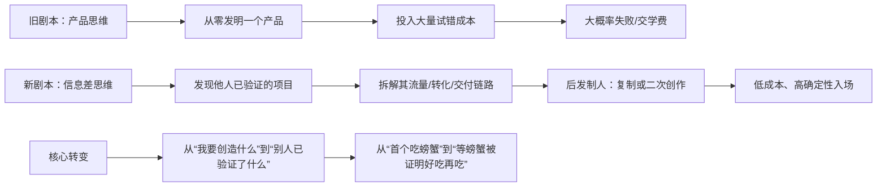
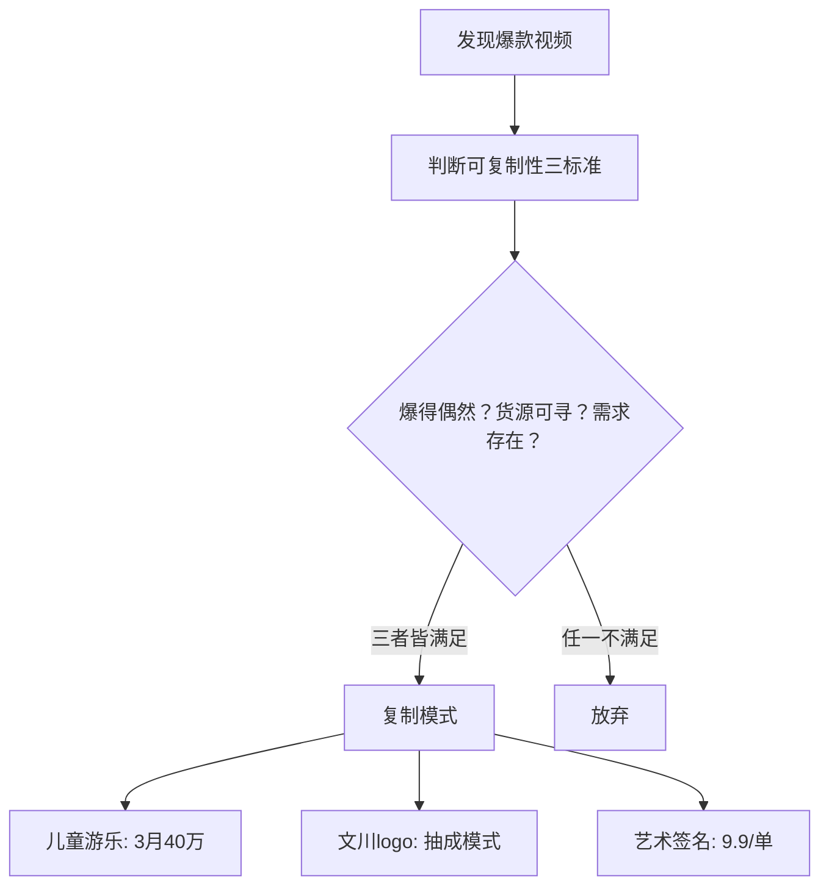
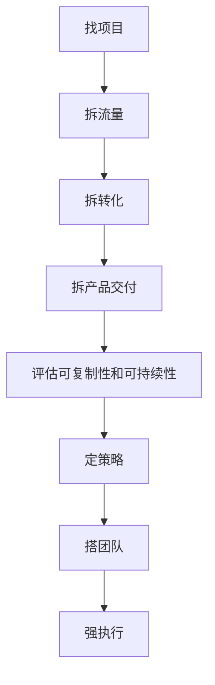
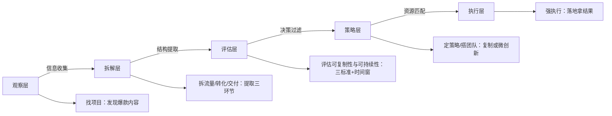
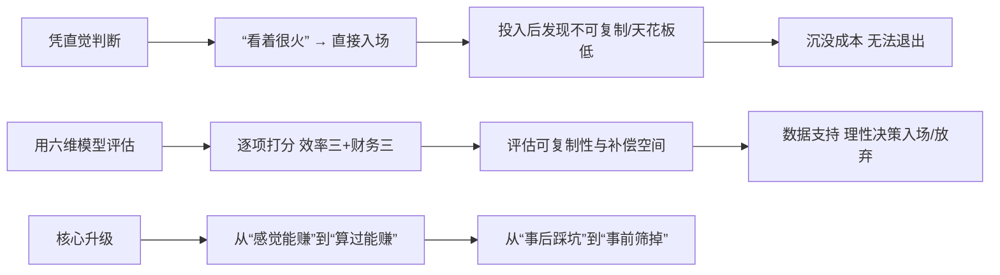
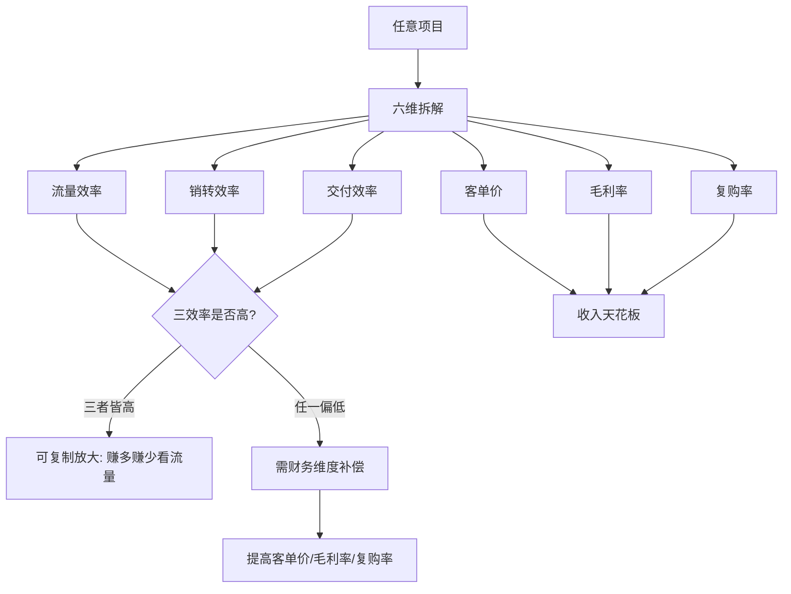
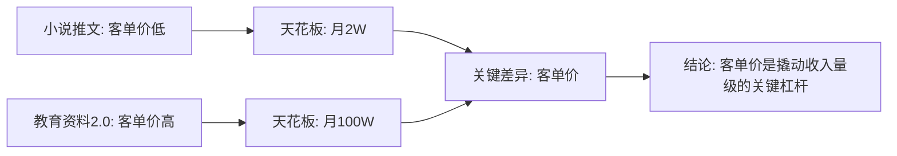
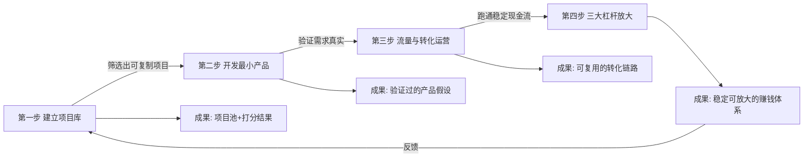
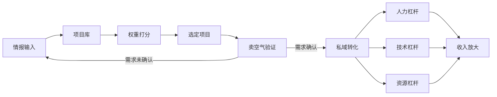

# 第 6 章 副业变现的底层逻辑 —— 从“看到”到“复制变现”
作者：龙哥

## 学习目标

- 理解副业成功的核心不是“做产品”而是“发现并复制已验证的赚钱模式”。
- 掌握“后发制人”的思维，能识别并判断一个项目是否已具备复制条件。
- 熟练应用商业项目拆解方法，将一个赚钱案例拆解为流量、转化、交付的底层链路。
- 学会使用六维评估模型为项目打分，判断其可复制性与收入天花板。
- 能对比不同项目（如小说推文 vs 教育资料）的六维画像，理解客单价对项目量级的杠杆作用。
- 建立从项目库到产品、运营、放大的整体认知框架，知道自己在哪一步、下一步做什么。

## 6.1 生活类比

想象副业探索是**一个当“课代表”抄作业**的过程。你不需要自己从零发明一套解题方法，而是要找到那个连续考了三次满分的学霸——他的笔记里藏着已经被验证有效的“标准答案”。在这个类比中：

- **信息差思维**，就是你比其他人更早意识到隔壁学霸的“提分笔记”远比你自己埋头苦读更有效——你知道一条别人不知道的提分路径。
- **后发制人**，则要求你克制住第一个冲上讲台自创公式的冲动，而是耐心等待学霸连续考了三次满分之后，再借他的笔记来学——用他人的成功验证为自己的入场信号。
- **商业项目拆解**，就是把学霸的笔记本拆成“公式集、错题本、做题顺序”三部分，然后你也照着做——分别对应着流量、转化、交付三个可复制的零件。
- **六维评估模型**，就相当于你在拿到一份新“答案”时，先认真算一笔账——花费多少时间、能提多少分、自己能不能坚持——再决定要不要照抄。
- **客单价杠杆**，它就像是你抄完“基础题解法”（赚小分）之后，发现必须再加上“压轴大题解法”（贵价课），总分才能冲上100万——同样的努力，因为选择了解法价值更高的内容，最终量级完全不同。

就像课代表不会自己从零创一套理论，聪明的副业者也会先去看别人已经验证有效的模式，再拆解、评估并复制它。这不仅是省力的路径，更是普通人对抗“没有试错资本”这一先天劣势的唯一理性选择。在后面的每一节中，我们都会回到这个“抄作业”的类比上——你会发现，后发制人、项目拆解、六维评估、客单价杠杆，本质上就是一套成熟课代表的完整方法论。

## 6.2 概念地图

本章的知识地图可以用下面这棵“树”来呈现：

```mermaid
graph TD
    A[第6章 副业变现的底层逻辑：从“看到”到“复制变现”] --> B[思维转变：从“产品思维”到“信息差思维”]
    B --> B1[信息差思维：知道别人不知道的路径就是商业价值]
    B --> B2[后发制人：等别人验证成功后再复制，而非盲目首创]
    B --> B3[核心主张：副业的核心不是做产品，而是发现并复制已验证的赚钱模式]
    
    A --> C[核心方法：商业项目拆解]
    C --> C1[定义：从爆款内容中拆出流量、转化、交付三环节]
    C --> C2[操作：商业拆解八步法]
    C --> C3[可复制性三标准：爆得是否偶然、货源是否可寻、场景是否验证有需求]
    C --> C4[前端策略：复述问题建立信任（内容策略）]
    
    A --> D[评估工具：六维评估模型]
    D --> D1[效率维度：流量效率、销转效率、交付效率 → 决定可复制性]
    D --> D2[财务维度：客单价、毛利率、复购率 → 决定收入天花板与补偿策略]
    D --> D3[评估标准：满足越多越好，满足四个点及格]
    
    A --> E[实战对比：案例应用六维模型]
    E --> E1[小说推文：六维全高但客单价低、无复购 → 天花板低（月1000~2W）]
    E --> E2[教育资料1.0：“三高一低”低客单、高毛利、无复购（月1000~2W）]
    E --> E3[教育资料2.0：多一步高客单价合作转化 → 跃迁（月2W~100W）]
    E --> E4[核心结论：客单价是撬动收入量级的关键杠杆之一]
    
    A --> F[整体框架：本书四部曲预览]
    F --> F1[建立项目库（选赛道）：喂养算法+情报挖掘+权重打分]
    F --> F2[开发最小产品：卖空气/软文先行（低成本验证）]
    F --> F3[流量与转化运营：私域前端流量+转化链路]
    F --> F4[三大杠杆放大：人力杠杆、技术杠杆、资源杠杆]
```



这张图告诉我们在本章中即将经历的旅程：从一个“产品思维”的旧剧本，切换到“信息差思维”的新剧本；再用商业项目拆解作为核心工具，把抽象的“赚钱”拆成可操作的零件；接着用六维评估模型给项目打分，判断值不值得复制；最后通过案例对比理解客单价的杠杆效应，并用本书四部曲的整体框架把前面所有工具串联起来。

## 6.3 从“产品思维”到“信息差思维” —— 用后发制人改写创业剧本

### 为什么需要这个概念？

多数副业失败者习惯于从零发明一个产品。但请你扪心自问：作为一个没有试错资本的普通人，你有多少次“灵光一现”最后变成了“交学费”？盲目创新在副业领域本质是赌博——你不知道需求是否真实存在，不知道玩法是否可行，甚至不知道市场是否已经饱和。真正的副业机会，其实隐藏在他人的成功里，等待被发现、拆解和复制。正如素材中反复强调的：

> “找到一个别人做过的事情，做了并且稳定有赚钱的项目。确定好赛道，给他们更匹配一点的调整就可以赚到钱。”
> ——（来源：《I9OAdzzs2oBliNxsmPjcHnBUnzf.md》）

这段话的价值在于：它把“副业成功”从“玄学”变成了“工程问题”——你不需要发明，只需要发现、拆解、复制。

### 核心定义：信息差思维与后发制人

我们用两个公式来定义本章最核心的两个概念。第一个是信息差思维，它展示的是副业赚钱的本质：

$$
\text{信息差价值} = \text{你知道的路径} - \text{别人知道的路径}
$$

为什么“减法”能代表商业价值？因为商业中的套利空间本质上来源于信息不对称：当你知道一条别人不知道的赚钱路径时，你就拥有了别人不具备的竞争优势，这个优势本身就可以变现——你可以通过搬运内容、复制模式、或者提供信息中介服务来获取收益。“你知道的路径”指的是你掌握的一条已验证的赚钱方法或渠道，“别人知道的路径”指的是大多数普通人认知范围内的常规做法。当你知道一条别人不知道的赚钱路径时，这个差值就是你的商业价值所在。换句话说，副业赚钱的本质不是“做产品”，而是“知道别人不知道的路径”。

第二个是后发制人，它展示的是入场时机的选择逻辑：

$$
\text{后发制人} = \text{等待他人验证成功} \rightarrow \text{复制或二次创作}
$$

这个公式的作用在于指导实际操作中的入场时机判断。它告诉我们：入场决策不应该基于自己的“灵光一现”，而应该基于外部信号——当且仅当“他人验证成功”这一信号出现时，才启动复制或二次创作。为什么“验证成功”必须是必要条件？因为时间维度上的可行性信号极其宝贵：一个项目能连续运营数月并持续盈利，本身就证明了需求真实、链路可行、市场接受——这些信息是你在入场前无法通过任何市场调研低成本获得的。换句话说，“验证成功”是在替你做最昂贵的试错。这个公式展示了后发制人的操作时序：不是第一个入场，而是等别人跑通了、赚到钱了，再进场抄作业。这种策略之所以成立，是因为“验证成功”本身就提供了极强的可行性信号，大幅降低了你的试错成本。素材原文这样描述：

> “有一个词叫做后发制人。就是你去做别人做过的事情，将其进行复制或者二次创作。我一定是看别人已经做成了，已经做了好几个月了，我才会选择做这个项目做这个赛道。”
> ——（来源：《I9OAdzzs2oBliNxsmPjcHnBUnzf.md》）

### 关键性质

后发制人策略有三个关键性质，我们逐一拆解。第一是可复制性，它要求项目必须能被拆解为可迁移的流量、转化、交付环节——如果拆完之后发现“这活儿只有他能干”，那它就不具备复制价值。第二是低风险性，它建立在他人已验证的基础上，你不需要投入几十万去试错——素材原文明确提到：“很多时候有些项目是完全可以复制的，是不需要投入几十万也可以复制的”（来源：《I9OAdzzs2oBliNxsmPjcHnBUnzf.md》）。第三是持续性，它要求同行已连续运营3个月以上，说明项目具有真实盈利能力——素材中“后发制人”的原文是：“我一定是看别人已经做成了，已经做了好几个月了，我才会选择做这个项目做这个赛道”（来源：《I9OAdzzs2oBliNxsmPjcHnBUnzf.md》）。这三个性质共同构成了判断“能不能复制”的底层约束。

### 典型例子：从拆解到变现的三条路径

我们来看三个具体的例子，它们共同展示了“看到-拆解-复制”的完整路径。第一个例子是儿童游乐项目。作者通过拆解一条商场儿童游乐爆款视频，发现其8.4w赞、1.1w转发、3000条评论背后隐藏着大量加盟咨询需求。组建3人团队后，三个月招了40多个加盟商、变现40万，完全复用了他人验证过的模式（来源：《I9OAdzzs2oBliNxsmPjcHnBUnzf.md》）。第二个例子是文川手写logo账号。作者拆解该账号后发现：评论区有大量“怎么找你设计logo”的客资，生产模式是固定内容供给，转化交付可外包给大学生设计师。最终以599元单价的模式，中间赚取差价，全链路复用了他人的验证（来源：《I9OAdzzs2oBliNxsmPjcHnBUnzf.md》）。第三个例子是艺术签名账号。持续发内容引发大量咨询，引流私域后以9.9元/个收费，用免费素材网站完成交付，日成交几十个客户。这个案例成本极低、落地极快，完全符合“可复制”的标准（来源：《I9OAdzzs2oBliNxsmPjcHnBUnzf.md》）。这三个例子共同说明：后发制人的本质不是偷懒，而是把别人的验证结果当作自己的起点。

### 方法演进：从“产品思维”到“后发制人”

为了让你更清晰地看到这种思维转变是如何发生的，下面的演进图展示了从旧剧本到新剧本的完整路径。你不是要“发明”，而是要“发现-验证-复制”——这是两种截然不同的创业心态。



### 边界条件

后发制人并非万能，它有两个明确的边界条件。第一个边界是复制的前提是“别人已经做成了”——若项目无人验证或验证失败，则不可盲目复制，这恰恰是后发制人与盲目抄袭的本质区别。第二个边界是必须找到可靠的货源或交付渠道——素材中的判断标准是：“他货源不是他自己的，也就是说我可以通过别的方式找到他的货源”（来源：《I9OAdzzs2oBliNxsmPjcHnBUnzf.md》）。如果货源不可寻，复制只是纸上谈兵。这两个边界条件实际上就是后发制人策略的安全护栏——它告诉你哪些“作业”可以抄，哪些“作业”抄了也没用。



## 6.4 商业项目拆解 —— 把“赚钱的别人”拆成“可复制的零件”

### 为什么需要这个概念？

看到别人赚钱容易，但普通人无法直接抄袭表面，因为不知道背后的链路。如果你只是照葫芦画瓢地模仿内容形式，却不知道它怎么引流、怎么转化、怎么交付，最后的结果就是“看着别人赚钱，自己一干就亏”。商业项目拆解提供了一套系统化方法，把抽象的赚钱项目转化为具体的、可操作的环节。素材是这样定义的：

> “拆下来之后，我就发现很多时候有些项目是完全可以复制的，是不需要投入几十万也可以复制的。复制了之后，用跟他一样的内容生产方式、转化链路，你也能拿到一定的结果。”
> ——（来源：《I9OAdzzs2oBliNxsmPjcHnBUnzf.md》）

这段话告诉我们：商业项目拆解的核心是把“赚钱的别人”拆成“可复制的零件”，让复制变成一条流水线作业。

### 核心定义：商业项目拆解

我们用以下公式来定义商业项目拆解的对象：

$$
\text{可复制项目} = \text{流量获取} + \text{转化链路} + \text{产品交付}
$$

在这个公式中，“流量获取”指的是项目通过什么方式吸引潜在客户（如固定内容分享、投放等），“转化链路”指的是从流量到成交的路径（如直播间直接成交、引流私域后社群转化等），“产品交付”指的是成交后交付的产品或服务形式（有形/无形、客单价多少）。这个公式之所以成立，是因为任何一个赚钱项目，无论表面看起来多么复杂，其底层都必然由这三个环节构成。当你能够从任意一个赚钱项目中抽出这三块，你就拥有了制造“同款”的能力。

### 商业拆解八步法

素材给出了一个被称为“八步法”的完整操作流程：

> **商业拆解八步法**（来源：《I9OAdzzs2oBliNxsmPjcHnBUnzf.md》）

```
1. 找项目：建立项目库，确定拆解对象
2. 拆流量：它是通过什么方式引流的？是固定内容分享还是投放？
3. 拆转化：是直播间直接成交，还是引流私域后社群/朋友圈转化？
4. 拆产品交付：有形还是无形？客单价多少？有没有同行做了半年以上？
5. 评估可复制性和可持续性：产品是否需大额投入？同行是否坚持3个月以上？
6. 定策略：你的产品、流量、转化三端口怎么做？复制或微创新？
7. 搭团队：产品端、流量端、转化端是否一人可扛，还是需两三人？
8. 强执行：没有强执行，前面所有一切都是自嗨。
```

这段伪代码展示了八步法的核心逻辑：它是一个从“看到”到“落地”的完整漏斗，每一步都在前面的基础上加一层筛子，最终只留下真正可复制、可持续的项目。其中第八步“强执行”被素材强调为最关键的一环——“如果你没有强执行，前面说的所有一切都是自嗨，没有用”（来源：《I9OAdzzs2oBliNxsmPjcHnBUnzf.md》）。值得注意的是，这套八步法出自《I9OAdzzs2oBliNxsmPjcHnBUnzf.md》，而在其他素材中也有与此互补的拆解思路——例如《NxhWdJj3UoPKvmxaBqkcz8wlntf.md》提供的六维评估模型，可以被看作是八步法中“评估可复制性和可持续性”这一步的量化工具。



### 方法演进：从观察到复制的流水线

八步法不仅仅是一个检查清单，更是一条“从观察到复制”的流水线。下面的演进图展示了每一步如何将前一步的“信息”转化为下一步的“决策”，最终实现从“看到他人赚钱”到“自己落地变现”的完整转化。



### 关键性质：可复制性三标准

商业项目拆解有三个关键性质。第一是系统性——按固定步骤（八步法）逐层拆解，不漏环节，确保每个维度都被覆盖。第二是可迁移性——拆出的零件（流量方式、转化方式）可应用到其他项目，素材中说“用跟他一样的内容生产方式、转化链路”，意味着零件是通用的（来源：《I9OAdzzs2oBliNxsmPjcHnBUnzf.md》）。第三是前端杠杆性——通过内容端的“复述问题”建立信任，是流量获取的敲门砖。素材中有一个很生动的例子：

> “举例：就拿看病举例子，医生会问你：‘有没有这个症状？有没有那个症状？’结果你发现：‘都是我现在的症状’，所以你认为这个医生懂你的病，这次找对了！所以，这就是一种内容策略，用复述问题建立信任基础！”
> ——（来源：《DNGrdODFBowfk2xwkNCc5GGSnRd.md》）

### 典型例子：艺术签名项目的完整拆解

我们用一个最轻量的例子来演示拆解的过程。下面的表格将展示艺术签名项目在流量、转化、交付、客单价、可复制性五个维度上的拆解结果，你可以看到这个项目为何被认为“低成本、可复制、快速起量”。

| 拆解维度 | 艺术签名项目 |
|---------|------------|
| 流量 | 持续发签名设计内容，小红书爆概率较大 |
| 转化 | 评论区咨询 → 私信 → 加微信 → 9.9元/个 |
| 交付 | 用免费素材网站完成，对用户收费 |
| 客单价 | 9.9元，日成交几十个 |
| 可复制性 | 货源（设计网站）可寻，场景（个性化签名）有验证需求 |

（来源：《I9OAdzzs2oBliNxsmPjcHnBUnzf.md》）

### 边界条件

商业项目拆解有两个边界条件。第一个边界是拆解要求判断可复制性三标准：爆得是否偶然、货源是否可寻、消费场景是否验证有需求。素材原文说：“首先，这个视频爆得偶然；其次，他货源不是他自己的；最后，这个消费场景经过验证是证明是有需求的，而且需求量还不小”（来源：《I9OAdzzs2oBliNxsmPjcHnBUnzf.md》）。第二个边界是拆解前需确认同行已坚持3个月以上，否则可能拆到伪需求。三个月是一个“可验证”的时间窗——能撑过三个月的项目，大概率实现了正向现金流。

## 6.5 六维评估模型 —— 给项目算一笔“复制账”

### 为什么需要这个概念？

面对五花八门的项目，仅凭直觉判断“能不能做”极易踩坑。你可能被一个“看着很火”的项目吸引，投进去之后才发现它根本没法复制、天花板也低得可怜。你需要一套统一的量化标尺，把“感觉”变成“数据”，在项目选择阶段就筛掉不可复制的低天花板项目。素材提出了一个关键的底层逻辑：

> “任何项目都可以拆解成：「流量效率，销转效率，交付效率，客单价，毛利率，复购率」，这六个点。六个点，满足的越多越好，满足四个点，及格。”
> ——（来源：《NxhWdJj3UoPKvmxaBqkcz8wlntf.md》）

### 核心定义：六维评估模型

我们用以下公式来定义六维评估模型的内部逻辑：

$$
\text{项目可复制性} = f(\text{流量效率}, \text{销转效率}, \text{交付效率})
$$

$$
\text{收入天花板} = f(\text{客单价}, \text{毛利率}, \text{复购率})
$$

这两个公式展示了六维模型的内在分工。第一个公式的逻辑在于：流量效率决定了你能否以低成本持续获取新客户，销转效率决定了你能否把流量高效地转化为成交，交付效率决定了你能否在不被交付拖垮的前提下承接大量订单——三者共同决定了一个项目能否被复制放大（“工程上可不可行”）。第二个公式的逻辑在于：客单价决定了单次成交的金额上限，毛利率决定了你能从每单中保留多少利润，复购率决定了你是否能形成持续收入——三者共同决定了项目的收入天花板与补偿策略（“经济上值不值得”）。当你评估一个项目时，实际上是在同时回答这两个问题。

### 效率维度与财务维度的量化标准

为了把抽象的六个维度变成可操作的刻度，我们用下面这张表格来呈现每个维度的高/低判定标准，并标注其出处。

| 维度 | 所属分类 | 量化指标 | 高/低判定标准 |
|------|---------|---------|--------------|
| 流量效率 | 效率维度 | 时间、素材、流量 | 花的时间少、素材难度低、获得流量大即为高 |
| 销转效率 | 效率维度 | 专业度（能否SOP化） | 专业度要求低（能SOP）、能一对多即为高 |
| 交付效率 | 效率维度 | 时间、人力 | 花的时间少（人力少）即为高；资料/课程支付即交付最高 |
| 客单价 | 财务维度 | 单次成交金额 | 上百/上千元为高，十几元为低 |
| 毛利率 | 财务维度 | (售价-成本)/售价 | 50%以上为高，10%左右为低 |
| 复购率 | 财务维度 | 重复购买行为 | 减肥/教育等重复需求为高，一次性消费为低 |

（来源：《NxhWdJj3UoPKvmxaBqkcz8wlntf.md》）

### 补偿策略：效率不足时用财务补

六维模型最实用的地方在于它的“补偿逻辑”。素材明确指出：

> “如果流量效率，销转效率，交付效率，这三块有一块低的话，就很难复制放大，那就得在客单价，毛利率，复购率这三块下功夫，比如通过提高客单价来增加收入。”
> ——（来源：《NxhWdJj3UoPKvmxaBqkcz8wlntf.md》）

我们可以用收入公式来解释这个补偿策略的数学基础：

$$
\text{收入} = \text{流量} \times \text{转化率} \times \text{客单价} \times \text{复购次数}
$$

这个公式的意义在于：当流量效率低（流量少）时，你仍然可以通过提高客单价或提高复购次数来维持收入水平。这不是“歪门邪道”，而是商业结构上的合理调整。换句话说，六维模型不是要求你每个维度都满分，而是告诉你在哪些维度上可以“将功补过”。

### 方法演进：从“感觉”到“量化”的决策升级

六维评估模型本质上是一次决策方式的升级——它把“我觉得能做”变成“数据显示能做”。下面的演进图展示了这种从直觉到量化的转变路径。





### 典型例子：不同项目的六维画像

下面这张表汇总了素材中拆解的五个项目的六维画像，它可以帮助你快速看到不同项目之间的结构差异。

| 项目 | 流量效率 | 销转效率 | 交付效率 | 客单价 | 毛利率 | 复购率 | 月收益 |
|------|---------|---------|---------|--------|--------|--------|--------|
| 小说推文 | 高 | 高 | 高 | 低 | 高 | 低 | 1000~2W |
| 教育资料1.0 | 高 | 高 | 高 | 低 | 高 | 低 | 1000~2W |
| 教育资料2.0 | 高 | 高 | 高 | 高 | 低 | 低 | 2W~100W |
| 减肥食谱 | 高 | 高 | 低~高 | 低~高 | 高 | 高 | 10W~200W |
| 知识付费 | 高 | 高 | 高 | 高 | 100% | 低 | 10W~500W |

（数据来源：《NxhWdJj3UoPKvmxaBqkcz8wlntf.md》）

从这张表中你可以直观地看到：同样是“三高一低”的结构，小说推文因为客单价只有十几元，月收益天花板就是2W；而教育资料2.0通过把客单价拉到几千到十几万，月收益天花板直接跃迁到100W。这就是客单价杠杆的直观体现。

### 边界条件

六维评估模型有两个边界条件。第一个边界是模型适用于评估可复制性，但财务维度无法弥补“需求不存在”的致命缺陷——如果一个项目六维都高但需求是虚假的，那它只是一个空中楼阁。第二个边界是若三效率中有一项低到无法操作，则该项目不宜复制——比如“流量效率低”到每天都产不出一个有效流量，那么即使客单价再高也无法形成稳定收入的闭环。

## 6.6 案例对比：小说推文与教育资料 —— 为什么一个天花板低，一个能到百万

### 为什么需要这个概念？

理论模型需要落到具体案例才能被真正理解。六维模型虽然清晰，但如果不看它在真实项目上的“计算过程”，你很难内化成自己的判断力。通过对比小说推文与教育资料这两个典型项目，你能直观看到客单价如何撬动收入天花板。

### 核心对比：小说推文 vs 教育资料 2.0

下面这张对比表将两个项目的六维画像并列呈现，你可以看到它们之间的核心差异（数据来源：《NxhWdJj3UoPKvmxaBqkcz8wlntf.md》）。

| 六维维度 | 小说推文 | 教育资料2.0 |
|---------|---------|------------|
| 流量效率 | 高（素材获取简单、框架固定自带流量） | 高（同上） |
| 销转效率 | 高（搜索暗号、充值会员即有佣金） | 高（转私域、商城转化、卖流量） |
| 交付效率 | 高（无需交付） | 高（资料即交付） |
| 客单价 | 低（十几二十块） | 高（几千到十几二十万） |
| 毛利率 | 高（50%以上） | 低（10%） |
| 复购率 | 低（没有复购） | 低（基本没有复购） |
| 月收益 | 1000~2W | 2W~100W |

（来源：《NxhWdJj3UoPKvmxaBqkcz8wlntf.md》）

### 关键差异：客单价的杠杆效应

对比上表，你会发现一个惊人的现象：这两个项目的效率维度几乎完全一样，都是“三高一低”，唯一的巨大差异是客单价。小说推文客单价十几元，教育资料2.0的客单价能达到几千到十几二十万——这个差异直接导致了收入量级从“千元级”跃迁到“百万级”。素材原文明确指出了这一点：

> “教育资料2.0项目：月收益2W~100W。（对比1.0，多了一步，高客单价转化合作）”
> ——（来源：《NxhWdJj3UoPKvmxaBqkcz8wlntf.md》）

“对比1.0，多了一步”——这一步就是提高客单价的合作转化。同样的流量、同样的转化、同样的交付，仅仅因为客单价提升了一百倍以上，收入天花板就拉升了两个数量级。

### 直觉理解：客单价为什么有这么大威力？

我们可以用收入公式来解释客单价的杠杆效应：

$$
\text{月收入} = \text{月客户数} \times \text{客单价} \times \text{复购次数}
$$

这个公式告诉我们：当流量效率和转化效率固定（即“月客户数”基本固定）时，收入完全由客单价和复购次数决定。客单价乘以10，收入就乘以10；客单价乘以100，收入就乘以100。举个示意性的例子来帮助理解：小说推文每天可能成交100单，每单15元，日收入1500元；教育资料2.0每天可能只成交1单，每单8万元，日收入就是8万元（注：这里的“每天成交1单8万元”仅为示意性计算，用于帮助理解客单价的杠杆效应，并非素材原文数据）。前者月入不到2万，后者月入可达数十万甚至更高。

### 边界的再审视：教育资料2.0为什么能把客单价抬上去？

你有没有想过一个问题：为什么小说推文不能像教育资料2.0那样，把客单价从十几块提到几万块？答案是：客单价的提升需要信任和场景的支撑。小说推文的用户是来找“爽文”的，心理预期就是十几块；而教育资料2.0的用户是考研、考公的高压人群，他们愿意为“上岸”的确定性支付几千甚至几万元。这不是同一个需求市场，你不能简单地把小说推文的流量导入教育资料的转化链路。这也解释了为什么素材中教育资料2.0的毛利率反而更低（10%）——因为高客单价的背后往往意味着更高的获客成本、更强的信任建设成本、更重的退换保障。客单价是一把双刃剑，它在抬高天花板的同时，也压缩了利润空间。

### 案例应用：用六维模型做项目决策

现在，让我们用六维模型来做一个“决策模拟”。假设你同时看到了小说推文和教育资料两个项目，你会如何选择？如果你更看重“快速起量、低门槛”，那么小说推文是更好的选择——它效率全高、启动成本极低，马上能见到现金流。如果你更看重“收入天花板、可持续”，那么教育资料2.0更有吸引力——虽然毛利率低，但客单价的高杠杆让它能支撑更高的收入量级。如果你两个都想要，可以考虑模型中的“补偿策略”：先用小说推文跑通流量、转化的SOP，再逐步向高客单价的品类延伸——这正是教育资料2.0的路径。



## 6.7 本书框架预览 —— 从项目库到产品、运营、放大四部曲

### 为什么需要这个概念？

零散的方法论容易让人“学完就忘”。你可能学会了六维模型、学会了拆解八步法，但如果不知道这些工具在整体路线图中的位置，到头来还是不知道今天该干什么。你需要一张整体路线图，把选赛道、做产品、搞运营、放大的逻辑串联起来，同时明确自己在哪个阶段、下一步该做什么。

### 核心定义：本书四部曲

素材实际上给我们画出了一张完整的路线图，从建立项目库到放大收入，可以归纳为四个阶段：

> **本书四部曲**（来源：《I9OAdzzs2oBliNxsmPjcHnBUnzf.md》《DNGrdODFBowfk2xwkNCc5GGSnRd.md》）

```
第一部：建立项目库（选赛道）
  -> 喂养算法获取情报
  -> 搜索/泛读拓宽信息源
  -> 八步法拆解项目
  -> 权重打分形成项目库

第二部：开发最小产品（卖空气/软文先行）
  -> 用最小成本验证需求
  -> 软文先行而非代码先行
  -> 卖空气/预售测试市场

第三部：流量与转化运营
  -> 解决前端流量（私域成败关键）
  -> 内容策略建立信任
  -> 转化链路设计

第四部：三大杠杆放大
  -> 人力杠杆（SOP+兼职）
  -> 技术杠杆（批量搬运/二次创作）
  -> 资源杠杆（资金/人脉）
```

这段伪代码展示了四部曲的递进逻辑：每一步都建立在前一步的成果之上，不可跳跃。你不能在还没有项目库的时候就去搞流量运营，那等于在没有靶子的情况下射箭。以第一部为例，素材建议“通过三个月的有意记录，就能积累几十个，形成1个项目库”，这说明项目库的建立是一个有意识的、持续的过程（来源：《I9OAdzzs2oBliNxsmPjcHnBUnzf.md》）。第二部的“卖空气”策略则强调“假装已经有了足够！卖空气！卖不出去就没必要继续做了！”——用最小成本验证需求（来源：《DNGrdODFBowfk2xwkNCc5GGSnRd.md》）。

### 方法演进：从“想法”到“体系”的四级跳

本书四部曲是一条完整的“从想法到体系”的演进路径，每一步都建立在前面成果之上，层层递进。下面的演进图展示了每一步如何将前一步的输出转化为下一步的输入，最终形成完整的赚钱飞轮。



### 四部曲内部的数据流

下面这张数据流图展示了四部曲之间如何衔接。



这个图展示了本书的闭环逻辑：情报→入库→筛选→验证→转化→放大，任何一环断裂都可能导致整个体系无法运转。尤其值得注意的箭头是“需求未确认→回到项目库”的回环——卖空气的验证失败不是终点，而是筛选机制的一部分。

### 关键性质

本书四部曲有三个关键性质。第一是递进性，每一步建立在前一步的成果之上，不可跳跃——没有经过验证的“卖空气”测试就贸然投入重金做产品，是本书反复警示的陷阱。第二是闭环性，从项目库到放大，最终形成可复制的赚钱体系——闭环的价值在于：一旦跑通，你可以持续在项目库中寻找新项目，走同样的流水线。第三是驱动性，前端流量是整套模式的起点和成败关键。素材明确主张：

> “私域只是一个渠道，是帮助我们企业更好地跟客户建立关系和发展粘性的一个渠道，其实更重要的是前端的流量，你有没有打开流量，每个月是否有稳定的流量进来。”
> ——（来源：《I9OAdzzs2oBliNxsmPjcHnBUnzf.md》）

### 边界条件

本书四部曲有两个边界条件。第一个边界是学习路径需因材施教：无资源者从低成本方法起步（喂养算法、卖空气验证、人力杠杆），有团队者可着重放大环节（技术杠杆、资源杠杆）。素材中说的“三大杠杆”里的“资源杠杆”就明确表示“不太适合我们大多数人，其实就是资金、人脉”（来源：《I9OAdzzs2oBliNxsmPjcHnBUnzf.md》）。第二个边界是四部曲适用于可持续、可复制的项目，纯投机型项目不适用——如果项目本身不具备可复制性（比如依赖特定人脉的线下业务），这套方法论的正循环就无法建立。

## 6.8 多源对照

本章的核心概念“商业项目拆解”与“六维评估模型”在多份素材中得到了不同角度的支撑。我们将共识与分歧分开梳理，并标注每一处观点的原始出处。

### 共识一：副业成功在于“复制而非发明”

《I9OAdzzs2oBliNxsmPjcHnBUnzf.md》与《NxhWdJj3UoPKvmxaBqkcz8wlntf.md》两份素材的共同核心主张是：副业的成功不在于从零发明产品，而在于发现并复制已验证的赚钱模式。《I9OAdzzs2oBliNxsmPjcHnBUnzf.md》使用“后发制人”这一概念，强调“等别人做成了再复制”；其原文写道：“拆下来之后，我就发现很多时候有些项目是完全可以复制的，是不需要投入几十万也可以复制的”（来源：《I9OAdzzs2oBliNxsmPjcHnBUnzf.md》）。《NxhWdJj3UoPKvmxaBqkcz8wlntf.md》则用“任何项目都可以拆解成六个点”来陈述这一观点，将“复制”的对象具体化为流量、销售、交付等可操作环节（来源：《NxhWdJj3UoPKvmxaBqkcz8wlntf.md》）。两份素材都将“等待验证 + 系统拆解 + 复制执行”作为副业成功的底层逻辑。

### 共识二：前端流量是私域成败的关键

《I9OAdzzs2oBliNxsmPjcHnBUnzf.md》提出了“私域痛点不在于私域怎么做，而是前端流量如何来”的命题，原文写道：“私域只是一个渠道……其实更重要的是前端的流量”（来源：《I9OAdzzs2oBliNxsmPjcHnBUnzf.md》）。《DNGrdODFBowfk2xwkNCc5GGSnRd.md》则从另一个角度佐证了这一点：它主张“软件的本质就是软文”，即产品最终需要靠内容（软文）来发掘前端流量（来源：《DNGrdODFBowfk2xwkNCc5GGSnRd.md》）。虽然一个讲私域、一个讲软件，但两者共同指向一个底层规律——没有前端流量，后端无论是产品还是转化都无从谈起。

### 共识三：最小成本验证需求的必要性

《DNGrdODFBowfk2xwkNCc5GGSnRd.md》提出了“卖空气”策略，原文写道：“或者直接做个模型，上架开卖，卖空气，卖预售。卖不出去就没必要继续做了！”（来源：《DNGrdODFBowfk2xwkNCc5GGSnRd.md》）。《I9OAdzzs2oBliNxsmPjcHnBUnzf.md》虽然没有使用“卖空气”这个词，但其“项目库→权重打分→选定项目”的流程同样强调在投入重金之前先用低成本方式验证项目的可行性（来源：《I9OAdzzs2oBliNxsmPjcHnBUnzf.md》）。两份素材的共识是：在全面投入之前，必须用一个最小成本的产品形态完成对需求的验证。

### 分歧一：对“非规范性生产”的态度

虽然在“复制已验证的模式”上达成共识，但在“复制到什么程度”上，两份素材存在分歧。《I9OAdzzs2oBliNxsmPjcHnBUnzf.md》强调“系统化复制”，主张用八步法逐层拆解、搭团队、做项目管理，整体路径是“稳定落地”和“放大”。而《DNGrdODFBowfk2xwkNCc5GGSnRd.md》则更强调“野路子”，主张“非规范化生产”、用“中文编程工具”快速捏出模型，核心是“降低成本、提升效率”而非“系统化管理”（来源：《DNGrdODFBowfk2xwkNCc5GGSnRd.md》）。前者偏向“正规军的体系化复制”，后者偏向“游击队的速度至上”。对你的启示是：早期验证阶段可以像《DNGrdODFBowfk2xwkNCc5GGSnRd.md》那样用最快速度跑通，而一旦验证成立则需切换到《I9OAdzzs2oBliNxsmPjcHnBUnzf.md》的体系化复制上来放大。

### 分歧二：客单价与流量矩阵，哪个才是天花板的关键？

两份素材对“收入天花板的核心变量”有不同侧重。《NxhWdJj3UoPKvmxaBqkcz8wlntf.md》通过教育资料1.0到2.0的案例，强调客单价的提升是撬动收入量级跃迁的关键杠杆；其原文写道：“教育资料2.0项目：月收益2W~100W。（对比1.0，多了一步，高客单价转化合作）”（来源：《NxhWdJj3UoPKvmxaBqkcz8wlntf.md》）。而《I9OAdzzs2oBliNxsmPjcHnBUnzf.md》则通过“艺术签名”“抓娃娃”等低客单项目，强调流量矩阵（多账号、多平台分发）才是放大收入的主要路径。实际上两者并不矛盾——你的选择取决于项目所处阶段：早期用流量矩阵验证模式，成熟后提高客单价撬动天花板。《NxhWdJj3UoPKvmxaBqkcz8wlntf.md》的四条补偿策略恰好为这种“阶段切换”提供了理论依据。

## 6.9 设计中的取舍

在这一节中，我们用三组问答来讨论本章设计过程中的关键取舍。

**第一组问答：为什么不用“先发创新”而是“后发制人”？**

问：先发创新听起来更“酷”，为什么不采用它？

答：先发创新是为有试错资本的人准备的。作为没有资本兜底的副业探索者，“先发创新”意味着你一个人承担了需求验证的全部风险——如果市场不买账，你付出的时间、金钱、信心全部归零。而后发制人的实质是“让别人替你先交学费”：你等待他人验证成功后再复制，用别人的试错成本换取自己的低风险入场。这个trade-off的本质是：用“首创权”（可能的高收益但大概率归零）换取“高确定性”（稳定的中收益）。

**第二组问答：商业拆解为什么不看“表面的产品”而要看“链路”？**

问：为什么拆解一个项目时，不直接模仿它的表面产品形态？

答：表面产品很容易被模仿，但无法被复制——你抄了他的产品形式，却不知道他的流量从哪来、转化怎么做。拆解链路（流量→转化→交付）的价值在于：链路是可迁移的，而产品是不可迁移的。比如你拆解了一个“艺术签名”账号，你学到的不是怎么做签名，而是“发内容→私信→微信→低价成交→免费素材交付”这条可复用的流水线。这种设计的代价是：拆解需要投入分析时间，而模仿表面只需要5分钟——但前者的长期回报远高于后者。

**第三组问答：六维模型为什么用“满足四个点及格”而不是“全部满足”？**

问：为什么六维模型不要求六个维度全部满足才算及格？

答：如果要求六维全部满足才及格，那么绝大多数副业项目都会被排除在外（实际上六维全高的项目凤毛麟角）。设置“满足四个点及格”的宽容线，是为了让模型可操作：它告诉你，只要六个维度里有一两个短板，你仍然有机会通过补偿策略（提高客单价/毛利率/复购率）来维持项目的可行性。这个取舍的本质是：用“允许短板存在”换取“模型的实际落地率”。代价是你需要清楚识别哪些短板可以补偿、哪些短板则意味着项目不适于复制。

## 6.10 动手练习

### 练习一：手算一次六维模型

给定两个副业项目，请用六维评估模型分别给它们打分。项目A为小红书减肥食谱账号——内容素材简单、获客量大；网销按SOP发即可；交付只需发PDF食谱；客单价10元，毛利率80%，减肥是重复过程所以复购高。项目B为企业IP代运营服务——需要深度行业洞察、案例产出慢；需要一对一销售谈判；交付需专业团队陪跑；客单价5万元，毛利率70%，客户基本一次性合作。请回答：项目A和项目B分别有哪些维度“达标”？哪个项目的收入天花板更高？为什么？如果项目B的流量效率很低，它可以靠哪些维度来补偿？请给出具体的策略。

### 练习二：拆解一个你身边的赚钱案例

观察你身边（朋友圈、抖音、小红书、闲鱼等）一个你觉得“赚钱”的账号或项目，完成一次商业拆解。第一步找到项目并描述它做什么、赛道、渠道；第二步拆流量（通过什么方式引流、内容形式、是否有评论区咨询）；第三步拆转化（直接在平台成交还是引流私域、转化话术）；第四步拆交付（有形产品还是无形服务、客单价）；第五步用可复制性三标准评估（爆得偶然？货源可寻？场景有需求？）；第六步用六维模型打分并给出结论是否值得复制。

### 练习三：战略模拟：如何用“后发制人”避开红海竞争

假设你看到抖音上“艺术签名设计”的账号很火、评论区有大量咨询。问题A：在复制前你需要确认哪三个条件才能动手？（提示：可复制性三标准）问题B：如果抖音已经做烂了，你如何利用“渠道信息差”原理找到一个仍有红利的平台？请具体说明选择依据。问题C：你准备如何用“复述问题建立信任”这一内容策略写出一条引流笔记的开头？请实际写出来。

### 练习四：案例对比：为什么小说推文天花板低而教育资料2.0能到百万

请根据本素材，分别列出小说推文和教育资料2.0的六维画像（每个维度标注：高/中/低）。回答问题：两者的核心差异在哪个维度？为什么这个维度的提升能带来如此大的收入跃迁？如果要提升小说推文项目的天花板，你会优先调整哪个维度？请给出具体操作建议。

### 练习五：动手搭建一个自己的“项目情报库”

选择你感兴趣的副业方向，按照商业拆解八步法建立一份项目情报库。第一步用“喂养算法”的方法连续3天主动刷该领域的商业内容并点赞收藏，记录刷到的3个潜在项目；第二步对每个项目完成八步法中前四步（找项目、拆流量、拆转化、拆交付）；第三步对每个项目用六维模型打分并按“满足维度数量”排序；第四步反思你的情报来源是否足够多元，如何利用“搜索+泛读”拓宽信息源。

## 6.11 本章小结

这一章中我们学习了副业变现的底层逻辑——从“看到”到“复制变现”的完整思维框架。首先，我们确立了“信息差思维”与“后发制人”的核心认知：副业成功不在于做产品，而在于发现并复制已验证的赚钱模式。其次，我们掌握了“商业项目拆解”的方法论，理解了如何把一个赚钱案例拆解为流量、转化、交付三个可迁移的零件，并用八步法系统化落地。接着，我们引入了“六维评估模型”这一量化工具，通过效率维度（流量/销转/交付）判断可复制性、财务维度（客单价/毛利率/复购率）判断收入天花板与补偿策略。然后，我们通过小说推文与教育资料2.0的对比展示了“客单价杠杆”的威力——同样的效率维度，只因客单价提升百倍就带来收入量级的跃迁。最后，我们给出了本书四部曲的整体框架：建立项目库→开发最小产品→流量与转化运营→三大杠杆放大，明确了每一步在整体路线图中的位置。

本章我们一起学习了以下概念：

| 概念 | 解释 |
|------|------|
| 信息差思维 | 认识到“你知道而别人不知道的路径”本身就是商业价值，副业的核心是发现并复制已验证的赚钱模式 |
| 后发制人 | 等别人做成了、连续做好几个月验证可行后，再复制或二次创作，而非盲目首创 |
| 商业项目拆解 | 从爆款内容中拆出流量、转化、交付三环节，系统化复制一个赚钱项目 |
| 商业拆解八步法 | 找项目→拆流量→拆转化→拆交付→评估可复制/可持续→定策略→搭团队→强执行的系统化拆解方法 |
| 可复制性三标准 | 爆得是否偶然、货源是否可寻、消费场景是否验证有需求，三者满足即可低成本复制 |
| 六维评估模型 | 将项目拆解为流量效率、销转效率、交付效率、客单价、毛利率、复购率六个可量化维度 |
| 效率维度 | 流量/销转/交付三效率决定项目能否被复制放大的底层能力 |
| 财务维度 | 客单价/毛利率/复购率决定收入天花板，在效率受限时可作为补偿手段 |
| 客单价杠杆 | 大幅提升客单价可将项目的收入量级从月千元级跃迁到月百万级（如教育资料1.0→2.0） |
| 本书四部曲 | 建立项目库（选赛道）→ 开发最小产品（卖空气/软文先行）→ 流量与转化运营 → 三大杠杆放大 |
| 三大杠杆 | 人力杠杆（低成本的兼职SOP）、技术杠杆（软件批量搬运）、资源杠杆（资金与人脉）可用于放大收入 |

在这些概念中，“客单价杠杆”特别值得强调：它告诉我们，在流量效率和转化效率已经固定的情况下，提高客单价是撬动收入天花板最直接的杠杆。而“三大杠杆”则提醒我们，在项目跑通之后，不要满足于单打独斗的线性增长，而应该主动引入人力、技术和资源来放大收入。下一章中，我们将进入本书的第一个实操模块：“发现与筛选”——像猎人一样建立自己的“项目情报库”。你会学到如何通过“喂养算法”让平台成为你的商业雷达，如何利用搜索框的下拉词“读心”用户需求，以及如何用八步筛选法从项目库中挑出真正值得投入的那一个。


