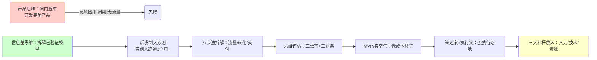
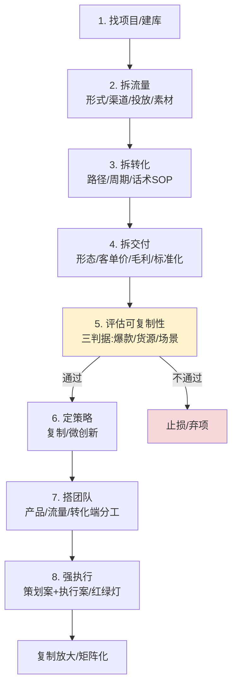
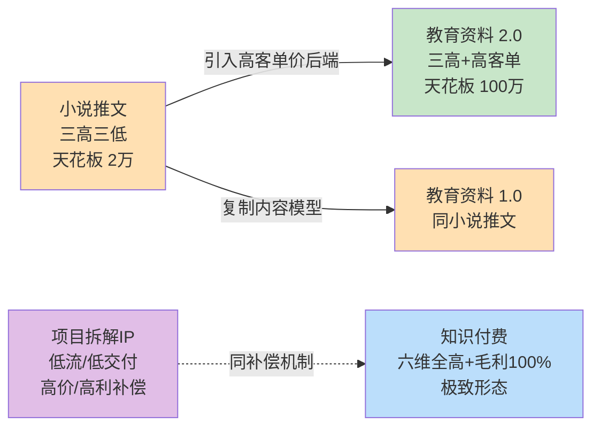

# 第 1 章 副业变现的底层逻辑 —— 从“看到”到“复制变现”
作者：龙哥

## 学习目标

- 理解副业失败的核心原因：陷入“产品思维”而非“信息差思维”
- 掌握商业项目拆解的八步法与可复制性三判据
- 熟练运用六维评估模型给项目“算账”：三效率决定可复制性，三财务决定天花板
- 能对标拆解真实案例（小说推文 vs 教育资料 2.0），识别关键变量（客单价/复购率）对收入的放大作用
- 建立全书“发现→验证→运营→放大”四部曲心智地图，明确各章节在闭环中的定位与依赖关系
- 树立“后发制人”复制心法：只做已验证、货源可寻、场景确定的项目，设定止损点规避沉没成本

## 1.1 生活类比：加盟店视角下的副业全景

想象做副业像“开一家加盟店”而非“发明新菜”。这个类比将贯穿全章，帮你把抽象的商业概念锚定到具象的经营动作中：产品思维等于自己在厨房闭门研发秘制酱料（高风险、长周期、无人买单）；信息差思维等于考察街对面排队店的“招牌菜、供应链、引流海报、外卖打包流程”，照抄核心、微调细节开自家分店（对应第 1.3 节范式转移）。商业项目拆解等于把对面店“拆成零件”：招牌怎么挂（拆流量）、菜单怎么排（拆转化）、食材找谁买（拆交付）、后厨怎么管（拆团队/执行），对应第 1.4 节八步法。六维模型等于加盟总部的“选址评估表”：人流量大不大（流量效率）、出餐快不快（交付效率）、加盟费多少（客单价）、回本快不快（毛利率）、老客回头率（复购率），对应第 1.5 节评估模型。卖空气/MVP 等于还没装修好就先在朋友圈发海报收定金，收不够就不开工（止损），对应第 1.3 节与第 3 章验证逻辑。三大杠杆等于雇兼职学徒（人力）、买自动炒菜机（技术）、谈食材团购价（资源），对应第 6 章放大策略。就像成熟加盟体系：先跑通单店模型（MVP），再标准化复制（矩阵/加盟），最后用杠杆放大规模。请在阅读后续小节时，随时回扣这个“加盟店”心智地图。

---

## 1.2 概念地图

副业变现底层逻辑
├── 核心范式转移：从“造产品”到“拆项目、算账、走流程”
│   ├── 产品思维 vs 信息差思维
│   ├── 后发制人原则（复制已验证模型）
│   └── 核心公式：收入 = 流量 × 转化 × 客单价 × 复购
├── 商业项目拆解（八步法）
│   ├── 找项目 → 建立项目库
│   ├── 拆流量（形式/渠道/投放/素材）
│   ├── 拆转化（路径/周期/话术SOP）
│   ├── 拆交付（形态/客单价/毛利/标准化）
│   ├── 评估可复制性（三判据：爆得偶然/货源可寻/场景验证）
│   ├── 定策略（复制/微创新）
│   ├── 搭团队（产品/流量/转化端分工）
│   └── 强执行（前提）
├── 六维评估模型（标尺）
│   ├── 效率维度（决定可复制性）
│   │   ├── 流量效率：时间少、素材易、流量大
│   │   ├── 销转效率：专业度低、能SOP、一对多
│   │   └── 交付效率：耗时少、人力少、支付即完成为最高
│   └── 财务维度（决定天花板/补偿机制）
│       ├── 客单价
│       ├── 毛利率
│       └── 复购率
├── 案例对比实战（变量隔离）
│   ├── 小说推文：三高三低 → 天花板 2万
│   ├── 教育资料 1.0：同小说推文
│   ├── 教育资料 2.0：引入高客单价合作 → 天花板 100万
│   ├── 项目拆解 IP：低流/低交付 + 高价/高利 → 月入 10-200万
│   └── 知识付费（李一舟）：六维全高 + 毛利 100% → 月入 10-500万
└── 全书框架四部曲
    ├── 第一部：建立项目库（Ch.2 发现与筛选）
    ├── 第二部：开发最小产品（Ch.3 产品孵化：卖空气/软文先行/MVP）
    ├── 第三部：流量与转化运营（Ch.4 流量收割、Ch.5 交付管理）
    └── 第四部：三大杠杆放大（Ch.6 放大：人力/技术/资源杠杆）

---

## 1.3 副业核心范式转移 —— 从“造产品”到“拆项目、算账、走流程”

### 为什么需要这个概念？

绝大多数副业失败，是因为陷入“产品思维”：闭门造车开发产品，却无流量、无转化、无交付闭环。成功的副业本质是“信息差思维”：发现已验证的商业模式，拆解其流量、转化、交付链路，低成本复制放大。普通人缺乏资源与容错率，需用“后发制人”策略，避开“从0到1”的创新风险，走“从1到N”的复制之路。

> "私域只是一个渠道，是帮助我们企业更好地跟客户建立关系和发展粘性的一个渠道，其实更重要的是前端的流量，你有没有打开流量，每个月是否有稳定的流量进来。"
> 
> ——《I9OAdzzs2oBliNxsmPjcHnBUnzf.md》

> "有一个词叫做后发制人。就是你去做别人做过的事情，将其进行复制或者二次创作。"
> 
> ——《I9OAdzzs2oBliNxsmPjcHnBUnzf.md>

这段话直击痛点：我们习惯盯着“产品”看，却忽略了“流量”才是生意的命门。秦汉唐在素材中反复强调，私域只是渠道，前端流量才是核心。没有稳定流量进来，转化链路再完美、交付团队再专业，都是空中楼阁。

> "软件的本质就是软文。软件开发出来，怎么推广？还是通过写文章，发广告，介绍你这个软件，软件的最终的展现方式还是软文"
> 
> ——《DNGrdODFBowfk2xwkNCc5GGSnRd.md》

作者将“软件的本质就是软文”这一反直觉认知推向极致：既然最终靠软文推广，为何不先写软文、测需求、收预售，再决定要不要开发？这就是“卖空气”思维的内核——用最低成本验证商业模型，而非打磨产品。

### 核心定义

**副业变现的底层逻辑**（来源：《I9OAdzzs2oBliNxsmPjcHnBUnzf.md》、《NxhWdJj3UoPKvmxaBqkcz8wlntf.md》、《DNGrdODFBowfk2xwkNCc5GGSnRd.md》）

选赛道（基本盘）→ 定渠道（流量源）→ 搭转化（成交链路）→ 定交付（产品形态）→ 算六维账（评估可复制性）→ 定策划案/执行案（落地）→ 加杠杆（放大）

#### 核心公式的逐步推导与业务含义

我们先从单次交易收入出发：

$$ \text{单次收入} = \text{流量} \times \text{首单转化率} \times \text{客单价} $$

但生意不是一次性买卖。用户若满意，会重复购买，引入复购率（指用户在生命周期内的平均重复购买次数，或按周期折算的复购系数），得到生命周期价值（LTV）视角的公式：

$$ \text{收入} = \text{流量} \times \underbrace{\text{首单转化率}}_{\text{获客效率}} \times \underbrace{\text{客单价}}_{\text{单价杠杆}} \times \underbrace{\text{复购率}}_{\text{留存杠杆}} $$

为何将“转化”拆为“首单转化率”与“复购率”两个独立变量？首单转化率反映“陌生流量→首单成交”的销售 SOP 能力，属于销转效率范畴（能否一对多、低专业度复制）。复购率反映“产品体验→再次付费”的交付价值与用户粘性，属于财务补偿范畴（不增加获客成本的前提下放大收入）。两者驱动因素、优化手段、团队分工完全不同，合并为单一“转化率”会模糊决策重心。

该公式如何指导“拆项目、算账”的具体决策？第一，反推所需流量：目标月入 5 万，客单价 200 元，首单转化 5%，复购 1.5 倍 → 需流量 = 50000 ÷ (200 × 5% × 1.5) ≈ 3333 人。若流量获取成本过高，说明模型跑不通，需调整客单价或转化路径。第二，识别短板变量：用六维模型（第 1.5 节）对标同行，发现“流量效率高、销转效率高、交付效率高、客单价低、复购低”（如小说推文），即知短板在财务维度，优化方向是引入高客单价后端（教育资料 2.0 模式）或提升复购（订阅制/耗材）。第三，资源分配优先级：三效率（流量/销转/交付）决定“能不能复制放大”，优先保证三效率达标；三财务（客单价/毛利/复购）决定“天花板在哪”，在效率受限时用财务杠杆补偿。

### 范式转移演进图



### 核心定义（续）

**核心公式**（来源：《NxhWdJj3UoPKvmxaBqkcz8wlntf.md》）

$$
\text{收入} = \text{流量} \times \text{转化率} \times \text{客单价} \times \text{复购率}
$$

这个公式展示了商业变现的四个核心杠杆。六维模型将其进一步拆解为三效率（流量/销转/交付）与三财务（客单价/毛利/复购），前三者决定能不能复制放大，后三者决定能赚多少、天花板在哪里。

**后发制人原则**（来源：《I9OAdzzs2oBliNxsmPjcHnBUnzf.md》）

> "我一定是看别人已经做成了，已经做了好几个月了，我才会选择做这个项目做这个赛道。"

这个原则展示了普通人副业的生存法则：不做从0到1的创新，只做从1到N的复制。等别人跑通模型、验证盈利、承担教育市场成本后，你再入场复制核心链路、微调细节，风险最低、收益最稳。

### 关键性质

副业变现的底层逻辑具有三个关键性质：可复制性，不依赖天赋与运气，依赖标准化流程（SOP）与已验证模型；低成本试错，通过“卖空气”/MVP预售验证需求，单项目投入可控制在低水平；组合拳打法，单一项目天花板低，需通过“1+1+1项目矩阵”或“矩阵化账号”实现收入放大。

### 典型例子

儿童游乐项目：拆解抖音爆款视频（8.4w赞、3000+评论咨询），3个月组建团队复制加盟模式，收入40万。文川手写Logo：拆解设计类账号评论区需求，外包大学生设计，中间赚差价，月入几万。抓娃娃卖娃娃+收徒：一年卖娃娃40万，收599元学费教技巧，合计年入百万，演示“二次变现”威力。

### 边界条件

仅适用于“货源非独家、消费场景已验证、爆款非偶然”的项目（商业拆解可复制性三判据）。核心前提是“前端流量已打通”：私域只是渠道，无前端流量一切归零。需具备基本的“喂养算法”与“搜索挖掘”情报获取能力，否则无源之水。本书不采纳 DNGrdODF 素材提出的“有效噱头、无效产品”（安慰剂效应）灰色打法，详见第 7 章“避坑与反思”；该观点虽在三份素材中独有且具争议性，但违背“交付真实价值”底线，实操中须规避。

---

## 1.4 商业项目拆解 —— 把“赚钱的别人”拆成“可复制的零件”

### 为什么需要这个概念？

看到别人赚钱不等于能复制，必须拆解出：流量从哪来？怎么转化？产品怎么交付？成本多少？才能判断“我能不能做”。避免“只模仿表面”：很多新手只学内容形式，不懂后端转化链路，导致有流量不变现、变现不交付。

### 核心定义

**商业项目拆解**（来源：《I9OAdzzs2oBliNxsmPjcHnBUnzf.md》、《DNGrdODFBowfk2xwkNCc5GGSnRd.md》）

对一个已验证盈利的项目，按“找项目→拆流量→拆转化→拆产品交付→评估可复制/可持续→定策略→搭团队→强执行”八步法进行结构化拆解。

**核心产出**：
- **策划案**：产品货盘、运营策略、目标、里程碑、止损点、放大点
- **执行案**：时间、地点、事项、责任人、阶段目标

> "策划案，包括你产品货盘是什么... 执行案是什么呢？某一年某一月的核心工作事项... 完成的时候要把它标绿，然后未完成或者延期的要把它标红。"
> 
> ——《I9OAdzzs2oBliNxsmPjcHnBUnzf.md》

### 八步法详解（来源：《I9OAdzzs2oBliNxsmPjcHnBUnzf.md》）

1. 找项目。建立项目库。
2. 拆流量。它是通过什么方式引流？是不是固定的内容分享方式去引流的？还是投放？市面上他们有没有其他的引流渠道？
3. 拆转化。它是通过什么转化？直接在直播间里面卖、还是引流到私域后通过社群转化？还是通过朋友圈+私聊？转化周期多久？
4. 拆产品交付。这个产品是有形的产品，还是无形的产品？是货物、还是课程，还是招商加盟的项目，客单价怎么样？好不好卖？有没有同行做了半年以上？
5. 评估可复制性和可持续性。比如说他这个产品你需要投入五万十万的，那这个事情短期内复制不了；同行没有坚持三个月以上，持续不了，如果他坚持三个月以上说明他挣到钱了，那就可持续。
6. 定策略。你自己定你的产品，你的流量，你的转化，这三个端口怎么做？是复制全部还是通过你的擅长点进行微创新。
7. 定完策略之后要搭团队。你要把这个事情分为几个点，比如产品端、流量端，转化端是否是一个人就够了，还是需要两三个人？
8. 强执行。最重要的就是最后一步，如果你没有强执行，前面说的所有一切都是自嗨，没有用。

这八步法展示了从“看到项目”到“落地执行”的完整闭环。前四步是拆解，后四步是重组与执行。第5步“评估可复制性”引入了三判据：

**可复制性三判据**（来源：《I9OAdzzs2oBliNxsmPjcHnBUnzf.md》）

> "首先，这个视频爆得偶然；其次，他货源不是他自己的，也就是说我可以通过别的方式找到他的货源；最后，这个消费场景经过验证是证明是有需求的，而且需求量还不小。"

| 判据 | 含义 | 检验方法 |
|------|------|----------|
| 爆得不偶然 | 爆款有固定内容框架、可复制素材来源 | 观察同账号是否多条爆款、素材是否可获取 |
| 货源可寻 | 供应链非独家、可替代、可获取 | 搜索同款/上游厂家、测试采样成本 |
| 场景验证 | 评论区有真实咨询、成交记录、复购证据 | 统计咨询转化率、复购周期、客单价分布 |

### 八步法流程图 / 数据流图



### 关键性质

拆流量：看引流内容形式（口播/图文/视频）、渠道（抖音/小红书/搜索）、是否投放、素材来源与生产难度。拆转化：看成交路径（直播间/私域社群/朋友圈/一对一）、转化周期、话术SOP化程度。拆交付：看产品形态（实物/虚拟/服务/加盟）、客单价、毛利率、交付耗时、是否可标准化。

### 典型例子

艺术签名账号：拆解发现小红书笔记爆发概率大，引流微信9.9元/单，免费素材网交付，日单几十，月入数千。飞纸牌切水果：爱好者发视频爆火→开线下教学班899元/人→10天速成，展示“技能变现”拆解路径。

### 边界条件

无法拆解“个人IP强绑定”的项目（如头部网红个人魅力驱动），因核心资产不可复制。同行坚持不足3个月的项目，大概率未验证盈利模型，不可入库。需投入5-10万以上资金/资源的项目，超出个人副业承受范围，需设止损点排除。

---

## 1.5 六维评估模型 —— 给项目算一笔“复制账”

### 为什么需要这个概念？

直觉判断项目靠不住：有的项目流量大但不赚钱，有的客单价高但交付累死人，需要一把“标尺”量化对比。决策“做还是不做”、“怎么放大”：三效率决定能否复制放大，三财务决定收入天花板，缺一项补一项。

### 核心定义

**六维指标体系**（来源：《NxhWdJj3UoPKvmxaBqkcz8wlntf.md》）

下表是项目评估的“加盟选址评估表”，请逐行对照你的目标项目打分：

| 维度 | 类别 | 核心指标 | 高标准定义 |
|------|------|----------|------------|
| **流量效率** | 效率 | 时间、素材难度、流量量级 | 时间少、素材易、流量大 |
| **销转效率** | 效率 | 专业度、SOP化、一对多 | 专业度低（能SOP）、能一对多 |
| **交付效率** | 效率 | 时间、人力 | 耗时少、人力少、支付即完成为最高 |
| **客单价** | 财务 | 单次交易金额 | 越高越好（配合转化率） |
| **毛利率** | 财务 | (收入-直接成本)/收入 | 越高越好 |
| **复购率** | 财务 | 用户重复购买比例 | 越高越好 |

> "我们以「时间，素材，流量」为指标。「花的时间少，素材难度低，获得流量大，即为流量效率高」"
> 
> "我们以「专业度」为指标。「专业度要求低（能SOP），能一对多，即为销转效率高，本质也是时间，销售的时间利用率」"
> 
> "我们以「时间」为指标。「花的时间少（人力少），即为交付效率高」"
> 
> ——《NxhWdJj3UoPKvmxaBqkcz8wlntf.md》

**及格线**（来源：《NxhWdJj3UoPKvmxaBqkcz8wlntf.md》）

> "「六个点，满足的越多越好，满足四个点，及格」"

**补偿机制**（来源：《NxhWdJj3UoPKvmxaBqkcz8wlntf.md》）

> "如果流量效率，销转效率，交付效率，这三块有一块低的话，就很难复制放大，那就得在客单价，毛利率，复购率这三块下功夫。"

这个定理展示了六维模型的核心决策逻辑：三效率全高 → 看流量定收入（如小说推文、知识付费）；任一效率低 → 必靠三财务补（如项目拆解IP、教育资料2.0）。

### 六维评估决策流图

```mermaid
flowchart TD
    Start[开始评估项目] --> E1{流量效率高?}
    E1 -->|否| E2{销转效率高?}
    E1 -->|是| E2
    E2 -->|否| E3{交付效率高?}
    E2 -->|是| E3
    E3 -->|否| Comp[至少一效率低\n→ 必须靠三财务补偿\n(高客单价/高毛利/高复购)]
    E3 -->|是| AllHigh[三效率全高\n→ 可复制放大\n收入=流量×客单价×复购]
    Comp --> Check[检查:客单价/毛利/复购\n满足几项?]
    AllHigh --> Check
    Check -->|满足≥4维| Pass[及格:可执行/放大]
    Check -->|满足<4维| Fail[不及格:设止损/弃项]
    style Comp fill:#fff3cd
    style AllHigh fill:#d4edda
    style Pass fill:#cce5ff
    style Fail fill:#f8d7da
```

### 关键性质

诊断功能：如“项目拆解IP”流量效率低、交付效率低，但靠高客单价(几千-六位数)+高毛利(70%+)补齐，月入10-200万。优化指南：小说推文三效率全高但客单价低/复购低→天花板2万；教育资料2.0引入高客单价合作→天花板升至100万。

### 典型例子

减肥食谱：三效率中高、复购率高(减肥是重复过程)→月入10-200万，展示“复购率”的杠杆作用。知识付费(李一舟)：六维全高、毛利率100%→月入10-500万，展示“零边际成本产品”的极致形态。注：该案例数据源自课程素材复盘（NxhWdJj3素材），非审计数据；该项目后续涉及合规争议，实操时须关注法律边界，详见第7章“避坑与反思”。

### 边界条件

仅适用于“标品/半标品”项目，强服务定制化项目（如高端咨询）交付效率天然低，需单独建模。数据来源须真实：流量、转化、客单价需实测或同行验证，不可拍脑袋估算。忽略“品牌资产”等长期隐性价值，仅评估显性财务与效率指标。

---

## 1.6 案例对比实战 —— 为什么小说推文天花板低，教育资料2.0能破百万

### 为什么需要这个概念？

理论模型必须经受案例检验：用六维模型逐项标注真实项目，展示“改一个维度（如客单价）如何改变项目命运”。建立“对标思维”：新手通过对比同类项目不同版本，理解“商业模式迭代”的必然路径。

### 核心定义

**六维标注法**：对单一项目，在六个维度上标注“高/中/低”或具体数值，并给出月收益区间，形成可视化画像。

**迭代对比法**：同一赛道不同版本（1.0 vs 2.0）横向对比，定位关键变量（通常是客单价或复购率）。

### 关键性质

变量隔离：小说推文 vs 教育资料1.0/2.0 同属“虚拟资料/内容变现”，仅客单价与转化链路不同，收入差10-50倍。补偿机制验证：项目拆解IP、知识付费均通过“高客单价+高毛利”补偿“低流量/低交付效率”，印证三财务补三效率。

### 真实案例六维标注表（来源：《NxhWdJj3UoPKvmxaBqkcz8wlntf.md》）

下表展示了同赛道不同版本的“变量隔离”效果，核心看点：仅改变客单价与转化链路，收入天花板跃升 50 倍。

| 项目 | 流量效率 | 销转效率 | 交付效率 | 客单价 | 毛利率 | 复购率 | 月收益区间 | 核心逻辑 |
|------|----------|----------|----------|--------|--------|--------|------------|----------|
| **小说推文** | 高 | 高 | 高 | 低(十几元) | 高(50%+) | 低 | 1k-2w | 靠量取胜，单价低难放大 |
| **教育资料 1.0** | 高 | 高 | 高 | 低(十几元) | 高(50-100%) | 低 | 1k-2w | 同小说推文模型 |
| **教育资料 2.0** | 高 | 高 | 高 | **高(千-百万)** | 中(10%) | 低 | **2w-100w** | **引入高客单合作，天花板升50倍** |
| **项目拆解IP** | 低 | 高 | 低 | **高(千-六位数)** | **高(70%+)** | 中高 | **10w-200w** | **高价补低效** |
| **知识付费(李一舟)** | 高 | 高 | 高 | 高(几千) | **极高(100%)** | 低 | **10w-500w** | **零边际成本极致** |

> "小说推文项目：月收益1000~2W。流量效率高...客单价低：十几二十块...复购率低：没有复购"
> 
> "教育资料2.0项目：月收益2W~100W。（对比1.0，多了一步，高客单价转化合作）客单价低：几千到十几二十万不等"
> 
> "项目拆解商业IP...流量效率低...交付效率低...客单价高：从几千到六位数。毛利率高：70%以上"
> 
> "知识付费，以李一舟为代表：月收益10W~500W...毛利率高：100%。"
> 
> ——《NxhWdJj3UoPKvmxaBqkcz8wlntf.md》

这个对比表揭示了客单价是撬动收入天花板的核心杠杆。小说推文与教育资料1.0模型同构，但教育资料2.0仅增加一步“高客单价合作转化”，客单价从几十元跃升至几千至几十万，收入上限随之从2万跃升至100万。这就是“算账”思维的威力：不盲目追流量，而精准改变决定天花板的财务变量。

注：“项目拆解IP”收入区间（10-200万）为讲师自述/学员反馈区间，非行业平均水平，样本量与分布未公开，决策时请结合自身资源校准。“知识付费/李一舟”案例数据同前注，仅作六维模型极致形态演示。

### 案例迭代演进图



### 边界条件

案例具有时效性：平台规则、流量成本变化会改变六维评分，需定期复盘更新。幸存者偏差：仅看到成功案例，未见同模型失败者，评估时需引入“止损点”兜底。非标品项目（如定制开发）难以直接套用六维标注，需拆解至标品化模块。

---

## 1.7 多源对照：三份素材对“副业本质”的共识与分歧

### 共识

| 核心观点 | I9OAdzzs(秦汉唐) | NxhWdJj3(六维模型) | DNGrdODF(个人开发者) |
|----------|------------------|-------------------|---------------------|
| **副业≠造产品** | 拆解复制已验证模型 | 六维评估可复制性 | 卖空气/MVP先验证 |
| **流量是命** | 私域痛点在前端流量 | 流量效率为第一效率 | 需求即搜索行为 |
| **复制>创新** | 后发制人原则 | 三效率高则可放大 | 非规范化生产/野路子 |
| **止损/低成本** | 设定止损点 | 及格线+补偿机制 | 开发周期≤1周 |

三份素材在“普通人副业应走复制路径、流量为先、低成本试错、设定止损”四大核心原则上高度一致，形成了本书的基因底色。

### 分歧

| 维度 | I9OAdzzs(秦汉唐) | NxhWdJj3(六维模型) | DNGrdODF(个人开发者) |
|------|------------------|-------------------|---------------------|
| **切入点** | 从**内容拆解**入手（刷抖音/小红书） | 从**指标建模**入手（六维量化） | 从**需求反推**入手（下拉词/搜索） |
| **核心工具** | 八步拆解法、策划案+执行案 | 六维评估表、补偿机制 | 卖空气、软文先行、套话做局 |
| **放大路径** | 三大杠杆（人力/技术/资源） | 矩阵化、高客单补偿 | 全球化、技术杠杆(自动化) |
| **伦理边界** | 避坑指南(不喜欢不碰) | 未明确展开 | **有效噱头/无效产品**(安慰剂效应) |

关键分歧点：DNGrdODF素材明确提出“有效噱头，无效产品”即不解决需求、也不是好产品，只要噱头有效、名字好，照样能赚钱（安慰剂效应、连花清瘟案例）。这在三份素材中是独有的、且极具争议的观点，属于灰色地带打法，本书将在第7章《避坑与反思》专门探讨其边界。

#### “软件本质是软文”观点的学术对标

DNGrdODF 素材提出“软件的本质就是软文”，这一观点可与成熟增长理论对标：PLG（产品导向增长）由 Wes Bush 在《Product-Led Growth》中主张“产品即分发渠道”，软文/内容即产品体验的前置展示，与“软文先行、反推开发”异曲同工；增长黑客由范冰在《增长黑客》中强调“获客-激活-留存”闭环中，内容营销是低成本获客核心手段；作者“卖空气/预售验证”实质是最小可行性实验（MVP）在内容层面的应用。本书采纳“软文先行”作为验证手段，但明确拒绝“无效产品/安慰剂”模式，以“交付真实价值”为底线（详见第7章）。

---

## 1.8 设计中的取舍

### 为什么不用“从0到1原创产品”方案？

原创产品需要：需求洞察能力、研发资源、市场教育成本、漫长验证周期。普通人副业缺资源、缺时间、缺容错率。素材中秦汉唐的“大闸蟹电商”失败教训证明：不喜欢、不擅长的赛道，即便赚到20万也坚决退出。原创是“赌博”，复制是“投资”。

### 为什么不追求“完美产品”而是“卖空气/MVP”？

> "个人开发者研发一个软件的时间不应超过1周，超过1周的软件产品不适合个人开发者！"
> 
> ——《DNGrdODFBowfk2xwkNCc5GGSnRd.md》

完美产品是结果，不是起点。卖空气/预售/MVP的本质是：用最小成本验证“有人愿为这个承诺付费”。若预售失败，止损点触发，损失仅几小时文案制作时间；若预售成功，再补交付、找供应链、做标准化。

### 这种设计的 trade-off 是什么？

下表梳理了“复制+低成本验证”路径的得失，请在实操中权衡：

| 获得 | 失去/风险 |
|------|-----------|
| 极低试错成本、快速现金流验证 | 可能错过需要长周期打磨的高壁垒机会 |
| 可复制、可放大的标准化模型 | 依赖平台算法/规则，存在系统性风险 |
| 避开“自嗨式造产品”陷阱 | 需持续投入情报获取（喂养算法/搜索）成本 |
| 用财务杠杆补偿效率短板 | 高客单价项目对信任/品牌要求更高 |

---

## 1.9 动手练习

### 练习 1：六维模型实战标注


### 练习 2：商业项目拆解复盘

在抖音/小红书/视频号找一个近 30 天持续出单的同行账号（粉丝 1-10 万，非头部大V）：拆流量：内容形式？发布频次？素材来源？是否投放？（对应类比：看对面店“招牌怎么挂、海报怎么贴”）拆转化：引流钩子？成交路径（直播/私域/小程序）？转化话术是否 SOP？（对应类比：看对面店“菜单怎么排、服务员怎么推销”）拆交付：产品形态？客单价？交付耗时？是否可标准化？（对应类比：看对面店“食材找谁买、出餐多快、能不能中央厨房配送”）套用“可复制性三判据”打分：爆款偶然性(1-10)、货源可寻度(1-10)、场景验证度(1-10)写出该项目的“策划案”草稿：货盘结构、目标、里程碑、止损点。回答问题：该项目的核心护城河是什么？你能复制吗？若你入场，会在哪个环节做“微创新”？（材质/流程/话术/渠道）

### 练习 3：喂养算法 & 项目库建立（7天挑战）

连续 7 天，每天在抖音/小红书/视频号花 30 分钟：搜索关键词：副业、赚钱、项目拆解、行业名词（如：宠物、母婴、跨境）；对出现的商业类内容：点赞、收藏、完读、评论“有用”；每天记录 3 个有完整“流量→转化→交付”闭环的项目片段（截图/链接）；第 8 天整理飞书表格，按八步法字段填入：项目名、赛道、渠道、内容形式、引流钩子、转化路径、产品形态、客单价、交付方式、同行坚持时长；给每个项目打六维分（高/中/低），筛选得分最高的 1 个作为下一阶段复制目标。平台算法机制佐证：抖音/小红书推荐系统基于协同过滤+兴趣图谱，显性交互信号权重排序通常为：完读/停留时长 > 分享/转发 > 评论 > 点赞 > 收藏（参考抖音算法透明化文档《抖音推荐算法原理》、小红书《薯条推广底层逻辑》第三方逆向分析）。“喂养算法”通过高权重行为（完读、停留、评论“有用”）显性标记商业内容偏好，2-3 周后推荐流中商业内容占比显著上升，实测有效。回答问题：算法推荐的商业内容质量随天数如何变化？哪个渠道的“信息密度”最高？（有效项目片段 / 刷屏时长）你筛选出的目标项目，止损点设在哪里？（时间/金钱/资源上限）

### 练习 4：MVP“卖空气”预售测试

基于练习 3 筛选出的目标项目，设计一个“卖空气”预售验证：产出：一张交付承诺海报/文档（含：产品名、核心卖点、价格、交付时间、退款承诺）；分发：发至 3 个精准社群/朋友圈/私信 20 个种子用户；指标：48 小时内，有多少人表达付费意向？多少人实际付款？复盘：若付费人数 < 3，分析是“流量不精准”“价值未打动”“信任不足”还是“伪需求”？回答问题：预售价格设定逻辑是什么？（成本+、价值锚点、竞品对标）若预售失败，你的止损点触发了吗？接下来怎么调整？

---

## 1.10 本章小结

这一章中我们学习了副业变现的底层逻辑。首先，我们确立了核心范式转移：从“造产品”转向“拆项目、算账、走流程”，理解了“后发制人”原则与“私域痛点在前端流量”两大基石认知。其次，我们掌握了商业项目拆解八步法与可复制性三判据，学会把赚钱的项目拆成可复制的零件。接着，我们深入解析了六维评估模型，理解三效率（流量/销转/交付）决定可复制性、三财务（客单价/毛利/复购）决定天花板，并掌握了“满足四个点及格、效率不足财务补”的决策标尺。然后，我们通过小说推文 vs 教育资料 2.0等真实案例对比，直观验证了“改变客单价如何跃迁收入天花板”。最后，我们预览了全书“发现→验证→运营→放大”四部曲框架，明确了各章节在闭环中的定位与依赖。

本章我们一起学习了以下概念：

| 概念 | 解释 |
|------|------|
| 产品思维 vs 信息差思维 | 副业成败分水岭：前者闭门造车，后者拆解复制已验证商业模式 |
| 后发制人原则 | 只做别人跑通3个月以上、货源非独家、消费场景验证有需求的项目 |
| 商业项目拆解八步法 | 找项目→拆流量→拆转化→拆交付→评估→定策略→搭团队→强执行 |
| 可复制性三判据 | 爆得不偶然、货源他人可寻、消费场景验证有需求 |
| 六维评估模型 | 流量/销转/交付效率（定可复制性）+ 客单价/毛利率/复购率（定天花板/补偿） |
| 三效率决定可复制性 | 三效率全高则收入取决于流量；任一低则难放大，需靠三财务补 |
| 六维及格线 | 六维满足≥4个为及格；效率维度不足时必须用财务维度补偿 |
| 小说推文 vs 教育资料 2.0 | 同赛道仅改客单价/转化链路，收入天花板从 2万跃升至 100万 |
| 项目拆解 IP 补偿机制 | 低流量/低交付效率 + 高客单价(几千-六位数)/高毛利(70%+) = 月入 10-200万 |
| 全书四部曲 | 建库（选赛道）→ MVP（卖空气/软文先行）→ 运营（公域截流/私域成交/双案管理）→ 放大（人力/技术/资源杠杆） |
| 止损点 | 设定时间/金钱/资源最大投入界限，达标未果即停止，避免沉没成本 |
| 喂养算法 | 主动点赞/收藏/停留商业内容，驯养平台算法成“商业雷达” |
| 策划案 + 执行案 | 策划案定方向（货盘/目标/里程碑/止损），执行案保落地（时间/事项/责任人/红绿灯标记） |

下一章中，我们将学习如何像猎人一样建立“项目情报库”——掌握“喂养算法”、下拉词挖掘、八步筛选法等具体工具，把“看到好项目”变成“手里有项目库”，为后续的拆解、验证、放大打下情报基础。

