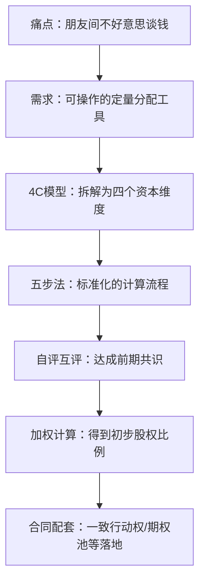
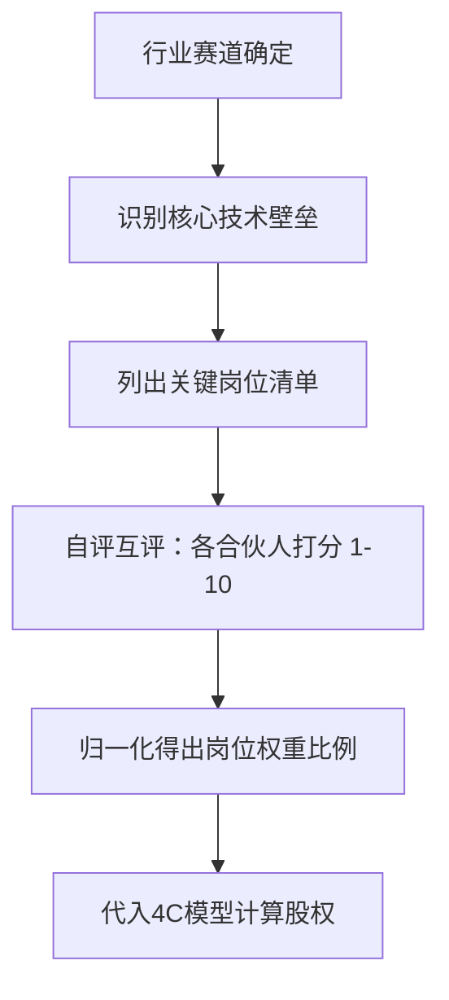
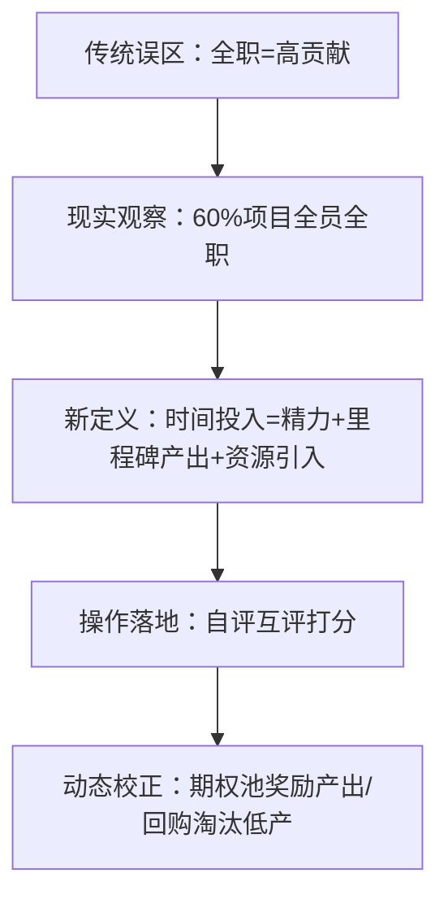
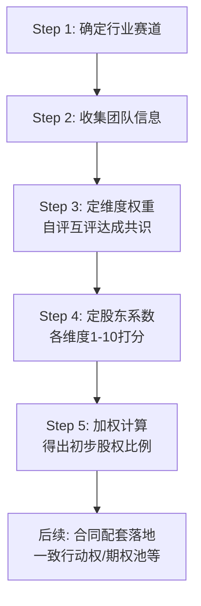
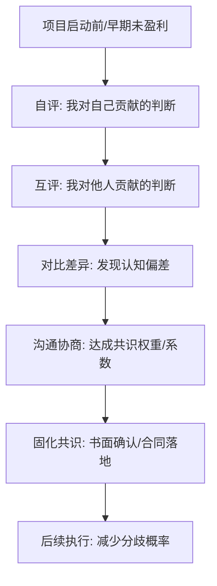
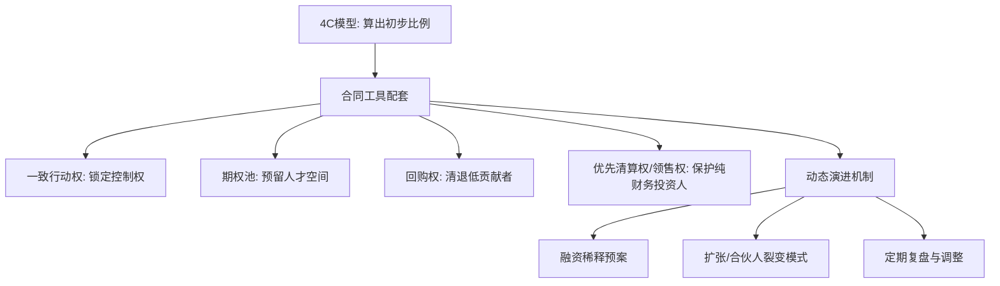

# 第 26 章 股权分配 —— 从“人情账”到“明白账”
作者：龙哥

## 学习目标

- 理解股权分配的核心矛盾：从“人情账”到“明白账”的转变需求
- 掌握4C动态量化股权分配模型的四个维度及其参考权重范围
- 能运用股权分配五步法为初创团队计算初步股权比例
- 理解创始人身份的本质是风险承担，而非出资多少或职位高低
- 认识岗位权重、时间投入、资金投入在量化模型中的具体内涵与衡量标准
- 领会前期共识机制对避免合伙拆伙、保障团队稳定的关键作用
- 能识别4C模型的边界条件，理解初步股权比例仅是起点，需合同配套落地
- 明确股权分配中资金投入的“信号价值”：真金白银体现信心与风险意愿
- 理解股权分配与后续融资、扩张之间的协同关系，避免为短期分配留下长期治理隐患

## 26.1 生活类比

想象你和两个朋友合伙开一家餐厅，你们需要商量好每个人占多少股份。餐厅里，创始人身份就像那位大厨兼老板，他不仅投入全部心血，更关键的是当餐厅亏损倒闭时，他要承担所有债务和善后责任，因此他拥有最终的决策权——谁来制定菜单、谁决定扩张，都要听他的。岗位权重好比餐厅的核心菜系，那位能做招牌菜的厨师，显然比负责端盘子的服务员更重要，因为菜好不好吃直接决定餐厅的生与死。时间投入看似简单——服务员站了几个小时就是几个小时——但关键不在于谁在店里待得久，而在于翻台率有没有达标、有没有带来熟客资源与供应商渠道。资金投入则是谁出了装修费和设备钱，但这笔钱并不自动赋予话语权：出钱多的人可以多分红，就像股东拿更多利息，但菜单怎么定、店往哪开，决策权仍然在大厨手里。正如分蛋糕前需要明确切分的依据——谁出钱、谁掌勺、谁经营——股权分配也需要在餐厅开张前就把规则定得明明白白，否则等到生意红火、利润可观时再谈分账，友谊就会在利益面前碎成一地。

## 26.2 概念地图

```
股权分配
├── 核心痛点
│   ├── 朋友间谈钱伤感情                    —— P001
│   ├── 主观判断无法量化贡献                —— P001
│   └── 对自身重要程度判断不一致导致拆伙    —— P001
├── 4C动态量化股权分配模型
│   ├── 创始人身份（10%-30%）
│   │   ├── 本质：风险承担与兜底责任        —— P001
│   │   ├── 关键：话语权锚点，公司唯一声音  —— P001
│   │   └── 判定：谁愿意无条件兜底谁掌舵    —— P001
│   ├── 岗位权重（30%-40%）
│   │   ├── 本质：行业技术壁垒所在          —— P001
│   │   ├── 判定：自评互评打分（如7:2:1）   —— P001
│   │   └── 影响：四维度中占比最高           —— P001
│   ├── 时间投入（10%-25%）
│   │   ├── 误区：全职≠高产出，兼职≠低价值  —— P001
│   │   ├── 核心：产出需匹配项目里程碑        —— P001
│   │   └── 外延：包含愿意引进的资源          —— P001
│   └── 资金投入（20%-50%）
│       ├── 作用：为项目提供运转资本          —— P001
│       ├── 信号：真金白银体现信心与风险意愿  —— P001
│       ├── 行业差异性：资金驱动型行业权重更高 —— P001
│       └── 边界：出钱多≠决策权，不等同创始人 —— P001
└── 操作流程与落地
    ├── 股权分配五步法
    │   ├── 确定行业和赛道（2维4类型）       —— P001
    │   ├── 收集创始团队信息（全职/岗位/出资）—— P001
    │   ├── 确定各维度权重比例（自评互评）    —— P001
    │   ├── 确定股东各维度权重系数（1-10打分）—— P001
    │   └── 加权计算各股东股权比例            —— P001
    ├── 前期共识机制
    │   ├── 时机：公司未盈利时最佳            —— P001
    │   ├── 方法：自评+互评达成一致           —— P001
    │   └── 作用：前置消除分歧，避免拆伙      —— P001
    └── 合同配套与边界
        ├── 起点非终点：需合同规范调整         —— P001
        ├── 配套工具：一致行动权/期权池/回购权等—— P001
        └── 动态演进：为后续融资与扩张预留空间 —— P001/P002
```

## 26.3 4C动态量化股权分配模型 —— 让股权分配从“拍脑袋”变“按公式”

### 为什么需要这个模型？

几乎每一支初创团队都会在某个深夜面对同一个尴尬问题：几个好朋友合伙创业，谈钱伤感情，不谈钱又怕日后扯皮。你心里盘算着自己出了多少力、投了多少钱、熬了多少夜，嘴上却只能说“都行都行，大家看着办”。这种“人情账”式的分配方式，看似和气，实则埋下了拆伙的定时炸弹。传统做法——“谁出力多谁多拿”——的问题在于，“出力”本身是一个根本无法量化的模糊概念。你觉得你贡献大，他觉得自己付出多，谁也没有客观标准去衡量，等到公司真的赚到钱了，分歧就会集中爆发。

这正是 4C 动态量化股权分配模型要解决的问题：把抽象的贡献转化为具体的股权比例，把“人情账”变成“明白账”。

> “今天给大家提供一个工具，这个工具的名称叫 4C 动态量化股权分配模型。4C中的C，就是资本的意思，资本我们分为人力资本和货币资本。再细分成4个维度的话，就是创始人身份、岗位权重、时间投入、资金投入。”
> 
> ——《P001, p.1》

### 核心定义

> 4C 动态量化股权分配模型**定义**（来源：P001 `docs/202301-02/C0dydiFPCoBI3LxemwWcXpdxn2e.md`）

$$
\begin{aligned}
\text{股权比例}_{i} &= \sum_{d \in \{F, H, T, M\}} w_d \times s_{d,i} \\
\text{其中：} \\
w_F &: \text{创始人身份权重}(10\%\sim30\%) \\
w_H &: \text{岗位权重}(30\%\sim40\%) \\
w_T &: \text{时间投入权重}(10\%\sim25\%) \\
w_M &: \text{资金投入权重}(20\%\sim50\%) \\
s_{d,i} &: \text{股东 } i \text{ 在维度 } d \text{ 的归一化系数}
\end{aligned}
$$

这段公式展示了 4C 模型的核心计算逻辑：每个股东的最终股权比例，等于四个维度（创始人身份、岗位权重、时间投入、资金投入）的权重，与该股东在每个维度的得分系数相乘后加总。这里的四个权重是模型内置的参数，各有参考范围；四个得分系数则是通过创始团队自评与互评得到。你可以把这个公式理解为一次“加权投票”：每个维度是一个投票议题，四个议题的重要性不同（权重不同），每个股东在每个议题上的“得票”也不同（系数不同）。最终谁的票数多，谁就获得更多股权。

**为什么采用加权求和而非乘法？** 采用加权求和是因为四个维度代表四种独立的资本贡献（人力资本的三个子维度：创始人身份、岗位权重、时间投入，以及货币资本的资金投入），它们之间是可替代的“加法”关系而非“乘法”关系——某个维度得分为零不应导致整体股权归零（例如纯财务投资人可能在岗位权重、时间投入、创始人身份上为零，但仍应享有资金投入带来的股权）。归一化系数 $s_{d,i}$ 的计算方式是：在每个维度内，将所有股东的原始打分（1-10分）归一化处理，使该维度下所有股东的系数之和为 1。权重范围边界的推导来源于成百上千个案例的经验积累（P001 宣称），即在不同行业类型中，观察到的各维度权重分布区间，并非严格的统计推导结论。[需要补充文献] 4C模型权重参考范围(10%-30%等)及"60%项目全员全职"的样本量、抽样方法、行业分布来源。

### 四个维度的参考权重

下表汇总了 4C 模型内置的权重参考范围，这些数值来自成百上千个案例的经验积累（P001 宣称）。请注意：这些数值并非固定标准，而是给创始团队一个“锚点”，具体取值需要团队共同商量决定。

| 维度 | 参考权重 | 衡量内容 |
|------|----------|----------|
| 创始人身份 | 10%-30% | 谁承担最大风险、谁愿意无条件兜底 |
| 岗位权重 | 30%-40% | 行业技术壁垒所在，哪个岗位最重要 |
| 时间投入 | 10%-25% | 全职/兼职、产出是否匹配里程碑 |
| 资金投入 | 20%-50% | 前期出资额度，信心与风险意愿信号 |

需要特别注意的是，四个维度权重加总应为 100%。如果你们团队认为这是一个资金密集型项目，资金投入的权重可以上调到接近 50%；如果是技术驱动型项目，岗位权重应该占据主导位置。

### 配套操作流程：股权分配五步法

模型本身只是框架，真正让框架落地的是五步法操作流程：

> 股权分配五步法**方法**（来源：P001 `docs/202301-02/C0dydiFPCoBI3LxemwWcXpdxn2e.md`）

```
1. 确定行业和赛道（分为技术驱动/资金驱动 × 自主创业/集团孵化共2维4类型）
2. 收集创始团队信息（谁是全职、负责岗位、各自出资额度等）
3. 确定每个维度的权重比例（创始团队自评互评达成共识）
4. 确定股东四个维度的权重系数（按 1 到 10 各自打分）
5. 加权计算各个股东的股权比例（维度权重 × 股东系数求和）
```

这段伪代码展示了五步法的完整链路：从宏观的赛道判断一步步收敛到微观的个人打分，最后通过加权计算得到清晰的股权数字。其中最关键的是第三步和第四步——它们依赖“自评互评”达成共识，而非某个人说了算。

### 一个完整的例子：儿童体能训练项目

我们来看看素材中演示的一个真实案例。三个朋友准备合伙做一个儿童体能训练项目：

- **小明**：发起人，之前加盟过幼儿游泳馆品牌，前期准备出资 50 万；
- **小磊**：负责市场，坚信“市场为王”，不愿意出钱；
- **小胡**：在国企上班，家里拆迁户，愿意投资 150 万。

项目预期启动资金为 200 万。三个合伙人通过自评与互评，最终确定了岗位权重为 **7:2:1**（核心教学/运营岗位贡献最大），时间投入为 **6:3:1**（体现全职投入与兼职参与的不同贡献程度）。将这些信息代入五步法，就能计算出每位合伙人应得的股权比例。

### 方法演进图



这个流程图展示了 4C 模型从“痛点”到“落地”的完整演进路径。你会发现，计算本身只是中间环节，真正重要的是前期的共识机制和后期的合同配套。

### 边界条件

需要明确的是，五步法算出的股权比例只是“起点”而非“终点”。正如素材作者所强调的：“这个股权比例分配是最最简单的一个环节，并不是说，按这个比例算出来的，就是最终体现在工商商事主体上的最后结果。”（P001, p.5-6）后续还需要一致行动权、期权池、分红奖励、回购权、优先清算权、领售权等一系列合同规范和调整。此外，四个维度的参考权重范围是经验值而非统计结论，实操中需要创始团队共同锚定达成共识。

## 26.4 创始人身份 —— 谁兜底，谁掌舵

### 为什么需要这个概念？

一家初创公司对外只能有一个声音。如果两个合伙人都觉得“我是老大”，公司就会陷入政出多门、决策瘫痪的泥潭。你可能会想：这还不简单，谁股份多谁说了算？但问题在于，股份可以用钱买——小胡出资 150 万，按理说应该股份最多，但他并不适合因此成为创始人。因为创始人的责任和风险承担，是无法用金钱来衡量的。

> “在我看来，它其实代表着风险承担，就谁最后在兜底。当这个项目不成立或这个项目遇到了极大的风险，谁愿意无条件的去为这个项目兜底，那这个人就是创始人，他对这个项目的付出程度是跟其他的合伙人完全不一样。”
> 
> ——《P001, p.3》

### 核心定义

> 创始人身份**定义**（来源：P001 `docs/202301-02/C0dydiFPCoBI3LxemwWcXpdxn2e.md`）

$$
\text{创始人身份} \approx \text{风险承担意愿} \times \text{兜底能力}
$$

这个“近似公式”展示了创始人身份的本质：它不是头衔、不是荣耀、更不是出资多少，而是“谁愿意在项目濒临崩溃时无条件兜底”。一个人愿意承担别人不愿承担的最坏情况，他对项目的投入程度就与其他合伙人完全不同。之所以使用近似号而非等号，是因为风险承担意愿与兜底能力之间存在非线性交互：只有当两者同时达到阈值（既有意愿又有能力），才能真正承担起创始人的角色；单一维度极高但另一维度为零时，创始人身份依然无法成立。在 4C 模型中，该维度参考权重为 10%-30%，更关键的是它决定了公司的控制权归属——公司对外只能有一个声音。

### 关键性质

- **风险导向**：创始人身份的本质是风险承担，而非出资多少或职位高低。谁愿意无条件为项目兜底，谁就是创始人。
- **不可替代性**：创始人对项目的付出程度与其他合伙人完全不同，因为他承担了别人不愿承担的最坏情况。
- **话语权锚点**：创始人身份决定了公司的控制权归属，是后续岗位、时间、资金分配的基准。

### 方法演进图


### 边界条件

创始人身份应与风险承担的实际意愿匹配，不能只挂名不兜底，否则项目遇困时会暴露出名不副实的矛盾。另外，如果项目由投资人主导完全出资，创始人身份可能转移到投资方，这需要在前期就明确约定，以免后续发生控制权纠纷。

## 26.5 岗位权重 —— 谁是技术的“承重墙”

### 为什么需要这个概念？

不同岗位对项目的价值贡献截然不同：有些岗位掌握着行业的技术壁垒，缺了它项目就做不起来；有些岗位则随时可被替代。如果不在前期明确“哪个岗位最重要”，公司发展壮大后，各合伙人就会因为“我岗位更重要”而互不相让。更有意思的是，这种分歧在前期做股权设计时往往不易被发现，但会在公司壮大的过程中逐渐放大成隐患。

> “2.岗位权重，就是这个行业技术壁垒在哪里，那个岗位是最重要的。……这个分歧在我们前期做股权设计的时候，大家可能不容易发现，但是在公司发展壮大的过程中，越到后面越会产生一些隐患。”
> 
> ——《P001, p.4》

### 核心定义

> 岗位权重**定义**（来源：P001 `docs/202301-02/C0dydiFPCoBI3LxemwWcXpdxn2e.md`）

$$
\text{岗位权重}_{岗位_i} = \frac{\text{岗位}_i \text{对公司成功的边际贡献}}{\sum_j \text{岗位}_j \text{对公司成功的边际贡献}}
$$

这个公式展示了岗位权重的本质：它衡量的是“哪个岗位对公司成功最不可或缺”。参考权重为 30%-40%，是四个维度中占比最高的因素，对最终股权比例影响最大。具体取值通过创始团队自评互评打分确定，素材案例中得出了 **7:2:1** 的岗位权重分配。公式采用边际贡献占比的形式，是因为岗位重要性是相对的、可比的——各岗位边际贡献之和构成了公司成功的总贡献，每个岗位的占比即为其权重。这也保证了各岗位权重之和为 1，符合加权求和模型的归一化要求。

你可以把岗位权重想象成一栋房子的承重墙：哪面墙抽掉了房子会塌，那面墙就是最重要的。不同行业的“承重墙”不同——编程项目里技术岗是承重墙，销售项目里市场岗是承重墙，生产项目里运营岗是承重墙。

### 关键性质

- **行业差异性**：不同赛道的技术壁垒岗位不同，必须结合具体行业来判断。
- **前期的分歧隐蔽性**：合伙人早期不易发现对岗位重要性判断的差异，但公司壮大后分歧会逐渐放大。
- **直接影响股权**：岗位权重是四维度中占比最高的因素（30%-40%），对最终股权比例影响最大。

### 方法演进图



### 边界条件

岗位权重针对的是“当前阶段”的项目需要。如果项目转型或扩张，各岗位的相对重要性会发生变化。此外，自评互评需建立在坦诚沟通基础上，若合伙人碍于情面不敢表达真实看法，权重分配会产生偏差。

## 26.6 时间投入 —— 别被“全职”欺骗，看产出才算数

### 为什么需要这个概念？

在创业团队中，你经常会遇到这样的矛盾：有的合伙人天天泡在公司，但产出乏善可陈；有的合伙人兼职参与，却带来了关键资源和人脉。如果仅仅以“全职/兼职”来衡量时间投入，就会严重低估后者的贡献。更关键的是，素材作者指出一个反直觉的观察：

> “但是大家有没有想过，就是其实有 60% 左右的项目，所有的合伙人除了纯财务投资人之外，其实都是全职参与的。只是说你全职参与的这个产出它是不是就能匹配的到这个项目的所有的进展，项目到达的里程碑是不是跟你全职参与有必然关系。”
> 
> ——《P001, p.4》

这句话揭示了一个核心事实：当大多数合伙人都是全职投入时，“全职”这个词就失去了区分度。真正需要衡量的是——你的产出是否匹配上了项目的里程碑进展。[需要补充文献] 4C模型权重参考范围(10%-30%等)及"60%项目全员全职"的样本量、抽样方法、行业分布来源。

### 核心定义

> 时间投入**定义**（来源：P001 `docs/202301-02/C0dydiFPCoBI3LxemwWcXpdxn2e.md`）

$$
\text{时间投入} = f(\text{投入时间精力}, \text{产出匹配里程碑}, \text{愿意引进资源})
$$

这个“函数公式”展示了时间投入的三个构成要素：最浅层的是投入的时间精力（全职/兼职），更本质的是产出是否匹配项目里程碑，同时还包括愿意为项目引进多少资源。参考权重为 10%-25%。这里采用加性函数形式 $f(x,y,z) = \alpha x + \beta y + \gamma z$（而非乘性或其他形式），是因为三个要素代表三个维度的独立贡献：时间精力是基础投入，里程碑产出是核心产出，引进资源是增量价值，三者可互补但不可替代——缺乏时间投入可通过高产出或引进关键资源补偿，反之亦然。若采用乘性形式，任一维度为零将导致整体为零，不符合创业实践中“兼职合伙人带来关键资源即可获得高权重”的观察。

简单来说，时间投入不是“人在工位”的打表计时，而是“事有推进”的成果检验。一个全职投入但产出跟不上里程碑的合伙人，他的时间投入权重理应降低；一个兼职但带来关键客户资源的合伙人，他的时间投入权重应该提高。

### 关键性质

- **产出导向**：时间投入的价值不在“待了多久”而在“推进了什么”。
- **资源绑定**：时间投入应同时包含投入的时间精力和愿意引进的资源，不只是一句“我是全职”。
- **前期约定**：必须在前期股权设计时就讲清楚时间投入的衡量标准，避免后期因投入-产出不匹配产生纠纷。

### 方法演进图



### 边界条件

素材中“60%左右的项目合伙人全职参与”是经验判断而非严格统计结论，不同项目差异较大。若全职合伙人产出长期不匹配里程碑，应及时通过动态调整机制（如期权池）校正股权，而非等到矛盾爆发才处理。

## 26.7 资金投入 —— 真金白银背后的“信心信号”

### 为什么需要这个概念？

项目启动总得有人出钱，但“谁出多少、出钱的人该占多少股”是初创团队最常见的争议点。你可能会直觉地认为：出钱多就该占股多。但在 4C 模型看来，资金投入的角色比这更微妙——它不仅是项目运转的燃料，更是一份“信心信号”。一个愿意真金白银砸进来的人，通常比只出人力的人更看好项目，也更愿意在困难时坚持。

> “4.资金的投入。这个比较好理解，所有的项目都会有一个前期资金的投入。……我们可以通过时间投入和资金投入去判断这个合伙人他对项目的信心和他愿意承担多大的风险。”
> 
> ——《P001, p.5》

### 核心定义

> 资金投入**定义**（来源：P001 `docs/202301-02/C0dydiFPCoBI3LxemwWcXpdxn2e.md`）

$$
\text{资金投入价值} = \alpha \times \text{出资额} + \beta \times \text{信心信号}
$$

这个公式展示了资金投入的双重价值：第一重是“输血价值”（出资额），为项目提供运转资本；第二重是“信号价值”（信心信号），出资额体现了合伙人对项目的信心和风险承担意愿。参考权重为 20%-50%，是四个维度中范围最宽的。采用加性形式而非乘性形式，是因为输血价值与信号价值是两个可独立计量的维度：即使某合伙人出资额较小（如天使投资人早期少量试投），其信心信号可能极强（愿意承担高风险、引荐后续大额融资）；反之，大额资金投入者可能仅寻求财务回报而非经营参与，信心信号较弱。两者加权求和能更精准捕捉这种解耦关系。

你可以把资金投入理解为一场扑克牌局中的“下注”：一个人愿意押上多少筹码，代表他对这手牌有多自信。只出人力不出钱的人，可以嘴上说“我很有信心”，但他的信心经不起真金白银的检验。

### 关键性质

- **信心信号价值**：愿意真金白银投入的人，往往比只出人力的人更看好项目、更愿意在困难时坚持。
- **行业差异性**：资金驱动型行业（如制造业、房地产）中资金权重更高，技术驱动型行业中资金权重相对降低。
- **补充性**：出钱多的合伙人不一定是创始人——儿童体能案例中小胡出资 150 万（总投资 200 万中的 75%），但创始人身份仍归发起人小明，说明资金投入不等于决策权。

### 方法演进图


### 边界条件

纯财务投资人通常不参与经营，其资金投入权重需通过优先清算权、领售权等合同条款单独约定，防止与经营股东冲突。此外，需警惕资金投入与风险意愿的匹配：若某合伙人出资额与其实际承担风险能力不匹配，项目遇困时可能引发撤资风险。

## 26.8 股权分配五步法 —— 从“一团乱麻”到“清清楚楚”

### 为什么需要这个方法？

有了 4C 模型的理论框架，创始团队还面临一个现实问题：从哪聊起？股权分配这个话题太敏感，大家要么回避不谈、假装不存在，要么一谈就崩、不欢而散。五步法的价值在于：它提供了一套“傻瓜式”的操作指南，让创始团队按部就班就能算出各方都能接受的股权比例。

> “第一个步骤：确定行业和赛道……第二个步骤：收集创始团队信息……第三个步骤：确定每个维度的权重比例……第四个步骤：确定股东四个维度的权重系数……第五个步骤：计算出各个股东的股权比例。”
> 
> ——《P001, p.2》

### 核心定义

> 股权分配五步法**方法**（来源：P001 `docs/202301-02/C0dydiFPCoBI3LxemwWcXpdxn2e.md`）

```
Step 1: 确定行业和赛道
        → 分为 技术驱动型/资金驱动型 × 自主创业型/集团孵化型 共 4 类
Step 2: 收集创始团队信息
        → 谁是全职、负责哪个岗位、各自出资额度等
Step 3: 确定每个维度的权重比例
        → 创始团队自评互评，在参考范围内达成共识
Step 4: 确定股东四个维度的权重系数
        → 每个股东在每个维度上按 1-10 打分
Step 5: 加权计算各股东股权比例
        → 维度权重 × 股东系数求和，得到最终比例
```

这段伪代码展示了五步法的完整执行流程。注意第三步和第四步是最需要沟通技巧的环节：它们依赖创始团队的自评与互评机制，而不是某个人说了算。每一步之间有严格的先后逻辑：先定赛道（宏观），再收集信息（基础），然后定维度权重（框架），接着打系数（微观），最后计算（结果）。这段伪代码展示了五步法的完整执行流程，强调第三、四步依赖自评互评达成共识而非独断，第五步通过加权求和得出透明可验证的数字，避免了模糊争论。

### 五步法的关键性质

- **流程化**：五步环环相扣，从宏观赛道判断到微观个人打分，逻辑严密，不会遗漏。
- **共识导向**：第三步和第四步依赖创始团队自评互评达成共识，而非某个人说了算。
- **计算透明**：各维度权重×各股东系数后加权求和，数字一目了然，避免“我感觉我贡献大”的模糊争论。

### 方法演进图



### 边界条件

五步法算出的比例只是“起点”而非“终点”，仍需配合一致行动权、期权池等合同工具才能落地。若团队人数较多（4人以上）或存在多个纯财务投资人，五步法的自评互评环节会变得更复杂，需分阶段进行。

## 26.9 前期共识机制 —— 越早摊牌，越少拆伙

### 为什么需要这个概念？

大多数合作伙伴拆伙，不是因为项目不赚钱，而是因为“觉得自己最重要、出力最多，但分到的钱不是最多”。这个心理落差在项目初期被掩盖，在赚钱之后被引爆。素材作者一针见血地指出了根源：

> “因为大家从一开始对自己的重要程度的判断就是不一致的，大多数合作伙伴拆伙，就是觉得自己最重要，出力最多，但是分到的钱又不是最多。所以在前期就要聊清楚，公司还没有开始发展的时候，也是最为好聊的时候，因为还没有赚钱，就不会那么计较。”
> 
> ——《P001, p.4》

这段话道出了一个反直觉的时间点：公司**没赚钱的时候**，反而是谈股权的最佳时机。一旦赚了钱，大家都会开始计较，“谈钱伤感情”的尴尬反而更严重。

### 核心定义

> 前期共识机制**定义**（来源：P001 `docs/202301-02/C0dydiFPCoBI3LxemwWcXpdxn2e.md`）

$$
\text{共识达成概率} \propto \frac{1}{\text{公司当前盈利水平}}
$$

这个“公式”虽然不严谨，但揭示了前期共识机制的核心逻辑：公司越不赚钱，大家越容易心平气和地达成共识。因此在项目尚未盈利的阶段，通过创始团队自评和互评，对 4C 模型中各维度的权重以及各股东的系数达成一致，是最佳策略。这里的正比关系采用反比例函数形式，是因为随着盈利水平上升，利益分配的博弈空间扩大，各方心理预期发散，达成共识的难度呈非线性上升。正比例系数并非严格统计量，而是定性刻画“未盈利阶段沟通成本最低”这一经验规律。

你可以把它类比为婚前协议：在热恋期签，双方都觉得是“对爱情的保护”；在冷战期签，就变成了“对离婚的预演”。公司刚起步时摊牌，是给友谊和合作上一道保险；等到赚钱后再谈，就是在利益面前考验人性了。

### 关键性质

- **防拆伙作用**：通过在前期明确重要程度判断，避免后期因“你觉得自己重要、我觉得我重要”的分歧走向拆伙。
- **双向评估**：自评（我对自己贡献的判断）与互评（我对他人贡献的判断）结合，比单方面主张更客观。
- **前置性**：必须在公司尚未盈利时完成，否则等到有利益可分时，理性谈判就会被情绪取代。

### 方法演进图



### 边界条件

自评互评需要合伙人之间具备基本的信任与坦诚对话能力，若关系已经紧张则该机制效果受限。此外，共识达成的权重比例并非法律效力，仍需通过工商登记和合同固化。

## 26.10 股权治理的系统观 —— 从“分对”到“分好”的持续进化

### 为什么需要这个概念？

4C 模型解决的是“分对”的问题：把股权按贡献量化分配，用共识机制避免拆伙。但“分对”不等于“分好”——初创公司还要面对融资、扩张、引入新合伙人等后续挑战，静态的股权比例可能成为前进的障碍。想象一下：公司刚成立时三人各占三分之一，看起来公平。但两年后需要引入一位技术总监，你拿什么股权给他？如果三位创始人的股权已经瓜分完毕，期权池又不存在，招人就无从谈起。

> “在最后不得不提醒大家的是，这个股权比例分配是最最简单的一个环节，并不是说，按这个比例算出来的，就是最终体现在工商商事主体上的最后结果。在算完初步的股权分配后，我们还会有其他一系列的合同规范和调整，比如一致行动权，期权池，分红奖励，回购权，纯资金方投资的优先清算权，领售权，等等等等。”
> 
> ——《P001, p.6》

### 核心定义

> 股权治理的系统观**定义**（来源：P001 `docs/202301-02/C0dydiFPCoBI3LxemwWcXpdxn2e.md` / P002 `docs/202301-02/PglAdRMiIoVTRyxc4Q3cw8hvnWf.md`）

$$
\text{股权治理} = \underbrace{\text{4C模型分配}}_{分对} + \underbrace{\text{合同工具配套}}_{分好} + \underbrace{\text{动态演进机制}}_{持续进化}
$$

这个公式展示了股权治理的完整图景：4C 模型负责“分对”（算出初步比例），合同工具负责“分好”（一致行动权、期权池、回购权等规范调整），动态演进机制负责“持续进化”（为融资、扩张预留空间）。三者缺一不可。采用加性结构而非嵌套结构，是因为三个层面在时间维度上是串行演进的：先有初始分配（分对），再有治理配套（分好），后有动态调整（演进），三者构成完整的生命周期管理链条。

素材中的胖龟找房项目（P002）提供了一个生动的应用场景：该项目通过“区域合伙人计划——城市管家”把本地跑通的项目复制到杭州、上海、深圳。这种跨区域扩张依赖一套动态的股权/利益分配机制来支撑：平台提供房源库、配房人员、带看流程，合伙人只需维护用户。没有前瞻性的股权结构设计，这种合伙人裂变模式很难跑通。

### 关键性质

- **动态性**：股权不是一成不变的，需通过期权池、回购权等工具在项目推进中动态调整，奖励实际贡献、淘汰不作为。
- **前瞻性**：分配时要为未来的融资、扩张（如引入城市合伙人）预留股权空间，避免后期无股可分。
- **系统性**：股权问题从来不只是“分钱”问题，还涉及公司控制权、决策机制、风险隔离等多层次治理议题。

### 方法演进图



## 26.11 多源对照

### 共识

无论是定量分配（P001）还是实践扩张（P002），都强调“规则前置”的价值。4C 模型主张在项目未盈利时通过自评互评达成共识，胖龟找房则用标准化的“配房-带看-成交”流程让合伙人快速上手。两者的底层逻辑相同：把模糊的约定变成清晰的规则。

### 分歧

4C 模型侧重于“初始分配”，即公司成立时如何把股权分给创始团队；胖龟找房则展示了“动态演进”，即项目如何在不同城市复制、不同角色如何持续协作。前者回答“怎么分”，后者回答“分了以后怎么用”。这说明股权分配不仅是一个静态的数学问题，更是一个动态的治理问题。

## 26.12 设计中的取舍

### 为什么不用“按出资比例分配”这种简单方式？

最直观的分配方式当然是“谁出钱多谁占股多”，看起来公平且容易理解。但这种方式的致命缺陷在于：它完全忽略了人力资本的价值。胖龟找房的创始人不收中介费，靠的是信息差创新；儿童体能项目的发起人小明，出钱不多（50万 vs 小胡的150万）但承担了全部启动风险。如果单纯按出资比例分配，小胡将获得绝对控股权，但真正主导项目的小明反而成了小股东。这样的股权结构会在决策时造成倒挂：贡献最大的人没有话语权，项目迟早会偏离方向。4C 模型的价值正在于把人力资本（创始人身份、岗位权重、时间投入）纳入计算，让“干活的人”和“出钱的人”各得其所。

### 这种设计的 trade-off 是什么？

4C 模型的代价是“复杂”——四个维度、多个参考范围、自评互评机制，比起“按出资比例”的一刀切要繁琐得多。这种复杂性的背后，是为了换取“公平”与“稳定”。当每个维度都被量化、被讨论、被认可后，合伙人之间的心理预期就被前置校准了，拆伙的概率大幅降低。但代价也是真实的：如果创始团队缺乏坦诚沟通的意愿，再精密的模型也只会沦为数字游戏。另一个 trade-off 是“静态 vs 动态”：4C 模型算出的比例是某一时间点的快照，无法自动应对未来的人员变动和融资稀释，必须依赖合同工具（期权池、回购权）来做动态调整。这也解释了为什么素材作者反复强调“起点非终点”。

## 26.13 动手练习

### 练习 1：手算一次股权分配

给定三个合伙人 A、B、C 合作创业：

- 项目类型：资金驱动型技术创业项目，启动资金 500 万
- A：发起人，全职负责技术研发，出资 200 万
- B：全职负责市场销售，出资 150 万
- C：兼职提供行业资源，出资 150 万

假设创始团队自评互评结果如下：

- 岗位权重（技术:市场:资源）= 5:3:2
- 时间投入（A:B:C）= 6:3:1
- 创始人身份 A=10 分，B=5 分，C=3 分
- 资金投入（A:B:C）= 4:3:3

请按以下步骤计算：

1. 设定四个维度的权重比例（在参考范围内自行设定）
2. 汇总各股东在每个维度的得分
3. 加权计算每位合伙人的最终股权比例

回答问题：

- 如果提高资金投入的权重到 45%，C 的股权比例会发生什么变化？
- 你认为怎样的权重设定对 A 最有利？最不利？
- C 的创始人身份得分低，但他的资金投入高，这对最终结果产生了什么影响？

### 练习 2：案例诊断：这家公司为什么会散伙？

阅读以下场景：

小王、小李、小张三人合伙开了一家教育培训公司。小王出资 30 万并全职管理教学，小李出资 40 万全职负责市场，小张出资 30 万但仅偶尔提供建议。由于项目启动时没有做股权分配，大家口头约定“按出资比例分配”。两年后公司盈利，小王认为自己贡献最大应多分，小李也认为市场是核心竞争力，而小张觉得自己出了最多的钱理应多拿，三方争执不下，最终散伙。

回答问题：

- 用 4C 模型分析，这三个人的分歧点分别对应哪个维度的权重视角？
- 如果他们在创业前使用五步法，你预估岗位权重和时间投入应该怎么设定？
- “按出资比例分配”的约定错在哪里？从“创始人身份”和“岗位权重”的角度解释。
- 结合 4C 模型，你认为在新项目中他们应该提前进行哪些沟通？

### 练习 3：实战演练：设计一家餐饮店的股权方案

场景设定：你和两位朋友计划开一家网红火锅店，预期启动资金 100 万。

- 你：拥有 5 年餐饮管理经验，全职投入，愿意出资 30 万
- 朋友甲：有火锅底料的独家秘方，全职负责后厨，只能出资 10 万
- 朋友乙：有资金实力但无餐饮经验，不愿全职参与，愿意出资 60 万

按要求完成以下工作：

1. 将行业归类到 4C 模型中的赛道类型（技术/资金驱动 × 自主/集团孵化）
2. 为四个维度设定你认为合理的权重范围，并说明理由
3. 为三位合伙人在每个维度上打分（1-10 分）
4. 计算每位合伙人的初步股权比例
5. 针对计算出的结果，提出需要关注的潜在风险点

思考题：

- 如果乙希望获得更多话语权，你如何用“创始人身份”的概念回应？
- 针对朋友甲“技术核心但资金少”的情况，如何利用“期权池”机制解决？
- 这个股权方案在执行过程中可能遇到哪些“前期共识”未覆盖的问题？

## 26.14 本章小结

这一章中，我们系统学习了股权分配从“人情账”到“明白账”的完整方法论。首先，我们理解了初创团队股权分配的核心痛点——朋友间谈钱伤感情、主观判断无法量化贡献、对自身重要程度判断不一致导致拆伙；其次，我们掌握了 4C 动态量化股权分配模型的定义与四个维度（创始人身份、岗位权重、时间投入、资金投入）及其参考权重范围；接着，我们逐一拆解了每个维度的本质——创始人身份代表风险承担、岗位权重指向行业技术壁垒、时间投入要看产出而非全职兼职、资金投入既是输血更是信心信号；然后，我们学习了配套的股权分配五步法操作流程，并通过儿童体能训练项目案例完整走了一遍从确定赛道到加权计算的操作；最后，我们探讨了前期共识机制的防拆伙价值，以及股权治理的系统观——4C 模型解决“分对”，合同工具解决“分好”，动态演进支撑融资与扩张。

本章我们一起学习了以下概念：

| 概念 | 解释 |
|------|------|
| 4C动态量化股权分配模型 | 将资本细分为创始人身份、岗位权重、时间投入、资金投入四个维度，加权计算股权比例，把“人情账”变“明白账” |
| 创始人身份 | 本质是风险承担与兜底责任，而非出资多少；谁承担最大风险谁最有控制权，公司对外只能有一个声音 |
| 岗位权重 | 代表行业技术壁垒所在，是四维度中占比最高（30%-40%）的因素，通过自评互评打分确定 |
| 时间投入 | 核心是产出是否匹配项目里程碑，而非简单区分全职/兼职；同时包含愿意为项目引进的资源 |
| 资金投入 | 既为项目提供运转资本，更是判断合伙人信心和风险承担意愿的“信号”；出钱多不等同于创始人 |
| 股权分配五步法 | 确定赛道→收集信息→定维度权重→定股东系数→加权计算，是标准化的五步操作流程 |
| 前期共识机制 | 在公司未盈利时通过自评互评达成共识，可前置消除“我觉得自己最重要”的分歧，有效避免拆伙 |
| 股权治理的系统观 | 4C模型解决的是“分对”的问题，还需配合一致行动权、期权池等工具解决“分好”后如何动态演进、支撑融资扩张的问题 |
| 合同配套与落地 | 计算出的初步股权比例仅是起点，仍需一致行动权、期权池、回购权等合同规范与调整才能最终落地 |

下一章中，我们将进入团队与治理主题的实践深化，探讨如何通过科学的招聘、融资避坑与合同规范，把股权设计的“图纸”真正落成“大厦”——从分好钱到走更远，完成公司治理从初创到规模的完整闭环。


