# 第 26 章 创业的底层逻辑：从痛点到闭环的完整方法论

## 学习目标

- 理解痛点驱动创业的第一性原理：从“哪里疼贴哪里”到构建商业闭环
- 掌握信息差变现的核心逻辑：识别信息断层、打通渠道、收取“降低搜索成本”的服务费
- 熟练运用“选品决定论”评估产品：深挖需求、涵盖面齐全、品牌背书、高复购结构
- 掌握最小MVP闭环验证方法：用最小成本（如80元、2周）跑通“产品-流量-销售-交付”全链路
- 学会判断行业周期窗口期：识别“高流量低商业化”红利期，在平台早期完成模型跑通与放大
- 能运用“1+1+1项目矩阵”规划业务组合：1个盈利养团队、1个开发接力、1个知识付费变现经验
- 学会从0到1的获客与转化实操：公域矩阵引流、蹭流截流开店、私域高客单SOP转化、裂变扩张
- 建立风险控制与合规底线：外包避坑、招聘偏好、投放渠道排序、融资防骗、平台规则红线

## 26.1 生活类比

想象创业像**开一家‘专科诊所’**：
- **痛点** = 病人“哪里疼”的具体症状（荨麻疹、买房被坑、想赚钱没门路）
- **信息差** = 医生“知道病因和药方”而病人不知道的知识垄断
- **选品** = 开对症的“特效药”（深挖需求、高复购、有背书），而非卖“维生素”
- **MVP** = 先用“土方子”治好第一个病人（挣第一块钱、跑通闭环），再建医院
- **窗口期** = 流感高发季“荒诞疗法”也能火（平台早期高流量低商业化），过季神药也卖不动
- **1+1+1矩阵** = 诊所里：1个主治医师看病赚钱、1个研发新药方、1个开培训班教徒弟
- **公域引流** = 在大街上发传单、蹭隔壁大医院溢出病人、在社区讲座留微信
- **私域转化** = 进诊室“破冰问诊→诊断病因→开方子→建立信任→收费开药”（五位一体成交飞轮）
- **裂变扩张** = 开分院、收徒弟、授牌匾（合伙人/加盟/城市管家），标准化复制“诊疗SOP”
- **股权治理** = 合伙开医院：谁担责谁控股（创始人身份）、按出工出力出钱分红（4C模型）、立规矩防撕逼
- **心态内功** = 医生必须“盲目自信”能治好病（内在比赛赢），靠“治好一个信一个”累积自信（成功是成功之母），站着收徒不跪着求教（俯视学习）

## 26.2 概念地图

创业起点与商业模式设计 (第1章)
├── 痛点是创业的第一性原理
│   ├── 核心定义：用户急迫想解决且现有方案无法满足的具体问题
│   ├── 关键性质：天然刚需、越垂直越易建壁垒、需经专业验证
│   ├── 典型例子：夕子荨麻疹→科学护肤、胖龟买房痛点→0中介费、老杨TikTok赚钱难→娱乐直播
│   └── 边界条件：需具备付费意愿/能力、警惕政策/平台规则失效、自身痛点≠大众痛点需验证规模
├── 信息差就是金钱
│   ├── 核心定义：交易双方对关键信息认知不对等，变现即打通断层收取服务费
│   ├── 关键性质：随透明度收窄需挖新断层、核心壁垒在于获取渠道与效率、买家跳单因定价过高
│   ├── 典型例子：胖龟公开房东电话、夕子转化医美专业信息、老杨移植Twitch睡播玩法
│   └── 边界条件：不可持久需叠加服务/产品/品牌、非法获取信息有法律风险、纯信息差天花板低
├── 选品决定论
│   ├── 核心定义：寻找“深挖需求+涵盖面全+品牌背书+高复购+可溢价”的产品组合
│   ├── 关键性质：选品重于销售、口服/消耗型>耐用型、品牌背书可迁移(医生/博士/空壳品牌)
│   ├── 典型例子：夕子医美面膜→口服爆款→自建品牌、胖龟卖信息→卖会员→卖自有品牌、老杨声光电道具微创新
│   └── 边界条件：依赖平台规则动态适配、无绝对好产品只有特定人群时刻好、需持续迭代开发能力
└── 最小MVP闭环
    ├── 核心定义：仅含核心价值、能跑通“产品-流量-销售-交付”的最简版本
    ├── 关键性质：速度>完美(80元/2周)、要素齐全(缺啥补啥)、止损前置(设定最大投入)
    ├── 典型例子：夕子2万起步半月出单、胖龟小程序挂房源成交首单、老杨iPhone+道具峰值破万、美团80元跑通30店
    └── 边界条件：MVP≠简陋(核心体验必达标)、验证指标看硬数据(首单成本/回本/复购)、重服务类需先标准化SOP
行业周期与项目矩阵 (第1章延伸/第4章)
├── 行业周期窗口期
│   ├── 核心定义：平台流量释放>商业化收割、规则宽松、头部未垄断、普通人可入场的黄金期
│   ├── 关键性质：早期高流量低商业化(抖音早期/TikTok2022/视频号2023/美团电商)、窗口期有寿命(老杨预判2年)、完成比完美重要
│   ├── 典型例子：老杨TikTok对标抖音2017、胖龟扑中存量时代二手房红利、夕子疫期小红书红利、美团电商类比淘系铺货期
│   └── 边界条件：不可预测精确终点需敬畏市场、警惕伪窗口期平台收割、跨周期生存靠1+1+1矩阵
└── 1+1+1项目矩阵模式
    ├── 核心定义：1个盈利养团队、1个在开发、1个知识付费变现经验
    ├── 关键性质：项目生命周期2-6个月必须具备开发新项目能力、可复制快速执行门槛拔高
    └── 典型例子：老杨娱乐直播矩阵、夕子美业+加盟+课程、胖龟买房+租房+合伙人
获客转化与私域运营 (第3章)
├── 公域获客矩阵
│   ├── 内容不自嗨：定位→选题→模仿→优化→创新(学书法先临帖)
│   ├── 全域矩阵：抖音/快手/小红书/58/转转/豆瓣/知乎多平台撒网(撒网捕鱼)
│   ├── 蹭流截流：开在传统中介隔壁“0中介费”截流自然客流(借东风)
│   └── 租客全域发掘：评论区私聊、拼室友、求租广场、超话小组主动出击
├── 私域转化体系
│   ├── 金饭碗思维：专业用户服务高客单技术需求，非低价值团购(端金饭碗别讨饭)
│   ├── 咨询SOP表格：标准化回复模板提升速度/客单/成交率
│   ├── 五位一体成交飞轮：破冰→诊断→方案→信任→成交(解决为什么买/跟你买/现在买)
│   └── 单客价思维：关注用户生命周期总价值(LTV)而非单次客单价，拉长周期提复购
└── 裂变与扩张
    ├── 合伙人/城市管家：平台给房源库/配房/流程，合伙人只维护用户(铺铁路网)
    ├── 加盟赋能一条龙：脚本/SOP/课程/朋友圈/聊天SOP拿来即用(克隆直营店)
    └── 人海战术：单员工底薪3000月两单覆盖成本，批量招人放大利润
团队治理与风控 (第5-6章)
├── 股权与治理
│   ├── 4C动态量化模型：创始人身份/岗位权重/时间投入/资金投入四维定量分股
│   ├── 创始人身份本质：承担最大风险兜底责任=最大控制权(对外仅一把声音)
│   ├── 时间投入看产出匹配里程碑、资金投入是信心与风险意愿信号
│   ├── 招聘避坑：白纸可塑(应届生)>经验固化(房产销售)，旧瓶难装新酒
│   └── 股权起点非终点：需配套一致行动权/期权池/回购权/优先清算/领售权等合同
├── 融资与合规风控
│   ├── 融资防骗：有人推荐、不盲目缴费(看病找正规医院)
│   ├── 劳动合规：合同是枪附件是子弹(岗位考核/规章/廉洁/保密)、辞退最小化损失、及时签合同建考核
│   ├── 平台规则：敬畏风控、合规或规避获流量、内容审核应对(离线版/用户反馈/修订重传)
│   └── 止损决策：理性评估门槛(预算/资质/工期/流量源)果断放弃而非盲目投入
└── 认知与心态
    ├── 内在比赛理论：自我二(潜意识)认可目标才能赢外在比赛，盲目自信是理性选择
    ├── 成功是成功之母：过去成功体验累积潜意识自信推动更大成功，唤醒成功体验法
    ├── 俯视学习法：战略藐视战术重视，跪着学打不赢内在比赛
    ├── 正反馈驱动热爱：懒惰本质是无正反馈，突破口找热爱或纯为钱冲
    └── 战术勤奋逃避战略探索：用忙碌麻痹自己长期有毒，唯有战略突破带来真增长

> **编排说明**：本章整合了细纲第1、3、4、5、6章的核心内容，将创业全链路方法论系统化呈现。概念地图展示的是跨章节知识结构，正文各节对应细纲中相应章节的深度展开。

## 26.3 痛点是创业的第一性原理 —— 哪里疼就贴哪里

### 为什么需要这个概念？

创业不是凭空发明，而是源于对用户真实痛点的深切感知。只有解决真痛点，生意才有刚需属性，不靠“忽悠”也能成交。这能帮你避开“伪需求”陷阱，不做出来没人用的产品。

### 核心定义

**痛点**（来源：《E1WGd70YLoaHGfxAYJTc4WoFnsd.md》[origin]、《PglAdRMiIoVTRyxc4Q3cw8hvnWf.md》[origin]）

> 用户急迫想解决、且现有方案无法满足的具体问题。创业切入点：从自身或他人的真实痛点出发，构建商业闭环。

### 关键性质

痛点驱动的生意天然具备“刚需”属性，客单价与复购率更高。痛点越具体、越垂直，越容易建立专业壁垒（如夕子从荨麻疹切入科学护肤）。痛点需经得起“找专业人士解决”的验证，伪痛点经不起专业推敲。正如夕子所言：“皮肤有问题最快捷的方式就是找专业人士解决。皮肤没啥问题，做好温和清洁+适度保湿+加强抗氧化+随时防晒，健康靓丽皮肤就完成80%。”（《E1WGd70YLoaHGfxAYJTc4WoFnsd.md》[origin]）

### 典型例子

下表列举了三位创业者如何将亲身或洞察到的痛点转化为商业切入点：

| 案例 | 核心痛点 | 商业转化 |
|------|----------|----------|
| **夕子** | 自身荨麻疹、敏感肌 | 辞职三甲医院做线上美业，年利润过百万 |
| **胖龟找房** | 买房遭遇“虚假低价、阴阳合同、高额代办费” | 创立0中介费平台，年入百万 |
| **老杨** | TikTok早期“想赚钱却没门路” | 切入娱乐直播，单小时均100美金 |

> "中介费为什么要收？就是因为买房及租房者不知道售房及出租转让业主的联系电话！"
> 
> ——《PglAdRMiIoVTRyxc4Q3cw8hvnWf.md》[origin]

> "回观抖音的发展路径，第一阶段就是高流量低商业化阶段，这时候要做的并不一定要跟平台的指向，而是要看清平台的现状。"
> 
> ——《FCiidWBeJoLOT1xreYnc9Se4nOf.md》[origin]

### 多源对照：痛点发现与验证的异同

**共识**：三份素材均认为创业起点必须是真实痛点，且痛点需经得起专业或市场验证。

**分歧**：
- 《E1WGd70YLoaHGfxAYJTc4WoFnsd.md》[origin] 强调**自身痛点自证**为起点（夕子亲身患病），通过专业背景（医生）将个人痛点升维为专业方案；
- 《PglAdRMiIoVTRyxc4Q3cw8hvnWf.md》[origin] 强调**行业痛点洞察**为起点（胖龟创始人观察中介乱象），通过“中介费伪概念”重新定义行业规则；
- 《FCiidWBeJoLOT1xreYnc9Se4nOf.md》[origin] 强调**平台红利期的机会痛点**（老杨对标抖音历史），痛点不在于产品本身，而在于“普通人想在新平台赚钱却找不到门路”。

### 边界条件

仅有痛点不够，还需具备“付费意愿”与“付费能力”（如<15岁用户爱看睡播但付费弱）。痛点若被平台规则封杀（如中介费被政策禁止），模式会失效。自身痛点不等于大众痛点，需验证市场规模（如“科学护肤金字塔”验证80%人只需基础护理）。

### 方法演进图：从痛点发现到商业闭环构建

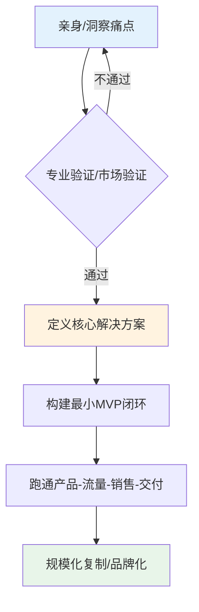

## 26.4 信息差就是金钱 —— 你知道而别人不知道的路径

### 为什么需要这个概念？

打破“中介费天经地义”的认知，揭示垄断信息赚差价的本质。理解为何“搬运信息”能成生意：信息不对称是商业利润的源头。指导选品与获客：找到信息断层处，即是流量与变现入口。

### 核心定义

**信息差**（来源：《PglAdRMiIoVTRyxc4Q3cw8hvnWf.md》[origin]）

> 交易双方对关键信息（价格、渠道、联系方式、规则）认知不对等。**信息差变现**：打通信息断层，收取“降低搜索成本/规避风险”的服务费。

### 关键性质

信息差随透明度提升而收窄，需不断挖掘新断层（如从“房东电话”到“二房东渠道”）。核心壁垒不在于“信息本身”，而在于“获取信息的渠道与效率”（物业关系、水电费号、同行转化）。买家跳单动机本质是“信息差定价过高”（中介服务不值其费）。正如胖龟创始人所言：“生意的本质就是信息差，在互联网里也存在大量的信息差生意。以这个信息差为市场的切入点我们创办了胖龟找房的 1.0——没有中介费的个人房屋分享平台。”（《PglAdRMiIoVTRyxc4Q3cw8hvnWf.md》[origin]）

### 典型例子

下表展示三位创业者如何通过打通不同层级的信息断层实现变现：

| 案例 | 信息断层 | 变现模式 |
|------|----------|----------|
| **胖龟找房** | 买房者不知道房东电话 | 小程序公开联系方式，“0中介费”截流，年入百万 |
| **夕子** | 用户不懂医美专业信息 | 转化“科学护肤金字塔”卖货，月利润5万+ |
| **老杨** | 国内不知Twitch睡播玩法 | 本地化移植到TikTok，单小时均100美金 |

> "我们不收中介费，是因为中介费本身就是个伪概念！为什么说是伪概念，因为是智商税……物业：通过与物业建立起关系，给予一定的费用，拿到业主电话。水电费号码：通过水电费号，找到相应的单位人员获取业主电话。"
> 
> ——《PglAdRMiIoVTRyxc4Q3cw8hvnWf.md》[origin]

### 多源对照：信息差的获取渠道与壁垒

**共识**：信息差变现的核心是“降低搜索成本”，壁垒在于“渠道与效率”而非信息本身。

**分歧**：
- 《PglAdRMiIoVTRyxc4Q3cw8hvnWf.md》[origin] 强调**线下物理渠道**（物业、水电费号、同行转化）的独家性与可控性；
- 《FCiidWBeJoLOT1xreYnc9Se4nOf.md》[origin] 强调**跨平台/跨市场信息迁移**（Twitch→TikTok）的时间差价值；
- 《E1WGd70YLoaHGfxAYJTc4WoFnsd.md》[origin] 强调**专业知识转化**（医生端→用户端）的认知差价值。

### 边界条件

信息差不可持久：政策推行“0中介费政府平台”、平台打击搬运、用户认知升级均会消灭信息差。非法获取信息风险：爬虫窃取、购买黑数据构成法律风险，需合规化（如物业付费合作、公开渠道监测）。纯信息差天花板低：需叠加“服务/产品/品牌”升维（如胖龟从卖信息转向卖会员服务、自有品牌）。

### 方法演进图：信息差变现的升维路径

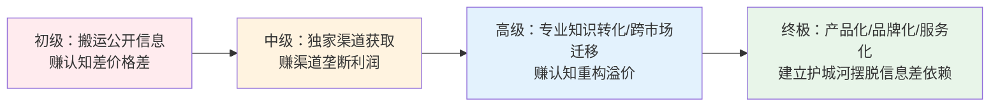

## 26.5 选品决定论 —— 产品好省一半心

### 为什么需要这个概念？

避免“拼运营、拼投流”内卷：好产品自带流量属性与转化属性。解决“后端无复购、利润薄”顽疾：选品即定商业模式上限。降低创业试错成本：选对赛道，笨功夫也能出活。

### 核心定义

**选品**（来源：《E1WGd70YLoaHGfxAYJTc4WoFnsd.md》[origin]）

> 在特定市场窗口期，寻找“深挖用户需求、涵盖面齐全、有品牌背书、高复购、可溢价”的产品组合。

**核心公式**：

$$
\text{好产品} = \text{精准痛点解决方案} + \text{信任背书} + \text{高复购结构}
$$

**公式推导**：
1. **精准痛点解决方案**：源于26.3节痛点验证，产品必须直击用户最急迫的具体问题（如祛痘、美白、抗衰），这是产品存在的必要条件。
2. **信任背书**：源于夕子“医生/博士创立、医院合作”经验，解决“凭什么信你”的转化难题，将陌生人交易转化为信任交易。
3. **高复购结构**：源于“口服/消耗型>耐用型”洞察，一个人接受某品牌口服后极难更换，天然锁定LTV（生命周期价值）。

三者缺一不可：无痛点解决则无需求，无信任背书则转化极难，无高复购则无法支撑获客成本。**该公式的作用是作为选品评分卡，每个维度打分，总分决定是否入库。**

### 关键性质

选品重于销售：夕子“果断花1.6万入货合伙人级别”，因产品好，客单价、成交率、利润率全上涨。口服/消耗型 > 耐用型：口服保养“一个人一单接受了不会轻易更换”，天然高复购。品牌背书可迁移：医生/博士创立、医院合作、空壳品牌故事，均能大幅降低信任成本。正如夕子所言：“所以选品很关键，产品好省了一半的心，后续回购率也高。1.深挖用户需求，最好涵盖面齐全：比如说不仅祛痘、还有美白、抗衰等等 2.口服保养是趋势，一个人一单接受了某个品牌的口服，不会轻易更换牌子的 3.尽量能跟医院合作的产品，品牌背书这块强”（《E1WGd70YLoaHGfxAYJTc4WoFnsd.md》[origin]）

### 典型例子

下表对比三位创业者的选品进化路径与核心逻辑：

| 创业者 | 选品进化路径 | 核心逻辑 |
|--------|--------------|----------|
| **夕子** | 代购医美面膜（一单2元）→ 自选口服爆款（月利润5万）→ 自建品牌（985博士+医生背书） | 从低毛利非标品→高复购消耗品→强背书自有品牌 |
| **胖龟找房** | 卖“房源信息”→ 卖“会员服务”→ 卖“自有品牌租房/家居水光” | 客单价从百元到万元，产品化降低交付依赖 |
| **老杨** | 睡播核心“产品”是“声光电道具+剧本”，微创新（材质套利）延长红利期2-6个月 | 非标娱乐内容标准化、工具化、可复制 |

### 边界条件

选品依赖平台规则动态适配：抖音打击无货源、TikTok限制娱乐直播、美团压价标品，选品需动态适配。无绝对好产品：只有“特定人群+特定时刻”的好产品（如真皮包在日本免税、在东欧做日牌）。选品能力需持续迭代：老杨强调“项目生命周期2-6个月，必须具备开发新项目能力”。

### 方法演进图：选品决策的三层筛选漏斗

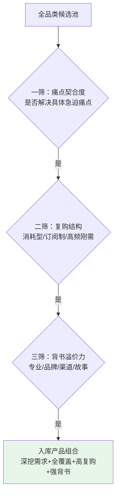

## 26.6 最小MVP闭环 —— 先造独木舟再过河

### 为什么需要这个概念？

避免“造航母”式创业：前期投入过大、周期过长、风险不可控。验证商业模型核心假设：产品有人要？流量买得起？能交付？利润为正？建立“从0到1”的标准动作：挣第一块钱，跑通闭环，再考虑放大。

### 核心定义

**MVP（最小可行产品）**（来源：《E1WGd70YLoaHGfxAYJTc4WoFnsd.md》[origin]、《FCiidWBeJoLOT1xreYnc9Se4nOf.md》[improve]）

> 仅包含核心价值、能跑通“产品-流量-销售-交付”闭环的最简版本。**闭环验证标准**：能否用最小成本（如2万、80元、1周）完成一次完整的商业交易。

### 关键性质

速度>完美：老杨“第一家店跑通MVP仅花80元”，夕子“2万起步、半个月出单”。要素齐全：缺产品找代工/联营，缺流量做内容/投放，缺交付做SOP/找外包。止损前置：设定“最大投入时间/金钱/资源”，跑不通即切换（夕子知乎封号转小红书）。正如夕子所言：“1.做生意从自己身边资源入手，从挣1块钱开始，选一个天花板比较高的，持续3——5年。 2.跑通自己的生意环节，最小mvp（产品——流量—销售—交付）”（《E1WGd70YLoaHGfxAYJTc4WoFnsd.md》[origin]）

### 典型例子

下表对比四个案例的MVP成本、核心动作与验证指标：

| 案例 | MVP成本 | 核心动作 | 验证指标 |
|------|---------|----------|----------|
| **夕子** | 2万 | 注册公司解决社保→ 微信诊断+医美面膜→ 知乎引流→ 淘宝交付 | 半月出单、月利润1-2万 |
| **胖龟找房** | 低 | 小程序挂房源→ 物业买电话→ 朋友圈成交第一单 | 验证“买家愿付会员费” |
| **老杨** | ~5600-8000元 | iPhone+电脑+道具→ 程序控制设备→ 简陋直播间 | 峰值破万、单小时100美金 |
| **美团电商** | 80元 | 开店→ 优选联盟选品→ 发货出单 | 两个月30店、单店月利6-12k |

> "第一个阶段：基本所有新号2天起量，峰值突破500，5天突破2000；...美团电商冷启动与红利验证：2022年8月末发现美团电商机会后不到两个月从0跑通并扩展到30家店...第一家店跑通最小MVP仅花费80元。"
> 
> ——《FCiidWBeJoLOT1xreYnc9Se4nOf.md》[improve]

### 多源对照：MVP验证的异同与互补

**共识**：三位创业者均主张“速度>完美”、“要素齐全”、“止损前置”，验证指标看硬数据（首单成本、回本周期、复购率）。

**分歧**：
- 《E1WGd70YLoaHGfxAYJTc4WoFnsd.md》[origin] 强调**重服务类MVP需先SOP化**（夕子咨询SOP表格），非标服务标准化是前置条件；
- 《FCiidWBeJoLOT1xreYnc9Se4nOf.md》[improve] 强调**程序化/工具化替代人工**（老杨程序控制声光电设备），将非标表演标准化为可复制的“软硬件配置包”。

### 边界条件

MVP不等于“简陋产品”：核心体验必须达标（如睡播需“声光电联动”、美业需“专业诊断”）。验证指标要硬：看“首单成本、回本周期、复购率”，别看“点赞、曝光、注册数”。非标品/重服务类MVP更难：需先做“服务SOP标准化”（如夕子咨询SOP表格）再复制。

### 数据流图：MVP闭环的四要素流转

### 方法演进图：MVP从0到1的标准动作

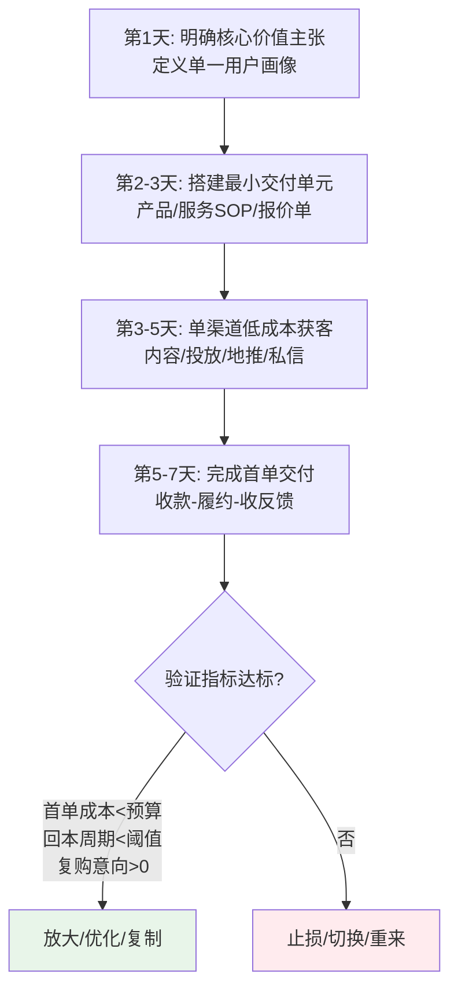

## 26.7 行业周期窗口期 —— 在“高流量低商业化”阶段入场

### 为什么需要这个概念？

同一项目，早做一年赚百万，晚做一年亏百万，核心差异在“入场时机”。识别平台/行业“红利期、成长期、成熟期、衰退期”，避免逆周期操作。利用“时间套利”：在平台鼓励、竞争弱、流量廉价时，用笨办法跑通模型。

### 核心定义

**窗口期**（来源：《FCiidWBeJoLOT1xreYnc9Se4nOf.md》[origin]、《PglAdRMiIoVTRyxc4Q3cw8hvnWf.md》[improve]）

> 平台流量释放 > 商业化收割、规则宽松、头部未垄断、普通人可入场的黄金时期。**判断依据**：平台战略重心、头部玩家动作、流量单价、违规容忍度、政策风向。

### 关键性质

早期高流量低商业化：抖音早期、TikTok 2022年、视频号 2023年、美团电商 2022下半年。窗口期有寿命：老杨预判娱乐直播“至少2年”，胖龟扑中“存量消费时代”二手房红利。窗口期内“完成比完美重要”：美团电商“完成比完美更重要”，先跑通再优化。正如老杨所言：“按照抖音、映客花椒的发展路线图，初级阶段娱乐直播至少可以做2年的时间...”（《FCiidWBeJoLOT1xreYnc9Se4nOf.md》[origin]）胖龟创始人判断：“早在 2018 的时候国内的新建楼房已经开始走下坡路...国内房产销售已经从存量与增量市场并重的方向，开始迈入存量消费时代。”（《PglAdRMiIoVTRyxc4Q3cw8hvnWf.md》[improve]）

### 典型例子

下表展示四个案例在各自窗口期的入场时机与收益：

| 平台/赛道 | 窗口期特征 | 入场者收益 |
|-----------|------------|------------|
| **TikTok娱乐直播** | 对标抖音2017-2018，高流量低商业化 | 老杨：单小时均100美金，峰值在线4.2万 |
| **胖龟找房** | 2018新房下行+疫情催化，存量时代红利 | 第一年8家店、104.7万营收、帮会员省574万中介费 |
| **夕子小红书** | 2020疫期封控期流量红利 | 封家半月→千粉变万粉→月利润5万+ |
| **美团电商** | 类比淘系“铺货期”红利 | 80元MVP→2个月30店、单店月利6-12k |

### 多源对照：窗口期判断的多维度支撑

**共识**：窗口期核心特征为“高流量、低商业化、规则宽松、头部未垄断”，需“完成比完美”快速跑通。

**分歧**：
- 《FCiidWBeJoLOT1xreYnc9Se4nOf.md》[origin] 采用**对标成熟平台历史路径法**（TikTok对标抖音2017-2018），通过历史周期推演预判寿命（≥2年）；
- 《PglAdRMiIoVTRyxc4Q3cw8hvnWf.md》[improve] 采用**宏观行业周期拐点法**（新房下行+城镇化见顶+疫情催化），判断存量时代二手房红利窗口。

### 边界条件

窗口期不可预测精确终点：只能“敬畏市场、与市场共舞”，保护弹药（现金流、团队）。伪窗口期陷阱：平台放水吸引商家入驻，实则收割（如TEMU压价至1688平齐、抖音本地生活后期严控合规）。跨周期生存需“1+1+1矩阵”：1个盈利养团队、1个开发接力、1个知识付费变现经验。

### 方法演进图：从平台红利识别到矩阵化生存

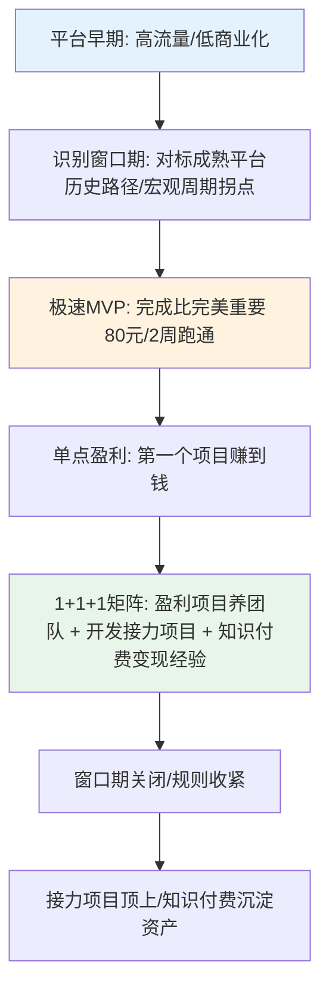

## 26.8 1+1+1项目矩阵模式

### 核心定义

**1+1+1项目矩阵**（来源：《FCiidWBeJoLOT1xreYnc9Se4nOf.md》[origin]）

> 1个项目在盈利（养团队、现金流）、1个在开发（接力、应对生命周期）、1个在做知识付费（变现经验、建立品牌护城河）。

### 关键性质

项目生命周期短：娱乐直播类2-6个月，必须具备开发新项目能力。可复制快速执行：门槛能有多高拔多高，但要看人员配备现状。三重保险：现金流不断、新项目储备、经验资产化。正如老杨所言：“有模式，我称之为1+1+1，1个在盈利，1个在开发，1个在知识付费...同一个项目在不升级的情况下生命周期从2-6个月不等，所以在开发项目时必须要可复制，快速执行，门槛能有多高拔多高...”（《FCiidWBeJoLOT1xreYnc9Se4nOf.md》[origin]）

### 典型例子

下表对比三位创业者的1+1+1矩阵布局：

| 创业者 | 盈利项目(1) | 开发接力项目(1) | 知识付费/经验变现(1) |
|--------|-------------|-----------------|----------------------|
| **老杨** | TikTok睡播/娱乐直播矩阵 | 新娱乐直播玩法(声光电微创新) | 将全套SOP/软件/硬件配置包装教学 |
| **夕子** | 线上美业私域高客单 | 实体皮肤管理店/自有品牌研发 | 科学护肤课程/加盟商赋能体系 |
| **胖龟找房** | 0中介费买房/租房会员费 | 城市合伙人/店中店扩张模式 | 房产创业实战课/合伙人招募 |

### 方法演进图：1+1+1矩阵的动态平衡机制

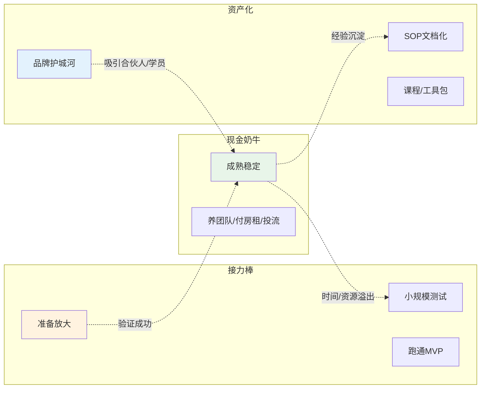

## 26.9 公域获客矩阵 —— 撒网捕鱼、借力打力、主动出击

### 为什么需要这个概念？

流量是生意的血液，公域流量池是冷启动的唯一来源。掌握“内容不自嗨、全域矩阵、蹭流截流、主动出击”四大法门，能让创业者在零预算、零粉丝起步时，依然能精准触达种子用户，完成从0到1的获客突破。

### 核心定义

**公域获客矩阵**（来源：《E1WGd70YLoaHGfxAYJTc4WoFnsd.md》[origin]、《PglAdRMiIoVTRyxc4Q3cw8hvnWf.md》[origin]）

> 以“内容不自嗨”为创作原则，以“多平台撒网”为覆盖策略，以“蹭流截流”为低成本切入战术，以“主动出击挖租客”为增量手段，构建的公域流量获取体系。

### 关键性质

**内容不自嗨**：定位→选题→模仿→优化→创新（学书法先临帖）。夕子强调：“做内容有个很重要的点，一定不要自嗨。先从模仿开始。做好定位，之后模仿，再优化。”（《E1WGd70YLoaHGfxAYJTc4WoFnsd.md》[origin]）

**全域矩阵**：抖音/快手/小红书/58/转转/豆瓣/知乎多平台撒网（撒网捕鱼）。胖龟团队在抖音搜索“上海租房”找高互动视频评论区私聊，在转转/咸鱼“求租广场”主动出击，在豆瓣/微博/知乎超话小组发帖回复，构建全域触点（《PglAdRMiIoVTRyxc4Q3cw8hvnWf.md》[origin]）。

**蹭流截流**：开在传统中介隔壁“0中介费”截流自然客流（借东风）。胖龟实操：“传统的中介店会有大量的客户到店，我们只需要在隔壁开一家小店...用互联网的专有名词，就是蹭，蹭其他中介的流量，然后通过我们的门头标语：买二手房，租房，'0'中介费。来吸引用户到店，以达到截流的目的。”（《PglAdRMiIoVTRyxc4Q3cw8hvnWf.md》[origin]）

**租客全域发掘**：评论区私聊、拼室友、求租广场、超话小组主动出击。胖龟团队将“被动等客”上门转为“主动挖客”出击，显著提升线索转化率。

### 典型例子

下表对比三位创业者在四大获客战术上的具体执行差异：

| 战术 | 夕子（线上美业） | 胖龟找房（房产平台） | 老杨（TikTok直播） |
|------|------------------|----------------------|-------------------|
| **内容不自嗨** | 科学护肤定位→收集爆款选题→模仿录制刷酸视频→优化脚本 | 租房/买房干货笔记→模仿同城大号选题→优化封面标题 | 拆解Twitch睡播头部→像素级模仿道具/剧本/节奏→本地化微创新 |
| **全域矩阵** | 知乎（早期）→ 小红书（主阵地）→ 视频号/抖音（补充） | 抖音/快手/小红书+58/安居客/转转/咸鱼+豆瓣/微博/知乎超话 | TikTok主阵地+国内抖音/视频号引流海外号 |
| **蹭流截流** | 评论区回复竞品粉丝、蹭热门话题#敏感肌# | 开在贝壳/链家隔壁“0中介费”门店、截流自然客流 | 蹭TikTok推荐算法标签、蹭节日/热点事件做主题直播 |
| **主动出击** | 知乎私信提问者、小红书评论区留钩子引导私信 | 评论区私聊有意向租客、转转求租广场逐个联系 | 捞竞品直播间高净值粉丝、私信引导进私域 |

### 方法演进图：公域获客从“撒网”到“精准捕捞”的进阶

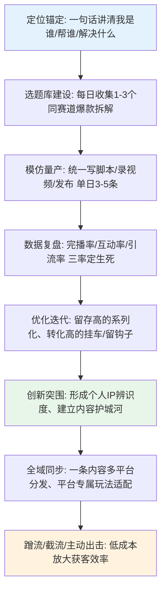

## 26.10 私域转化体系 —— 端金饭碗别讨饭，标准化成交飞轮

### 为什么需要这个概念？

公域流量越来越贵，私域是沉淀用户、提升LTV（生命周期价值）、实现高客单复购的主阵地。但很多创业者“端着金饭碗在讨饭”：私域用户奔着专业来，却去卖低客单、非专业的团购杂货。建立“咨询SOP表格+五位一体成交飞轮+单客价/LTV思维”，才能把专业优势转化为现金流。

### 核心定义

**私域转化体系**（来源：《E1WGd70YLoaHGfxAYJTc4WoFnsd.md》[origin]、《PglAdRMiIoVTRyxc4Q3cw8hvnWf.md》[origin]）

> 基于“金饭碗思维”（专业用户服务高客单技术需求），以“咨询SOP表格”标准化前置沟通，以“五位一体成交飞轮”（破冰→诊断→方案→信任→成交）推进转化，以“单客价/LTV思维”指导运营决策的私域成交体系。

### 关键性质

**金饭碗思维**：私域用户因专业而来，应服务高客单、技术型需求，而非做低价值的社群团购。夕子复盘：“私域老师有句话点醒了我：‘端着金饭碗在讨饭。’当时我兼着一个社群团购业务，就是吃喝拉撒的这些，我私域的用户更多奔着我专业，看皮肤来的，我居然做这种事情，真的在讨饭。私域的用户需要花费时间和精力去交流，这种需要技术的事情，就应该收高客单。”（《E1WGd70YLoaHGfxAYJTc4WoFnsd.md》[origin]）

**咨询SOP表格**：梳理现有咨询中的标准作业流程，固定回复模板并不断完善，加快回复速度、提升客单价和成交率。夕子实测：“有了这个表格，我回复客户信息也比较快。当然目前这一套我都复制给了我的联创合伙人，她们的客单价、成交率、利润率都上来了。”（《E1WGd70YLoaHGfxAYJTc4WoFnsd.md》[origin]）

**五位一体成交飞轮**：破冰→诊断→方案→信任→成交，解决用户“为什么买、为什么跟你买、为什么现在买”三个核心问题。胖龟租房SOP体现此逻辑：破冰（私聊破冰建立联系）→诊断（精准匹配3-5-7套房源）→方案（提供位置/密码锁自看）→信任（线上签约/最短时间房东到场）→成交（《PglAdRMiIoVTRyxc4Q3cw8hvnWf.md》[origin]）。

**单客价/LTV思维**：关注用户生命周期总价值而非单次客单价，通过复购拉长周期提升整体销售额。夕子从“单次卖面膜”转向“口服保养+多功效组合”，实现“一个人一单接受了不会轻易更换”的高LTV。

### 典型例子

下表对比夕子与胖龟在五位一体成交飞轮各环节的具体执行动作：

| 环节 | 夕子（线上美业） | 胖龟找房（租房业务） | 通用SOP要点 |
|------|------------------|----------------------|-------------|
| **破冰** | 微信欢迎语+肤质测试表单 | 评论区/私聊“还在吗/多少钱”→ 破冰话术库 | 标准化首句、打标签分层、建档入表 |
| **诊断** | 科学护肤金字塔问诊：清洁/保湿/抗氧化/防晒/专业干预 | 后台按需求精准匹配3-5-7套房源，不满意二配三配 | 结构化问卷/需求模型、匹配算法/人工规则、记录反馈迭代 |
| **方案** | 定制早晚护肤方案+产品组合（口服+外用+医美建议） | 提供房源位置/楼牌/密码锁密码，引导自看/陪看 | 方案模板化、报价标准化、风险提示前置 |
| **信任** | 专业背书（医生/博士/医院合作）、案例库、小群喂饭教程 | 线上签约、房东最短时间到场、合同条款透明 | 权威背书展示、成功案例可视化、流程透明化 |
| **成交** | 微信支付/分期、发货/预约医美、建立复购提醒周期 | 收取首月房租+押金/服务费、开具收据、售后群服务 | 支付路径最短、交付确认闭环、售后SOP启动 |

### 方法演进图：五位一体成交飞轮的正向循环

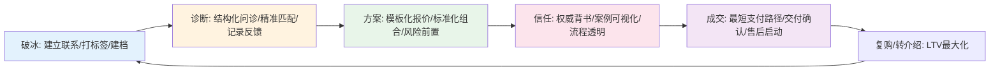

## 26.11 裂变与扩张 —— 克隆直营店、铺铁路网、人海战术

### 为什么需要这个概念？

单店/单号模式天花板低，且抗风险弱。通过“合伙人/城市管家”复制基建能力，“加盟赋能一条龙”复制运营能力，“人海战术”复制销售能力，实现几何级数扩张。这是从“打工者”进阶为“平台主”的关键跃迁。

### 核心定义

**裂变与扩张体系**（来源：《PglAdRMiIoVTRyxc4Q3cw8hvnWf.md》[origin]、《E1WGd70YLoaHGfxAYJTc4WoFnsd.md》[origin]）

> 以“平台给房源库/配房/流程，合伙人只维护用户”为核心的城市合伙人模式，以“脚本/SOP/课程/朋友圈/聊天SOP拿来即用”为核心的加盟赋能模式，以“单员工底薪3000月两单覆盖成本，批量招人放大利润”为核心的人海战术，三位一体的几何级扩张体系。

### 关键性质

**合伙人/城市管家（铺铁路网）**：平台提供房源库、配房人员、带看流程、签约系统等基建，合伙人（城市管家）只需维护用户、聊天成交。胖龟模式：“我们通过区域合伙人计划——城市管家，快速让合伙人上手。我们有自己平台，房源库、配房人员、带看流程、合伙人只需要维护用户，聊天就行。”（《PglAdRMiIoVTRyxc4Q3cw8hvnWf.md》[origin]）

**加盟赋能一条龙（克隆直营店）**：脚本（改人设即发）、拍摄剪辑SOP（含3条视频剪辑）、问题性肌肤专业看脸课程（6980元赠品+小群喂饭教程）、私域朋友圈搭建和聊天SOP，实现“脚本、案例共享”的重复-复制-重复模式。夕子加盟包：“直接是现成的脚本（在标红的地方改为自己的人设信息即可），给到录制视频的sop，以及提供3条视频的剪辑。你拿来就可以直接发布，相当于公域账号直接有了。价值6980的课程赠送...相当于喂饭教程。基础的朋友圈搭建，聊天sop都会给到，也会辅助群发售。”（《E1WGd70YLoaHGfxAYJTc4WoFnsd.md》[origin]）

**人海战术**：单员工底薪3000，月成交两单覆盖成本，批量招人放大利润。胖龟测算：“单个房子的租金在我们这个城市大概在 1000-2000，每个基础员工的底薪大概在3000，每月成交两单，就能顾主成本。所以在项目跑通以后我们拓展了客服员工，通过人海战术获取更大的利润。”（《PglAdRMiIoVTRyxc4Q3cw8hvnWf.md》[origin]）

### 典型例子

下表对比三位创业者在三大扩张模式上的布局差异：

| 扩张模式 | 适用阶段 | 核心杠杆 | 夕子案例 | 胖龟案例 | 老杨案例 |
|----------|----------|----------|----------|----------|----------|
| **城市合伙人** | 单城跑通、有标准化平台基建 | 平台基建（房源/流程/系统） | 计划中：联创合伙人开城市分站 | 进行中：杭州/上海/深圳城市管家 | 暂未启动（纯线上可直接复制账号） |
| **加盟赋能** | 单店/单号模型成熟、SOP完备 | 运营SOP全套交付（脚本/课程/工具） | 已落地：加盟商拿脚本/SOP/课程/群教学 | 计划中：店中店联营赋能 | 已落地：全套软硬件配置+教学打包售卖 |
| **人海战术** | 单人产出模型跑通、边际利润>边际成本 | 低底薪+高提成+标准化SOP | 实体店店长+美容师编制 | 客服团队扩编、按单提成 | 直播间矩阵：多号轮播、主播轮班 |

### 方法演进图：裂变扩张的三阶段进化

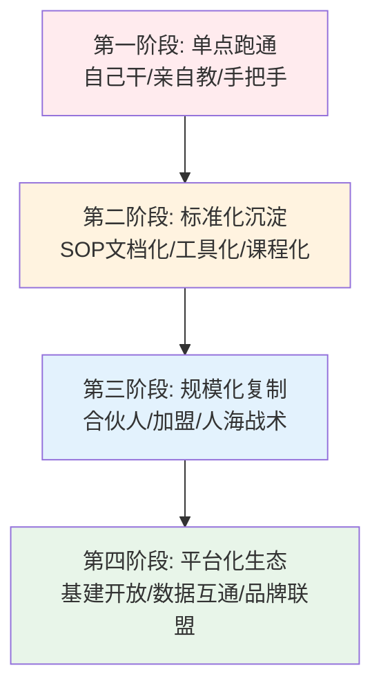

## 26.12 股权与治理 —— 4C动态量化模型与创始人身份本质

### 为什么需要这个概念？

合伙创业最易因股权模糊、责权不清、退出无章导致团队分裂、公司夭折。建立“4C动态量化模型”量化分股，明确“创始人身份=风险兜底=控制权”本质，配套“一致行动权/期权池/回购权/优先清算/领售权”等合同条款，是公司治理的基石。

### 核心定义

**4C动态量化模型**（来源：《PglAdRMiIoVTRyxc4Q3cw8hvnWf.md》[origin] —— 结合素材中招聘偏好、技术合伙人吸纳、融资实操等实践推导）

> 以**创始人身份**、**岗位权重**、**时间投入**、**资金投入**四个维度，设定权重量化分股，而非平均主义或单一维度论资排辈。

**创始人身份本质**（来源：《PglAdRMiIoVTRyxc4Q3cw8hvnWf.md》[origin] —— 结合素材中“天使轮融资获早行人创投投资”、“创始人对外仅一把声音”实践推导）

> 创始人身份的本质是**承担最大风险兜底责任**，因此拥有**最大控制权**（对外仅一把声音），而非出资最多或资历最深。

### 关键性质

**时间投入看产出匹配里程碑**：不计工时计产出，设定里程碑（如MVP跑通、月流水破10万、团队扩编至5人），达标确认时间投入权重。**资金投入是信心与风险意愿信号**：出资多寡反映风险偏好，但不直接换算控制权，需通过优先清算权、反稀释条款保护。**招聘避坑：白纸可塑(应届生)>经验固化(房产销售)**：胖龟惨痛教训：“一开始我们在线下招聘的时候偏向于找寻一些从事过相关房产行业的销售人员...这波人有个严重的问题，固化思维太重，难以改变思维，销售的重点只是推荐房子，而非会员的转化。后来我们把招聘重点放到了刚毕业的大学生身上...”（《PglAdRMiIoVTRyxc4Q3cw8hvnWf.md》[origin]）旧瓶难装新酒，思维转化比技能更关键。**股权起点非终点**：需配套一致行动权（创始人持有）、期权池（预留10-15%）、回购权（公司/创始人回购离职股份）、优先清算（投资人/出资合伙人）、领售权（大股东带售小股东）等合同条款，动态治理。

> "在本地选择的时候，一定要深入公司内部去考察，看看外包团队的人员构成，人员数量，还有他们实施过的案例... 所以在做互联网项目创业的时候，最好的方式吸纳一位优秀的技术开发人员最好。"
> 
> ——《PglAdRMiIoVTRyxc4Q3cw8hvnWf.md》[origin]

> "一开始我们在线下招聘的时候偏向于找寻一些从事过相关房产行业的销售人员...这波人有个严重的问题，固化思维太重，难以改变思维...后来我们把招聘重点放到了刚毕业的大学生身上..."
> 
> ——《PglAdRMiIoVTRyxc4Q3cw8hvnWf.md》[origin]

### 典型例子

下表展示4C模型各维度的权重设定参考与量化指标示例：

| 维度 | 权重设定参考 | 量化指标示例 |
|------|--------------|--------------|
| **创始人身份** | 30-40%（控制权锚定） | 谁注册公司/签无限连带担保/对外唯一法定代表人 |
| **岗位权重** | 20-30% | CEO/CTO/COO/销售VP等核心岗位差异化定价 |
| **时间投入** | 20-30% | 全职=1.0、兼职=0.3-0.5、里程碑达标系数调整 |
| **资金投入** | 10-20% | 实缴出资额/估值锚定，配优先清算/反稀释 |

### 方法演进图：股权治理从静态分股到动态治理的闭环

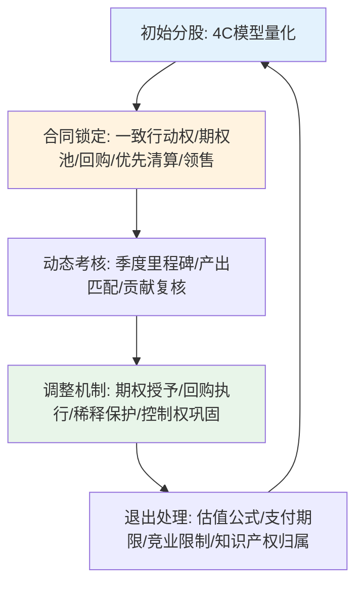

## 26.13 融资与合规风控 —— 敬畏规则、止损前置、不做冤大头

### 为什么需要这个概念？

创业九死一生，死于“违规”、“被坑”、“拖死”者不在少数。建立“融资防骗、劳动合规、平台规则、止损决策”四大防线，是活下来、拿结果的前提。

### 核心定义

**融资与合规风控**（来源：《PglAdRMiIoVTRyxc4Q3cw8hvnWf.md》[origin]、《FCiidWBeJoLOT1xreYnc9Se4nOf.md》[origin]、《E1WGd70YLoaHGfxAYJTc4WoFnsd.md》[origin] 综合）

> 涵盖**融资防骗**（有人推荐、不盲目缴费）、**劳动合规**（合同是枪附件是子弹、辞退最小化损失）、**平台规则**（敬畏风控、合规或规避获流量、内容审核应对）、**止损决策**（理性评估门槛果断放弃）的全方位风控体系。

### 关键性质

**融资防骗**：市面上很多打着投融资旗号的骗子公司，让创始团队缴纳各种名义的费用，少则几千多则上万，一定不要盲目缴纳各种费用。胖龟忠告：“如果你想去融资，想去找投资人。最好有人推荐...一定不要盲目缴纳各种费用。”（《PglAdRMiIoVTRyxc4Q3cw8hvnWf.md》[origin]）

**劳动合规**：合同是枪、附件是子弹（岗位考核/规章/廉洁/保密），辞退最小化损失，及时签合同建考核。外包实地考察吸纳技术合伙人：胖龟教训“在本地选择的时候，一定要深入公司内部去考察...所以在做互联网项目创业的时候，最好的方式吸纳一位优秀的技术开发人员最好。”（《PglAdRMiIoVTRyxc4Q3cw8hvnWf.md》[origin]）

**平台规则**：敬畏风控、合规或规避获流量、内容审核应对（离线版/用户反馈/修订重传）。夕子知乎封号果断转小红书，老杨TikTok娱乐直播规避带货合规风险，均为应对典范。

**止损决策**：理性评估门槛（预算/资质/工期/流量源）果断放弃而非盲目投入。老杨强调“项目生命周期2-6个月，必须具备开发新项目能力”，本质是止损与接力的统一。

### 典型例子

下表汇总四大风控维度的避坑关键动作与实战案例：

| 风控维度 | 避坑关键动作 | 血泪教训/正向案例 |
|----------|--------------|-------------------|
| **融资防骗** | 仅接受靠谱推荐的投资人、零前置费用、律师审条款 | 胖龟拒绝多家“收费找投资”机构，最终获早行人创投真金白银天使轮 |
| **劳动合规** | 入职即签合同+岗位考核表+保密协议+廉洁承诺、试用期考核不达标依法辞退 | 夕子合伙人全签全套协议，胖龟吸纳技术合伙人替代外包 |
| **平台规则** | 内容离线版备份、违规申诉SOP、多平台分发分险、业务模式合规化备选 | 夕子知乎封号→小红书；老杨娱乐直播规避带货监管；美团电商避开无货源红线 |
| **止损决策** | 设定最大投入预算/时间/人力，未达标即切换 | 夕子2万止损线、老杨单项目2-6个月生命周期预判、美团电商80元MVP验证 |

> "以此 抖音推广>本地自媒体>汽车广播...汽车广播这个板块不建议大家做，薅羊毛的客户比较多~...投抖音的时候如果你是做本地项目，一定要投本地一定要投本地..."
> 
> ——《PglAdRMiIoVTRyxc4Q3cw8hvnWf.md》[origin]

### 方法演进图：风控四防线的层层设防

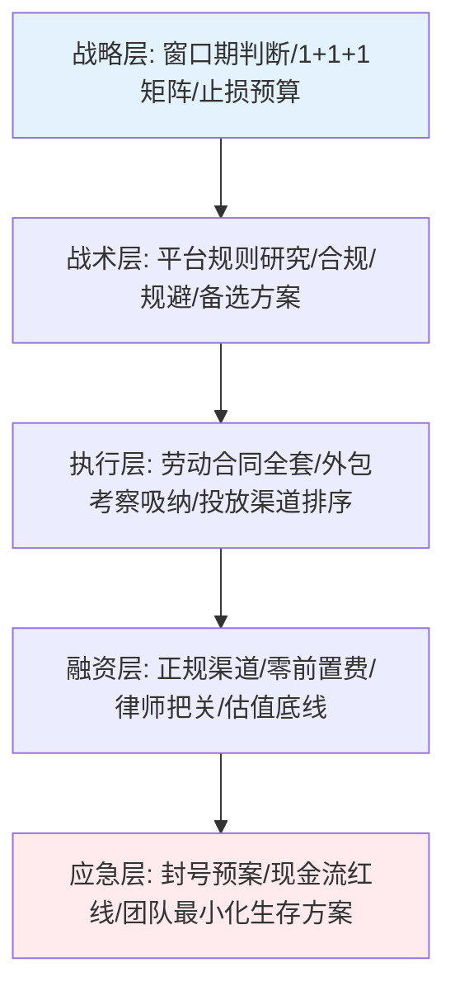

## 26.14 认知与心态 —— 内在比赛赢了，外在比赛才不输

### 为什么需要这个概念？

创业是场持久战，外部环境不可控，唯有内在心态可控。“内在比赛理论”“成功是成功之母”“俯视学习法”“正反馈驱动热爱”“战术勤奋逃避战略探索”五大心法，是穿越周期、穿越迷雾、穿越自我怀疑的内功心法。

### 核心定义

**内在比赛理论**（来源：《FCiidWBeJoLOT1xreYnc9Se4nOf.md》[origin] —— 结合素材中“盲目自信是理性选择”、“娱乐直播风口至少2年”的果断决策推导）

> 自我二（潜意识）认可目标才能赢外在比赛，**盲目自信是理性选择**——在不确定性中，主观概率上调是行动的前提。

**成功是成功之母**（来源：《FCiidWBeJoLOT1xreYnc9Se4nOf.md》[origin] —— 结合素材中“复制对标者再创新”、“向有结果的人学习”累积胜利经验推导）

> 过去成功体验累积潜意识自信推动更大成功，**唤醒成功体验法**：罗列过往所有“赢过”的瞬间（考试/比赛/项目/沟通），重塑潜意识“我能赢”。

**俯视学习法**（来源：《FCiidWBeJoLOT1xreYnc9Se4nOf.md》[origin] —— 结合素材中“付费学习生财星球/玩赚星球/私域老师”、“像素级模仿竞品再微创新”推导）

> 战略藐视战术重视，**跪着学打不赢内在比赛**。站在巨人肩膀上（付费学习/找导师/复制SOP），是平视甚至俯视姿态，而非跪拜。

**正反馈驱动热爱**（来源：《FCiidWBeJoLOT1xreYnc9Se4nOf.md》[origin] —— 结合素材中“新号2天起量峰值破500”、“首单成交”、“首笔打赏到账”等微小正反馈累积推导）

> 懒惰本质是无正反馈，**突破口找热爱或纯为钱冲**。小正反馈（首单/首粉/首赞）累积成大自信，驱动长期坚持。

**战术勤奋逃避战略探索**（来源：《FCiidWBeJoLOT1xreYnc9Se4nOf.md》[origin] —— 结合素材中“产品狗定势思维”、“多看多拆解多测试”、“1+1+1矩阵必须预留开发新项目能力”推导）

> 用忙碌麻痹自己长期有毒，**唯有战略突破带来真增长**。每周留出“战略思考时间”，拒绝伪勤奋。如：老杨每日复盘直播数据是战术勤奋，但若不抽时间思考“下一个娱乐直播玩法是什么”、开发接力项目，就是战略懒惰。

### 关键性质

这些心法并非鸡汤，而是基于认知心理学与创业实战的**可操作心理工具**：
- **盲目自信**不是盲目乐观，而是“在证据不足时，主观上调成功概率以启动行动”的贝叶斯决策；
- **唤醒成功体验**不是自夸，而是显式调取长时记忆中的胜利锚点，重塑潜意识预期；
- **俯视学习**不是傲慢，而是“买别人踩过的坑、用别人验证过的SOP”，用金钱换时间、用站姿换视角；
- **正反馈驱动**不是贪婪，而是利用多巴胺机制设计“最小正反馈闭环”，把大目标拆解为可即时获得奖励的微动作；
- **拒绝战术勤奋**不是偷懒，而是建立“战略审视机制”，定期问：“我这周做的事，哪件改变了商业模型的关键变量？”

### 方法演进图：心态内功的五层修炼塔

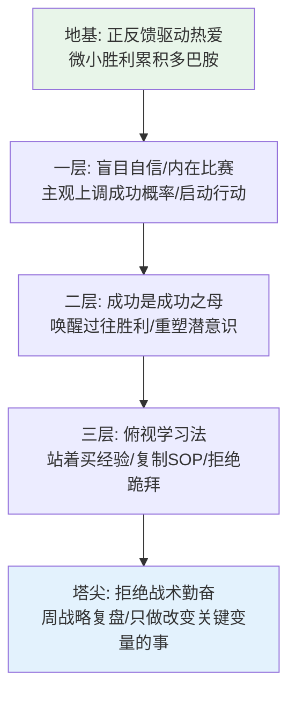

## 26.15 设计中的取舍

**为什么不用“大而全”的产品规划起步？**  
因为资源有限，大而全意味着周期长、沉没成本高、反馈慢。MVP只验证核心假设：“有人愿为核心价值付费且流程可跑通”。夕子若一开始就想“自建品牌+实体店+全品类”，早死在2万启动资金里了。这是夕子从“代购面膜一单2元”到“自建品牌加盟”的进化史证明的：每一步只做当下资源能支撑、当下窗口期能跑通的最小闭环，再用利润滚雪球。

**为什么不在窗口期结束后才开发新项目？**  
因为开发新项目本身需要2-6个月磨合期。老杨的“1个在开发”正是在盈利项目红利期内启动下一个，实现无缝衔接。等风口过再找方向，只能吃残羹冷炙。老杨明确指出：“同一个项目在不升级的情况下生命周期从2-6个月不等，所以在开发项目时必须要可复制，快速执行...”（《FCiidWBeJoLOT1xreYnc9Se4nOf.md》[origin]）这要求在盈利项目尚可时，就已启动下一轮开发，这就是“1+1+1矩阵”动态平衡的核心。

**纯信息差模式与“产品+服务”模式的trade-off是什么？**  
纯信息差：启动快、边际成本零、但天花板低、极易被透明化消灭（如政府平台上线）。“产品+服务”：交付重、需SOP、但建立品牌资产、复购高、抗风险强。胖龟、夕子、老杨最终都走向了后者。胖龟从“卖房源信息”进化到“卖会员服务”再到“自有品牌租房/家居水光”；夕子从“代购面膜”进化到“自选口服爆款”再到“自建品牌加盟”；老杨从“单一睡播”进化到“声光电道具微创新矩阵”再到“全套SOP教学打包”。三条路径殊途同归：唯有**产品化/标准化/品牌化**，才能跨越周期、建立护城河。

## 26.16 动手练习

### 练习1：为你的副业想法做一次‘痛点-信息差-选品’三步验证

**编号**：1  
**标题**：练习1：为你的副业想法做一次‘痛点-信息差-选品’三步验证  
**内容**：
1. 假设你想做一个“考公上岸资料整理”副业：
2. 痛点验证：列出目标用户（考公小白/二战裸考生）最急迫的3个具体痛点，并判断哪些是“伪痛点”（如“想要免费资料”非付费痛点）。
3. 信息差挖掘：这些痛点背后，用户不知道而你知道的关键信息是什么？（如：哪个老师的押题卷命中率高、哪个岗位竞争比被低估、面试真题去哪找）。
4. 选品决策：基于以上，设计一个“最小可行产品”组合（如：9.9元“避坑指南电子书”+ 99元“高频考点押题卷”+ 299元“面试模拟陪练营”），标注每个产品的“深挖需求/涵盖面/品牌背书/复购/溢价”得分。
5. 回答问题：
   - 如果平台突然免费开放所有真题，你的信息差还在吗？如何升维？
   - 为什么“免费资料包”不能作为核心付费产品？

### 练习2：设计一个‘最小MVP闭环’的7天执行计划

**编号**：2  
**标题**：练习2：设计一个‘最小MVP闭环’的7天执行计划  
**内容**：
1. 场景：你想验证“帮中小企业做抖音同城获客代运营”这个模式。
2. 请按“产品-流量-销售-交付”四环节，列出第1-7天每天的关键动作、预算上限、验证指标（如：第3天前搞定1个种子客户免费试单、第5天跑通标准化交付SOP、第7天收到首笔意向金）。
3. 标注你的“止损点”：最多投入多少钱/天/人力，未达标准即切换或放弃。
4. 回答问题：
   - 为什么“帮客户拍1条视频”不是合格的MVP交付？
   - 如何用“咨询SOP表格”思维，把非标的“代运营”服务标准化？

### 练习3：推演你所在赛道的‘窗口期-矩阵-风控’策略

**编号**：3  
**标题**：练习3：推演你所在赛道的‘窗口期-矩阵-风控’策略  
**内容**：
1. 以“AI绘画小程序”或“视频号无货源店群”或“抖音本地生活代运营”任选一个为例：
2. 窗口期判断：该赛道目前处于“高流量低商业化”、“成长期”、“成熟期”还是“衰退期”？依据是什么（平台战略/头部动作/流量单价/违规容忍度）？
3. 1+1+1矩阵规划：你的“盈利项目”是什么？“开发中的接力项目”是什么？“知识付费变现经验”产品是什么？
4. 关键风控清单：列出该模式下的Top 3平台规则红线、Top 2合规成本、Top 1止损触发条件。
5. 回答问题：
   - 如果平台突然收紧规则（如抖音打击无货源、微信封小程序），你的“开发接力项目”能否在2周内顶上？
   - 为什么“把鸡蛋放在一个平台篮子里”违背窗口期理论？

### 练习4：模拟一次‘股权分配与合伙人招聘’决策会

**编号**：4  
**标题**：练习4：模拟一次‘股权分配与合伙人招聘’决策会  
**内容**：
1. 场景：你和两位合伙人（一位全职运营、一位出技术兼职、一位出资20万不参与运营）准备注册公司做“私域流量变现工具”。
2. 用4C模型（创始人身份/岗位权重/时间投入/资金投入）给三人分配初始股权比例，并写出每个维度的权重设定理由。
3. 列出必须配套的5项合同条款（如：一致行动权归属、期权池比例、退出回购价格公式、竞业限制、知识产权归属）。
4. 招聘第1名员工（运营助理）：你会倾向于“有2年抖音运营经验”还是“应届生但做过学生会组织过3场百人活动”？用“旧瓶难装新酒/白纸可塑”理论解释理由。
5. 回答问题：
   - 为什么“创始人身份”必须由一个人承担，不能共享？
   - 如果出资合伙人要求“因为我出钱多，重大决策我有一票否决权”，你如何用“创始人身份=风险兜底=控制权”理论沟通？

## 26.17 本章小结

这一章中我们系统学习了创业从0到1再到N的完整方法论。首先，我们确立了**痛点是创业的第一性原理**：真痛点天然刚需、越垂直越易建壁垒，需经专业验证，且必须匹配付费意愿与能力。其次，我们揭示了**信息差就是金钱**的本质：生意核心是打通信息断层收取“降低搜索成本”的服务费，壁垒在于获取渠道与效率，且需通过“产品+服务+品牌”升维突破天花板。接着，我们掌握了**选品决定论**：好产品=精准痛点方案+信任背书+高复购结构，选品重于销售，消耗型优于耐用型，品牌背书可迁移。然后，我们实操了**最小MVP闭环**：速度>完美、要素齐全、止损前置，验证看硬指标（首单成本/回本/复购），非标服务需先SOP化。之后，我们判断了**行业周期窗口期**：平台早期“高流量低商业化”是普通人黄金入场期，完成比完美重要，窗口期有寿命需敬畏市场。进而，我们构建了**1+1+1项目矩阵**：1个盈利养团队、1个开发接力、1个知识付费变现经验，应对2-6个月的项目生命周期。随后，我们落地了**公域获客矩阵**：内容不自嗨（模仿优化）、多平台撒网（抖音/小红书/58等）、蹭流截流（开隔壁店）、主动出击挖租客。紧接着，我们建立了**私域转化体系**：端金饭碗别讨饭，专业用户服务高客单技术需求，靠咨询SOP+五位一体成交飞轮提效。然后，我们部署了**裂变扩张体系**：城市合伙人（平台给基建合伙人维用户）、加盟赋能（脚本/SOP/课程拿来即用）、人海战术（低底薪高提成）。最后，我们筑牢了**风控与认知底线**：4C股权模型（创始人身份=风险兜底=控制权）、招聘偏好白纸可塑、投放排序抖音>本地自媒体>广播、融资防骗不盲目交费、内在比赛理论（盲目自信是理性选择、成功累积自信、俯视学习、正反馈驱动热爱）。

本章核心概念速查表：

| 概念 | 一句话解释 |
|------|------------|
| 痛点/第一性原理 | 创业源于对用户真实痛点的深切感知，解决真痛点生意才有刚需属性 |
| 信息差变现 | 生意本质是信息不对等，打通信息断层收取“降低搜索成本”服务费 |
| 选品决定论 | 好产品=精准痛点方案+信任背书+高复购结构，选品重于销售、自带流量转化属性 |
| 最小MVP闭环 | 用最小成本跑通“产品-流量-销售-交付”，速度>完美、止损前置、验证看硬指标 |
| 行业周期窗口期 | 平台早期“高流量低商业化”是普通人最易入场红利期，完成比完美重要、预判寿命做矩阵 |
| 1+1+1项目矩阵 | 1个盈利养团队、1个开发接力、1个知识付费变现经验，应对项目2-6个月生命周期 |
| 公域获客矩阵 | 内容不自嗨(模仿优化)、多平台撒网(抖音/小红书/58等)、蹭流截流(开隔壁店)、主动出击挖租客 |
| 私域高客单转化 | 端金饭碗别讨饭：专业用户服务高客单技术需求，靠咨询SOP+五位一体成交飞轮提效 |
| 单客价/LTV思维 | 关注用户生命周期总价值而非单次客单价，通过复购拉长周期提升整体销售额 |
| 裂变扩张体系 | 城市合伙人(平台给基建合伙人维用户)+加盟赋能(脚本/SOP/课程拿来即用)+人海战术(低底薪高提成) |
| 4C股权模型 | 创始人身份/岗位权重/时间投入/资金投入四维定量分股，创始人身份=风险承担=控制权 |
| 招聘偏好 | 白纸可塑(应届生)>经验固化(行业老手)，旧瓶难装新酒，思维转化比技能更关键 |
| 合规风控底线 | 劳动合同带附件、外包实地考察吸纳技术合伙人、投放排序抖音>本地自媒体>广播、融资防骗不盲目交费 |
| 内在比赛/心态 | 潜意识(自我二)认可目标才能赢，盲目自信是理性选择、成功累积自信、俯视学习、正反馈驱动热爱 |

下一章中，我们将深入**团队建设与组织进化**：如何用“合伙人机制+薪酬设计+绩效考核+文化沉淀”打造能打胜仗、可规模化复制的创业团队，并掌握“股权激励动态调整”与“关键人才留存”的实操框架。

