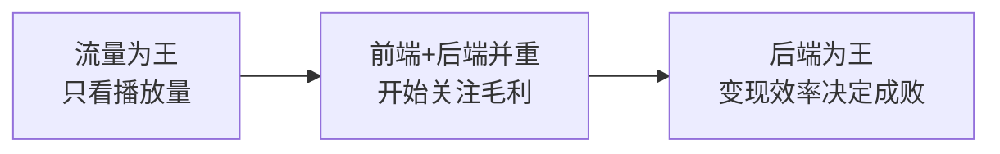
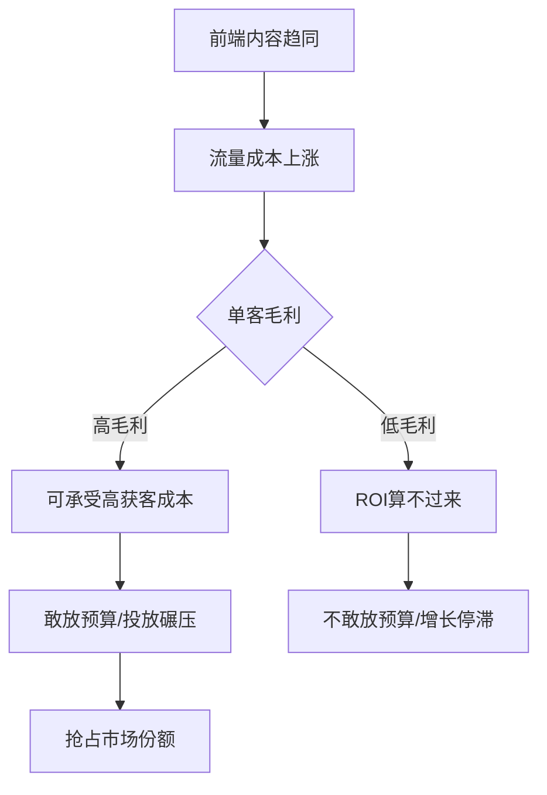
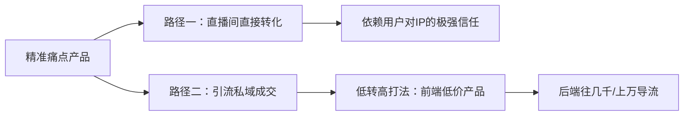
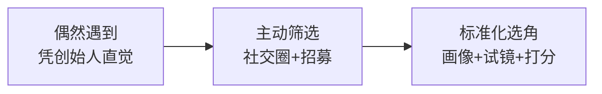
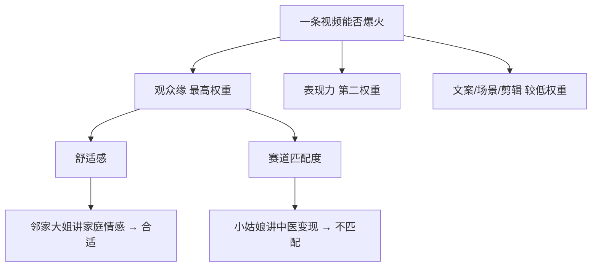
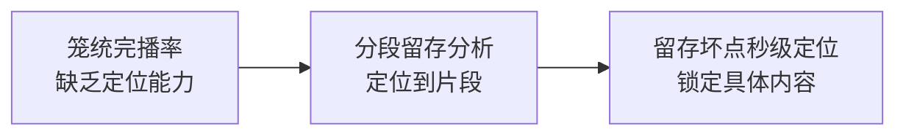
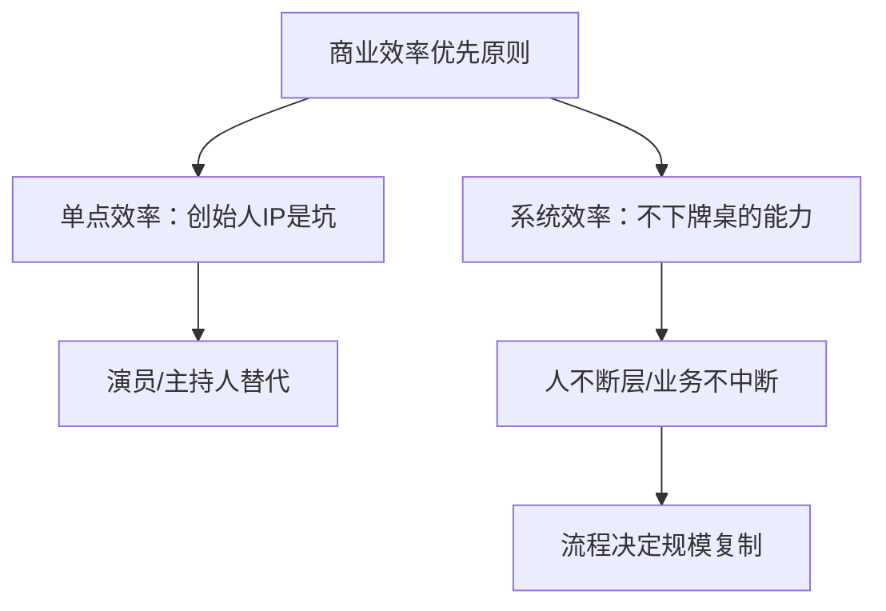
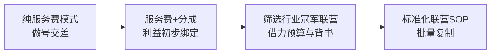
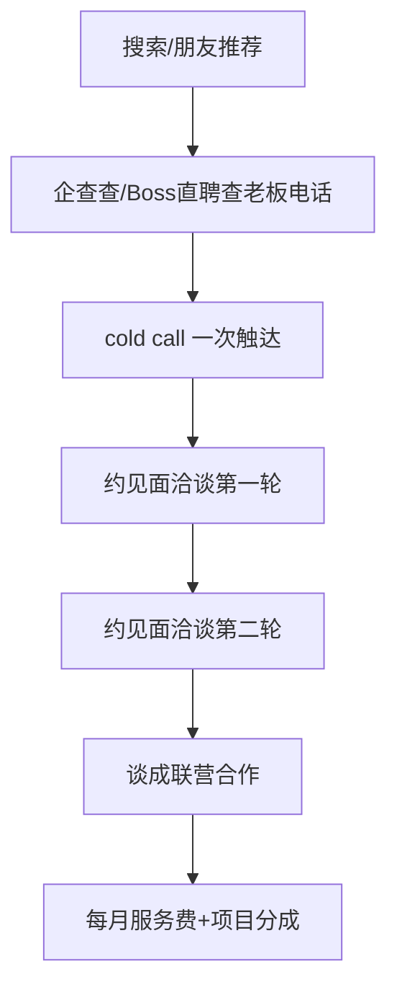

**

# 第 13 章 短视频IP矩阵——从“内容”到“生意”的工业化复制
作者：龙哥

## 学习目标

完成本章学习后，你将能够：

1. 理解后端变现效率为何是抖音IP项目成败的决定因素，并能用“单客毛利-获客成本”视角评估项目；
2. 掌握泛兴趣产品与精准痛点产品的分类标准，并能根据客单价匹配对应的成交路径；
3. 理解观众缘在短视频爆火要素中的优先级，能判断出镜人是否与赛道调性匹配；
4. 掌握通过“留存坏点”定位视频流失节点的方法，并能据此优化内容结构；
5. 理解创始人IP的局限性与演员替换的商业效率逻辑，能基于效率而非情感选择出镜人；
6. 理解“不下牌桌的能力”与“流程决定规模复制”的内在联系，能设计防止单点依赖的团队机制；
7. 掌握行业冠军联营的筛选、触达与合作框架，能评估该策略的适用条件。

## 13.1 生活类比

想象一下，你在经营一家餐厅。后端变现效率，就是每桌客人平均能贡献多少利润——这决定了你敢不敢花大钱做广告拉客；如果每桌只赚 8 块，你花 20 块买一个客人，那就亏定了。泛兴趣产品，就是门口几块钱一份的小吃，靠走量吸引路过的人随手就买，不用太多信任。精准痛点产品，则是需要提前预约的高档套餐，价格高、利润厚，但客人必须先信任厨师的手艺才肯掏钱。观众缘，是服务员给客人的第一印象——一个不适合的人端着菜上来，客人扭头就走，再好的菜也白搭。留存坏点，是客人吃着吃着突然皱眉放下筷子，你要立刻找到是哪道菜出了问题赶紧撤掉。创始人亲自下厨，往往是个坑——老板的手艺未必比专业厨师好，而且他还要管店、见客户，没法整天泡在厨房里。不下牌桌的能力，意味着哪怕主厨离职，后厨也能靠标准菜谱照常出菜，餐厅不会关门。最后，行业冠军联营，就是傍上本地最火的餐饮集团，借他们的名气、食材供应链和招牌菜来给自己引流。这一整套类比，就是本章要拆解的短视频 IP 矩阵方法论。我们可以先用一张总览图来预览本章的知识结构，然后再逐一展开。

## 13.2 概念地图

```
短视频IP矩阵方法论
├── 后端变现效率（决定成败）
│   ├── 定义：单位流量的变现能力
│   ├── 核心指标：单客毛利
│   └── 推论：高毛利可拉高获客成本碾压对手
├── 变现产品双轨制
│   ├── 泛兴趣产品（0-50元）
│   │   ├── 特征：大流量、高转化
│   │   └── 路径：短视频带货直接成交
│   └── 精准痛点产品（1000+元）
│       ├── 特征：精准刚需、依赖信任
│       └── 路径：直播间转化 / 引流私域
├── 出镜人选择
│   ├── 观众缘 > 表现力 > 文案 > 场景 > 剪辑
│   ├── 创始人IP是坑（效率论）
│   └── 演员/主持人替代策略
├── 内容生产与复盘
│   ├── 文案结构：泛流量开头+漏斗型观点+引导结尾
│   ├── 留存坏点：定位掉人元凶
│   └── 三维复盘：5秒完播率/总体完播率/留存坏点
├── 团队能力建设
│   ├── 不下牌桌的能力（人不断层）
│   ├── 流程决定规模复制（经验沉淀）
│   └── 人才培养路线：剪辑→运营→项目经理
└── 借力放大的组织结构
    ├── 行业冠军联营（预算/背书/变现体系）
    └── 服务费+项目分成的利益绑定
```

**本章素材来源说明。** 需要提前说明的是，本章所有核心概念与论述均整理自单一原始素材，即俊达（热浪）的实战分享《短视频IP矩阵》（素材文件：`docs/202301-02/MXPcd58gSoEsTlxFhUVcJ5X7npc.md`）。该素材系统梳理了作者从0到1搭建短视频团队的实战经验。由于素材来源单一，本章未设置“多源对照”小节（模板中用于多篇素材交叉验证的章节），而是基于该素材的内部逻辑进行组织。建议你在应用本章方法论时，主动寻找其他独立来源（如行业报告、其他操盘手的案例复盘）进行交叉验证，以增强结论的稳健性。

## 13.3 变现效率——决定成败的“后端引擎”

你是否想过，为什么两个粉丝量几乎相同的账号，一个年入百万，另一个却连投放预算都不敢加？

答案往往不在前端内容，而在后端的变现能力。让我们先从俊达在《短视频IP矩阵》中提出的核心主张说起。

> “抖音是开卷考试，前端内容一定是趋同的，而真正决定了项目成败的，是我们的后端变现效率。”
>
> ——摘自《短视频IP矩阵：后端变现效率决定项目成败》第一章“变现效率”[MXPcd58gSoEsTlxFhUVcJ5X7npc]

这句话背后的逻辑，你需要先理解抖音的“开卷考试”本质。

**直觉：为什么前端趋同？**

抖音上，任何赛道的前端内容（文案、拍摄、剪辑）都是可以互相抄袭的。你今天发现一个爆款脚本，明天就有 100 个账号在做类似的结构。前端内容根本没有秘密可言。如果前端无法拉开差距，那差距就只能在后端——谁能把同样的流量变成更多的钱。

**为什么需要量化后端变现效率？**

既然差距在后端，你就需要一个指标来衡量“同一个客户，你能从他身上赚多少钱”。没有这个量化指标，你只能凭感觉判断项目能不能做，无法在多个项目间客观比较，也无法科学地决定投放预算。我们先建立一个现金流模型来理解“后端变现效率”这个概念是如何运作的。假设你经营一个账号，每获取一个客户，会经历三个现金流节点：首先，这个客户在你整个变现体系中的生命周期内，累计会支付的总金额，我们称之为**客户终身价值**（Customer Lifetime Value，缩写为CLV，此为推导引入的概念，用于描述客户的总收入贡献）；其次，为了服务这个客户，你需要支付履约成本（交付产品的生产成本、人工、售后等）；最后，你从每个客户身上实际赚到的，就是**单客毛利**。由此，我们可以推导出第一个公式（依据素材中“单客贡献毛利”的核心概念推导）：

$$

\text{单客毛利} = \text{客户终身价值} - \text{履约成本}

$$

我们来一步步推导**为什么可以这样变**：第一步，客户终身价值是你从客户那里收到的所有钱的总额，这是一个“收入”概念；第二步，履约成本是为了实现这笔收入而必须花出去的钱，这是一个“支出”概念；第三步，商业上衡量一个客户是否“赚钱”，最基本的方法就是“收进来的钱”减去“花出去的钱”，剩下来的就是毛利。所以这个式子本质上是“收入 - 成本 = 利润”这个通用会计恒等式在单客场景下的应用。它的含义是：单客毛利就是你服务一个客户所净赚的钱。这个利润越高，说明你的变现体系越健康。

有了单客毛利，我们就能进一步回答一个实际问题：你最多愿意花多少钱去“买”一个客户？商业上，你每获取一个客户都要花费成本（投放广告、买流量等），这笔花费相当于你提前支付的成本。你当然希望这笔投入能收回并且有得赚。假设你期望从每个客户身上保留一部分利润作为自己的回报，这就是**期望利润**（此为推导引入的经营者主观设定参数，可视为预留的安全垫——如果连这部分利润都保不住，这笔生意对你而言就不值得做）。那么你愿意支付给平台的**获客成本上限**，就等于单客毛利减去你期望保留的利润：

$$

\text{获客成本上限} = \text{单客毛利} - \text{期望利润}

$$

我们同样逐步推导**为什么可以这样变**：第一步，单客毛利是你从每个客户身上赚到的总利润，它构成了一个可供分配的“资金池”；第二步，你作为经营者，必须从这个池子里优先给自己留下一部分钱作为回报，这就是“期望利润”；第三步，除了这部分留给自己的利润，池子里剩下的钱，就是你能够拿出来换取下一个客户的最大代价——如果超过这个数，意味着你不仅没赚到钱，反而在倒贴。因此，这个公式的本质是“有限资源下的预算分配”：把毛利这个有限的蛋糕，切成“留给自己的利润”和“换取新客户的成本”两块。在实际业务中，这个公式的作用是帮你设定**投放竞价的天花板**——当一条广告流的实际获客成本高于这个上限时，就应该果断放弃追投，转而优化后端毛利。

把这两个公式连起来看：单客毛利越高，你能承受的获客成本就越高。作者给出了一个非常犀利的对比。

> “同样的减肥粉，别人设计好了完善的变现体系，一个客户可以贡献1000块的毛利，而你只能做到500块，那么别人就可以通过投放，通过矩阵，把获客成本拉到900块。”
>
> ——摘自《短视频IP矩阵：后端变现效率决定项目成败》第一章“变现效率”[MXPcd58gSoEsTlxFhUVcJ5X7npc]

这个对比揭示了竞争的本质：当对手的单客毛利是 1000 元时，他可以承受 900 元的获客成本；而你只有 500 元毛利，最多只能承受 400 元。同一个流量池里，对手敢出价 900，你只敢出价 400——优质的流量自然被对手抢走，你只能捡剩下的。

**为什么敢花大钱本身就是一种碾压？**

> “抖音的流量成本一定是越来越高的，当你ROI算不过来的时候，你就不敢放预算。”
>
> ——摘自《短视频IP矩阵：后端变现效率决定项目成败》第一章“变现效率”[MXPcd58gSoEsTlxFhUVcJ5X7npc]

这里有一个关键机制值得你注意。在这个机制中，流量供给是有限的，但需求（所有想做抖音的商家）是无限的，所以流量价格必然上涨；当流量价格上涨到超过你能承受的获客成本上限时，你的ROI就“算不过来了”；此时你不敢放预算，增长停滞；而对手因为毛利高、上限高，反而可以加大投放、抢占更多份额。这个过程的本质，是变现效率决定了你在流量竞价中的“出价权”。**这个机制在实际业务中起什么作用？** 它回答了一个战略性的问题：当平台流量越来越贵时，你和对手谁能留在牌桌上继续买量。它是你判断“该不该追加投放预算”的底层依据——预算能否追加，不取决于你多想要流量，而取决于你后端毛利撑不撑得住更贵的流量。

**方法演进：从“流量为王”到“后端为王”。**

“后端变现效率”这一视角并非一开始就存在，它的形成有一个脉络。在短视频红利早期，从业者普遍信奉“流量为王”——只要播放量够大，就能靠广告或带货赚钱，几乎不需要考虑后端变现效率。但随着入局者增多，前端内容迅速趋同、流量成本持续上涨，单纯追求播放量的模式难以为继。于是演进到“前端+后端并重”——操盘手开始关注单客毛利，但后端往往只是辅助。再往后，才出现了“后端为王”的成熟阶段——明确认识到后端变现效率才是决定项目成败的根本，前端只是入口。这个演进可以用下图表示：



**设计取舍：为什么不用“前端爆款”策略替代“后端效率”？**

你可能会问，既然前端内容趋同，为什么不把精力全部放在做出爆款视频上，靠免费流量取胜？这个方案的问题在于，免费流量是不可控的。爆款视频有运气成分，无法保证稳定产出。而投放买量是可控的、可规模化的。后端变现效率决定了你在可控的付费流量战场上能不能持续作战并扩大战果——因此它才是决定成败的根基，前端爆款只是锦上添花，无法替代后端的造血能力。

我们可以用一张逻辑流程图来理解后端变现效率是如何起作用的：



**边界条件。** 不过，这一指标并非万能。它成立的前提是：前端内容质量达标、流量规模相当。如果前端流量本身就很差，再高的变现效率也是无米之炊。另外，高毛利是拉高获客成本的前提——如果你的毛利本身就低，变现效率再高也难以支撑大规模投放。

本节我们建立了后端变现效率的分析框架——从单客毛利到获客成本上限，再到流量竞争中的出价权。下一节我们将回答“卖什么”的问题，看看不同的变现产品如何匹配不同的运营逻辑。

## 13.4 泛兴趣产品与精准痛点产品——变现产品的“双轨制”

做 IP 之前，你必须先回答一个问题：你要卖什么？

俊达的建议，是把适合做 IP 的变现产品分成两类，用完全不同的逻辑去运营。我们来看他的分类方法。

> “什么样的变现产品适合做IP呢？我认为有两种：一种是低客单价（0-50）的泛兴趣产品（比如书单号，低价知识付费课程）；还有一种是高客单价（1000+）的精准痛点产品（比如高考志愿填报）。”
>
> ——摘自《短视频IP矩阵：变现产品选择》第二章“变现产品”[MXPcd58gSoEsTlxFhUVcJ5X7npc]

**直觉：为什么要把产品分成两类？**

因为两类产品对应的人群规模、信任要求、成交路径完全不同。拿低客单价产品当高客单产品来经营，你会浪费流量；拿高客单产品当低客单产品来冲量，你会赚不到钱。我们来系统拆解这两种产品，形成完整的对照。下表展示了这两种产品的核心差异：

| 维度 | 泛兴趣产品 | 精准痛点产品 |
|------|------------|--------------|
| 客单价 | 0-50 元 | 1000+ 元 |
| 目标人群 | 大流量人群（1亿+） | 精准刚需人群 |
| 决策逻辑 | 冲动、低决策成本 | 理性、高决策成本 |
| 信任要求 | 低（不需要强信任） | 极高（极度依赖信任） |
| 成交路径 | 短视频带货直接成交 | 直播间转化 / 引流私域成交 |
| 典型例子 | 书单号、揭秘人性书籍 | 高考志愿填报、一对一咨询 |

这个表格展示了：两种产品的核心差异不在“价格”，而在“人群规模”和“信任要求”这两个维度。泛兴趣产品需要大流量和高转化率来弥补低客单价；精准痛点产品则依赖高信任来支撑高客单价。这种“双轨并行”的分类思想，正是该小节标题“变现产品的双轨制”所指——两类产品不是谁替代谁，而是针对不同人群、用不同逻辑并行运营。

**泛兴趣产品的运营逻辑。**

> “因为客单价低，所以一定要选择大流量，高转化率产品，比如书单号，比如揭秘人性的厚黑学，产品针对的用户人群规模在1亿+。”
>
> ——摘自《短视频IP矩阵：变现产品选择》第二章“变现产品”[MXPcd58gSoEsTlxFhUVcJ5X7npc]

对于低客单价产品，你要的不是“精准”，而是“量大”。一条视频爆了，可能有几十万人看到，哪怕转化率只有 0.1%，也足够产生可观的收入。这种产品的流量逻辑，靠的是短视频带货直接成交——用户看到视频里的书，觉得有意思，顺手就下单了。

**精准痛点产品的两条成交路径。**

> “对于高客单价产品，通常有两种成交路径，一种是直播间直接转化，一种是引流私域成交。”
>
> ——摘自《短视频IP矩阵：变现产品选择》第二章“变现产品”[MXPcd58gSoEsTlxFhUVcJ5X7npc]

高客单产品的成交逻辑完全不同。我们把它拆成两条路径，分别理解：



路径一是**直播间直接转化**：用户在直播间听你讲专业内容，对你产生信任后，当场下单高客单服务。这依赖极强的即时信任。路径二是**引流私域成交**：你先用低价产品（低转高打法）把用户引入私域，再通过后续服务往高客单产品导流。

**方法演进：从“单一产品冲量”到“双轨并行”。**

“双轨制”的分类打法并非一开始就有，它的形成也是逐步演进的。早期团队往往只做单一产品——要么只卖低价产品冲量（但利润薄、无法支撑团队），要么只做高价产品（但对信任要求高、新号极难变现）。这两种单一策略都会遇到瓶颈。后来演进到“按品类选打法”——根据产品客单价匹配对应的成交路径，但整个账号通常只围绕一种产品运营。再往后，才出现了“双轨并行”的成熟形态——同一个操盘团队旗下同时运营多个账号，用泛兴趣产品引流养号、维持现金流，用精准痛点产品做利润支撑。这个演进可以用下图表示：


**设计取舍：为什么不用“单一产品通吃”的打法？**

你可能会想，为什么不只卖高客单价的精准痛点产品，或者只做低客单价的泛兴趣产品？前者的问题是：高客单产品对信任要求极高，新号前期极难变现，现金流压力大；后者的问题是：低客单价产品利润单薄，无法支撑起一个有规模团队的运营成本。因此，成熟的做法往往是双轨并行——用泛兴趣产品引流养号、维持现金流，用精准痛点产品做利润支撑。但这也意味着你要同时打磨两套不同的内容逻辑和成交话术，团队复杂度会上升。

**边界条件。** 需要注意的是，50-1000 元之间的“中间价位”不在这个分类讨论范围内。这个区间既没有大流量的冲动消费支撑，又没有高客单的信任深度支撑，需要单独设计成交路径。另外，高客单产品的直播间直接转化依赖用户对 IP 的极强信任，新号初期很难做到，通常需要先积累内容信任。

本节我们回答了“卖什么”的问题，掌握了泛兴趣产品与精准痛点产品的双轨制运营逻辑。接下来我们要回答“谁来卖”的问题——出镜人的选择，这往往是内容能否爆火的第一道关卡。

## 13.5 观众缘——短视频爆火的“第一块敲门砖”

你有没有过这样的体验：刷到一条视频，内容讲得挺好，但出镜人让你不舒服，你划走了。这就是观众缘的力量。它甚至排在你可能更认为重要的文案、剪辑之前。

> “观众缘，不只是观众看的舒服，还得匹配。你让个小姑娘讲中医变现一定不好。”
>
> ——摘自《短视频IP矩阵：观众缘》第三章“IP打造流程”[MXPcd58gSoEsTlxFhUVcJ5X7npc]

**直觉：为什么观众缘比内容要素更重要？**

因为用户在刷到视频的前 3 秒内，还来不及看你的文案和剪辑技巧，他第一眼看到的就是出镜人。这个瞬间的“直觉判断”决定了是继续看还是划走。如果出镜人不匹配，再好的文案也白费。

**如何量化“观众缘”的优先级？**

俊达给出了一个非常明确的优先级排序：

> 短视频爆火要素优先级
>
> ——摘自《短视频IP矩阵：观众缘》第三章“IP打造流程”[MXPcd58gSoEsTlxFhUVcJ5X7npc]

$$

\text{观众缘} > \text{表现力} > \text{文案（选题} > \text{开头} > \text{结构} > \text{结尾）} > \text{场景} > \text{剪辑}

$$

我们来逐步推导**为什么可以这样变**：第一步，这个排序反映了各要素对视频爆火的“贡献权重”——越靠左的要素，对最终效果的杠杆作用越大；第二步，观众缘和表现力是“人选”维度——它们决定了同一篇文案在不同人嘴里的效果差异，是先于制作存在的；第三步，文案、场景、剪辑是“制作”维度——它们是后端的加工环节，只能优化、无法替代人选。**这个排序公式在实际选角中起什么作用？** 它给你提供了一张“资源分配清单”——当你预算有限时，应该优先把钱和精力花在找到“有观众缘+有表现力”的出镜人上，而不是砸重金在后期制作上。这就是为什么同样一篇文案，不同的人念出来效果天差地别。

**观众缘的两个维度：舒适感与匹配度。**

注意，观众缘不是“长得好看”这么简单。它是两个维度的乘积。第一个维度是**舒适感**，即观众看这个人是否觉得舒服、自然、没有违和感；第二个维度是**匹配度**，即这个人是否与赛道、IP 调性契合——让一个亲和力强的邻家大姐讲家庭情感很合适，但让她讲严肃的财经分析可能就不匹配。你可以把观众缘理解为一个“合适的人站在合适的赛道前”。匹配度是赛道选择的产物，而不是后天培养的结果。

**选角方法演进：从“偶然遇到”到“主动筛选”。**

在团队刚起步时，选角往往依赖创始人的个人直觉和社交圈——碰运气式地遇到一个“感觉对的人”。但这个方法的问题是：遇到合适的人概率极低，且无法复制。当团队开始规模化（从 1 个账号到 10 个账号）时，你需要一套标准化的选角流程。这套流程通常包含：明确赛道调性要求（输出匹配画像）→ 发布试镜招募 → 按观众缘评定表打分（舒适感、匹配度各若干指标）→ 小规模试拍验证 → 数据反馈后确认人选。通过这套演进，选角从“玄学”变成了“工程”：



**设计取舍：为什么不用“整容级剪辑”来替代“选对人”？**

你可能会问，既然剪辑排在最后一位，为什么不通过炫酷的剪辑特效来弥补出镜人观众缘的不足？答案在于短视频的消费场景：观众是在快速滑动中做决定的，他等不及看你精心设计的剪辑特效。观众的注意力决策完全基于“第一眼的人”是否可信、是否吸引。剪辑技术只能优化观看体验，无法替代人本身的亲和力与信任感。与其重金投入后期制作，不如花更多精力在选角上——选对了人，内容制作事半功倍；选错了人，再好的剪辑也是徒劳。这当然意味着你要花大量时间面试、试镜、筛选出镜人，但这是值得的，因为它是所有内容要素中杠杆率最高的投入。

为了更直观地理解观众缘在整个内容生产中的位置，我们来看它的权重分布：



**边界条件。** 需要提醒的是，观众缘是爆火的**必要非充分条件**。如果你选了合适的人，但文案和选题很差，依然不会爆。另外，表现力强的人可以在一定程度上弥补观众缘的不足，但反过来，观众缘不足的人，即使表现力强，也难以突破那个“第一眼被划走”的瓶颈。

本节我们解决了“谁来卖”的问题——观众缘是选择出镜人的第一标准。但选对了人，内容不一定就能留得住人。下一节我们进入复盘环节，看看如何用“留存坏点”揪出视频中赶走观众的内容。

## 13.6 留存坏点——复盘中揪出“掉人元凶”

做短视频，我们当然想知道什么内容能留住人。但俊达提出了一个更反直觉的问题：你知道吗，什么内容在“赶人”？

> “留存坏点（哪一秒人数骤降，我们自己造的一个词），我们不能只看什么文案、什么方法能留住人，还需要不断的复盘去找到什么话、什么场景、什么动作会掉人，然后再把这个话、文案砍掉。”
>
> ——摘自《短视频IP矩阵：留存坏点》第三章“IP打造流程”[MXPcd58gSoEsTlxFhUVcJ5X7npc]

**直觉：为什么播放量会“骤降”而不是“均匀流失”？**

如果你的视频质量是稳定的，观众的流失应该是渐进的——有人看完了，有人中途退出。但俊达观察到一个现象：流失往往在某一秒突然发生，大量观众在同一时刻划走。这说明视频中某个特定瞬间触发了观众的集体反感。找到这个瞬间，就是找到视频的“掉人元凶”。

**如何量化“留存坏点”？**

在后台数据中，你看到的是一条“每秒留存曲线”，横轴是视频的秒数，纵轴是留存率（即看到这一秒的观众占初始观众的比例）。要精确定位“哪一秒在赶人”，我们需要一个指标来量化“骤降”的程度。直觉上，你希望找到那个单秒流失最严重的时刻。这个时刻应该满足什么条件？首先，它必须是留存率下降幅度最大的那一秒——下降的百分比越大，说明这一秒的内容“赶人”的作用最强。其次，这个指标要能比较不同视频、不同位置的流失严重程度，以绝对值衡量才公平。综合这两点，我们定义：把每一秒（第 t 秒到第 t+1 秒）流失的观众数占第 t 秒留存观众数的比例，称为这一秒的“流失率”；**留存坏点**就是使这个流失率达到最大的那一秒。“留存坏点”是作者自创的概念，素材中未给出严格的数学定义，这里我们用公式将其操作化（依据素材中“某一秒人数骤降”的描述推导），便于数据定位。用公式表达，就是取流失率最大的时刻：

$$

\text{留存坏点} = \arg\max_{t} \left( \frac{N_t - N_{t+1}}{N_t} \right)
$$

其中，$N_t$ 表示第 $t$ 秒时仍在观看的观众人数，$\arg\max$ 表示“使得括号内数值最大时对应的那一秒”。我们来逐步推导**为什么可以这样变**：第一步，$N_t - N_{t+1}$ 是“这一秒内流失的人数”，即从第 t 秒到第 t+1 秒之间离开的观众数量；第二步，光看流失人数绝对值不够公平，因为视频开头的观众基数大，流失人数天然就多，所以要把流失人数除以第 t 秒的留存人数 $N_t$，得到“流失比例”；第三步，对每一秒都算出这个流失比例，然后取最大值所在的时刻，那个时刻就是所有秒中“相对流失最严重”的一秒，即留存坏点。**这个公式在实际业务中起什么作用？** 它把你的“感觉”变成了“数据定位”——以前你可能凭直觉猜测某个片段在赶人，现在你能从后台数据中机械地、精确地揪出那个具体的秒数，从而让内容优化有据可依。

**设计取舍分析：为什么用“流失率”而不是“流失人数”？**

因为如果你用流失人数的绝对值，那么视频开头（观众基数大）的流失人数天然就比后面高，这会误导你——你可能错把正常的内容转场当成了坏点。而“流失率”衡量的是相对流失比例，排除了基数影响，能更公平地比较不同时刻的流失强度。当然，这也意味着该指标对单秒短时波动可能过于敏感——有时某个瞬间的骤降只是内容转场的正常现象，需要结合具体内容判断。为了降低敏感性，你可以在实际操作中设定一个阈值（比如流失率超过某个百分比才标记为坏点），再结合内容做人工复核。

**如何定位和修复留存坏点？**

定位留存坏点，你需要查看视频后台的“每秒留存曲线”。为了把这一方法沉淀为团队可复用的能力，我们可以将复盘流程标准化。具体操作流程如下：

```
1. 打开视频后台的播放留存数据
2. 观察留存曲线，找到留存率骤降的秒数节点
3. 定位该秒对应的具体内容（话、场景、动作）
4. 分析该内容为何引起观众反感的可能原因
5. 毫不犹豫地砍掉该段内容，重新剪辑
6. 发布后再次观察留存曲线，验证是否改善
```

这段伪代码展示了：留存坏点的修复是一个“定位→分析→砍掉→验证”的闭环。关键在于第四步要做到准——你是说教了？场景切换太突兀了？还是动作让观众不适？

更进一步，从方法论的演进来看，“留存坏点”并非凭空产生，它的形成有一个脉络。在最早的短视频复盘阶段，团队往往只关注“完播率”这个笼统指标——视频播完的比例高不高，播完率高就觉得内容好。但这个指标的弊端是过于粗放：你不知道观众具体在哪一秒流失，也无法定位问题内容。后来演进到“分段留存分析”——把视频切成若干段，看每一段的留存情况，大致定位问题片段，但颗粒度仍然不够细。再往后，才出现了“留存坏点”这种精细到秒的定位方法——直接锁定“哪一秒在赶人”，让优化做到刀刀见血。这个演进可以用下图表示：



**留存坏点与留存好点的配合。**

留存坏点的价值，在于它和“留存好点”形成互补。所谓“留存好点”，就是那些让观众持续观看、留存率保持稳定的节点，它告诉我们哪些内容留人、应该放大什么；所谓“留存坏点”，则是那些让观众大量流失的节点，它告诉我们哪些内容赶人、应该砍掉什么。只关注前者，你会不断放大好内容，但坏内容依然在偷偷流失观众；只关注后者，你会不断删减，但好内容的优势没有强化。两者必须同时复盘，才能完整把握一条视频的留存逻辑。

**设计取舍：为什么不用“凭感觉复盘”来替代“数据定位”？**

你可能会问，既然自己是内容创作者，凭经验不也能知道哪段内容不好吗？为什么非要盯数据？这个方案的问题在于，创作者的主观感觉和观众的客观行为经常脱节。你觉得很精彩的铺垫，观众可能觉得冗长；你觉得无所谓的口头禅，观众可能觉得反感。留存坏点的价值，就是用一个客观的、数字化的标尺，替代“我觉得”的主观判断。它把复盘的颗粒度从“整条视频好不好”细化到“第几秒出了问题”，让优化动作变得精准可执行。当然，代价是你需要积累足够的播放量样本——播放量太低的视频，留存曲线会呈现随机波动，数据定位反而可能误导你。因此，数据定位适合有一定播放基础的账号，新号起步阶段还是以对标学习和内容打磨为主。

**补充文献说明。** 需要注意的是，“留存坏点”是作者自创的概念（素材中明确标注“我们自己造的一个词”），目前缺乏权威的二手文献对其定义、方法论边界进行系统化阐述与验证。建议你在应用到自身业务时，结合平台官方的观众留存分析工具（如巨量算数）进行交叉验证，并关注学术界或业界关于视频观众流失预测模型的相关研究，以补充这一概念的理论基础。

**边界条件。** 留存坏点的定位依赖足够的播放量样本。播放量太低的视频，留存曲线会呈现随机波动，看不出明显趋势。另外，有时留存骤降是正常的内容转场导致的（比如从“开场钩子”切换到“正式内容”），需要结合具体内容判断，不能机械地看到骤降就砍。

本节我们掌握了如何通过“留存坏点”优化单条视频的内容结构。但内容优化是战术层面的事，战略层面还有一个更根本的问题：谁来出镜？下一节我们将直面创始人IP的效率陷阱。

## 13.7 多源对照：创始人IP是坑 与 不下牌桌的能力——商业效率优先的“双重视角”

本节我们把两个相互联系、又彼此支撑的概念放在一起对照：**创始人 IP 是坑** 与 **不下牌桌的能力**。它们分别从“出镜人选择”和“团队能力建设”两个角度，指向同一个核心——商业效率优先。需要特别说明的是，这两个概念目前均出自同一原始素材（俊达的实战分享，素材文件：`docs/202301-02/MXPcd58gSoEsTlxFhUVcJ5X7npc.md`），因此本节采用“概念对照”而非严格意义上的“多源验证”方式来组织论述。`[需要补充文献：创始人IP效率论与不下牌桌能力的独立来源佐证——补充方向：寻找其他短视频操盘手或MCN机构关于创始人IP失败的案例分析，以及团队抗风险能力建设的行业研究]`

> “大部分老板的认知还是说要做创始人IP，但从我们经验，创始人IP真的是个坑。一方面，大部分老板的专业程度，不足以弥补在表现力上的差距；另一方面，老板本身时间比较值钱，没有办法全力all in在抖音流量端。”
>
> ——摘自《短视频IP矩阵：创始人IP是坑》第三章“IP打造流程”[MXPcd58gSoEsTlxFhUVcJ5X7npc]

**直觉：为什么老板出镜反而效率低？**

这里有两个关键矛盾。第一，老板的专业能力是做业务的，但短视频需要的“表现力”是另一回事——一个很懂高考志愿填报的专家，未必能在镜头前生动地讲出来。第二，老板的时间极其宝贵，他不可能每天花几个小时拍视频、做直播。当直播场次跟不上时，你已经花钱买来的流量就白白浪费了。

**为什么需要量化“创始人出镜”的效率损失？**

你可能觉得“创始人出镜好不好”是个见仁见智的话题，凭感觉判断就够了。但俊达的案例（见下文）表明，创始人出镜导致的流量浪费是实实在在的现金损失。为了让你能客观判断“谁出镜更划算”，我们需要把效率损失算出来，而不是靠直觉。我们可以从一个产能模型来理解。视频产能（即团队能稳定产出的视频/直播数量）是由两个因素共同决定的：一是出镜人可投入的时间，二是出镜人的表现力（单位时间内产出的有效内容量）。两者的乘积就构成了总产能：

$$

\text{视频产能} = \text{出镜人可投入时间} \times \text{出镜人表现力}

$$

我们来逐步推导**为什么可以这样变**：第一步，出镜人可投入时间是“数量”维度——你每周能花几个小时拍摄，决定了产出的总时长上限；第二步，出镜人表现力是“质量”维度——同样一个小时内，表现力强的人能产出更多有效内容，而表现力弱的人可能反复NG、产出的废片率高；第三步，把“数量”和“质量”相乘，就得到了有效产能，因为总有效产出 = 总投入时长 × 单位时长的有效产出率。这个连乘关系揭示了为什么创始人出镜常常效率低下：即便创始人表现力可以得到 6 分（满分 10），但他的可投入时间可能只有专业演员的 1/5（比如每周只有 4 小时 vs 演员的 20 小时），那么创始人的视频产能 = 4 小时 × 6 分 = 24 单位，而专业演员 = 20 小时 × 8 分 = 160 单位，差了近 7 倍。可见，时间投入的短板对产能的制约是指数级的，不是简单线性叠加。

在此基础上，我们可以进一步推导商业效率公式。商业效率是总变现与总成本的比值。总成本包含两个部分：一部分是显性的运营成本（拍摄、剪辑、投放），另一部分是你需要核算的隐性成本——出镜人的时间成本（即如果不做短视频，出镜人去干别的业务能创造的收益，也就是机会成本）：

$$

\text{商业效率} = \frac{\text{总变现}}{\text{运营成本} + \text{出镜人机会成本}}

$$

我们来逐步推导**为什么可以这样变**：第一步，商业效率衡量的是“投入一块钱能赚回多少钱”，所以分子是总变现、分母是总投入；第二步，总投入不能只算看得见的运营成本——虽然预算表上只写了拍摄、剪辑、投放的费用，但如果创始人亲自出镜，他原本可以去谈客户管理团队，这部分被放弃的业务收益也是真实的代价；第三步，把这个隐性代价（机会成本）加进分母，才能反映创始人出镜的“真实成本”。**这个公式在实际业务中起什么作用？** 它帮你把“谁出镜更划算”这个看似主观的决策，变成了一个可计算的效率比较——当你不确定该让创始人出镜还是请演员时，分别套用这两个方案的总变现和总成本，算出各自的商业效率，哪个高就选哪个。仔细看这个公式，分母中为何要加上机会成本？因为你衡量“效率”是为了做决策——比较创始人出镜和专业演员出镜这两个方案哪个更划算。当你把创始人拉来拍视频，他就无法去谈客户、管理团队，这部分被放弃的业务收益就是机会成本，必须计入总成本中才能反映真实的经济效率。而专业演员的机会成本远低于创始人（演员不去拍视频可能就没有这样的高收益业务），因此用商业效率公式一算，创始人出镜的方案往往就不划算了。

实际上，作者在这条路上踩过坑。

> “我们在这上面就踩坑了，当时和高考这个项目合作，就是让创始人出来做的，后面创始人时间有限，直播场次跟不上，浪费了很多流量（至少几十万的钱钱）。”
>
> ——摘自《短视频IP矩阵：创始人IP是坑》第三章“IP打造流程”[MXPcd58gSoEsTlxFhUVcJ5X7npc]（注：此案例细节出自上述单一素材文件）

这个案例让我们看到，创始人 IP 的问题不是“能不能做”，而是“值不值得做”。当流量已经通过投放买回来，却因为创始人没时间直播而浪费掉时，损失是实实在在的现金。

**不下牌桌的能力：团队层面的“效率底线”。**

如果说“创始人 IP 是坑”讨论的是出镜人选择的效率，那么“不下牌桌的能力”讨论的就是团队整体运营的效率底线。

> “我认为一个真正能盈利的短视频团队，最重要的不是什么内容能力，而是不下牌桌的能力。人不断层，不会因为一个IP，一个运营退出不干，而让业务停下来了。”
>
> ——摘自《短视频IP矩阵：不下牌桌的能力》第四章“团队打造”[MXPcd58gSoEsTlxFhUVcJ5X7npc]

在当前的素材范围内，这两个概念虽然都来自俊达同一篇实战分享，但作者的论述已经呈现了足够的内部张力：前者关注“谁出镜更划算”的单点选择，后者关注“怎么让业务不因任何一个人而停摆”的系统稳健性。我们认为，这组概念可以被视为一个内部对照——它们共同指向“商业效率优先”的原则，但在关注层次上形成了单点效率与系统效率的分工。当未来有更多独立素材支持时，这组对照还可以进一步扩展为跨素材的三角验证。

**共识。**

这组概念的共识在于都指向“商业效率优先”的核心价值观。出镜人选择要讲效率，团队建设也要讲效率。两者的共同目标是让整个系统稳定、可持续地赚钱。无论是用演员替代创始人，还是建立不下牌桌的团队机制，本质上都是在消除“单点低效”和“单点风险”对业务持续性的威胁。

**分歧。**

两者的分歧不在价值观上，而在于关注层次的不同——“创始人 IP 是坑”关注的是**单点效率**（出镜人选择），解决的是“谁出镜更划算”；而“不下牌桌的能力”关注的是**系统效率**（团队稳健性），解决的是“怎么让业务不因任何一个人而停摆”。前者是战术层面的优化，后者是战略层面的保障。

我们用一张架构分层图来理解这两个概念在团队中的位置：



**设计取舍：为什么不用“创始人拼命挤出时间”来替代“请演员”？**

你可能会问，如果创始人确实很有表达欲，也愿意挤出时间，是不是就可以自己出镜？这个方案的诱惑在于：创始人最懂业务，讲出来最有说服力，而且省去了演员的沟通成本。但它忽视了一个根本问题：创始人的时间是稀缺资源，无论怎么挤，都难以保证持续、稳定的高频产出。短视频是一个需要“日更”或“高频直播”的赛道，一旦产能跟不上，前期买量的投入就打了水漂。请演员的代价是增加了选题和文案环节的沟通成本，但这个代价是可控的、显性的；而创始人时间不足导致的流量浪费，是不可控的、隐性的机会成本。因此，基于商业效率的计算，请演员通常是更优解——除非创始人本身就是一个时间极度充裕、表现力极强的特例。

**边界条件。** 需要提醒的是，“创始人 IP 是坑”并非适用于所有情况。如果创始人本人就是专业演员、主持人，或者有极强的表达欲和充足的时间投入，那么“例外”是存在的。同样，“不下牌桌的能力”在个体创作者阶段没有意义——自己就是全部，团队化运营才是它发挥作用的土壤。

本节我们从“商业效率优先”的原则出发，对照了“创始人IP是坑”与“不下牌桌的能力”这两个概念。但这两者都有一个共同的支撑点——流程。下一节我们将深入“流程决定规模复制”，看看如何让经验不再浪费。

## 13.8 流程决定规模复制——让经验不再“浪费”

你有没有想过，你的团队最大的浪费是什么？俊达给出的答案，可能颠覆你的认知。

> “内容营销团队，最大的浪费根本不是人才、时间，而是经验的浪费。没有好的流程，内容营销团队积累、探索的内容方法没办法积累下来，这个业务就根本没办法放大。”
>
> ——摘自《短视频IP矩阵：流程决定规模复制》第四章“团队打造”[MXPcd58gSoEsTlxFhUVcJ5X7npc]

**直觉：为什么经验的浪费比人才的浪费更严重？**

人才流失，只是失去一个“执行者”；经验流失，则是失去一套“方法”。如果团队的核心方法只存在于某个员工的脑子里，他一离职，方法就带走了——你不仅失去了人，还失去了业务最核心的竞争力。怎么才能让放大的前提稳固？答案是：把方法标准化为流程。俊达将此作为一句信念：

> “我相信用流程能规模复制。”
>
> ——摘自《短视频IP矩阵：流程决定规模复制》第四章“团队打造”[MXPcd58gSoEsTlxFhUVcJ5X7npc]

**如何理解“经验→流程→规模”的传导机制？**

我们来看一个团队要放大业务时面临的真实困境。假设你有一个 10 人团队，业务能力取决于两个因素：一是团队里沉淀下来的可复用流程，二是对少数关键人物的依赖程度。如果团队的流程很少、一切靠几个核心员工的个人能力，那么一旦这些人走了，业务就停滞。由此，我们可以把**规模化能力**定义为一个比值（依据素材中“经验需要流程沉淀”的核心概念推导）：

$$

\text{规模化能力} = \frac{\text{沉淀的流程数量}}{\text{关键人物依赖度}}

$$

我们来逐步推导**为什么可以这样变**：第一步，规模化能力考量的核心问题是“你敢不敢扩张”——如果扩张后核心人员一撤就崩盘，你就不敢扩张；第二步，决定你“敢不敢”的因素有两个：团队里有多少套可复用的流程（分子），以及业务对个别关键人物的依赖有多深（分母）；第三步，把两者相除，是因为它们的作用方向相反——流程越多，你越敢扩张；依赖越深，你越不敢扩张，所以规模化能力 = 流程资产 ÷ 单点依赖。**这个公式在实际业务中起什么作用？** 它帮你诊断团队的“可复制性”——当你想从 3 个账号扩张到 10 个账号时，先算算这个比值：如果流程多、依赖浅，扩张是安全的；如果流程少、依赖深，贸然扩张只会放大风险。关于“依赖度”的量纲：在实际操作中，你可以用“业务知识被关键人物独占的程度”来近似衡量，例如“如果某个核心员工明天离职，有多大比例的业务操作无法被其他人接手”，用 0%（完全可替代）到 100%（完全不可替代）来打分。这个指标是启发式的，不需要精确计算，目的是让团队意识到单点依赖的风险。

由此，我们可以进一步推出**业务放大**的公式。业务放大需要两个条件：一是有标准化的流程可供复用，二是团队成员能真正掌握并熟练应用这些流程。两者的乘积才构成实际的放大效果：

$$

\text{业务放大} = \text{标准化流程} \times \text{团队成员可复用度}

$$

我们来逐步推导**为什么可以这样变**：第一步，有了标准化流程文档（SOP）只是第一步，它提供了“可复用的方法”；第二步，但流程写得再好，如果团队成员不会用、不熟练，它也就是一堆废纸，所以必须乘上团队成员的实际掌握程度；第三步，之所以用乘法而不是加法，是因为这两个条件缺一不可——如果只有流程文档（标准化流程很高），但团队成员不会用（可复用度为 0），那效果就是 0；反过来，如果团队成员能力很强（可复用度高），但根本没有流程可依，全靠个人发挥，那也无法稳定复制。只有两者都高，业务才能可靠放大。关于“可复用度”的测量：你可以用“团队成员经过培训后，能独立按SOP完成操作的占比”来近似衡量，同样采用启发式的百分比评估。

**从“经验”到“规模”的演进路径。**

为了更直观地看到“流程决定规模复制”是如何一步步实现的，我们可以画出一条演进路径。这条路径从创始人/核心人员的隐性经验出发，经过提炼、固化、培训，最终达到规模化复制：


这条路径展示了从“经验”到“规模”的四个阶段：首先是**提炼**，将核心人员脑子里“只可意会不可言传”的经验，梳理成一套可以讲清楚的方法；其次是**固化**，将方法写成文档、录成视频、做成检查表，形成标准化流程（SOP）；第三是**复制**，通过培训让每个成员都能按 SOP 执行；第四是**迭代**，在复制过程中不断收集反馈、优化 SOP，形成正向循环。**为什么会这样演进？** 因为短视频行业高度依赖创意和手感，如果经验不提炼固化，每次做视频都是“从零开始”，团队无法形成积累效应。只有走过这条路径，业务才不会因为某个核心人物的离开而停滞。

**“我相信用流程能规模复制”的信念依据。**

俊达把这句话作为信念，而非单纯的技巧。这是因为：只有流程，才能让团队不依赖某个天才——把“留存坏点”复盘法固化为每一条视频的必做流程，团队每一个成员都能用，而不是只有创始人会；只有流程，才能让经验可积累——今天是 A 发现了某个爆款开头，明天 B 能复用这个结构，后天 C 能在此基础上迭代；只有流程，才能让业务可扩张——当你从 1 个账号变成 10 个账号时，每个账号都按同一套 SOP 运作，才能保证质量下限。

**设计取舍：为什么不用“高薪挖角”来替代“流程沉淀”？**

你可能会问，既然缺的是有能力的人，为什么不直接高薪挖人，非要花大力气做流程？这个方案的短期诱惑很大，但长期来看有严重问题。首先，高薪挖角成本极高——一个成熟的运营月薪可能是普通员工的 3-5 倍，而且竞品也在抢人，人才价格水涨船高。其次，挖来的核心员工依然是个“单点”，他一旦被更大的公司挖走，你的业务依然停摆。流程沉淀的投入虽然前期慢、产出不直观，但它产生的是“组织资产”，不会随人员流动而流失。两者的区别是：挖角买到的是一次性的“人力”，流程沉淀买到的是可复利的“组织记忆”。当然，流程管理的代价是可能牺牲一部分创新速度（过度流程化会扼杀创意），因此流程应该在验证有效后逐步固化，而不是一开始就僵化地套上枷锁。

**边界条件。** 流程管理不能僵化。如果流程变成了教条，反而会扼杀创新空间。此外，在业务探索初期（0 到 1 阶段），过度流程化可能拖慢速度——流程应该是在验证了某个方法有效之后，逐步固化的，而不是一开始就试图把一切都标准化。

本节我们理解了“流程决定规模复制”如何让经验沉淀为组织资产。但流程的执行需要团队的支撑。下一节我们将视角拉高，看看如何通过“行业冠军联营”借力最强的外部放大器。

## 13.9 行业冠军联营——借力最强的“流量放大器”

前面的章节，我们都在讲“怎么把内容做好”。但俊达还有一套反直觉的策略：不靠自己做流量，而是直接去找“行业冠军”借力。

> “所以就搜、找朋友问，哪家机构是我们当地最大的，也就是行业冠军，然后企查查、boss直聘查老板电话，直接一个cold call打过去，也很顺利，约见面两次后，谈成联营合作，每月的服务费+项目分成。”
>
> ——摘自《短视频IP矩阵：行业冠军联营》第五章“实战心得”[MXPcd58gSoEsTlxFhUVcJ5X7npc]

**直觉：为什么要找“行业冠军”而不是自己从零做？**

中小团队自己做抖音，常常面临三重困境：预算不足、缺乏背书、变现体系不完整。与其单打独斗，不如直接找到行业里最强的机构合作，借力打力。行业冠军的优势，恰好就是这三点的完美补齐。

**如何评估一个联营合作对象是否合格？**

你可能会想，什么样的机构才配得上“行业冠军”这个标签？根据作者的实战经验，一个值得联营的行业冠军需要同时满足三个条件：第一，有预算——这意味着它有钱投入投放和内容制作，不用你为运营经费发愁；第二，有背书——品牌在当地有口碑，自带信任感，能降低用户决策门槛；第三，变现体系完整——后端已经跑通了销售和交付，你只需要负责前端流量。这三个条件是“同时满足”的关系（依据素材中“行业冠军的好处就是有预算、有背书、变现体系完整”推导）：

$$

\text{联营合作对象条件} = \text{有预算} \times \text{有背书} \times \text{变现体系完整}

$$

我们来逐步推导**为什么可以这样变**：第一步，把每个条件视为一个“开关”——满足则为 1，不满足则为 0；第二步，三个条件之间是“必须同时满足”的关系，这对应数学上的“逻辑与”运算，而逻辑与的数值表达就是乘法（1×1×1=1，任何一项为 0 则结果为 0）；第三步，连乘的结果就是联营价值的“开关判断”——结果为 1 说明值得联营，结果为 0 说明缺了任何一环都不能成立。**这个公式在实际业务中起什么作用？** 它给你提供了一张“合作对象筛选清单”——在决定投入时间和精力去洽谈之前，先用这三个条件快速打分，避免在不合格的对象身上浪费资源。关于实际筛选中的打分方式：公式中的 0/1 编码是一种简化的理想假设，现实中的三个条件往往是连续的（例如预算“充足程度”、背书“强弱程度”），并非绝对的 0 或 1。因此，你可以将每个条件按 0 到 1 之间的程度打分（比如“预算很充足”打 0.9，“预算勉强”打 0.4），再用连乘得到一个总分——分数越接近 1，说明该对象越接近理想的“行业冠军”。**为什么是乘法关系？** 因为这三者是缺一不可的：如果只有预算但没有背书，你导来的流量在转化时会因为缺乏信任而流失；如果有背书但没预算，你又得自己垫钱做投放，模式不可持续；如果前两者都有但变现体系不完整，流量来了接不住，等于白干。所以它们构成的是一个“逻辑与”的关系，任何一个为零，整个联营的价值就为零。

那么，双方的利益该如何绑定？作者给出的合作模式是服务费加项目分成的组合：

$$

\text{合作模式} = \text{每月服务费} + \text{项目分成}

$$

我们来逐步推导**为什么可以这样变**：第一步，服务费是“固定收益”——无论项目效果如何，乙方每月都能收到一笔基础费用，用来覆盖团队的人力和运营成本；第二步，项目分成是“浮动收益”——根据项目实际赚到的钱按比例分成，项目越好、分得越多；第三步，把固定和浮动两者相加，就构成了一个“保底+激励”的合作结构。**这个公式在实际业务中起什么作用？** 它设计了一组“利益对齐机制”——让乙方（操盘方）既有安全感（服务费保底），又有动力（分成激励），从而愿意长期投入。这个模式设计的精妙之处在于：服务费保障了运营方（乙方）的基础收入，即使项目短期没有起色，也能覆盖人力成本；而项目分成则把双方利益绑在一起——只有甲方真正赚到钱，乙方才能分到更多，这让双方的动机对齐，形成长期共赢。

**行业冠军联营方法论的演进。**

这套打法并不是凭空产生的，它的形成有一个演进脉络。最早的短视频操盘手们，靠的是“纯服务”模式——客户付一笔固定的服务费，操盘手负责做号，盈亏与操盘手无关。这种模式的弊端是操盘手没有动力追求极致效果，只求交差。后来演进到“服务费+分成”模式，让操盘手的收入与效果挂钩，但这需要操盘手有足够的案例和数据来支撑议价。再往后，最成熟的操盘手开始主动筛选“行业冠军”作为合作对象，用他们的预算和背书来放大自己的操盘能力，形成互利共赢。这个演进可以用下图表示：



**行业冠军联营的完整流程。**

我们可以把整个联营过程拆解成一个时序图，展示从“找”到“谈成”的完整链条：



这条流程展示了“找冠军→查到联系方式→触达→洽谈→合作”的完整链路。**为什么会这样设计？** 因为行业冠军通常是被乙方主动联系的一方，乙方必须用最快的路径、最直接的方式触达决策人（老板），而不是绕道与中层经理反复沟通。cold call 虽然唐突，却是最高效的破冰方式。洽谈两次是因为第一次建立信任、第二次谈定条款，节奏紧凑不拖沓。

**为什么“行业冠军”比“大而全的平台”更适合联营？**

你可能会想，为什么不去找那些全国知名的大平台合作？原因在于：**行业冠军在本地，且有强烈的变现诉求**。本地冠军需要的是把品牌在当地放大，而你有短视频操盘能力，双方互补。而全国性大平台，要么轮不到你合作，要么你无法提供它需要的独特价值。`[需要补充文献：行业冠军联营策略的适用条件与风险案例研究——补充方向：寻找关于本地化营销合作、中小企业联营模式的行业案例，验证该策略的适用边界和潜在风险]`

**设计取舍：为什么不用“自己闷头做号”来替代“联营”？**

你可能会问，既然自己掌握了操盘方法，为什么不自己做一个账号来变现，非要分利润给行业冠军？这个问题的答案是：自己做号的两个瓶颈无法靠努力突破——一是**冷启动背书**，新号没有信任基础，转化率极低；二是**预算**，做号需要持续的投放和内容投入，资金压力大。联营的本质是把你自己的能力（操盘）与对方的资源（预算+背书+变现体系）组合，相当于你用 50% 的分成换来了 10 倍的资金和 100 倍的信任，这往往比自己 100% 独占一个小盘子更划算。当然，代价是你无法获得全部利润，而且需要面临合作伙伴的磨合成本——一旦双方目标不一致，合作可能破裂。相比之下，若选择与“全国大平台”联营，虽然知名度更高，但谈判地位不对等、流程繁琐、且你的价值容易被稀释，其隐形成本反而更高。

**边界条件。** 这套打法适用于有一定短视频操盘能力的服务方（乙方）。纯新手在还没有任何案例和数据时，很难打动行业冠军。另外，“行业冠军”需要前期充分的本地化调研——不同城市的冠军不同，你需要通过搜索、朋友推荐等方式确认你找的是真正的头部机构。

本节我们掌握了“行业冠军联营”这套借力放大的组织结构。到此，短视频 IP 矩阵的完整方法论已经呈现完毕。下一节我们将从全局视角审视这些方法背后的设计取舍。

## 13.10 设计中的取舍

在构建短视频 IP 矩阵的过程中，每个关键决策都伴随着权衡。本节把散落在各节的取舍分析集中起来，以“为什么不用某方案”和“trade-off”两面来审视。

**为什么不用纯技术手段做 IP 矩阵，而要强调“观众缘”和“创始人 IP 是坑”？**

因为短视频的本质是“人影响人”，不是“技术影响人”。你当然可以用剪辑技巧、AI 工具提高效率，但观众最终是被“人”打动的。技术手段只能放大人的影响力，无法替代人的亲和力和信任感。观众缘和创始人的时间瓶颈，都是技术无法绕过的“人的物理限制”。因此，选对人（观众缘）和排除错的人（创始人IP）比纯技术投入更具杠杆效应。

**这种设计的 trade-off 是什么？**

**正面收益**：用演员替代创始人，你获得的是稳定、高频、可控的内容产能，以及由此带来的流量利用率提升；观众缘优先，你获得的是更高的内容爆火概率和更低的流量浪费风险。**代价**：用演员替代创始人，你要接受“演员对业务的理解可能不如创始人”的知识差距，需要在选题和文案环节多花沟通成本去补足；观众缘优先，你要接受“表现力强的演员可能不匹配赛道”的错配风险，需要用更严谨的试镜流程去降低。但俊达的判断是：这些成本，远低于创始人出镜导致的时间瓶颈和流量浪费——前者是可控的显性成本，后者是难以估量的机会成本。

## 13.11 动手练习

1. **用后端变现效率评估两个竞品项目**。假设你运营两个抖音号，粉丝规模均为10万：账号A卖泛兴趣产品（书单号），单客毛利 8 元，获客成本上限 5 元；账号B卖精准痛点产品（高考志愿填报），单客毛利 800 元，获客成本上限 700 元。请回答：如果平台流量成本上涨到 20 元/人，两个账号分别会面临什么局面？哪个账号更适合激进投放？为什么？如果你只有 5 万元预算，你会如何分配？依据是什么？

2. **分析一个视频的留存坏点**。你有一条3分钟的知识类视频，播放数据如下：0-15秒留存率 60%（表现优秀）；15-16秒留存率从 60% 骤降至 25%；16-90秒留存率稳定在 25% 缓慢下降到 18%；90-91秒再次骤降至 8%；91-180秒缓慢下降至 3%。请回答：根据数据，这条视频有几个留存坏点？分别在第几秒？假设第16秒内容是“开始讲理论概念”，第91秒是“插入一段冗长的案例背景”，你会如何修改？为什么留存骤降比均匀流失更需要警惕？这说明了什么？

3. **设计一个行业冠军联营的触达方案**。假设你在长沙，想为一家本地最大家装公司操盘抖音引流，请设计：如何找到这家“行业冠军”？（列出至少3种检索渠道）；撰写一段不超过50字的 cold call 开场白，要求说明来意、摆出价值、预约见面；如果对方拒绝，你是否有备选方案？请列出2个备选合作对象并说明理由。

4. **判断团队的“不下牌桌”能力**。对比以下两个团队的状况，判断哪个更符合“不下牌桌的能力”：团队X——核心运营小张掌握全部选题库和投放策略，他一旦离职，账号停更2周；团队Y——每个账号有标准化SOP，3名运营互相备份，任何一人休假/离职，其余人可无缝接手。请回答：哪个团队更能“不下牌桌”？给出判断依据。团队X若要提升该能力，应该优先做什么？（从流程/备份/知识沉淀三个角度）结合“流程决定规模复制”，说明为什么团队Y更容易扩张到10个账号？

5. **为一款产品匹配变现路径**。你正在为以下两款产品做IP变现规划：产品①售价29.9元的“人际沟通话术电子书”；产品②售价1999元的“一对一职场晋升教练”（6周服务）。请回答：分别判断属于泛兴趣产品还是精准痛点产品？依据是什么？为产品①设计一条短视频带货的脚本结构（用“泛流量开头+漏斗型观点+引导结尾”框架）；为产品②设计两条成交路径：直播间直接转化 vs 引流私域成交，各自的信任建设重点是什么？

## 13.12 本章小结

这一章中，我们系统学习了短视频 IP 矩阵的完整方法论。首先，我们理解了后端变现效率为何是项目成败的决定因素，并学会了用“单客毛利-获客成本”的视角评估一个项目是否值得投入；其次，我们掌握了变现产品的双轨制——泛兴趣产品靠大流量走量成交，精准痛点产品靠高信任实现高客单；接着，我们深入了出镜人选择的逻辑，理解了观众缘的权重和创始人 IP 的效率陷阱；然后，我们学会了用“留存坏点”定位视频流失节点，并用三维复盘优化内容结构；在团队层面，我们理解了“不下牌桌的能力”和“流程决定规模复制”的内在联系；最后，我们掌握了行业冠军联营这套借力放大的组织结构。

下表对本章涉及的核心概念进行了汇总，便于你回顾和查阅：

| 概念 | 解释 |
|------|------|
| 后端变现效率 | 单位流量的变现能力（如单客毛利），决定获客成本上限，是抖音IP项目成败的真正决定因素 |
| 泛兴趣产品 | 低客单价（0-50元）面向大流量人群的产品，靠短视频带货走量成交 |
| 精准痛点产品 | 高客单价（1000+元）解决精准刚需的产品，靠直播间转化或引流私域成交 |
| 观众缘 | 出镜人的舒适感与赛道匹配度，是短视频爆火权重最高的因素 |
| 留存坏点 | 视频中某一秒观众人数骤降的流失节点，需复盘定位并砍掉对应内容 |
| 创始人IP是坑 | 创始人专业度难补表现力差距且时间成本高，应基于商业效率用演员替代 |
| 不下牌桌的能力 | 不因单个IP或运营退出而业务停滞的持续运营能力，是团队最重要的能力 |
| 流程决定规模复制 | 通过标准化流程把经验沉淀下来，才能实现从1到N的业务放大 |
| 行业冠军联营 | 筛选当地行业头部机构，以服务费+分成模式借力其预算、背书与变现体系 |

**补充说明。** 需要再次提醒你，本章所有概念均整理自单一素材（`docs/202301-02/MXPcd58gSoEsTlxFhUVcJ5X7npc.md`），未设置多源对照小节。我们已在各相关小节标注了“`[需要补充文献]`”的具体方向（如留存坏点的方法论验证、创始人IP效率论的独立来源、行业冠军联营的适用条件等），建议你在后续学习或应用中主动寻找更多独立素材进行交叉验证，以增强结论的稳健性。

下一章中，我们将走进抖音 SEO 的蓝海世界，学习如何用搜索流量的逻辑，在推荐流量之外开辟精准、持久、低成本的获客渠道。

