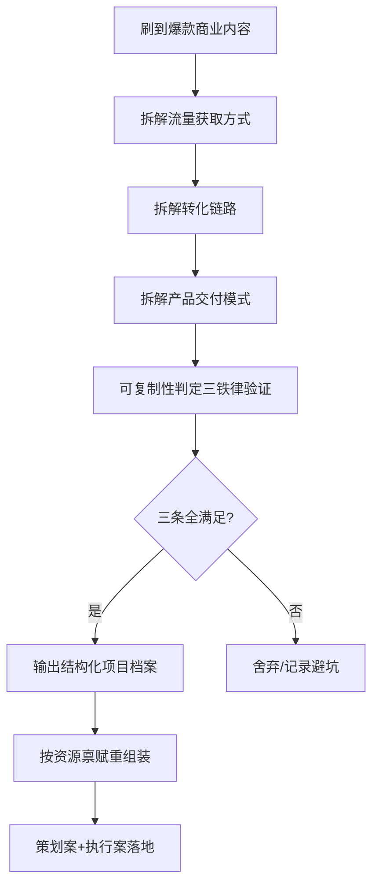
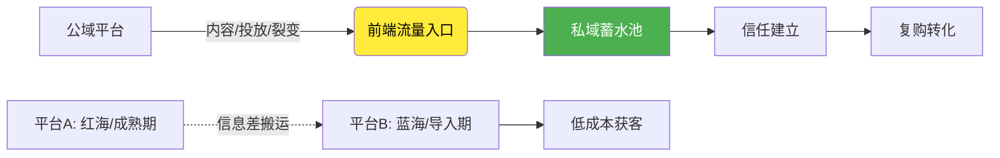
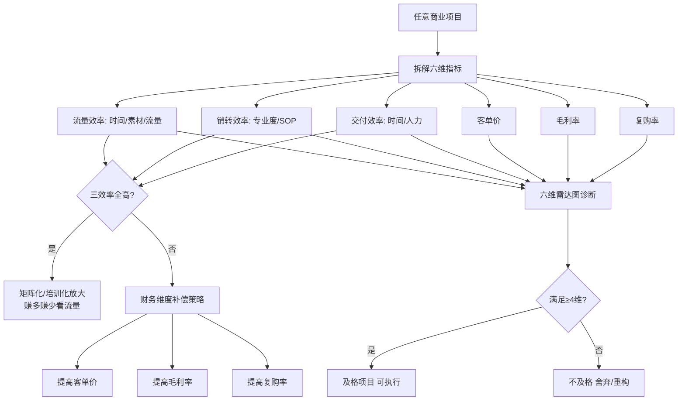
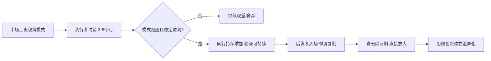
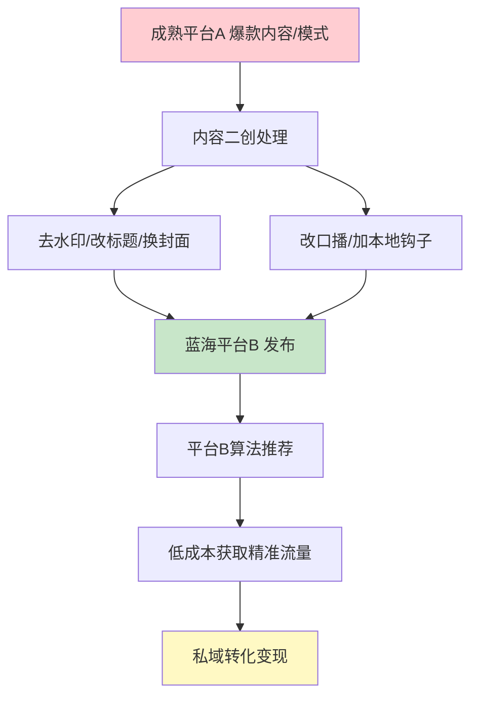
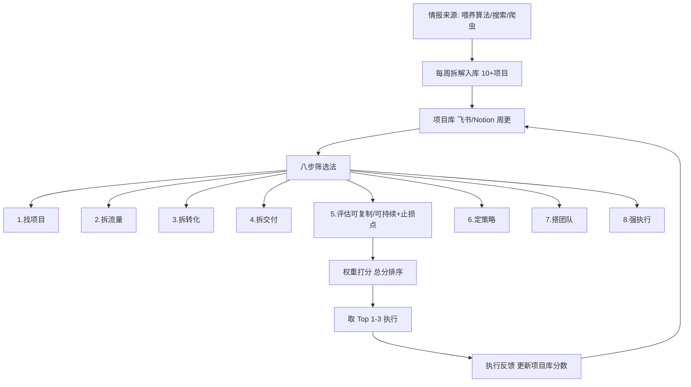
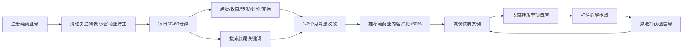
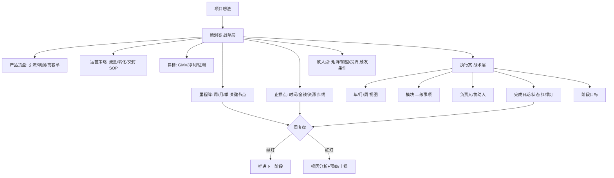
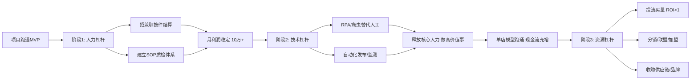
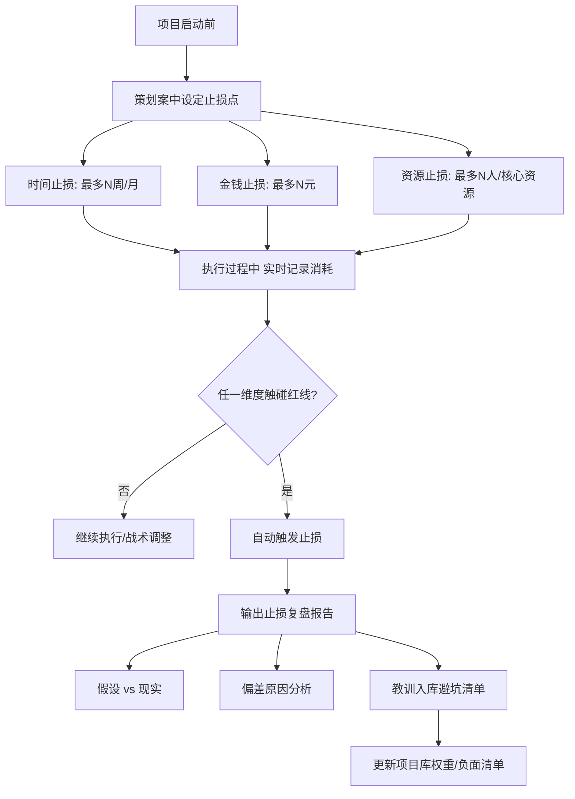

# 第 5 章 交付与项目管理 —— 把“买卖”做成“生意”的脚手架

## 学习目标

- 理解商业项目拆解的核心逻辑：从爆款内容逆向提取可复制的商业模式零件
- 掌握私域前端流量决定论：私域只是渠道，前端流量才是生死线，建立流量优先的战略认知
- 熟练运用六维评估模型（流量效率、销转效率、交付效率、客单价、毛利率、复购率）给项目算“复制账”
- 掌握后发制人原则与红海不红认知：只做已验证项目的微调复制，规避原创创新风险
- 建立项目库与八步筛选法体系：从情报挖掘、结构化归档到权重打分决策的标准化流程
- 掌握喂养算法与信息差搬运术：驯养专属商业情报猎犬，利用跨平台信息差实现流量套利
- 掌握项目管理双案法（策划案+执行案）与止损点机制：用里程碑管进度、用止损点保本金
- 理解三大杠杆放大法（人力、技术、资源）的分级适用条件与组合拳打法
- 能根据项目六维画像制定差异化策略：效率维度高走矩阵化放大，效率维度低走高客单价补偿
- 掌握交付效率分级与产品分类：支付即交付最高，陪跑训练营最低，按交付模式设计货盘
- 理解客单价、毛利率、复购率三大财务杠杆的补偿机制：效率不足时用财务指标兜底
- 掌握止损点的三维设定与复盘沉淀：时间/金钱/资源红线前置，输出复盘报告入库避坑清单

## 5.1 生活类比

想象做副业像**开一家“复刻版”奶茶店**：

**商业项目拆解** = 去排队最长的那家店，不偷配方，但拆解它的：选址逻辑（流量）、点单动线（转化）、出杯 SOP（交付）、定价结构（客单/毛利）、会员体系（复购）。

**六维评估模型** = 给这家店做“体检报告”：选址好不好复制（流量效率）、点单能不能标准化（销转效率）、出杯要不要大厨（交付效率）、一杯卖多少钱（客单价）、扣除成本剩多少（毛利率）、顾客会不会回购（复购率）。

**后发制人** = 不研发新口味（原创创新），直接复刻成熟爆款，只在“少糖选项”“本地水果”“外卖包装”上做微调。

**喂养算法** = 每天去商圈转 3 圈，盯着哪家店排队久、哪家新开张就拍照记录，训练你的“选址雷达”。

项目管理双案法 = **策划案**是开业筹备书（菜单/定价/装修/开业日/止损线/加盟标准），**执行案**是每日排班表（谁采购/谁炒糖/谁出杯/几点开门/今日目标流水）。

**止损点** = 开业前立下“军令状”：亏损超 10 万或连续 3 月不回本，无条件关店转型，不拖家人、不借高利贷。

**三大杠杆** = **人力杠杆**招兼职店员按单提成；**技术杠杆**上自动封口机/点单小程序/库存预警；**资源杠杆**拿加盟费开直营店、买上游果园、砸抖音同城投流。

就像开奶茶店不需要发明“珍珠”，只需拆透成熟模式、算清六维账本、立好止损军令、再用杠杆复制开分店，副业亦是如此。

---

## 5.2 概念地图

第五章：交付与项目管理 —— 把“买卖”做成“生意”的脚手架
├── 核心方法论
│   ├── 商业项目拆解  —— P001, P002
│   │   ├── 八步拆解法（找项目→拆流量→拆转化→拆交付→评估→定策略→搭团队→强执行）  —— P001
│   │   └── 可复制性判定三铁律（爆款非偶然、货源可寻、场景验证）  —— P001
│   ├── 私域前端流量决定论  —— P001
│   │   ├── 私域是渠道非水源  —— P001
│   │   └── 信息差搬运论（跨平台内容套利）  —— P001
│   ├── 六维评估模型  —— P002
│   │   ├── 效率维度：流量效率(时间/素材/流量)、销转效率(专业度/SOP)、交付效率(时间/人力)  —— P002
│   │   ├── 财务维度：客单价、毛利率、复购率  —— P002
│   │   └── 判定定理：三效率定可复制、四财务定上限、满四及格  —— P002
│   └── 后发制人与红海生存法  —— P001
│       ├── 只做验证3个月+项目  —— P001
│       └── 红海微调而非原创创新  —— P001
├── 执行落地体系
│   ├── 项目库与八步筛选法  —— P001
│   │   ├── 动态项目库维护（飞书/Notion周更）  —— P001
│   │   ├── 权重个性化打分（按资源禀赋调整权重）  —— P001
│   │   └── 止损前置（第5步强制设定时间/金钱/资源红线）  —— P001
│   ├── 项目管理双案法  —— P001
│   │   ├── 策划案：产品货盘、运营策略、目标、里程碑、止损点、放大点  —— P001
│   │   └── 执行案：年/月/周、模块、二级事项、内容、负责人、协助人、完成日期、状态、阶段目标  —— P001
│   └── 喂养算法情报体系  —— P001
│       ├── 专用商业号物理隔离  —— P001
│       ├── 多平台并行（抖音/小红书/视频号/👸号/即刻）  —— P001
│       └── 搜索关键词强化标签（招商加盟/代理批发/私域引流/副业项目）  —— P001
└── 放大与风控
    ├── 三大杠杆放大法  —— P001
    │   ├── 人力杠杆：SOP+兼职（门槛最低，5-10分钟/篇，引流付费）  —— P001
    │   ├── 技术杠杆：RPA/爬虫/自动化脚本（门槛中等，批量采集/去重/发布/监测）  —— P001
    │   └── 资源杠杆：投流/分销/品牌授权/收购（门槛最高，需强现金流）  —— P001
    ├── 止损点与避坑标准  —— P001
    │   ├── 三维止损：时间/金钱/资源上限  —— P001
    │   ├── 负面清单：不喜欢不碰、重供应链不碰、同行<3月不碰、单一变现不碰  —— P001
    │   └── 止损复盘报告：假设vs现实、偏差原因、教训入库  —— P001
    └── 典型案例验证库  —— P001, P002
        ├── 儿童游乐（3月40万）、文川手写Logo、艺术签名、抓娃娃收徒  —— P001
        ├── 小说推文、教育资料1.0/2.0、减肥食谱、项目拆解IP、知识付费(李一舟)  —— P002
        └── 大闸蟹电商失败教训（不喜欢赛道坚决止损）  —— P001

---

## 5.3 商业项目拆解 —— 把“赚钱的别人”拆成“可复制的零件”

### 为什么需要这个概念？

你可能有过这样的经历：刷到一个爆款视频，评论区全是“怎么联系”“多少钱”，你觉得“这个项目我也能做”，但真上手时才发现——文案不会写、素材找不到、转化话术没谱、交付流程跑不通，最后只能干瞪眼。多数副业失败，不是因为选错了赛道，而是**盲目创新、从零发明**，忽略了市场上已有大量验证可行的案例。你缺的不是“灵感”，是一套**标准化流程**，能把不可控的“撞大运”转化为可控的“拆解动作”。

> "拆下来之后，我就发现很多时候有些项目是完全可以复制的，是不需要投入几十万也可以复制的。复制了之后，用跟他一样的内容生产方式、转化链路，你也能拿到一定的结果。"
> 
> —— 来源：docs/202301-02/I9OAdzzs2oBliNxsmPjcHnBUnzf.md

> "通过刷抖音或者刷小红书的过程发现商业案例，再拆解复制这样的案例去形成一个商业模式，去发展自己的副业。"
> 
> —— 来源：docs/202301-02/NxhWdJj3UoPKvmxaBqkcz8wlntf.md

这两段原文直接点出了本章的核心逻辑：**商业项目拆解不是“抄作业”，是“拆零件、重组装”**。你要把别人赚钱的黑盒，拆成流量获取、转化链路、产品交付三个白盒，再按自己的资源禀赋重新组装。

### 核心定义

**商业项目拆解**（来源：docs/202301-02/I9OAdzzs2oBliNxsmPjcHnBUnzf.md；docs/202301-02/NxhWdJj3UoPKvmxaBqkcz8wlntf.md）

> 从公域平台（抖音、小红书）的爆款商业内容出发，逆向拆解其流量获取方式、转化链路、产品交付模式。
> 
> **核心产出**：一份包含赛道、渠道、流量模式、转化模式、交付模式、客单价、可复制性评估的结构化项目档案。

这个定义展示了三个关键动作：(1) **来源锁定**——只拆爆款商业内容，不拆娱乐内容；(2) **维度固定**——流量/转化/交付三件套缺一不可；(3) **产出标准化**——输出结构化档案，而非碎片笔记。

### 关键性质

下表总结了商业项目拆解的三个核心性质，帮助你区分“拆解”与“模仿”的本质区别：

| 性质 | 说明 |
|------|------|
| 非模仿表面 | 不抄文案、不抄封面，抄的是底层商业逻辑（谁在买、为什么买、怎么卖的） |
| 可迁移性强 | 拆解出的“零件”（如引流钩子、转化话术、交付SOP）可重组到自己的项目中 |
| 依赖“后发制人” | 只拆已验证稳定盈利3个月以上的项目，规避幸存者偏差 |

### 典型例子

我们来看四个素材中验证过的实战案例：

1. **儿童游乐项目**：拆解“挖掘机模拟工地”爆款视频（8.4w赞、3000评论），复制其加盟招商模式，3个月变现40万。
2. **文川手写Logo**：拆解评论区“怎么找你设计”的需求，外包给大学生设计师赚差价（收599、付200）。
3. **艺术签名**：拆解“发内容→引流微信→9.9元/单→免费素材网交付”全链路，月入数千。
4. **抓娃娃收徒**：拆解“线下抓娃娃→闲鱼卖娃娃→私域收徒599元教抓娃娃”双重变现，年入百万。

这些案例的共同点：**货源非独家、消费场景已验证、爆款非偶然**——这就是后文要讲的“可复制性判定三铁律”。

### 边界条件

- 仅适用于“货源非独家、消费场景已验证、爆款非偶然”的标品化/服务标准化项目。
- 核心技术壁垒强（如专利药、高精尖制造）、强个人IP绑定（如头部网红自有品牌）的项目难以拆解复制。
- 需具备基础的内容生产能力与私域转化能力，纯小白需先补齐“发内容、加微信、发朋友圈”基本功。

### 方法演进图

---

## 5.4 私域前端流量 —— 私域只是渠道，流量才是生死线

### 为什么需要这个概念？

绝大多数人把精力花在私域运营细节（社群SOP、朋友圈排版、话术脚本）上，却忽略了一个残酷事实：**没有流量进来，运营再好也是零**。这是素材中最反直觉、也是最核心的认知重构——**私域只是蓄水池，前端流量才是水源**。

> "私域只是一个渠道，是帮助我们企业更好地跟客户建立关系和发展粘性的一个渠道，其实更重要的是前端的流量，你有没有打开流量，每个月是否有稳定的流量进来。"
> 
> —— 来源：docs/202301-02/I9OAdzzs2oBliNxsmPjcHnBUnzf.md

> "所以私域的痛点不在于私域怎么做，而是前端流量如何来。"
> 
> —— 来源：docs/202301-02/I9OAdzzs2oBliNxsmPjcHnBUnzf.md

这段话直接定性了私域的定位：**工具属性 > 核心属性**。你在私域上投入的每一分钟，前提是前端有稳定流量入口。否则，再完美的社群SOP、再高明的话术脚本，面对的都是空荡荡的群聊。

### 核心定义

| 概念 | 定义 |
|------|------|
| **前端流量** | 公域平台（抖音、小红书、视频号、搜索SEO等）通过内容、投放、裂变等方式，将陌生用户引入私域（微信/企微）的入口流量 |
| **私域渠道** | 企微、个人号、社群等用于存储、信任建立、复购转化的工具集合，本质是“蓄水池”而非“水源” |

### 关键性质

- **流量优先级 > 转化优先级**：月稳定进粉1000+且转化率10%，优于月进粉100但转化率50%。
- **流量稳定性决定业务确定性**：靠单条爆款视频引流的业务极其脆弱，需建立可复制的内容生产流水线保证流量持续。
- **渠道间存在信息差**：同一内容在抖音烂、在小红书爆，换赛道/换平台即可获得流量套利。

> "渠道其实是有信息差的，我们做过很多项目，其实吃的就是信息差，有些项目在抖音上做得很烂的，但是如果你搬到小红书上面，瞬间就爆了。"
> 
> —— 来源：docs/202301-02/I9OAdzzs2oBliNxsmPjcHnBUnzf.md

这个“信息差搬运论”是后续单独一节会详细展开的放大技巧，这里先建立认知：**流量不是“种”出来的，是“搬”过来的、是“换”来的。**

### 典型例子

- **儿童游乐案例**：靠一条爆款视频（1000w+播放）带来3000条咨询，验证流量大、意向强，才敢投入团队做加盟。
- **信息差搬运**：抖音做烂的“减肥食谱”搬到小红书优化后瞬间爆火，获取低成本精准流量。
- **作者亲测**：不喂养算法/不搜索/不监测数据，刷不到商业案例，也就没有项目来源。

### 边界条件

- 无产品/无交付能力时，引流再多也是“养死号”，需先跑通MVP（最小可行产品）。
- 违规引流（诱导、硬广、违禁词）会导致账号限流/封号，流量来源必须合规可持续。
- 单一渠道依赖风险极高，需建立“主渠道+备选渠道+测试渠道”的流量矩阵。

### 方法演进图

---

## 5.5 六维评估模型 —— 给项目算一笔“复制账”

### 为什么需要这个概念？

面对海量副业项目，你手里没有统一的“尺子”。直觉决策易陷入“看热闹”、“蹭热度”陷阱，导致资源投入错配。素材P002系统提出了**六维评估模型**，把模糊的“项目好坏”拆解为具体的“指标优劣”，这是全书最核心的分析工具。

> "任何项目都可以拆解成：「流量效率，销转效率，交付效率，客单价，毛利率，复购率」，这六个点"
> 
> —— 来源：docs/202301-02/NxhWdJj3UoPKvmxaBqkcz8wlntf.md

### 核心定义

**六维评估模型**（来源：docs/202301-02/NxhWdJj3UoPKvmxaBqkcz8wlntf.md）

将任意商业项目拆解为六个维度：
- **效率维度**（决定可复制性/可放大性）：流量效率、销转效率、交付效率
- **财务维度**（决定收入天花板/抗风险性）：客单价、毛利率、复购率

#### 5.5.1 流量效率

**定义**（来源：docs/202301-02/NxhWdJj3UoPKvmxaBqkcz8wlntf.md）

> 我们以「时间，素材，流量」为指标。「花的时间少，素材难度低，获得流量大，即为流量效率高」

**公式化表达**：

$$
\text{流量效率} = \frac{\text{获得流量}}{\text{时间投入} \times \text{素材制作难度}}
$$

**公式逐步推导与物理意义**：
分子“获得流量”是产出端，分母“时间投入 × 素材制作难度”是成本端。时间投入反映人力成本，素材制作难度反映技能门槛与不确定性。两者相乘得到“综合投入成本”。**分子大、分母小，比值即高**，意味着单位投入撬动的流量大——这就是流量效率高的物理意义：**用最低的时间与技能成本，换取最大的曝光增量**。

**判断标准**：
- 高：5分钟发条朋友圈，3个号同发，1000好友看到；或半小时拍口播，双机位，5000播放。
- 低：需精心策划选题、专业拍摄剪辑、投放才能出流量。

**作用指导**：该公式量化了内容生产的“投入产出比”，指导你在选题、素材来源、生产工具三个维度做减法，将流量效率最大化。若分母无法压低，则需通过矩阵号、投放等手段拉高分子。

#### 5.5.2 销转效率

**定义**（来源：docs/202301-02/NxhWdJj3UoPKvmxaBqkcz8wlntf.md）

> 我们以「专业度」为指标。「专业度要求低（能SOP），能一对多，即为销转效率高，本质也是时间，销售的时间利用率」

**公式化表达**：

$$
\text{销转效率} = \frac{\text{成交量}}{\text{销售人力投入} \times \text{专业度要求}}
$$

**公式逐步推导与物理意义**：
分子“成交量”是转化产出，分母“销售人力投入 × 专业度要求”是转化成本。专业度要求高，意味着难招人、难培训、难标准化、单人单位时间处理上限低。**专业度要求低（能SOP化）、能一对多**，分母小，效率才高。素材直言：“基本上网销不需要啥专业度，按SOP做就好，线下才需要极高的专业度”。

**作用指导**：该公式揭示了“SOP化”是提升销转效率的核心杠杆。将销售话术、异议处理、成交流程标准化为清单，即可用低成本兼职替代高薪销售，实现一对多群发/自动化回复，成倍提升分子/分母比。

#### 5.5.3 交付效率

**定义**（来源：docs/202301-02/NxhWdJj3UoPKvmxaBqkcz8wlntf.md）

> 我们以「时间」为指标。「花的时间少（人力少），即为交付效率高」

**公式化表达**：

$$
\text{交付效率} = \frac{\text{交付完成订单数}}{\text{交付人力工时}}
$$

**公式逐步推导与物理意义**：
分子是交付产出（完成订单数），分母是交付投入（人力工时）。**支付即完成交付（如资料、低价课）分母趋近于0，效率趋近无穷大，效率最高**；训练营、陪跑、咨询需要持续投入时间精力，分母大，效率低。这个公式量化了“交付是否标准化、产品化”的程度。

**作用指导**：该公式倒逼产品设计向“标准化、自动化、产品化”进化。若分母无法压缩（如必须1v1服务），则必须通过提高客单价、毛利率、复购率三个财务指标来补偿分子端的单客价值，否则模型跑不通。

### 关键性质：两大判定定理

#### 定理一：三效率定可复制（来源：docs/202301-02/NxhWdJj3UoPKvmxaBqkcz8wlntf.md）

> 流量效率高，意味着内容极其好复制，可以通过矩阵，培训等方式，把这一块单独拎出去，进行放大。
> 
> 销转效率高，交付效率高，意味着销售可以SOP化，不需要极强的专业性，也意味着交付也不需要啥时间，精力，同时也意味着流量来了，能接得住。
> 
> 意味着，「赚多赚少，取决于流量的多少」。
> 
> 如果流量效率，销转效率，交付效率，这三块有一块低的话，就很难复制放大。

**这个定理展示了**：三大效率是“放大资格证”。三效率全高 → 可矩阵化/培训化放大，赚多赚少看流量量级；任一效率低 → 难放大，必须靠财务维度补齐。

#### 定理二：六维满足度及格线（来源：docs/202301-02/NxhWdJj3UoPKvmxaBqkcz8wlntf.md）

> 「六个点，满足的越多越好，满足四个点，及格」
> 
> 那就得在客单价，毛利率，复购率这三块下功夫，比如通过提高客单价来增加收入。

**这个定理展示了**：六维不是非黑即白，有及格线（≥4），有补偿机制（效率不足靠财务补）。这是一个**诊断工具**而非**评分卡**——通过六维雷达图，一眼定位项目短板（如：流量效率低→加内容团队；交付效率低→产品标准化）。

### 典型例子：五大项目六维画像对比

下表展示了素材中五个实战案例的六维画像对比，你能直观看到“效率维度定放大、财务维度定上限”的铁律：

| 项目 | 流量效率 | 销转效率 | 交付效率 | 客单价 | 毛利率 | 复购率 | 月收益区间 | 核心结论 |
|------|----------|----------|----------|--------|--------|--------|------------|----------|
| **小说推文** | 高 | 高 | 高 | 低(十几块) | 高(50%+) | 低 | 1K-2W | 三效率全高靠量取胜，天花板低 |
| **教育资料1.0** | 高 | 高 | 高 | 低(十几块) | 高(50-100%) | 低 | 1K-2W | 同小说推文，标准化极致 |
| **教育资料2.0** | 高 | 高 | 中 | **高(千-十万)** | 中(10%) | 低 | 2W-100W | **高客单价补齐效率不足**，收入跃迁50倍 |
| **减肥食谱** | 高 | 高 | 中高 | 中高 | 高 | **高** | 10W-200W | 六维均衡，**复购率高**（减肥是重复过程）规模效应强 |
| **项目拆解IP** | **低** | 高 | **低** | **高(千-六位数)** | **高(70%+)** | 中高 | 10W-200W | **高客单价+高毛利补偿低效率**，知识付费典型 |
| **知识付费(李一舟)** | 高 | 高 | 高 | 高(几千) | **极高(100%)** | 低 | 10W-500W | **六维全高，毛利100%**，顶级商业模型 |

这个对比表揭示了三条核心规律：
1. **三效率全高 = 靠量赚钱**（小说推文、教育资料1.0），但受限于客单价，天花板在2W/月。
2. **效率有短板 = 必须靠财务杠杆补**（教育资料2.0提客单价、项目拆解IP提客单价+毛利、减肥食谱靠复购）。
3. **六维全高 = 印钞机**（知识付费），但极其稀缺，可遇不可求。

### 边界条件

- 框架假设“已有产品/服务”，不适用于纯概念阶段（0-1验证前）的创意评估。
- 指标权重因赛道而异：重运营赛道（如本地生活）交付效率权重高；重内容赛道（如自媒体）流量效率权重高。
- 数据来源需真实：自报数据易夸大，建议用“同行持续做3个月以上”、“可找到同款货源”、“评论区真实咨询”三铁律交叉验证。

### 方法演进图

---

## 5.6 后发制人原则 —— 别做第一个吃螃蟹的人，做第100个跟着赚钱的人

### 为什么需要这个概念？

普通人创业易犯“原创情结”，自以为要发明新模式，实则99%死在“教育市场”、“验证需求”、“跑通流程”三座大山上。缺乏风险承受能力：All in新模式一旦失败，本金归零、信心崩塌、彻底退出游戏。我们需要一套**低风险、高确定性的入场策略**，让“跟随”成为一种理性的战略选择而非无奈之举。

> "有一个词叫做后发制人。就是你去做别人做过的事情，将其进行复制或者二次创作。"
> 
> —— 来源：docs/202301-02/I9OAdzzs2oBliNxsmPjcHnBUnzf.md

> "我一定是看别人已经做成了，已经做了好几个月了，我才会选择做这个项目做这个赛道。"
> 
> —— 来源：docs/202301-02/I9OAdzzs2oBliNxsmPjcHnBUnzf.md

### 核心定义

**后发制人原则**（来源：docs/202301-02/I9OAdzzs2oBliNxsmPjcHnBUnzf.md）

- 只做别人已跑通、稳定盈利3个月以上、同行持续增加的项目。
- 核心动作：复制（1:1照搬成熟模式）或 二次创作（微调流量渠道/产品包装/交付细节）。
- 绝不做：未验证的新赛道、需自建供应链的重模式、依赖个人天赋/运气的非标项目。

### 关键性质

- **确定性 > 想象力**：用别人已付出的“试错成本”换取自己的“确定性收益”。
- **速度优势**：省去0-1验证期（通常3-6个月），直接进入1-N放大期。
- **竞争视角转换**：不怕竞争多，就怕没人做（没人做=伪需求/跑不通）；红海里照样能分一杯羹。

### 典型例子

- **儿童游乐**：别人跑通“视频引流+加盟模式”半年后作者入场，3个月赚40万。
- **文川手写Logo**：别人跑通“抖音展示+微信成交+外包交付”模式后作者复制，月入数万。
- **艺术签名**：验证小红书同类账号持续出单3个月以上，才组建团队批量操作。

### 边界条件

- **入场时机把控**：太早（模式未稳）跟不上节奏，太晚（红利期过）利润被卷没；最佳窗口：头部玩家跑通6-18个月、尚未形成垄断寡头时。
- **必须具备“微创新”能力**：纯复制无护城河，需在内容形式/转化话术/服务细节/客群细分上做微调。
- **资源匹配度**：复制的项目所需资源（技术/资金/人脉/时间）需在自己可调配范围内。

### 方法演进图

---

## 5.7 信息差搬运论 —— A平台的“烂内容”就是B平台的爆款

### 为什么需要这个概念？

认知误区：认为“好内容”应当在所有平台都火，实则平台算法、用户画像、内容生态差异巨大。资源浪费：在饱和平台（如抖音知识付费红海）硬卷，不如搬运到蓝海平台（如小红书、视频号）收割红利。需要打破“平台忠诚度”，建立“内容即素材、平台即渠道”的工具理性。

### 核心定义

**信息差搬运论**（来源：docs/202301-02/I9OAdzzs2oBliNxsmPjcHnBUnzf.md）

- **渠道信息差**：同一商业内容/模式，在不同平台处于不同生命周期阶段（导入期/成长期/成熟期/衰退期）。
- **搬运套利**：将成熟平台上已验证的爆款内容/模式，经“去水印、改标题、换封面、改口播、加本地化钩子”等二创处理，发布到导入期/成长期平台。
- **核心公式**：成熟平台验证模式 × 蓝海平台流量红利 × 合规二创 = 低成本高确定性收益。

> "渠道其实是有信息差的，我们做过很多项目，其实吃的就是信息差，有些项目在抖音上做得很烂的，但是如果你搬到小红书上面，瞬间就爆了。有些项目在小红书上面做的人很多了，那你把同样的内容优化一下，搬到抖音上，也有可能把它做爆。"
> 
> —— 来源：docs/202301-02/I9OAdzzs2oBliNxsmPjcHnBUnzf.md

### 关键性质

- **非盗版搬运**：必须做“二次创作”（改脚本、换实拍、加本地信息），通过平台原创保护/重复检测。
- **平台特性适配**：抖音重“节奏/前3秒/音乐”，小红书重“封面/标题/干货感/标签”，视频号重“私域钩子/直播切片/熟人裂变”。
- **时间窗口**：通常有3-6个月的“跨平台红利期”，过期则平台原生内容成熟，搬运失效。

### 典型例子

- **减肥食谱**：抖音成熟期（同质化严重） → 搬运至小红书（女性用户强需求、种草属性强） → 优化封面标题+加食谱图文 → 单号月入数万。
- **项目拆解课程**：抖音大V讲课 → 切片转发到视频号/👸号 → 挂小程序/企微引流 → 收割不刷抖音的长尾人群。
- **本地生活**：大城市跑通的“探店/团购”模式 → 搬运至三四线城市同城账号 → 换本地店铺/本地方言/本地福袋 → 降维打击。

### 边界条件

- 法律红线：不搬运受版权保护的影视/音乐/课程全片，只搬运“商业模式/内容框架/非独家素材”。
- 平台风控：抖音/快手/视频号对搬运打击力度大，需建立“素材库+去重工具+多账号矩阵”降低单账号风险。
- 非万能药：强个人IP/强供应链/强服务交付的项目（如名医问诊、定制装修）搬运无效，核心壁垒不可复制。

### 方法演进图

---

## 5.8 项目库与八步筛选法 —— 像VC一样建立自己的“项目投资组合”

### 为什么需要这个概念？

刷到好项目不记录、记录不整理、整理不评估、评估不决策，导致“见猎心喜”却“束手无策”。缺乏对比基准：只看单个项目爽不爽，不看项目间优劣、不看资源匹配度。需要一套“收集→结构化→量化打分→决策”的标准化流程，把碎片信息变成可执行的行动清单。

> "一个星期整理一次，把你群里的文章全都整理到你的一个飞书文档或者飞书表格里面，把它按照项目的拆解的逻辑把它整理下来。"
> 
> —— 来源：docs/202301-02/I9OAdzzs2oBliNxsmPjcHnBUnzf.md

> "整理完之后，建立项目库，然后根据流量、转化、产品交付难度等各个维度，设置权重，给他们打分。分数高的项目，不出意外，就是你接下来可以做副业的发展方向。"
> 
> —— 来源：docs/202301-02/I9OAdzzs2oBliNxsmPjcHnBUnzf.md

### 核心定义

| 组件 | 定义 |
|------|------|
| **项目库** | 按统一拆解模板（流量/转化/交付/客单/可复制性/可持续性）归档的项目档案库，建议用飞书表格/Notion/Excel维护，周更 |
| **八步筛选法** | 找项目 → 拆流量 → 拆转化 → 拆交付 → 评估可复制/可持续 → 定策略 → 搭团队 → 强执行，每步设权重打分，总分排序取Top 1-3执行 |

> "1、找项目。建立项目库。2、拆流量... 3、拆转化... 4、拆产品交付... 5、评估可复制性和可持续性... 6、定策略... 7、搭团队... 8、强执行。"
> 
> —— 来源：docs/202301-02/I9OAdzzs2oBliNxsmPjcHnBUnzf.md

### 关键性质

- **动态迭代**：项目库不是静态仓库，而是“流动的漏斗”，新项目进、旧项目出、分数随市场变化调整。
- **权重个性化**：有内容团队→流量权重低；有销售团队→转化权重低；有供应链→交付权重低；独资独干→三效率权重全高。
- **止损前置**：八步法第5步（评估）必须包含“止损点设定”：最多投多少钱/时间/人力，未达标准强制退出。

### 典型例子

- **作者实操**：每周喂养算法刷50+商业案例 → 拆解入库10个 → 八步打分 → 选Top 2实测 → 1个死、1个活 → 活的放大。
- **儿童游乐项目**：流量分90、转化85、交付70、可复制90、可持续80、策略匹配95、团队搭建80、执行力90 → 总分高，决策Go。
- **大闸蟹电商**：交付分20（售后极重）、可持续30（季节性强）、策略匹配10（不擅长/不喜欢） → 总分低，果断Kill。

### 边界条件

- 打分主观性强，建议引入“同行对标法”：找3个做过同类项目的人独立打分取均值。
- 执行力是前提：筛选再准，不执行=0；八步法最后一步“强执行”需配合项目管理（策划案+执行案）落地。
- 项目库规模：建议维持20-50个在库项目，太少无选择权，太多管不过来，定期清理“分数<60”或“过期>6个月”项目。

### 方法演进图

---

## 5.9 喂养算法 —— 驯养一只专属的“商业情报猎犬”

### 为什么需要这个概念？

平台算法默认推送娱乐/八卦/短视频，商业干货内容权重低，不主动干预就刷不到有价值的商业案例。被动等推荐效率极低：可能刷1000条才见1个商业案例，主动喂养可将比例提升至1:10甚至更高。需要建立“信息获取的主动权”，让算法为我所用，而非被算法喂养。

> "无论是抖音还是小红书，还是今日头条，还是现在的👸号视频号，都是算法逻辑。我上面讲的几个案例、还有我自己拆过的几百个项目，很多都是通过喂养算法刷到的。"
> 
> —— 来源：docs/202301-02/I9OAdzzs2oBliNxsmPjcHnBUnzf.md

> "我就不断的点赞收藏关注，然后坚持了一、两个月之后，它就不断地给我推送这些文章。"
> 
> —— 来源：docs/202301-02/I9OAdzzs2oBliNxsmPjcHnBUnzf.md

### 核心定义

**喂养算法**（来源：docs/202301-02/I9OAdzzs2oBliNxsmPjcHnBUnzf.md）

通过持续、有意识的“点赞、收藏、转发、评论、停留、关注”商业类内容，训练平台兴趣模型，使其持续推荐同类高质量商业案例。

**核心动作**：建立“商业号”专用账号，仅关注商业博主、仅互动商业内容、仅搜索商业关键词，物理隔离娱乐干扰。

### 关键性质

- **训练周期**：通常需坚持1-2个月每日30-60分钟，算法模型才稳定收敛到“商业赛道”。
- **多平台并行**：抖音（短视频案例）、小红书（图文案例/长尾SEO）、视频号（直播/私域案例）、👸号（深度复盘）、即刻/知乎（深度讨论）五端同步喂养。
- **反馈闭环**：发现优质案例 → 立即收藏/转发到项目库 → 标注拆解重点 → 算法捕获强信号 → 推送更多同类。

### 典型例子

- **作者亲测**：每日2小时商业泛读，坚持数年，算法精准推送“儿童游乐/手写Logo/艺术签名/抓娃娃”等百余可复制案例。
- **反面教训**：用生活号刷商业内容，算法混乱，推送“美女/搞笑/剧情”夹杂，商业信息密度极低。
- **进阶玩法**：配合“搜索关键词”（如‘招商加盟’、‘代理批发’、‘私域引流’、‘副业项目’）主动搜索，强化算法标签。

### 边界条件

- 账号垂直度至关重要：混用生活/娱乐账号喂养，算法模型会“精神分裂”，推荐质量大打折扣。
- 算法随时变：平台调整推荐策略（如抖音弱化关注、强化推荐）可能导致喂养失效，需定期校准（检查近20条推荐中商业内容占比）。
- 无法替代“深度搜索/爬虫监测”：喂养只能获取“算法想给你看的”，无法获取“竞品隐藏数据/长尾关键词/付费文章”，需配合搜索/技术手段。

### 方法演进图

---

## 5.10 项目管理双案法 —— 策划案定方向，执行案保落地

### 为什么需要这个概念？

绝大多数副业死于“有想法、无计划、靠冲动、烂尾收场”，缺乏从战略到战术的落地工具。只有目标无拆解：想“月入10万”但不知“本周周一周二周三具体干啥、谁干、干成啥样算合格”。需要一套轻量级、可视化、可复盘的项目管理工具，适配1-3人微团队/独行侠场景。

### 核心定义

| 案例 | 定义 | 核心字段 |
|------|------|----------|
| **策划案（战略层）** | 产品货盘（引流品/利润品/高客单品定价规格）、运营策略（流量/转化/交付SOP）、目标（月GMV/净利/进粉数）、里程碑（第1周跑通MVP/第1月破万/第3月放大）、止损点（最多投入时间/金钱/资源上限）、放大点（矩阵/加盟/代理触发条件） | 产品货盘、运营策略、目标、里程碑、止损点、放大点 |
| **执行案（战术层）** | 甘特图/看板形式，字段含：年/月/周、模块、二级事项、具体内容、负责人、协助人、完成日期、状态（绿=完成/红=延期/黄=进行中）、阶段目标 | 时间、模块、事项、内容、负责人、协助人、完成日期、状态、阶段目标 |

> "项目管理。我把它分为两个部分，一个叫策划案，一个叫执行案。"
> 
> —— 来源：docs/202301-02/I9OAdzzs2oBliNxsmPjcHnBUnzf.md

> "策划案就是一个想法、规划、目标制定；执行案就是人员分工、分解执行、过程监控、结果复盘。"
> 
> —— 来源：docs/202301-02/I9OAdzzs2oBliNxsmPjcHnBUnzf.md

> "策划案，包括你产品货盘是什么。这个产品货盘包括定价、规格... 里程碑是什么意思呢？就是你在做这个项目的过程中，有一些对你来说有关键性的目标叫里程碑。"
> 
> —— 来源：docs/202301-02/I9OAdzzs2oBliNxsmPjcHnBUnzf.md

> "执行案是什么呢？某一年某一月的核心工作事项。第一个模块是什么？这个模块里的二级事项有哪些？具体内容是什么？负责人是什么？协助人是谁？完成日期是什么？完成的时候要把它标绿，然后未完成或者延期的要把它标红。这个叫执行案。"
> 
> —— 来源：docs/202301-02/I9OAdzzs2oBliNxsmPjcHnBUnzf.md

### 关键性质

- **策划案管“不做什么”、执行案管“做什么、谁做、何时做、做成啥样”**。
- **里程碑=决策节点**：到点必复盘，达标继续投、不达标止损/转型，杜绝“沉没成本拖延症”。
- **止损点=保护膜**：写在策划案里、签字确认、到期强制执行，克服人性贪婪/侥幸。
- **表格化/可视化**：执行案必须是表格/看板，不在表格里的事项=不存在，不在负责人栏的=没人干。

### 典型例子

**儿童游乐项目策划案**：
- 引流品=免费体验课、利润品=2万加盟费、高客单=全套设备运营包
- 里程碑：第2周搭建账号/第4周出第一单/第8周招满20家
- 止损点：投入5万未出单即停

**执行案示例（2023年1月核心模块“账号搭建”）**：

| 日期 | 模块 | 二级事项 | 具体内容 | 负责人 | 协助人 | 完成标准 | 状态 |
|------|------|----------|----------|--------|--------|----------|------|
| 周一 | 账号搭建 | 注册蓝V | 提交营业执照/对公打款 | 运营A | 无 | 蓝V通过 | ☐ |
| 周二 | 素材准备 | 爆款去重 | 下载同行20条爆款→去重工具跑→存素材库 | 兼职A | 我 | 产出10条可用素材 | ☐ |

### 边界条件

- 过度规划陷阱：策划案不宜过细（只定关键节点），执行案不宜过满（预留20%缓冲），防止“制定计划花了3个月、执行1天就挂了”。
- 适用规模：1-10人团队最佳；超10人需引入专业PM工具（飞书项目/钉钉Teambition/Jira）。
- 非刚性约束：市场剧变（如平台封杀赛道、政策突变）时，策划案允许“战略转向”，但必须留痕复盘、重新设定止损点。

### 方法演进图

---

## 5.11 三大杠杆放大法 —— 用人力、技术、资源把收入从1放大到100

### 为什么需要这个概念？

单人单号单项目收入天花板低（通常月入3-5万封顶），且极其脆弱（生病/封号/平台变规则即归零）。多数人只会“自己干更久/更狠”，不会“借力放大”，导致陷入“高强度低杠杆”陷阱。需要显性化三种杠杆的适用条件、操作手册、风险边界，让“放大”成为可标准化的动作而非靠运气。

### 核心定义

| 杠杆 | 定义 | 门槛 | 典型动作 |
|------|------|------|----------|
| **人力杠杆** | 将内容生产/引流/基础客服等标准化流程（SOP）外包给低成本兼职，按件/按结果付费 | 最低（0资金起步） | 招兼职做小红书笔记，5-10分钟/篇，引流加1微信付5-10元 |
| **技术杠杆** | 用RPA/爬虫/自动化脚本/批量工具替代人工重复劳动 | 中等（需懂技术/雇技术） | 影刀RPA日采集爆款500条、自动去重改脚本、定时发布50个矩阵号 |
| **资源杠杆** | 用资金买流量（投放）、买渠道（分销/联盟）、买品牌（授权/收购）、买团队（收购/合伙） | 最高（需强现金流/强人脉） | 日耗1万投放、招募城市合伙人收2万服务费+分成、收购上游供应链 |

> "人力杠杆。人力杠杆顾名思义是低成本的兼职。比如说要做小红书。我们招了很多兼职小伙伴，通过我们自己的内容生产模式，做成一个 SOP ，帮我们去做引流，5 到 10 分钟一篇笔记，引流加一个微信我给你多少钱。"
> 
> —— 来源：docs/202301-02/I9OAdzzs2oBliNxsmPjcHnBUnzf.md

> "技术杠杆就是顾名思义通过软件释放你的双手。比如说你可以批量的把某一个领域的小红书笔记批量地扒一下，因为你要抄同行。...用这种工业化的流水线这种方式去完成。"
> 
> —— 来源：docs/202301-02/I9OAdzzs2oBliNxsmPjcHnBUnzf.md

> "资源杠杆这边我就不多说了，其实就是资金、人脉，不太适合我们大多数人。"
> 
> —— 来源：docs/202301-02/I9OAdzzs2oBliNxsmPjcHnBUnzf.md

### 关键性质

- **杠杆分级**：人力杠杆门槛最低 → 技术杠杆门槛中等 → 资源杠杆门槛最高。
- **组合拳**：成熟项目通常“人力起步 → 技术替代人力 → 资源放大规模”三阶段叠加。
- **SOP是前提**：无SOP无法外包、无SOP无法写脚本、无SOP无法复制；SOP质量决定杠杆上限。

### 典型例子

- **人力杠杆**：小红书矩阵号，招10个兼职，人均日产5篇笔记，日引流500+，月成本3万、产出流量价值15万。
- **技术杠杆**：用影刀RPA/自建爬虫，日采集全网同赛道爆款视频500条、自动去重改脚本、定时发布到50个矩阵号，零人工。
- **资源杠杆**：项目跑通后，拿利润做信息流投放（日耗1万）、招募城市合伙人（收2万服务费+分成）、收购上游供应链（卡位成本端）。

### 边界条件

- **人力杠杆**：管理成本随人数指数级上升，超20人兼职团队若无专职管理层极易失控；质量把控需建立“抽检+返工+淘汰”机制。
- **技术杠杆**：平台反作弊升级快（设备指纹/行为建模/内容指纹），脚本维护成本高，需持续投入技术迭代，非一劳永逸。
- **资源杠杆**：杠杆率最高但风险最大，投放跑不出ROI、合伙人跑路、收购整合失败均可能导致现金流断裂，非新手建议。

### 方法演进图

---

## 5.12 止损点与避坑标准 —— 如何优雅地“认输”

### 为什么需要这个概念？

沉没成本陷阱：已投入时间/金钱/感情越多，越不愿放弃，导致在错误项目上持续输血直至耗尽资源。缺乏客观退出标准：凭感觉“再坚持一下”、“马上就要成了”，结果错失最佳止损窗口。需要在“热血上头前”预设“熔断机制”，用理性约束感性，保护核心本金与精力。

> "止损点什么意思呢？就是你做这个事情不用继续了，你做这个事情的最大限度，你能够承担多大的损失。这个止损点包括你的时间成本、还有你的金钱投入、资源投入。"
> 
> —— 来源：docs/202301-02/I9OAdzzs2oBliNxsmPjcHnBUnzf.md

### 核心定义

| 概念 | 定义 |
|------|------|
| **止损点** | 项目启动前预设的“最大可承受损失红线”，包含三维指标：时间止损（最多投入N周/月）、金钱止损（最多投入N元）、资源止损（最多调动N个核心资源/人力） |
| **避坑标准** | 基于过往失败经验提炼的“负面清单”，触发即放弃/不入场：不喜欢的赛道不碰、需自建重供应链不碰、同行未持续3个月不碰、单一变现渠道不碰 |

### 关键性质

- **止损是战略动作非战术失误**：止损不代表失败，代表“保留实力、等待下一个更高确定性机会”。
- **预设即执行**：写在策划案里、对着镜子说一遍、告诉合伙人/监督伙伴，到期自动触发，无需二次决策。
- **止损后复盘**：必须输出《止损复盘报告》：假设是什么、现实是什么、偏差原因、教训沉淀到避坑清单。

### 典型例子

- **大闸蟹电商**：不喜欢电商、售后重、供应链长，4个月赚20万但极其痛苦 → 触发“不喜欢不碰”避坑标准，坚决退出，誓不再碰电商。
  
> "在 19 年的时候，正好认识一个大学同学...准备搞一波大闸蟹电商。...做起来之后我会发现我自己一点都不喜欢做电商卖货这个事，我自己一点都不感兴趣。虽然我们当时做了 4 个月的时间，但是就挣了 20 来万。我从这个事情上我得出一个结论，我这辈子不会再碰电商。"
> 
> —— 来源：docs/202301-02/I9OAdzzs2oBliNxsmPjcHnBUnzf.md

- **作者设定通用止损点**：新项目测试期最长3个月、投入上限5万元、核心人力不超过2人；任一指标超标未跑通MVP即止损。
- **知识付费项目**：发现交付效率极低（需1v1陪跑）、流量效率下降（素材枯竭） → 触发“交付效率<阈值”止损，转型做“标准化课程+社群”模式。

### 边界条件

- 区分“战略止损”（模式跑不通）与“战术调整”（渠道/素材/话术不行）：前者砍项目、后者换打法，切勿混淆。
- 止损点设定过严（如1周不出单即止损）会扼杀需要长周期孵化的项目（如品牌建设、SEO、私域沉淀），需根据项目周期特性差异化设定。
- 合伙人项目：止损点需全员书面确认，避免事后扯皮；涉及员工/兼职时，需提前预留遣散/结算成本在止损金额内。

### 方法演进图

---

## 5.13 红海不红 —— 任何红海赛道都不缺一个年赚几十万的人

### 为什么需要这个概念？

心理障碍：见“赛道拥挤/竞品多/大佬强”即退缩，误以为红海没机会，实则错过确定性收益。认知偏差：把“头部垄断”当成“全赛道无机会”，忽略长尾市场、细分人群、差异化服务的巨大空间。需要重塑“竞争观”：竞争激烈=市场验证充分=需求真实=模式成熟，反而是最安全的入场信号。

> "任何一个红海的赛道都不缺一个一年赚几十万的人，都不缺你一个一年赚几十万的人。"
> 
> —— 来源：docs/202301-02/I9OAdzzs2oBliNxsmPjcHnBUnzf.md

> "所以你唯一能够要做的事情就是找到一个别人做过的事情，做了并且稳定有赚钱的项目。确定好赛道，给他们更匹配一点的调整就可以赚到钱。"
> 
> —— 来源：docs/202301-02/I9OAdzzs2oBliNxsmPjcHnBUnzf.md

### 核心定义

**红海不红原则**（来源：docs/202301-02/I9OAdzzs2oBliNxsmPjcHnBUnzf.md）

- 红海本质：存量博弈、透明化竞争、效率比拼，而非“分不到蛋糕”。
- 核心主张：任何一个红海赛道都不缺一个年赚几十万的人，关键是找到已验证项目做微调，而非盲目创新。
- 微调维度：更垂直的人群（如：不做通用减肥、做“产后妈妈减肥”）、更极致的服务（如：1v1陪跑/全程管家）、更细分的产品（如：只卖“零添加代餐饼干”）。

### 关键性质

- **确定性溢价**：红海项目模式成熟、供应链完善、教育成本低、用户认知成熟，新人只需“执行到位”即可拿结果。
- **避开“创新陷阱”**：新手创新九死一生，微调存活率>80%；创新留给头部玩家，新手负责“填补缝隙”。
- **差异化≠创新**：差异化是在成熟模式基础上做减法/做加法/做乘法，本质是“更适合特定人群”而非“发明新东西”。

### 典型例子

- **小说推文**：红海至极，但坚持“垂直作者+垂直专栏+核心剧情前置+模板化剪辑”的新手，依然能月入过万。
- **闲鱼倒货**：红海到不能再红，但坚持“只捡品牌标品+只做官方价150+品类+用‘抵账/抵债’关键词找低价货”的玩家，月入3-5万稳如狗。
- **本地生活/同城相亲/考公资料/公考面试**：赛道烂大街，但做“本地化/垂类化/服务化”微调的团队，年入百万比比皆是。

### 边界条件

- 微调≠抄袭：必须在“合规/合法/有差异化价值”前提下微调，纯克隆（文案/素材/页面1:1复制）必死于平台风控/用户审美疲劳/价格战。
- 入场时机：赛道处于“成长期→成熟期早期”最佳；“衰退期”（如共享充电宝、VR体验馆）红海也是死海，切勿入场。
- 资源匹配：红海拼细节、拼运营、拼供应链、拼服务，资源禀赋（时间/精力/资金/技能/人脉）不匹配的细分赛道，依然做不好。

---

## 5.14 多源对照：可复制性判定的三铁律

素材给出了判断一个项目是否可复制的**三铁律**，这是商业项目拆解的“入场门槛测试”：

### 共识

三个条件**同时满足**，即可低成本复制：
1. **爆款非偶然**：该账号历史数据稳定，非单条视频/笔记侥幸爆火。
2. **货源可寻**：产品/服务非独家垄断，可通过同款/替代货源获取。
3. **场景验证**：评论区/私信有真实咨询成交记录，证明消费场景跑通。

> "首先，这个视频爆得偶然；其次，他货源不是他自己的，也就是说我可以通过别的方式找到他的货源；最后，这个消费场景经过验证是证明是有需求的，而且需求量还不小。"
> 
> —— 来源：docs/202301-02/I9OAdzzs2oBliNxsmPjcHnBUnzf.md

### 分歧

素材P002的六维模型提供了**更精细的量化判定**：即使三铁律通过，若“三效率”有一项偏低，放大依然受阻，必须靠“客单价/毛利率/复购率”补偿。**三铁律是定性门槛，六维模型是量化诊断**，两者互补：先过三铁律定性，再用六维模型定量。

---

## 5.15 设计中的取舍

为什么不用“原创创新”而是“后发制人”？

原创创新需要承担“市场教育成本+需求验证成本+流程跑通成本”三座大山，普通人资源（时间/金钱/精力/认知）均不足以支撑。后发制人把前两座大山的成本转嫁给先行者，自己只承担“流程跑通+微调优化”成本，风险降维打击。

这种设计的 trade-off 是什么？得是确定性收益、极速启动、可复制放大；失是无先发优势、无独家护城河、易陷入同质化价格战；解是必须在“微创新”上持续投入（内容形式/转化话术/服务细节/客群细分），把“复制”做成“差异化复制”。

---

## 5.16 动手练习

### 练习 1：手算一个项目的六维画像

请选择一个你熟悉的副业项目（如：小红书卖PPT模板、抖音书单号、知识付费社群、闲鱼无货源），按六维模型逐项打分（1-10分）并简述理由：

1. 流量效率：制作内容耗时？素材从哪来？日均流量多少？
2. 销转效率：需不需要1v1沟通？能否SOP化？转化周期多久？
3. 交付效率：下单后需不需要人工介入？单单耗时？
4. 客单价：单次交易金额？
5. 毛利率：扣除直接成本后利润占比？
6. 复购率：用户半年内二次购买比例？

回答问题：
- 该项目三效率是否全高？若否，最短板在哪？
- 若最短板无法短期提升，能否通过提高客单价/毛利率/复购率补偿？具体怎么改？
- 按“满四及格”标准，该项目是否及格？是否值得All in？

### 练习 2：拆解一个真实爆款商业案例（实战演练）

打开抖音/小红书/视频号，搜索关键词“招商加盟”“代理批发”“副业项目”“私域引流”，找一条点赞>1万、评论区大量咨询联系方式的爆款视频/笔记：

1. 拆流量：是什么内容形式？（口播/混剪/实拍/图文）发布频次？前3秒钩子是什么？标题/标签关键词？
2. 拆转化：引导去哪？（主页链接/私信/评论区/直播间/小程序）话术脚本？是否有免费诱饵（资料/体验课/测评）？
3. 拆交付：卖什么？（实物/课程/服务/加盟）客单价？交付流程？是否标准化？
4. 判可复制性：用“三铁律”验证——爆款是否偶然？（看账号历史数据）货源/服务是否独家？（搜同款）消费场景是否验证？（评论区真实咨询量）
5. 定策略：若你要复制，是1:1全盘复制，还是微调？（换人群/换平台/换钩子/换交付方式）

回答问题：
- 该项目六维画像大致如何？
- 你的资源禀赋（时间/技能/资金/人脉）匹配度打几分？
- 设定止损点：最多投多少天/多少钱/多少精力？未跑通MVP怎么退出？

### 练习 3：搭建你的“项目情报雷达”喂养算法实操

注册/指定一个“纯商业号”（抖音/小红书/视频号/👸号/即刻任选一平台），执行14天喂养计划：

Day 1-3：清理关注列表，仅保留商业博主；搜索并关注20个“副业拆解/项目复盘/商业模式”账号
Day 4-7：每日30分钟，仅对商业内容点赞/收藏/转发/评论/完播，物理屏蔽娱乐推荐（点“不感兴趣”）
Day 8-14：每日新增搜索3个长尾关键词（如：小红书引流SOP、闲鱼选品技巧、视频号带货话术），收藏优质内容至项目库

记录观察：
1. 第7天 vs 第1天，推荐流中商业内容占比变化？
2. 算法推荐的“同类账号”是否精准？
3. 收获了多少可入库的商业案例？

回答问题：
- 若14天后商业内容占比仍<30%，可能原因是什么？（账号权重/垂直度/平台算法特性）
- 如何用“搜索+爬虫/插件”补齐算法推荐的盲区？
- 该账号能否作为长期情报来源？需建立什么维护SOP？

### 练习 4：为一个新项目写“策划案”与“执行案”骨架

假设你决定复制“儿童游乐挖掘机模拟”项目（或你练习2选定的项目），请起草：

【策划案】骨架：
1. 产品货盘：引流品____、利润品____、高客单品____（含定价/规格）
2. 运营策略：流量端____、转化端____、交付端____（各写核心SOP 1-2句）
3. 目标：月GMV____、净利____、进粉数____
4. 里程碑：第1周____、第2周____、第1月____、第3月____
5. 止损点：时间____、金钱____、资源____（三维必填）
6. 放大点：触发条件____、放大方式（矩阵/加盟/代理/投流）____

【执行案】第1周甘特表（示例）：
| 日期 | 模块 | 二级事项 | 具体内容 | 负责人 | 协助人 | 完成标准 | 状态 |
|---|---|---|---|---|---|---|---|
| 周一 | 账号搭建 | 注册蓝V | 提交营业执照/对公打款 | 我 | 无 | 蓝V通过 | ☐ |
| 周二 | 素材准备 | 爆款去重 | 下载同行20条爆款→去重工具跑→存素材库 | 兼职A | 我 | 产出10条可用素材 | ☐ |
...（补全至周日）

回答问题：
- 里程碑与止损点是否匹配？（如：止损点3个月，但第1月里程碑仅‘搭建账号’，风险是否过大？）
- 执行案中‘完成标准’是否可量化、可验证？模糊词（如‘搞定、优化、推进’）是否已剔除？
- 若周三‘素材准备’延期（标红），对第1周里程碑影响多大？预案是什么？

### 练习 5：杠杆选择题：给三个不同阶段的项目配杠杆

场景A：项目刚跑通MVP，月利润2万，你是独行侠，无团队、无技术、存款5万。请设计“人力杠杆”启动方案：招几人？做什么SOP？按件/按结果怎么结算？月成本上限？

场景B：项目月利润稳定10万，有3人核心团队，内容生产/发布/数据监测全靠人工，耗时占比70%。请设计“技术杠杆”替代方案：哪些环节优先自动化？（RPA/爬虫/API/脚本）预算多少？预计释放多少人力？

场景C：项目单店模型跑通，月净利30万，想3年开100家分店。请设计“资源杠杆”扩张方案：加盟还是直营？投流预算？供应链整合？风控红线？

回答问题：
- 三个场景的杠杆门槛、风险、回报周期有何本质区别？
- 你手头的项目（或练习2项目）目前处于哪阶段？未来6个月最该部署哪种杠杆？第一步动作是什么？

### 练习 6：交付模式分类与货盘设计实战

请对照“支付即交付（资料/课程/软件）”“发货履约（实物/无货源/代发）”“服务陪伴（训练营/咨询/陪跑）”三大交付模式：

1. 列举你熟悉的5个副业项目，分别归类到三种模式中，并标注交付效率高/中/低
2. 为其中一个“服务陪伴型”项目设计“产品货盘”：引流品（免费/低价）、利润品（标准化服务）、高客单品（定制/独家）
3. 计算该项目的交付边际成本：第1个客户 vs 第100个客户的交付耗时/人力差异

回答问题：
- 若要将“服务陪伴型”项目的交付效率从“低”提升到“中”，必须标准化哪些环节？（SOP化、工具化、产品化）
- 高客单品的交付是否一定要由创始人亲自做？如何用“IP手/聊天手”机制替代？
- 该项目六维画像中“交付效率”打几分？能否通过“客单价/毛利率/复购率”三财务指标补偿？

### 练习 7：止损点压力测试：模拟项目偏离轨道的决策

假设你投入某项目已耗时6周、花费3万元、调动2名核心兼职，止损点设定为“8周/5万/3人”。目前情况：流量端日均进粉仅20人（预期100）、转化率1%（预期5%）、交付端已出现3次投诉。

1. 列出此时的“止损仪表盘”：三维指标实际消耗 vs 红线剩余量
2. 判断：是否触发止损？理由是什么？（战略止损 vs 战术调整）
3. 若决定继续，必须在接下来2周内达成的“挽救里程碑”是什么？
4. 写一份《止损复盘报告》草稿：假设、现实、偏差原因、教训入库条目

回答问题：
- 止损点设得太宽（如12周/10万）会带来什么后果？太窄（如4周/1万）呢？
- 如何区分“战略止损”（模式跑不通）和“战术调整”（素材/话术/渠道不行）？
- 合伙人项目中，止损点如何通过“一致行动协议”强制执行、避免扯皮？

## 5.17 本章小结

这一章中我们学习了如何把“买卖”做成“生意”的脚手架体系。首先，我们建立了**商业项目拆解**的核心逻辑：从爆款内容逆向提取流量/转化/交付全链路零件，仅复制已验证模式，不搞原创创新；其次，确立了**私域前端流量决定论**：私域只是蓄水池，前端流量才是水源，无稳定流量入口私域运营再强也是零；接着，掌握了**六维评估模型**这一核心工具：流量效率/销转效率/交付效率定可复制性，客单价/毛利率/复购率定收入天花板，满四及格；然后，内化了**后发制人原则与红海不红认知**：只做已验证项目的微调复制，规避原创创新风险；之后，建立了**项目库与八步筛选法**标准化流程：从情报挖掘、结构化归档到权重打分决策；同时，掌握了**喂养算法与信息差搬运术**：驯养专属商业情报猎犬，利用跨平台信息差实现流量套利；进而，落地了**项目管理双案法（策划案+执行案）与止损点机制**：用里程碑管进度、用止损点保本金；最后，理解了**三大杠杆放大法（人力、技术、资源）**的分级适用条件与组合拳打法，以及**交付效率分级与财务补偿策略**。

本章我们一起学习了以下概念：

| 概念 | 解释 |
|------|------|
| 商业项目拆解 | 从爆款内容逆向提取流量/转化/交付全链路零件，仅复制已验证模式，不搞原创创新 |
| 私域前端流量决定论 | 私域只是蓄水池，前端流量才是水源；无稳定流量入口，私域运营再强也是零 |
| 六维评估模型 | 流量效率/销转效率/交付效率定可复制性，客单价/毛利率/复购率定收入天花板，满四及格 |
| 流量效率 | 以时间、素材难度、获得流量为标尺：时间少、素材易、流量大即为高 |
| 销转效率 | 以专业度为标尺：可SOP、能一对多、销售时间利用率高即为高（网销天然优于线下） |
| 交付效率 | 以时间/人力为标尺：支付即完成（资料/课程）最高，陪跑/训练营需持续投入则低 |
| 后发制人原则 | 只做别人跑通3个月以上的项目，用别人的试错成本换自己的確定性收益 |
| 信息差搬运论 | A平台烂内容搬运优化到B平台即成爆款，核心是跨平台生命周期错位与合规二创 |
| 喂养算法 | 用专用商业号持续点赞/收藏/停留商业内容，1-2个月驯化算法成专属情报猎犬 |
| 项目库与八步筛选法 | 周更结构化档案库+权重打分漏斗，第5步必设止损点，分数高者决策Go |
| 项目管理双案法 | 策划案管战略（货盘/目标/里程碑/止损/放大），执行案管战术（表格化人/事/时/标红绿） |
| 止损点 | 启动前预设时间/金钱/资源三维红线，到期自动触发，输出复盘报告沉淀避坑清单 |
| 三大杠杆放大法 | 人力杠杆（SOP+兼职）起步 → 技术杠杆（RPA/爬虫）替代 → 资源杠杆（投流/分销/收购）跨越 |
| 红海不红 | 任何红海赛道都不缺年赚几十万的人，新手做微调（更垂直人群/极致服务/细分产品）而非创新 |
| 可复制性判定三铁律 | 爆款非偶然、货源可寻、消费场景验证有需求——三条全满足即可低成本复制 |
| 交付效率分级 | 支付即完成（资料/课程）> 发货型（实物/无货源）> 服务型（陪跑/训练营/咨询），按时间/人力递减 |
| 财务维度补偿策略 | 三效率有短板时，提高客单价（高客单品）、毛利率（虚拟/品牌）、复购率（会员/订阅）兜底收入 |

下一章中，我们将学习**放大与变现**——用三大杠杆撬动百万级收入，从“能赚钱的个体”跃迁为“能放大的体系”，掌握人力杠杆（兼职SOP）、技术杠杆（批量搬运/爬虫）、资源杠杆的实战操盘手册，以及全球化作为长期出路的战略思考。

