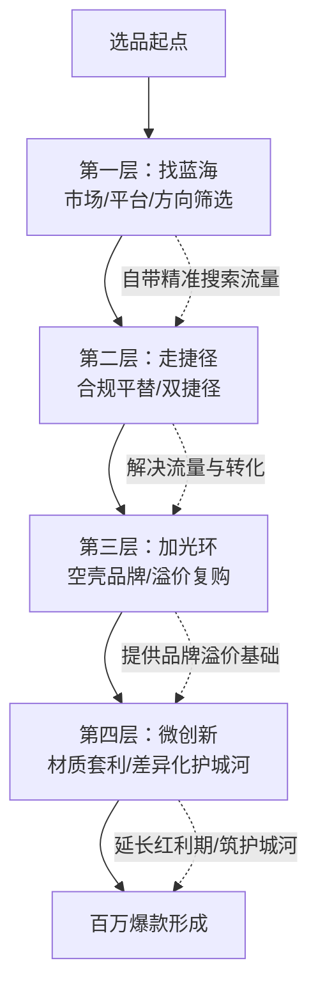
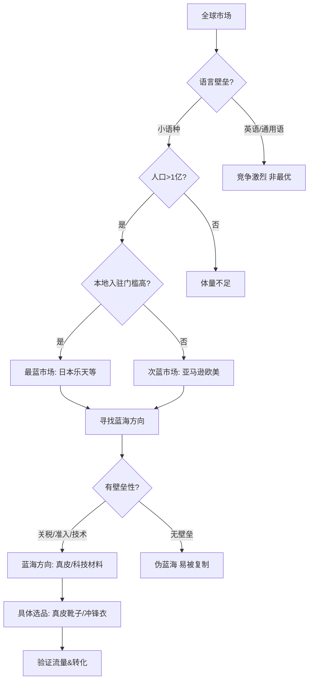
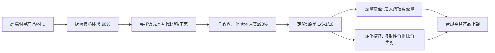
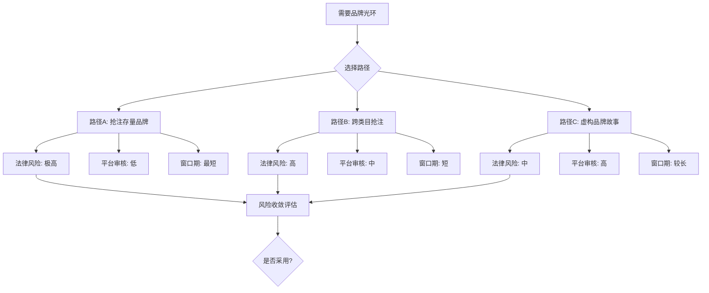
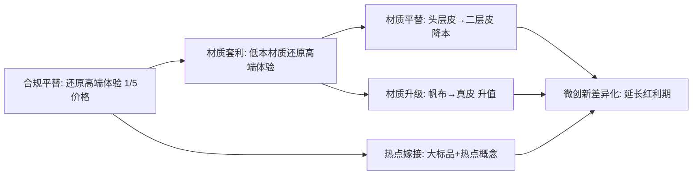
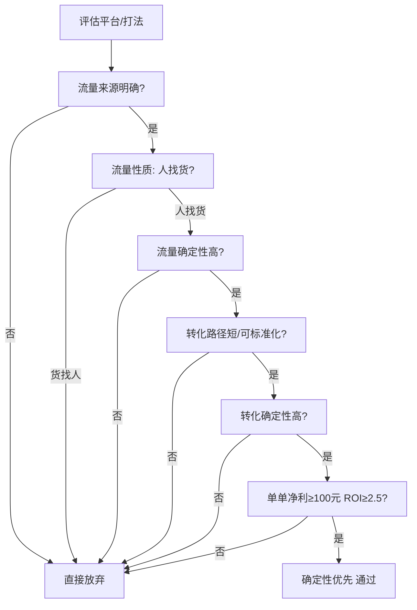

# 第 35 章 选品方法论 —— 从“选什么”到“为什么能卖爆”
作者：龙哥

## 学习目标

- 理解选品即运营的核心主张，掌握以流量与转化作为选品底层判断依据的思维方式
- 掌握蓝海市场分层方法，能从市场、平台、方向三层递进筛选出自带精准流量的蓝海方向
- 理解合规平替的双捷径原理，掌握用低成本还原核心体验以获得流量与转化双赢的策略
- 了解空壳品牌的运作机制与窗口期特征，能辩证评估其溢价收益与合规风险
- 掌握微创新与材质套利的差异化方法，理解新手为何应基于大标品而非原创设计做创新
- 建立确定性优先的决策框架，能运用流量与转化底层逻辑评估平台与项目，避免追逐彩票式机会

## 35.1 生活类比

想象选品是一次**军队作战前的弹药选择**：**选品** = 你决定携带的武器型号（决定战斗方式）；**流量** = 你如何吸引敌人进入射程（引流方法）；**转化** = 武器能否一发命中目标（转化卖点）；**蓝海** = 选择无人防守的侧翼战场（避开红海）；**平替** = 用改进型弹药打出原装炮弹的效果（性价比优势）；**空壳品牌** = 穿上敌方精锐部队的军装迷惑对手（品牌光环）。就像聪明的指挥官不会在选弹药时只想“打得好”，而是在选定的那一刻就决定了整个战术布局——选品即运营，选品本身就决定了流量和转化的整套打法。

## 35.2 概念地图

选项即运营：流量×转化
├── 底层主张：选品决定引流方法与转化卖点
│   ├── 前置性（选品是运营起点）—— P001
│   ├── 决定性（选品错误运营难救）—— P001
│   └── 耦合性（流量与转化相互成就）—— P001
├── 蓝海筛选体系
│   ├── 蓝海市场/平台四层分类—— P001
│   │   ├── 最蓝（小语种+人口1亿+本地门槛）
│   │   ├── 次蓝（发达国家+平台有空间）
│   │   ├── 微蓝（新上线平台+开放入驻）
│   │   └── 不蓝（所有低价平台）
│   └── 蓝海方向（自带搜索流量的垂直方向）—— P001
│       ├── 壁垒性（关税/入驻门槛）
│       └── 自流量性（垂直关键词自带人群）
├── 流量与转化捷径
│   ├── 合规平替（双捷径策略）—— P001
│   │   ├── 流量捷径（蹭明星产品/高端材质搜索量）
│   │   ├── 转化捷径（极致性价比比价优势）
│   │   └── 体验还原标准（90%体验，1/5价格）
│   ├── 空壳品牌（品牌光环策略）—— P001
│   │   ├── 溢出性（复购10%、净利提升30%）
│   │   ├── 故事性（虚构品牌故事的套利）
│   │   └── 窗口期（特定时期有效、合规风险）
│   └── 微创新/材质套利（差异化护城河）—— P001
│       ├── 本质是不创新（基于大标品升级）
│       ├── 材质套利（低本还原高端体验，成本降2/3）
│       └── 护城河性（延长红利期）
└── 决策框架：确定性优先
├── 底层判断依据：流量与转化—— P001, P002
├── 反彩票逻辑（拒绝货找人流量）—— P001
├── 回避低利润平台（低价平台算来算去都是亏）—— P001, P002
└── 独立判断（讲不出底层逻辑大概率是镰刀）—— P002

## 35.3 选品即运营 —— 让“选什么”决定“怎么卖”

### 为什么需要这个概念？

新手常把“选品”和“运营”当作两件事，认为只要产品好，后面靠运营就行。但素材指出，如果选品时没有想清楚流量和转化，后面运营只会事倍功半。我们需要建立一个认知框架：**选品本身就已经决定了引流方法和转化卖点**。

> "七分选品，三分运营？我们认为选品就是运营，运营要解决的问题主要就是两个：流量，转化。好的选品，在确定具体产品的时候，就已经确定引流方法，和转化方法（卖点）。即好的选品模式，必须把流量和转化，解决一个，或者两个都解决。"
> 
> ——《docs/202301-02/20230207_02.md》[P001]

这句话直接打破了“先选品、后运营”的串行思维。你在选定“日本乐天真皮靴子”的那一刻，其实已经隐含了：流量来自用户主动搜索“真皮靴子”这一垂直关键词；转化靠“中国出厂价几十元 vs 日本预期100+美元”的极致性价比。这两个问题在选品时就已解决，后续运营只是执行罢了。

### 核心定义：选品即运营

**定义**（来源：《docs/202301-02/20230207_02.md》[P001]）

> 选品即运营：好的选品在确定具体产品的时候，就已经确定了引流方法（流量）和转化方法（卖点）。
> 运营要解决的核心问题只有两个：流量和转化。
> 好的选品模式，必须把流量和转化解决一个，或者两个都解决。

**核心公式**

$$选品决策 = f(流量来源, 转化路径, 利润结构)$$

$$结果 = 流量 \times 转化率 \times 客单价 \times 复购率$$

**公式逐式解释**：
- **流量来源**：由选品决定用户是“主动搜索”还是“被动推荐”而来，前者意图强、确定性高；后者依赖算法、波动大。
- **转化路径**：由选品决定用户从看到产品到下单的步数、摩擦度、比价难度，直接影响转化率。
- **利润结构**：由选品决定的成本结构与定价空间，决定了单单净利与ROI下限。
- **流量 × 转化率 × 客单价 × 复购率**：生意结果的四大驱动因子，选品在确定产品时就已锁定这四个变量的上下限。

这个定义展示了三个核心性质：

1. **前置性**：选品阶段是运营的起点，而非独立的环节。你在做市场调研、看关税数据、找供应链时，其实已经在做运营策略了。
2. **决定性**：选品错误时，运营再好也难以补救。比如你在TikTok上卖一个客单价5美元的百货小商品，再怎么优化视频、投流，也很难覆盖获客成本——因为选品决定了“流量性质是货找人、转化依赖冲动消费”这个无法改变的底层结构。
3. **耦合性**：流量和转化是相互成就的。真皮靴子的案例里，精准搜索流量（用户主动搜“真皮”）天然带着高购买意图，转化率自然高；而Gore-Tex平替冲锋衣，蹭“Gore-Tex”搜索词得来的流量，因为“39.99美元 vs 100-200美元”的价格锚点，转化率同样被放大。

### 关键方法：选品四层结构

作者从底层往上将选品分为四层，对应四个步骤的操作范式：

**方法**（来源：《docs/202301-02/20230207_02.md》[P001]）

```
第一层【套利】：找蓝海市场、蓝海平台、蓝海方向（本章35.4节详解）
第二层【流量&转化】：合规平替、合规山寨，解决双捷径（本章35.5节详解）
第三层【模式】：空壳品牌，加光环获取溢价与复购（本章35.6节详解）
第四层【品&品类】：微创新、材质套利，打造差异化护城河（本章35.7节详解）
```

**方法演进流程图**：



这四步不是并列的选项，而是**层层递进的依赖关系**：
- 没有第一步的蓝海筛选，第二步的平替就没有精准流量可蹭；
- 没有第二步的流量转化基础，第三步的品牌溢价就没有销量支撑；
- 没有前三步的利润积累，第四步的微创新投入就没有资金保障。

### 典型例子

**真皮鞋类（日本乐天）**：消费者主动搜索“真皮靴子”而非“看广告”，产品自带精准流量；中国出厂价几十人民币 vs 日本预期100+美元，极致性价比完成转化。

**Gore-Tex平替冲锋衣（亚马逊美站）**：消费者搜索“Gore-Tex”时，“39.99美元的功能相同产品”鹤立鸡群，同时解决流量（蹭大牌搜索词）和转化（极致比价优势）。

### 边界条件

- 该概念主要适用于跨境电商和有一定搜索流量的成熟平台（如亚马逊、日本乐天）。
- 在纯“货找人”的平台（如TikTok）上，选品对流量和转化的影响较为间接，需要结合其他流量获取手段。
- 过于极致的选品要求可能导致“完美主义拖延”，需要与快速验证MVP相结合。

---

## 35.4 蓝海分层与蓝海方向 —— 从“红海逃逸”到“自带流量”

### 为什么需要这个概念？

新手常把“蓝海”等同于“某个具体产品”，但这样选出来的产品往往竞争依然激烈。需要先从更大的格局（市场、平台、方向）层层筛选，才能真正脱离红海。蓝海不只是竞争小，更要**自带精准搜索流量**，才能真正降低获客成本。

> "最蓝的（第一类蓝海）：1.小语种发达国家，2.人口大于一个亿，3.有本地入驻门槛的头部平台 ，比如日本乐天"
> 
> "次蓝的（第二类蓝海）：1.发到国家，2.人口大于一个亿，3.平台仍然有蓝海选品空间， 比如亚马逊欧美日"
> 
> "微蓝的（第三类蓝海）：1.新上线的平台 ，2.刚开始开放中国卖家入驻的平台 ，即使是低价平台也有一点铺货红利期"
> 
> "不蓝的：所有低价平台"
> 
> ——《docs/202301-02/20230207_02.md》[P001]

### 核心定义：蓝海市场/平台四层分类

**定义**（来源：《docs/202301-02/20230207_02.md》[P001]）

根据语言、人口、准入壁垒等特征，将蓝海分为四层：

| 层级 | 核心特征 | 典型代表 | 竞争强度 | 红利持久度 |
|------|----------|----------|----------|------------|
| 最蓝 | 小语种发达国家 + 人口>1亿 + 本地入驻门槛高 | 日本乐天 | 极低 | 长（年级） |
| 次蓝 | 发达国家 + 人口>1亿 + 平台仍有空间 | 亚马逊欧美日 | 低-中 | 中 |
| 微蓝 | 新上线平台 + 刚开放中国卖家入驻 | 新兴平台早期 | 中（随时间升高） | 短（季度级） |
| 不蓝 | 所有低价平台 | 虾皮、速卖通、Temu | 极高 | 无 |

这个分类展示了三个判断标准：**语言壁垒**、**市场体量**、**准入门槛**。三者叠加越高，蓝海越“蓝”。

### 核心定义：蓝海方向

**定义**（来源：《docs/202301-02/20230207_02.md》[P001]）

> 蓝海方向：比蓝海品类更高一层的概念，是相对垂直的产品方向（如真皮、科技材料），自带精准搜索流量，是连接宽泛蓝海和具体选品的关键。

> "蓝海方向不是蓝海品类，真皮或者科技材料，可以做的品类有好几个，比如真皮我们重点选择了鞋类，科技材料我们即做了鞋类也做了服装类。蓝海方向虽然有了，但还是很宽泛的，距离落实具体选品，虽然还有一些距离，但这一步，我们已经开始解决精准流量了，因为真皮就是一个相对垂直的关键词，对应的就是对产品有一定要求，并有一定消费力的人群。"
> 
> ——《docs/202301-02/20230207_02.md》[P001]

这个定义揭示了蓝海方向的两个关键性质：
- **壁垒性**：如日本真皮制品的高关税壁垒，保护了价格体系不被打破。
- **自流量性**：“真皮”、“Gore-Tex”本身就是垂直关键词，搜索这些词的用户天然具备需求明确、消费力较强的特征。

### 关键方法：第一步【找蓝海】

**方法**（来源：《docs/202301-02/20230207_02.md》[P001]）

**第一步【找蓝海】的完整操作流程：**

第一，筛选蓝海市场：优先寻找小语种发达国家，人口超过1亿，且有本地入驻门槛的头部平台，如日本乐天。这类市场语言壁垒高、准入门槛高，能天然过滤掉90%以上的跨境小白和新手。

第二，筛选蓝海平台：在目标市场锁定头部平台，如日本乐天、亚马逊日本站。平台层级决定了流量质量与规则稳定性，头部平台拥有成熟的搜索流量体系和完善的履约体系。

第三，定位蓝海方向：寻找具有“壁垒性”和“自流量性”的垂直方向。可通过三条路径发现：一是海关壁垒，如日本真皮制品高关税保护价格体系；二是平台搬运，将成熟平台验证过的方向迁移到新平台；三是材质升级，从低端材质向高端材质迁移的方向。

第四，落地具体品类：在方向下选择具体SKU，如真皮方向下选鞋类、包类。此时距离具体选品仍有一定距离，但已经解决了精准流量问题，因为垂直关键词自带明确需求和消费力人群。

**蓝海筛选决策流程图**：



### 典型例子：日本真皮制品蓝海发现过程

> "我们通过筛选日本海关关税信息，发现真皮制品在日本的关税非常高...价格体系没有被打破过。比如真皮的靴子，日本人普遍认为应该卖到 100 多美元以上，而中国工厂出厂价格有的仅有几十人民币。这就是一片广阔的蓝海选品大方向。"
> 
> ——《docs/202301-02/20230207_02.md》[P001]

这个案例完整演示了“海关壁垒 → 价格保护 → 认知锚点 → 利润空间”的推导链条。

**注**：该案例引用了“日本海关关税信息”，建议进一步核对具体HS编码（如6403.XX真皮鞋类）、关税税率数值（真皮制品通常8-30%不等）、对比基准（合成革关税通常较低），可参考日本海关官网或JETRO报告获取权威数据。

### 边界条件

- 蓝海分层主要适用于跨境电商的平台选择，国内电商平台难以直接套用该四层分类。
- 蓝海方向仍需结合具体品类落地，否则仍然宽泛。
- 蓝海窗口期会随着时间推移和平台规则变化而消失，需要持续寻找新的蓝海。

---

## 35.5 合规平替 —— 用十分之一的价格，做出90%的体验

### 为什么需要这个概念？

新手直接卖大牌同款有侵权风险，但卖完全不同的产品又缺乏流量和信任。需要一个既能蹭到大牌搜索流量、又合法合规的中间路线。平替不是抄袭，而是**用低成本材料还原核心体验**，实现流量和转化双赢。

> "合规平替不仅可以平替具体明星产品，也可以平替高端材质，这两种做产品的方向都是自带流量的，因为明星产品和高端材质，是有相应的搜索流量的。具体标准就是要达到原产品的客户体验的 90%，但是价格只有五分之一甚至更少。合规平替是一个适用绝大部分类目的宝藏选品方向，因为它既有流量捷径，也有转化捷径。"
> 
> ——《docs/202301-02/20230207_02.md》[P001]

### 核心定义：合规平替

**定义**（来源：《docs/202301-02/20230207_02.md》[P001]）

> 合规平替：通过较低成本的材料或产品，还原高端明星产品或高端材质的核心体验（90%），但价格仅为原品的五分之一甚至更少，从而同时解决流量和转化问题。

这个定义包含三个硬性指标：
- **体验还原度 ≥ 90%**（核心功能、手感、使用场景一致）
- **价格 ≤ 原品 1/5 甚至 1/10**（极致性价比）
- **合规性**：自有品牌或合法授权，不侵权

### 关键性质：双捷径机制

| 捷径类型 | 来源 | 机制 | 关键动作 |
|----------|------|------|----------|
| **流量捷径** | 明星产品/高端材质的搜索量 | 用户搜索“Gore-Tex”、“Dyson”、“真皮”时，你的产品出现在搜索结果中 | 标题/搜索词/广告词精准覆盖大词 |
| **转化捷径** | 极致性价比的比价优势 | 同一搜索结果页中，你的价格是竞品的 1/5-1/10，体验却有 90% | 主图/五点描述/视频强化“同等体验、十分之一价格” |

> "好的平替，可以打原价的十分之一的价格，净利润还有 200 人民币以上。"
> 
> "它虽然不是 goretex 的，但是搜索 goretex 它会展示，它功能相同，它足够便宜。...39.99 的它鹤立鸡群。"
> 
> ——《docs/202301-02/20230207_02.md》[P001]

### 关键方法：第二步【走捷径】

**方法**（来源：《docs/202301-02/20230207_02.md》[P001]）

**第二步【走捷径】的完整操作流程：**

第一，确定对标对象：选取有巨大搜索量的明星单品（如某款爆款冲锋衣）或高端材质大词（如 Gore-Tex、真皮、记忆棉）作为平替目标。

第二，拆解核心体验：深度分析用户到底在为哪 90% 的体验买单——防风/透气/手感/支撑/颜值等，剥离品牌溢价、营销包装等非核心因素。

第三，寻找低成本替代材料/工艺：如头层皮→二层皮、Gore-Tex→高透气PU涂层、记忆棉→高回弹海绵+凝胶层，目标是成本大幅下降但核心功能指标不降。

第四，验证体验还原度：打样实测、找种子用户盲测、对比核心指标（如透湿量、防水压力、回弹率），确保达到原品90%以上体验。

第五，定价策略：成本 × (3-5) = 售价，确保 ≤ 原品 1/5，且单单净利 ≥ 100-200 元。

第六，上架布局：标题含大词、主图对比图、搜索词埋大词、可投放竞品品牌词广告（合规前提下）。

**合规平替双捷径流程图**：



### 典型例子

**冲锋衣 + Gore-Tex 平替（亚马逊美站）**：
- 原品：知名户外品牌 Gore-Tex 冲锋衣，客单 100-200 美元
- 平替：自有品牌，高透气 PU 涂层面料，功能相同（防水透气），定价 39.99 美元
- 结果：搜索“Gore-Tex”出现在首页 SKU 中，“39.99 的它鹤立鸡群”，客单净利 100+ 元

**真皮平替（日本乐天）**：
- 原品：头层皮真皮靴，日本认知价格 100+ 美元
- 平替：二层皮真皮靴，成本下降 2/3，保持“真皮”属性与手感
- 结果：日本消费者认可“真皮”标签，以 1/3-1/5 价格成交

**注**：Gore-Tex平替案例为作者自述经验数据，建议补充该SKU的ASIN、BSR排名、广告投放ACOS、真实净利核算表等可验证数据，可通过Jungle Scout/Helium 10等第三方选品工具历史数据佐证。

### 边界条件

- 主要适用于有搜索流量、用户会主动比价的平台（如亚马逊、乐天、独立站 SEO）。
- 平替需要有足够大的价格差支撑，否则难以形成比价优势（如原品本身就很便宜的品类不适用）。
- 必须确保产品合规：不使用对方商标、不虚假宣传材质、不侵犯外观专利。

---

## 35.6 空壳品牌 —— 让“故事”成为溢价的翅膀

### 为什么需要这个概念？

白牌产品缺乏信任背书，难以卖出高价，也难以获得复购。但打造一个真正的品牌需要漫长的时间和巨额投入，不适合快速验证生意。需要一种**低成本、快速获得“品牌感”**的策略，为产品赋予溢价能力。

> "我们还给他们起了个名字，叫做空壳品牌。这也是一种选品模式，虽然只有特定的窗口期。"
> 
> "1.抢注国外品牌，并复制它的全系产品（例如 koolaburra 已被 ugg 收购） 2.抢注国外品牌，并跨类目做新类目产品（速卖通常见套利玩法） 3.在国外注册品牌，策划国外的品牌故事和品牌形象（国内电商常见品牌捷径）"
> 
> ——《docs/202301-02/20230207_02.md》[P001]

### 核心定义：空壳品牌

**定义**（来源：《docs/202301-02/20230207_02.md》[P001]）

> 空壳品牌：通过抢注国外知名品牌（未在该类目注册的）或策划一个虚构的外国品牌故事，快速获得品牌溢价、信任和复购的选品模式。

### 关键性质

| 性质 | 说明 | 典型表现 |
|------|------|----------|
| **窗口期性** | 只适合特定窗口期，随平台监管收紧、消费者认知提升失效 | 早期亚马逊/速卖通/乐天可行，现在风险极高 |
| **故事性** | 品牌故事可自由策划，借助跨国信息差建立“高端”形象 | “德国工艺”、“日本匠心”、“美国户外传承” |
| **溢价性** | 成功案例复购可达 10%，净利提升最多 30% | 白牌客单 30 美元 → 空壳品牌客单 50 美元，复购率从 2% → 10% |

> "我们做一个日本品牌，在东欧做一个日本品牌，在美国做一个欧洲或者日本品牌，这都是可行的，本土客户查不到，故事随便你说。成功的空壳品牌，可以做到 10%的复购，可以带来的净利提升最多可以达到 30%。"
> 
> ——《docs/202301-02/20230207_02.md》[P001]

### 关键方法：第三步【加光环】

**方法**（来源：《docs/202301-02/20230207_02.md》[P001]）

**第三步【加光环】的三大操作路径及完整流程：**

**路径 A：抢注存量品牌（风险最高）**
第一，搜索国外知名品牌在目标国/类目的商标注册情况；第二，发现未注册的知名品牌（如某户外品牌未在鞋类注册）；第三，抢先注册商标，复制或改良其全系产品上架；第四，利用品牌自带搜索流量 + 信任背书快速出单。

**路径 B：跨类目抢注（中风险）**
第一，找知名品牌在非核心类目未注册的情况；第二，注册并开发新类目产品（如服装品牌做箱包）；第三，借品牌联想度转化。

**路径 C：虚构海外品牌故事（现主流但合规风险大）**
第一，在目标市场国家注册一个听起来像当地品牌的商标；第二，编造品牌故事：创始年份、创始人传记、工厂实景、设计理念；第三，包装页、A+页面、视频全铺陈品牌调性；第四，配合空壳品牌做合规平替/微创新产品，形成“品牌+性价比”双重打击。

**空壳品牌三路径决策流程图**：



### 多源对照：空壳品牌的三种操作方式对比

**共识**：三种方式都利用“消费者对海外品牌的信任默认”+“跨国核实成本高”这一信息差，低成本获取品牌溢价。

**分歧**：

| 维度 | 路径 A：抢注存量品牌 | 路径 B：跨类目抢注 | 路径 C：虚构品牌故事 |
|------|----------------------|--------------------|----------------------|
| 法律风险 | 极高（恶意抢注、侵犯在先权利） | 高（跨类保护、驰名商标保护） | 中（虚假宣传、消费者欺诈） |
| 平台审核通过率 | 低（品牌备案常被拦截） | 中 | 高（自有商标） |
| 消费者发现真相后果 | 极严重（品牌方维权、平台永封、赔偿） | 严重 | 中等（信任崩塌、差评、退货率飙升） |
| 窗口期长度 | 最短（品牌方一旦发现即维权） | 短 | 较长（但随平台合规收紧缩短） |
| 适合阶段 | 早期红利期、快速收割 | 早中期 | 早中晚期均可尝试，但长期不可持续 |

**注**：空壳品牌“复购 10%、净利提升 30%”为作者自述经验数据，缺乏样本量、统计周期、对照组（同品类白牌基准）说明，建议补充店铺级匿名数据或行业基准对比。

### 边界条件

- 该方法涉及法律和道德灰色地带，抢注他人品牌存在维权和法律风险。
- 窗口期有限，随着平台监管和消费者认知提升会失效。
- 空壳品牌无法建立长期的品牌资产，无法替代真正的品牌建设。
- **在当前全球电商合规化趋势下，该做法风险越来越高，建议谨慎使用或仅作为短期过渡策略**。

---

## 35.7 微创新与材质套利 —— “不创新”的差异化才是新手红利

### 为什么需要这个概念？

新手原创设计风险极高，盲目“痛点迭代”需要专业积淀，难以获得成功确定性。但完全同质化的产品又陷入价格战，需要一种**低风险、高确定性**的差异化方法。微创新就是在“大标品”基础上做小幅升级和嫁接，用最低成本获得差异化红利。

> "微创新其实就是不创新。新手做差异化，不要去考虑原创设计，痛点迭代，这些方向没有专业积淀，很难拿到成功确定性，新手适合基于大标品，去做升级式的和热点嫁接式的差异化产品。我们比较推荐新手去做的微创新差异化套路是：材质套利，是上文材质平替的一个延申。"
> 
> ——《docs/202301-02/20230207_02.md》[P001]

### 核心定义：微创新与材质套利

**定义**（来源：《docs/202301-02/20230207_02.md》[P001]）

> 微创新：其本质是“不创新”——新手不做原创设计和痛点迭代，而是基于大标品，做升级式的和热点嫁接式的差异化产品，以获得更长的红利期。
> 
> 材质套利：微创新的推荐路径，通过使用更低成本的原材料（如二层皮替代头层皮）来还原高端材质（如真皮、Gore-Tex）的体验，从而获得巨大的成本优势和利润空间。

### 关键性质

| 创新类型 | 操作逻辑 | 典型案例 | 成本变化 | 价值提升 |
|----------|----------|----------|----------|----------|
| **材质升级** | 低端材质 → 高端材质 | 帆布包 → 真皮包 | 成本上升 | 客单价大幅提升、品类跃迁 |
| **材质平替/套利** | 高端材质 → 低成本同体验材质 | 头层皮 → 二层皮；Gore-Tex → PU涂层 | 成本下降 1/3-2/3 | 维持高端定位、利润率飙升 |
| **热点嫁接** | 大标品 + 当下热点概念 | 普通水杯 + “氢水/富氢”概念；普通枕头 + “助眠/颈椎”概念 | 微增 | 蹭热点流量、溢价 |

> "材质升级：帆布升级到真皮 平替套利：头层皮换成二层皮，成本下降三分之二。"
> 
> ——《docs/202301-02/20230207_02.md》[P001]

### 关键方法：第四步【微创新】

**方法**（来源：《docs/202301-02/20230207_02.md》[P001]）

**第四步【微创新】的完整操作流程：**

第一，选定大标品：市场验证成熟、需求稳定、供应链成熟的基础款（白T恤、帆布鞋、移动电源、不锈钢保温杯）。

第二，选择微创新路径：A. 材质升级——识别大标品的“低端材质痛点”，升级为高端材质（帆布→真皮、塑料→金属、化纤→天然纤维）；B. 材质平替——识别高端材质的“高成本痛点”，用低成本材质还原 90% 体验（头层皮→二层皮、实木→高密度板+实木贴皮、纯铜→铜包铝）；C. 热点嫁接——结合当下热搜概念（AI、健康、环保、露营、银发经济）给大标品加功能/卖点。

第三，供应链验证：找 3-5 家工厂打样，测试成本、良率、交期。

第四，成本核算：确保升级后成本仍允许 3-5 倍定价、净利 ≥ 100 元/单。

第五，差异化上架：主图/视频突出“材质对比”、“实验数据”、“权威背书”。

### 方法演进图：从平替到微创新的延伸关系



### 为什么新手不适合做“原创设计”和“痛点迭代”？

| 维度 | 原创设计/痛点迭代 | 微创新/材质套利 |
|------|-------------------|-----------------|
| **需求确定性** | 未知（用户可能不买单） | 高（大标品需求已验证） |
| **专业门槛** | 极高（工业设计、人因工程、模具开发） | 低（材料替换、工艺微调） |
| **资金投入** | 大（开模、打样、试错） | 小（现成模具、换料即可） |
| **周期** | 长（3-12个月） | 短（2-4周） |
| **成功率** | 低（<10%） | 高（>50%） |
| **护城河** | 专利/设计版权（但易被规避） | 供应链成本优势+选品组合壁垒 |

### 边界条件

- 微创新不适用所有品类，需要找到可做材质或功能升级的大标品。
- 热点嫁接式创新需要快速响应，热点退潮后红利消失。
- “不创新”的定位限制了长期品牌价值的构建，适合起步阶段的快速验证。

---

## 35.8 确定性优先 —— 别把生意做成“买彩票”

### 为什么需要这个概念？

新手常被“一夜暴富”的流量红利故事吸引，追逐爆单机会，但这类“货找人”流量本质上是碰运气。成功生意的核心是可持续、可复制的确定性，而非依赖偶然运气的爆单。需要建立一套评估项目/平台时“确定性优先”的决策准则，避免被“镰刀”收割。

> "成功老板都是抓确定性，只有韭菜财迷爱抓彩票，我接触的大卖，没有一个主战场在 tk。大力出奇迹，每天上 100 个视频，我要 all in~~你的时间不值钱?你 all in 一个月好好打工一万块赚不到?你这样做 tk 跟赌有啥区别?"
> 
> "听谁的?听自己的!终究要自己懂底层判断依据:1.流量 2.转化。"
> 
> "要让其知其所以然。讲不出所以然的，大概率镰刀。"
> 
> "这两个平台的卖家，都比我厉害，因为我算来算去他们都是亏的。Temu 也是低价平台，也不建议新手入。"
> 
> ——《docs/202301-02/20230207_02.md》[P001] 与 《docs/202301-02/20230207_04.md》[P002]

### 核心定义：确定性优先

**定义**（来源：《docs/202301-02/20230207_02.md》[P001] 与 《docs/202301-02/20230207_04.md》[P002]）

> 确定性优先：成功的生意人追求确定的、可持续的赚钱模式，而非依赖偶然爆单或一夜暴富的运气；在评估平台或打法时，必须基于“流量”和“转化”两个底层逻辑进行判断，而非听信片面之词。

### 关键性质

| 性质 | 说明 | 反面教材 |
|------|------|----------|
| **持续性** | 确定性生意可复制、可放大，而非一锤子买卖 | TikTok“货找人”流量、单视频爆单不可复现 |
| **底层判断** | 流量和转化是评估一切的底层坐标系，离开这两个维度的讨论都是耍流氓 | 听信“某平台好做”、“某老师带赚钱” |
| **风险回避** | 确定性思维天然回避风险，投向高概率方向 | All in 单一平台、借贷投流、无止损线 |
| **独立判断** | 讲不出底层逻辑的“推荐”大概率是镰刀 | 盲目跟风、付费进群学“秘籍” |

### 关键方法：平台/项目评估清单（基于流量×转化）

**方法**（来源：《docs/202301-02/20230207_02.md》[P001] 与 《docs/202301-02/20230207_04.md》[P002]）

评估任一平台或打法时，必须能回答这 6 个问题：

| 维度 | 追问 | 合格标准 |
|------|------|----------|
| **流量来源** | 流量从哪来？搜索/推荐/广告/私域？ | 明确、可量化、可持续 |
| **流量性质** | 人找货（搜索）还是货找人（推荐）？ | 优先人找货/搜索流量 |
| **流量确定性** | 流量波动大不大？受算法/政策影响大不大？ | 低波动、低政策依赖 |
| **转化路径** | 用户如何从看到到下单？几步？ | 路径短、摩擦小、可标准化 |
| **转化确定性** | 转化率稳不稳？依赖什么关键因素？ | 高稳定性、可控因素主导 |
| **利润结构** | 扣除流量成本、履约成本后，单单净利多少？ | 单单净利 ≥ 100 元、ROI ≥ 2.5 |

**平台评估决策流程图**：



### 典型例子：为什么大卖主战场不在 TikTok？

> "tk 又是个跟 fb 一样'货找人'的流量性质...但目前结合 tk 广告一级代理商的数据来看，tk 广告投放的 roi 极不稳定，即使付费玩家盈利的也不多。"
> 
> ——《docs/202301-02/20230207_02.md》[P001]

**流量视角**：“货找人” = 被动推荐，用户无明确购买意图，点击率低、停留短、转化靠冲动。
**转化视角**：ROI 极不稳定，今日爆单明日归零，无法建立稳定的投放模型。
**结论**：不符合“确定性优先”，不适合作为主战场。

**注**：该判断引用“tk 广告一级代理商的数据”，未披露代理商名称、样本量、统计周期、行业分布，建议补充 TikTok Ads Transparency Report 官方季度报告或独立机构白皮书作为第三方佐证。

### 典型例子：为什么不建议新手入驻低价平台（虾皮/速卖通/Temu）？

> "这两个平台的卖家，都比我厉害，因为我算来算去他们都是亏的。Temu 也是低价平台，也不建议新手入。不蓝的：所有低价平台"
> 
> ——《docs/202301-02/20230207_02.md》[P001]

**流量视角**：平台自带流量大，但极度价格敏感，流量质量低。
**转化视角**：只有极致低价能转化，但极致低价 = 无利润或亏损。
**利润结构**：客单价极低（几美元），扣除佣金、广告、履约、退货，净利为负或极薄。
**结论**：不符合“确定性优先”，是“镰刀”收割新手的温床。

**注**：“算来算去都是亏的”为定性判断，建议补充标准化利润测算表模板：客单价、佣金率、广告占比、退货率、履约成本五维拆解，并给出实测案例。

### 边界条件

- 确定性优先不等于完全排斥高风险高回报机会，而是在早期资源有限时作为主要决策原则。
- “流量和转化”是核心判断依据，但不同行业和阶段可能还需要考虑交付、合规等因素。
- 过于追求确定性可能导致错过真正的颠覆性机会，需结合自身风险承受能力判断。

---

## 35.9 多源对照

### 共识

- **选品是系统工程**，不是拍脑袋决定单品，需要从市场、平台、方向、产品层层推导。
- **流量与转化**是评估一切商业模式的底层坐标系，离开这两个维度的讨论都是耍流氓。
- **新手应追求确定性**，避开“货找人”流量红利陷阱和低价平台亏损陷阱。

### 分歧

| 视角 | 《20230207_02.md》（实战选品法） | 《20230207_04.md》（认知决策法） |
|------|----------------------------------|----------------------------------|
| **核心关注** | 怎么选出能卖爆的具体产品 | 怎么避免认知偏差、做对决策 |
| **方法论层级** | 战术/执行层（四步法、具体案例） | 战略/思维层（道术器用、5WHY） |
| **风险态度** | 承认空壳品牌等灰色手段的窗口期价值 | 强调合规、长期主义、风险控制 |
| **工具配套** | 海关数据、关键词工具、供应链验证 | 商业模式画布、年度总结、目标拆解 |

**综合建议**：用《20230207_02.md》的四步法做**选品执行**，用《20230207_04.md》的“事实与观点区分”“5WHY分析”“道术器用四层分析”做**决策复盘**。例如：选定“真皮靴子”方向后，用商业模式画布梳理“用什么产品解决谁的痛点赚什么钱”；遇到“日本乐天真皮类目竞争加剧”问题，用5WHY追问根因是“供应链成本上升”还是“平台流量分发变化”再定对策。

---

## 35.10 设计中的取舍

### 为什么不用“原创设计”而是“微创新”？

原创设计需要工业设计能力、模具开发资金、市场教育成本，成功率极低（<10%），周期长（3-12个月），新手没有容错空间。微创新基于大标品，需求已验证、供应链成熟、模具现成、只需换料/微调，成功率高（>50%）、周期短（2-4周）、**成本可控**。这是用“确定性”换“上限”的理性取舍。

### 为什么不用“品牌建设”而是“空壳品牌/合规平替”？

真品牌建设需要 3-5 年沉淀、千万级投入、全链路管控，适合已跑通模型、有充足现金流的中大卖。新手阶段，空壳品牌（窗口期内）和合规平替（长期可行）能以极低成本获得“品牌感溢价”和“信任转化”，是**用“时间”换“空间”的战术妥协**。但必须清醒：这是过渡策略，长期仍需沉淀真品牌资产。

### 为什么拒绝“TikTok/低价平台”而选择“搜索流量平台”？

TikTok 等“货找人”平台流量看似大、爆发快，但**流量确定性极低**（算法黑箱、政策多变、ROI 不稳定），且**转化依赖冲动消费**，客单价低、复购难、品牌资产沉淀难。搜索流量平台（亚马逊、乐天、独立站 SEO）流量**确定性高**（用户主动搜索、关键词稳定、可长期积累），转化**意图强**、客单价高、复购可期、**品牌资产可沉淀**。这是用“慢”换“稳”、用“确定性”换“爆发力”的战略取舍。

---

## 35.11 动手练习

### 练习 1：评估一个平台的“确定性”

假设你是一个跨境电商新手，有两个选择：
- A. TikTok：短视频带货，流量大但“货找人”，ROI不稳定
- B. 日本乐天：本地入驻门槛高，小语种市场，竞争小

请运用“确定性优先”原则和“流量与转化”底层判断依据，回答：
1. 分别从流量确定性、转化确定性两个维度评估上述两个平台
2. 为什么作者断言“我接触的大卖没有一个主战场在 TikTok”？
3. 如果你只有10万元启动资金，你会选择哪个平台？为什么？
4. 请给出你评估一个平台是否值得投入的判断清单（至少包含5个维度）

### 练习 2：蓝海方向筛选实战练习

假设你拥有以下资源和约束条件：
- 预算：50万人民币
- 供应链：可对接中国工厂，能生产鞋类、服装、箱包
- 目标市场：可选择日本、欧美、东南亚

备选蓝海方向如下：
- A. 真皮制品（日本市场）——海关关税壁垒保护，日本消费者认为真皮靴子应卖100+美元，中国出厂价几十人民币
- B. Gore-Tex平替冲锋衣（美国市场）——功能相同但价格仅39.99美元，原品100-200美元
- C. 帆布包升级为真皮包（欧洲市场）——材质升级提升客单价

请回答：
1. 运用“蓝海市场→蓝海平台→蓝海方向→具体选品”四层筛选法，对上述三个方向进行排序并说明理由
2. 分别指出每个方向的流量来源（用户为什么会搜到你的产品？）
3. 分别指出每个方向的转化卖点（用户为什么买你的而非别人的？）
4. 如果只能选一个方向，你选哪个？请结合确定性优先原则给出决策依据

### 练习 3：设计一个“合规平替”产品方案

选择你熟悉的一个品类（如运动鞋、保温杯、蓝牙耳机），完成以下任务：
1. 确定一个“高端明星产品或高端材质”作为对标对象，说明其搜索流量来源
2. 设计你的平替方案：
   - 使用什么低成本材料/工艺来还原核心体验？
   - 预估可以达到原品体验的百分比（要求≥90%）
   - 预估你的成本和定价（要求≤原品1/5价格）
3. 回答：
   - 为什么你的方案是“合规”的？如何避免侵权风险？
   - 能否同时解决流量和转化？请具体说明
   - 这个方案的护城河在哪里？竞争者多快能跟进？

### 练习 4：微创新矩阵：从大标品到差异化产品

选取一个你熟悉的“大标品”（如白T恤、帆布鞋、移动电源），运用微创新思维设计差异化方案：
1. 列出该大标品的3个核心属性（材质、功能、设计风格）
2. 分别运用“材质升级”“材质平替”“热点嫁接”三种路径设计差异化方案：
   - 材质升级：如帆布→真皮，提升价值的逻辑是什么？
   - 材质平替：如头层皮→二层皮，降低成本的同时如何保持体验？
   - 热点嫁接：结合当前热点（如AI、健康、环保）做差异化
3. 回答：
   - 为什么新手不适合做“原创设计”和“痛点迭代”？
   - 微创新“不创新”的本质是什么？它和抄袭的区别在哪里？
   - 在什么情况下微创新无法形成护城河？

### 练习 5：空壳品牌的风险评估报告

你是一家跨境电商公司的选品顾问，老板让你评估“空壳品牌”策略是否适用于新拓展的欧洲市场：
1. 结合素材中空壳品牌的三种操作方式（抢注复制、抢注跨类目、虚构品牌故事），逐一分析：
   - 品牌溢价空间有多大？
   - 法律风险等级如何？
   - 消费者发现真相的概率与后果是什么？
   - 平台审核通过的概率如何？
2. 对每种方案给出“建议采用/谨慎采用/不建议采用”的结论并说明理由
3. 回答：
   - 素材认为空壳品牌“只有特定窗口期”，你认为窗口期消失的信号有哪些？
   - 如果你决定不采用空壳品牌但又要“加光环”，请设计3个合法合规的替代方案

---

## 35.12 本章小结

这一章中我们学习了如何建立一套以“流量×转化”为底层判断依据的选品方法论。首先我们确立了**选品即运营**的核心认知：好的选品在确定产品时就已解决流量来源和转化卖点，运营不再是事后补救而是选品的自然延伸。其次我们掌握了**蓝海分层筛选体系**，从最蓝/次蓝/微蓝/不蓝四层市场平台分类，到自带搜索流量的蓝海方向定位，实现从红海逃逸到自带精准流量。接着我们深度拆解了**合规平替**的双捷径机制——蹭大词流量与极致性价比转化并行，并给出了90%体验还原、1/5价格、合规自有品牌的硬性标准。然后我们辩证分析了**空壳品牌**的三种操作路径、溢价收益与法律/平台/信任三重风险，明确其仅为特定窗口期的过渡策略。随后我们理解了**微创新与材质套利**“不创新”的差异化本质：基于大标品做材质升级/平替/热点嫁接，用最低成本获得差异化红利与护城河。最后我们建立了**确定性优先**的决策框架，用流量来源、流量性质、流量确定性、转化路径、转化确定性、利润结构六个维度评估平台与项目，拒绝“货找人”彩票逻辑和低价平台亏损陷阱。

本章我们一起学习了以下概念：

| 概念 | 解释 |
|------|------|
| 选品即运营 | 好的选品在确定产品时就已经确定了引流方法（流量）和转化方法（卖点），运营核心只解决流量与转化两个问题 |
| 蓝海市场/平台分层 | 根据语言、人口、准入壁垒将蓝海分为最蓝、次蓝、微蓝、不蓝四层，壁垒越高蓝海越持久 |
| 蓝海方向 | 比蓝海品类更高一层的垂直产品方向（如真皮、科技材料），自带精准搜索流量，是连接宽泛蓝海与具体选品的关键 |
| 合规平替 | 用低成本材料还原高端产品90%核心体验、价格仅五分之一甚至更少，同时解决流量与转化的双捷径策略 |
| 空壳品牌 | 通过抢注国外品牌或虚构海外品牌故事快速获取溢价与复购，但只有特定窗口期且存在法律灰色地带 |
| 微创新/材质套利 | 新手不做原创设计，基于大标品做材质升级/平替/热点嫁接差异化，本质是不创新，以降低风险延长红利期 |
| 确定性优先 | 追求可持续、可复制的确定性生意模式，基于流量与转化两个底层逻辑独立判断，拒绝彩票式爆单与镰刀收割 |

下一章中，我们将学习 **“流量获取与私域运营”** —— 从“公域捕捞”到“私域养殖”，系统掌握流量切片分析、流速控制、流量合并三大运营技术，以及私域单客价思维、五位一体成交飞轮等精细化变现方法论，打通“获客-留存-变现”完整链路。


