# 第 25 章 副业创业的底层逻辑与实战方法论 —— 从“中介费伪概念”到“基本盘论”
作者：龙哥

## 学习目标

- 理解中介费伪概念的本质：识别信息差如何转化为商业切入点
- 掌握最小MVP闭环的验证逻辑：从挣第一块钱开始跑通产品-流量-销售-交付全链路
- 深刻领会选品决定论：好产品如何自带转化力、降低获客成本、提升复购率
- 学会私域高客单（金饭碗）运营：用专业信任换取高溢价，避免“端着金饭碗讨饭”
- 掌握向有结果的人学习、复制再创新的付费学习与执行范式
- 熟练运用蹭流截流开店策略：低成本借力竞对流量实现冷启动
- 理解店中店联营赋能模式：用技术手段（锁码）把别人的店变成自己的分销点
- 掌握加盟商赋能一条龙体系：将单店跑通的SOP标准化、工具化、包装化实现快速复制
- 理解城市合伙人（城市管家）制度：总部做重基建、合伙人做轻运营的扩张模型
- 建立存量时代行业洗牌的周期判断力：在旧模式出清期用新模式收割存量红利
- 确立基本盘思维：构建自主可控、高复购、高毛利的核心业务抵御单一变现渠道风险

## 25.1 生活类比

想象创业像在红海里开一家“不收中介费”的房产中介店。你发现中介赚的是“信息差的钱”（买家不知道房东电话），于是你搭个平台直接把电话给买家，中介费瞬间归零——这就是中介费伪概念的核心洞察。别想着先盖写字楼招百人，先在隔壁租个10平米小屋，挂个“0中介费”牌子，成交第一单、赚第一块钱，证明模式跑通——这就是最小MVP闭环的验证逻辑。别光琢磨“怎么卖房”，先把“房源真假、看房方便、签约安全”这产品打磨极致，好产品让客户自己掏钱、自己带新客——这就是选品决定论的产品力。客户找你是因为信你专业（如皮肤管理、租房避坑），别拿这宝贵信任去卖9.9元团购纸巾，要卖高客单、高复购的核心服务——这就是私域高客单/金饭碗的信任变现。别闭门造车，花钱进同行大佬的“内部群”，抄作业、抄SOP、抄话术，再结合自己资源改良创新——这就是向有结果的人学习、复制再创新的付费范式。直接在全城生意最火的中介门店隔壁开张，挂“0中介费”大字报，坐享其成精准流量，用极致性价比截胡——这就是蹭流截流开店的冷启动。不租门面不雇人，跟楼下便利店、驿站谈：“放个二维码展架，客户扫码成交你分佣”，用技术锁码躺赚分销网络——这就是店中店联营赋能的低门槛扩张。把你跑通的“拍视频脚本、剪辑模板、朋友圈文案、咨询话术”全打包成“傻瓜包”，加盟商改个名字就能开干——这就是加盟商赋能一条龙的标准化复制。总部搭平台、建房源库、配带看团队（重资产标准化），合伙人只管本地搞关系、聊天成交（轻资产执行），分成共赢——这就是城市合伙人/城市管家制度的扩张模型。房地产从“盖新房”转“盘活存量”，传统中介靠信息差吃饭的日子结束了，平台化、服务化、透明化的新模式正是入场最佳时机——这就是存量时代洗牌的周期判断力。别把命系在“接广告”或“平台分成”单一绳子上，必须有自有品牌、自有门店、自有会员体系这“压舱石”，才能穿越周期——这就是基本盘论的抗风险底线。

## 25.2 概念地图

```mermaid
graph TD
    A[商业认知与模式设计] --> B[核心洞察]
    A --> C[验证方法论]
    A --> D[产品与选品]
    A --> E[私域运营]
    A --> F[获客与流量]
    A --> G[组织与复制]
    A --> H[周期与风控]
    A --> I[学习与成长]
    
    B --> B1[中介费伪概念（信息差即商机） —— P002]
    B --> B2[生意的本质是信息差 —— P002]
    B --> B3[有需求的地方就有市场 —— P002]
    B --> B4[买房用户跳单深层动机是省中介费 —— P002]
    
    C --> C1[最小MVP闭环（挣1块钱起步） —— P001]
    C --> C2[平台内容创造准客户环境 —— P002]
    
    D --> D1[选品决定论（产品好省一半心） —— P001]
    D --> D2[美业选品三要素（需求深/口服/背书） —— P001]
    D --> D3[二房东渠道模型（空置成本驱动付费） —— P002]
    
    E --> E1[私域高客单/金饭碗（专业信任换溢价） —— P001]
    E --> E2[咨询SOP表格（标准化提升转化） —— P001]
    E --> E3[配房-带看-成交标准流程（租房SOP） —— P002]
    
    F --> F1[蹭流截流开店（借竞对流量冷启动） —— P002]
    F --> F2[房东联系方式获取法（物业/水电/同行） —— P002]
    F --> F3[租客全域发掘法（多平台矩阵主动出击） —— P002]
    F --> F4[抖音投放>本地自媒体>汽车广播 —— P002]
    
    G --> G1[店中店联营赋能（锁码跟踪+低门槛） —— P002]
    G --> G2[加盟商赋能一条龙（脚本/剪辑/课程/SOP） —— P001]
    G --> G3[城市合伙人/城市管家（总部基建+合伙人执行） —— P002]
    G --> G4[人海战术与城市扩张（单员工两单覆盖成本） —— P002]
    
    H --> H1[存量消费时代来临（旧模式出清/新模式窗口） —— P002]
    H --> H2[变现渠道不能单一/基本盘论（自有品牌/店/IP） —— P001]
    H --> H3[投资须防骗子公司（收费即警惕） —— P002]
    H --> H4[外包选型避坑/招聘偏好应届生 —— P002]
    
    I --> I1[向有结果的人学习，复制再创新（付费买时间/避坑） —— P001]
    I --> I2[换词换认知（代理→会员降低心理阻力） —— P001]
```

---

## 25.3 中介费伪概念 —— 让信息差成为你的商业切入点

### 为什么需要这个概念？

你有没有想过，为什么买房、租房要给中介几万块“中介费”？他们到底提供了什么服务？

> "我们不收中介费，是因为中介费本身就是个伪概念！为什么说是伪概念，因为是智商税，中介费为什么要收？就是因为买房及租房者不知道售房及出租转让业主的联系电话！"
> 
> ——《胖龟找房创业复盘，素材ID: P002》

这段话直击要害：**中介费的本质不是服务费，是信息差造成的“智商税”**。买房者不知道房东电话，租房者不知道业主联系方式，这种信息不对称让中介把持了交易入口，收取高额佣金。

> "生意的本质就是信息差，在互联网里也存在大量的信息差生意。以这个信息差为市场的切入点我们创办了胖龟找房的 1.0——没有中介费的个人房屋分享平台。"
> 
> ——《胖龟找房创业复盘，素材ID: P002》

作者进一步推演：一旦信息透明化，中介费存在的合理性基础瞬间崩塌。

> "如果买房者或者租房者知道房东电话！那么他们还会给中介公司掏中介费吗？nonononon，绝对不会！这叫什么？是不是信息不对等差造成的信息差？"
> 
> ——《胖龟找房创业复盘，素材ID: P002》

> "有需求的地方就有市场，中介平台公司在房产市场蓬勃发展的10年获得了大量的财富，也产生了大量的问题。"
> 
> ——《胖龟找房创业复盘，素材ID: P002》

> "回想一下买房的用户为什么要私下找我成交？我在开发新店的时候为什么愿意跑中介的单子？其实就是想省掉高额的中介费，中介提供的价值不值得收取这么高的费用。"
> 
> ——《胖龟找房创业复盘，素材ID: P002》

这就是**中介费伪概念**的核心洞察——**商机往往藏在“被大众视为理所当然的收费”背后的信息壁垒里**。

### 核心定义

> **中介费伪概念**（来源：《胖龟找房创业复盘，素材ID: P002》）
> - 中介费并非服务价值的对价，而是信息差（买房者不知道房东电话）造成的“智商税”
> - 个人房屋分享平台：不收中介费、不做中介，仅撮合买卖双方直接对接的信息平台

> "我们不是房屋中介公司，因为我们不收取中介费！我们是第三方平台，但是又跟其他的第三方平台不一样，我们做的是个人房屋分享平台。"
> 
> ——《胖龟找房创业复盘，素材ID: P002》

### 关键性质

信息透明化即可消除中介费合理性基础：一旦买卖双方能直接联系，中介费失去存在理由。平台撮合效率取决于房源真实性与直接触达便捷度：核心竞争力不是“服务”，是“信息获取与分发能力”。商业模式可持续性依赖于“信息获取成本 < 用户支付意愿”：只有获取真实房东电话的成本低于用户愿意付的会员费，模式才跑得通。

### 典型例子

**胖龟找房 1.0**：建立个人房屋分享平台，让买房者直接联系房东，省去中介费。

### 方法演进图

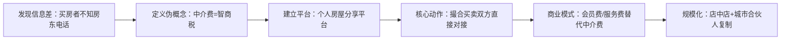

### 边界条件

仅适用于标品化程度高、交易流程可标准化的领域（如二手房、租房、二手车）。非标服务强、需专业担保的复杂交易（如大额商业地产）仍需中介介入。平台需自建房源库，获取真实房东联系方式的成本不能过高。

---

## 25.4 最小MVP闭环 —— 从“挣1块钱”开始跑通商业模型

### 为什么需要这个概念？

很多创业者一上来就想“造航母”：租写字楼、招团队、开发完美产品、铺大广告。结果钱烧光了，发现根本没人买单。

> "1.做生意从自己身边资源入手，从挣1块钱开始，选一个天花板比较高的，持续3——5年。"
> 
> "2.跑通自己的生意环节，最小mvp（产品——流量—销售—交付）"
> 
> ——《夕子线上美业创业复盘，素材ID: P001》

这是**最小可行产品（MVP）闭环**的核心逻辑：用最小成本、最短时间，跑通“产品→流量→销售→交付”完整商业环节。核心指标只有一个：**能否挣到第一块钱、能否完成一次完整的陌生人交易**。

### 核心定义

> **最小MVP闭环**（来源：《夕子线上美业创业复盘，素材ID: P001》）
> - 用最小成本、最短时间，跑通“产品→流量→销售→交付”完整商业环节
> - 核心指标：能否挣到第一块钱、能否完成一次完整的陌生人交易

### 关键性质

先验证模式，再投入资源：模式跑通前，所有投入都是沉没成本。闭环跑通是复制放大的前提：未跑通的模式放大只会放大亏损。产品不必完美，但流程必须闭环：有产品、有流量、能收钱、能交付。

### 典型例子

**夕子线上美业**：2万启动资金，知乎引流（流量），微信诊断（销售），卖医美面膜（产品），发货（交付），完成单人闭环，月利润从1-2万提升至10万+。

**胖龟找房**：先在洛阳跑通“小程序获客→线下门店/店中店→会员转化→省中介费”单店模型。验证：8家门店、34家店中店、287名付费会员、营收104.7万。

> "胖龟找房建立这个第三方平台撮合买方与卖方匹配，互利，解决需求及痛点，产生良性循环。"
> 
> "我们将所有的流程模板化，标准化，我们通过区域合伙人计划——城市管家，快速让合伙人上手。"
> 
> ——《胖龟找房创业复盘，素材ID: P002》

### 平台内容创造准客户环境

> "因为平台上的客户全是有需求的，没有需求的客户是不需要来浏览的，那么活跃在胖龟找房里面的客户都是准客户。胖龟找房建立这个第三方平台撮合买方与卖方匹配，互利，解决需求及痛点，产生良性循环。"
> 
> ——《胖龟找房创业复盘，素材ID: P002>

这一定理揭示了垂直平台的天然流量优势：用户主动搜索/浏览即代表强意向，平台只需做好撮合效率，转化率远超泛流量广告。

### 方法演进图

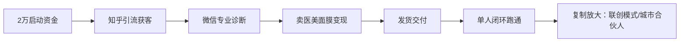

### 边界条件

MVP不是简陋产品，核心价值必须对用户有效（如夕子的专业诊断、胖龟的真实房东电话）。仅适用于边际成本可控、交付可标准化的业务，重资产/重定制业务需调整验证颗粒度。验证周期建议设定止损点（如3个月不跑通即放弃或调整）。

---

## 25.5 选品决定论 —— 好产品自带转化力，省一半销售心力

### 为什么需要这个概念？

你是不是也觉得“只要我营销做得好，烂产品也能卖”？错了。

> "所以选品很关键，产品好省了一半的心，后续回购率也高。"
> 
> ——《夕子线上美业创业复盘，素材ID: P001》

**选品决定论**的核心主张：商业成败的70%以上取决于选品。好产品 = 深挖用户需求 + 涵盖面齐全 + 强背书 + 高复购。产品解决真痛点、覆盖全周期、有权威背书，销售自然水到渠成。

### 核心定义

> **选品决定论**（来源：《夕子线上美业创业复盘，素材ID: P001》）
> - 商业成败的70%以上取决于选品
> - 好产品 = 深挖用户需求 + 涵盖面齐全 + 强背书 + 高复购

### 关键性质

| 维度 | 核心要求 | 素材支撑 |
|------|----------|----------|
| **需求深度** | 不仅解决表层症状（如祛痘），更覆盖深层需求（美白、抗衰、口服调理） | "深挖用户需求，最好涵盖面齐全：比如说不仅祛痘、还有美白、抗衰等等" (P001) |
| **粘性设计** | 口服/耗材类产品天然具备高复购，是现金流稳定器 | "口服保养是趋势，一个人一单接受了某个品牌的口服，不会轻易更换牌子的" (P001) |
| **信任背书** | 医院合作、专家研发、专利成分等第三方背书大幅降低用户决策成本 | "尽量能跟医院合作的产品，品牌背书这块强" (P001) |

### 典型例子

**夕子美业选品进化史**：
1. 单一医美面膜（代购，一单赚2元）
2. 扩展为“祛痘+美白+抗衰+口服”全品类矩阵
3. 引入医生/博士背书，自建品牌
4. 客单价与复购双升，年利润过百万

**胖龟租房产品化**：
- 非标中介服务 → 标准化租房产品（配房单、带看SOP、密码锁自看、线上签约）
- 单房租金1000-2000元，基础员工底薪3000元，**月成交两单即覆盖成本**

> "单个房子的租金在我们这个城市大概在 1000-2000，每个基础员工的底薪大概在3000，每月成交两单，就能顾主成本。"
> 
> ——《胖龟找房创业复盘，素材ID: P002》

### 二房东渠道模型（空置成本驱动付费）

> "我们推演了很多，也会见了很多房东，最后我们找准了二房东这个渠道。因为二房东手上不单单就一间房子，他需要快速的让自己的房子租出去不能有空置，因为每空置一天，房租的费用就需要自行来承担。"
> 
> ——《胖龟找房创业复盘，素材ID: P002>

这一模型揭示了**谁为“零中介费”买单**的底层逻辑：二房东承担空置成本，天然具备付费意愿与高频出房需求，成为平台核心供给侧合作伙伴。

### 方法演进图

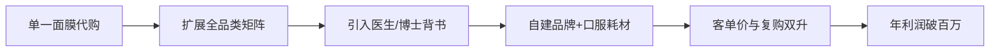

### 边界条件

选品需结合自身资源禀赋（夕子懂皮肤、胖龟懂房产），盲目跟风选品大概率翻车。产品迭代周期要快于市场教育周期，避免陷入“造市场”的高成本陷阱。单一爆品生命周期有限，必须建立“1个盈利+1个开发+1个储备”的产品矩阵。

---

## 25.6 私域高客单（金饭碗） —— 专业信任换取高溢价

### 为什么需要这个概念？

私域流量获取成本高、维护成本高。如果你私域里全是冲着你专业来的用户（如皮肤问题、租房避坑），却去卖9.9元纸巾、99元团购课，这就是典型的**“端着金饭碗讨饭”**。

> "私域老师有句话点醒了我：‘端着金饭碗在讨饭。’当时我兼着一个社群团购业务，就是吃喝拉撒的这些，我私域的用户更多奔着我专业，看皮肤来的，我居然做这种事情，真的在讨饭。"
> 
> "私域的用户需要花费时间和精力去交流，这种需要技术的事情，就应该收高客单。"
> 
> ——《夕子线上美业创业复盘，素材ID: P001>

### 核心定义

> **私域高客单/金饭碗**（来源：《夕子线上美业创业复盘，素材ID: P001》）
> - 利用专业人设建立的深度信任，销售高客单价、高毛利、需专业指导的产品/服务
> - 金饭碗原则：私域用户画像决定变现上限，专业型用户必须匹配专业型高客单产品

### 关键性质

信任杠杆：专业诊断/咨询过程本身就是最强销售话术，成交率远超广告投放。复购飞轮：高客单产品通常为周期性消耗品（护肤品、房租），LTV极高。SOP标准化：咨询话术、搭配方案、朋友圈脚本必须标准化，才能复制给合伙人/员工。

> "梳理了现有咨询中的sop表格，目前也不断在完善，有了这个表格，我回复客户信息也比较快。当然目前这一套我都复制给了我的联创合伙人，她们的客单价、成交率、利润率都上来了。"
> 
> ——《夕子线上美业创业复盘，素材ID: P001>

### 配房-带看-成交标准流程（租房SOP）

胖龟找房将租房这一非标服务拆解为标准化工业流水线：
1. **配房**：后台按租户需求精准匹配3-5-7套房子，不满意二配三配，人员有客户表，日总结周复盘
2. **带看**：提供位置、楼牌号、房间号、密码锁密码或钥匙位置，引导客户自看，降低人力成本
3. **成交**：联系房东/二房东/管理公司最短时间内签约，大量采用线上签约

> "由后台人员，根据租户提供的租房需求，按照公司的房源表进行精准匹配房源，每个需求会发对应的 3-5-7 套合适的房子，不满意的接着二配，三配等。每位人员都会有自己相应的客户表，每日要进行总结，每周要进行复盘..."
> 
> "客户想看哪个房子，我们会提供这个房子的位置、楼牌号、房间号、密码锁的密码，或者钥匙存放位置。引导客户自己去看房..."
> 
> "一旦客户看中了，我们会联系房源所属的房东，二房东，管理公司等，在最短的时间内到房间内给客户签署租房合同，当然也有很大一部分都是线上签约。"
> 
> ——《胖龟找房创业复盘，素材ID: P002>

这一SOP使得“配房专员”成为可复制的标准岗位，单人日处理上限可量化，为后续人海战术与城市扩张奠定基础。

### 换词换认知（代理→会员降低心理阻力）

> "后面打破心魔的是因为我说服自己，不把代理常挂嘴边，代理就是会员，会员就是代理。哈，换个词，顾客听着也舒服，我也舒服。"
> 
> ——《夕子线上美业创业复盘，素材ID: P001>

这一认知重构技巧将“发展代理”的推销感转化为“服务会员”的服务感，显著降低用户心理防线与自身推销负担，是私域高客单转化中的关键微创新。

### 典型例子

**夕子**：私域咨询皮肤 → 搭配医美面膜/口服 → 单客均价数千元，复购率极高。

**胖龟找房**：租客进私域 → 配房师1v1精准匹配 → 带看成交 → 收会员费/佣金，单客价值远超广告变现。

### 方法演进图

### 边界条件

前端内容/广告必须精准筛选“有痛点、有支付力”的用户，泛流量进私域反而稀释转化率。专业服务交付高度依赖人，需建立“咨询SOP表格”“看脸喂饭教程”等工具化手段降低对个人能力依赖。单纯卖课/卖群等虚拟服务若无实物产品支撑，复购与信任难以持续。

---

## 25.7 向有结果的人学习，复制再创新 —— 付费买别人的试错经验

### 为什么需要这个概念？

闭门造车试错成本极高、周期极长，90%的坑前人都踩过。成功者的方法论已被市场验证，付费学习本质是**“买时间、买确定性、买避坑指南”**。

> "4.赚钱，向有结果的人学习，复制再创新"
> 
> "不断付费学习,付费最有价值的两个星球，一个是生财星球，一个是玩赚星球。"
> 
> "除了付费星球，还付费了私域老师。"
> 
> ——《夕子线上美业创业复盘，素材ID: P001>

### 核心定义

> **复制再创新**（来源：《夕子线上美业创业复盘，素材ID: P001》）
> - 找到已跑通模式的标杆 → 付费进入其核心圈子/购买其课程/咨询 → 1:1复制核心动作 → 基于自身资源禀赋做差异化改良
> - 核心公式：收入 = (标杆模式 × 执行力) + (自有资源差异化 × 杠杆)

### 关键性质

付费筛选：高价社群/课程自带筛选机制，同频者密度高，信息信噪比高。近距离观察：只有进入核心圈子（私域语音、线下聚会），才能看到标杆不愿公开的“细节动作”。快速反馈：标杆或助教的点评能纠正执行偏差，避免“自以为是”地偏离赛道。

### 典型例子

**夕子的复制再创新路径**：
1. 付费生财星球/玩赚星球（学方法论）
2. 付费私域老师1.5小时咨询（破认知）
3. 复制“高客单+SOP”模式
4. 创新“医生背书+口服品类”差异化

> "跟私域老师语音沟通了一个半小时，我列举现状，指出目标，一起想突破点。核心点就是深挖用户需求……提高顾客信任度。"
> 
> "有个孕妈店主，加入联创不到一个礼拜就成功卖出去家居水光了。"
> 
> ——《夕子线上美业创业复盘，素材ID: P001>

**胖龟的复制再创新路径**：
1. 对标贝壳/链家模式
2. 创新“0中介费+会员制+店中店”差异化
3. 再对标加盟模式复制扩张

### 方法演进图

### 边界条件

标杆必须“近期有结果、模式可拆解、愿分享细节”，过时大佬/只讲大道理的不可信。复制对象最好是“比你领先半年、资源相似”的中间层，而非头部巨头（资源鸿沟太大无法复制）。创新幅度建议在10%-20%（如改人设、改渠道、改品类），颠覆性创新留给跑通后再做。

---

## 25.8 蹭流截流开店 —— 借竞对流量低成本获客

### 为什么需要这个概念？

从零建立线下流量成本极高（选址、装修、广告），且不确定性强。竞对已帮你完成“教育市场、筛选意向客、沉淀流量”的脏累苦活。

### 核心定义

> **蹭流截流**（来源：《胖龟找房创业复盘，素材ID: P002》）
> - 在标杆竞对门店隔壁/周边开设小型门店，利用竞对自然客流，用极致性价比/差异化卖点（如0中介费）拦截进店
> - 核心逻辑：竞对流量=精准流量，门头标语=最强广告语，转化话术=差异化价值锚点

> "传统的中介店会有大量的客户到店，我们只需要在隔壁开一家小店，很小的一家店，就会有源源不断的客流通过我们店铺门前。只用做好引流跟转化就行了。"
> 
> "用互联网的专有名词，就是蹭，蹭其他中介的流量，然后通过我们的门头标语：买二手房，租房，\"0\"中介费。来吸引用户到店，以达到截流的目的。"
> 
> ——《胖龟找房创业复盘，素材ID: P002>

### 关键性质

选址即获客：选址决策=流量决策，紧邻竞对是最高性价比的选址策略。极致反差：门头必须制造强烈认知冲突（如“中介费几万”旁边写“0中介费”）。轻资产：店面极小、装修极简、人员极少（仅需引流/转化），固定成本极低。

### 典型例子

**胖龟找房（涧西区标杆店案例）**：
> "一个典型的案例，我们这边有个涧西区，涧西区有个中介门店，该门店是整个洛阳市区里的标杆店跟销售冠军门店。我们在这个店的隔壁开了一家店，门头就是“0 中介费”。自从开了店以后，截流隔壁门店好多顾客，导致这家门店销售额接连下降，店员也不敢带顾客去店里面谈了。"
> 
> ——《胖龟找房创业复盘，素材ID: P002>

**瑞幸早期**：紧邻星巴克开店，用“半价/免费”截流咖啡刚需人群。

### 方法演进图

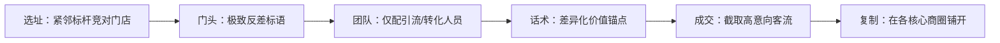

### 边界条件

仅适用于高频、刚需、决策周期短、比价意愿强的标品化服务（租房、咖啡、快剪、修锁）。需承受竞对报复性打压（恶意投诉、压价、挖员工），需有法律/合规防御准备。长期看仍需建立自有品牌护城河，纯靠截流不可持续，属于冷启动战术而非长期战略。

---

## 25.9 房东联系方式获取法、租客全域发掘法与渠道ROI排序

### 为什么需要这个概念？

平台没有房源就没有产品，没有租客就没有流量。胖龟找房通过实战总结出一套低成本、高效率的双边获客SOP，将“获源难、获客贵”这两大房产中介顽疾系统化解决。

### 房东联系方式获取法（三条低成本渠道）

> "物业：通过与物业建立起关系，给予一定的费用，拿到业主电话。水电费号码：通过水电费号，找到相应的单位人员获取业主电话。同行转化：传统的中介，房源共享，客户共享，切入同行，获取业主电话。"
> 
> ——《胖龟找房创业复盘，素材ID: P002>

这一“获源SOP”打破了房源获取的黑箱，使平台具备独立造血能力，不依赖房东主动入驻。

### 租客全域发掘法（多平台矩阵主动出击）

通过抖音/快手/小红书（发帖+评论区私聊）、58/安居客（拼室友）、转转/咸鱼（求租广场）、豆瓣/🧣/知乎（超话、小组）等自媒体平台矩阵发掘有效租客，强调主动出击而非坐等上门。

> "打开抖音，搜索 上海租房，找热点回复量最高的几个，点开评论区，找回复 博主：这个多少钱，这个还在吗，徐汇区某某还有房子吗，等等一系列的有租房欲望的人，那就给人私聊，破冰建立联系取得租房需求。"
> 
> "转转，咸鱼，这些APP比较有意思，在主菜单上直接就有租房的模块，点开租房，找到求租广场..."
> 
> "豆瓣，🧣，知乎，这一类的APP，比如🧣，有各地的租房超话，#杭州租房超话#上海租房超话，进入讨论组内，进行发帖，回复..."
> 
> ——《胖龟找房创业复盘，素材ID: P002>

### 抖音投放>本地自媒体>汽车广播（实测ROI排序）

实测渠道ROI排序：抖音本地投放效果最优（获客成本600元/名，带来4000+粉丝、100+付费会员、5位加盟商），本地自媒体次之，汽车广播最差（投入2万未见水花，薅羊毛客户多）。

> "以此 抖音推广>本地自媒体>汽车广播...品牌营销这部分营销推广直接带来了 4000+的粉丝，付费会员大概在 100 多名，获客成本大概在 600 左右一名，投产比还不错。招商版块推广带了 100+的意向客户，最后成交变成加盟客户 5 位，单个加盟商成本在 8000 左右。汽车广播这个板块不建议大家做，薅羊毛的客户比较多~。这个版块我们大概扔进去 2w，水花都看不到。"
> 
> ——《胖龟找房创业复盘，素材ID: P002>

### 关键性质表

下表汇总了双边获客的核心方法与实测结论。

| 获客维度 | 核心方法 | 关键指标/结论 |
|----------|----------|---------------|
| **房源端** | 物业付费/水电费逆查/同行共享 | 低成本建立独立房源库，不依赖房东主动入驻 |
| **租客端** | 多平台矩阵主动出击（抖音评论区/58拼室友/闲鱼求租/豆瓣超话） | 主动破冰建联，获取高意向租房需求 |
| **付费推广** | 抖音本地投放 > 本地自媒体 > 汽车广播 | 抖音获客成本600元/名，投产比高；广播无效且薅羊毛多 |

### 方法演进图

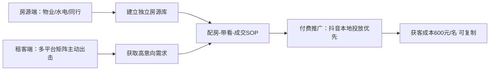

---

## 25.10 店中店联营赋能 —— 用“锁码跟踪”把别人的店变成你的分销点

### 为什么需要这个概念？

直营门店扩张慢、重资产、管理半径受限，加盟又面临管控难、品控难、利益分配难。社区业态（便利店、驿站、理发店）自带高频客流且信任度高，但缺乏变现产品。

### 核心定义

> **店中店联营**（来源：《胖龟找房创业复盘，素材ID: P002》）
> - 在社区高频业态内设专区/展架/二维码，由店员推荐/用户自扫，通过小程序锁码归属佣金，平台赋能产品+SOP+培训
> - 赋能三件套：给流量（锁码追踪）、给产品（标准化服务包）、给方法（话术/海报/流程）

> "通过合伙人计划，开设联营店中店，有便利店，社区菜鸟驿站，理发店等各种贴近顾客的地方。我们通过小程序锁码跟踪，为社区业态附能，为合作方增收。"
> 
> ——《胖龟找房创业复盘，素材ID: P002>

### 关键性质

低门槛：合作方零成本接入，只有成交才分佣，决策链条极短。可复制：标准化“锁码+话术+海报”包，可在一周内铺开百家店中店。数据穿透：平台实时掌握每个店中店的进线量、转化率、客单价，便于精细化运营。

### 典型例子

**胖龟找房**：
- 在便利店、菜鸟驿站、理发店放置“租房/买房咨询”展架+二维码
- 店员引导扫码 → 进小程序 → 锁码归属 → 平台配房带看 → 成交分佣

### 方法演进图

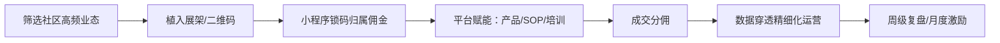

### 边界条件

依赖小程序/企微等技术基建实现锁码归属，技术门槛较高（需自研或购买成熟SaaS）。合作方店员推荐意愿取决于“分佣金额/动作成本”比，佣金设计需极具吸引力且结算及时。品控风险：合作方服务态度/专业度不可控，需建立“神秘客巡店+用户投诉扣分”机制。

---

## 25.11 加盟商赋能一条龙 —— 把“单店跑通”复制成“万店模版”

### 为什么需要这个概念？

单店跑通 ≠ 可规模化。加盟商缺乏选品、获客、转化、交付全套能力，不赋能必死。传统加盟只收加盟费、卖设备/耗材，不管加盟商能不能赚钱，导致闭店率高、品牌口碑崩塌。

### 核心定义

> **加盟商赋能一条龙**（来源：《夕子线上美业创业复盘，素材ID: P001》）
> - 总部将单店跑通的全套运营动作（公域获客、私域转化、专业交付、朋友圈运营）标准化、工具化、包装化，加盟商“改人设即发布、拿话术即成交”
> - 四大赋能维度：产品端（爆品+背书）、流量端（脚本+剪辑+投放）、专业端（课程+喂饭群）、私域端（SOP+群发售）

> "所以我现在给到合作伙伴，直接是现成的脚本（在标红的地方改为自己的人设信息即可），给到录制视频的sop，以及提供3条视频的剪辑。你拿来就可以直接发布，相当于公域账号直接有了。"
> 
> "3.问题性肌肤专业看脸端：价值6980的课程赠送，有小群服务，不会看的皮肤发群里，品牌方会告知你是什么，怎么搭配，相当于喂饭教程。"
> 
> "4.私域端：基础的朋友圈搭建，聊天sop都会给到，也会辅助群发售。"
> 
> ——《夕子线上美业创业复盘，素材ID: P001>

### 关键性质

| 维度 | 核心逻辑 | 实证效果 |
|------|----------|----------|
| **降维打击** | 总部用专业团队（医生、剪辑、运营）产出的内容/SOP，碾压加盟商自行摸索 | 孕妈店主一周内卖出自有品牌家居水光 |
| **利益绑定** | 总部不收高额加盟费，靠产品毛利/服务费分成，只有加盟商赚钱总部才赚钱 | 长期共生，非割韭菜 |
| **快速复制** | 标准化交付包使新店“开业即巅峰”，大幅缩短爬坡期 | 标准化程度高、非强依赖核心人才个人IP的业务适用 |

### 典型例子

**夕子美业联创模式**：
- 给脚本（改红字即发）、给3条视频剪辑、给6980元看脸课程+喂饭群、给朋友圈/聊天SOP、辅助群发售

### 方法演进图

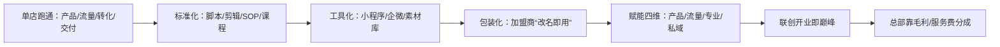

### 边界条件

总部必须具备极强的内容生产、产品研发、运营迭代能力，否则赋能内容会迅速过时。仅适用于高度标准化、非强依赖核心人才个人IP的业务（如标品零售、标准化服务）。需建立“区域保护+业绩考核+退出机制”防止恶性竞争与劣币驱逐良币。

---

## 25.12 城市合伙人制度（城市管家） —— 用“平台基建”换“合伙人执行”

### 为什么需要这个概念？

直营扩城成本高（房租、人力、管理）、风险大、速度慢。加盟模式下总部管控弱，合伙人动力不足或乱操作。

### 核心定义

> **城市合伙人/城市管家**（来源：《胖龟找房创业复盘，素材ID: P002》）
> - 总部提供房源库、配房人员、带看流程、品牌/法务/技术支持；合伙人负责本地获客、用户维护、成交转化；双方按约定分成
> - 核心公式：总部投入=标准化基建成本（可摊薄），合伙人投入=本地获客成本+时间；收益按贡献分成

$$
\begin{aligned}
\text{总部投入} &= \text{平台开发} + \text{房源库建设} + \text{配房团队} + \text{法务合规} \quad (\text{可摊薄的固定成本}) \\
\text{合伙人投入} &= \text{本地获客成本} + \text{时间精力} \quad (\text{边际变动成本}) \\
\text{分成比例} &= f(\text{总部基建价值占比}, \text{合伙人执行贡献占比})
\end{aligned}
$$

### 逐步推导与解释

**第一步：拆解总部投入为“可摊薄的固定成本”**。平台开发、房源库建设、配房团队、法务合规这些投入，随着服务城市数量增加，单城市分摊成本递减，边际成本趋近于零。

**第二步：拆解合伙人投入为“边际变动成本”**。本地获客成本（广告、地推）、时间精力随业务量线性增长，无规模经济效应。

**第三步：为什么分成比例是两者价值占比的函数？** 因为总部提供了“被复制的基建”，合伙人提供了“难以标准化的本地执行”，双方贡献不同性质的稀缺资源，分成必须反映各自不可替代的价值占比。若总部基建价值占比大（如技术壁垒高、房源库独家），总部分成比例应高；若合伙人本地关系/执行力是稀缺变量，合伙人分成比例应高。

**第四步：这个公式的作用**。它将“模糊的合伙谈判”转化为“可量化的成本结构对齐”，使新城市复制决策可被财务模型验证：只有当预期单城市利润 > 总部摊薄成本 + 合伙人机会成本时，才值得开城。

> "我们通过区域合伙人计划——城市管家，快速让合伙人上手。我们有自己平台，房源库、配房人员、带看流程、合伙人只需要维护用户，聊天就行。"
> 
> "单个房子的租金在我们这个城市大概在 1000-2000，每个基础员工的底薪大概在3000，每月成交两单，就能顾主成本。"
> 
> ——《胖龟找房创业复盘，素材ID: P002>

### 关键性质

能力分层：总部解决“难而标准”的事（供应链、系统、法务、培训），合伙人解决“杂而变”的事（本地关系、陌生人信任、临门一脚）。激活存量：利用合伙人本地资源（房源、人脉、渠道）快速冷启动新城市。可复制性：标准化“房源库+配房团队+带看SOP”包，新城市部署周期可压缩至2周内。

### 人海战术与城市扩张（单员工两单覆盖成本）

胖龟找房在洛阳跑通单店模型后，通过“人海战术”快速扩张：单基础员工底薪3000元，月成交两单即覆盖成本，边际成本极低。复制到上海、杭州、深圳等高流动人口城市后，单房佣金可达1-2万，单店模型利润空间大幅跃升。

> "单个房子的租金在我们这个城市大概在 1000-2000，每个基础员工的底薪大概在3000，每月成交两单，就能顾主成本。所以在项目跑通以后我们拓展了客服员工，通过人海战术获取更大的利润。"
> 
> "将上海、杭州、深圳等数十万间合作房源整合到胖龟平台上...那里每年数以万计的毕业生蜂拥而至有庞大的需求市场...单个的房子佣金会更高，有高达 1-2w，也有 2000-3000 的总体来说是很不错的。"
> 
> ——《胖龟找房创业复盘，素材ID: P002>

### 投资须防骗子公司（收费即警惕）

> "如果你想去融资，想去找投资人。最好有人推荐，市面上很多打着投融资的旗号的骗子公司，他们让创始团队缴纳各种名义的费用，少则几千多则上万，一定不要盲目缴纳各种费用。"
> 
> ——《胖龟找房创业复盘，素材ID: P002>

这一风控铁律强调：正规投资机构不向创业者收取任何前置费用，任何以“尽调费、通道费、担保费”等名义收费的融资中介大概率为诈骗。

### 外包选型避坑/招聘偏好应届生

> "在本地选择的时候，一定要深入公司内部去考察，看看外包团队的人员构成，人员数量，还有他们实施过的案例... 所以在做互联网项目创业的时候，最好的方式吸纳一位优秀的技术开发人员最好。"
> 
> "一开始我们在线下招聘的时候偏向于找寻一些从事过相关房产行业的销售人员...这波人有个严重的问题，固化思维太重，难以改变思维，销售的重点只是推荐房子，而非会员的转化。后来我们把招聘重点放到了刚毕业的大学生身上..."
> 
> ——《胖龟找房创业复盘，素材ID: P002>

两条关键组织建设经验：
1. **技术外包必实地考察团队构成、实施案例**，条件允许优先吸纳技术合伙人，规避“包工头层层转包”风险
2. **招聘偏好应届生/空白页人才**：有经验者往往带着固化思维（如传统中介只懂推房不懂转会员），空白页更易植入新模式SOP

### 方法演进图

### 边界条件

必须先在1-2个城市跑通“单店模型+区域模型”，验证财务模型健康、可复制，再开放合伙人。核心数据（房源库、用户数据、交易流程）必须掌握在总部手中，防止合伙人“学会即走人”。法务风险：合伙人非员工，劳动关系、税务筹划、违规担责需有完善协议约定。

---

## 25.13 存量时代的行业洗牌机会 —— 在旧模式出清时建立新模式

### 为什么需要这个概念？

任何行业从增量转存量时，旧模式（依赖增量红利）会失效，新模式（依赖效率/服务/技术）的窗口期打开。

> "早在 2018 的时候国内的新建楼房已经开始走下坡路，大规模的城镇化建设也接近尾声。加上自 2019 年底疫情开始，老百姓们开始节衣缩食。国内房产销售已经从存量与增量市场并重的方向，开始迈入存量消费时代。"
> 
> "任何一个行业都有其周期性...房地产行业正在进入低利率时期，房产中介未来会比较煎熬。"
> 
> ——《胖龟找房创业复盘，素材ID: P002>

### 核心定义

> **存量时代机会窗口**（来源：《胖龟找房创业复盘，素材ID: P002》）
> - 行业增速放缓、存量博弈加剧、头部垄断松动、用户对性价比/服务敏感度上升的战略窗口期
> - 新旧模式置换：旧模式=重资产/高获客/低效率/信息不透明；新模式=轻资产/低获客/高效率/信息透明/服务标准化

### 关键性质

周期判断：通过宏观数据（新开工面积、城镇化率、人口流动）+微观观察（中介店关门率、从业者收入下降）双重验证。切入时机：在旧模式“煎熬期”（尚未完全死透、但已无力反击）切入，而非“红利期”（巨头林立）或“死亡期”（需求消失）。政策顺风：政府推动“降低交易成本、规范市场秩序”往往与新模式方向一致（如杭州政府上线0中介费平台）。

> "ps：2021年杭州上线了\"0\"中介费的政府平台机构。我们是不是提前了一步？哈哈哈"
> 
> ——《胖龟找房创业复盘，素材ID: P002>

### 典型例子

**胖龟找房**：2018年新房见顶 → 2020年切入二手房/租房存量市场 → 2021年杭州政府跟进验证模式正确性。

### 方法演进图

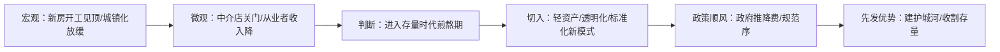

### 边界条件

存量市场总量虽大但不增，份额获取为零和博弈，需具备极强的差异化护城河（品牌、技术、供应链、运营效率）。政策风险：政府下场做平台可能形成“裁判下场踢球”，需提前布局差异化护城河（如胖龟的店中店+合伙人网络）。人才难寻：存量时代需“运营型/服务型”人才，而市场多为“销售型/投机型”人才，招聘与培养成本高。

---

## 25.14 变现渠道不能单一（基本盘论） —— 别把鸡蛋放在一个篮子里

### 为什么需要这个概念？

单一变现渠道（如仅靠广告、仅靠平台分成、仅靠单一大客户）抗风险能力极弱。平台规则变、行业周期转、大客户流失，任何单一变量波动都可能导致现金流断裂。

> "这里也提醒各位美妆护肤博主，变现渠道不要太单一了，不能完全依赖于接广告。得有个基本盘，比如有家淘宝店铺，有家实体店，或者有项项目。"
> 
> "因为原来依赖的单一广告收入渠道下滑，甚至没了，不得不停更。为爱发电的少，人人都要吃饭，长期也亏不起。"
> 
> ——《夕子线上美业创业复盘，素材ID: P001>

> "我们开辟了全新的业务增收渠道，做到了月入 15w 的小成绩...这个业务板块我们从 0 开始摸索，经过了小半年的努力，我们做到了月入 15w 的小成绩。"
> 
> ——《胖龟找房创业复盘，素材ID: P002>

### 核心定义

> **基本盘**（来源：《夕子线上美业创业复盘，素材ID: P001》）
> - 自主可控、高复购、高毛利、抗周期的核心业务（自有品牌、自有门店、自有会员体系、自有产品/IP）
> - 变现组合拳：基本盘（50%+营收稳定器）+ 补充盘（广告、分销、咨询等现金流增强器）+ 实验盘（新业务探索）

### 关键性质

| 维度 | 核心价值 | 实证案例 |
|------|----------|----------|
| **话语权** | 有基本盘才敢拒绝不合理广告/合作，才有议价权，才能穿越周期 | 夕子2024年零广告收入，靠自有品牌+联创模式+实体店覆盖成本并盈利 |
| **复利效应** | 基本盘通常伴随用户资产积累（私域用户、品牌资产、数据资产），边际成本递减 | 胖龟：会员费+开发商返佣+代办费+租房佣金+加盟分成，多元变现支撑月入15w+ |
| **资源反哺** | 基本盘产生的现金流、人才、数据、供应链可反哺新业务孵化 | 反面：2024年大量单纯靠接广告的美妆博主停更/转行，因无基本盘 |

> "2024年一年都没有广告，不是没有广告找，是不感兴趣。自身业务就够吃了，当然有个现状是品牌投广告的越来越少，很多是直接投到直播间了，要产出。所以你会看到很多护肤博主，美妆博主停更了。因为原来依赖的单一广告收入渠道下滑，甚至没了，不得不停更。"
> 
> ——《夕子线上美业创业复盘，素材ID: P001>

### 典型例子

**夕子**：自有品牌+联创模式+实体店构成基本盘，2024年零广告依然盈利。

**胖龟找房**：会员费+开发商返佣+代办费+租房佣金+加盟分成五元变现，月入15w+。

### 方法演进图

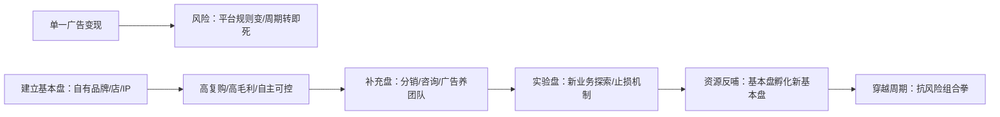

### 边界条件

基本盘建立周期长（通常1-3年），前期现金流压力大，需用补充盘（接广告、做分销）养活团队。多元化 ≠ 盲目多元，所有业务必须围绕核心用户群、核心能力圈展开，避免“伪多元化”分散焦点。基本盘也要定期体检：若核心产品/赛道结构性衰退，必须果断迭代或放弃（如夕子从代购转自有品牌）。

---

## 25.15 多源对照：两个创业案例的共识与分歧

以下对照基于两份素材（P001夕子美业、P002胖龟找房）的显性内容进行提炼，**[需要补充文献]**标注处为素材未直接覆盖、需进一步佐证的推断。

### 共识：跑通闭环 → 标准化 → 规模化的铁律

| 维度 | 夕子（线上美业·P001） | 胖龟（房产平台·P002） | 共识本质 |
|------|----------------------|----------------------|----------|
| **起点** | 自身痛点（荨麻疹/敏感肌） | 行业痛点（中介费高/信息差） | 痛点即切入点 |
| **验证** | 2万跑通MVP闭环 | 洛阳跑通单店模型 | 先挣第一块钱 |
| **产品** | 深挖需求+口服+医院背书 | 标准化租房产品+二房东渠道 | 选品决定成败 |
| **私域** | 高客单+SOP+专业诊断 | 配房师1v1+会员费/佣金 | 专业信任换高溢价 |
| **学习** | 付费星球+私域老师咨询 | 对标贝壳/链家+对标加盟模式 | 复制再创新 |
| **扩张** | 联创模式（赋能一条龙） | 城市合伙人/店中店 | 标准化复制 |
| **风控** | 基本盘论（自有品牌/店） | 多元变现（会员/佣金/加盟） | 单一渠道必死 |

### 分歧：重个人IP vs 去个人化、深度绑定 vs 浅度绑定

| 维度 | 夕子（线上美业·P001） | 胖龟（房产平台·P002） | 素材支撑情况 |
|------|----------------------|----------------------|--------------|
| **资产属性** | 重个人IP（夕子医生人设）、轻线下 | 重平台/系统、去个人化 | 夕子强调“医生背书/人设”；胖龟强调“平台/锁码/流程” |
| **扩张方式** | 联创（深度绑定、共享品牌/产品/SOP） | 城市合伙人/店中店（浅度绑定、分成制） | 夕子给“脚本/课程/SOP”深度赋能；胖龟给“房源库/配房团队”基建支持 |
| **核心护城河** | 产品研发能力+专业人设+私域信任 | 房源库+锁码系统+合伙人网络+政策先发 | 夕子属“软实力”；胖龟属“硬基建” **[需要补充文献：两素材未直接对比护城河性质]** |
| **风险敞口** | 主要在产品/合规/人才 | 主要在政策/法务/运营管控 | 夕子提及“品牌投放转直播间”；胖龟提及“政府下场/外包避坑/招聘固化思维” |

---

## 25.16 设计中的取舍

以下分析基于两份素材的显性决策逻辑重构，属于作者基于素材的理论推演，**[需要补充文献]**标注处为素材未直接表述的推断。

### 为什么不直接做“传统中介”而是做“0中介费平台”？

**素材支撑**：P002明确列举传统中介五大痛点（虚假房源、违规收费、阴阳合同、抬高房价、乱收费），并宣称“生意的本质是信息差”，以此为切入点创办1.0平台。

**Trade-off**：放弃了单笔高佣金（几万中介费），换取了高频复购（租房/二手房高周转）+ 规模化复制能力（城市合伙人/店中店）+ 政策护城河。

### 为什么不用“直营扩张”而是用“城市合伙人”？

**素材支撑**：P002描述“总部搭平台、建房源库、配带看团队（重资产标准化），合伙人只管本地搞关系、聊天成交（轻资产执行）”，并强调“单员工两单覆盖成本”的人海战术经济性。

**Trade-off**：放弃了对单店的绝对控制权，换取了规模化速度和边际成本递减。核心风险在于“数据/品控外泄”，需通过技术锁码、法务协议、核心数据不下放来对冲 **[需要补充文献：素材未详述数据隔离具体措施]**。

### 为什么“加盟商赋能”要做到“脚本/剪辑/课程/SOP”全包？

**素材支撑**：P001展示“给脚本、给剪辑、给6980课程喂饭群、给朋友圈/聊天SOP、辅助群发售”全套交付，并引用孕妈店主一周出单案例佐证“开业即巅峰”效果。

**Trade-off**：总部前期投入极大（团队/技术/内容），现金流压力大，需通过直营店/联创店先跑通造血，再反哺赋能体系建设 **[需要补充文献：素材未直接给出总部造血节奏与赋能体系建设投入的财务时间序列数据]**。

---

## 25.17 方法演进总览图

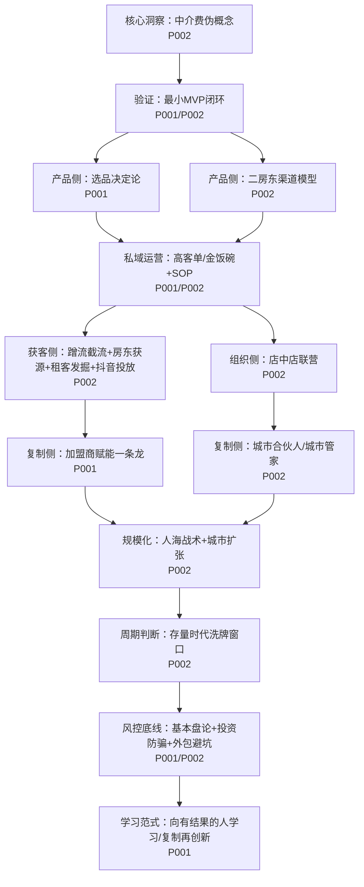

---

## 25.18 动手练习

### 练习1：拆解你身边的“中介费伪概念”

请选取一个你熟悉的行业（如二手车、招聘、装修、留学中介、票务代抢等），完成以下分析：

1. 识别该行业的“中介费”由谁支付？服务对象是谁？核心信息差是什么（如：买方不知道卖方联系方式、求职者不知道企业直招渠道、业主不知道施工队真实报价）？
2. 如果建立“个人分享平台”打破该信息差，平台的最小MVP闭环是什么？（产品形式？流量从哪来？如何收钱？如何交付？）
3. 该行业的“选品决定论”体现在哪？什么样的产品/服务能自带转化力、高复购？（如：二手车的“严选认证+延保”，装修的“定价透明+节点验收”）
4. 设计一个“蹭流截流”的冷启动方案：竞对在哪？你在竞对旁边做什么差异化卖点？门头标语怎么写？
5. 若要做“加盟商赋能一条龙”，你需要打包哪4大维度的标准化交付包？（参考：产品端、流量端、专业端、私域端）

### 练习2：推演“城市合伙人”单店财务模型

假设你在二线城市复制“胖龟找房”0中介费租房模式，已知条件：

- 单间月租金中位数：1500元
- 基础员工/合伙人底薪/生活费：3500元/月
- 成交一单可收取会员费/服务费：800元（来自二房东/房东）
- 单人日均有效带看/沟通量：3组，成交转化率：10%

请计算并回答：

1. 单人月成交多少单？能否覆盖成本？
2. 若引入“店中店”模式，合作便利店日均进线5组，转化率5%，需铺设多少家店中店才能让1名配房专员饱和？（假设专员日处理上限20组）
3. 总部建设“房源库+配房团队+小程序锁码系统”一次性投入30万，月维护2万。若单城市合伙人月分成利润1万，需多少个合伙人城市才能在12个月内回本总部投入？
4. 关键敏感变量是什么？（提示：租金中位数、转化率、客单价、人效）若租金中位数降至1000元、客单价降至500元，模型是否崩塌？如何调整？

### 练习3：设计“基本盘+补充盘+实验盘”变现组合拳

假设你是一位拥有5万精准粉丝（女性、25-35岁、护肤/租房/职场进阶需求）的内容创作者，当前仅靠接广告变现（月入3-5万，极不稳定）。请按“基本盘（50%+营收稳定器）、补充盘（现金流增强器）、实验盘（新业务探索）”框架设计你的变现组合：

1. 定义你的“基本盘”：是什么自有产品/服务/IP？为什么它高复购、高毛利、自主可控？预计建立周期多久？前期如何用补充盘养活团队？
3. 设定1个“实验盘”：高风险高回报的新方向（如自建品牌、开实体店、做SaaS工具），设定止损点（时间/金钱/人力上限）。
4. 画出三者的资源反哺关系：基本盘如何反哺补充盘/实验盘？补充盘如何保护基本盘？实验盘成功后如何升级为新基本盘？

### 练习4：复制再创新——拆解一个标杆案例并制定你的微创新方案

选取一个你想模仿的近期成功案例（如某小红书博主卖课、某同城租房👸号、某抖音团购达人），完成：

1. 用“产品-流量-销售-交付”MVP闭环拆解其核心模式（画流程图或列清单）。
2. 列出其不愿公开的“细节动作”（如：选品逻辑、话术细节、发布时间、投放策略、售后SOP），并规划如何通过付费/进群/线下见面等方式获取这些信息。
3. 分析你的“自有资源禀赋”（专业背景、人脉、资金、技术、内容能力、时间），对比标杆，找出你的差异化优势与劣势。
4. 制定“10%-20%微创新”方案：在复制核心模式基础上，你要改什么？（人设？渠道？品类？定价？服务流程？技术工具？），并说明为何这个微创新能建立护城河。
5. 设定“向有结果的人学习”的付费预算与ROI预期：愿投入多少钱/时间？预期多快跑通MVP？多快回本？

---

## 25.19 本章小结

这一章中我们系统学习了副业创业的底层逻辑与实战方法论。首先，我们从**中介费伪概念**切入，揭示信息差即商机的本质，理解商业切入点往往藏在“大家都在交的智商税”背后。其次，我们掌握了**最小MVP闭环**验证逻辑，从挣第一块钱开始跑通产品-流量-销售-交付全链路，避免造航母式的资源浪费。接着，我们深刻领会了**选品决定论**，好产品自带转化力、降低获客成本、提升复购率，是商业成败的70%关键。然后，我们学会了**私域高客单（金饭碗）**运营，用专业信任换取高溢价，避免“端着金饭碗讨饭”的错位。随后，我们掌握了**向有结果的人学习、复制再创新**的付费学习与执行范式，用10%-20%的微创新建立差异化护城河。此外，我们熟练运用了**蹭流截流开店**、**房东联系方式获取法**、**租客全域发掘法**、**抖音投放优先**四大获客策略，以及**店中店联营赋能**、**加盟商赋能一条龙**、**城市合伙人制度**三大组织复制模型，实现从单店跑通到万店复制的规模化路径。最后，我们建立了**存量时代行业洗牌的周期判断力**和**基本盘思维**，在旧模式出清期用新模式收割存量红利，构建自主可控、高复购、高毛利的核心业务抵御单一变现渠道风险。

本章我们一起学习了以下概念：

下表汇总了本章所有核心概念及其解释与来源。

| 概念 | 解释 | 来源 |
|------|------|------|
| 中介费伪概念 | 中介费本质是信息差造成的智商税，信息透明化即可消除其合理性基础 | P002 |
| 最小MVP闭环 | 用最小成本跑通产品-流量-销售-交付全链路，挣到第一块钱是验证唯一标准 | P001 |
| 选品决定论 | 商业成败70%取决于选品，好产品自带转化力、高复购、强背书，省一半销售心力 | P001 |
| 私域高客单/金饭碗 | 私域用户因专业而来，必须匹配高客单、高毛利、需专业指导的产品/服务，而非低客单团购 | P001 |
| 向有结果的人学习 | 付费学习本质是买时间、买确定性、买避坑指南，核心是复制核心动作后结合自身资源微创新 | P001 |
| 蹭流截流开店 | 在竞对旁开店，用极致差异化卖点（如0中介费）拦截竞对自然客流，低成本冷启动 | P002 |
| 房东联系方式获取法 | 通过物业关系、水电费号码、同行转化三条渠道低成本获取真实房东电话，建立独立房源库 | P002 |
| 租客全域发掘法 | 通过抖音/快手/小红书/58/闲鱼/豆瓣/🧣/知乎等多平台矩阵主动破冰获取高意向租客 | P002 |
| 抖音投放优先 | 实测本地获客ROI排序：抖音>本地自媒体>汽车广播，抖音获客成本约600元/名 | P002 |
| 店中店联营赋能 | 在社区高频业态植入二维码/展架，用小程序锁码追踪佣金，零成本铺设线下分销触点 | P002 |
| 加盟商赋能一条龙 | 总部将单店跑通的获客、转化、交付、私域全套SOP标准化包装，加盟商拿来即用、开业即巅峰 | P001 |
| 城市合伙人/城市管家 | 总部做重基建（平台/房源库/配房团队/法务），合伙人做轻运营（本地获客/用户维护/成交），利益深度绑定 | P002 |
| 人海战术与城市扩张 | 单基础员工底薪3000元，月成交两单覆盖成本，复制到高佣金城市放大利润空间 | P002 |
| 存量时代洗牌机会 | 行业从增量转存量时，旧模式失效、新模式窗口打开，需识别周期拐点用新模式收割存量红利 | P002 |
| 基本盘论 | 单一变现渠道抗风险极弱，必须建立自主可控、高复购、高毛利的核心业务作为压舱石 | P001 |
| 投资须防骗子公司 | 正规投资机构不收前置费用，任何以尽调费/通道费/担保费名义收费的融资中介大概率为诈骗 | P002 |
| 外包选型避坑/招聘偏好应届生 | 技术外包必实地考察团队/案例，优先吸纳技术合伙人；招聘偏好空白页应届生规避固化思维 | P002 |
| 换词换认知 | 将“代理”改称“会员”，降低用户心理阻力与自身推销负担，提升私域转化率 | P001 |

下一章中，我们将学习如何将这些方法论内化为个人的商业认知体系，并探讨在AI时代如何利用技术杠杆进一步放大个体的商业价值。

