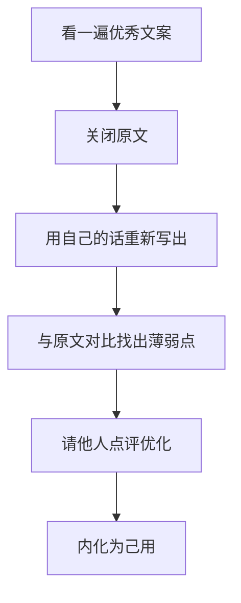

# 第 17 章 内容与文案力 —— 从“自嗨式表达”到“深入人心”

## 学习目标

- 理解「心金文案」的双重属性：既能吸金（商业变现）又能深入人心（情感共鸣）
- 掌握写文案前的「三重思考」框架：明确宏观/微观目的、洞察目标受众、适配发布平台特性
- 熟练运用「富兰克林复写法」（看-关-写-比）精准定位表达薄弱点并通过外部点评优化
- 掌握「共鸣感构建」三维路径：经历共鸣、感受共鸣、价值观共鸣，并理解高能量吸引低能量的底层逻辑
- 建立「输入带动输出」的分级阅读体系：故事类练表达 → 评论类练逻辑 → 商业类练变现套路
- 理解打广告的本质是「放大与筛选」，区分优质软广与垃圾硬广，破除「不敢打广告」的心理卡点
- 掌握「人际关系四象限」与「鱼塘钓鱼」策略：精准识别第4象限（顾及感受）与第2象限（无需顾及）用户，建立精准流量池
- 理解成交依赖「有间隔的重复次数」信任积累法则，掌握前置价值输出、个性展现、信任建设的节奏
- 掌握「打广告无成交四步排查法」：查用户精准度 → 查文案细节 → 查前期铺垫 → 理解曲折坚持长期主义
- 理解销量增长的「从众慕强」复利效应：持续拿结果、迭代产品、获背书，用实力反杀质疑者

## 17.1 生活类比

想象一下，「文案创作」其实是一场精心设计的相亲局。你要展示硬核条件——房车票、存款证明，这叫「吸金」，证明你有商业变现的能力；同时你还要流露真实性格温度，聊童年趣事让人会心一笑，吐槽加班心酸让人感同身受，谈三观人生让人肃然起敬，这叫「深入人心」，建立情感共鸣。缺一不可，光有条件像张冷冰冰的简历，光有温度像个只会聊天的好人，唯有「心金文案」两手抓，才能让对方既信得过你的实力，又动得了你的真心。

相亲前得先问自己三个问题：我是想结婚还是交友（宏观/微观目的）？对方喜欢什么类型（目标受众画像）？在公园见面还是酒吧（平台特性适配）？这就是「写作前三重思考」，想不清这三条就贸然动笔，文案必跑题、必自嗨。

要练口才，你会反复背诵、模仿偶像的高情商话术，合上书自己复述一遍，再对比录音，精准找出自己「直男/直女」发言的薄弱环节，这正是「富兰克林复写法」的「看-关-写-比」闭环。练得久了，再请闺蜜、导师点评两句，外部视角一校准，表达立马上台阶。

聊天建立连接，得层层递进：先聊童年趣事、同款遭遇，建立「经历共鸣」；再吐槽加班心酸、失眠焦虑，触发「感受共鸣」；最后谈三观人生、信仰坚守，锁定「价值观共鸣」。正如吸引力法则所言，高能量吸引低能量，你必须先在文案里勇敢表达真实心声、打造势能，才能引发别人的共鸣。

打广告就像发朋友圈官宣恋情：放大让喜欢你的人更安心、更坚定，筛选让嫉妒你的人退散、拉黑。你若因怕「打扰」无关人员而不敢发，等于错失真爱、留住烂桃花，这分明是本末倒置。广告的本质就是「放大与筛选」，不打广告，就没有筛选，也就吸引不来真正的客户。

相亲对象必须是「单身异性」（鱼），不能是「已婚同事、发小、长辈」（牛羊长颈鹿）。你在动物园里相亲钓不到鱼，怪自己魅力低？得去鱼塘（精准流量池）才能验证钓技。「人际关系四象限」教你精准识别：第4象限的亲友合作方（有感情、有价值交换），广告分组可见、顾及感受；第2象限的泛泛之交（无感情、无价值交换、不点赞不评论不聊天不掏钱），无需顾及，可清理可屏蔽。别把「不掏钱就删」搞成冷血原则，有知识情绪价值交换的非付费用户是「鱼苗」，得悉心培养。

从微信聊天到视频通话，再到见面吃饭、见父母，多次触动、时间沉淀，才能修成正果。成交也是如此，依赖「有间隔的重复次数」：有人首次触动即买单，有人需 3 次、5 次、10 次，有人需第 10 天、第 30 天、第 100 天看干货、看生活、了解为人，第 N 次被触动才下单。广告只是临门一脚，前置必须有 N 篇价值干货、N 条生活朋友圈、N 次活动互动，把信任垒起来。

相亲失败怎么复盘？四步走：对象不对（查用户精准度，在不在鱼塘）？话术烂（查文案细节，价值点讲清没、背书够不够）？缘分未到铺垫少（查前期铺垫，干货生活互动量够不够）？好饭不怕晚（理解道路曲折，坚持长期主义）。别一上来就怪自己能力不行，先查池子、查文案、查铺垫，最后调心态。

刚谈恋爱时亲友质疑「这人行吗？」；结婚、生娃、升职、买房节节胜利，质疑者纷纷转粉「早说这人靠谱！」。「从众慕强」是人性，销量从 10 单→50 单→100 单→300 单→500 单→1000+ 单的阶梯增长，配合产品迭代、大咖背书，围观者心理依次经历嘲笑→震惊→动摇→付费→后悔。你的出路只有一条：持续拿结果、持续迭代、持续获背书，用实力反杀质疑者。

## 17.2 概念地图

内容与文案力
├── 核心范式：心金文案
│   ├── 吸金属性（商业变现）
│   └── 深入人心属性（情感共鸣）
├── 前置思维：三重思考
│   ├── 宏观/微观目的
│   ├── 目标受众画像
│   └── 平台特性适配
├── 核心方法论
│   ├── 富兰克林复写法（看-关-写-比+外部点评）
│   ├── 共鸣感构建法（经历/感受/价值观三维）
│   ├── 输入带动输出三级阅读法（故事→评论→商业）
│   ├── 100问练习法（建立认知体系+输出能力）
│   ├── 三个为什么/A4头脑风暴/多角度思维（深度思考训练）
│   └── 闪光文件夹/文案素材库（素材积累管理）
├── 广告与销售心法
│   ├── 放大与筛选本质（破除不敢打广告）
│   ├── 优质软广 vs 垃圾硬广区分
│   ├── 人际关系四象限（顾及/不顾及决策）
│   ├── 鱼塘钓鱼精准池策略
│   ├── 有间隔的重复次数（信任积累法则）
│   ├── 四步排查法（用户→文案→铺垫→心态）
│   └── 从众慕强复利效应（销量阶梯拿下质疑者）
└── 核心定律
├── 文案是思维的显化
├── 一条文案一个主旨
├── 统一风格形成记忆点
├── 硬性模仿/套模板局限思维
├── 文字掌控力提升信息捕捉与思维层次
├── 高质量输入3个月大幅提升思维
├── 酒香也怕巷子深（好东西必宣传）
└── 打扰无关人员=吸引精准客户（本末倒置批判）

## 17.3 心金文案 —— 既能吸金又能深入人心的写作范式

### 为什么需要这个概念？

多数人做私域发朋友圈咨询寥寥，核心原因是陷入“自嗨式写作”：沉浸在自己的局限想法里，而非用户想看的内容。文案不同于文章，必须兼具商业变现属性（吸金）和情感触动属性（深入人心），缺一不可。文案是思维的显化，写作过程就是将思考与价值观传递出来的过程，思考不清晰写不出好文案。根据《JPRAdLgGFowUE7xargGc8YNjnzh.md》素材显示，作者指出："很多人做私域的朋友，为什么发了无数朋友圈但是咨询寥寥无几？大概率是因为他陷入了一种自嗨式写文案的状态。他沉浸在自己的世界里，按照自己的局限性想法去发文案，他以为用户会想看的内容，其实用户并不一定想看。" 同时该素材强调："文案不同于文章，文案本身就带有一层商业变现属性，所以能够吸金才是关键，而文案又需要蕴藏感情、给人能带来触动，所以深入人心的写法，也是必要。"

### 核心定义

**心金文案**（来源：《docs/202301-02/JPRAdLgGFowUE7xargGc8YNjnzh.md`）
: 既能吸金（具备商业变现属性），又能深入人心（蕴含感情、带来情感触动）的文案类型。

**自嗨式写文案**（来源：《docs/202301-02/JPRAdLgGFowUE7xargGc8YNjnzh.md`）
: 按照自身局限性想法创作，误以为用户想看的内容其实用户并不一定想看的错误写作状态。

### 关键性质

文案风格需统一协调：频繁变换风格（今俏皮明毒舌）不利于形成记忆点，差异化标签化风格才能持续吸粉。素材中作者提到："很多人写文案，是没有一个统一风格的，今天俏皮可爱，明天又是犀利毒舌，后天又成了沉稳温柔——这样反而不利于形成记忆点。所以一定要想明白，自己要形成哪种文案风格，统一、协调，才能持续吸粉。"

硬性模仿与套用模板会束缚思维：只会在他人框架内改写，无法理解文案背后的吸引点与逻辑性。素材指出："这种就是根本没掌握文案写法，自以为很聪明，但实际上束缚了自己的文案力和创造力，她只会在我的文案框架里去改写，却从未思考我文案中的吸引点和逻辑性。所以大家写作记住，千万不要硬性模仿，更不要去套什么所谓的模版，那只会局限你的思维。"

文字掌控力越强，信息捕捉能力与思维层次越高：写文案具有“逆天改命”效果，能提升认知敏感度。素材写道："学会写文案，是真的有逆天改命的效果的。你对文字掌控力越强，对信息也会越敏感，也更容易捕捉到有价值的信息，而这些信息的摄入会让你的思维层次快速提升，脱颖而出。"

### 典型例子

作者个人IP标签中“文案力”首当其冲：年输出百万字，文案在创业圈广泛传播，小红书吸粉无数、变现超7位数。多位朋友反馈“某人的小红书在模仿你”，印证差异化风格形成的竞争优势与记忆点。素材记录："我身上被人广为记忆的个人IP标签中，首当其冲的应该就是我的文案力。我坚持更新朋友圈，年输出超过百万字，写的文案在创业圈被广泛传播，在小红书上也通过文案吸粉无数，变现超过7位数。""比如很多朋友会跑来跟我说，谁谁谁的小红书是模仿你的，这就是我的文案风格形成的优势，特点分明。"

### 边界条件

非一蹴而就：需“不断输入、高频思考、适当技巧、大量练习”长期积累。

输入质量决定输出上限：认知基础薄弱时闷头苦想易归因逻辑出错，需踩着巨人肩膀（高质量输入）。

内化是必经环节：从“明白”到“掌握”有一个内化过程，仅收集素材不思考无法转化为自身认知。

---

## 17.4 写作前的3重思考 —— 目的、受众、平台的预判断

### 为什么需要这个概念？

直接动笔易陷入“自嗨”或跑题，缺乏商业目的导向。不同平台（👸号、朋友圈、小红书）特性迥异，同一内容不调整直接分发效果大打折扣。不理解用户画像与需求，写出的文案无法建立信任与共鸣。

### 核心定义

**写作前三重思考**（来源：《docs/202301-02/JPRAdLgGFowUE7xargGc8YNjnzh.md`）
: 写文案前必须明确的三个前置性问题：写作目的（宏观/微观）、目标受众（用户画像/需求）、发布平台（特性适配）。

### 关键性质

宏观目的定方向：整体文案方向是为了实现什么（如打造IP、卖课、引流）。微观目的定动作：单条文案要达到什么具体目的（如促单、互动、筛选）。素材指出："我们在写文案之前，需要思考两层目的。一层是宏观的，你整体文案的方向是为了实现什么？……一层是微观的，具体到每一个单条文案要达到什么目的？"

受众理解先于表达：先去理解用户特征与痛点，才能写好文案甚至于做好营销。素材强调："你要先去理解用户，然后才能写好文案甚至于做好营销。"

平台适配放大影响力：同一条文案根据平台特性微调，可实现多平台分发、成倍放大影响力。素材说明："同一条文案，适当根据平台特性去修改，就可以实现多平台分发，真正让一条文案实现成倍放大影响力的效果。"

### 典型例子

👸号适合深度长文建立专业信任；朋友圈适合高频生活化建立人设温度；小红书适合图文笔记种草引流。针对“宝妈副业”人群写文案，需理解其“时间碎片化、渴望低门槛、怕被割韭菜”的特征，而非泛泛谈赚钱。

### 边界条件

仅为写作前的“预判断”，不包含具体写作技巧，需配合后续“术”层面方法使用。平台规则变动快，适配策略需随时迭代，不可固化为死板模板。

---

## 17.5 富兰克林复写法 —— 通过“看-关-写-比”精准定位表达薄弱点

### 为什么需要这个概念？

多数人写作“孤芳自赏”，缺乏客观反馈机制，无法发现自己表达不清晰、逻辑跳跃的薄弱环节。光读爆款文案无法内化为己用，必须通过主动复现来拆解高手的表达结构与词句选择。

### 核心定义

**富兰克林复写法**（来源：《docs/202301-02/JPRAdLgGFowUE7xargGc8YNjnzh.md`）
: 复写四步法：看一遍优秀文案 → 关闭原文 → 用自己的话重新写出 → 与原文对比找出表达薄弱点。进阶：请他人（朋友/专业人士）点评优化，引入外部视角校准。素材详细描述："什么叫做复写？就是你先看一遍文案，然后把它关闭，尝试用自己的话去再次写出来，然后你会发现，每一次你写出来的内容都不一样，然后你去跟原文案对比，去发现自己表达不清晰的地方在哪里，那就是你写作的薄弱点。""然后当大家写出来一个文案的时候，不要孤芳自赏，可以去找一些朋友或者专业人士帮助你点评你的文案，提出建议。"

### 关键性质

每次复写产出内容都不一样，对比过程能精准定位“表达不清晰在哪里”。倒逼大脑从“被动识别”转为“主动构建”，加速写作能力内化。非模仿神似，而是通过复现理解高手“吸引点与逻辑性”的底层结构。

### 典型例子

选取行业公认的爆款文案（如李叫兽、刘润等大咖文章）作为复写素材。针对自己的“开头不吸引人”问题，专门复写 20 个优秀开头，对比提炼通用句式。

### 边界条件

素材选择决定上限：复写垃圾文案只会练成垃圾笔法，必须选高质量标杆。易陷入“形式大于本质”：机械重复不思考、不请教点评，效果极低。适合短文案/片段训练，长文复写成本过高，建议拆解为段落单元练习。

### 方法流程图

该流程图展示了富兰克林复写法的完整闭环：从被动阅读转为主动复现，再通过自我对比与外部点评，最终实现写作能力的内化提升。每一轮循环都能精准定位表达薄弱点，形成“练-查-改”的螺旋上升。

---

## 17.6 共鸣感构建法 —— 用“经历/感受/价值观”三维相似性击中用户内心

### 为什么需要这个概念？

纯逻辑说服无法触动决策，用户买单源于情感共振：觉得“懂我”、“像我”、“代表我”。自嗨式写作缺乏生活场景感受，文案悬浮、假大空，无法唤起用户记忆中的相似情境。

### 核心定义

**共鸣感构建法**（来源：《docs/202301-02/JPRAdLgGFowUE7xargGc8YNjnzh.md`）
: 通过“构建相似”引发共鸣，三个方向：经历的共鸣（同款遭遇）、感受的共鸣（同款情绪）、价值观的共鸣（同款信仰）。核心动作：在文案中代入生活场景感受，贴近现实，将喜怒哀乐具象化呈现。素材指出："这种共鸣，是需要通过「构建相似」来进行的。可以在文案中代入生活场景感受，贴近现实，你所感受到的喜怒哀乐，用户也能同样感受到。""分享给大家3个方向：经历的共鸣，感受的共鸣，价值观的共鸣。""世间万物其实都遵循着吸引力法则，低能量会被高能量吸引，那你就必须要先把自己的势能打造起来，勇敢的在文案里去表达你的心声，才会引发别人的共鸣。"

### 关键性质

共鸣非天生，需刻意构建：主动挖掘自身经历中具有普遍性的瞬间，提炼为可复用的共鸣素材。高能量吸引低能量：必须先在文案里勇敢表达真实心声、打造势能，才能引发别人共鸣。三维递进：经历共鸣最浅（易模仿）、感受共鸣中（需真诚）、价值观共鸣最深（形成铁粉）。

### 典型例子

**经历共鸣**：“凌晨三点还在改方案，外卖凉了也不想动，那一刻突然懂了什么叫独自承担”

**感受共鸣**：“不是不想赚钱，是每次迈出第一步前，胃里都像揣了块冰，明明知道安全却依然恐惧”

**价值观共鸣**：“我不信捷径，只信复利。哪怕现在没人看，我也要把每一篇都当成留给未来的礼物”

### 边界条件

切忌矫情造作：为共鸣而共鸣、编造悲惨故事会被识破，反噬信任。需匹配人设：硬汉人设写细腻感受会违和，温柔人设写血性价值观会割裂。共鸣是手段非目的：最终要落脚到“价值交换”或“行动引导”，不能只爽自己不动用户。

---

## 17.7 输入带动输出与三类内容分级阅读法

### 为什么需要这个概念？

认知基础薄弱时“闷头苦想”极易归因逻辑出错，思维提升必须依赖高质量外部输入。读完即忘、无法转化为写作素材，是缺乏系统性的输入分级与内化机制。

### 核心定义

**输入带动输出**（来源：《docs/202301-02/JPRAdLgGFowUE7xargGc8YNjnzh.md`）
: 以高质量阅读输入带动文案输出，输入后经“内化”转化为自身认知，再经写作显化。

**三类内容分级**（来源：《docs/202301-02/JPRAdLgGFowUE7xargGc8YNjnzh.md`）
: 故事类（练表达/语句通畅）→ 评论类（练逻辑/结构）→ 商业类（练观点/文案套路）。素材详述："千万不要自己闷头苦想，因为你的认知基础薄弱，你想半天想出来的很可能归因逻辑就是错的。思维是一定要通过不断输入才能得到提升的，踩着巨人的肩膀，你会看到更广阔的天空。""建议大家看三类，可以先从【故事类】的内容看起，然后去看一些【评论类】的内容，最后再去看一些【商业类】的内容。""看故事类的内容是看表达方式，是看语句的通畅，连贯的表达，是把一件事情说明白的能力。""接着看【评论类】的内容，比如书评，影评等等，这类是去看逻辑的。""最后再看【商业类】的内容，这类内容是看观点和文案套路。"

### 关键性质

分级递进：故事类打底写得通顺，评论类提升逻辑深度，商业类直击变现技巧，不可跳级。必须建立“文案素材库”分门别类整理：高价值精华集中存放，便于反复翻阅与快速调用。素材建议："这里我建议大家可以建立一个属于自己的「文案素材库」，因为在这个快节奏的时代，只看一遍的内容可能转眼就忘，而拥有一个专属自己的素材库，全部都是高价值的精华内容，会更有利于自我的精进。"

配合“100问练习法”：整理行业高频 100 问，能答自答、不会求教后用自己话写出，同时建立专业认知体系与输出能力。素材指导："去把你行业里最常见的100个问题整理出来，能自己回答的自己尝试回答，不能自己回答的去各种书籍、行业大神那里求教获得答案，理解之后再用自己的话写出来。"

### 典型例子

### 边界条件

输入≠抄袭：必须“用自己的话写出来”，照搬模仿无法形成思考与文风。素材库若不分类、不精读、不复盘，会变成“数字垃圾场”，定期清洗整理是刚需。100问练习初期极其痛苦，需忍受“不会写、写得烂”的挫败感，坚持写完才能看到质变。

---

## 17.8 打广告的“放大与筛选”本质 —— 重新定义广告的商业与社交属性

### 为什么需要这个概念？

多数人“不敢打广告”，根源是误把广告等同于“打扰”、“推销”、“丢人”，产生心理阻力。不打广告等于放弃“吸引客户”，因对无关人员的“打扰”恐惧而舍弃真正支持者，属本末倒置。

### 核心定义

**打广告的本质：放大与筛选**（来源：《docs/202301-02/HfJEd0huioyShvxowVfcOMQYnHb.md`）
: 打广告的本质是“放大”与“筛选”双重作用：
  - **放大**：让喜欢你的人更深入理解你的能力价值（更喜欢）；让不喜欢你的人更烦你（更排斥）
  - **筛选**：喜欢你的人靠近、购买、成为客户；不喜欢你的人屏蔽、删除、拉黑，自动退出你的流量池

素材原文："打广告这动作，本质是一种「放大」和「筛选」。""让喜欢你的人，更深入的理解你在做的事情，更明白你的能力和价值。喜欢你的人，更喜欢你；不喜欢你的人，更烦你。此为「放大」。""喜欢你的人，觉得你的广告，是一个能更好的了解你的窗口，了解完之后，他们会靠近你，购买你的产品，成为你的客户。不喜欢你的人，觉得你打广告，是又想让他掏钱了，你又打扰他了，看完后更烦你，然后屏蔽你、删除你、拉黑你。此为筛选。"

### 关键性质

广告是“临门一脚”非“唯一步骤”：前置必须有价值输出、个性展现、信任建立。

优质软广 vs 垃圾硬广：有趣、适度激发梦想、克制、依据真实好评、提供价值的软广不被讨厌；自嗨自夸、制造危害、贩卖焦虑、刷屏的硬广才是应被讨厌的对象。素材对比："我们讨厌的广告，是那种不考虑观众的感受，光自卖自夸，还凭空制造一些不买的危害，暗示你不卖你就是蠢蛋，那种自嗨+夸大宣传+贩卖焦虑+刷屏+不输出价值的垃圾广告。""而那种：有趣的/适度正能量激发梦想的/克制的/根据真实好评的/提供价值的软广，对于多数人来说，哪怕谈不上喜欢，至少也是不会讨厌的。""你要讨厌的不是打广告这件事，而是应该讨厌打垃圾广告。"

人际关系四象限决定发广告策略：顾及亲友/合作方（分组可见），无视无价值交换的泛泛之交（可删可不发）。

### 典型例子

作者早期因怕同事亲友看见副业广告尴尬而分组可见，后发现真正成交的全是陌生精准粉，亲友反而不买单。发一条“年入百万”的硬广被吐槽“割韭菜”；改为分享“从零开始搭建副业的 30 个坑”的软广，引来精准咨询并成交。

### 边界条件

产品本身必须是“好东西”（真实、有价值、靠谱），烂产品打广告只会加速暴雷。“筛选”前提是流量池里有“鱼”：在养牛场（非精准好友池）钓鱼，广告再好也钓不上来。长期不打广告、只做价值输出会变成“免费工具人”，需在信任积累到位时果断收割。

---

## 17.9 人际关系四象限与“鱼塘钓鱼”精准用户池策略

### 为什么需要这个概念？

新手常把“随缘积累的泛泛好友”当精准用户池，打广告无成交后怀疑自己能力，实则池子不对。不懂得区分“需顾及感受的人”和“无价值交换的人”，导致要么不敢发、要么发了被骂心态崩。

### 核心定义

**人际关系四象限**（来源：《docs/202301-02/HfJEd0huioyShvxowVfcOMQYnHb.md`）
: 按“有无感情”ד有无价值交换”划分，核心区分：
  - **第4象限（有感情、有价值/需维护）**：亲朋好友、领导同事合作方 → 广告分组可见或私发
  - **第2象限（无感情、无价值交换）**：不点赞、不评论、不聊天、不掏钱的泛泛之交 → 无需顾及，可删可屏蔽

**鱼塘钓鱼类比**（来源：《docs/202301-02/HfJEd0huioyShvxowVfcOMQYnHb.md`）
: 精准人群=鱼，随缘好友=牛羊长颈鹿 → 在动物园钓不到鱼不代表钓技不好，得去鱼塘验证技术。

素材原文："要照顾感受的那批人，是第4象限的那批人。是你的亲朋好友，以及你的领导同事合作方（如果你有主业，在宣传你的副业的话）。这些人，你早晚要见面，抬头不见低头见的，所以要顾及他们对你的看法，避免被他们讨厌。""但是像第2象限的那批人，你在网上加到的好友，平时也不交流，也不见他给你朋友圈、推文点赞评论，不和你产生知识、情绪上的价值交换，那他们除了给你掏钱，和你发生金钱关系外，对你而言，其实也没有别的价值了。""这里再强调一次，我说的这波人是：不点赞、不评论、不聊天、不掏钱，与你在知识、情绪、金钱上没有任何价值交换的人。而不是说，不付费的人，就都该删掉。""你现在的精准人群，他们的类型是【鱼】，但你以前从各种场合积累下来的，都是些【牛】【羊】【长颈鹿】【犀牛】【狮子】... 2000好友里，就没有几只你要的【鱼】。钓不到鱼，那不是再正常不过了吗？""所以呀，当你发现你没钓上几只鱼时，你要想的第一件事，不是怀疑自己，而是思考思考，自己到底是在鱼塘，还是动物园。要检验自己的钓鱼技术如何，得去鱼塘，才能检验出来呀。"

### 关键性质

好友数量≠商业价值：2000 个随缘好友不如 200 个精准粉丝。主动清理第2象限好友能提升朋友圈广告触达率与转化率（减少干扰、算法权重更高）。“不掏钱的人不都该删”是误读：有知识/情绪价值交换的非付费用户属于“鱼苗”，需培养。

### 典型例子

### 边界条件

非冷血社交：第4象限亲友仍需正常维护，仅在商业推广层面做物理隔离。精准池子建设是长期工程：需配合公域内容引流、裂变、付费投放等系统动作，非一蹴而就。

---

## 17.10 成交前的信任积累 —— “有间隔的重复次数”法则

### 为什么需要这个概念？

打广告不出单往往非文案问题，而是前期“铺垫不足”：用户未被充分触动、信任未建立。盲目追求“一次成交”违背人性：决策需要多次触动、不同维度验证、时间沉淀。

### 核心定义

**有间隔的重复次数**（来源：《docs/202301-02/HfJEd0huioyShvxowVfcOMQYnHb.md`）
: 成交取决于用户在不同时间点、不同内容形式下，被你反复触动的累积次数（3次、10次、30天、100天……）。广告只是最后一击，前置动作：输出N篇价值文章、发N条生活朋友圈、参与N次活动互动。

素材记录："打广告，是成交前的最后一步，而不是唯一的步骤！在打广告之前，还有：价值输出、个性展现、信任建立...""我发现，打动别人，让人下单这事，除了强度之外，还有【有间隔的重复次数】。""有些人会在认识你的第一天就买单。而有些人会在第10天、第30天、第50天、第100天...第N次看到你的干货，看到你的生活，了解你这人的性格、三观，第N次被你触动后，才会买单的。"

### 关键性质

转化节奏因人而异：有人首次触动即买单，有人需 3/5/10 次触动，有人需看生活朋友圈了解为人后才买单。“峰终定律”在信任积累中的体现：开头（专业价值输出）和结尾（真实生活展现）的愉悦体验，决定整体好感度。付出不够多时坦然接受无回报：复盘前期铺垫不足，比怪用户、怪算法、怪文案更有建设性。

### 典型例子

作者自述：有 3 篇精彩代表作，新友看完仍不买单，刷十几篇唠嗑短文后才下单。用户反馈：“看你朋友圈半年了，感觉你靠谱、不浮夸，今天终于决定买你的课”。素材描述："以我为例，原本我以为，我已经有几篇很精彩的代表作了，一些新朋友加过来，看了我3篇大作，应该就能买单了。但实际上，我发现不完全是这样的。也有很多朋友，是看了我几篇大作后初步了解了我，但仍对我的产品无动于衷。后来又刷了我十几篇唠嗑短文后，才来找我下单的。""有些人是在第一次觉得你真牛逼的时候，就会买单的。而有些人需要3次、5次、10次，觉得你牛逼，才会买单。有些人，是觉得你牛逼就买单了。而有些人，是知道你厉害还不够，还要在朋友圈中看到你的生活，了解你的为人后，才会买单的。"

### 边界条件

重复≠复制粘贴：需“内容形式多样（干货/生活/观点/案例）+ 时间间隔自然分布”。仅靠重复无法弥补“产品烂/不专业/人品差”的硬伤，信任建立的前提是基本盘过硬。间隔过长（如半年不发）会导致遗忘、信任归零，需维持最低频次存在感。

---

## 17.11 打广告后无成交的四步排查法 —— 从归因“能力不足”转向“动作复盘”

### 为什么需要这个概念？

打广告没出单极易引发“自闭”、自我否定，陷入情绪内耗而非问题解决。缺乏结构化排查框架，导致盲目改文案、换产品、甚至放弃项目，错失优化机会。

### 核心定义

**四步排查法**（来源：《docs/202301-02/HfJEd0huioyShvxowVfcOMQYnHb.md`）
: 四步依次排查：
  1. 检查用户精准度（是在鱼塘还是动物园）
  2. 检查文案细节（产品讲清没、价值点够不够、信任背书有没有）
  3. 检查前期铺垫（价值输出/互动/信任建设做没做够）
  4. 理解道路曲折，持续努力（接受挫败、坚持长期主义）

素材框架："一、为什么你不敢打广告？ 我觉得这个原因有三。 1）你对所卖产品的价值不够认可 2）你对于「人际」的理解不到位 3）你对于「广告」的理解不到位""二、打广告之后没成交，感觉挫败怎么办？ 1）检查用户有没有问题 2）检查文案有没有问题 3）检查前期铺垫有没有问题 4）理解道路的曲折，持续努力"

### 关键性质

顺序不可乱：池子不精准（第1步）时，改文案（第2步）无效；铺垫不足（第3步）时，换池子（第1步）也白搭。文案自查清单化：产品初心/价值点/场景/包含范围/适合人群/价格/服务期/交付方式/信任背书/好评素材……逐项核对。素材清单："打广告的时候，得想想：你的产品讲清楚没有？你为什么要做这个产品，初心是什么？这东西的价值点在哪，用于哪些场景，解决哪些问题？产品服务包含什么，不包含什么？适合哪些人买，哪些人不适合买？价格多少？服务期多长？用哪些平台/工具/方式做交付？......""东西讲清楚了，价值感传递的够不够？现在有多少人买你东西了？买了你东西的人，都有哪些进步？有什么实打实的收益？买了你东西的人，对你的产品服务是怎样评价的？有没有哪些圈内大咖帮你做信任背书，为你站台？......"

铺垫自查量化：N篇价值文、N条生活圈、N次活动互动，没做到数量就坦然接受“无回报”。素材指出："在打广告之前，还需要输出N篇有价值的文章，写N篇生活分享的朋友圈，N次参加活动，和大家交流互动建立信任。最后才是打广告，完成这临门一脚，开单。""打了广告不出单的时候，回顾一下自己的前期努力做了多少？想想自己付出的其实还不够多，那没有回报，其实也能心甘情愿的接受了。"

终极心法：从众慕强是人性，销量从 10→50→100→300→500→1000+ 的增长过程，本身就是拿下质疑者、建立权威的过程。

### 典型例子

排查第1步：发现好友多为亲戚同事 → 立刻启动公域引流建精准号，而非改广告文案。排查第2步：发现文案未讲清“服务期/交付方式/不适合人群” → 补全细节后转化率翻倍。排查第3步：发现打广告前仅发 1 篇干货、0 条生活圈 → 补 2 周日更干货+生活圈后再发广告，出单。

### 边界条件

非万能药：产品伪需求、严重违规、平台封杀等硬性限制下，排查再细也无解。第4步“持续努力”需设定止损点：连续 3 个月按排查优化仍无起色，需果断复盘项目可行性。

---

## 17.12 销量增长与产品迭代的“从众慕强”复利效应

### 为什么需要这个概念？

初期销量低（如 10 单）极易被围观者嘲笑、质疑，打击创作者信心。不理解“从众慕强”规律，会因早期负面反馈而过早放弃，错失复利爆发期。

### 核心定义

**从众慕强复利效应**（来源：《docs/202301-02/HfJEd0huioyShvxowVfcOMQYnHb.md`）
: 随着销量阶梯增长（10→50→100→300→500→1000+）、产品迭代（版本更新）、大咖背书（权威背书），围观人群心理依次经历：嘲笑→震惊→动摇→付费→后悔没早上车。创作者的出路只有一条：持续努力拿结果、持续迭代产品、持续获取背书，用结果反杀质疑。

素材描述："人类的骨子里，都是从众和慕强的。当你的产品只有10个付费用户的，某些围观群众会在心里笑你...当你卖了50个人了，他们会被震惊一下...当你卖了100人了，他们再震惊一下，不得不承认你有点本事了...当你卖了300人了...他们中的一些人，就开始动摇了：卧槽，当初是我小看你了，现在再不上车，再晚之后就跟不上了。于是为你付费了。""当你了500份了...又一批嘴硬的人坐不住了，被你拿下了。而还有一些人，继续嘴硬，不承认你。等到你卖了上千份了...这时他们会垂头丧气，感慨：开始看不见你，后来看见了但看不起你，再然后承认你有点本事了但还不是完全信你，等到完全信你的时候已经追不上你了...""酒香也怕巷子深呀，你卖的是个好东西，何必藏着掖着呢？大方宣传，让好东西传播出去，为世界做贡献才对嘛。"

### 关键性质

非线性突变：前期积累期极长（可能几个月仅 10 单），一旦突破临界点（如 100 单+背书），转化率指数级跃升。“酒香也怕巷子深”：好产品必须主动宣传，销量增长本身就是最强的社会证明广告。质疑者最终会成为最忠诚的用户或推销员（认知失调消解机制）。

### 典型例子

作者描述：卖 10 份时被笑“割韭菜”；卖 50 份被震惊；卖 100 份承认有本事；卖 300 份迭代 2-3 版本+大佬背书后，质疑者动摇付费；卖 500 份嘴硬者坐不住；卖 1000+ 份早期嘲笑者垂头丧气感慨“追不上了”。

### 边界条件

仅适用于“产品真有价值、创作者真在迭代、市场真有需求”的正向循环场景。若产品本身体验差、售后烂，销量增长反而加速暴雷（负面口碑传播更快）。需警惕“幸存者偏差”：只看到成功者的增长曲线，未看到同起跑线上死在 10 单、50 单阶段的大多数。

---

## 17.13 多源对照与共识分析

本章核心概念由两篇核心素材支撑：`docs/202301-02/JPRAdLgGFowUE7xargGc8YNjnzh.md`（侧重文案写作方法论）与 `docs/202301-02/HfJEd0huioyShvxowVfcOMQYnHb.md`（侧重广告心法与销售转化）。两者在「心金文案」的商业属性、前置思考框架、信任积累法则、长期主义心态上形成高度共识，互为道术两面。

### 共识点

| 概念维度 | JPRAdLgGFowUE7xargGc8YNjnzh.md（文案道术） | HfJEd0huioyShvxowVfcOMQYnHb.md（广告心法） | 共识结论 |
|----------|---------------------------------------------|---------------------------------------------|----------|
| 文案商业本质 | 文案自带商业变现属性，必须「吸金」 | 广告是「放大与筛选」，最终指向成交 | 文案与广告同源，核心均为商业变现 |
| 以用户为中心 | 反对「自嗨式写作」，先理解用户再表达 | 反对「垃圾硬广」，主张「优质软广」提供价值 | 皆主张从用户需求出发，而非自我表达 |
| 信任先于成交 | 强调「输入带动输出」、深度思考积累 | 强调「有间隔的重复次数」、前置铺垫 | 信任积累是成交前提，无捷径可走 |
| 长期主义 | 「不断输入、高频思考、大量练习」 | 「理解道路曲折，持续努力拿结果」 | 时间复利是核心杠杆，拒绝速成幻想 |
| 素材积累体系 | 「闪光文件夹」「文案素材库」「100问练习」 | 隐含于「价值输出」「好评素材」收集中 | 素材库是文案与广告的共同弹药库 |

### 互补差异

| 维度 | JPRAdLgGFowUE7xargGc8YNjnzh.md | HfJEd0huioyShvxowVfcOMQYnHb.md | 互补价值 |
|------|--------------------------------|--------------------------------|----------|
| 核心视角 | 写作技艺与思维训练（道术内功） | 销售心理与转化动作（实战外功） | 内功深厚，外功才精准；外功反哺，内功才落地 |
| 典型方法 | 富兰克林复写法、共鸣构建、三级阅读 | 四象限分类、鱼塘钓鱼、四步排查法 | 写法解决“怎么写”，销法解决“给谁卖、怎么卖” |
| 风格主张 | 统一风格形成记忆点，拒绝硬性模仿 | 优质软广标准，区分软硬广本质 | 风格是长期资产，软广是单次战役的战术选择 |
| 认知升级路径 | 文字掌控力→信息捕捉→思维层次提升 | 销量增长→社会证明→权威背书→信任护城河 | 微观写作能力与宏观商业结果的双向奔赴 |

### 综合启示

将两篇素材融合，可得一套完整的「内容-信任-成交」飞轮：**用「三重思考」定向、用「富兰克林复写」练笔、用「共鸣三维」击心、用「三级阅读+100问」筑基**，产出「心金文案」；**用「四象限」清理池子、用「鱼塘策略」引精准鱼、用「前置铺垫」垒信任、用「软广标准」写广告**，触发「放大与筛选」；**用「有间隔重复次数」累积触动、用「四步排查」复盘迭代、用「从众慕强」跨越临界**，完成复利爆发。文案力不仅是写作技能，更是贯穿「吸引-信任-转化-裂变」全链路的核心杠杆。

---

## 17.14 核心定律集：文案与成交的底层公理

本章素材中分散着多条经验总结为“定律”级别的认知，汇总如下。这些定律是贯穿全章的底层公理，指导所有方法论的落地执行。

| 定律 | 核心含义 | 来源素材 |
|------|----------|----------|
| 文案是思维的显化 | 写作是思维过程的显性呈现，思考清晰才能写得清晰 | docs/202301-02/JPRAdLgGFowUE7xargGc8YNjnzh.md |
| 一条文案一个主旨 | 每条文案只围绕一个核心主旨，过多主旨让人眼花缭乱 | docs/202301-02/JPRAdLgGFowUE7xargGc8YNjnzh.md |
| 统一风格形成记忆点 | 差异化、标签化的统一风格是确立形象、持续吸粉的关键 | docs/202301-02/JPRAdLgGFowUE7xargGc8YNjnzh.md |
| 硬性模仿/套模板局限思维 | 机械套用他人框架会束缚创造力，无法理解底层吸引逻辑 | docs/202301-02/JPRAdLgGFowUE7xargGc8YNjnzh.md |
| 文字掌控力提升思维层次 | 对文字掌控力越强，信息捕捉越敏锐，思维层次提升越快 | docs/202301-02/JPRAdLgGFowUE7xargGc8YNjnzh.md |
| 高质量输入3个月见效 | 真正高质量的输入仅需3个月即可大幅提升思维水平 | docs/202301-02/JPRAdLgGFowUE7xargGc8YNjnzh.md |
| 酒香也怕巷子深 | 好产品必须主动宣传，不必含羞藏掖 | docs/202301-02/HfJEd0huioyShvxowVfcOMQYnHb.md |
| 打扰无关人员=吸引精准客户 | 因怕打扰无关人而不打广告，本质是舍弃真正支持者 | docs/202301-02/HfJEd0huioyShvxowVfcOMQYnHb.md |

> **一句话引导**：以上八条定律构成了本章的认知基石，前六条聚焦文案创作的内功心法，后两条聚焦广告投放的外功心法，共同支撑「心金文案」从写作到变现的完整闭环。

---

## 17.15 设计中的取舍

### 为什么不用“硬性模仿/套模板”方案？

硬性模仿和套用模板看似能快速产出文案，实则将写作者锁死在他人的表达框架内。素材明确指出：模仿者“只会在我的文案框架里去改写，却从未思考我文案中的吸引点和逻辑性”。这种方案的 trade-off 是：**短期产出速度快，但长期丧失独立思考与表达能力，无法形成差异化个人风格**。真正的文案成长路径是：通过富兰克林复写法“复现高手结构” → 内化为己用 → 输出带有个人标签的原创文案。

### 为什么不“只做价值输出、不打广告”？

不打广告等于主动切断“筛选”通道。素材给出的本末倒置批判极其犀利：**对于无关人员是“打扰”的东西，对于你的客户恰是“吸引”**。若因照顾无关人员观感而不打广告，等于舍弃真正的支持者。Trade-off 是：**避免短期社交尴尬，换取长期商业机会的永久性丧失**。正确策略是：用“分组可见”物理隔离第4象限亲友，在第2象限泛泛之交面前大方打广告，让筛选机制自然运作。

### 为什么不“一次性倾销、追求单次成交”？

人性决策需要“间隔重复”的信任积累。素材实证：作者有 3 篇精彩代表作，新友看完仍不买单，需再刷十几篇唠嗑短文才下单。Trade-off 是：**追求单次成交的高效率幻觉，换取真实转化率的极低**。成交是“临门一脚”，前置必须有 N 篇价值输出 + N 条生活展现 + N 次互动信任建设。这就是“酒香也怕巷子深”的现代注脚。

### 为什么要“优质软广”而非“垃圾硬广”？

垃圾硬广（自嗨自夸、制造危害、贩卖焦虑、刷屏、无价值）虽能短期收割冲动型用户，但会透支信任账户、引发平台限流、毁掉个人IP长期资产。优质软广（有趣、激发梦想、克制、真实好评、提供价值）虽见效稍慢，却能同步完成品牌沉淀、信任积累、精准筛选。Trade-off：**短期暴利 vs 长期复利**，素材明确主张“讨厌垃圾广告而非打广告本身”，软广是可持续的商业文明。

### 为什么要“鱼塘钓鱼”而非“动物园硬钓”？

在非精准池（动物园）投放广告，无论文案多好、产品多强，转化率趋近于零，且会污染算法模型、降低账号权重。鱼塘钓鱼的前置成本（引流、筛选、标签化）虽高，但边际收益递增：精准池越大、标签越细，单条广告ROI越高。Trade-off：**前置重运营 vs 后置轻成交**，素材类比“在养牛场钓不到鱼不代表技术烂”，精准池是成交的必要条件。

### 为什么要“前置铺垫”而非“直接成交”？

直接成交省去了 N 篇干货、N 条生活、N 次互动的沉没成本，但忽略了人性决策的“确认偏误”与“熟悉度效应”：用户需要在不同时间、不同维度反复确认“你靠谱、你懂我、你值这个价”。前置铺垫的每一次触达，都是在为最终成交铺路。Trade-off：**高频投入 vs 高转化产出**，素材实证“看3篇大作不买、刷十几篇唠嗑才买”，铺垫是成交的概率放大器。

---

## 17.16 动手练习

### 练习1：心金文案诊断与重写

素材：某私域运营者发朋友圈推广《副业入门课》，文案如下：
《大佬带你躺赚！这门课原来999，今天仅需99！名额仅剩10个，手慢无！买了就能月入过万，不信你看我收益截图！》

任务：
1. 从「心金文案」双重属性（吸金/深入人心）角度，诊断该文案的三大核心问题
2. 运用「三重思考」框架，分析该文案在目的、受众、平台适配上的缺失
3. 运用「共鸣感构建」三维路径，重写一条心金文案（字数不限），并在文后标注对应的经历/感受/价值观共鸣点
4. 说明你如何通过「富兰克林复写法」练习这条新文案（素材来源、复写步骤、对比重点、点评渠道）

### 练习2：精准鱼塘建设与广告排查实战

场景：你运营一个「考公上岸笔记」私域号，微信好友2000人（含500大学同学、300前同事、200亲戚、1000陌生加粉），发了3条考公课广告，仅1单成交（买家是陌生粉）。

任务：
1. 用「人际关系四象限」分类你的2000好友，标注哪些需「分组可见」、哪些可「清理/不顾及」、哪些是「精准鱼/鱼苗」
2. 按「四步排查法」依次自查：
   - 用户精准度：你的「鱼塘」在哪？当前池子鱼的比例多少？如何低成本扩充鱼塘？
   - 文案细节：对照「广告文案自查清单」（初心/价值点/场景/包含/适合人群/价格/服务期/交付/背书/好评），列出你当前文案缺失的5项关键信息
   - 前期铺垫：过去30天你发了多少篇价值干货/生活圈/互动活动？是否达标？
   - 心态复盘：面对1单成交，如何用「从众慕强效应」和「有间隔的重复次数」视角重构心态？
3. 制定未来2周的「前置铺垫+精准引流+广告投放」执行计划表（含每日动作、预期指标）

### 练习3：输入带动输出——三级阅读与100问落地

背景：你决定用3个月系统提升「小红书爆款笔记写作」领域的文案力。

任务：
2. 设计你的「文案素材库」分类标签体系（至少3级标签），并规定「每日/每周/每月」的整理与复盘SOP
3. 列出「小红书爆款笔记写作」领域的前20个高频问题（作为100问的起步），并完成前3个问题的「自己回答→求教验证→用自己话重写」闭环演示
4. 结合「三个为什么/A4头脑风暴/多角度思维」三种思维训练法，设计一周7天的每日10分钟思维训练计划（每天练哪种、围绕什么主题、产出什么成果）
5. 预设第3个月末的验收标准：你的文案力提升将体现在哪3个可量化指标上？（如：单篇笔记平均阅读量、转粉率、商单报价等）

### 练习4：软广设计与信任积累节奏推演

任务：为你的「考公上岸笔记」私域号，设计一套「21天信任积累+第22天软广成交」的内容日历。

要求：
1. 21天前置铺垫：每天安排1条价值干货/1条生活人设/1次互动动作（可合并），标注对应「有间隔的重复次数」节奏（如：第1/3/7/14/21天为关键触点）
2. 第22天软广文案：运用「优质软广」标准（有趣/激发梦想/克制/真实好评/提供价值）撰写，并在文后逐条自查「广告文案自查清单」10项细节
3. 设定「分组可见」策略：根据四象限，列出需屏蔽的标签组、需私发的重点人名单、公开可见的预期触达人数
4. 预案：若第22天广告发出后24小时0成交，按「四步排查法」写出具体排查动作清单（每步至少3个可执行动作）
5. 反思：该日历设计中，哪些环节体现了「酒香也怕巷子深」、哪些体现了「打扰无关人员=吸引精准客户」？

---

## 17.17 本章小结

这一章中我们学习了内容与文案力的完整方法论体系。首先确立了「心金文案」这一核心范式——既要吸金（商业变现）又要深入人心（情感共鸣），文案是思维的显化。其次掌握了写作前的「三重思考」前置框架：明确宏观微观目的、洞察目标受众、适配平台特性。接着系统学习了三大核心写作方法：富兰克林复写法通过“看-关-写-比”精准定位表达薄弱点；共鸣感构建法从经历、感受、价值观三维击中用户内心；输入带动输出法通过故事类→评论类→商业类三级阅读分级提升，配合100问练习与素材库建设形成闭环。随后深入广告与销售心法：破解广告本质是「放大与筛选」，区分优质软广与垃圾硬广；用人际四象限与鱼塘钓鱼策略建立精准用户池；遵循「有间隔的重复次数」信任积累法则做前置铺垫；掌握四步排查法从用户、文案、铺垫、心态四维复盘无成交原因；最后理解「从众慕强」复利效应——持续拿结果、迭代产品、获背书，用实力反杀质疑者。

本章我们一起学习了以下概念：

| 概念 | 解释 |
|------|------|
| 心金文案 | 既能吸金（商业变现）又能深入人心（情感共鸣）的文案范式，文案是思维的显化 |
| 自嗨式写作 | 沉浸自身局限视角、忽略用户真实需求的错误写作状态，导致朋友圈发再多也无咨询 |
| 写作前三重思考 | 宏观/微观目的、目标受众画像、平台特性适配——文案不跑题、不自嗨的前置锚点 |
| 富兰克林复写法 | 看优秀文案→关闭→用自己话重写→对比找薄弱点→请人点评，精准定位表达短板的训练闭环 |
| 共鸣感构建三维 | 经历共鸣（同款遭遇）→ 感受共鸣（同款情绪）→ 价值观共鸣（同款信仰），高能量吸引低能量 |
| 输入带动输出三级阅读 | 故事类练表达通畅 → 评论类练逻辑结构 → 商业类练变现套路，踩着巨人肩膀提升思维 |
| 100问练习法 | 整理行业高频100问，能答自答、不会求教后用自己话写出，同时建立专业认知体系与输出能力 |
| 打广告本质：放大与筛选 | 放大喜欢者理解与认可，筛选出精准客户剔除无关人员；不打广告=舍弃真正支持者（本末倒置） |
| 优质软广 vs 垃圾硬广 | 有趣/激发梦想/克制/真实好评/提供价值=软广；自嗨自夸/制造危害/贩卖焦虑/刷屏/无价值=硬广 |
| 人际关系四象限 | 按「有无感情」×「有无价值交换」分类：第4象限（亲友/合作方）顾及分组可见，第2象限（泛泛之交）无需顾及可清理 |
| 鱼塘钓鱼策略 | 精准用户=鱼，随缘好友=牛羊长颈鹿；在动物园钓不到鱼不代表技术烂，得去鱼塘（精准流量池）验证 |
| 有间隔的重复次数 | 成交取决于用户在不同时间点、不同内容形式下被反复触动的累积次数（3次/10次/30天/100天），广告只是临门一脚 |
| 前置铺垫三件套 | N篇价值干货 + N条生活朋友圈 + N次活动互动，打广告前完成信任建设，付出不够坦然接受无回报 |
| 四步排查法 | 1查用户精准度(鱼塘/动物园) 2查文案细节(价值点/信任背书/交付细节) 3查前期铺垫(干货/生活/互动量) 4理解曲折持续努力 |
| 从众慕强复利效应 | 销量阶梯增长(10→50→100→300→500→1000+)配合产品迭代+大咖背书，围观者心理经历嘲笑→震惊→动摇→付费→后悔，持续拿结果反杀质疑 |
| 核心定律集 | 文案即思维显化/一条文案一个主旨/统一风格形成记忆点/硬性模仿局限思维/文字掌控力提升思维层次/高质量输入3个月见效/酒香怕巷深/打扰即吸引 |

下一章中，我们将学习「裂变与转化」——从“临门一脚”到“指数增长”，掌握裂变营销的两种基本模型与叠加玩法，以及成交前的信任积累、广告的“放大与筛选”本质，打通“流量→信任→成交→复购”的完整链路。

