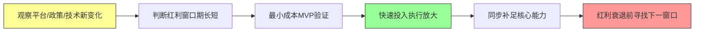
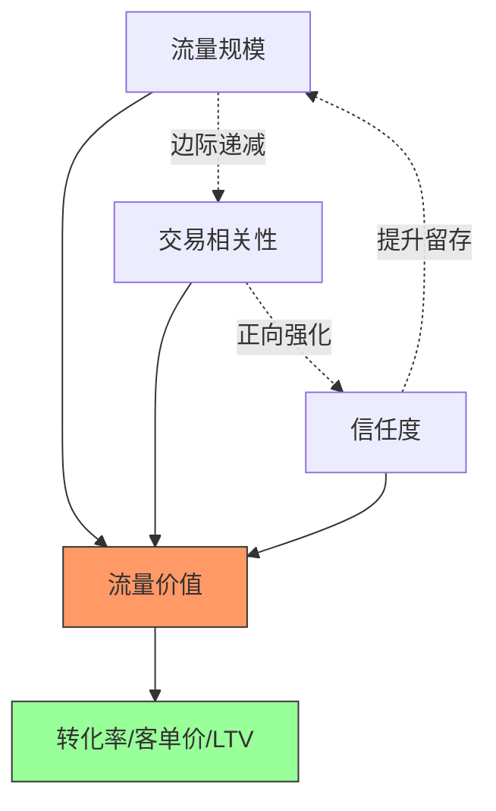
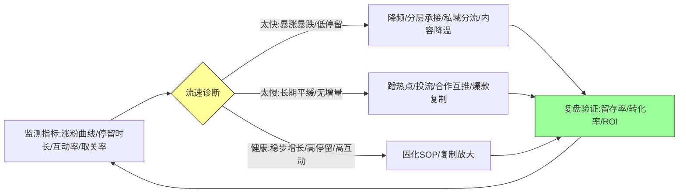
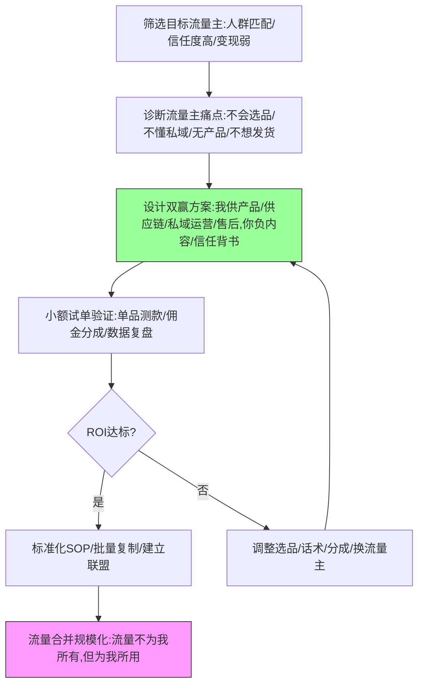

# 第 43 章 流量变现的底层逻辑与实操体系
作者：龙哥

## 学习目标

- 理解赚钱的本质是交易，交易的本质是满足用户需求
- 掌握识别和利用时代红利的方法与时机判断
- 学会用流量价值公式（规模×相关性×信任度）评估流量质量
- 理解从第一个粉丝开始变现的运营原则
- 掌握流量流速控制与停留时间优化的核心操作
- 理解交易目的论：没有互动的曝光全是负价值
- 学会通过流量合并整合他人流量，实现双赢合作
- 能根据自身资源与平台特性设计完整的流量变现闭环

## 43.1 生活类比

想象流量变现是一场**捕鱼行动**。老渔民出海前，先看潮汐表，找准鱼群洄游的季节（时机），这便是**时代红利**——在鱼最多时下网（借东风），顺势而为。撒网入水，这一网能罩住多少鱼，取决于网的大小与撒网位置，这就是**流量规模**，解决“连接多少人”的问题。但网里全是虾米杂鱼毫无用处，**流量相关性**要求网里的鱼必须是你要的那种鱼（目标客户），不是目标鱼种再多也是白忙。鱼群若不信任你的网，受惊四散，**信任度**便是鱼信不信你的网真的不会伤它（用户信不信任你），决定了能否留住连接。收网节奏更讲究：**流量流速**若太快，鱼群冲破网眼，停留时间太短无法成交；太慢，鱼群聚不拢，规模上不去，唯有不快不慢、持续不断，增加用户停留时间，才能丰收。**交易目的**则是：捞上来的每一网鱼都要能卖钱，空网等于白忙（没有互动就是负价值），单纯的曝光不产生交易反而是负资产。最高明的渔民懂得**流量合并**：借用别人的渔场，承诺帮他卖更多鱼，让他的鱼群为你所用（双赢合作），因为谁能让流量主赚更多钱，谁就拥有了这个流量。就像老渔民知道看潮汛、选渔场、控网速，流量变现的高手也懂得看时机、选人群、控节奏，才能把每一滴流量变成真金白银。

## 43.2 概念地图

流量变现的底层逻辑
├── 赚钱的本质
│   ├── 交易 = 满足用户需求       —— P005《20230207_05.md》
│   ├── 付款者选择与打动方式        —— P005《20230207_05.md》
│   └── 物质需求 vs 精神需求         —— P005《20230207_05.md》
├── 时代红利
│   ├── 90%收入来自红利             —— P003《20230207_03.md》, P011《20230207_11.md》
│   ├── 时效性：窗口期行动           —— P003《20230207_03.md》
│   ├── 隐蔽性：误以为是实力         —— P003《20230207_03.md》
│   └── 可迁移性：识别方法可复制      —— P003《20230207_03.md》
├── 流量价值公式
│   ├── 规模 × 相关性 × 信任度       —— P006《20230207_06.md》
│   ├── 规模解决连接问题             —— P006《20230207_06.md》
│   ├── 相关性决定目标客户           —— P006《20230207_06.md》
│   └── 信任度决定用户信不信         —— P006《20230207_06.md》
├── 流量变现原则
│   ├── 可变现的流量才叫流量         —— P005《20230207_05.md》, P006《20230207_06.md》
│   ├── 门票过期成废纸               —— P005《20230207_05.md》
│   └── 从第一个粉丝开始变现          —— P005《20230207_05.md》
├── 流量流速悖论
│   ├── 太快无法停留                 —— P006《20230207_06.md》
│   ├── 太慢丧失规模                 —— P006《20230207_06.md》
│   └── 增加用户停留时间为核心        —— P006《20230207_06.md》
├── 交易目的论
│   ├── 单纯曝光无价值               —— P006《20230207_06.md》
│   ├── 有曝光无反馈是负价值          —— P006《20230207_06.md》
│   └── 平台不给无互动内容推流        —— P006《20230207_06.md》
└── 流量合并
    ├── 自建流量 vs 整合流量           —— P006《20230207_06.md》
    ├── 谁让流量主赚更多钱谁拥有流量   —— P006《20230207_06.md》
    └── 双赢合作模式设计               —— P006《20230207_06.md》

## 43.3 赚钱的本质 —— 一场“各取所需”的交易

### 为什么需要这个概念？

副业、创业的第一步，是搞清楚钱到底从哪里来。如果不知道赚钱的本质，就容易陷入“自嗨式努力”，把“自己会做什么”当成“用户需要什么”，结果做出没人买单的产品。从“产品思维”转向“信息差思维”的前提，是先懂“交易逻辑”：钱不是靠努力挣来的，是靠交换赚来的。只有看清这层本质，后续的选品、引流、转化才有了正确的坐标系。 —— P005《20230207_05.md》

### 核心定义

> "赚钱的本质是交易，交易的本质是满足用户需求。只要满足用户需求，就能赚到钱，你需要做的就是选谁作为付款者，以及怎么打动付款者，这个需求可以是物质需求，也可以是精神需求。"
> 
> —— P005《20230207_05.md》

这个定义展示了三个关键点：（1）赚钱不是靠“努力”而是靠“交换”；（2）交换的对象是“需求”，而非“产品”；（3）你只需要解决两个问题——谁付钱，怎么让他付钱。

### 方法演进图：需求识别 → 付款者选择 → 价值打动 → 交易达成

**图示说明**：上图展示了从需求发现到交易放大的完整链路。起点是“发现用户痛点/痒点”（而非“自己有什么技能”），核心决策节点是“定义目标付款人画像”，这决定了后续产品设计、信任构建的方向。交易达成后并非结束，而是进入“复购/裂变/放大”的飞轮，这才是可持续商业的起点。 —— P005《20230207_05.md》

### 关键性质

**需求永恒性**：只要满足用户需求，就能赚到钱——需求永远存在，商业机会就不会消亡。市场从不缺需求，只缺能精准满足需求的供给。 —— P005《20230207_05.md》

**价值交换非零和**：交易的双方是“价值交换”而非“零和博弈”，好的生意让双方都觉得自己赚了。用户得到问题解决，你得到利润，双赢才可持续。 —— P005《20230207_05.md》

**付款者先行性**：交易的前提是“有人愿意付款”，因此在设计产品前，先问“谁会付钱”。不搞清楚付款者是谁、凭什么付钱，一切动作都是无效动作。 —— P005《20230207_05.md》

### 典型例子

卖资料、做课程、接咨询：都是在满足用户“省钱省时间”或“求成长”的需求。用户买的不是课程本身，而是“更快达到结果”的确定性。如果你卖的东西用户根本不需要，本质上就不是交易，而是自嗨。比如给不想减肥的人卖减肥课，再好的内容也卖不出去。 —— P005《20230207_05.md》

### 边界条件

满足需求 ≠ 产品必须完美，只要用户感知到“物有所值”即可成交。MVP（最小可行性产品）的核心就是用最低成本验证需求是否真实。不能只关注“自己会做什么”，还要关注“用户需要什么”，两者交集才是生意的起点。能力圈之外的需求可以通过合作、外包、学习来补齐，但需求不存在则无解。 —— P005《20230207_05.md》

---

## 43.4 时代红利 —— 那 90% 的“运气钱”

### 为什么需要这个概念？

多数人失败，是因为把“时代赏饭吃”误当成“自己本事大”。认清红利的来源，才能在设计副业时主动“借东风”而非“逆风飞”。如果不理解红利的时效性，就会在红利退潮后无法转型，守着过往的成功经验在新环境里走向灭亡。 —— P003《20230207_03.md》

### 核心定义

> "可能所有夸张，我们所赚的每一百块钱，有九十块钱是时代红利，仅有十块钱是时代对我们个人能力的补偿，英雄只是时势的产物。"
> 
> —— P003《20230207_03.md》

> "商业英雄只是平台以及市场红利的产物。今天所有的大佬，都是在某一个时间，抓到了某一个市场红利，再匹以执行力，就赚到了第一桶金。"
> 
> —— P011《20230207_11.md》

> "以前总以为自己足够努力赚的是实力的钱，经历了上半年几个月淘系红利期...才明白我们赚的钱都是红利的钱，这是今年最大的感悟之一。"
> 
> —— P011《20230207_11.md》

这个定义展示了残酷但解放的真相：（1）你赚的大部分钱，是时代给你的红包；（2）所谓“大佬”，只是恰好站在了风口上；（3）红利是“放大器”而非“无中生有”，它放大的是你的执行力。

### 43.4.1 多源对照：P003 与 P011 的共识与互补

通过对比 P003《20230207_03.md》与 P011《20230207_11.md》两份素材，可以在以下三点上形成更立体的红利认知：

**共识点 1：红利占比 90% 是基线认知**  
P003 给出了量化结论“每一百块钱九十块是红利”，P011 作者亲历淘系红利期后得出“赚的钱都是红利的钱”，两份素材在不同时间、不同作者间达成一致，确立了“红利主导、能力次之”的基线认知。

**共识点 2：英雄是时势产物，执行力是入场券**  
P003 说“英雄只是时势的产物”，P011 细化为“抓到市场红利，再匹以执行力，赚到第一桶金”。这揭示了红利不是躺赢，而是“红利 × 执行力”的乘法关系——零执行力乘以任何红利系数仍为零。

**互补点 3：个人认知迁移的实证**  
P011 作者记录了“以前总以为自己足够努力赚的是实力的钱，经历淘系红利期才明白”的认知跃迁过程。这为 P003 的“隐蔽性：身处红利期误以为实力”提供了鲜活的个案佐证：认知迁移往往发生在红利退潮的痛感中，而非红利高峰期的顺风顺水时。

> **[需要补充文献：P011 完整上下文以验证“淘系红利期亲历细节”]**  
> P011 素材中“经历了上半年几个月淘系红利期”具体指代哪个时间窗口、哪类淘系玩法（如无货源店群、短视频带货、超级单品等）、作者亲自操盘的具体数据（投入/产出/周期），这些细节若能补全，将显著增强“红利是放大器而非无中生有”论点的说服力。

### 方法演进图：红利识别 → 窗口期行动 → 能力补足 → 下一轮复制

**图示说明**：上图描绘了红利利用的全周期动作。起点是“观察新变化”（如新平台上线、政策松绑、技术突破），关键判断节点是“判断窗口期长短”（决定投入力度），核心执行节点是“最小成本 MVP 验证 → 快速投入放大”，这是红利期“快”的体现。同步进行的“补足核心能力”是为红利退潮后留存资产，终点“红利衰退前寻找下一窗口”体现了“可迁移性”——方法论比单次红利更值钱。 —— P003《20230207_03.md》；P011《20230207_11.md》

### 关键性质

**时效性**：红利窗口不会永远敞开，必须在窗口期快速行动。比如视频号直播带货的早期流量扶持期、ChatGPT 刚火时的搜索流量红利，错过窗口期再入场就是存量博弈。 —— P003《20230207_03.md》

**隐蔽性**：身处红利期的人往往误以为是自己的实力，导致误判和后续战略失误。很多赚到第一桶金的人，后来死在“以为自己很牛”而停止学习上。 —— P003《20230207_03.md》

**可迁移性**：识别红利的方法（如观察新平台流量倾斜、关注政策松绑信号、监测新技术应用爆发）可以复制到下一个窗口。方法论比单次红利更值钱。 —— P003《20230207_03.md》

### 典型例子

早期在抖音、小红书、美团电商等新平台入场的从业者，享受了平台对优质内容的流量扶持，用普通内容换来了超额曝光。2022 年 ChatGPT 刚火时，快速注册“ChatGPT中文版”并集成 API 的人，吃到了搜索流量的红利，极低成本获取了种子用户。 —— P003《20230207_03.md》；P011《20230207_11.md》

### 边界条件

红利是“放大器”不是“无中生有”，它放大的还是你已有的执行力与内容能力。零执行力乘以任何红利系数仍为零。只看到红利而忽略自身能力的补足，会在红利退去后跌得更惨。红利期赚的钱要再投资到能力建设中，为下一轮红利储备弹药。 —— P003《20230207_03.md》；P011《20230207_11.md》

---

## 43.5 流量价值公式 —— 规模×相关性×信任度，缺一不可

### 为什么需要这个概念？

只盯着阅读量、粉丝数，容易被“虚假繁荣”迷惑。流量规模大 ≠ 流量值钱，关键要看这笔流量能否带来交易。需要一个公式来量化“流量到底值多少钱”，才能指导投放决策、内容策略与资源分配。 —— P006《20230207_06.md》

### 核心定义

> "流量价值=流量规模×交易相关性×信任度"
> 
> "有时候我们面对一篇阅读量很高的文章、一篇赞藏很高的小红书笔记、一个很火的抖音视频，会感到困惑或焦虑。因为我们只看到了表层的流量规模，有些慌张，但流量规模只解决连接的问题，不解决交易的问题。比流量规模更重要的是流量相关性……不轻易连接，但连接必有价值。"
> 
> —— P006《20230207_06.md》

这个公式展示了流量价值的三个乘法因子：
- **流量规模**：解决“连接多少人”的问题（UV、PV、粉丝数）
- **交易相关性**：解决“是不是目标客户”的问题（人群画像匹配度）
- **信任度**：解决“用户信不信你”的问题（品牌背书、内容积累、私域沉淀）

### 公式推导与解释

**为什么用乘法而非加法？**  
因为这是一个“木桶效应/短板决定论”模型：流量价值的实现需要三个条件同时满足——你要能触达用户（规模），触达的要是目标人群（相关性），目标人群还要相信你（信任度）。任一项为 0，整个链路断裂，价值归零。加法模型会掩盖短板，让人误以为“规模大就能弥补相关性差”，实则不然。 —— P006《20230207_06.md》

**各因子量化指标选取依据**  
- 规模：公域看 UV/PV/播放量，私域看好友数/群人数/打开率  
- 相关性：用目标人群画像标签覆盖率衡量，如“宝妈占比 80%”相关性得分高；“泛娱乐粉占比 80%”相关性得分低  
- 信任度：用互动率（评论/收藏/转发/私信率）、复购率、私域留存时长、客单价溢价能力综合评分  
这些指标的选取依据是：每个因子必须对应一个可观测、可追踪、与交易强相关的代理变量，才能将定性认知转化为可操作的诊断工具。 —— P006《20230207_06.md》

**边界条件推导**  
- 公式是相对量化而非绝对量化，用于横向比较和战略判断，不能精确到元  
- 新品牌或新账号初期信任度为 0，更需要靠相关性（精准投放）来弥补，此时可引入“背书信任度”替代（如借 KOL 背书、平台认证、案例展示）  
推导逻辑：信任度本质是“用户对承诺兑现概率的主观概率估计”，新账号无历史兑现记录，主观概率趋近 0。但可通过“权威背书”（借用已有信任主体的信用）、“平台背书”（如企业认证、蓝V）、“案例背书”（真实成交截图、用户见证）将他人的信任度迁移过来，形成“代理信任度”，从而启动乘法链路。 —— P006《20230207_06.md》

> 这个公式的核心作用是帮助运营者快速诊断流量质量——当转化不及预期时，只需分别打分三个维度，得分最低者即为突破口。例如规模 8 分、相关性 3 分、信任度 7 分，则优先提升相关性（精准定向、调整选题、筛选渠道），而非盲目追求涨粉。

### 方法演进图：流量价值三要素相互作用

**图示说明**：上图展示了流量价值的三个输入因子（规模、相关性、信任度）如何汇聚为“流量价值”，进而决定下游的转化率、客单价、LTV（生命周期价值）。虚线箭头揭示了三因子间的动态互动：盲目追求规模会稀释相关性（边际递减）；高相关性的人群更容易建立信任（正向强化）；高信任度提升用户留存，反哺规模的有效增长（提升留存）。这提醒运营者：三因子不是孤立的，调整一个会牵动其他。 —— P006《20230207_06.md》

### 关键性质

**乘法短板效应**：三者相乘而非相加：任一项趋近于 0，整体价值就趋近于 0。别把希望寄托在单一维度的极致上。 —— P006《20230207_06.md》

**小而美优于大而空**：高相关、高信任的小流量，价值远大于低相关、无信任的大流量。500 个精准铁粉 > 5 万个泛娱乐粉。 —— P006《20230207_06.md》

**资产与消耗品**：信任度是可积累的资产，随时间复利增长；规模是及时消耗的资源，停止投入即衰减。运营重心应逐步从“买规模”转向“建信任”。 —— P006《20230207_06.md》

### 典型例子

一篇 10 万阅读的文章如果受众并非产品目标人群（低相关性），转化可能不如一篇 1000 阅读的垂直社群帖子。私域里 500 个信任你的铁粉，其变现能力往往超过公域 5 万个泛粉。因为信任度高、决策链路短、复购率高。 —— P006《20230207_06.md》

### 边界条件

该公式是相对量化而非绝对量化，用于横向比较和战略判断，不能精确到元。新品牌或新账号初期信任度为 0，更需要靠相关性（精准投放）来弥补，可通过“借信任”策略（如大V背书、平台认证、真实案例）快速启动。 —— P006《20230207_06.md》

---

## 43.6 能够变现的流量才叫流量 —— 门票过期就成废纸

### 为什么需要这个概念？

许多做内容的新手“只攒粉不变现”，等到想变现时粉丝已流失或失效。区分“数据”和“资产”：不能变现的粉丝只是平台上的数字，不产生现金流就不是资产。要建立“从第一个粉丝就开始变现”的意识，避免等到流量过期。 —— P005《20230207_05.md》；P006《20230207_06.md》

### 核心定义

> "要从第一个粉丝就开始变现，流量就像是一张门票，有效期内你不用掉，就会变成一张废纸。能够变现的流量才叫流量，不能变现的流量只能叫做数据。"
> 
> —— P005《20230207_05.md》

> "让该来的来，让该走的走，多不重要，合适就好，我们的目的是交易"
> 
> —— P006《20230207_06.md》

这个定义展示了流量的“时效性”和“工具性”：（1）流量有保质期，不用即作废；（2）变现不是目的，交易才是目的；（3）粉丝数量不重要，合适才重要。

### 关键性质

**时效性**：用户注意力和需求会随时间变化，越早变现越好。用户的“高意向窗口期”极短，过了这村没这店。 —— P005《20230207_05.md》

**积累性**：即便暂时无法直接收钱，也要通过互动、私域沉淀维持“票根”有效性。建立连接、打标签、沉淀需求，都是变现的预备动作。 —— P005《20230207_05.md》

**行动导向**：变现不只是收钱，也包括建立信任、锁定用户关系。引导加微信、进群、填问卷、领资料，都是变现链路上的微转化。 —— P006《20230207_06.md》

### 典型例子

小红书资料号每篇笔记末尾“加微信领资料”，就是从第一个粉丝开始变现。每一条内容都带钩子，每一个流量都有去向。👸号追热点涨粉 4 万+后，立即通过文中广告、CPS 链接等方式在当天变现 6K+，没有“养熟再卖”的犹豫期。 —— P005《20230207_05.md》；P006《20230207_06.md》

### 边界条件

“从第一个粉丝开始变现”不等于向每个粉丝都推销，而是要有明确的转化路径。内容端给价值、私域端建信任、产品端收钱，分工明确。在积累期过早过度变现可能损害信任，需要平衡“变现”和“养粉”。用“给工具/给方法”类内容建立专业信任，再用“给产品”收割，节奏感由流速决定。 —— P005《20230207_05.md》；P006《20230207_06.md》

---

## 43.7 流量流速悖论 —— 不快不慢才能细水长流

### 为什么需要这个概念？

很多运营者只关注流量多少，而忽视了流量的“速度”——来得快去得也快，等于白来。流量太猛（如一夜爆红）往往难以承接，用户停留短、转化差，还容易触发平台风控。需要一个关于“流量节奏”的心智模型来指导投放与内容排期。 —— P006《20230207_06.md》

### 核心定义

> "流量的速度太快、没有停留、规模再大也没有用，流量一直停留不动也不行，等于没有了规模。流量的核心是流和量，就要流动也要停留、不快不慢、持续不断，这样的流量价值才是最大的。增加用户的停留时间。"
> 
> —— P006《20230207_06.md》

这个定义揭示了流量的“流动性悖论”：（1）太快 = 冲不进用户心智，停留时间短；（2）太慢 = 规模不足，边际效应弱；（3）核心操作 = 增加停留时间 + 保持规模稳定。

### 方法演进图：流速诊断-调控-验证循环

**图示说明**：上图构建了“监测 → 诊断 → 干预 → 验证” 的流速管理闭环。起点是四大监测指标（涨粉曲线、停留时长、互动率、取关率），核心判断节点是“流速诊断”三分类（太快/太慢/健康），对应三套差异化干预动作：太快时要“降温分流”，太慢时要“造势引流”，健康时要“固化复制”。所有干预最终汇聚到“复盘验证”三大核心指标（留存率、转化率、ROI），再反馈至监测，形成持续优化飞轮。 —— P006《20230207_06.md》

### 关键性质

**可感知性**：流速是可感知的：观察粉丝增长曲线、互动率、留存时间来判断流速是否健康。数据面板是流速计，每日必看。 —— P006《20230207_06.md》

**主动可控**：流速控制是主动行为：通过内容选题、发布频次、投放节奏来调整。不是随波逐流，而是手握方向盘。 —— P006《20230207_06.md》

**流动×停留**：流量价值 = 流动 × 停留：既要有“活水”进来，也要让“水”在池子里留下。只进不留是漏桶，只留不进是死水。 —— P006《20230207_06.md》

### 典型例子

视频号新号起号期前 7 天有流量扶持，如果一下推得太猛却接不住，反而浪费了扶持期。要控制发布节奏，配合承接话术，把公域流量稳稳接入私域。👸号追热点单日涨粉 4 万，如果不能通过私域承接和后续内容稳住，粉丝也会大量取关（该案例取关率 53.8%）。爆发后的“留人动作”比“引流动作”更关键。 —— P006《20230207_06.md》

### 边界条件

不同平台、不同阶段的“合适流速”不同，不可一概而论。起号期要快，成熟期要稳，衰退期要变。流量太慢时确实需要激进动作打破僵局，但前提是有承接能力。没承接能力的激进动作只是制造更多垃圾数据。 —— P006《20230207_06.md》

---

## 43.8 交易目的论 —— 没有互动的曝光全是负价值

### 为什么需要这个概念？

许多做内容的人被“阅读量”“播放量”绑架，误以为曝光就是成功。需要纠正“流量越多越好”的直觉，建立以交易为目的的运营观。理解平台不给无互动内容推流的机制，才能顺应算法做内容。 —— P006《20230207_06.md》

### 核心定义

> "从交易目的来看，单纯的页面曝光是没有太大价值的，如果是内容页面，有曝光无反馈反而是负价值。"
> 
> "没有互动就没有价值，平台不给流量。"
> 
> "让该来的来，让该走的走，多不重要，合适就好，我们的目的是交易"
> 
> —— P006《20230207_06.md》

这个定义把“流量”重新定义为“交易的前置条件”而非“成功的指标”：（1）曝光只是连接，不是价值；（2）无反馈的曝光 = 浪费用户注意力 = 负价值；（3）平台算法会惩罚低互动内容。

### 关键性质

**平台惩罚机制**：平台算法会惩罚低互动内容：没有互动就没有价值，平台不给你流量。算法的逻辑是“用户不互动 = 内容质量差/不匹配”，后续分发会被切断。 —— P006《20230207_06.md》

**反馈即价值**：曝光之后的“反馈”包括：评论、收藏、转发、停留时长、私信、点击链接等。每一个互动信号都是用户投票“我感兴趣”，算法据此扩大分发。 —— P006《20230207_06.md》

**交易不等于立刻付钱**：交易不一定是立刻付钱，但必须让用户“动一下”（留下某种互动信号），否则就是自嗨。微转化（扣 1、领资料、加微信）是通往大转化的必经台阶。 —— P006《20230207_06.md》

### 典型例子

同样一篇内容，80 人看完没人留言，和 50 人看完有 20 人问“怎么买”——后者的流量价值远高于前者。前者是死数据，后者是活线索。小红书笔记下方引导“扣1领资料”，就是为了将曝光转化为互动信号。评论区热度起来，算法二次推流，形成正向飞轮。 —— P006《20230207_06.md》

### 边界条件

品牌曝光类（如大型广告）可能不追求即时互动，但那是有预算的例外，不在个人副业的讨论范围内。产品处于很早期，确实可能没有互动，那说明内容或产品本身需要先迭代。用 MVP 验证需求，而非怪流量不好。 —— P006《20230207_06.md》

---

## 43.9 流量合并 —— 让流量主的百万粉丝为我所用

### 为什么需要这个概念？

自建流量池成本高、周期长，普通人最快的方式是“借”别人的流量。不是所有流量都要从零获取，“整合别人的流量”是更高阶的玩法。理解“谁让流量主赚更多钱，谁就拥有其流量”的底层逻辑，才能设计双赢的合作模式。 —— P006《20230207_06.md》

### 核心定义

> "我自己认为世界上流量按照所有权分类只有两类：一个是自己建团队获取流量，还有一类是整合别人的流量。谁能让流量主赚更多的钱，谁就拥有了这个流量主的流量。我们假设有一个 KOL，积累了四五年的流量...现在如果我能想一个办法出来，让他卖我的货，一个月能赚二十万，那这个人四五年积累的流量就会为我服务...在这个世界里并不缺流量，真正缺少的是把流量价值最大化的方法。"
> 
> —— P006《20230207_06.md》

这个定义揭示了流量获取的“杠杆逻辑”：（1）流量不必自建，可整合；（2）合作的核心是利益分配，让流量主赚更多；（3）世界不缺流量，缺的是“把流量价值最大化的方法”。

### 方法演进图：流量合并合作模式设计

**图示说明**：上图展示了流量合并的标准化作业流程。起点是“筛选目标流量主”（三个硬性筛选标准：人群匹配、信任度高、变现弱——这保证了合作空间存在），核心诊断节点是“诊断流量主痛点”（只有精准诊断痛点，才能设计出对方无法拒绝的方案），关键设计节点是“设计双赢方案”（我补足你不会/不想做的环节，你贡献内容与信任），验证节点是“小额试单”（用单品测款把风险控制在可承受范围），决策节点“ROI 达标？”决定是“标准化放大”还是“调整重试”，终点是建立“流量不为我所有但为我所用”的规模化合作网络。 —— P006《20230207_06.md》

### 关键性质

**双赢性**：对方获得额外收入，你获得现成的精准流量。不是“薅羊毛”，而是“做大蛋糕再分蛋糕”。 —— P006《20230207_06.md》

**可放大性**：一次合作跑通后，可批量复制与更多流量主合作。建立标准化合作包（选品库+话术包+发货售后体系），复制边际成本极低。 —— P006《20230207_06.md》

**成本优化**：相比投放广告，合作分成的边际成本更低、风险更可控。广告是“先花钱后不确定”，合作是“先出单再分成”。 —— P006《20230207_06.md》

### 典型例子

找到一位积累多年的 KOL，设计一套方案让他卖你的货月入 20 万，他四五年积累的流量就会为你服务。KOL 只需发内容、信任背书，其余全包。抖音本地生活从业者与本地“行业冠军”联营，借助头部机构的背书与流量放大变现。用专业运营能力换取渠道资源。 —— P006《20230207_06.md》

### 边界条件

前提是你能提供一个让流量主“赚更多”的方案，否则对方没有合作动力。方案必须包含：选品确定性、发货履约能力、售后兜底、分成结算透明。需要警惕流量主的粉丝画像与你的目标人群是否匹配，避免无效流量。先小范围测款验证转化，再决定是否深度绑定。 —— P006《20230207_06.md》

---

## 43.10 买卖·生意·商业三分论 —— 认清你在玩哪层游戏

### 为什么需要这个概念？

很多创业者把“买卖”当“商业”做，自己包揽选品、运营、发货、客服、售后，累死累活却跳不出“出卖时间换钱”的第一层级。认清三者层级差异，才能有意识地设计跃迁路径，从“自己干”进化到“让别人干、让系统干”。 —— P006《20230207_06.md》

### 核心定义

> "首先你要清楚的是买卖、生意、商业是三件事情，所以你做的事是需要自己去做所有事，那就是第一个阶段——靠出卖劳动力赚钱。"
> 
> "如果你像段永平那样，有很多代理商，然后通过代理商让自己赚个几百亿，那就是代理商赚差价的天花板级别了。"
> 
> "商业的本质是什么？其实就是卖卖卖，就是你能给别人创造价值，而创造得这个价值只要是客户所需要的就可以不断的去卖。"
> 
> —— P006《20230207_06.md》

这个定义划分了商业进化的三个层级：
- **买卖**：自己做所有事，出卖劳动力，天花板是个人时间上限。
- **生意**：通过代理商、分销、多次卖出同一份产品，建立可复制的分销网络，突破个人时间限制。
- **商业**：建立可复制、可放大、可标准化的模式（品牌、体系、平台、资本），实现“睡后收入”，天花板是市场容量。

### 关键性质

**跃迁而非并存**：三者是进化关系，而非并存选项。必须先跑通买卖（验证模型），再复制成生意（建立代理/分销），最后抽象成商业（标准化模式+资本放大）。 —— P006《20230207_06.md》

**核心变量不同**：买卖拼“执行力”，生意拼“模式复制力”，商业拼“系统设计力与资本运作力”。 —— P006《20230207_06.md》

**时间杠杆递增**：买卖 1 份时间卖 1 次，生意 1 份时间卖 N 次（通过他人），商业 0 时间卖无数次（通过系统）。 —— P006《20230207_06.md》

### 典型例子

自己做课、自己直播、自己发货、自己答疑 = 买卖。月入 3 万，想涨到 10 万极难。招募 30 个代理商卖课，提供标准化话术、课程体系、售后体系 = 生意。月入 30 万成为可能。打造“知识付费加盟品牌”，输出全套 SOP、品牌授权、流量扶持、IT 系统，收加盟费+分成 = 商业。年入千万级。 —— P006《20230207_06.md》

### 边界条件

不要试图跳级：没跑通单店模型（买卖）就想搞加盟（商业），必死无疑。每个层级都有其生存空间，不必人人追求“商业”。买卖做精致、生意做规模、商业做生态，各安其位。 —— P006《20230207_06.md》

---

## 43.11 设计中的取舍

**问：为什么不采用“大而全”的全网铺开策略（追求全平台覆盖、追求曝光最大化）？**  
**答：因为流量价值公式决定了：规模若以牺牲相关性和信任度为代价，乘积反而变小。大而全的流量不仅转化差，还会稀释私域标签，导致后续运营成本指数级上升。个人副业资源有限，必须集中火力在“高相关、高信任”的小流量上，用“精准捕鱼”替代“撒大网”。这种设计的核心 trade-off 在于：得——转化率高、客单价高、复购率高、运营轻量、抗风险强（深耕单一赛道建立护城河）；失——绝对流量规模小、品牌知名度建立慢、单一渠道依赖风险大；平衡点——用“流量合并”补规模短板（借力放大），用“私域沉淀”补抗风险短板（建立自有资产），用“多平台同步分发”补品牌曝光短板（低成本触达）。**

---

## 43.12 动手练习

### 1. 流量价值计算：评估你自己的流量池

假设你现在有一个小红书账号，粉丝 5000 人，每篇笔记平均阅读量 2000，互动率（点赞+收藏+评论）约 5%。  
1. 根据流量价值公式，评估你当前流量的三个维度（规模、相关性、信任度），分别打 1-10 分  
2. 计算你的流量价值综合得分（三者的乘积）  
3. 设计三个具体方案分别提升三个维度中的一个  

**回答问题：**  
- 如果粉丝增加到 50000 但相关性从 8 降到 3，流量价值如何变化？  
- 为什么说高相关、高信任的小流量价值远大于低相关、无信任的大流量？

---

### 2. 时代红利识别：复盘一次追热点经历

选择一个你所在行业或平台近期出现的红利窗口（如新平台上线、政策调整、技术突破）。  
1. 列出该红利的三个特征（时效性、隐蔽性、可迁移性分别体现在哪里）  
2. 设计一个最小成本利用该红利的行动方案（预算不超过 100 元）  
3. 预判该红利的衰退信号，并规划红利期后的转型方向  

**回答问题：**  
- 如何判断一个红利窗口还剩下多少时间？  
- 为什么说红利是放大器的不是无中生有？

---

### 3. 流量流速诊断：你的内容为什么留不住人？

选取你自己发布的最近 5 条内容（文章、视频或笔记），统计每条内容的：  
1. 播放量/阅读量（流量规模）  
2. 平均停留时长（流速快慢的体现）  
3. 互动量（评论、收藏、转发数）  
4. 引流转化人数（私信、加微信、点击链接）  

**回答问题：**  
- 如果一条内容阅读量很高但互动率极低，问题可能出在哪里？  
- 你会采取什么措施来增加用户停留时间？  
- 对比一下：10000 阅读无互动与 500 阅读 30% 互动，哪条内容价值更高？为什么？

---

### 4. 流量合并方案设计：为你的流量主找双赢合作点

假设你认识一位在某个细分领域积累了 2 万精准粉丝的 KOL，但他目前没有好的变现方式。  
1. 分析这位 KOL 的粉丝画像（人群特征、需求痛点），评估与你的产品/服务的相关性  
2. 设计一个让 KOL 月入额外收入 1 万元以上的合作方案（包括分利机制、产品选配、内容配合）  
3. 列出三个可能的风险点及应对策略  

**回答问题：**  
- 为什么强调“谁能让流量主赚更多钱，谁就拥有其流量”而非直接购买？  
- 如果 KOL 的粉丝与你的目标人群不匹配，你会如何处理？

---

### 5. 交易目的论实操：把曝光转化为互动

以你最近发布的一条内容为例，重新设计它的转化路径。  
1. 原内容结尾的互动引导是什么？效果如何？  
2. 重新设计 3 种不同的引导方式（如“扣1领取资料”、“评论区告诉我你的问题”、“私信回复关键词”）  
3. 测试一周，记录每种方式带来的互动率和转化率变化  

**回答问题：**  
- 为什么有曝光无反馈是负价值而不是中性？  
- 平台算法是如何惩罚低互动内容的？  
- 如何在变现和养粉之间找到平衡？

---

## 43.13 本章小结

这一章中我们系统学习了流量变现的底层逻辑与实操体系。首先，我们确立了**赚钱的本质是交易，交易的本质是满足用户需求**，从而避免“自嗨式努力”。其次，我们认清了**时代红利**——普通人约 90% 收入来自红利，必须在窗口期快速行动，且识别红利的方法可迁移。接着，我们掌握了**流量价值公式（规模×相关性×信任度）**，理解了流量质量的三维评价体系。然后，我们内化了**“能够变现的流量才叫流量”**的原则，建立从第一个粉丝开始变现的意识。随后，我们理解了**流量流速悖论**，学会控制流速、增加停留时间。再然后，我们接受了**交易目的论**，明白没有互动的曝光是负价值，平台不给无互动内容推流。最后，我们掌握了**流量合并**的高阶玩法，通过让流量主赚更多钱来整合他人流量为我所用。同时我们认清了**买卖·生意·商业三分论**，明确自己所在的进化层级，设计跃迁路径。

本章我们一起学习了以下概念：

| 概念 | 解释 |
|------|------|
| 交易本质 | 赚钱的本质是交易，交易的本质是满足用户需求，关键在选对付款者与提供价值 |
| 时代红利 | 普通人约 90% 收入来自时代红利，需在窗口期快速行动，识别红利的方法可复制 |
| 流量价值公式 | 流量价值 = 规模 × 相关性 × 信任度，三者相乘缺一不可 |
| 可变现流量 | 能够变现的流量才叫流量，不能变现的流量只是数据，应从第一个粉丝就开始变现 |
| 流量流速悖论 | 流量必须不快不慢、持续不断才能产生最大价值，核心是增加停留时间并保持规模 |
| 交易目的论 | 从交易目的看，单纯曝光无价值，有曝光无反馈反而是负价值，平台不给无互动内容推流 |
| 流量合并 | 谁能让流量主赚更多钱，谁就拥有其流量，通过双赢方案整合他人流量为我所用 |
| 买卖生意商业三分论 | 自己做所有事是买卖，通过代理/多次卖出是生意，建立可复制放大的模式才是商业 |

下一章中，我们将学习**选品方法论**，从“选什么”到“为什么能卖爆”，系统拆解跨境电商和国内电商的选品核心，构建一套可复制的选品决策框架，让你理解流量与转化的确定性来源。

