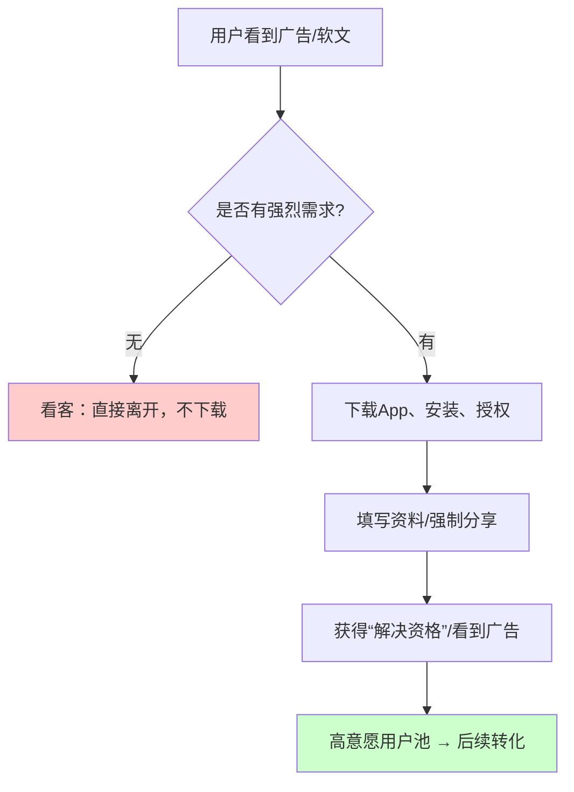
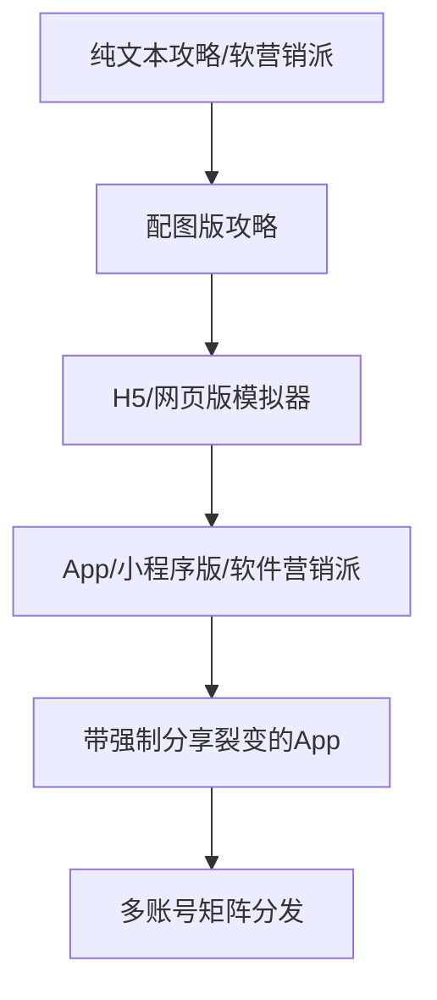
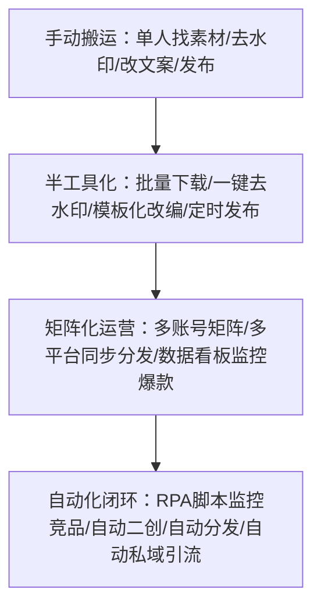
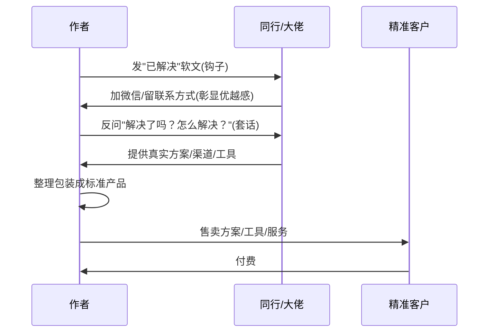
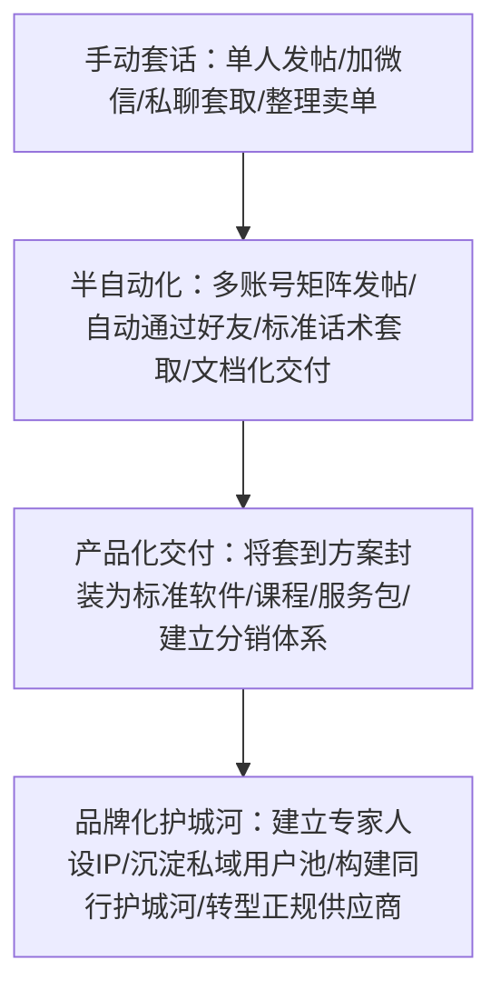
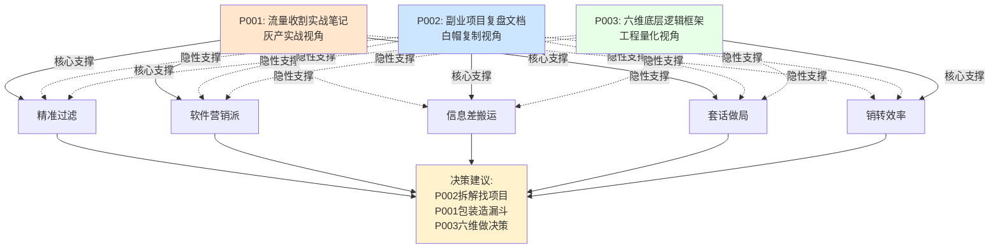
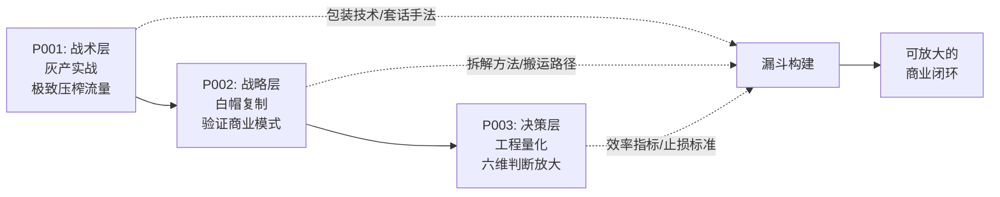

# 第 4 章 流量收割与转化 —— 从“看客”到“付费用户”的狩猎场
作者：龙哥

## 学习目标

- 理解App下载门槛如何成为精准筛选高意愿用户的反直觉优势
- 掌握软件营销派碾压软营销派的认知机制与操作要点
- 熟练运用信息差搬运论跨平台复制验证过的商业模式
- 掌握套话做局的逆向获取核心方案并变现的完整流程
- 能用六维模型中的销转效率维度判断项目是否可SOP化放大
- 建立"专业度越低、越能靠SOP放大"的反直觉商业认知

## 4.1 生活类比

想象流量收割是一场**精准的“钓鱼比赛”**：**App门槛** = 故意设置的**“专业钓竿门槛”**，只有真正想钓大鱼（强需求）的人，才愿意花精力搞来专业装备下载App；路人（看客）见工具太复杂直接走开，池子里全是高意愿鱼。**软件营销派** = 钓鱼时亮出**“智能声控自动上钩钓竿”**：虽然核心功能（钩子）和普通竿子一样，但“高科技外观”让路人瞬间信服“这竿子更专业”，甚至主动帮你宣传（强制分享裂变）。**信息差搬运** = 把**A湖（红海）钓烂了的鱼饵配方**，稍加改良带到**B湖（蓝海）**：B湖的鱼从没见过这招，上钩率极高；等B湖也学会了，再换C湖。**套话做局** = **“我早就钓到大鱼了”的吹牛战术**：在岸边大声宣称“秘诀已破解”，引来同行（高手）前来炫耀“其实我有更好的饵”，你记下配方转手卖给没钓到鱼的新手。**销转效率SOP** = 把钓鱼动作拆解成**“傻瓜式标准动作卡”**：不需要钓鱼大师（高专业度），临时工照着卡片“抛竿-等待-收杆”就能批量出货，把“技术活”变成“流水线”。

## 4.2 概念地图

第4章 流量收割与转化
├── 1. 精准过滤：App门槛是筛选器  —— P001
│   ├── 核心定义：高摩擦操作即天然筛选器
│   ├── 关键性质：反直觉优势、信任锚定、流量精准化
│   ├── 典型案例：微信解封/羊了个羊刷分工具
│   └── 边界条件：仅适用刚性刚需、依赖分发规则、需配合逼真界面
├── 2. 软件营销派 vs 软营销派  —— P001
│   ├── 核心定义：软营销(纯文本) vs 软件营销(逼真App界面)
│   ├── 关键性质：认知碾压、裂变内生性、广告隐蔽性
│   ├── 典型案例：解封助手App vs 文字攻略、刷分App vs P图教程
│   └── 边界条件：依赖包装能力/灰色地带、平台风控周期性失效、维护成本随规则升级
├── 3. 信息差搬运论  —— P002
│   ├── 核心定义：跨平台算法/用户差异形成的内容价值非对称
│   ├── 关键性质：非对称收益、方向性流动(成熟→新兴)、时间窗口敏感
│   ├── 典型案例：抖音烂项目→小红书爆款、知乎长文→👸号超长文、TikTok→国内短视频
│   └── 边界条件：仅限内容消费型、需二创规避侵权、算法升级周期性失效
├── 4. 套话做局  —— P001
│   ├── 核心定义：已解决口吻吸粉→反问套方案→卖给未解决者的三步曲
│   ├── 关键性质：零成本研发、信任反转、高杠杆复制
│   ├── 典型案例：淘客API对接套话(几十万)、羊了个羊P图吸粉→套工具变现
│   └── 边界条件：依赖同行愿分享、法律/道德风险高、仅解决已知有解问题
└── 5. 销转效率本质：低专业度可SOP放大  —— P003
    ├── 核心定义：销转效率=销售时间利用率，指标为专业度/SOP/一对多
    ├── 关键性质：可复制性判据、杠杆支点(专业度越低越易放大)、反直觉规律
    ├── 典型案例：小说推文SOP充值、项目拆解IP话术成交、知识付费挂车
    └── 边界条件：高客单/强信任场景需高专业度、平台打击模板化、非标业务难完全SOP

## 4.3 精准过滤 —— App门槛是筛选“付费意愿”的筛子

### 为什么需要这个概念？

传统认知里，我们总觉得“门槛越低越好”，恨不得用户不用下载、一点就能用，生怕流失一个潜在客户。但素材作者发现了一个**反直觉的真相**：

> "但是正因为App使用不方便，却可以当成优势利用一下"
> "如果没有强烈的需求，用户根本不可能去下载安装App App大多数展示只是看客，下载率极低！"
> "但这时用户看到了App截图和使用方法，用户就会知道，有这么一个App，没有需求的用户不可能去下载。所以用户觉得：该App'真的具有该功能！'"

——《流量收割实战笔记》（P001, p.1-2）

这段话揭示了三个层面的逻辑：
1. **自我筛选**：高摩擦操作（下载、安装、授权、甚至强制分享）天然过滤掉“无强烈需求的看客”。
2. **信任锚定**：用户看到逼真的App截图和操作流程后，会预设“该App真的具有该功能”，大幅降低后续成交的信任成本。
3. **流量精准化**：极低的下载率（如1%）反而意味着留存用户的极高质量。

### 核心定义

**精准过滤（App门槛筛选器）**：利用App下载、安装、授权等高摩擦操作，作为用户需求强度的天然过滤器。只有真正有强烈痛点、急需解决的用户，才愿意跨过门槛下载使用。

> **概念名称**：精准过滤  
> **来源素材**：`[P001, p.1-2]`  
> **核心机制**：`高摩擦门槛 → 自我筛选 → 高意愿用户池`

这个机制展示了：**不便即筛选，门槛越高，留存用户付费意愿越强**。

### 关键性质

精准过滤机制具有三个关键性质：首先是**反直觉优势**，传统认知认为不便是劣势，实则是“天然筛选器”，门槛越高，用户质量越高；其次是**信任锚定**，用户看到App截图/流程后，会预设“功能真实存在”，降低后续成交信任成本；最后是**流量精准化**，极低下载率（如1%）反而意味着极高的用户质量，转化率大幅提升。

### 典型案例

**微信解封类软件**  
用户必须下载App、填资料、甚至强制分享才能“申请解封”，看似繁琐实则精准收割急需解封的用户。作者指出：
> "弄一个APP告诉你，你下载这个APP，填上名字，就可以申请解封！"
> "我不仅有广告，我还强制你分享给别人后才能使用，这可比软文营销狠"

**羊了个羊刷分工具**  
用户为破关下载App，过程本身即验证了强付费意愿。

### 方法演进图



### 边界条件

精准过滤策略仅适用于“刚性刚需”场景，如解封、破解、急救类等“必须马上解决”的问题，非高频刚需产品会因门槛过高导致流量枯竭；同时依赖平台分发规则，若应用商店下架、iOS免签困难、微信屏蔽链接，策略即刻失效；此外必须配合“软件营销派”的逼真界面，否则用户下载后发现“无功能/假界面”即刻卸载，信任崩塌。

---

## 4.4 软件营销派 vs 软营销派 —— 用“魔法打败魔法”

### 为什么需要这个概念？

纯文本攻略（软营销）同质化严重，用户早已产生免疫，转化率低。同赛道竞品若推出“看起来更专业的工具”，会瞬间碾压纯内容玩家。你需要一种“降维打击”的内容形式，重塑专业度感知。

> "软件营销派：核心是，看起来更逼真、更专业。广告隐藏的更深，更容易用户裂变"
> "但是呢，如果这种方向的文章上产生了一个软件派，就可以直接碾压他们了，因为软件看起来更逼真了.....虽然仍然不解决任何问题！"
> "对于这两个版本而言，用户肯定会觉得后一个版本更专业，虽然这两个版本都无法解决你的问题。"

——《流量收割实战笔记》（P001, p.2-3）

### 核心定义

下表对比了软营销派与软件营销派在形式、核心逻辑与用户感知三个维度的差异：

| 派别 | 形式 | 核心逻辑 | 用户感知 |
|------|------|----------|----------|
| **软营销派** | 纯文本/图文攻略，教用户手动操作或心理疏导 | “教你怎么做” | 觉得“麻烦、不专业、可能是骗子” |
| **软件营销派** | 包装成可视化App/小程序界面，让用户填名字点按钮 | “软件问题必须用软件解决” | 觉得“专业、自动化、值得信赖” |

> **概念名称**：软件营销派 vs 软营销派  
> **来源素材**：`[P001, p.2-3]`  
> **核心机制**：`逼真界面 → 认知碾压 → 高转化/裂变`

这个对比展示了：**同等无效内容下，带界面演示的版本被感知为更专业、更可信，从而获得认知碾压优势**。

### 关键性质

软件营销派具备三大关键性质：**认知碾压**是指同等无效内容下，带界面演示的版本被感知为更专业、更可信，直接降维打击纯文本竞品；**裂变内生性**是指极易植入“强制分享解锁功能”等病毒式传播机制（如“分享到3个群才能使用”），让用户自发传播；**广告隐蔽性**是指推广链路藏在App操作流程中，而非显性文案，有效规避平台风控审核。

### 典型案例

**微信解封**  
- 软文版：教你“写申诉理由”，用户需自己组织语言、去官方渠道提交。  
- 软件版：给你“申诉助手App”，填名字点按钮，自动生成申诉文案并提交（实则可能只是跳转链接）。后者转化率碾压前者。

**羊了个羊刷分**  
- P图攻略：教你用美图秀秀P一张高分截图。  
- “一键修改分数App”：打开即显示“修改中... 成功！”，引发疯狂分享裂变。

### 方法演进图



### 边界条件

软件营销派核心依赖“看起来像”的包装能力，而非真实功能，属于灰色地带；平台一旦打击“诱导分享/虚假功能”类小程序/App，该策略即刻失效；需持续迭代UI/交互细节维持“逼真感”，维护成本随平台规则升级而增加。

---

## 4.5 信息差搬运论 —— A平台的“烂内容”就是B平台的爆款

### 为什么需要这个概念？

创作者常陷入“原创焦虑”，认为内容必须首发、独家。但跨平台算法推荐机制、用户画像差异巨大，同一内容在不同平台命运截然不同。我们需要一个低成本、可规模化的内容获取与分发逻辑。

> "渠道其实是有信息差的，我们做过很多项目，其实吃的就是信息差，有些项目在抖音上做得很烂的，但是如果你搬到小红书上面，瞬间就爆了。有些项目在小红书上面做的人很多了，那你把同样的内容优化一下，搬到抖音上，也有可能把它做爆。"
> "通过刷抖音或者刷小红书的过程发现商业案例，再拆解复制这样的案例去形成一个商业模式，去发展自己的副业。"
> "拆下来之后，我就发现很多时候有些项目是完全可以复制的，是不需要投入几十万也可以复制的。复制了之后，用跟他一样的内容生产方式、转化链路，你也能拿到一定的结果。"

——《副业项目复盘文档》（P002, p.1-2）

### 核心定义

**信息差搬运论**：渠道间存在天然信息差——用户群体不重叠、算法偏好不同、内容生态成熟度不同。核心操作：在平台A（红海/过度竞争）挖掘验证过的爆款内容，搬运至平台B（蓝海/内容空白）并微调优化。

> **概念名称**：信息差搬运论  
> **来源素材**：`[P002, p.1-2]`  
> **核心公式**：

$$
\text{收益} = (\text{目标平台流量价值} - \text{搬运成本}) \times \text{时间窗口系数}
$$

### 公式逐步推导与解释

该公式由三个核心变量构成，揭示了搬运业务的盈利结构：

1. **目标平台流量价值**：指平台B当前的流量单价与总量。新兴平台（如早期小红书、视频号）因内容供给不足，算法对优质内容给予极高权重，单位流量商业价值远高于成熟平台。这是收益的“天花板”。量纲为货币单位/单位时间。
2. **搬运成本**：指将平台A内容二创搬运至平台B的边际成本，包括去水印、剪辑、改文案、配音、加水印等。由于素材现成、无需从0策划，成本极低（常仅为原创成本的1/10甚至更低）。这是收益的“底板”。量纲为货币单位/单位时间。
3. **时间窗口系数**：反映平台B红利期的衰减曲线。平台早期系数>1（流量加权推荐），成熟期系数≈1，饱和期系数<1（流量限流、查重）。这是收益的“放大器/衰减器”。量纲为无量纲比率。

**为何可用乘法建模？**  
三变量量纲统一为“货币单位/单位时间”。流量价值与搬运成本同为现金流量，相减得单位时间净收益；时间窗口系数为无量纲比率，乘以净收益即得该窗口期内的期望总收益。

三变量分别代表搬运杠杆的三个正交维度：**平台红利（流量价值）**、**执行门槛（搬运成本）**、**红利周期（时间窗口）**。三者相互独立、均对收益呈单调影响，乘法模型能准确捕捉“短板效应” —— 任一维度极低（平台红利耗尽、搬运成本因查重升级逼近流量价值、时间窗口关闭），整体收益即趋近于零，符合实际业务直觉。

### 公式作用概述

该公式量化了**“搬运成本极低、收益取决于目标平台流量红利期、且具有方向性（成熟→新兴）和时间窗口敏感性”**的核心特征。它指导操作者：只在时间窗口系数>1的平台早期重仓搬运；成熟期需转型原创或换赛道；若搬运成本因查重升级而逼近流量价值，即刻止损。

### 关键性质

信息差搬运论具有三大关键性质：**非对称收益**是指搬运成本极低（复制+伪原创），收益主要取决于目标平台流量红利期，呈现高杠杆特征；**方向性流动**是指内容价值流动通常呈单向性，从成熟平台（抖音、知乎）向新兴/垂类平台（小红书、视频号、👸号）流动，反向搬运效果往往大打折扣；**时间窗口敏感**是指目标平台内容生态成熟前（如小红书早期、视频号早期）效果最佳，一旦平台算法升级、原创保护机制完善，搬运策略即刻失效。

### 典型案例

下表列举了典型的跨平台搬运路径与结果：

| 源平台(A) | 目标平台(B) | 内容形态 | 结果 |
|-----------|-------------|----------|------|
| 抖音 | 小红书 | “艺术签名/手写logo”项目 | 搬运至小红书瞬间爆火，月入数万 |
| 知乎 | 👸号 | 长文回答 | 拆解重组为“超长文”，吃搜索流量红利 |
| TikTok | 抖音/快手/视频号 | 爆款视频 | 去水印搬运，批量收割播放量 |

### 数据流图


### 方法演进图



### 边界条件

信息差搬运论仅适用于“内容消费型”项目，如资料、教程、娱乐等，强服务/强交付/强供应链项目无法单纯靠搬运复制；涉及版权/侵权风险，需做“二次创作”处理（剪辑、配音、改文案、加水印）；平台算法升级（原创保护、跨平台查重）会周期性失效，需持续对抗。

---

## 4.6 套话做局 —— 把“同行的方案”变成“自己的产品”

### 为什么需要这个概念？

个人开发者/创业者常因“不会技术/没资源/没方案”不敢入局。但实际上，市场上已有大量同行解决了同类问题，只需“套”出来即可。我们需要一套“零成本获取核心交付方案”的逆向获客逻辑。

> "我将这个问题用：已经解决的口吻写出来，软文中附加微信号，之后每天都有淘客大佬加我"
> "过了些天，我又反问加我的人'前几天有点忙没来得及回，你们解决了吗？'开始套话，怎么解决的？"
> "总有解决的，也总有没解决的。把解决的套出来，卖给精准的，没解决的客户，直接盈利几十万！"
> "套话之所以能成，主要是因为对方要彰显优越感"
> "羊了个羊刚有点火，立刻就有人P一张分数999999截图，去社交软件用已经开挂的口吻发文，开始吸粉，差不多5天后《羊了个羊》大火，这时他就可以，套话找真正能刷分软件了，直接把粉丝变现！"

——《流量收割实战笔记》（P001, p.3-4）

### 核心定义

**套话做局三步曲**：

> **算法 1：套话做局标准流程**  
> **来源素材**：`[P001, p.3-4]`  
> **核心概念**：`套话做局`

```
1. 以“已解决问题”的口吻写软文/发内容（如“折腾3天终于搞定XX，全网教程都过时了，我整理了最新可用方案”）
   → 吸引同行/从业者加微信（利用同行好奇心/优越感）
2. 过段时间反问：“解决了吗？怎么解决的？”
   → 套取真实可行方案（API接口/渠道商/脚本/工具）
3. 将套到的方案整理包装
   → 卖给“未解决但急需解决”的精准付费用户
```

这个流程展示了：**零成本研发（方案来自市场验证过的同行）、信任反转（买家以为卖家是专家）、高杠杆复制（一份方案无限售卖，边际成本趋近零）**。

### 关键性质

套话做局具备三大关键性质：**零成本研发**是指核心方案来自市场验证过的同行，非自研，省去了技术攻关与试错成本；**信任反转**是指买家以为卖家是“已解决的专家”，实则卖家只是“信息中介”，利用信息不对称获利；**高杠杆复制**是指一份套到的方案可无限复制售卖，边际成本趋近零，极易放大。

### 典型案例

**淘客API对接难题**  
作者写“已解决”软文引几十个淘客大佬加微信 → 套出对接方案 → 卖给不会对接的小白淘客，盈利几十万。

**羊了个羊刷分**  
P图999999分截图发“已开挂”贴吸粉 → 游戏火爆后套取真刷分工具 → 变现粉丝。

**各类“已破解/已对接/已实现”类软文**，本质皆为套话陷阱。

### 时序图



### 方法演进图



### 边界条件

套话做局依赖同行“有解且愿分享”，若行业极度保密或无解，则套不到核心方案；法律/道德风险高，涉及虚假宣传、欺诈、侵犯商业秘密，平台严打；仅能解决“已知有解”的问题，无法应对真正的“从0到1”创新需求。

---

## 4.7 销转效率的本质 —— 专业度越低，越能靠SOP放大

### 为什么需要这个概念？

创业者常误以为“专业度高=赚钱多”，陷入“提升专业度”的内耗。实际操作中，高专业度依赖人（难复制、难培训、难放大）。我们需要一个评估标准：判断销售环节是否可标准化、规模化。

> "我们以「专业度」为指标。"
> "「专业度要求低（能SOP），能一对多，即为销转效率高，本质也是时间，销售的时间利用率」"
> "「基本上网销不需要啥专业度，按SOP做就好，线下才需要极高的专业度」"
> "销转效率高，交付效率高，意味着销售可以SOP化，不需要极强的专业性，也意味着交付也不需要啥时间，精力，同时也意味着流量来了，能接得住。"

——《六维底层逻辑框架》（P003, p.1-2）

### 核心定义

**销转效率 = 销售时间的利用率**

核心指标三维判断：
1. **专业度要求**（能否SOP化？1-5分，≤2分为低）
2. **是否一对多**（群发/自动化/标准化话术？≥80%步骤可一对多）
3. **单位时间产出**（单客服务时长 ≤10分钟？）

> **概念名称**：销转效率  
> **来源素材**：`[P003, p.1-2]`  
> **核心公式**：

$$
\text{销转效率} = \frac{\text{成交金额}}{\text{销售人力投入时间}} \propto \frac{1}{\text{专业度要求}} \times \text{一对多系数} \times \frac{1}{\text{单客服务时长}}
$$

### 公式逐步推导与解释

该公式从“销售时间利用率”这一本质出发，拆解为三个可观测、可操作的工程变量：

1. **专业度要求（分母）**：衡量执行销售动作所需的隐性知识、经验、判断力门槛。量纲为“专业度等级（1-5）”。专业度越高，意味着越依赖资深人员，培训周期越长，人力可替代性越差，故置于分母。为量化建模，取倒数 `1/专业度`，专业度1(最低)对应系数1，专业度5(最高)对应系数0.2。
2. **一对多系数（分子）**：衡量单次销售动作可同时服务的客户数比例。量纲为“无量纲比率（0-1）”。如群发朋友圈/自动回复/直播挂车为1（一对无限多）；1对1语音/面诊为0.01（一对一）。直接乘在分子上，代表单位动作的流量放大倍数。
3. **单客服务时长（分母）**：衡量完成一次成交闭环所需的纯人工时间投入。量纲为“分钟/单”。含沟通、诊断、报价、收款、交付确认全链路。时长越短，单位时间内可服务客户数越多，故置于分母。为量化建模，取倒数 `1/单客时长`，单位为“单/分钟”。

**为何用乘除法建模？**  
三变量分别代表销售杠杆的三个正交维度：**人力替代性（专业度）**、**流量放大性（一对多）**、**时间周转率（单客时长）**。三者相互独立、均对销转效率呈正向/负向单调影响，乘法模型能准确捕捉“短板效应” —— 任一维度极低（专业度极高、纯一对一、单客时长极长），整体效率即趋近于零，符合实际业务直觉。

> **理论锚点**：该模型借鉴了销售运营领域经典的 *Sales Velocity* 公式（销售速度 = 机会数 × 平均成交额 × 转化率 ÷ 销售周期）中的“时间利用率”维度，并结合 *Autor-Levy-Murnane (2003) 任务框架* 中“常规任务易标准化/自动化”的理论，将“专业度要求”显式化为人力可替代性的逆指标，形成工程化可测算模型。

### 公式作用概述

该公式揭示了**专业度要求越低、一对多比例越高、单客时长越短，销转效率越高，越易通过人力/技术杠杆放大**的核心规律。它将“销转效率”从模糊感知转化为可测算、可优化的工程指标：若要提升效率，只需在三维中寻找“短板”并针对性SOP化（降专业度）、工具化（增一对多）、流程化（减单客时长）。

### 关键性质

销转效率具有三大关键性质：**可复制性判据**是指能否写成SOP交给兼职/新人执行？能则高，不能则低，这是判断项目能否规模化放大的核心试金石；**杠杆支点**是指专业度要求越低，越容易通过“人力杠杆”（招兼职）、“技术杠杆”（自动化话术）放大，专业度是撬动规模化的核心支点；**反直觉规律**是指看似“不专业”的标准化流程，反而支撑起百万级收入放大，颠覆了“高专业=高收入”的传统认知。

### 典型案例

下表展示了不同项目在销转效率三维指标上的表现：

| 项目 | 专业度 | 一对多 | 单客时长 | 销转效率 | 放大方式 |
|------|--------|--------|----------|----------|----------|
| **小说推文** | 极低(搜暗号充值) | 极高(自动化) | <1分钟 | 极高 | 矩阵号/SOP充值 |
| **项目拆解IP** | 中(话术成交) | 高(标准话术) | 10-30分钟 | 高 | 话术文档化+兼职销售 |
| **知识付费/课程** | 低(挂车/直播) | 极高(一对万) | 0分钟(即时交付) | 极高 | 直播间/短视频挂车 |

### 多源对照：不同素材对“销转效率”的侧重

**共识**：
- 网销（线上）本质低专业度、可SOP、可一对多，销转效率天然高。
- 线下销售（面销、会销）高专业度、一对一、低效率。

**分歧**：
- **《P001 流量收割实战笔记》视角**：销转效率高低取决于“包装能力”（软件营销派 vs 软营销派），核心是**信任构建的形式** —— 逼真界面能让低专业度销售显得高专业，从而提升转化率。
- **《P002 副业项目复盘文档》视角**：销转效率隐含在“转化链路拆解”中，核心是**能否复制同行的转化路径** —— 拆解竞品“直接在直播间卖/引流私域社群转化/朋友圈+私聊”，照抄其转化动作即可获得同等效率。
- **《P003 六维底层逻辑框架》视角**：销转效率取决于“专业度/SOP/一对多”三指标，核心是**时间利用率与可复制性** —— 显式量化三指标，判断项目是否可“照单全收给兼职做”。

### 边界条件

高客单价（>10万）、强信任依赖（医疗、法律、高端咨询）场景，低专业度SOP会破坏成交，需高专业度人工介入；平台风控若打击“话术模板/自动回复/批量操作”，SOP策略失效；仅适用“标准化产品/服务”，非标定制化业务无法完全SOP。

---

## 4.8 多源对照 —— 核心概念的跨素材支撑与差异

本章五大核心概念中，“精准过滤”“软件营销派”“套话做局”主要依托 P001《流量收割实战笔记》单一素材，构建了从流量筛选到成交变现的完整灰产/黑产实战链路；“信息差搬运论”主要依托 P002《副业项目复盘文档》，提供了合规白帽层面的内容获取与分发方法论；“销转效率”则同时见于 P001、P002、P003 三份素材，形成了多视角互补的理论厚度。下表系统对照三份素材对共现概念的侧重差异：

| 核心概念 | P001《流量收割实战笔记》（灰产实战视角） | P002《副业项目复盘文档》（白帽复制视角） | P003《六维底层逻辑框架》（工程量化视角） |
|----------|------------------------------------------|------------------------------------------|------------------------------------------|
| **精准过滤 / App门槛** | 核心策略：高门槛筛选+信任锚定+强制分享裂变，配合“软件营销派”界面形成完整漏斗 | 未直接提及；隐含在“拆流量/拆转化”中，关注竞品引流钩子设计 | 未直接提及；隐含在“流量效率”指标中，关注获客动作的时间/素材/流量比 |
| **软件营销派** | 核心战术：逼真界面碾压软文、内生裂变、广告隐蔽，属“包装>功能”的灰产标配 | 未直接提及；隐含在“拆产品交付”中，关注竞品交付形式（软件/课程/服务） | 未直接提及；隐含在“销转效率”专业度指标中，工具化界面可降低销售专业度要求 |
| **信息差搬运** | 未直接提及；隐含在“下拉词发现需求/全球化分发”中，关注跨平台/跨国家的需求差异 | 核心定理：渠道信息差是副业项目主要利润来源，给出A→B搬运实操案例 | 未直接提及；隐含在“流量效率”素材难度指标中，搬运素材难度极低推高流量效率 |
| **套话做局** | 核心手法：以“已解决”钓同行，反问套方案卖小白，属“零成本研发”灰产典范 | 未直接提及；隐含在“拆产品交付/评估可复制性”中，关注竞品核心供给链路从何而来 | 未直接提及；隐含在“交付效率”中，套到方案即交付标准化，极大提升交付效率 |
| **销转效率** | 隐性体现：软件营销派降低销售专业度、强制分享实现一对多、App流程缩短单客时长 | 隐性体现：拆解竞品转化链路（直播/私域/朋友圈）即复制其销转效率模型 | 显性建模：专业度/SOP/一对多三指标量化，给出公式与及格线，判断项目可放大性 |

**综合启示**：  
P001 提供“如何在灰色地带极致压榨流量价值”的战术细节；P002 提供“如何在合规前提下复制验证过商业模式”的战略框架；P003 提供“如何用工程指标判断任意项目能否规模化”的决策工具。**实战中建议：用 P002 的拆解法找项目、用 P001 的包装法造漏斗、用 P003 的六维模型做决策。**

### 素材支撑关系图谱



### 概念演进对比流程图



---

## 4.9 设计中的取舍

- **为什么不用“纯小程序/网页”而要“App”？**  
  这种设计的 trade-off 是什么？因为小程序/网页无需下载，门槛更低，流量更大，但筛选会失效：无门槛意味着全是看客，转化率极低，私域淤积大量低质用户，运营成本激增；同时网页/H5易被判定为“临时搭建的钓鱼页”，App有图标、启动页、原生交互，自带“正规军”光环，信任感更强；再者小程序无法实现“强制分享解锁”“后台常驻监听”“读取通讯录/剪贴板”等灰色裂变/功能手段；最后分发规则不同，App可通过应用商店搜索/ASO获取自然流量，小程序主要靠社交裂变/👸号导流，获客来源结构完全不同。Trade-off在于：App门槛高流失大，但留存者质量极高；小程序门槛低流量大，但留存者质量参差不齐。刚性刚需选App，泛需求选小程序。

- **为什么不用“自研核心功能”而要“包装/套壳/套话”？**  
  这种设计的 trade-off 是什么？因为真开发需1周+，包装/套话只需1天，“卖空气”先验证需求，卖得动再开发，卖不动直接砍，零沉没成本；大多数“刚需工具”无技术壁垒，核心竞争力在分发与包装，而非代码；真功能往往触碰平台红线（破解、刷分、自动化脚本），包装版可随时下架切号，风险可控；若真有技术大佬已解决，套话成本远低于自研，且方案已被市场验证。Trade-off在于：自研可控但慢、贵、险；包装/套话快、廉、险但可控（随时切号）。个人开发者/小团队只能选后者。

---

## 4.10 动手练习

### 练习 1：实战推演：为你的项目设计“App门槛”筛选器

假设你在卖一个“自动生成考研复习规划表”的虚拟服务，目标用户是考研党。

1. 如果用网页/小程序直接生成，会吸引哪些低质量用户？转化率为何会被稀释？
2. 设计一个“必须下载App、填写10项详细信息、看完3分钟教程视频”才能生成规划表的流程，写出这3个门槛分别过滤掉了什么样的用户。
3. 思考：若平台下架App，或用户无法安装(如iOS免签困难)，该策略如何快速降级为“网页版+人工审核”而不失精准度？

### 练习 2：跨平台搬运实战：寻找你的“A湖→B湖”路径

打开抖音/快手搜索“副业项目/赚钱教程”，找到3个播放量>10万但评论区全是“怎么联系”“骗子吧”的账号。

1. 记录其核心内容形式(口播/图文/混剪)、引流钩子(资料包/软件/社群)、变现产品(课程/加盟/软件)。
2. 去小红书/视频号/👸号搜索同关键词，观察是否有同质内容。若无，即为蓝海；若有，对比其互动率与引流方式差异。
3. 设计“二创SOP”：从原视频中提取哪3个核心知识点？换成什么BGM/滤镜/文案口吻？如何植入你的私域钩子(如“完整版进群”)?
4. 回答问题：为什么同样的内容在抖音是“烂大街”在小红书却是“干货”？平台用户画像差异在哪里？

### 练习 3：套话做局复盘：从“零方案”到“卖方案”

选定一个你完全不懂但市场需求大的技术难题(如“如何批量注册ChatGPT账号”、“如何破解某软件会员”)。

1. 写一篇200字“已解决软文”，核心话术参考：‘折腾3天终于搞定XX，全网教程都过时了，我整理了最新可用方案，需要的扣1’。
2. 发布到知乎/贴吧/抖音评论区/微信群(模拟即可)，记录加你微信的人中，有多少是“同行/卖工具的”(他们通常会主动发广告或技术细节)。
3. 对这类人话术：‘大佬牛啊，我那边有批精准粉没工具，咱们合作/付费买你方案？’——模拟套取核心步骤(如API接口/渠道商/脚本)。
4. 回答问题：此法核心利用了人性中的什么弱点？若对方警觉不回复，如何用“小号提问/懂行人设”二次套话？

### 练习 4：销转效率自检：你的项目能“照单全收”给兼职做吗？

拿出你正在做或准备做的项目，从‘陌生人加微信’到‘收到钱’列出完整动作清单(如：发朋友圈→话术回复→发收款码→发资料)。

1. 标注每步所需专业度(1-5分，5为需创始人亲自上)、是否可一对多(群发/自动化)、单步耗时。
2. 计算：全流程平均专业度≤2分？可一对多步骤占比≥80%？单客服务时长≤10分钟？→ 三个是则销转效率高，可大规模招兼职/SOP放大。
3. 针对“不达标”步骤(如‘诊断需求需1对1语音’)，设计标准化替代方案(如‘发诊断问卷→自动出报告→匹配标准话术’)。
4. 回答问题：为什么高客单价(>5000元)项目往往难以全流程SOP？此时销转效率低是否意味着项目不好？如何用高毛利/高复购补偿？

---

## 4.11 本章小结

这一章中我们学习了流量收割与转化的五大核心认知与手法。首先，我们颠覆了“门槛越低越好”的直觉，理解了**App高门槛反而能作为天然筛选器**，精准过滤出强付费意愿用户并锚定信任。其次，我们掌握了**软件营销派碾压软营销派**的认知机制：逼真界面带来专业度感知的降维打击，并内生裂变与隐蔽广告优势。接着，我们熟练运用**信息差搬运论**，跨平台复制验证过的商业模式，吃渠道算法与用户重叠度的差价。然后，我们掌握了**套话做局**的逆向获取核心方案并变现的完整三步曲流程，利用同行优越感零成本拿到交付方案。最后，我们用六维模型中的**销转效率维度**判断项目可放大性，建立了“专业度越低、越能靠SOP放大”的反直觉商业认知：网销本质低专业度可SOP，看似不专业的标准化流程反而支撑百万级收入放大。

本章我们一起学习了以下概念：

| 概念 | 解释 |
|------|------|
| 精准过滤（App门槛） | 高下载门槛反而能筛选出强需求用户，并锚定信任“该App真有功能” |
| 软件营销派 | 用逼真App界面碾压纯文本攻略，自带专业光环并内生裂变机制 |
| 信息差搬运论 | A平台的烂内容搬运优化到B平台即成爆款，吃渠道算法与用户重叠度的差价 |
| 套话做局 | 以已解决口吻吸引同行，反问套取真实方案，转手卖给未解决的精准付费用户 |
| 销转效率本质 | 销转效率=销售时间利用率；专业度越低、越能SOP、越能一对多，放大杠杆越大 |
| 低专业度高杠杆 | 网销本质低专业度可SOP，看似不专业的标准化流程反而支撑百万级收入放大 |

下一章中，我们将学习**交付与项目管理**——如何把“买卖”做成“生意”的脚手架，包括交付效率分级、策划案与执行案双轮驱动、止损点设定，以及客单价与毛利率的补偿策略，帮助你在流量进来后“接得住、留得下、复购得起”。


