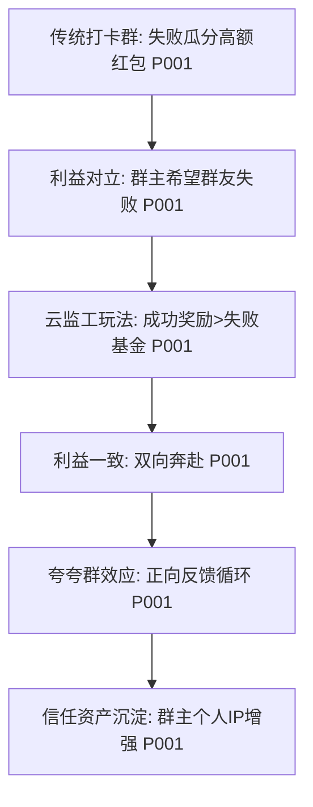
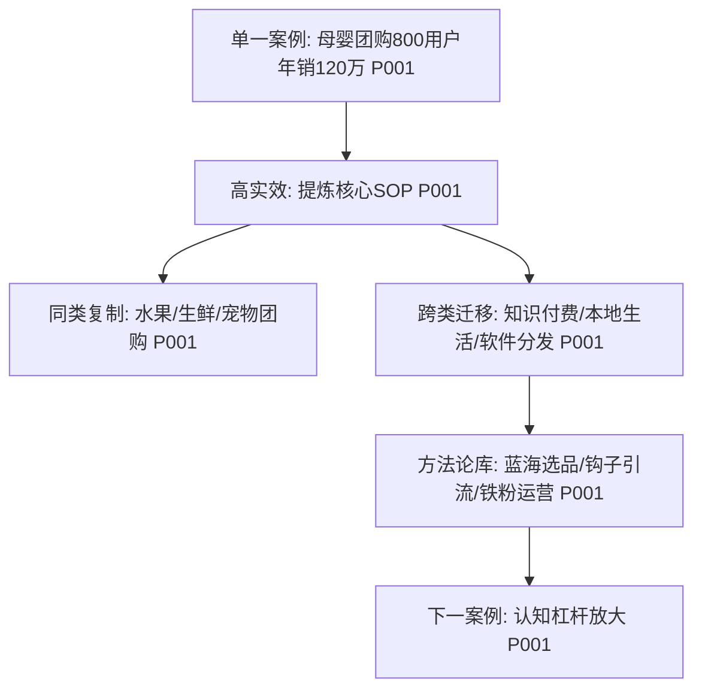
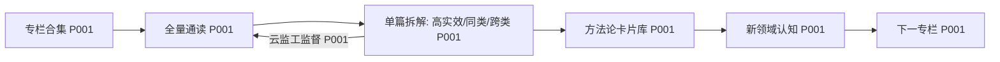
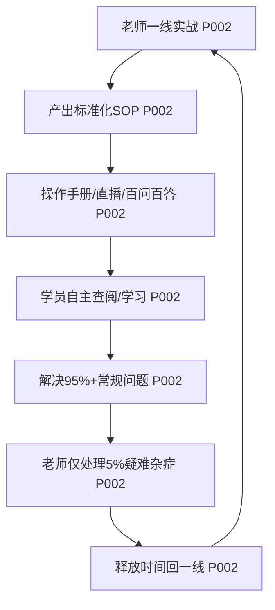
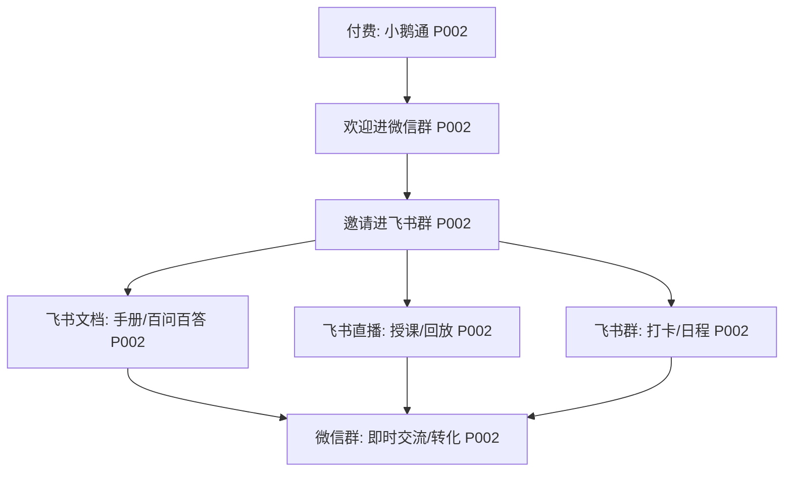

# 第 16 章 社群运营与个人成长方法论

## 学习目标

- 理解云监工玩法的核心机制与利益一致性设计原则
- 掌握举一反三项目拆解法与地毯式阅读法的操作步骤
- 理解钩子引流理论中引流饵与变现品的解耦逻辑
- 掌握训练营高效交付三板斧（手册、直播、百问百答）替代1v1的标准化流程
- 理解撬动学员时间与责任的三大策略（分享机制、责任引导、打卡模板）
- 掌握训练营工具链选型原则与千聊/小鹅通、飞书组合的避坑指南
- 能运用利益一致性规则设计、云监工招募、MVP验证等方法解决执行力与交付效率问题

## 16.1 生活类比

想象**云监工玩法**是一场**“马拉松领跑员招募计划”**：群主是想破纪录但容易偷懒的跑者；云监工是沿途围观、加油、计时、递水的观众团；规则是跑完给观众发奖牌（心得/折扣/盲盒），放弃只发瓶水钱（200元失败基金）；利益一致意味着观众越希望跑者赢，跑者动力越足，双向奔赴。想象**训练营交付体系**是**“自助式健身房”**而非**“私教陪练”**：操作手册是器械使用说明书/训练计划表（随时可查）；直播课是固定时间的团操课/动作示范课（可回看）；百问百答是墙上的常见问题解答贴（避免教练重复讲）；1v1诊断是仅当动作极度危险/卡住时才叫教练过来（最后手段）；打卡模板是每日训练日志（自己记、教练抽查、同伴围观）。就像健身房靠标准化设施和课表服务上千会员，训练营靠手册/直播/百问百答实现“一份时间卖很多次”。

## 16.2 概念地图

第16章：社群运营与个人成长方法论
├── 云监工玩法体系
│   ├── 核心定义：快闪群+外部监督+正向反馈  —— P001 (ID: ELHqdhiI5oSQAxxItLJctNAhnah)
│   ├── 利益一致性规则：成功奖励>失败基金  —— P001 (ID: ELHqdhiI5oSQAxxItLJctNAhnah), P002 (ID: MUfLdmUlTosj0NxPhlfcjRPHnff)
│   ├── 执行流程：招募→监督→产出→奖励/复盘  —— P001 (ID: ELHqdhiI5oSQAxxItLJctNAhnah)
│   └── 典型效应：夸夸群/陪伴感/信任沉淀  —— P001 (ID: ELHqdhiI5oSQAxxItLJctNAhnah)
├── 项目拆解与认知升级方法
│   ├── 举一反三拆解法：高实效/同类复制/跨类迁移  —— P001 (ID: ELHqdhiI5oSQAxxItLJctNAhnah)
│   ├── 地毯式阅读法：全量摄入破茧房  —— P001 (ID: ELHqdhiI5oSQAxxItLJctNAhnah)
│   ├── 钩子引流理论：引流饵≠变现品  —— P001 (ID: ELHqdhiI5oSQAxxItLJctNAhnah)
│   └── 蓝海选品思维跨域迁移  —— P001 (ID: ELHqdhiI5oSQAxxItLJctNAhnah)
├── 训练营高效交付体系
│   ├── 核心心法：高效率才能高质量/老师不脱离一线  —— P002 (ID: MUfLdmUlTosj0NxPhlfcjRPHnff)
│   ├── 三板斧标准化交付：操作手册/直播/百问百答  —— P002 (ID: MUfLdmUlTosj0NxPhlfcjRPHnff)
│   ├── 撬动学员资源：优秀学员分享/分享必爆  —— P002 (ID: MUfLdmUlTosj0NxPhlfcjRPHnff)
│   ├── 责任归属机制：开营引导/打卡模板/取消无效提醒  —— P002 (ID: MUfLdmUlTosj0NxPhlfcjRPHnff)
│   ├── 手册编写原则：按阶段给出/只给最少必要信息  —— P002 (ID: MUfLdmUlTosj0NxPhlfcjRPHnff)
│   └── 工具链选型：小鹅通+飞书全家桶+微信群  —— P002 (ID: MUfLdmUlTosj0NxPhlfcjRPHnff)
└── 底层定理与公理
    ├── 利益对立危害论  —— P001 (ID: ELHqdhiI5oSQAxxItLJctNAhnah), P002 (ID: MUfLdmUlTosj0NxPhlfcjRPHnff)
    ├── 1v1优先级最低论  —— P002 (ID: MUfLdmUlTosj0NxPhlfcjRPHnff)
    ├── 被动执行无果论  —— P002 (ID: MUfLdmUlTosj0NxPhlfcjRPHnff)
    ├── 分享必爆论  —— P002 (ID: MUfLdmUlTosj0NxPhlfcjRPHnff)
    ├── 私域无转化概率零论  —— P001 (ID: ELHqdhiI5oSQAxxItLJctNAhnah)
    └── 坚持+SOP化放大论  —— P001 (ID: ELHqdhiI5oSQAxxItLJctNAhnah)

## 16.3 云监工玩法 —— 把「独自修行」变成「众人围观的游戏」

### 为什么需要这个概念？

普通人独自跑项目、学课程极易半途而废，缺乏外部监督与正向反馈。传统打卡群规则常把群主和群友利益对立（如失败瓜分红包），导致群主动力不足、难以持续。我们需要一种低成本、可快速测试、利益一致的机制来替代“靠自律”。

### 核心定义与推导

> "希望我复盘的这个云监工快闪群玩法，能：帮助更多圈友高效地跑MVP；让群变得更好玩，云监工还可以成为社群角色、监督促进复盘文化等；让云监工们感知、陪伴到群主的成长；让云监工们加强对群主了解、记忆。"
> 
> ——《P001 (ID: ELHqdhiI5oSQAxxItLJctNAhnah): 云监工挑战复盘》

**云监工玩法**的核心结构由三个要素构成：

$$
\text{CloudSupervision} = \langle \text{Goal}, \text{Rules}, \text{Reward} \rangle
$$

其中：
- $\text{Goal}$：短周期（3-7天）、可量化的具体挑战目标（如“3天读50篇+写5000字”）
- $\text{Rules}$：利益一致性规则（成功奖励 > 失败基金）
- $\text{Reward}$：群主核心交付物 + 自身产品折扣 + 实物盲盒

这个定义展示了云监工玩法的最小可行结构：它不需要复杂的工具开发，只需微信群+朋友圈文案即可发起，属于典型的“非规范化生产”产物。

### 关键方法：快闪群招募与执行流程

> **云监工挑战执行流程**（来源：《P001 (ID: ELHqdhiI5oSQAxxItLJctNAhnah)》）

```
1. 目标设定：明确挑战内容（阅读篇数、输出字数、时间周期）
2. 规则设计：成功奖励（心得+折扣+盲盒） vs 失败基金（低额，如200元）
3. 招募文案：朋友圈正文放招募信息，评论区放具体规则
4. 群内监督：云监工实时围观、计时、鼓励、汇总进度
5. 产出交付：挑战结束产出承诺物（如5000字复盘）
6. 奖励兑现：按规则发放奖励或瓜分失败基金
7. 复盘沉淀：将挑战过程与产出整理为可复用内容资产
```

这段流程展示了从“想法”到“结果”的完整闭环。关键在于第2步规则设计：将失败基金设低（200元），筛选掉纯奔红包来的“薅羊毛”用户；将成功奖励设高（高价值心得+产品折扣+盲盒），让群主有动力持续产出优质内容，让监工有动力真诚陪伴。

### 典型效应与边界条件

> "在我花2天多时间，招募102位云监工并完成挑战后，这验证了我此前的想法：云监工玩法特别适合普通人，它简单好操作+可低成本快速进行测试，它的运营模式对群主的要求并没有陪伴群那么高。"
> 
> ——《P001 (ID: ELHqdhiI5oSQAxxItLJctNAhnah): 云监工挑战复盘》

**正向循环效应**：监工的鼓励、陪伴、汇总形成“夸夸群”效应，强化群主执行力。作者实测：3天内招募102位监工，实际耗时接近2天（预估6小时），产出5000字复盘。监工主动帮忙算时间、汇总群内容、送“开年礼物”，群从监督场变成激励场。

**边界条件**：
- 仅适合短周期（3-7天）、目标具体可量化的挑战，长周期易疲劳
- 群主需有一定基础影响力（朋友圈能招到人），纯冷启动需先跑通小规模种子用户
- 失败基金金额必须设低（如200元），过高会吸引赌徒心态、破坏利益一致性

### 方法演进图



## 16.4 利益一致性规则设计 —— 让群主与群友站在同一边

### 为什么需要这个概念？

绝大多数付费打卡群、挑战群采用“失败罚款/瓜分高额红包”规则，把群主和群友变成对立面：群主希望群友失败、群友希望群主翻车。利益对立导致群主无正向反馈、群友缺乏真实陪伴，群体难以健康持续。必须从规则层面重构利益关系，实现“群主赢→大家都赢”。

### 核心定义

> **利益一致性规则**（来源：《P001 (ID: ELHqdhiI5oSQAxxItLJctNAhnah), P002 (ID: MUfLdmUlTosj0NxPhlfcjRPHnff)》）

$$
\text{HealthyRule} \iff \text{Value}(\text{SuccessReward}) \gg \text{Value}(\text{FailFund})
$$

其中：
- $\text{SuccessReward} = \{\text{核心交付物}, \text{产品折扣}, \text{实物盲盒}\}$
- $\text{FailFund} = \text{低额红包（如200元）}$

这个公式展示了健康规则的数学本质：成功方的收益期望远大于失败方的补偿成本，从而将博弈从“零和/负和”转为“正和博弈”。

### 多源对照

**共识**：
- P001 与 P002 均认为“失败瓜分高额红包”会导致利益对立，不可持续
- 双方都主张“成功奖励 > 失败基金”作为核心设计原则

**分歧**：
- P001 侧重于“快闪群+云监工”的短周期挑战场景，强调低门槛、可快速测试
- P002 侧重于“百日写作/打卡”等长周期付费社群，建议采取“收费+收押金”模式，而非“完成打卡全额退费”

> "如果新人运营百日XX活动，建议采取收费+收押金模式。如果只用完成打卡全额退费，当群主再次变现能力弱……在一定程度相当于把群主、参与者的利益对立，这不是一种健康的状态，不利于可持续发展。"
> 
> ——《P002 (ID: MUfLdmUlTosj0NxPhlfcjRPHnff): 训练营运营避坑指南》

### 典型例子与反面教材

**正例**：本案例——成功送5000字心得+7折购课权+盲盒；失败瓜分200元，作者顺利完成并收获大量好评与信任。

**反例**：百日打卡群“全额退费”模式——群主不赚钱、学员不珍惜、双输。

### 设计中的取舍

**为什么不用“全额退费”模式？**

因为“全额退费”本质上是把群主的变现能力透支给学员的“免费心理账户”。当群主无法通过后续变现覆盖前期投入时，群主动力崩塌，服务质量下降，最终群友也得不到价值。低失败基金+高价值成功奖励，迫使群主必须交付高质量内容才能获益，倒逼群主成长。

## 16.5 举一反三项目拆解法 —— 从「看一个案例」到「悟一类生意」

### 为什么需要这个概念？

读项目案例若只盯着“这个项目还能不能做”，极易陷入幸存者偏差与时效性陷阱。普通人缺乏从单一案例抽象出可迁移方法论的训练，导致学了不用、用了不准。我们需要一套结构化的思维工具，把“别人的经验”变成“自己的能力”。

### 核心定义

> **举一反三拆解法**（来源：《P001 (ID: ELHqdhiI5oSQAxxItLJctNAhnah)》）

$$
\text{CaseDecomposition} = \langle \text{HighEfficiency}, \text{SameTypeReplica}, \text{CrossTypeTransfer} \rangle
$$

其中：
- $\text{HighEfficiency}$：吸收浓缩精华，快速获取有效信息、节省时间
- $\text{SameTypeReplica}$：发散到同赛道、同模式的其他项目（如水果团购→母婴团购→生鲜团购）
- $\text{CrossTypeTransfer}$：抽象出底层逻辑（如蓝海选品、钩子引流、铁粉运营），应用到完全不同领域

这个定义展示了案例价值的三个递进层级：从“拿来即用”到“同类复制”再到“跨域迁移”，认知杠杆逐层放大。

### 关键性质

- **复利型学习**：每拆解一个案例，方法论库就增厚一层，后续看新项目速度指数级提升
- **避免“技术性模仿”**：不抄表面动作（发什么文案、用什么工具），抄底层逻辑（为什么这么选品、为什么这样设计钩子）
- **可练习性**：把拆解过程显性化为“看案例→写核心逻辑→列同类/跨类应用”的固定动作

### 典型例子

> "举一反三是做项目要练习的基本功。看完教育人做水果团购后，我首先想到我在生财知识星球发过的这篇文章《才391个小红书粉丝，但引流私域432人成交308单的复盘》，两者在一些方面逻辑是一致的，之后这类项目都可以借鉴经验；我的另外一个想法是这种拆解项目的思路，也很值得练习。"
> 
> ——《P001 (ID: ELHqdhiI5oSQAxxItLJctNAhnah): 举一反三拆解法》

**同类复制链**：
- 水果团购 → 母婴团购 → 生鲜团购 → 宠物用品团购
- 核心逻辑不变：私域高转化 + 非标品团购 + 铁粉精细化运营

**跨类迁移链**：
- 母婴团购（实物） → 知识付费社群（虚拟） → 本地生活服务
- 迁移要素：“铁粉精细化运营”+“广撒网筛选”+“信任先行”

### 方法演进图



### 延伸阅读：蓝海选品思维跨域迁移

> "蓝海选品思维不仅仅只能用于带货，也能用于生产更受欢迎的视频、音频、文章或图片。挖掘蓝海离不开对异常值的敏感度。"
> 
> ——《P001 (ID: ELHqdhiI5oSQAxxItLJctNAhnah)》

**核心逻辑**：所谓“蓝海”，本质是“需求已被验证、但供给尚未充分、且竞争强度低”的异常值区间。这一思维不限于电商选品，可迁移至：
- **内容选题**：用“关键词搜索量大、优质内容少”筛选短视频/文章选题
- **课程开发**：“学员痛点强、现有课程少、交付难度可控”的知识产品
- **服务设计**：“高频刚需、标准化程度低、溢价空间大”的本地生活服务

**操作步骤**：
```
1. 定义目标场域（如：小红书育儿赛道、抖音同城生活、知识付费大健康）
2. 建立异常值监测指标（搜索量/完播率/转化率/客单价/复购率等）
3. 挖掘“高需求/低供给”缺口（用数据工具/平台榜单/竞品调研）
4. 用最小成本MVP验证（发3条测试内容/跑1单测试服务/卖1份测试课）
5. 快速SOP化放大（坚持+SOP化放大论 P001）
```

[需要补充文献：蓝海选品思维跨域迁移的系统性论述]

## 16.6 地毯式阅读法 —— 打破信息茧房的「强制全量摄入」

### 为什么需要这个概念？

算法推荐下，人天然只看爱看、擅长、认同的内容，形成“信息茧房”，认知边界无法拓展。碎片化阅读导致知识体系破碎，无法建立领域全貌认知。我们需要一种反本能的阅读策略，强迫自己摄入“不感兴趣、不擅长、甚至反感”的内容。

### 核心定义

> **地毯式阅读法**（来源：《P001 (ID: ELHqdhiI5oSQAxxItLJctNAhnah)》）

$$
\text{CarpetReading} = \forall d \in \text{Collection}: \text{Read}(d) \land \text{Decompose}(d)
$$

其中：
- $\text{Collection}$：有边界的内容集合（专栏/合集/系统性课程）
- $\text{Read}(d)$：一篇不漏、按序通读
- $\text{Decompose}(d)$：读完每篇必做“举一反三”拆解，输出结构化笔记

这个定义展示了地毯式阅读的两个必要条件：全量摄入 + 强制输出。缺一不可。

### 关键性质

- **痛苦但高收益**：违背人性偏好，认知负荷高，但边际收益递增
- **适用边界**：适合“专栏/合集/系统性课程”等有边界的内容集合，不适合无边界的信息流
- **外部强制机制**：可与“云监工”结合：外部监督对抗内部抗拒，保证完成度

### 实测数据

> "时间：过程中我留意了时间，一篇快的话看是10分钟左右，慢的话是1个多小时……实实在在在看+整理的时间，总共一共花了接近2天……花的时间，比想象中多很多，最开始我预估的是整个过程6小时左右。"
> 
> ——《P001 (ID: ELHqdhiI5oSQAxxItLJctNAhnah): 地毯式阅读实测》

作者3天内地毯式读完《生财有术项目精选》50篇，打破认知盲区，发现“蓝海选品思维可跨类迁移”“钩子引流理论”等核心方法论。反面：以往只挑“副业、写作、私域”标签读，完全错过“宠物殡葬、除甲醛、拼多多虚拟货”等跨域灵感。

### 数据流图：阅读-拆解-迁移循环



## 16.7 钩子引流理论 —— 「引流饵」不等于「变现品」

### 为什么需要这个概念？

很多新手误以为“引流内容必须就是卖的产品”，导致公域内容过于硬广、不被推荐、流量为零。特定垂直产品作为钩子，在公域极难爆款，导致私域来水为零，转化概率归零。需要解耦“引流钩子”与“变现产品”，只要钩子能吸引目标人群即可。

### 核心定义

> **钩子引流理论**（来源：《P001 (ID: ELHqdhiI5oSQAxxItLJctNAhnah)》）

$$
\text{Hook} \neq \text{Product}
$$

$$
\text{GoodHook} \iff \text{Attract}(\text{TargetAudience}) \land \text{CostControllable} \land \text{Compliant}
$$

其中：
- $\text{Hook}$：公域发布的吸引目标用户进入私域的内容/产品/活动
- $\text{Product}$：私域实际销售、交付、变现的核心产品/服务
- $\text{TargetAudience}$：变现产品的目标人群

这个定义展示了引流与变现的解耦关系：钩子只需满足三个条件即可，不必是产品本身。

### 关键性质与策略取舍

下表对比了泛内容钩子与垂直产品钩子在爆款概率、精准度及适用阶段的差异：

| 钩子类型 | 公域爆款概率 | 精准度 | 适用阶段 |
|----------|-------------|--------|----------|
| 泛内容钩子（通用干货/情感共鸣/工具模板） | 高 | 低 | 冷启动/流量池建立期 |
| 垂直产品钩子（具体课程/实物商品） | 极低 | 高 | 私域成熟/品牌期 |

**核心策略**：宁要“泛流量进私域再筛选”，不要“精准流量为零” —— 进私域概率 > 0，才有转化可能。

> "相比大众喜闻乐见的内容，特定产品作为钩子时，在公域爆的可能性更小。虽然用泛内容引流的用户没那么精准，但如果用户不进私域，那在私域带货成功的概率为0。"
> 
> ——《P001 (ID: ELHqdhiI5oSQAxxItLJctNAhnah): 钩子引流理论》

### 典型例子

| 变现品 | 钩子（公域内容） | 逻辑 |
|--------|------------------|------|
| 母婴团购 | 宝妈副业避坑指南 / 育儿焦虑缓解 | 吸引宝妈人群，而非直接发团购链接 |
| 除甲醛服务 | 新房入住坑点自查清单 / 异味识别科普 | 吸引新房业主，建立专业信任 |
| 知识付费课程 | 免费思维导图 / 工具包 / 避坑清单 | 低成本交付，高感知价值 |

### 边界条件

- 私域必须有成熟转化路径（人设、朋友圈、销售话术、交付体系），否则引流再多也沉不住
- 钩子与变现品的“人群重合度”必须足够高，否则引来全是无效用户，转化成本过高
- 平台规则红线：钩子不能含显性引导加微信、外链等违规动作，需用“主页、评论区、私信、粉丝群”等合规路径

## 16.8 训练营高效交付三板斧 —— 手册、直播、百问百答替代1v1

### 为什么需要这个概念？

训练营老师常陷入“教学占时间→脱离一线→业绩下滑→教学质量降”的死亡螺旋。1v1答疑最耗时、最重复、价值最低（碎片化、未雕琢），却是学员最爱要、老师最难拒绝的。必须建立标准化交付体系，把“重复性劳动”变成“一次性资产”。

### 核心心法

> **高效率交付才能高质量交付**（来源：《P002 (ID: MUfLdmUlTosj0NxPhlfcjRPHnff)》）

**推导过程**：
1. 老师时间 = 教学时间 + 一线实战时间（零和博弈）
2. 教学时间增加 → 一线实战时间减少 → 自身业绩下滑 → 教学内容可落地性变差 → 学员体验变差
3. 打破恶性循环的唯一路径：提升教学单位时间的交付效率（标准化），释放一线时间
4. 故：$\text{Quality} \propto \text{Efficiency} \propto \text{FrontlineTime}$

$$
\text{Quality} \propto \text{Efficiency} \propto \text{FrontlineTime}
$$

$$
\text{TeacherTime} = \text{Teaching} + \text{Frontline}
$$

$$
\frac{\partial \text{Quality}}{\partial \text{FrontlineTime}} > 0, \quad \frac{\partial \text{FrontlineTime}}{\partial \text{TeachingTime}} < 0
$$

这个公式组展示了核心悖论：教学时间挤占一线实战时间，导致教学质量下降。打破悖论的唯一路径是提升教学单位时间的交付效率（标准化），释放一线时间。

### 三板斧标准化交付体系

> **分级交付体系**（来源：《P002 (ID: MUfLdmUlTosj0NxPhlfcjRPHnff)》）

$$
\text{DeliverySystem} = \text{Handbook} + \text{LiveStream} + \text{Q\&A} + \epsilon \cdot \text{1on1}
$$

其中：
- $\text{Handbook}$（操作手册）：系统性给出所有知识，**用来“查”**
- $\text{LiveStream}$（直播讲解）：更直观介绍手册，**用来“理解”**
- $\text{Q\&A}$（百问百答）：各种碎片化问题，**用来“查”**
- $\epsilon \cdot \text{1on1}$：仅当上述三者均无法解决时启动，**兜底选项**，权重 $\epsilon \approx 0$

该公式量化了“95% 问题由前三者解决、1v1 仅兜底”的设计意图：通过一次性制作可复用的标准化内容（手册、直播录播、百问百答），将老师的碎片化重复劳动降至最低，实现“把一份时间卖很多次”。

> "在我的训练营体系里，1v1是学员优先级最低的选项。因为1v1：会耗费大量时间；会需要我重复回答非常多的问题；即时回复的东西，都是未经雕琢的碎片化的信息，对学员的帮助，效果并没那么好。简单来说，就是1v1是最吃力不讨好的事情。"
> 
> ——《P002 (ID: MUfLdmUlTosj0NxPhlfcjRPHnff): 1v1优先级最低论》

### 操作手册编写两大原则

#### 1. 按阶段给出信息

> "做成一个项目，很难。但把项目分解清楚，让大家一块，一块执行清楚了，难度就会下降很多。每一周有一个固定的主题，大家就围绕着这一个主题去执行，去讨论。"
> 
> ——《P002 (ID: MUfLdmUlTosj0NxPhlfcjRPHnff): 按阶段给出信息》

**执行步骤**：
```
1. 拆分动作：要做成项目，都需要做什么事？先后顺序？
2. 识别技能：每个动作需要什么技能/知识？
3. 估算耗时：掌握技能大概需要多长时间？
4. 分阶段放出：按周/模块分批释放信息
```

#### 2. 只给最少必要信息

> "文档里面哪些信息，删掉之后，也不影响学员完成这个阶段的动作？然后，删掉这些内容。"
> 
> ——《P002 (ID: MUfLdmUlTosj0NxPhlfcjRPHnff): 最少必要信息》

**执行步骤**：
```
1. 列出当前阶段所有已知信息
2. 逐项提问：删掉这条，学员还能跑通闭环吗？
3. 能跑通 → 删除；不能跑通 → 保留
```

### 数据流图：标准化交付如何释放老师时间



## 16.9 撬动学员时间与责任 —— 让「被动等教」变成「主动求成」

### 为什么需要这个概念？

绝大多数学员习惯“被动等老师推、等群友拉、等灵感来”，执行力极低、成材率极低。老师对后进学员的提醒、催促、安慰几乎全是无效工作（被提醒者要么无视、要么敷衍、极少因此出成绩）。必须从机制上转移责任、调动学员主观能动性。

### 三大核心策略

#### 策略一：优秀学员分享机制（“分享必爆”）

> "可以给其他学员信心——同期的你可以，我也可以。在「怎么学」这块，起到一个榜样的作用——老师一般更知道教怎么做。通过准备分享，更清楚的意识到出自己的正确动作是什么，让自己的成果更稳。——我们称之为「分享必爆」"
> 
> ——《P002 (ID: MUfLdmUlTosj0NxPhlfcjRPHnff): 分享必爆论》

**机制设计**：
- **何时邀请**：跑通流程、有结果的学员（种子学员）
- **分享什么**：怎么学、怎么做、踩过什么坑
- **如何激励**：曝光权益、个人IP打造、折扣/佣金
- **艾特扩大影响力**：分享时@该学员，利用榜样效应

**三方共赢**：
- 老师：释放精力、丰富课程内容
- 分享者：复盘固化正确动作（分享必爆）、扩大影响力
- 听众：获得同侪视角的实战经验、信心提升

#### 策略二：开营责任引导

> "被动 的做项目，几乎是不可能做出成果的。我的责任是：在你想做这个项目的时候，遇到的问题，都能得到解决；你的责任是：踏踏实实的执行项目，努力保证动作不变形。做到：失败的唯一可能性，就是学员自己放弃。"
> 
> ——《P002 (ID: MUfLdmUlTosj0NxPhlfcjRPHnff): 责任归属机制》

**核心话术**：
- 老师责任 = 解决执行中遇到的所有问题（手册/直播/Q&A覆盖）
- 学员责任 = 踏踏实实执行、动作不变形
- 失败唯一原因 = 学员自己放弃

#### 策略三：每日打卡模板

> **打卡模板结构**（来源：《P002 (ID: MUfLdmUlTosj0NxPhlfcjRPHnff)》）

```
1. 今日发布视频数量
2. 昨日发布视频总播放量  
3. 昨日GMV
4. 明日发布计划
5. 遇到问题及解决
6. 疑问
```

**关键性质**：
- 强制显性化执行轨迹：没做→空白→羞耻感/同伴压力
- 老师取消无效提醒：精力全投入帮积极学员出成果 → 后进者看到成果、重拾信心 → 归队冲刺
- “有的会在我提醒之后，完全无声无息；有的会在我提醒之后，敷衍式的做一些动作；但，几乎没有人会因为我的提醒，而做出成绩。”

### 设计中的取舍

**为什么取消对后进学员的提醒？**

因为提醒是“感动自己的无效工作”。被动执行者的根因是动机不足而非信息缺失。帮积极学员出成果产生的“示范效应+羡慕心理”比任何提醒都有效。这是典型的“结果导向管理”替代“过程监控管理”。

## 16.10 训练营工具链选型与避坑 —— 免费不等于无成本

### 为什么需要这个概念？

训练营交付涉及收款、文档、直播、社群、打卡五大场景，工具选型直接影响交付体验、资金安全、运营效率。免费工具（如千聊）常有隐形成本：风控严、提现慢、类目限制多，可能导致现金流断裂。需建立“主收款+备用收款”“主交付+备用交付”的冗余工具链。

### 核心选型矩阵

下表汇总了训练营五大交付场景的主选、备选方案及核心原则：

| 场景 | 主选方案 | 备选方案 | 核心原则 |
|------|----------|----------|----------|
| 收款 | 小鹅通（付费、稳、类目宽） | 千聊（免费、但高风类目极易冻结） | **资金安全 > 功能丰富 > 免费便宜** |
| 文档/知识库 | 飞书文档（权限分级/多维表格/知识库/视频播放） | 腾讯文档/Notion | 交付体验 > 工具统一 |
| 直播/录播 | 飞书直播 | 微信群直播/小鹅通直播 | 回放永久可用、无压缩 |
| 打卡/群管 | 飞书群（打卡/日程/审批一体化） | 微信群+小程序 | 自动化程度高 |
| 即时交流 | 微信群（国民级渗透率、社交链天然存在） | 飞书群 | 转化路径最短 |

### 避坑实录：千聊风控案例

> "我自己在千聊上开过一期课程，款项被冻结了50%，剩下部分分阶段返还，预计得9个月才能全部提现。一旦你的课程属于下面这些类目，你的课程款项都有可能被冻结，分阶段返还。星座玄学、医疗、金融财经、部分教育培训行业、非课程教学、线下履约、跨境电商、抖音培训等领域。"
> 
> ——《P002 (ID: MUfLdmUlTosj0NxPhlfcjRPHnff): 千聊风控实例》

**教训**：涉及金融、跨境、抖音培训等高风类目，必须首选小鹅通/自建系统，禁用千聊等免费平台。免费的往往是最贵的。

### 作者实操工具链

> "我这边习惯的交付方式是：操作手册——飞书文档；直播授课&录播回放——飞书直播；打卡——飞书群；交流——微信群；百问百答——飞书文档"
> 
> ——《P002 (ID: MUfLdmUlTosj0NxPhlfcjRPHnff): 交付工具链》

**学员完整路径**：
```
付费(小鹅通) → 自动进微信群(欢迎语/引导) → 
飞书群邀请(打卡/文档权限) → 
飞书文档阅读手册(按阶段解锁) → 
飞书直播上课(有录播回放) → 
飞书群每日打卡 → 
微信群即时交流/百问百答查阅
```

### 数据流图：工具链协同全景



## 16.11 多源对照：社群运营的核心共识与分歧

### 共识

下表汇总了 P001 与 P002 在核心观点上的共识：

| 核心观点 | P001支撑 | P002支撑 |
|----------|----------|----------|
| 利益一致性是社群健康的前提 | 云监工规则设计 | 百日活动收费+押金模式 |
| 标准化交付优于1v1重复劳动 | 隐含（手册/复盘沉淀） | 显性三板斧体系 |
| 被动执行无果，主动责任是成果前提 | 云监工外部监督机制 | 责任归属引导+打卡模板 |
| 免费工具隐形成本高，资金安全第一 | 隐含（快闪群低成本） | 千聊冻结50%实例 |

### 分歧

下表汇总了 P001 与 P002 在不同维度上的分歧：

| 维度 | P001(云监工/个人挑战视角) | P002(训练营/商业交付视角) |
|------|---------------------------|---------------------------|
| 适用周期 | 短周期（3-7天）MVP验证 | 中长周期（4-12周）技能交付 |
| 监督主体 | 外部云监工（群友） | 内部机制（打卡/分享/责任） |
| 奖励结构 | 群主产出内容/折扣/盲盒 | 学员成果/技能/收入 |
| 规模上限 | 受限于群主个人影响力 | 可通过SOP无限放大 |
| 核心风险 | 群主连续失败信任崩塌 | 工具链风控/交付质量下滑 |

## 16.12 设计中的取舍

### Q: 为什么不用“全员PK/对抗赛”模式？

A: 对抗赛适合同水平、同目标的群体（如同期备考），但训练营学员基础参差不齐，强行PK会让弱者退出、强者厌倦。云监工的“非对称关系”（群主挑战、群友监督）更符合“领跑员+观众团”的自然心理。

### Q: 为什么操作手册不一次性全给？

A: 认知负荷理论：新手面对完整SOP会因信息过载而瘫痪。“按阶段给出+最少必要信息”本质上是**脚手架教学**——只给搭建当前层所需的脚手架，上层脚手架在当前层搭好后再给。

### Q: 为什么不用钉钉/企微替代飞书+微信？

A: 飞书文档/多维表格/知识库/直播一体化，对内容型交付体验远超钉钉；微信群承载社交关系与转化，不可替代。双轨并行成本最低、体验最好。

## 16.13 动手练习

### 练习 1：设计一个云监工挑战规则

**场景**：你想在7天内完成《生财有术项目精选》某专题30篇文章的阅读并输出3000字复盘。

**任务**：
1. 设计招募文案（正文+评论区规则），包含挑战目标、时间节点、成功奖励(至少3项)、失败基金金额。
2. 说明为何将失败基金设为该金额？如何筛选掉“薅羊毛”用户？
3. 列出挑战成功后你需交付的3项奖励具体内容，说明它们如何沉淀你的个人IP。
4. 若挑战第3天你想放弃了，云监工群会产生什么群体动力学效应？如何利用规则设计化解？

### 练习 2：实战演练：举一反三拆解一个项目案例

**素材**：某宝妈通过小红书发「育儿焦虑缓解笔记」引流，私域运营800用户年销120万母婴团购。

**任务**：
1. 【高实效性】提炼该案例的核心操作SOP（选品、引流钩子、私域运营、转化话术）共4步。
2. 【同类复制】列举3个可直接套用该逻辑的同赛道项目（如：孕妇装团购、儿童英语启蒙、产后修复服务）。
3. 【跨类迁移】将「铁粉精细化运营+广撒网筛选」逻辑迁移到「知识付费训练营招生」场景，写出对应的动作映射表。
4. 思考：若你没有母婴垂直背景，该如何通过“痛点发现法”快速建立选品敏感度？

### 练习 3：训练营交付体系搭建实战

**场景**：你要推出一个「短视频带货训练营」（4周、999元、目标学员月GMV破万），招生30人。

**任务**：
1. 按「按阶段给出信息」原则，拆解4周课程大纲（每周主题、核心动作、所需技能、预估耗时）。
2. 按「最少必要信息」原则，列出第1周操作手册目录（只保留学员能跑通「选品→发视频→挂车」最小闭环的条目）。
3. 设计「百问百答」初始化结构：按阶段分类 vs 按模块分类（选品/拍摄/剪辑/投流/客服）的优劣势对比。
4. 配置工具链：收款用小鹅通还是千聊？交付用飞书文档/直播/群+微信群，画出学员从付费到进交付群的完整路径图。
5. 制定「优秀学员分享机制」规则：何时邀请、分享什么、如何激励、如何艾特扩大影响力。

### 练习 4：地毯式阅读+云监工联合挑战

**任务**：
1. 选择一个你感兴趣但从未系统学习的付费专栏/👸号合集（至少20篇）。
2. 发起3天云监工挑战：朋友圈招募监工，规则自定（参考练习1）。
3. 执行地毯式阅读：每篇必读、必做「举一反三」拆解笔记（高实效/同类/跨类）。
4. 产出：一份「专栏全景图」思维导图 + 10个可迁移方法论卡片。
5. 复盘记录：实际耗时vs预估、监工互动质量、招募转化率、意外收获。

**思考题**：
- 为什么预估6小时实际花2天？时间误差来源是什么？
- 监工的哪句鼓励/行为最触动你？这揭示了什么人性弱点？
- 若换成独自阅读无监工，你会在第几篇放弃？为什么？

## 16.14 本章小结

这一章中我们学习了如何用**云监工玩法**低成本解决执行力问题、用**利益一致性规则**设计健康可持续的社群机制、用**举一反三拆解法**与**地毯式阅读法**打破认知边界建立方法论库、用**钩子引流理论**解耦公域获客与私域变现、用**训练营三板斧标准化交付体系**替代低效1v1、用**撬动学员时间与责任**三大策略实现被动转主动、用**冗余工具链**保障资金安全与交付体验。首先我们理解了云监工快闪群的核心机制与利益一致性设计；其次掌握了项目拆解的三层递进与地毯式阅读的强制全量摄入；接着掌握了引流钩子与变现品解耦的底层逻辑；然后构建了操作手册/直播/百问百答的分级交付体系与按阶段/最少必要信息的手册编写原则；接着学习了优秀学员分享/责任引导/打卡模板三大撬动策略；最后掌握了小鹅通+飞书+微信的工具链选型与千聊风控避坑指南。

本章我们一起学习了以下概念：

| 概念 | 解释 |
|------|------|
| 云监工玩法 | 用快闪群招募监工监督目标进度，利益一致设计让双方共赢，低成本解决执行力问题 |
| 利益一致性规则 | 挑战成功群友得高价值奖励，失败仅瓜分低额基金，筛选同频者、避免利益对立 |
| 举一反三项目拆解法 | 从单一案例提炼三层价值：吸收精华、同类复制、跨类迁移，建立可复用方法论库 |
| 地毯式阅读法 | 一篇不漏通读专栏/合集并强制输出拆解，打破算法推荐形成的信息茧房 |
| 钩子引流理论 | 公域引流内容(钩子)不等于私域变现产品，只要吸引目标人群进私域即为好钩子 |
| 高效率交付才能高质量交付 | 老师必须保持一线实战，通过标准化交付释放时间，避免教学挤占实战的恶性循环 |
| 三板斧标准化交付 | 操作手册(查)+直播(懂)+百问百答(查)解决95%问题，1v1仅作兜底 |
| 撬动学员时间与责任 | 优秀学员分享机制+责任归属引导+每日打卡模板，将被动等教转为主动求成 |
| 按阶段给出/最少必要信息 | 手册按周拆解项目动作，只给完成当前闭环所需信息，降低认知负荷提升执行率 |
| 工具链冗余设计 | 收款主小鹅通备千聊(避类目风控)，交付用飞书全家桶+微信群，资金安全>免费便宜 |

下一章中，我们将学习**内容与文案力**——从识别“自嗨式表达”陷阱开始，系统掌握“心金文案”的思考框架与实战方法，探讨如何通过高质量输入与思维训练实现文案力的持续提升，把“写什么”变成“为什么爆”。

