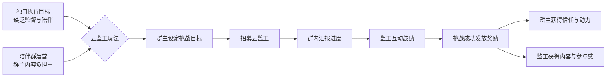
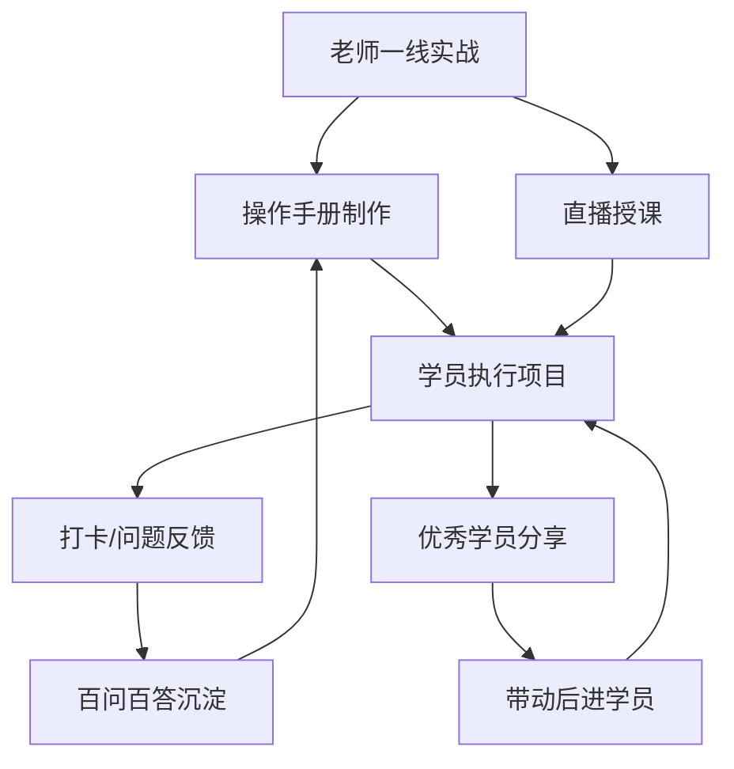
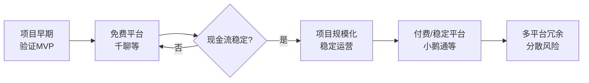

# 第 16 章 自驱型社群与个人成长 —— 把“围观”变成生产力

## 学习目标

-   理解云监工玩法的定义、运作机制与双向价值
-   掌握健康挑战群规则的共赢设计原则，识别利益对立的危害
-   运用地毯式阅读法打破信息茧房，建立系统性输入方法
-   通过举一反三项目拆解法，将个案经验提炼为可迁移方法论
-   掌握高效率交付的三大支柱：标准化内容、学员赋能、责任归因
-   理解按阶段给出信息与最少必要信息原则在降低学习门槛中的作用
-   识别标准化交付的平台依赖风险与其适用边界
-   运用坚持+SOP化放大论，将已验证的MVP迭代为可复制体系

## 16.1 生活类比

想象云监工玩法是一场**人生马拉松的线上陪跑团**：群主是参赛选手，设定目标并向公众承诺完成；云监工是陪跑观众，围观、打气、监督你的每一步；打卡汇报则是沿途的里程标志，让监工看到你没有偷懒；成功奖励则是选手冲线后请陪跑团吃的庆功宴。就像选手需要观众的掌声才能跑得更远，群主也需要通过云监工获得持续的执行动力与信任沉淀。

再想象高效率交付体系的三大支柱像是**经营一家连锁餐厅**：把一份时间卖很多次（操作手册+直播+百问百答）是标准化的中央厨房，所有分店按同一配方出菜，无需每道菜都由主厨亲自下厨；撬动学员时间（优秀学员分享）是老顾客的口碑推荐，比店长自夸更能带来新客；让学员为自己负责（责任归因）是顾客自己选择菜品，对自己的味蕾负责。就像连锁餐厅用中央厨房降低对主厨的依赖，训练营通过标准化交付让老师的单位时间价值最大化。

在接下来的章节中，我们会反复回到这两个生活类比，将抽象的方法论与具体的运营场景连接起来。

## 16.2 概念地图

```
社群运营与个人成长方法论
├── 云监工玩法
│   ├── 定义：低成本社群玩法，招募监工监督目标进度
│   ├── 核心机制：招募 → 设定目标 → 汇报进度 → 发放奖励
│   ├── 价值：群主获动力与信任，监工获内容与参与感
│   └── 典型实践：102位云监工3天读50篇（P001）
├── 挑战群规则设计
│   ├── 健康规则：挑战成功大家获益更多
│   ├── 利益对立危害：失败瓜分红包/退费机制不可持续
│   ├── 筛人效应：低额失败基金过滤红包猎人
│   └── 适用边界：目标需有挑战性且奖励有吸引力
├── 阅读与拆解方法
│   ├── 地毯式阅读法
│   │   ├── 定义：一篇不漏通读全集，覆盖全部内容
│   │   ├── 目的：打破信息茧房、获得全景认知
│   │   └── 边界：需过滤低质内容，适合系统学习阶段
│   └── 举一反三项目拆解法
│       ├── 抽象化：从具体案例提炼可复制逻辑
│       ├── 发散性：横向同类迁移+纵向跨类迁移
│       └── 复利性：长期积累形成判断力
├── 高效率交付体系
│   ├── 核心主张：高效率交付才能保证高质量交付
│   ├── 支柱一：把一份时间卖很多次（操作手册+直播+百问百答）
│   ├── 支柱二：撬动学员时间（优秀学员分享/分享必爆）
│   ├── 支柱三：让学员为成果负责（责任归因+打卡模板）
│   ├── 信息呈现原则
│   │   ├── 按阶段给出信息：项目拆分、分周放出
│   │   └── 最少必要信息：删掉不影响完成阶段动作的内容
│   └── 交付边界
│       ├── 平台依赖风险（千聊冻结案例）
│       └── 1v1诊断仍不可替代
└── 成长放大策略
    ├── 坚持+SOP化放大论：把一件小事做100次
    ├── 从MVP到体系：单点收益 → 可复制体系
    └── 去风口化：关注可重复流程，而非追逐新渠道
```

## 16.3 云监工玩法 —— 让围观成为一种生产力

正如马拉松选手需要赛道旁的观众和陪跑者给予鼓励，才能坚持跑完漫长的路程，我们在执行个人目标时，也同样需要来自外界的监督与陪伴。这种"被看见"的感觉，正是云监工玩法能够撬动巨大执行力的心理基础。缺乏监督与陪伴，是个人执行长期目标时最常见的拦路虎。

### 原文摘录

> "希望我复盘的这个云监工快闪群玩法，能：帮助更多圈友高效地跑MVP；让群变得更好玩，云监工还可以成为社群角色、监督促进复盘文化等；让云监工们感知、陪伴到群主的成长；让云监工们加强对群主了解、记忆。"
> ——《云监工快闪群复盘：一人做事不如一群人玩+学》

这段原文揭示了云监工玩法的四个核心价值：跑MVP、社群角色化、感知成长、加深记忆。下面我们逐层拆解。

### 为什么需要云监工？

传统社群运营往往需要群主持续产出优质内容来维持活跃度，这对个人创业者或小团队而言是巨大的精力黑洞。而你如果只是默默执行目标，又缺乏外部监督带来的紧迫感。云监工玩法恰好同时解决这两个问题：你不需要"表演"内容，只需要真实地汇报进度；而你获得的监督与鼓励，又会反过来推动你走得更远。

### 核心机制

> **云监工玩法**定义（来源：P001/ELHqdhiI5oSQAxxItLJctNAhnah.md）

```
招募监工 → 设定挑战目标 → 群内汇报进度 → 挑战成功后发放奖励
```

这个流程展示了一条"承诺-公开-兑现"的完整链路。它之所以有效，是因为它把"个人目标"转化成了"公共事件"：一旦你向102个人承诺了目标，食言的代价就变得很高。

具体而言，作者丽丽的招募与筹备过程如下：

```
1. 确定挑战目标：3天阅读50篇文章并输出5000字心得
2. 以快闪群形式招募云监工（正文放招募信息，评论区放具体规则）
3. 设定奖励机制：成功→所有监工获得心得+7折优惠+盲盒；失败→群内瓜分200元
4. 挑战期间持续在群内汇报进度
5. 完成后复盘，发放奖励
```

让我们逐一解析这五个步骤的必要性：

-   **第1步设定挑战目标**，这是整个玩法的"锚点"。目标必须有挑战性但又有达成可能，才能激发监工的好奇心与围观欲——一个太容易实现的目标无法体现群主的诚意与能力，也难以让监工产生"见证奇迹"的参与感。
-   **第2步招募云监工**，采用"正文放招募信息，评论区放具体规则"的形式，是刻意为之。正文的使命是激发情感共鸣与好奇心，让看到的人产生"想围观"的冲动；而评论区则承载详细的规则说明，供有意参与者仔细阅读。这种设计避免了信息过载稀释招募文案的感染力，也让规则的传达更清晰。
-   **第3步设定奖励机制**，必须在挑战开始前明确公布。这既是对群主的"军令状"，也是给监工的"预期管理"。提前设定奖励，可以让监工在挑战期间就形成对回报的期待，从而更积极地投入监督与互动，而非事后补救。
-   **第4步汇报进度**，是信任建立的核心环节。定期的进度汇报让监工实时看到群主的努力与坚持，这种"透明化"是赢得监工信任与鼓励的关键。
-   **第5步复盘发放奖励**，是承诺的兑现，也是下一次挑战的起点。它不仅完成了本次的闭环，更是为群主积累了信任资产，为未来的社群运营打下基础。

这段流程展示了云监工玩法如何以极低的成本完成一次社群实验。相比陪伴群等重度运营模式，它不需要你日更内容、不需要复杂的积分体系，只需要一个明确的目标和一份真诚的承诺。

### 双向价值

云监工玩法之所以能持续运转，是因为它为参与双方都创造了独特价值，形成了一个正向循环的激励结构。下表清晰地展示了这种双向价值：

| 角色 | 获得什么 |
|------|----------|
| 群主 | 执行动力、外部监督、信任沉淀、内容素材 |
| 云监工 | 内容（心得）、奖励（优惠/盲盒）、参与感、陪伴成长的成就感 |

更重要的是，这种玩法对群主的运营能力要求极低：你不需要擅长活跃气氛，也不需要设计复杂的互动游戏，只需要按时汇报进度。正是这种"低门槛"让它成为普通人高效跑通MVP的理想工具。

### 一个真实的例子

作者用快闪群招募了 **102位云监工**，在3天内阅读50篇文章，并写出了超过5000字的心得。这个挑战不仅顺利完成，群还意外变成了"夸夸群"——监工们自发计算作者的时间投入、帮忙汇总内容、送出大量正向鼓励。用作者的话说："这哪里是云监工群？简直是夸夸群！"

这个案例也生动地展示了云监工玩法的演进脉络。它并非凭空产生的全新概念，而是从传统的"无人监督的独自坚持"和"需要群主持续输出的陪伴群"这两种低效模式中进化而来：



这张演进图清晰地表明，云监工玩法如何通过引入"围观者"这一角色，既解决了个人执行缺乏监督的问题，又减轻了群主的内容产出压力，将"围观"这一看似被动的行为，转化为了推动目标达成的生产力。

### 边界条件

云监工玩法并非万能。首先，目标设置必须有挑战性但又有达成可能，否则无法激发监工兴趣——太容易的目标会让围观者觉得"没意思"。其次，奖励设计需让监工感到值得参与。更重要的是，如果群主持续产出能力不足或缺乏真诚互动的意愿，这种玩法难以沉淀为长期信任——一次性的快闪群容易做，但要让监工愿意长期追随，靠的还是群主真实的成长。

## 16.4 健康的挑战群规则 —— 让群主与群友站在同一边

很多社群运营者在设计挑战群时，第一个想到的规则是"失败瓜分红包"或"打卡全额退费"。这些规则听起来很合理，实则暗藏杀机。

### 原文摘录

> "以前我见过一些目标挑战群，规则一般只是挑战失败后瓜分1000元或XXXX元。这是不太健康的，这会把群主、群友的利益对立起来。所以我的规则中设置的是如果我挑战成功了，大家能获得更多。另外规则中挑战失败瓜分的金额设置得很低，这能筛选掉只是被红包吸引的人。"
> ——《云监工快闪群复盘：一人做事不如一群人玩+学》（来源：P001/ELHqdhiI5oSQAxxItLJctNAhnah.md）

> "如果只用完成打卡全额退费，当群主再次变现能力弱、群主没法通过活动赚到有正反馈的钱时……在一定程度相当于把群主、参与者的利益对立，这不是一种健康的状态，不利于可持续发展。"
> ——《云监工快闪群复盘：一人做事不如一群人玩+学》（来源：P001/ELHqdhiI5oSQAxxItLJctNAhnah.md）

这两段话点出了挑战群规则设计的核心分野：**利益对立**还是**利益共赢**。前者会让群主与群友站在博弈的两端，后者则能让双方形成命运共同体。

### 利益对立危害论

> **利益对立危害论**定义（来源：P001/ELHqdhiI5oSQAxxItLJctNAhnah.md）

$$
\text{群主利益} + \text{群友利益} = 
\begin{cases}
\text{零和（对立）} & \text{失败瓜分高额红包} \\
\text{共赢（一致）} & \text{成功时大家获益更多}
\end{cases}
$$

这个"公式"展示了两种规则的根本差异。我们可以这样理解：在零和机制下，蛋糕的大小是固定的。群主希望挑战失败（这样才需要支付红包），群友也盼着群主失败（这样才能分到红包）——双方的收益呈"你多我少"的负相关，因此天然站在对立面。而在共赢机制下，群主挑战成功的收益并非来自群友的损失，而是共同创造的新价值（如心得、优惠、盲盒）。此时，群主越成功，群友所得越多，双方的收益呈正相关，利益自然趋于一致。

更隐蔽的问题是"打卡全额退费"机制。这种机制看似对用户友好，实则是在压榨群主。当群主无法从活动中获得正反馈（如变现、信任积累）时，他就没有动力持续投入，最终课程或社群的质量下降，受损失的还是学员。这是一个"双输"的局面。

### 健康的规则设计

> **健康挑战群规则设计**（来源：P001/ELHqdhiI5oSQAxxItLJctNAhnah.md）

```
1. 挑战成功时：所有监工获得奖励（心得+优惠+盲盒）
2. 挑战失败时：群内瓜分低额失败基金（200元）
3. 失败基金金额要低，以过滤红包猎人
```

让我们逐条解读这个规则设计的精妙之处：

-   **第1条"挑战成功时所有监工获得奖励"**，是规则的核心。它直接定义了群主与监工的关系为"利益共同体"——监工不再是单纯的看客，而是群主成功的"利益相关者"。这种机制会让监工从"旁观者"转变为"支持者"，更积极地参与互动、提供帮助。
-   **第2条"挑战失败时瓜分低额失败基金"**，为挑战保留了"风险"元素。它让群主为自己的承诺承担了象征性的代价，增加了挑战的严肃性，同时也给了监工一个"最低限度的补偿"。
-   **第3条"失败基金金额要低（200元）"**，是设计的点睛之笔。这里的核心逻辑是**筛选而非惩罚**。高额的失败基金（如1000元）会吸引一批"红包猎人"——他们并不关心群主的成长，纯粹冲着瓜分红包而来。这些人不仅不会提供有价值的监督，反而会盼着群主失败，破坏社群氛围。而低额的200元，不足以吸引"红包猎人"，却能吸引真正对目标感兴趣、愿意陪伴成长的"云监工"。

这个设计暗含一个精妙的心理机制：**让群友为你的成功"下注"**。当监工知道你的成功会带来更多回报时，他们就不仅仅是监督者，更是利益相关者。

### 边界条件

健康规则并非没有前提。低额失败基金的前提是群主能提供足够吸引人的"成功奖励"，否则围观者没有参与动力。此外，如果挑战目标毫无难度，群友会因"太容易"而觉得奖励无含金量，失去围观兴趣——规则的挑战性必须与奖励的吸引力达成平衡。

## 16.5 系统化认知训练：地毯式阅读法与举一反三项目拆解法

面对海量信息，多数人会陷入两种极端：要么只挑喜欢的看，陷入信息茧房；要么看一个案例学一个案例，无法迁移应用。本节将对照同一篇素材（P001）中提出的两种互补方法，它们共同构成了一套"输入-加工-输出"的系统性认知训练框架。

### 16.5.1 地毯式阅读法 —— 把信息茧房撕开一道口子

> "以前我看内容，更多地是挑自己喜欢的主题或人。这次采用地毯式的方法每一篇都看，很受益，又了解了一些新领域的思路、打破了一点点信息茧房。"
> ——《云监工快闪群复盘：一人做事不如一群人玩+学》（来源：P001/ELHqdhiI5oSQAxxItLJctNAhnah.md）

这段话揭示了一个尴尬的现实：我们自以为在"学习"，其实只是在重复确认自己的既有认知。算法推荐加剧了这种倾向——你越喜欢什么，平台就越推什么，最终你的视野被锁死在一个舒适的牢笼里。这种"选择性接触"（selective exposure）是信息茧房形成的心理根源。正如法学家凯斯·桑斯坦（Cass Sunstein）在《信息茧房》一书中所指出的，当人们只接触与自己观点一致的信息时，他们的视野会变得狭隘，并逐渐与多元社会隔绝。

**地毯式阅读法**（来源：P001/ELHqdhiI5oSQAxxItLJctNAhnah.md）的定义是：对某一资料集或领域做一篇不漏的通读，强制自己接触不感兴趣但可能重要的内容。它作为一种系统性的输入策略，具有以下三个关键特性：

-   **打破选择性接触**：强迫自己读那些"不感兴趣"的文章，往往意外收获最大。这种"被迫"的阅读，能有效对抗算法推荐和认知偏好构建的信息茧房。
-   **系统性输入**：获得对某一领域的全景认识，而非片段式理解。这为后续的"举一反三"提供了广阔的素材库和知识背景。
-   **发现异常值**：为蓝海选品等思维提供跨领域迁移的素材。地毯式阅读中的"意外发现"，往往是产生创新想法的源泉。作者通过地毯式阅读《生财有术项目精选》50篇文章，获知了大量非其日常关注领域的创业玩法——从宠物殡葬到水果团购，这些"异常值"恰恰是打开新思路的钥匙。[需要补充文献：关于信息茧房与选择性接触的认知心理学研究，可参考桑斯坦（Sunstein）的《信息茧房》或相关 "echo chamber" 研究文献]

### 16.5.2 举一反三项目拆解法 —— 从一个案例打穿一类玩法

> "举一反三是做项目要练习的基本功。看完教育人做水果团购后，我首先想到我在生财知识星球发过的这篇文章《才391个小红书粉丝，但引流私域432人成交308单的复盘》，两者在一些方面逻辑是一致的，之后这类项目都可以借鉴经验；我的另外一个想法是这种拆解项目的思路，也很值得练习。"
> ——《云监工快闪群复盘：一人做事不如一群人玩+学》（来源：P001/ELHqdhiI5oSQAxxItLJctNAhnah.md）

这段话展示了一个关键的思维跃迁：从"看一个案例"到"看一类案例"。作者看完"教育人做水果团购"后，立刻联想到自己的小红书引流案例，发现两者在"做人群"与"信任成交"逻辑上完全一致。

**举一反三项目拆解法**（来源：P001/ELHqdhiI5oSQAxxItLJctNAhnah.md）的核心是三步：

```
1. 抽象化：从具体操作中提炼可复制的逻辑（而非只记步骤）
2. 发散性：从单一案例向同类（横向）与跨类（纵向）迁移
3. 复利性：积累的拆解能力可反复用于判断新项目
```

让我们逐层解析这三步的递进逻辑：

-   **第1步"抽象化"**是基础。它的作用在于将案例的表层操作（例如"在社区群接龙卖水果"）剥离，提炼出深层的、可迁移的逻辑（例如"利用社区信任进行私域转化"）。这一步的关键是回答"这个项目成功的内在原因是什么？"，而非"这个项目具体做了什么？"。
-   **第2步"发散性"**是核心。它建立在"抽象化"的基础上，将提炼出的逻辑横向迁移到同类项目（例如从"水果团购"迁移到"母婴团购"），或纵向迁移到跨类项目（例如从"C端零售"迁移到"B端服务"）。这一步的价值在于，将一个案例的经验放大为对一类玩法的认知。
-   **第3步"复利性"**是长期回报。每一次成功的"举一反三"都会强化你的拆解肌肉记忆，当这种能力积累到一定程度，你面对任何新项目时，都能迅速调用已有的框架进行判断，形成远超常人的商业敏感度。

### 共识与分歧：两种方法的协同

**共识（来源：P001/ELHqdhiI5oSQAxxItLJctNAhnah.md 内部）**：地毯式阅读法和举一反三项目拆解法共同构成了一套完整的"输入-加工"系统。地毯式阅读负责**广度输入**，解决"信息从哪来"的问题；举一反三负责**深度加工**，解决"信息怎么用"的问题。二者缺一不可：没有地毯式的输入，举一反三将面临"无米之炊"的困境；没有举一反三的加工，地毯式的阅读也只会沦为过眼云烟。

**分歧（来源：P001/ELHqdhiI5oSQAxxItLJctNAhnah.md 内部）**：关于"是否应该过滤内容"，作者在倡导"地毯式"阅读（每一篇都看）的同时，也承认"需过滤低质或过时的内容，否则时间成本高而收益有限"。这两种主张看似矛盾，实则取决于应用场景。地毯式阅读法适用于**系统性学习阶段**，例如阅读一本经过筛选的精华合集（如《生财有术项目精选》），此时"全看"能最大化获取全景认知的收益；而"选择性过滤"则适用于**日常碎片化信息摄取**，此时信息噪音量大，主动筛选是提高效率的必要手段。理解这一适用场景的差异，是避免机械套用方法的关键。

## 16.6 高效率交付 —— 三天三夜不如一份好手册

回到连锁餐厅的类比：如果每一位客人点菜，主厨都需要亲自跑到菜市场重新买菜、重新研究菜谱，那这家餐厅的规模和口碑都将难以为继。同样，在知识付费领域，如果老师将大量时间耗费在逐一回复学员的重复性问题上，他很快就会陷入"越努力、越疲惫、质量越差"的恶性循环。

你有没有见过这样的场景：一位训练营老师从早到晚在微信上回复学员问题，忙得焦头烂额，却仍然被学员抱怨"回复太慢"、"讲得不清楚"？这种"用时间换口碑"的模式，最终会拖垮老师本人，也拖垮教学质量。

### 原文摘录

> "要做出高质量，落地性强的训练营，老师就不能脱离一线。"
> ——《手把手教你：从0到1做一门高质量的实战训练营》

这句话揭示了一个被很多人忽视的悖论：**越是努力教学，教学越可能变差**。当你把大量时间花在教学上，一线实战的时间就变少了；实战少了，你的业绩下滑，教的东西的落地性也变差。最终，学员体验差，自己项目也没做好。

### 核心主张

> **高效率交付**定义（来源：MUfLdmUlTosj0NxPhlfcjRPHnff.md）

$$
\text{交付质量} = \frac{\text{老师的一线实战能力}}{\text{单位时间的教学精力投入}}
$$

这个公式展示了"高效率交付才能保证高质量交付"的核心主张。我们可以这样理解这个比值的含义：分子"一线实战能力"代表内容的"含金量"，它决定了老师教的东西是否有效、是否落地；分母"单位时间的教学精力投入"代表内容的"传递效率"，它决定了老师能覆盖多少学员、能持续多久。如果分母无限增大（老师投入了所有时间在教学上），而分子（实战能力）却因脱离一线而萎缩，那么交付质量必然下降。

它挑战了"投入越多越好"的直觉——关键在于让老师的单位时间价值最大化，而不是无限增加工作时间。具体而言，高效率交付体系包含三大支柱：

| 支柱 | 做法 | 解决什么问题 |
|------|------|-------------|
| 把一份时间卖很多次 | 操作手册+直播录播+百问百答 | 重复回答相同问题的碎片化劳动 |
| 撬动学员的时间 | 优秀学员分享机制 | 老师难以覆盖的个性化困难 |
| 让学员为成果负责 | 责任归因+打卡模板 | 被动学员"推不动"的困局 |

这三根支柱共同构成了一个稳定的交付结构，下面我们逐一拆解。

### 支柱一：把一份时间卖很多次

> **把一份时间卖很多次**定义（来源：MUfLdmUlTosj0NxPhlfcjRPHnff.md）

```
交付体系 = 操作手册（系统性知识，用于"查"）
        + 直播录播（直观讲解，用于"理解"）
        + 百问百答（碎片化问题，用于"查"）
        + 1v1诊断（兜底，优先级最低）
```

这段结构展示了"标准化+兜底"的交付架构。让我们逐一解析各交付物的设计逻辑：

-   **操作手册**，定位为"查"。它是系统化知识的集大成者，回答的是"做成这个项目需要哪些步骤和具体动作？"。它是一本随时可翻阅的工具书，让学员在遇到流程性问题时能自助解决，无需打扰老师。
-   **直播录播**，定位为"理解"。它是手册的"3D演示版"，通过直观的讲解和实操演示，帮助学员理解手册中抽象步骤背后的"为什么"。它解决的是"手册能告诉我做什么，但不能告诉我怎么做好"的问题。
-   **百问百答**，定位为"查"。它是碎片化问题的集合，是老师和学员智慧的沉淀。它保证了"一个问题多人问"时，答案可以在文档中找到，而非在微信里重复发送。
-   **1v1诊断**，被刻意放在最低优先级。理由是：**1v1会耗费大量时间、需要重复回答非常多问题、即时回复的东西都是未经雕琢的碎片化信息**。它只在手册、直播、百问百答都无法解决学员的个性化难题时才动用，是最后的兜底。

作者在实践中验证了这一组合的效力："按照以往经验来说，上述已经能解决大部分问题，1v1诊断的情况很少出现。"这意味着，老师可以将宝贵的精力聚焦于真正复杂、个性化的问题——而那些重复性的基础问题，交给手册和百问百答去解决。

### 支柱二：撬动学员的时间

> **撬动学员时间**方法（来源：MUfLdmUlTosj0NxPhlfcjRPHnff.md）

```
1. 邀请完成项目较好的学员做经验分享
2. 分享内容聚焦"怎么学"而非"怎么做"
3. 通过分享巩固分享者自己的正确动作（分享必爆）
4. 形成老师、优秀学员、普通学员三方共赢
```

这套方法的核心洞察是：**同期同伴的"他可以，我也可以"，比老师任何说教都更有说服力**。学员会遇到很多老师没遇到过的困难，而优秀学员的经验分享恰好填补了这个空白。

"分享必爆"是这套机制的隐藏红利：通过准备分享，优秀学员能更清楚地意识到自己的正确动作是什么，让自己的成果更稳。分享者受益、听众受益、老师也释放了精力——三方共赢，这是最理想的社群机制。

### 支柱三：让学员为成果负责

> **让学员为成果负责**方法（来源：MUfLdmUlTosj0NxPhlfcjRPHnff.md）

```
责任分割：
- 我的责任：解决你想做这个项目时遇到的问题
- 你的责任：踏踏实实执行项目，保证动作不变形

配合每日打卡模板：
1. 今日发布视频数量
2. 昨日发布视频总播放量
3. 昨日GMV
4. 明日发布计划
5. 遇到问题以及如何解决
6. 疑问
```

这套责任分配的核心主张是"被动的做项目，几乎是不可能做出成果的"。作者甚至取消了所有对后进学员的提醒工作，因为那是"只会感动自己的无效工作"。让我们逐一解析打卡模板中六个维度的设计意图：

-   **维度1"今日发布视频数量"**，是一个**动作指标**。它用来监督学员当天是否执行了核心动作，是"责任在己"的最低体现。它能防止学员用"学习、准备"等借口来代替"实践"。
-   **维度2"昨日发布视频总播放量"**，是一个**效果指标**。它强迫学员关注自己动作带来的市场反馈，建立"动作-结果"的关联，引导学员对数据保持敏感。
-   **维度3"昨日GMV"**，是一个**商业指标**。它是整个训练营的终极目标，它的出现让学员时刻铭记项目是为了"成交"而非"自嗨"。
-   **维度4"明日发布计划"**，是一个**承诺指标**。它让学员在今日结束前就规划好明天的动作，将被动执行转化为主动计划，并可以在第二天进行核对。
-   **维度5"遇到问题以及如何解决"**，是一个**复盘指标**。它鼓励学员成为自己问题的解决者，记录并分享解决问题的过程。这既有助于学员自身成长，也为"百问百答"沉淀了素材。
-   **维度6"疑问"**，是一个**求助指标**。这是留给学员唯一可以"示弱"的入口。将"疑问"放在打卡的最后一项，暗示学员首先要自己尝试解决（维度5），实在不行再向老师求助，维护了学员的自主学习性。

这个看起来很"狠"的做法，背后的逻辑是：**提醒后进学员只会让他们继续被动地等，而当你努力帮积极主动的学员做出成果后，后进学员看到后会重拾积极性、归队一起冲**。与其把精力花在"拽"别人上，不如把精力花在"成就"主动者上，让榜样的力量去带动其他人。

### 信息呈现原则：按阶段给出与最少必要信息

> **信息呈现两原则**（来源：MUfLdmUlTosj0NxPhlfcjRPHnff.md）

```
原则一：按阶段给出信息
  1. 拆分项目：步骤、顺序、所需技能、耗时
  2. 按周分阶段放出信息
  3. 学员每阶段围绕一个主题执行和讨论

原则二：最少必要信息
  1. 问自己：学员完成这件事需要哪些信息？
  2. 再问：哪些信息删掉后不影响完成阶段动作？
  3. 然后，删掉这些内容。
```

这两个原则解决了一个被严重低估的问题：**信息过载本身就是学习障碍**。一次性把项目全流程全抛给学员，学员会迷失在"有用但不必要"的进阶信息中。而"按周放出信息 + 只给最少必要信息"的组合，让学员每阶段只需要聚焦一个闭环，难度骤降。

这个原理与认知负荷理论（Cognitive Load Theory，由约翰·斯威勒（John Sweller）于1988年提出）一致：**工作记忆容量有限，过多的信息反而会挤占执行所需的心智资源**。删掉那些"有用但不必要"的信息，不是为了简化教学，而是为了让学员能够真正完成当前阶段的任务。

### 数据流图：交付体系的信息流转

下面的数据流图展示了这套高效率交付体系如何形成闭环，并持续优化：



这张数据流图展示了交付体系的闭环结构。老师的一线经验沉淀为手册与直播，学员执行中产生的问题回流为百问百答，优秀学员的分享又反过来带动后进者——整个系统通过标准化内容释放老师时间，又通过同侪激励放大教学效果。

## 16.7 标准化交付的边界 —— 当天花板出现时，该看见什么

任何一个方法论都有它的适用边界。高效率交付体系也不例外——它在大部分场景下高效运转，但总有一些"例外"需要你看见。如果说前面的章节讲述了标准化如何提升效率，那么本节将聚焦于标准化之外的"盲区"与"风险"。

### 原文摘录

> "我自己在千聊上开过一期课程，款项被冻结了50%，剩下部分分阶段返还，预计得9个月才能全部提现。"
> ——《手把手教你：从0到1做一门高质量的实战训练营》（来源：MUfLdmUlTosj0NxPhlfcjRPHnff.md）

这段话揭示了一个真实的平台风险：**标准化交付往往依赖某个特定平台，而平台的规则你无法控制**。作者在千聊上的课程款被冻结50%，且分阶段返还预计9个月——这本是一堂已经交付完的课程，回款周期却被无限拉长。

### 标准化交付的三大边界

首先，**平台依赖风险**是标准化交付面临的最直接挑战。免费工具（如千聊）为了控制风险，往往对特定类目的课程（如金融、跨境电商、抖音培训等）实施严厉的风控措施，冻结款项、分阶段返还。这会让训练营的现金流面临巨大不确定性。应对策略是多平台/多载体布局（飞书+微信群+千聊/小鹅通），降低单一依赖。

其次，**标准化无法覆盖的盲区**同样不可忽视。即使操作手册+直播+百问百答的组合能解决大部分问题，但复杂或个性化问题仍需人工介入。作者坦诚："1v1诊断的情况很少出现"——注意是"很少"而非"从不"，这恰恰说明1v1诊断的不可替代性。它作为标准化的"安全网"，兜住那些标准化内容无法触及的个性化难题。

最后，**过度标准化的机械执行**是一个隐性风险。当标准化变成"只顾走流程、忽略个体差异"时，教学质量反而会下降。标准化的目的是释放精力，而不是替代判断。老师需要警惕陷入"为了标准化而标准化"的陷阱，忘记教学的初心是帮助学员成长。

### 设计中的取舍

**问**：为什么标准化交付体系不彻底取消1v1诊断？

**答**：因为标准化内容解决的是"共性问题"，而1v1诊断解决的是"个性问题"。取消1v1虽然能进一步释放老师时间，但会让那些确实需要个性化指导的学员失去支持，最终损害口碑。正确的做法是把1v1定位为"兜底"而非"标配"——让它成为标准化的补充，而不是替代。

**问**：既然单一平台有风险，为什么不全部用付费平台？

**答**：付费平台（如小鹅通）虽然风控更宽松，但增加了运营成本，对于早期训练营可能不划算。这是典型的"成本-风险"trade-off：免费平台省成本但风险高，付费平台更稳定但成本高。理性的策略是根据项目阶段选择，形成一个平台演进的路径：早期可用免费平台验证，规模化后再切换付费平台。



这种"先免费验证，后付费稳定"的决策路径，可以帮助你在控制成本的同时，逐步降低平台依赖的系统性风险。这不仅仅是平台的取舍，更是一种"设计中的取舍"思维——在成本、风险与稳定性之间寻找最优平衡点。

## 16.8 坚持 + SOP化 —— 把一件小事做100次

本章的终点，也是个人成长的起点。任何方法论，最终都要落回到"坚持执行"这个朴素的动作上。无论是云监工的外部监督，还是高效率交付的标准化体系，其最终目的都是为了让你能够将一件有价值的小事，持续地、重复地做下去。

### 原文摘录

> "相信坚持的力量，在跑通MVP后SOP化，把一件小事做100次、把1个主题写100篇文章并分享。哪怕是被绝大部分人认为已经过时了的渠道、内容，也能拿到结果。"
> ——《云监工快闪群复盘：一人做事不如一群人玩+学》（来源：P001/ELHqdhiI5oSQAxxItLJctNAhnah.md）

这段话是全书最"反共识"的主张之一：**渠道会过时，但坚持不会**。当所有人都在追逐新风口、新平台时，把一件已被验证的小事重复做100次，反而能拿到结果。这里的"把一件小事做100次"，意味着将单个成功案例转化为稳定的产出习惯；而"把1个主题写100篇文章并分享"，则是在深度上下功夫，通过反复输出，成为该领域的专家，积累内容资产与读者信任。

### 从MVP到体系的三级跳

> **坚持+SOP化放大论**（来源：P001/ELHqdhiI5oSQAxxItLJctNAhnah.md）

```
第一级：跑通MVP → 用最小成本验证模式有效
第二级：SOP化 → 将验证过的流程固化为可重复执行的清单
第三级：做100次 → 重复执行并持续迭代，积累经验与内容资产
```

这个三级跳的核心逻辑是层层递进的：

-   **第一级"跑通MVP"**，是整个放大策略的前提。它的作用是回答"这件事能不能做"的问题。通过云监工、快闪群等低成本方式，快速验证一个项目或模式的可行性。只有方向正确，后续的坚持才有意义。
-   **第二级"SOP化"**，是承上启下的关键。它的作用是回答"这件事怎么稳定做"的问题。将MVP阶段验证过的流程、方法、话术固化为一份SOP（标准作业程序）清单，将依赖个人灵感的"手艺"转化为可复制的"工艺"。这一步是后面"做100次"能够不偏离方向、保持质量的保障。
-   **第三级"做100次"**，是最终放大。它的作用是回答"这件事能带来多少复利"的问题。每一次执行，不仅仅是重复，更是迭代。100次的积累，带来的是经验、内容资产、用户信任和口碑的指数级增长。

这个框架也贯穿了本章的每个概念，它并非孤立的理论，而是对前述所有方法论的整合：

-   **云监工玩法**，正是"跑通MVP"的绝佳实践工具。它用最低的成本，为你的新项目或新目标提供监督和动力，快速验证其可行性。
-   **健康挑战群规则**，则是"SOP化"机制设计的典范。它将"成功共赢"与"低额失败基金"的原则固化为可复用的规则模块，确保社群可持续运营。
-   **地毯式阅读法与举一反三项目拆解法**，是"做100次"过程中的认知训练SOP。它们为你在重复实践中提供方法论指导，让你在坚持的同时，不断从输入和输出中迭代认知。
-   **高效率交付体系**，是将你的"做100次"成果进行放大的教学SOP。当你通过坚持积累了经验和内容，你可以用标准化的交付体系去赋能他人，实现更大的价值。

需要注意的是，坚持的前提是MVP已验证有效。如果方向错误，坚持只会加速失败。而"已验证"的标准是什么？答案就在本章之前的各个单元：找到能赚钱的项目、算清六维账、完成最小闭环。当这几个条件都满足时，"做100次"才是有意义的复利，而不是无意义的重复。

## 16.9 设计中的取舍：在方法论与适用性之间寻找平衡

本章介绍的所有方法论，在应用层面都会面临类似的取舍。为了帮助你更好地在不同场景下做出明智的决策，我们在此整理几个关键的取舍对比。

**问：云监工玩法是万能的社群运营方式吗？**

**答：** 不是。云监工玩法是"MVP验证"的利器，适合在短期内测试一个目标或项目是否可行，但它并不适合作为长期社群的日常运营模式。云监工玩法是"事件驱动"的，它依靠一个明确的挑战目标来凝聚参与者；而一个长期社群需要的是持续的内容供给和价值输出，这需要其他运营手段（如陪伴群、内容日更等）来支撑。选择哪种模式，取决于你的社群阶段和目标——是快速验证，还是长期深耕。

**问：在哪里设计"利益对立"的机制是合理的？**

**答：** 本章强调"利益对立危害论"主要适用于目标导向的付费/挑战社群。在这些场景中，成员的目标高度一致（如完成任务、获得技能），对立机制会破坏协作，导致双输。但在纯兴趣或娱乐社群中（如游戏公会、粉丝后援会），适度引入"竞争对立"（如团队PK、黑马逆袭）反而能增加趣味性，提升参与感。因此，核心原则是：**机制设计必须服务于社群的核心目标。**如果社群的核心目标是协作共赢，就应避免零和博弈；如果是娱乐休闲，适度的对立可以成为调味剂。

**问：什么时候应该坚持，什么时候应该放弃？**

**答：** "坚持+SOP化放大论"的前提是"跑通MVP"。判断是否应该坚持的黄金标准，是看你的项目是否已经通过了MVP验证。如果你尚未跑通MVP（即还没有用最小成本验证你的模式有人需要、有人愿意付费），那么此时更需要的是快速试错和调整方向，而非盲目坚持。一旦MVP验证成功，转入了SOP化执行阶段，那么"做100次"的坚持才是有意义的。因此，识别"已验证"的标准至关重要，它决定了你的坚持是"复利"还是"南辕北辙"。

**问：在标准化交付和个性化服务之间，如何权衡？**

**答：** 标准化的核心优势是效率，但天花板是难以兼顾个体差异；个性化服务的优势是深度，但瓶颈是老师的精力。理性的做法是采用"标准化为主，个性化为辅"的混合策略。将80%的共性问题用标准化内容（手册、直播、百问百答）解决，释放老师的精力；将剩余的20%个性化疑难杂症用1v1诊断进行兜底。这种设计既能保证服务质量的下限（标准化），又能提升服务体验的上限（个性化）。

## 16.10 动手练习

-   **练习1：设计一场云监工挑战**（假设你是一名知识付费博主，想通过云监工玩法验证一个新项目（如21天完成一份行业报告）的可行性：写出你的挑战目标（需有挑战性但可达成）；设计三类奖励（学习心得/优惠券/盲盒），并说明每类奖励对应的心理激励；设定失败基金金额，并解释为什么该金额能有效过滤红包猎人；规划招募文案与发布渠道（如朋友圈、社群）；制定挑战进行中的汇报节奏（如每日打卡/阶段总结）。回答问题：你的规则设计如何体现群主与监工的利益一致性？如果监工参与热情不高，你会如何调整规则？）

-   **练习2：对比分析两种挑战群规则的健康度评估**（现有两个目标挑战群的设计方案：方案A挑战失败后群内瓜分1000元红包；方案B挑战成功时所有监工获得心得+优惠券+盲盒，失败仅瓜分200元。分别标注两个方案中群主与群友的利益关系（对立/共赢）；分析方案A为什么会导致群友盼着群主失败；分析方案B的低额失败基金如何实现筛人效应；若方案B的挑战目标被群友认为"太容易达成"，会发生什么问题？回答问题：在纯兴趣社群（非目标导向）中，方案A的"对立机制"是否也必然有害？为什么？）

-   **练习3：举一反三——从个案到方法论的提炼**（阅读以下案例："博主A通过小红书发布'打工人便当食谱'系列笔记引流私域，再售卖定制化减脂食谱（398元/份），月成交200+单。"列出该案例的3个关键步骤（引流→信任→成交）；横向迁移找出一个与它"引流逻辑"一致的同类项目（如健身、美容），并指出相似点；纵向迁移将该案例的"做人群"逻辑应用到B端（如为企业提供员工健康餐定制）；抽象出一套可复制的"人群定位+内容引流+高客单变现"框架。回答问题：什么情况下你的框架会失效？需要哪些前提条件？）

-   **练习4：重构你的交付**（假设你正在运营一个"👸号写作训练营"，目前主要依赖1v1答疑支撑学员：将👸号写作的完整流程拆解为5个阶段（如定位→选题→撰写→排版→发布）；为每个阶段设计"操作手册"应包含的3个关键知识点；确定每个阶段的"最少必要信息"并列出你需要主动删除的"有用但不必要"的内容；设计一个"优秀学员分享"排期表（每周1次），并写出分享主题；设计每日打卡模板包含的3个复盘维度。回答问题：哪些学员问题是你认为标准化内容永远无法覆盖的？为什么仍需保留1v1诊断？若你的课程类目属于千聊冻结高风险类目（如金融、培训），你如何分散平台风险？）

-   **练习5：SOP化设计**（选取一个你正在做或想做的副业项目（如闲鱼无货源、小红书好物分享）：用"坚持+SOP化放大论"，为该项目的MVP设计一个最小闭环（如：选品→上架→引流→成交）；将闭环转化为一份可重复执行的SOP清单（含每个步骤的操作要点与耗时）；规划"把一件小事做100次"的迭代节奏：每天/每周重复哪件事？如何复盘优化？设想从"单点执行"到"体系化"的升级路径（如从个人卖家→供应商），需新增哪些模块？回答问题：在什么条件下，坚持重复会变成"南辕北辙"？你如何识别这种风险？坚持+SOP化放大的前提是MVP已验证有效，你如何判定"已验证"？给出你的标准。）

## 16.11 本章小结

这一章中，我们建立了一套从"自驱执行"到"体系放大"的个人成长方法论。首先，通过学习云监工玩法，我们理解了如何用"公开承诺+外部监督"的机制，把个人目标变成公共事件，用最低成本跑通MVP；其次，通过健康挑战群规则，我们掌握了"利益一致性"设计原则，识别了"失败瓜分红包"和"打卡退费"等对立机制的不可持续性。接着，我们通过地毯式阅读法与举一反三项目拆解法，建立了"系统性输入+结构化输出"的认知训练框架，打破信息茧房、实现跨案例迁移。然后，我们深入了解了高效率交付的三大支柱——标准化内容、学员赋能、责任归因——以及"按阶段给出信息"与"最少必要信息"两大原则，理解了"高效率才能保高质量"的核心主张。最后，我们探讨了标准化交付的平台依赖风险与适用边界，并用"坚持+SOP化放大论"将全书方法论收束为"跑通MVP→SOP化→做100次"的成长飞轮，将个人执行、社群运营与教学交付整合为一个可迭代、可复制的系统。

本章我们一起学习了以下概念：

| 概念 | 解释 |
|------|------|
| 云监工玩法 | 招募监工监督目标进度的低成本社群玩法，群主得动力与信任，监工得参与感与奖励 |
| 健康挑战群规则 | 挑战成功大家获益更多的共赢机制，低额失败基金用于筛选红包猎人 |
| 利益对立危害论 | 群主与群友利益对立的机制（如失败瓜分高额红包）不可持续，应设定共赢规则 |
| 地毯式阅读法 | 一篇不漏的通读策略，打破信息茧房，获得对某一领域的全景认知 |
| 举一反三项目拆解法 | 从个案发散到同类与跨类项目，将具体操作抽象为可迁移的方法论 |
| 高效率交付 | 只有保持高效率交付，才能保证高质量交付，核心是让老师的单位时间价值最大化 |
| 把一份时间卖很多次 | 用操作手册+直播录播+百问百答替代1v1重复劳动，实现一次制作、反复使用 |
| 撬动学员时间 | 通过优秀学员分享机制，利用同侪榜样效应实现三方共赢 |
| 让学员为成果负责 | 将做出成果的责任归因给学员自身，配合打卡模板保证执行力 |
| 按阶段给出信息 | 制作手册前拆分项目，按周分阶段放出信息，降低项目完成难度 |
| 最少必要信息 | 只提供完成当前阶段闭环所需的信息，删掉不影响动作完成的内容，降低学习门槛 |
| 标准化交付的边界 | 标准化无法覆盖所有特殊情况，且面临平台依赖风险，需留有人工介入与多平台冗余 |
| 坚持+SOP化放大论 | 跑通MVP后SOP化，把一件小事做100次，哪怕渠道已过时也能拿到结果 |

在第 17 章中，我们将聚焦**流量冷启动——从"无人问津"到"第一批客户"**。如果说本章教会了你如何通过自驱与体系化"把事做成"，那么下一章将告诉你"如何让人看见、如何吸引第一批同行者"。我们将深入探讨私域的本质、个人品牌的杠杆作用，以及三种"借流量"的具体路径——从公域内容引流、社群"群红"到"抱大腿"的价值交换，帮助你在无资源、无资本的条件下，完成从0到1的流量破局。

