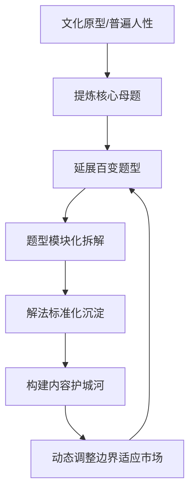
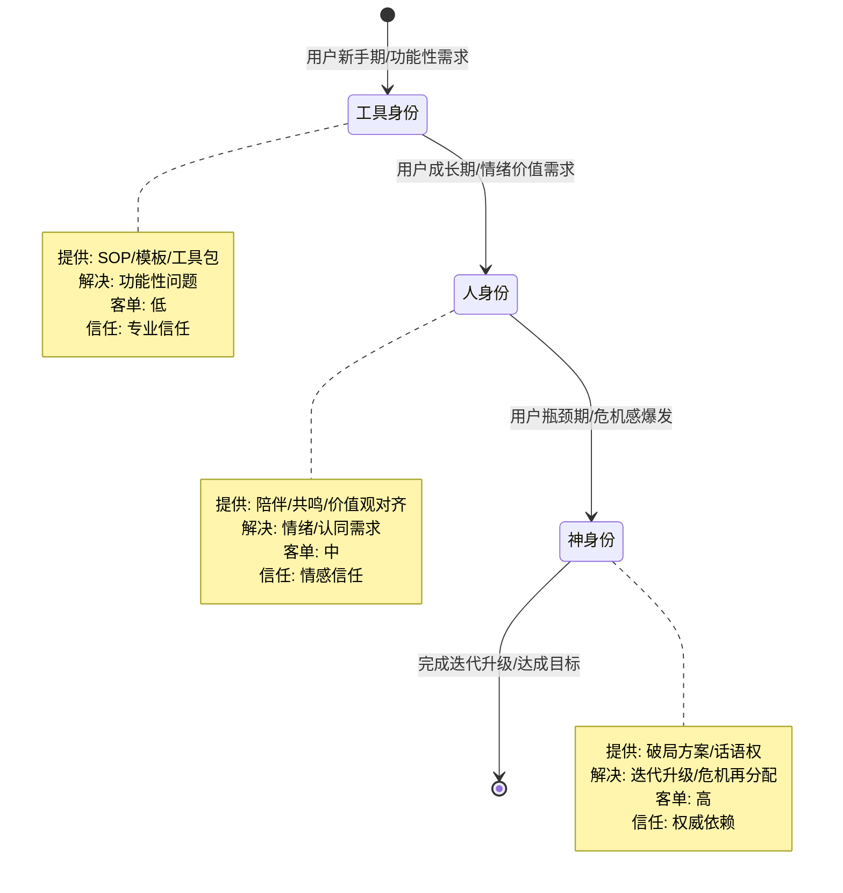
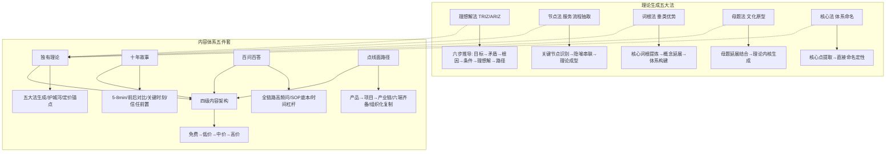
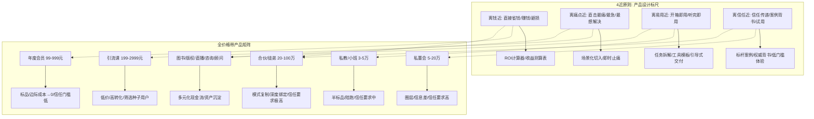
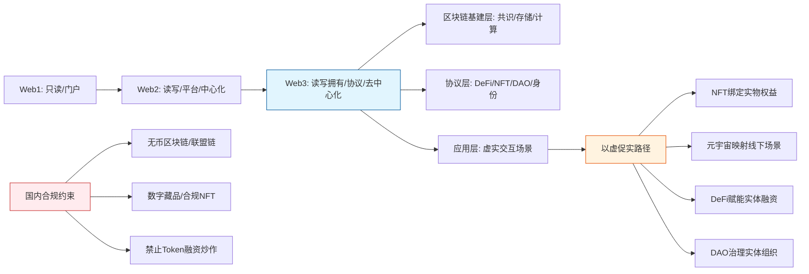
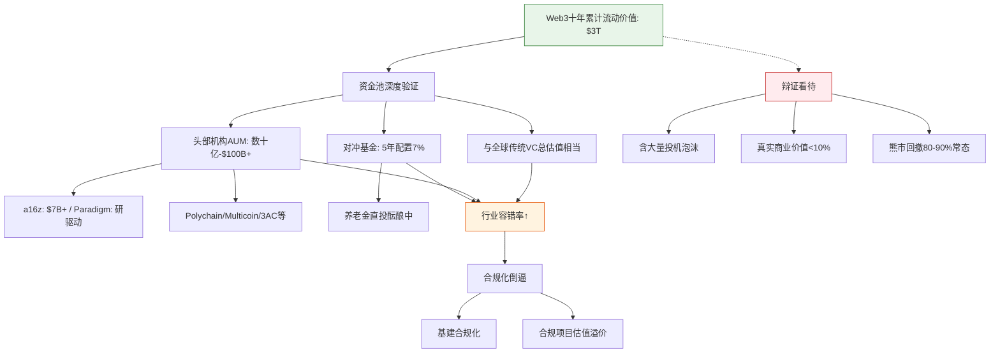
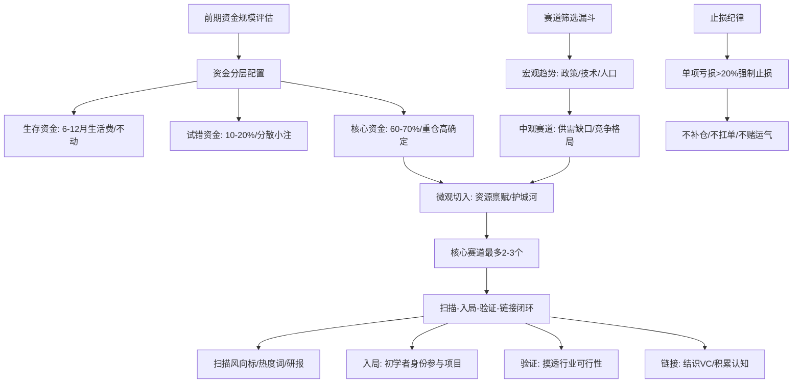
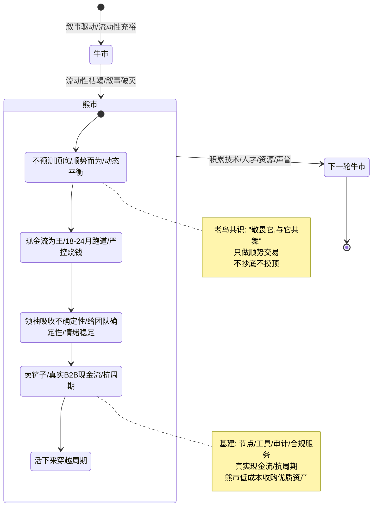
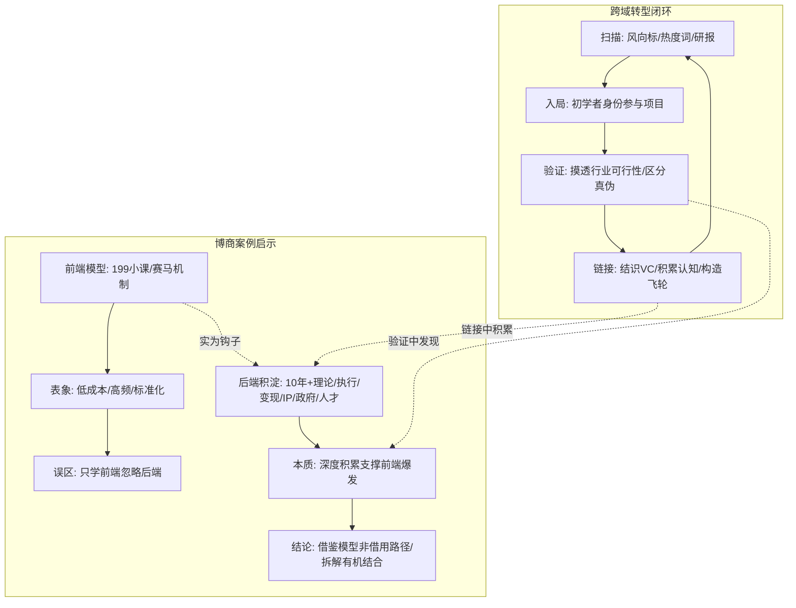

# 第 33 章 IP打造与Web3趋势：从“风骨体面”到“虚实融合”的认知跃迁
作者：龙哥

## 学习目标

- 理解IP母题作为文化原型搭建护城河的核心作用与延展逻辑
- 掌握IP三重身份（工具/人/神）在用户不同阶段的动态切换策略
- 熟悉IP四级观感（松弛/对象/获得/氛围）驱动感性消费的组合拳打法
- 理解IP五份资产（用户/版权/实物/文化/生态）的幂次效应与化学反应
- 掌握内容体系五件套（架构/理论/故事/问答/路径）的构建方法与标准化交付逻辑
- 熟练运用构建独有理论的五大方法（理想解法/节点法/词根法/母题法/核心法）
- 理解千万营收模型全价格带产品矩阵与4近原则（离钱/痛点/易用/信任近）的定价底层逻辑
- 明确Web3定义、以虚促实趋势及其与传统互联网的演进关系
- 建立赛道选择的金融视角：选择比努力更重要、容错率控制与资金分层配置策略
- 掌握Web3熊市生存铁律：敬畏市场、保护弹药/团队、选基建不选应用

## 33.1 生活类比

想象打造个人IP像**经营一座“文化主题乐园”**：**母题** = 乐园的**核心主题故事**（如迪士尼的“梦想王国”），决定所有项目的风格边界，且可无限延展新乐园区（百变题型）；**三重身份** = 游客不同阶段的**导览角色**：新手期发地图/快速通行证（工具/功能），深度游期分配专属向导陪聊拍照（人/情绪），迷路/遇险时出动救援总指挥调度资源（神/危机再分配话语权）；**四级观感** = 乐园的**沉浸式体验设计**：排队不焦虑有互动（松弛感）、专属VIP通道叫名字（对象感）、隐藏彩蛋超预期惊喜（获得感）、烟火秀/巡游让人不想走（氛围感）；**五份资产** = 乐园的**复利资产包**：年卡会员画像（用户）、IP授权周边/影视（版权）、实体园区/酒店（实物）、“童话梦想”文化正统性（文化）、迪士尼度假区生态圈（生态）；**内容体系五件套** = 乐园的**标准化运营手册**：游玩路线图（架构）、核心IP设定集（理论）、创始人华特传记电影（十年故事）、游客高频问答手册（百问百答）、从单一乐园到文旅地产帝国的扩张蓝图（点线面）；**千万营收模型** = 乐园的**全生命周期钱包规划**：门票（会员）、VIP向导（私教）、会员俱乐部（私董）、合伙开分园（合伙）、IP授权玩具（图书/版权）、表演秀/快闪（直播）、定制旅行规划（咨询/顾问）；**4近原则** = 乐园产品设计的**黄金法则**：卖快速通行证离钱近、卖防晒霜/雨衣离痛点近、租童车/推车离易用近、卖年卡/会员权益离信任近。想象**Web3像“数字世界的淘金热”**：**Web3定义** = 不只是卖铲子（工具），而是建立**“虚实同权”的新大陆产权制度**（区块链确权），让虚拟黄金能兑换现实物资（以虚促实）；**融资3万亿** = 全球资本已在新大陆铺设**万亿级铁路网络**（基建/协议/流动性），验证新大陆非虚构；**赛道选择金融视角** = 淘金者按**粮草（资金规模）决定玩法**：粮草少挖表层高确定矿脉（高杠杆/短周期），粮草深挖深层大矿脉（长周期/重资产），分仓储粮（容错率）避免一矿不中全军覆没；**熊市生存法则** = 寒冬来临时：**敬畏雪崩不硬抗（敬畏市场）、留够过冬粮草18个月（保护弹药）、照顾好随行兄弟不散伙（保护团队）、卖铲子/修铁路（基建）比下井淘金（应用）更能活下来**。

## 33.2 概念地图

IP打造与Web3趋势
├── IP外部地基框架（12345）
│   ├── 1个母题（文化原型/护城河锚点/百变题型可延展）  —— HiVkdfBYJo2H5xxWIemcMcMQnLc
│   ├── 2层基因（文化沉淀风骨+商业持续变现）  —— HiVkdfBYJo2H5xxWIemcMcMQnLc
│   ├── 3重身份（工具解决功能/人提供情绪/神解决迭代-危机再分配）  —— HiVkdfBYJo2H5xxWIemcMcMQnLc
│   ├── 4级观感（松弛感/对象感/获得感/氛围感-至少两种组合驱动感性消费）  —— HiVkdfBYJo2H5xxWIemcMcMQnLc
│   └── 5份资产（用户/版权17类13可交易/实物/文化/生态-幂次效应）  —— HiVkdfBYJo2H5xxWIemcMcMQnLc
├── IP内容体系五件套
│   ├── 四级内容架构（免费→低价引流→中价核心→高价合伙）  —— HiVkdfBYJo2H5xxWIemcMcMQnLc
│   ├── 一套独有理论（五大生成法：理想解法/节点法/词根法/母题法/核心法）  —— HiVkdfBYJo2H5xxWIemcMcMQnLc
│   ├── 一个十年故事（5-8分钟中视频/前后对比/关键时刻/文案/音乐）  —— HiVkdfBYJo2H5xxWIemcMcMQnLc
│   ├── 一份百问百答（标准化交付SOP/把时间卖无数次）  —— HiVkdfBYJo2H5xxWIemcMcMQnLc
│   └── 一份点线面打通路径（产品-项目-产业链/品项态/六端齐备）  —— HiVkdfBYJo2H5xxWIemcMcMQnLc
├── IP千万营收模型与4近原则
│   ├── 全价格带产品矩阵（会员/私教/私董/合伙/图书/直播/咨询/顾问）  —— HiVkdfBYJo2H5xxWIemcMcMQnLc
│   ├── 1+1+1直播模式（低成本量产/日双播/单场6w/月400w）  —— HiVkdfBYJo2H5xxWIemcMcMQnLc
│   ├── 一书一码联合出品人（破解传统版税天花板）  —— HiVkdfBYJo2H5xxWIemcMcMQnLc
│   └── 4近原则（离钱近/离痛点近/离易用近/离信任近）  —— HiVkdfBYJo2H5xxWIemcMcMQnLc
├── Web3核心认知
│   ├── Web3定义（区块链基础/虚实交互/以虚促实趋势）  —— T1Jad4VhIoPc2hxKJxwcUFPOnTc
│   ├── 融资规模验证（10年3万亿流动价值/头部机构管百亿/对冲基金配7%）  —— T1Jad4VhIoPc2hxKJxwcUFPOnTc
│   ├── 赛道选择金融视角（资金分层/漏斗筛选/止损纪律/选择>努力）  —— T1Jad4VhIoPc2hxKJxwcUFPOnTc
│   └── 熊市生存法则（敬畏共舞/保护弹药/保护团队/基建优于应用）  —— T1Jad4VhIoPc2hxKJxwcUFPOnTc
└── 跨域方法论迁移
    ├── 传统金融转型Web3扫描-入局-验证-链接闭环  —— T1Jad4VhIoPc2hxKJxwcUFPOnTc
    └── 博商案例：后端积淀决定前端模型可复制性  —— HiVkdfBYJo2H5xxWIemcMcMQnLc

## 33.3 IP母题 —— 为个人品牌搭建可延展的文化护城河

### 为什么需要这个概念？

传统定位、卡位非从内容角度出发，无法做细化延展，也就搭建不起真正的护城河。你可能听过“定位理论”，但作者指出，定位有一个弊端：它不是从内容的角度出发的，也就没法做好更细化的延展，更不可能把护城河做出来 [HiVkdfBYJo2H5xxWIemcMcMQnLc]。IP需要一个核心锚点，既能搭建护城河，又能随时调整边界适应市场变化。只有落到内容层面的文化原型，才能支撑百变题型的标准化解法。

### 核心定义

**母题**源自文化原型概念，指文化传统中具有传承性的文化因子，或人类社会中循环往复且普遍发生的事情。最简单的理解就是原型 [HiVkdfBYJo2H5xxWIemcMcMQnLc]。是IP外部打造框架“12345”中的“1”，为IP提供不可替代的文化基因锚点。

> "指的是，文化传统中具有传承性的文化因子，或者人类社会中那些循环往复且普遍发生的事情。最简单的理解就是原型。"
> 
> ——《HiVkdfBYJo2H5xxWIemcMcMQnLc》

### 关键性质

- **可延展性**：母题下可衍生百变题型，题型可模块化、解法可标准化。作者追问：定了一个母题之后，母题下有百变题型的对不对？那百变题型最好是都可以解，百变题型具体都有哪些？题型能不能模块化，解法能不能标准化？ [HiVkdfBYJo2H5xxWIemcMcMQnLc]
- **护城河构建**：基于文化传承性，天然具有差异化壁垒，难以被复制。
- **动态边界**：不像固定定位那样僵化，可随市场环境灵活调整内容边界。

### 典型例子

- **女性安全IP**：母题为“女性成长/保护”，题型可延展为家暴、户外安全、PUA、诈骗案例分析等模块。作者强调：真正需要分享的、真正有文化溢价的是通过一些家暴、户外安全、pua、诈骗等等相关的案例分析 [HiVkdfBYJo2H5xxWIemcMcMQnLc]。
- **律师IP**：母题为“规则博弈/权利维护”，题型覆盖婚姻、合同、刑事等细分场景。

### 边界条件

- 母题必须源自真实文化传统或普遍人性，不能是伪造的伪概念。
- 仅有母题不够，还需配合2层基因、3重身份等完整框架才能落地。
- 缺乏内容生产能力时，母题无法转化为实际商业价值。

### 方法演进图



## 33.4 IP 2层基因 —— 风骨与变现的双重基因

### 为什么需要这个概念？

IP若只有商业变现无文化沉淀，是“快招”，易被平台收割、同质替代；若只有文化风骨无商业闭环，是“雅士”，难以为继、无法规模化。唯有“风骨”立身、“变现”立命，双基因共振，方能构建既有文化溢价又有商业持续力的长周期IP。

### 核心定义

**2层基因**指IP应兼具文化沉淀价值（风骨）与商业持续能力（变现），并强调不要做没有文化溢价的事情，以及避免全盘复刻他人路径（借鉴模型而非借用） [HiVkdfBYJo2H5xxWIemcMcMQnLc]。

> "指文化沉淀价值（风骨）和商业持续能力（变现），这里重点需要说的有三点：一是不要做没有文化溢价的事情……二是IP是少数人的领地……三是不要相信天道酬勤那种鬼话。"
> 
> ——《HiVkdfBYJo2H5xxWIemcMcMQnLc》

### 关键性质

- **文化沉淀价值（风骨）**：IP置身主流/亚文化正统性，产生文化溢价，形成差异化壁垒，支撑长周期品牌资产。
- **商业持续能力（变现）**：建立全价格带产品矩阵，实现现金流闭环，支撑团队运营与内容生产的良性循环。
- **借鉴不借用**：IP是少数人的领地，每个IP的花期与成长环境不同，直接复刻他人路径易形成路径依赖、忽略关键情境节点；应拆解多模型取长补短、有机结合 [HiVkdfBYJo2H5xxWIemcMcMQnLc]。
- **反幸存者偏差**：单靠长期努力/日更基本归零，所有坚持须建立在清晰前景+有效正反馈（两周可验证变现）基础上，否则要及时转换或引入团队 [HiVkdfBYJo2H5xxWIemcMcMQnLc]。

### 典型例子

- **李子柒**：置身“田园诗意/非遗传承”文化正统（风骨），通过食品授权、供应链整合实现商业闭环（变现），文化资产赋能版权溢价，版权授权反哺实物销售。
- **穿搭IP发布会**：沉淀版权素材（版型/面料专利）构建文化辨识度，单场发布会融合带货、内容、广告、版权授权实现千万-上亿流水 [HiVkdfBYJo2H5xxWIemcMcMQnLc]。
- **女性安全IP**：从单纯防卫技能升级为家暴、户外安全、PUA、诈骗案例分析，置身“女性成长/保护”文化母题，实现文化溢价与高客单咨询并行 [HiVkdfBYJo2H5xxWIemcMcMQnLc]。

### 边界条件

- “风骨”不可伪造，需真实扎根文化传统或普遍人性，否则长期必翻车。
- “变现”不可透支信任，短期暴利行为会破坏文化资产的幂次效应。
- 个人资源禀赋决定双基因侧重：内容强者重风骨先行，运营强者重变现先行，但终局必须双备。

### 方法演进图

```mermaid
graph TD
    A[IP核心定位] --> B[文化沉淀基因: 风骨/文化溢价]
    A --> C[商业持续基因: 变现/现金流闭环]
    B --> B1[置身主流/亚文化正统]
    B --> B2[母题延展/百变题型]
    B --> B3[版权/实物/文化资产化学反应]
    C --> C1[全价格带产品矩阵]
    C --> C2[标准化交付/组织化复制]
    C --> C3[现金流支撑团队/内容生产]
    B1 -.->|赋能溢价| C1
    B3 -.->|反哺变现| C3
    C2 -.->|规模化输出| B2
    
    style A fill:#e1f5fe,stroke:#01579b
    style B fill:#fff3e0,stroke:#e65100
    style C fill:#e8f5e9,stroke:#2e7d32
    
    note right of B
        借鉴模型不借用路径
        IP是少数人的领地
        不信天道酬勤幸存者偏差
    end note
```

## 33.5 IP三重身份（工具/人/神） —— 根据用户阶段动态切换服务角色

### 为什么需要这个概念？

用户在不同成长阶段的核心需求不同：初期要解决功能问题，中期要情绪价值/价值观认同，瓶颈期要破局升级。单一身份无法覆盖用户全生命周期，导致留存和客单价天花板低。明确身份切换逻辑，能让IP从卖课程变成卖确定性、卖陪伴、卖话语权。

### 核心定义

**三重身份**指IP需要根据不同的状态下把自己当工具或者当人或者当神 [HiVkdfBYJo2H5xxWIemcMcMQnLc]。

- **工具**：从解决用户问题的功能性上说的，提供标准化SOP、模板、工具包。
- **人**：从解决用户价值主张或情绪性的角度去说的，提供陪伴、共鸣、价值观对齐。
- **神**：从解决用户迭代升级的角度去说的，利用危机再分配效应获得话语权，提供破局方案。

> "工具是从解决用户问题的功能性上说的……人是从解决用户价值主张或情绪性的角度去说的……神是从解决用户迭代升级的角度去说的，危机具有强烈的再分配的效应。"
> 
> ——《HiVkdfBYJo2H5xxWIemcMcMQnLc》

### 关键性质

- **阶段对应性**：用户从新手→成长期→瓶颈期，IP身份需同步切换工具→人→神。
- **信任递进**：工具建立专业信任，人建立情感信任，神建立权威依赖。
- **变现杠杆**：工具身份卖标品(低客单)、人身份卖服务/社群(中客单)、神身份卖高端顾问/合伙(高客单)。

### 核心推演：危机再分配效应

这是“神”身份的支撑逻辑。当用户意识到自身的瓶颈之后便具有了一定的危机感，这时候谁解决这个危机感谁就具有一定的再分配话语权，将用户从平等关系变为被指挥、被组织状态，借此搭建护城河 [HiVkdfBYJo2H5xxWIemcMcMQnLc]。

> "当用户意识到自身的瓶颈之后便具有了一定的危机感，这时候谁解决这个危机感谁就具有一定的再分配话语权……"
> 
> ——《HiVkdfBYJo2H5xxWIemcMcMQnLc》

### 典型例子

- **私域顾问**：前期给SOP工具包(工具)，中期做年度陪跑/私董会(人)，瓶颈期重构商业模式/组织架构(神)。
- **龙飞律师**：普法视频解决法律常识(工具)，连麦共情解决情绪(人)，疑难案件定乾坤(神)。

### 边界条件

- 必须有真实解决问题的能力支撑，不能靠包装伪装神的身份。
- 身份切换需自然，不能生硬割裂，否则显得人格分裂。
- 神身份依赖“危机再分配效应”，用户无危机感时强行扮神会引发反感。

### 方法演进图



## 33.6 IP四级观感 —— 让用户在感性支配下完成高客单复购

### 为什么需要这个概念？

理性决策门槛高、周期长，高客单产品靠讲逻辑很难成交。感性消费由“爽、信、得、沉”驱动，能绕过理性防御直接促单。缺乏观感设计的IP，内容再好也只能卖低价标品，无法突破变现天花板。

### 核心定义

**四级观感**指IP的对外输出和呈现上要具备至少两个观感才可以让用户有被感性支配而非理性催生的消费行为 [HiVkdfBYJo2H5xxWIemcMcMQnLc]。观感是IP触达用户感性系统的接口，直接决定用户付费意愿和复购率。

- **松弛感**：传递“问题我都见过/都能解”的确定性，消除用户焦虑，建立权威锚点。
- **对象感**：打破大众传播的疏离感，制造专属定制的错觉，提升信任密度。
- **获得感**：交付超预期价值(知识、资源、情绪)，让用户觉得“赚到了”。
- **氛围感**：构建沉浸式场景(社群、直播、线下)，让用户不想离开、舍不得退。

> "松弛感是说IP有一种尽在掌握的状态……对象感是指这些话我只对你一个人说……获得感指的是没能让你说卧槽就是我输……氛围感是指沉浸其中无法自拔。"
> 
> ——《HiVkdfBYJo2H5xxWIemcMcMQnLc》

### 关键性质：组合拳效应

单一观感易疲劳，至少两种组合(如松弛+获得、对象+氛围)才能持续刺激。这是一个硬性约束：具备至少两个观感。

### 典型例子

- **龙飞律师**：连麦时“你还不快说”的松弛感 + 实战解决的获得感 → 短期破千万粉。作者复盘：龙飞律师在婚姻方向的连麦上就是有一种松弛感的……你看那些连过麦的都解决了，你还不快来说出你的糟心事儿我给你出出好主意嘛，这也是她的账号短短时间内就破千万的原因 [HiVkdfBYJo2H5xxWIemcMcMQnLc]。
- **穿搭IP发布会**：专属造型师的对象感 + 秀场沉浸的氛围感 → 单场千万-上亿流水。一场发布会包括带货、内容输出、广告、版权授权等等至少能有千万上亿的流水 [HiVkdfBYJo2H5xxWIemcMcMQnLc]。
- **女性安全IP**：案例复盘的获得感 + 陪伴社群的氛围感 → 高客单咨询成交。

### 边界条件

- 观感必须建立在真实专业能力之上，空有观感无交付是“杀猪盘”。
- 不同赛道观感权重不同：知识付费重松弛+获得，陪伴类重对象+氛围。
- 过度追求氛围感可能陷入“氛围组”内耗，需警惕伪社群化。

### 方法演进图

```mermaid
graph LR
    A[IP内容输出] --> B{观感组合<br/>(至少两种)}
    B --> C[松弛感: 确定性/权威锚点]
    B --> D[对象感: 专属感/信任密度]
    B --> E[获得感: 超预期/价值溢出]
    B --> F[氛围感: 沉浸场景/归属感]
    C --> G[感性支配消费决策]
    D --> G
    E --> G
    F --> G
    G --> H[高客单成交]
    H --> I[复购/裂变]
    I --> A
```

## 33.7 IP五份资产 —— 将流量转化为可持续积累的复利资产包

### 为什么需要这个概念？

流量是一次性的、流动的、平台的，不属于创作者，随时会归零。只有转化为用户、版权、实物、文化、生态五类资产，才能建立不流动的稀缺资产护城河。多数创作者只盯着用户资产(流量变现)，忽略版权、文化、生态的长期复利价值。

### 核心定义

**五份资产**指的用户资产、版权资产、实物资产、文化资产、生态资产这五种和个人IP息息相关的资产形态 [HiVkdfBYJo2H5xxWIemcMcMQnLc]。

- **用户资产**：精准粉丝池，用户画像决定IP商业边界和估值。
- **版权资产**：IP衍生的17类版权中13类可交易(课程、书籍、商标、形象授权等)。首先要明确一个IP可以有17种版权，其中13种是可交易的 [HiVkdfBYJo2H5xxWIemcMcMQnLc]。
- **实物资产**：IP衍生品、周边、实体店、实物教具等有形载体。
- **文化资产**：IP置身其中的主流/亚文化正统性(如李子柒的田园文化、非遗传承)。文化资产是指IP能够将自己置于某一主文化或者亚文化之下 [HiVkdfBYJo2H5xxWIemcMcMQnLc]。
- **生态资产**：组织内成员协同发展带来的经济效益(如星云IP计划的产业群组)。本质上指的是某个组织里所有成员或者单位协同有效发展带来的经济效益 [HiVkdfBYJo2H5xxWIemcMcMQnLc]。

### 关键性质

- **资产间化学反应**：文化资产赋能版权溢价，版权授权带动实物销售，生态放大用户价值。
- **幂次效应**：品牌/文化资产边界广、幂次效应强，支持IP多次“觉醒”与跨周期生存。如果你的IP是靠品牌涨起来的，那品牌本身所具有的势能就是你的用户资产。显而易见，品牌性质的边界会更广，幂次效应更强，IP的多次“觉醒”就有了可能 [HiVkdfBYJo2H5xxWIemcMcMQnLc]。
- **稀缺性递增**：用户资产流动性强，文化/生态资产流动性弱但稀缺性高、护城河深。

### 典型例子

- **李子柒**：文化资产(田园美学) → 版权资产(食品授权) → 实物资产(预制菜) → 生态资产(供应链整合)。李子柒的IP本质上也是走文化资产路线的 [HiVkdfBYJo2H5xxWIemcMcMQnLc]。
- **穿搭IP**：版权资产(版型/面料专利) + 实物资产(发布会现场单) → 单场千万流水。
- **星云IP计划**：20个S级IP + 理论/执行/变现/人才端 → 年2亿盘子的生态资产。

### 边界条件

- 资产构建需长周期投入，短期现金流为负，需有耐心资本或现金奶牛支撑。
- 版权资产需法律意识前置，否则易被侵权且维权成本高。
- 生态资产依赖组织管理能力，个人IP团队小时难以构建。

### 方法演进图

```mermaid
graph TD
    A[流量/粉丝] --> B[用户资产: 精准画像/商业边界]
    B --> C[版权资产: 17类版权/13类可交易]
    C --> D[实物资产: 衍生品/周边/实体店]
    D --> E[文化资产: 主流/亚文化正统性]
    E --> F[生态资产: 组织协同/产业群组]
    
    E -.->|赋能溢价| C
    C -.->|授权带动| D
    F -.->|放大价值| B
    
    style E fill:#f9f,stroke:#333
    style F fill:#f9f,stroke:#333
    
    note right of E
        幂次效应强
        支撑IP多次觉醒
        跨周期生存
    end note
    
    note right of F
        稀缺性最高
        护城河最深
        组织化复制
    end note
```

## 33.8 内容体系五件套 —— 从零构建可复制、可规模化的IP知识产品线

### 为什么需要这个概念？

多数创作者只有碎片内容(文章/视频)，缺乏体系化产品，无法支撑高客单和规模化交付。无体系无法培养内容经纪人/合伙人，自己永远跳不出“亲自上阵”的交付陷阱。五件套分别解决：架构(做什么)、理论(凭什么)、故事(信什么)、问答(细节怎么做)、路径(怎么放大)。

### 核心定义

一个IP的内容体系包含5个部分 [HiVkdfBYJo2H5xxWIemcMcMQnLc]：

1. **四级内容架构**：免费公域内容 → 低价引流品(199/299) → 中价核心品(3w私教/5-20w私董) → 高价合伙品(20w-100w)。
2. **一套独有理论**：IP的核心护城河，通过五大方法生成。
3. **一个十年故事**：5-8分钟中视频，素材含前后对比/关键时刻，文案清晰/目的明确/契机合理，音乐体现品位。
4. **一份百问百答**：覆盖用户从入门到精通的所有高频问题，标准化交付的SOP底本。
5. **一份点线面打通路径**：产品(点)→项目(线)→产业链/生态(面)的结构化成长地图。

### 关键性质

- **理论驱动体系**：独有理论是定价锚点和护城河，无理论只有内容是“打杂”，有理论才是“专家”。
- **故事建立信任**：十年故事解决“凭什么信你”的信任成本问题，是高客单成交的前置素材。
- **百问百答降维打击**：将非标咨询标准化为产品，实现“把时间卖无数次”的杠杆。
- **路径指引放大**：点线面打通让团队看清晋升路径，吸引人才加盟，实现组织化复制。

### 核心方法：构建独有理论的五大生成法

作者给出了一套为IP生成自有独创理论的系统化方法 [HiVkdfBYJo2H5xxWIemcMcMQnLc]：

#### 理想解法（基于TRIZ ARIZ算法）

理想解法依据TRIZ（发明问题解决理论）中的ARIZ算法，通过六步推导获得理想解。其核心逻辑公式如下：

$$
\begin{aligned}
&\textbf{Step 1: } \text{最终目标} = \text{IFR(Ideal Final Result)} = \frac{\sum \text{有用功能}}{\sum \text{有害功能} + \sum \text{成本}} \to \max \\
&\textbf{Step 2: } \text{矛盾} = \text{工具} \uparrow \Rightarrow \text{有害功能/成本} \uparrow \quad (\text{行政矛盾}) \\
&\textbf{Step 3: } \text{矛盾根因} = \text{物理矛盾} = \text{同一参数需同时满足相反要求} \\
&\textbf{Step 4: } \text{消除条件} = \text{分离原理(时间/空间/条件分离)} \lor \text{超场资源利用} \\
&\textbf{Step 5: } \text{理想解} = \text{在不改变系统其他部分前提下消除矛盾的方案} \\
&\textbf{Step 6: } \text{实施路径} = \text{利用现有/可获得资源达成Step 5条件的具体步骤}
\end{aligned}
$$

**逐式解释**：
- **第一个公式** 展示了理想最终结果(IFR)的定义：在有用功能不减少的前提下，有害功能与成本趋近于零，即系统理想化程度最高。
- **第二个公式** 定义了行政矛盾：为达到目标而引入的工具/资源反而带来了新的有害功能或成本增加。
- **第三个公式** 揭示了物理矛盾的本质：系统中的某一参数需要同时满足两个相互排斥的要求（如：既要快又要慢）。
- **第四个公式** 给出了消除物理矛盾的两大核心路径：分离原理（在时间、空间或条件上分离矛盾要求）与超场资源利用（引入外部场/资源解决矛盾）。
- **第五个公式** 定义了理想解的标准：不改变系统其余部分，仅消除核心矛盾的方案。
- **第六个公式** 将理想解落地为可执行的资源调用与操作步骤序列。

**作用概述**：这套六步推导公式将模糊的‘目标’转化为可操作的‘理想解’，强迫创作者从系统论视角拆解矛盾而非经验主义拍脑袋，是生成高阶理论的硬核方法论 [HiVkdfBYJo2H5xxWIemcMcMQnLc]。【需补充文献：TRIZ 经典教材/ARIZ 算法标准文献出处】

#### 节点法（服务流程抽取）

节点法是从实际服务交付流程中抽取共性关键节点，并用隐喻体系串联成理论框架的方法 [HiVkdfBYJo2H5xxWIemcMcMQnLc]。例如为私域顾问设计“水利私域理论”：第一步重构组织结构重塑商业模型，后续以水为喻（水系/水利工程/水循环）串联 [HiVkdfBYJo2H5xxWIemcMcMQnLc]。该方法要求创作者具备大量真实服务案例复盘经验，将隐性知识显性化为可传授的理论体系。

#### 词根法（垂类优势提炼）

词根法针对垂直领域核心优势提炼词根，构建专属概念体系 [HiVkdfBYJo2H5xxWIemcMcMQnLc]。例如“内容经纪”中的“经纪”词根延展为“选品/包装/推广/变现/孵化”五大模块。该方法适用于已有垂类深度积累、需建立行业标准话语权的创作者。

#### 母题法（延展结合）

母题法基于IP母题进行延展与结合，将文化原型转化为理论内核 [HiVkdfBYJo2H5xxWIemcMcMQnLc]。如以“女性成长/保护”为母题，生成“女性安全赋能理论体系”。该方法强理论的文化厚度与延展边界，适合文化型IP构建差异化护城河。

#### 核心法（体系核心命名）

核心法直接提取自身内容体系最核心的点进行命名 [HiVkdfBYJo2H5xxWIemcMcMQnLc]。如直接命名“内容经纪理论”。该方法最简洁但要求创作者对体系全貌有极清晰的掌控力，适合体系已成熟、需对外输出品牌概念的阶段。

### 典型例子

- **水利私域理论**：用节点法从“重构组织→重塑模型→水系/水利工程/水循环”提炼，支撑50-100w/年顾问费 [HiVkdfBYJo2H5xxWIemcMcMQnLc]。
- **内容经纪人培训**：从文章/课程(产品) → 培训班(项目) → 理论/执行/变现/IP/政府/人才六端齐备(产业群组)。产品可以是一篇文章一份课程一个账号一个3折页甚至一个二维码等……那怎么做项目呢？是不是可以再做一个内容经纪人培训项目养一大批和我差不多的人呢？……组成一个S级为基因的产业群组是不是也可以呢？ [HiVkdfBYJo2H5xxWIemcMcMQnLc]。

### 十年故事创作规范

素材方面，需要前后对比表现成长，重点是新手村到大佬村的对比；关键时刻重点标注 低谷、荣耀、转折；故事方面，一般一个十年故事要5-8分钟……文案方面，表达清晰……目的明确，增加信任 [HiVkdfBYJo2H5xxWIemcMcMQnLc]。

### 边界条件

- 理论生成需基于真实服务案例复盘，闭门造车的理论是伪理论。
- 十年故事需真实经历支撑，编造故事违背“风骨”底色，长期必翻车。
- 百问百答需持续迭代，市场变化快，半年前的答案可能已过时。

### 方法演进图



## 33.9 千万营收模型与4近原则 —— 覆盖全生命周期的IP变现产品矩阵

### 为什么需要这个概念？

单一变现模式(如只收会员/只卖课)抗风险极弱，平台规则变动即死。缺乏产品阶梯，用户无升级路径，生命周期价值(LTV)被严重低估。不懂定价底层逻辑，要么定价太高卖不出去，要么太低累死自己。

### 核心定义

**千万营收模型**将内容型IP所有可变现方式统一罗列，并给出每种变现方式的定价区间与增长模型 [HiVkdfBYJo2H5xxWIemcMcMQnLc]：

- 年度会员(标品趋近0交付)
- 私教3w/3个月
- 私董会5-20w门票
- 合伙/徒弟20w-100w
- 图书(一书一码/联合出品)
- 课程直播(199小课/双播/月400w)
- 自媒体(爆款路线+五方向配比，服务直播与私域)
- 咨询1K+/h
- 培训1天3w/1小时1w
- 轻顾问3w起，重顾问20w/年起

**4近原则**：离钱近好变现、离痛点近好卖出、离易用近好留存、离信任近好复购 [HiVkdfBYJo2H5xxWIemcMcMQnLc]。

> "注意一个底层逻辑就是4近，离钱近好变现，离痛点近好卖出，离易用近好留存，离信任近好复购。"
> 
> ——《HiVkdfBYJo2H5xxWIemcMcMQnLc》

### 关键性质

- **产品阶梯完整**：覆盖从99元到100w+的全价格带，实现用户全生命周期收割。
- **交付效率递减**：标品(会员/课程)边际成本趋近0 → 服务(私教/顾问)边际成本高但溢价高。
- **信任要求递增**：买会员只需信内容，买合伙需信人/信模式/信未来。
- **4近作为设计标尺**：新产品上架前必过四关，不过关不发布。

### 典型例子

- **199小课直播**：一天两播、单场6w、月400w，验证“低成本量产+高转化”模式。说个现实数据，199小课，一天两播，一场6w，一个月400w~有点意思是吧…… [HiVkdfBYJo2H5xxWIemcMcMQnLc]。
- **一书一码联合出品**：招募1000人出资，破解传统版税低(5w册仅二三十万)的天花板。图书在常规出版的情况下卖5w册才有二三十万的版税收入，但是能卖1w册已经属于畅销书了……可以，走一书一码和联合出品人计划，在一书一码技术的支持下招募1000个人作为联合出品人 [HiVkdfBYJo2H5xxWIemcMcMQnLc]。
- **私董会**：5-20w门票卖圈子/信息差/人脉，离信任近、离钱近，复购率极高。

### 边界条件

- 后端高客单产品(私教/顾问/合伙)极度依赖个人精力，非标准化难复制，需控制销售比例。
- 图书联合出品需合规操作，避免踩非法集资/非法经营红线。
- 自媒体爆款路线依赖平台算法，不可控因素大，不能作为核心现金流依赖。

### 方法演进图



## 33.10 Web3定义与以虚促实趋势 —— 虚实融合的新一代互联网生态

### 为什么需要这个概念？

传统互联网流量红利见顶，存量博弈下需要寻找新的价值增长极。区块链技术提供了确权、激励、治理的新基建，使虚拟资产具备金融属性。理解Web3本质，才能判断哪些是伪概念、哪些是真机会，避免踩坑或错过红利。

### 核心定义

**Web3**：一种基于区块链技术的互联网生态，并且还能实现与现实世界交互的虚拟世界 [T1Jad4VhIoPc2hxKJxwcUFPOnTc]。是Web2的演进形态，强调以虚促实的经济趋势。

**以虚促实**：虚拟经济(NFT、元宇宙、DeFi)与实体经济结合，通过虚拟资产流通反哺实体商业价值。

> "什么是Web3? 是一种基于区块链技术的互联网生态，并且还能实现与现实世界交互的虚拟世界。"
> 
> ——《T1Jad4VhIoPc2hxKJxwcUFPOnTc》

### 关键性质

- **确权基石**：区块链解决数字资产“谁拥有、谁创造、谁受益”的确权问题。
- **激励原生**：Token经济让用户、开发者、投资者利益原生对齐，降低冷启动成本。
- **虚实互通**：NFT绑定实物权益、元宇宙映射线下场景、DeFi为实体融资，打破次元壁。各大厂也都开始推出自己平台的NFT和线下结合，而这也符合国内所说的以虚促实的经济趋势 [T1Jad4VhIoPc2hxKJxwcUFPOnTc]。
- **金融化倾向**：所有资产天然金融化，流动性高但波动大、监管不确定性强。

### 典型例子

- **大厂NFT**：阿里/腾讯发行NFT绑定实物盲盒/版权授权，验证虚实结合路径。
- **跨境电商/Web3结合**：虚拟身份确权+去中心化信用评分，解决跨境信任成本高痛点。
- **以虚促实案例**：虚拟土地拍卖收入反哺线下商圈建设，虚拟演唱会带动实体周边销售。

### 边界条件

- 国内监管红线严格：无币区块链、合规NFT(数字藏品)、禁止Token融资/炒作。
- 基建尚不成熟：TPS低、Gas费高、用户体验差(私钥管理、钱包门槛)，大规模应用尚早。
- 叙事大于应用现状：90%项目仍在讲故事阶段，真实商业闭环案例极少。

### 方法演进图



## 33.11 Web3融资规模与市场验证 —— 3万亿流动价值与机构入场的硬数据

### 为什么需要这个概念？

判断赛道是否为伪风口，核心看真金白银的资本投票，而非媒体热度。机构资金规模、增速、配置比例，决定了赛道的天花板高度和持续时间。普通人无法直接参与一级市场，但可通过二级市场流动性、开发者活跃度间接验证。

### 核心定义

- **Web3十年创造3万亿美元流动价值**：相当于全球传统VC投资初创公司总估值之和。Web3市场在10年内创造了3万亿美元的流动价值，已足以与传统投资基金投资的初创公司的总价值相媲美 [T1Jad4VhIoPc2hxKJxwcUFPOnTc]。
- **头部机构管理规模**：Polychain/Paradigm/a16z/Multicoin/3AC等管理数十亿至数百亿美元。Polychain、Paradigm、a16z、Multicoin、3AC以及一些其他专精的公司各自管理着数十亿或数百亿美元的资金 [T1Jad4VhIoPc2hxKJxwcUFPOnTc]。
- **对冲基金配置计划**：全球大量对冲基金5年内将7%资产配置Web3，养老金直投酝酿中。全球大量对冲基金正计划5年内将其资产的7%投入到web3的市场中，巨无霸养老基金也开始酝酿直投了 [T1Jad4VhIoPc2hxKJxwcUFPOnTc]。

### 关键性质

- **资金池深度决定容错率**：资金池越深，项目死得越慢、越晚，创业者试错时间越长。
- **机构入场带来合规化倒逼**：大资金合规要求高，倒逼行业基建合规化、合规项目估值溢价。
- **流动价值≠实体价值**：3万亿含大量投机泡沫，真实落地商业价值可能不足10%，需辩证看待。

### 典型例子

- **a16z加密基金**：累计募资超70亿美金，专投基建/协议/工具，投资周期7-10年，极度长期主义。
- **Paradigm**：研驱动投资，仅投技术极强团队，带动行业技术标准提升(如EIP标准制定)。
- **传统巨头转型**：富达/贝莱德推出比特币ETF/代币化基金，标志化机构合规入口打通。

### 边界条件

- 数据多为海外市场，国内监管环境下不可直接映射，参考意义大于操作意义。
- 机构资金有锁仓期、合规审计，散户不可模仿机构打法(如做市、套利、对冲)。
- 3万亿含历次牛市峰值泡沫，熊市回撤80-90%常态化，切勿用峰值估值算账。

### 方法演进图



## 33.12 赛道选择的金融视角：选择比努力更重要与容错率控制

### 为什么需要这个概念？

创业者易陷入“战术勤奋掩盖战略懒惰”：在错误赛道上拼命越努力，死得越快。资源有限时，All in单一赛道风险极高，缺乏容错率导致一次失败即出局。引入投资组合思维，按资金规模配置赛道，是普通人逆袭的唯一理性路径。

### 核心定义

- **选择比努力更重要**：前期资金规模决定关注赛道维度(小资金做高确定性/高杠杆，大资金做长周期/重资产)。有句老话，选择比努力更重要。在看赛道之前，在于你前期资金规模有多大，再决定要关注什么赛道 [T1Jad4VhIoPc2hxKJxwcUFPOnTc]。
- **容错率控制**：给自己留足试错空间(资金/时间/精力)，避免早期单点压注导致不可逆损失。从金融的角度来说，要给自己一定的容错率，如果在早期仅仅是ALL IN在一个方向，风险并不是特别好控制 [T1Jad4VhIoPc2hxKJxwcUFPOnTc]。

### 关键性质

- **资金分层配置**：生存资金(6-12个月生活费)不动、试错资金(10-20%)分散小注、核心资金(60-70%)重仓高确定性。
- **赛道筛选漏斗**：宏观趋势(政策/技术/人口) → 中观赛道(供需缺口/竞争格局) → 微观切入(自身资源禀赋/护城河)。
- **止损纪律**：单个赛道/项目亏损超预算20%强制止损，不补仓、不扛单、不赌运气。

### 典型例子：作者转型Web3的实操路径

2021年上半年开始，我对市场上的风向标和热度词也特别敏锐，时刻留意研报中各行各业市场的需求性。跟两个公司的合伙人说了下我的想法，自己另外去开辟Web3的赛道。然后我用金融圈的资源找到了一些国内Web3的初创团队，以一个初学者的身份参与进去。因为只有自己参与项目，才能快速的摸透行业的可行性。平时也会积极的参加一些Web3的线下或线上分享会，结识到不少行业VC [T1Jad4VhIoPc2hxKJxwcUFPOnTc]。这展示了“扫描-入局-验证-链接”的转型闭环。

### 边界条件

- 该框架假设有一定积蓄/现金流，零积蓄者需先解决生存再谈选择。
- 容错率不等于分散投资，过度分散会稀释精力导致全军覆没，核心赛道最多2-3个。
- “选择”需建立在深度调研基础上，盲目跟风热门赛道是伪选择。

### 方法演进图



## 33.13 Web3熊市生存法则：敬畏市场、保护弹药、选对赛道

### 为什么需要这个概念？

牛市人人是天才，熊市才见真章；90%入场者死在熊市，而非牛市。缺乏敬畏心会导致高杠杆、重仓叙事、忽视风控，一旦反转归零。团队崩溃往往始于领袖无法隔离外部恐慌，导致内部信任瓦解、核心成员离散。

### 核心定义

- **敬畏市场**：承认市场不可预测，不预测顶底，只跟随趋势，与市场共舞而非对抗。真正活下来能够完成远航的老鸟，都懂一句话：“敬畏它，并且与它共舞” [T1Jad4VhIoPc2hxKJxwcUFPOnTc]。
- **保护弹药**：现金流为王，严控烧钱率，确保18-24个月跑道，不为增长牺牲生存。
- **保护团队**：领袖吸收外部不确定性，给团队确定性(发得起薪、方向不摇摆、情绪稳定)。如果你们是一个初次接触并投身于Web3市场的年轻团队领袖，请尽你所能保护你们的团队和成员不受市场崩塌的连锁反应影响，特别是近期FTX事件导致的连环暴雷 [T1Jad4VhIoPc2hxKJxwcUFPOnTc]。
- **选基建不选应用**：卖铲子(基建/工具/协议)比淘金(应用/项目)抗周期、现金流稳定。在一个拥有大量资金弹药的“基建公司”工作绝对不是个坏的选择，这在熊市会是更好的选择 [T1Jad4VhIoPc2hxKJxwcUFPOnTc]。

### 关键性质

- **心态优于技术**：技术熊市可积累，心态崩了人散了技术归零。
- **现金流优于估值**：融资难时，能自我造血的业务(如节点服务、开发工具、审计)估值重估最高。
- **信任优于合约**：熊市合约漏洞频发、跑路频发，唯有链上声誉和线下信任可穿越周期。

### 典型例子

- **FTX暴雷连环效应**：未敬畏风控、挪用用户资金、高杠杆赌注，导致生态系统性崩塌。
- **老鸟共识**：“敬畏它，并且与它共舞” — 只做顺势交易、不抄底不摸顶、仓位动态平衡。
- **基建公司优势**：拥有大量资金弹药、真实现金流业务、核心技术壁垒，熊市反而可低成本收购人才/资产。

### 边界条件

- 仅适用于已入场并有一定积累的玩家，场外观望者熊市最佳策略是“继续学习、攒钱、等入场点”。
- 敬畏不等于恐惧不作为，而是有节制地行动，区别于赌徒式All in。
- 国内合规环境下，“基建公司”定义需调整为：合规牌照持有者、国企数字化服务商、出海合规服务商。

### 方法演进图



## 33.14 跨域方法论迁移

### 传统金融转型Web3扫描-入局-验证-链接闭环

作者从传统金融分析师转型Web3创业者的过程，展示了一套可复用的跨域转型方法论 [T1Jad4VhIoPc2hxKJxwcUFPOnTc]：

1. **扫描**：对市场风向标、热度词保持敏锐，时刻留意研报中各行业市场需求性。
2. **入局**：利用原有行业资源(金融圈人脉)找到目标赛道初创团队，以初学者身份参与项目，躬身入局摸透可行性。
3. **验证**：通过亲自参与项目实操，快速验证行业真实逻辑、区分伪概念与真机会。
4. **链接**：积极参加线上线下分享会，结识行业VC与核心玩家，构造认知与资源的复利飞轮。

> "2021年上半年开始，我对市场上的风向标和热度词也特别敏锐，时刻留意研报中各行各业市场的需求性。跟两个公司的合伙人说了下我的想法，自己另外去开辟Web3的赛道。然后我用金融圈的资源找到了一些国内Web3的初创团队，以一个初学者的身份参与进去。因为只有自己参与项目，才能快速的摸透行业的可行性。平时也会积极的参加一些Web3的线下或线上分享会，结识到不少行业VC。"
> 
> ——《T1Jad4VhIoPc2hxKJxwcUFPOnTc》

### 博商案例：后端积淀决定前端模型可复制性

素材指出，互联网上盛行博商的“199小课+赛马机制”玩法，但多数模仿者忽略了博商后端已积累十几年，199小课只是后端几万上百万费用的钩子；赛马机制可学，但后端常年积淀学不来 [HiVkdfBYJo2H5xxWIemcMcMQnLc]。这进一步印证了“借鉴模型而非借用路径”的论点：前端模型的可复制性，根源于后端不可复制的深度积累。

> "比如现在很多家都在学博商的玩法，但忽略了其实博商的后端已经积累了十几年，199的小课只是后端几万上百万费用的钩子；赛马机制可以学，但后端没有常年的积淀是学不来的。"
> 
> ——《HiVkdfBYJo2H5xxWIemcMcMQnLc》

### 方法演进图：跨域转型与后端积淀双轨并行



## 33.15 多源对照

### 共识

- **IP建设需要体系化**：两份素材均强调从零散动作升级为体系工程。HiVkdfBY素材提出五步法、五件套；T1Jad4V素材提出扫描-入局-验证-链接闭环。
- **后端积淀决定前端可复制性**：HiVkdfBY素材博商案例指出“后端积累十几年，199小课只是钩子”；T1Jad4V素材强调“只有自己参与项目，才能快速摸透行业可行性”，均指向“亲身实践积累不可替代”。
- **选择大于努力**：T1Jad4V素材显性提出“选择比努力更重要”；HiVkdfBY素材隐性体现为“IP是少数人的领地，不要走别人的路径”，均强调赛道/模型选择的优先级。

### 分歧

- **变现节奏差异**：HiVkdfBY素材主张“内容型IP覆盖全价格带产品矩阵，即刻变现”；T1Jad4V素材Web3语境下强调“熊市现金流为王，基建优于应用”，变现周期更长、更重基建。
- **理论地位不同**：HiVkdfBY素材将“独有理论”视为IP核心护城河，投入五大方法生成；T1Jad4V素材未显性提出理论构建，更重“参与验证”与“资源链接”。
- **风险偏好差异**：HiVkdfBY素材容忍“非标高客单”依赖个人精力；T1Jad4V素材强调“容错率控制、止损纪律、不All in”，风控更严。

## 33.16 设计中的取舍

**为什么不用“定位”而是“母题”？**
定位是静态的标签(如“职场沟通教练”)，边界固化，无法支撑内容层面的细化延展；母题是动态的文化原型(如“权力博弈/自我表达”)，天然可延展百变题型，且自带文化传承壁垒。Trade-off：母题要求创作者具备深厚文化素养与内容结构化能力，门槛高于简单贴标签。

**为什么IP要设计“三重身份”而非单一专家人设？**
单一专家人设只能卖标品(课程/会员)，天花板低；三重身份覆盖用户全生命周期，工具→人→神对应低/中/高客单，实现LTV最大化。Trade-off：身份切换极其考验运营节奏与交付能力，稍有不慎显得“人格分裂”或“过度承诺”，需极强的服务标准化支撑。

**为什么Web3熊市要“做基建不做应用”？**
应用层依赖用户流量与Token叙事，熊市流量枯竭、叙事破灭，现金流瞬间断裂；基建层(节点、工具、审计、合规服务)有真实B2B现金流，抗周期性强。Trade-off：基建技术门槛高、增速慢、缺乏爆发性叙事，难吸引短期投机资金，不适合追求快速财富效应的创业者。

## 33.17 动手练习

### 练习 1：为你的IP寻找母题与百变题型

假设你是一位“职场沟通教练”，试完成以下推演：
1. 定义你的母题（文化原型/普遍人性），如“权力博弈”、“自我表达”、“关系契约”等，并说明理由
2. 在该母题下，设计3-5个可模块化、解法可标准化的“百变题型”（如：向上汇报、跨部门协作、困难对话、薪资谈判、会议主持）
3. 对比：若用传统“定位”（如“教职场沟通”），为何无法支撑上述题型的细化延展与护城河构建？

回答问题：
- 母题必须源自真实文化传统吗？可否人为创造新母题？风险是什么？
- 题型模块化、解法标准化的判断标准是什么？

### 练习 2：设计某垂类IP的三重身份切换路径

选择一个你熟悉的垂类（如：考研、减重、跨境电商、育儿），为该IP设计三重身份的动态切换：
1. 工具身份：提供哪些标准化SOP/模板/工具包？解决什么功能性问题？客单价区间？
2. 人身份：提供何种陪伴/共鸣/价值观对齐服务？如陪跑营、私董会、社群。客单价区间？
3. 神身份：针对用户何种“危机感/瓶颈期”？如何获得“再分配话语权”？如重构商业模式、人生规划顶层设计。客单价区间？
4. 画出用户从新手→成长期→瓶颈期的身份切换触发条件与信任递进路径图

回答问题：
- 如何避免身份切换显得“人格分裂”？关键衔接动作是什么？
- 神身份若无真实破局案例支撑，强行扮演会有何后果？

### 练习 3：用4近原则审计你的产品矩阵

列出你当前或计划中的3-5款IP变现产品（如：99元训练营、2999元课程、19999元私教、99999元合伙人），对每款产品打分（1-5分）：
1. 离钱近：是否直接帮用户省钱/赚钱/避损？
2. 离痛点近：是否直击用户当下最痛、最急、最想解决的问题？
3. 离易用近：交付门槛多低？用户拿到手能否“开箱即用/听完即用”？
4. 离信任近：成交前需建立多深信任？是否有信任传递机制（如案例/背书/试用）？

汇总得分，识别短板产品，并按4近原则提出优化建议（如：增加ROI计算器提升“离钱近”、拆解为每日5分钟任务提升“离易用近”）

回答问题：
- 为何高客单产品（如合伙人）天然“离信任近”却可能“离易用远”？如何平衡？
- 单一产品能否同时满足4近？还是需矩阵组合覆盖？

### 练习 4：Web3赛道选择与容错率压力测试

假设你有50万可投入资金（含6个月生活费20万），想进入Web3赛道，请按金融视角完成：
1. 资金分层：生存资金、试错资金、核心资金各分配多少？比例理由？
2. 宏观趋势漏斗：从政策/技术/人口宏观趋势，筛选出2个中观赛道（如：RWA资产上链、去中心化物理基建DePIN、ZK应用层、合规稳币支付）
3. 微观切入：结合你过往资源禀赋（技术/渠道/内容/资金），在上述赛道中选1个核心切入点，定义你的“护城河雏形”
4. 止损纪律：设定单项目/单赛道最大亏损额度与触发止损的具体信号（如：代币解锁、核心开发者离职、监管文件发布）

回答问题：
- 为何“选择比努力更重要”在Web3尤为显著？举反例（如：在错误叙事赛道All in做内容/开发）
- 容错率不等于分散投资，如何界定“核心赛道最多2-3个”的边界？

### 练习 5：复盘一个IP案例的“风骨与变现”平衡度

选取一个你熟知的头部IP（如：李子柒、罗振宇、某垂类大V、某知识付费机构），按以下维度打分（1-5分）并找证据：
1. 文化溢价（风骨）：是否置身主流/亚文化正统？有无版权/实物/文化资产化学反应？
2. 商业持续力（变现）：营收模型是否覆盖全价格带？是否依赖单一平台算法？后端复购率如何？
3. 理论护城河：是否有独有理论体系？是否用五大生成法之一产出？理论是否支撑高客单定价？
4. 身份切换与观感：能否识别其工具/人/神身份？四级观感中最强/最弱是哪两个？
5. 点线面进化：目前处于产品/项目/产业链哪阶段？团队/政府/人才端是否齐备？

输出：该IP的核心强项与致命短板，若你是其操盘手，下一步最关键的动作是什么？

回答问题：
- “不要做没有文化溢价的事情”是绝对真理吗？纯工具型IP（如Excel教程）如何生存？
- 如何判断一个IP是“借鉴模型”还是“借用/复刻路径”？关键区分点在哪里？

## 33.18 本章小结

这一章中我们系统学习了IP打造的完整方法论与Web3趋势的核心认知。首先，我们拆解了IP外部地基“12345”框架：母题作为文化原型锚点支撑百变题型延展；两层基因要求风骨与变现并重；三重身份工具/人/神匹配用户全生命周期；四级观感组合拳驱动感性消费；五份资产通过化学反应与幂次效应构建复利护城河。其次，我们详解了内容体系五件套：四级架构分层定价、五大方法生成独有理论、十年故事建立信任、百问百答标准化交付、点线面路径指引组织化放大。接着，我们梳理了千万营收模型全价格带矩阵与4近原则定价底层逻辑。随后，我们转向Web3领域，明确了基于区块链的虚实交互生态定义与以虚促实趋势，验证了3万亿流动价值与机构入场的硬数据，建立了赛道选择的金融视角（资金分层/漏斗筛选/止损纪律），并提炼了熊市生存铁律（敬畏市场/保护弹药/保护团队/选基建）。最后，通过多源对照与设计取舍，我们厘清了IP与Web3方法论的共性与差异，为你在存量时代寻找增量、在周期中穿越寒冬提供了认知地图与操作指南。

本章我们一起学习了以下概念：

| 概念 | 解释 |
|------|------|
| 母题 | 文化原型锚点，支撑百变题型延展，构建可调整边界的内容护城河 |
| 2层基因 | 文化沉淀价值（风骨）与商业持续能力（变现）双重基因，缺一不可 |
| 3重身份（工具/人/神） | 匹配用户新手/成长/瓶颈三阶段需求，对应功能/情绪/迭代升级，神身份依赖危机再分配效应 |
| 4级观感 | 松弛/对象/获得/氛围感，至少两两组合驱动感性消费，绕过理性防御成交高客单 |
| 5份资产 | 用户/版权/实物/文化/生态资产，品牌/文化资产幂次效应强，支撑IP多次觉醒 |
| 内容体系五件套 | 架构/理论/故事/问答/路径，理论为护城河，故事解信任，问答标准化交付，路径指引组织化放大 |
| 独有理论五大生成法 | 理想解法(TRIZ)/节点法(服务流程抽取)/词根法(垂类优势)/母题法(延展结合)/核心法(体系核心命名) |
| 十年故事 | 5-8分钟中视频，素材含前后对比/关键时刻，文案清晰/目的明确/契机合理，音乐体现品位 |
| 点线面打通 | 产品(点)→项目(线)→产业链/生态(面)，对应电商人货场，六端齐备成产业群组 |
| 千万营收模型 | 覆盖99元-100w+全价格带，交付效率递减/信任要求递增，1+1+1直播月400w验证低成本量产 |
| 4近原则 | 离钱近好变现、离痛点近好卖出、离易用近好留存、离信任近好复购，新品上架必过四关 |
| Web3 | 基于区块链、能与现实交互的虚拟世界生态，核心趋势为以虚促实 |
| Web3融资规模 | 10年创造3万亿流动价值，头部机构管数百亿，对冲基金5年配7%，资金池深度决定行业容错率 |
| 赛道选择金融视角 | 选择比努力重要，资金分层配置(生存/试错/核心)，宏观-中观-微观漏斗筛选，单项止损20% |
| 熊市生存铁律 | 敬畏市场与市场共舞、现金流为王保护弹药、领袖吸收不确定性保护团队、做基建(卖铲子)不做应用(淘金) |

下一章中，我们将学习如何将这些方法论内化为个人的认知操作系统，构建长期主义的复利人生框架。感谢你读到了这里，恭喜你，你已经完成了第33章的学习，掌握了从IP打造到Web3趋势的跨域认知框架。


