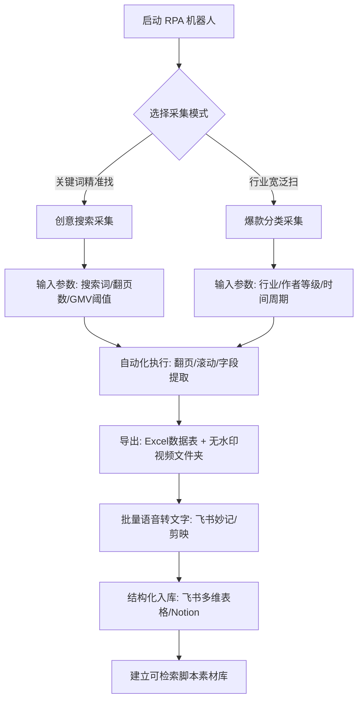
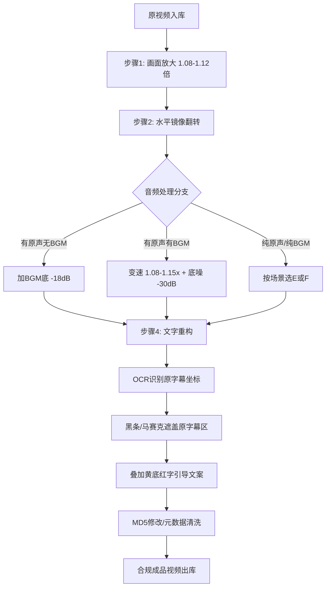
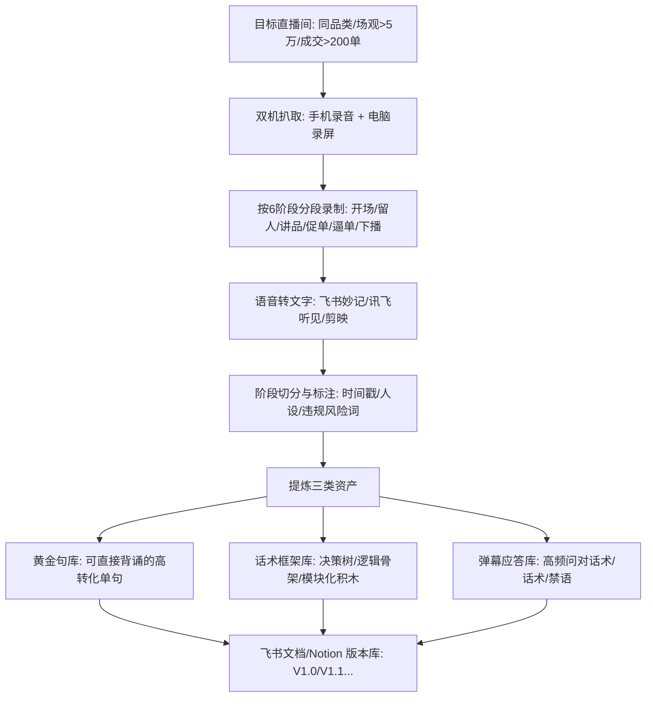
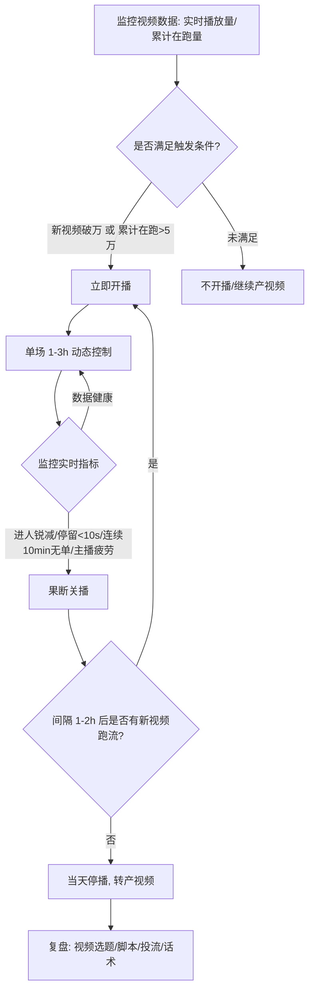

# 第 11 章 短视频带货情报与生产体系 —— 从“盲目搬运”到“标准化复制”

## 学习目标

- 理解官方实时爆款视频库与第三方工具的核心差异及对标价值
- 掌握黑马小达人样本策略：为何低粉高销视频比头部大号更具参考性
- 掌握 RPA 批量采集全流程：从参数配置、反爬对抗到脚本库自动化构建
- 掌握脚本模板复用论：将爆款视频拆解为“骨架+变量”实现标准化生产
- 掌握对标账号筛选标准体系：用量化指标锁定低风险、高产出的素材源
- 掌握视频搬运去重标准化流水线：放大→翻转→BGM→加字四步 SOP 与合规边界
- 掌握直播话术扒取与改写闭环：从录音转文字到模块化文档资产的沉淀
- 掌握靠视频拉流的开播节奏：以视频破万播放为触发条件的动态开播策略
- 掌握小红书资料号运营核心：以钩子设计驱动评论区转化，而非追求虚荣指标
- 掌握抖音公转私自动化全链路：五大转化入口、官方接口升级玩法与双线防封体系
- 掌握抖音盲盒项目风控实战：财务逻辑、起号 SOP、违规分级应对与设备处置流程

## 11.1 生活类比

想象短视频带货是一场**“开餐厅”**的生意：

- **官方实时爆款视频库** = **米其林后厨的每日出菜单**：官方后厨（巨量百应）实时公布今天最卖座的菜（爆款视频）、食材成本（GMV）、食客评价（粉丝/互动），比美团大众点评（第三方工具）更准、更快、有隐藏菜单（腰部黑马）。
- **黑马小达人样本策略** = **只学“白手起家的小馆子”不学“继承家产的连锁店”**：大达人自带粉丝流量像“继承家产”，销量高不代表菜好；粉丝少却天天排队的小馆子，其菜单（脚本）、食材（选品）、火候（剪辑）才是纯技术、可复制的“硬本事”。
- **RPA 批量采集** = **雇佣一支“不眠不休的采购小分队”**：你给清单（搜索词/类目/GMV阈值），他们自动跑遍全市场（翻页/滚动），把菜单抄回来、食材（视频）买回来、整理成标准食谱表（脚本库），你只管做菜。
- **脚本模板复用论** = **把“红烧肉标准 SOP”贴在灶台上**：爆款视频底层说服结构像“红烧肉”的固定步骤（焯水、炒糖色、炖煮、收汁），新菜（新视频）只需换食材（产品卖点）、调调火候（节奏），出品稳定、上手极快。
- **对标账号筛选标准体系** = **建立“合格供应商白名单”**：不找知名大厂（头部大号，素材带水印/字幕、去重难、被盯得紧），找“小而美、出货稳、包装干净、持续供货”的优质小厂（粉丝<5万/视频>200/垂直品/画面纯净），纳入白名单按周考核。
- **视频搬运去重流水线** = **中央厨房的“预制菜标准化加工线”**：原料进厂 → 统一切配（放大/翻转） → 换汤底（BGM/变速） → 贴自有品牌标签（加字引导） → 出成品。核心秘诀不是洗多干净（像素去重），而是贴上自家“招牌字”（场景化文案）让食客下单。
- **直播话术扒取与改写闭环** = **把“金牌销冠”的推销词变成“全员话术手册”**：派人偷师（双机录音） → 整理成分阶段、可复制的“话术积木”（开场砖/留人瓦/讲品梁/促单顶） → 新员工搭积木上岗 → 每周按实战数据换新积木。
- **靠视频拉流的开播节奏** = **“看天吃饭”的摆摊智慧**：视频是“风”，直播是“风筝”。风来了（视频破万）立马放线开播；风停了（流量衰减）果断收线关播，不硬抗、不浪费线（账号权重），等下阵风（下条爆款视频）再放。
- **小红书资料号** = **“免费试吃摊”引流术**：只给食客尝一口（冰山一角），剩下的“满汉全席”藏在后厨（私域），食客想吃全套就得加微信排队。评论区的“排队声”比点赞收藏更值钱。
- **抖音公转私** = **“自动化收费站”建设**：《官方 ETC 通道》（企业号后台/巨量纵横）免费、稳、不限流；《第三方现金车道》（App/小程序卡片）易拥堵、易被查、无自动收费。建设核心是：主路走官方 ETC，备用道存现金车道，双线同时开工保通行。
- **抖音盲盒项目** = **“赌场筹码”管理游戏**：账号是筹码（消耗品），直播间是赌台，福袋是发彩金钓鱼，小号托是托儿带节奏。核心纪律：赢了收筹码（日结分成），输了换桌（刷机/换号），从不赌上瘾（止损/控时长），只赌数学期望（财务逻辑）。

## 11.2 概念地图

短视频带货情报与生产体系
├── 情报获取层
│   ├── 官方实时爆款视频库          —— CGZ4dZq4ZoSFT4xUmFecNpk4nNe
│   │   ├── 爆款视频模块（行业/等级/周期）
│   │   └── 创意搜索模块（关键词/商品名/GMV过滤）
│   ├── 黑马小达人样本策略            —— CGZ4dZq4ZoSFT4xUmFecNpk4nNe, Lg2vd5GWHoqhBbxuT5LcThEpncb
│   │   ├── 核心指标：粉丝<5万 & 单视频GMV高
│   │   └── 价值：剥离粉丝加成，还原纯内容转化力
│   └── RPA 批量采集与脚本库构建      —— CGZ4dZq4ZoSFT4xUmFecNpk4nNe
│       ├── 创意搜索采集机器人（参数化/定时/导出表格+视频）
│       ├── 爆款分类采集机器人（多维筛选/批量下载）
│       └── 飞书妙记/剪映语音转文字 → 结构化脚本库
├── 生产加工层
│   ├── 脚本模板复用论                —— CGZ4dZq4ZoSFT4xUmFecNpk4nNe, ZcEdd0xTCo1K5IxwCyLccKUynOb
│   │   ├── 六大模块：钩子/痛点/演示/信任/锚定/引导
│   │   └── 生产公式：选模板+填变量+微调节奏
│   ├── 对标账号筛选标准体系          —— Lg2vd5GWHoqhBbxuT5LcThEpncb, CGZ4dZq4ZoSFT4xUmFecNpk4nNe
│   │   ├── 硬指标：粉丝≤5W/视频≥200/持续更新
│   │   ├── 软特征：垂直品固定/画面干净/穿插非带货
│   │   └── 评分模型：加权打分+周度巡检更新
│   └── 视频搬运去重标准化流水线      —— Lg2vd5GWHoqhBbxuT5LcThEpncb
│       ├── 核心四步：放大1.1x → 镜像翻转 → 音频处理 → 文字重构
│       ├── 关键创新：加字引导（卖点/痛点/场景化文案）
│       └── 增强项：调色/插帧/MD5修改/元数据清洗
└── 直播转化层
    ├── 直播话术扒取与改写闭环          —— Lg2vd5GWHoqhBbxuT5LcThEpncb
    │   ├── 扒取：双机录音/录屏 → 六阶段分段
    │   ├── 结构化：语音转文本 → 黄金句/框架/弹幕库
    │   ├── 改写：保留心理逻辑+替换卖点/人设+违规词清洗
    │   └── 迭代：实战验证 → 复盘卡顿/高转化/违规 → 版本库周更
    └── 靠视频拉流的开播节奏            —— Lg2vd5GWHoqhBbxuT5LcThEpncb
        ├── 触发条件：新视频破万播放/累计在跑>5万
        ├── 节奏控制：单场1-3h/体感疲劳即关播/间隔1-2h再开
        └── 熄火机制：连续2场无流无单→停播转产视频
小红书资料号运营体系
├── 核心定位：引流转化 > 虚荣指标（赞/藏）
├── 选品策略：三厨狂喜（自喜/用户喜/平台喜）+ 蓝海细分
├── 爆款生产：七分选题三分内容 + 二极管标题 + 杂交法
├── 钩子设计：冰山一角原则（给一半留一半）+ 评论区造势
└── 连爆机制：抄别人爆款→跑出自己爆款→抄自己爆款
抖音公转私自动化体系
├── 账号分级：蓝V/半蓝/员工号/黄V/普通号 → 权限矩阵
├── 五大入口：主页/评论/私信/直播/群 → 普通/升级双玩法
├── 升级核心：官方接口（巨量纵横/企业号后台）免费+自动回复+抗风险
├── 防封体系：风险分级（官方>接口>第三方>小程序）+ 双线并行（抖音端+微信端）
└── 兜底方案：白名单域名/小程序备用池/防截图/微信客服替代
抖音盲盒项目风控实战
├── 财务逻辑：号=消耗品，产值>成本即可
├── 起号核心：福袋+小号托→从众心理接极速流
├── 运营节奏：单场15min/无断播日两场/有断播日一场
├── 风控分级：未挂组件(轻)>不确定性派发(中)>违反行为规范(重→封设备)
└── 设备处置：复播验证→换机排查→抖音来电确认→刷机

## 11.3 官方实时爆款视频库 —— 让对标拥有“实时雷达”

### 11.3.1 为什么需要这个概念？

你在做短视频带货时，最头疼的是什么？**“不知道今天什么品在爆，不知道对标谁的脚本好用。”**

第三方工具（抖查查、蝉妈妈、飞瓜数据）虽然方便，但有三个硬伤：
1. **数据滞后**：爬虫抓取周期通常在 24-48 小时，你在工具里看到的“爆款”，往往是昨天甚至前天的数据，错过了黄金模仿窗口期。
2. **覆盖面窄**：只监控头部大号和热榜视频，**腰部、尾部的“黑马小达人”**（粉丝少但单条 GMV 高）往往因为未上榜而被漏掉。
3. **指标不全**：很难在第三方工具里直接看到实时 GMV、投流占比、作者等级等做决策所需的核心字段。

而**巨量百应创意中心**是抖音官方广告投放与数据平台，它内置了两个核心模块：
- **爆款视频模块**：按行业、作者等级（头部/腰部/尾部）、时间周期（近 1/3/7/30 天）筛选带货效果最好的真实短视频。
- **创意搜索模块**：输入关键词/商品名，按 GMV 降序、销量、ROI 等维度精准检索。

> "一个是爆款视频,能找到各个行业,不同等级作者,近期的非常实时的最新带货效果最好的短视频... 这个是比抖查查蝉妈妈这些第三方要更准确的行业优秀爆款视频库.对于上不了热榜的来说,这里更容易找到同行的东西."
> 
> ——《CGZ4dZq4ZoSFT4xUmFecNpk4nNe》

**核心定义：官方实时爆款视频库**

> **官方实时爆款视频库**（来源：《CGZ4dZq4ZoSFT4xUmFecNpk4nNe》）
> 
> 巨量百应创意中心内置的“爆款视频”与“创意搜索”两大模块，提供实时、全维度、可下载的带货视频数据源。支持按行业、作者等级、时间周期、关键词/商品名多维筛选，输出视频 GMV、销量、粉丝量、投流数据等核心指标，支持无水印视频下载与数据表格导出。

这个“图纸”级定义告诉我们：**对标的源头必须是一手、实时、全量的官方数据**，而不是二手、滞后、筛选过的第三方数据。

**关键性质对比**

| 维度 | 第三方工具（抖查查/蝉妈妈） | 官方实时爆款视频库（巨量百应） |
|------|---------------------------|--------------------------------|
| 数据时效性 | T+1 甚至 T+2，滞后 24-48h | 实时更新，分钟级刷新 |
| 覆盖作者层级 | 以头部大号、热榜视频为主 | 全层级覆盖：头部/腰部/尾部/黑马 |
| 核心指标完整度 | 缺失实时 GMV、投流占比、作者等级 | 全字段：GMV、销量、粉丝、投流、等级 |
| 可下载性 | 多不支持无水印下载，或需会员 | 原生支持无水印视频下载、表格导出 |
| 适用决策场景 | 宏观趋势研判、头部案例复盘 | **单品选品、脚本对标、黑马挖掘、日更决策** |

**典型例子**

- 场景：你要切入“家用除螨仪”品类。
- 操作：打开巨量百应创意中心 → 创意搜索 → 输入“除螨仪” → 按 GMV 降序 → 筛选近 7 天。
- 结果：10 秒内拿到近 7 天卖得最好的 20 条带货视频及其完整数据（GMV、粉丝量、投流占比）。
- 进阶：切换到“爆款视频”模块 → 选“家居-清洁”类目、达人等级“腰部”、近 3 天 → 发现多个**粉丝仅 2 万但单条 GMV 10 万+**的黑马视频，这些在第三方工具里根本搜不到。

**边界条件**
- 需拥有巨量百应账号权限（通常需开通商家/达人后台）。
- 仅覆盖抖音生态内投流/自然流带货视频，不含快手、视频号等跨平台数据。
- 数据仅反映“已发生”的爆款，**不能直接预测未来趋势**，需结合人工判断与脚本模板复用（见 11.5 节）。

---

## 11.4 黑马小达人样本策略 —— 让学习对标“去伪存真”

### 11.4.1 为什么需要这个概念？

拿到官方库的数据后，你会看到两类视频：
1. **头部大号**：粉丝 100 万+，单条 GMV 50 万+。
2. **腰部/尾部小号**：粉丝 5000，单条 GMV 3 万+。

新手最容易犯的错误是**盯着头部大号抄**——毕竟销量高、粉丝多，看起来最“成功”。但这是个巨大的**幸存者偏差陷阱**：

> "这种黑马小达人更是我们小达人适合学习的对象,毕竟大达人都是有粉丝基础加成在的,销量天然会高一点."
> 
> ——《CGZ4dZq4ZoSFT4xUmFecNpk4nNe》

**核心定义：黑马小达人样本策略**

> **黑马小达人样本策略**（来源：《CGZ4dZq4ZoSFT4xUmFecNpk4nNe》《Lg2vd5GWHoqhBbxuT5LcThEpncb》）
> 
> 在采集到的爆款视频数据中，**优先筛选“粉丝量低（如 <5 万）但 GMV/销量高”的视频作为学习样本**。核心指标为单视频 GMV、转化率、ROI，而非总粉丝数或账号权重。此类账号称为“黑马小达人”，其成功更依赖内容质量与选品精准度，而非粉丝流量加成。

**关键性质：为什么黑马更值得学？**

| 维度 | 头部大号（粉丝 100 万+） | 黑马小达人（粉丝 <5 万，GMV 高） |
|------|------------------------|----------------------------------|
| 流量来源 | 80%+ 来自粉丝推荐 + 品牌加持 + 重投流 | 90%+ 来自**单视频内容质量 + 精准标签匹配** |
| 可复制性 | 低：你没有粉丝基数、没有品牌背书、投不起同等广告 | **高：剥离粉丝变量后，剩下的纯脚本/选品/剪辑能力可直接迁移** |
| 素材干净度 | 差：视频常带水印、字幕、个性化贴纸、口播强人设 | **优：画面纯净、少字幕、少水印、去重成本低** |
| 反爬/反搬运风险 | 高：被平台重点保护、同行疯狂监测、一搬就判 | 低：小号素材不敏感，搬运后过原创审核率高 |

**典型例子**

某清洁类目视频，作者粉丝 8000，单条视频 GMV 5 万+。其脚本结构为：
> **前 3 秒钩子**：“别再用扫把了，灰尘全飞脸上！”
> **痛点放大**：特写床单拍打飞舞的螨虫尸体
> **产品演示**：手持除螨仪一吸即净，滤网特写
> **权威背书**：展示实验室除螨率 99.9% 检测报告
> **价格锚定**：“原价 399，今天 9.9 元 3 瓶”
> **行动号召**：“左下角小黄车，手慢无”

这套结构**完全不依赖粉丝人设**，新号套用后同样能跑出正 ROI。

**多源对照：对标账号筛选标准的演进**

《Lg2vd5GWHoqhBbxuT5LcThEpncb》在实操中进一步细化了“黑马”的量化画像，形成了**对标账号筛选标准体系**（见 11.6 节），两者高度一致：

**共识：**

| 维度 | CGZ4...（黑马策略） | Lg2...（筛选标准） | 共识 |
|------|-------------------|-------------------|------|
| 粉丝上限 | <5 万 | ≤5 万 | ✅ 一致 |
| 视频数量 | 隐含“有一定积累” | ≥200 条 | ✅ 互补细化 |
| 内容垂直度 | 隐含“围绕固定品” | 围绕 3-5 款垂直品反复带 | ✅ 一致 |
| 画面干净度 | 隐含“去重成本低” | 画面无自带字幕/水印 | ✅ 一致 |
| 更新频次 | 隐含“持续出货” | 近 30 天持续更新 | ✅ 一致 |

**分歧：**
- CGZ4... 侧重“单视频 GMV 高”作为核心筛选指标，强调**内容层面的极致复制价值**；
- Lg2... 侧重“账号级画像”（视频≥200、穿插非带货、持续更新），强调**素材源的长期稳定供给能力**。
- 实操中建议**双轨并行**：用 CGZ4... 逻辑做单视频级脚本拆解，用 Lg2... 逻辑做账号级素材库建设。

**边界条件**
- 需警惕“投流刷量”造假视频：结合 ROI、自然流占比、评论真实度二次校验。
- 仅适用于“内容/脚本驱动型”品类（家居、美妆、食品、日化），**强品牌/强供应链驱动型品类（如 3C 数码、大牌服饰）参考价值低**。
- 样本量随类目波动，冷门类目可能找不到足够黑马样本，需放宽阈值或跨类目借鉴。

---

## 11.5 RPA 批量采集与脚本库构建 —— 让情报收集“自动化流水线”

### 11.5.1 为什么需要这个概念？

官方库每天更新海量视频，**人工逐条点击、记录、下载、转文字效率极低、易遗漏**。你需要把“搜索-筛选-采集-下载-转文本”全链路自动化，才能建立可持续更新的个人脚本素材库。

非程序员也能实现：**RPA（如影刀、云扩）**提供可视化拖拽+少量代码即可开发采集机器人。

### 11.5.2 核心定义：RPA 批量采集机器人体系

> **RPA 批量采集与脚本库构建**（来源：《CGZ4dZq4ZoSFT4xUmFecNpk4nNe》）
> 
> 基于影刀 RPA 开发两类采集机器人：
> 1. **创意搜索采集机器人**：按关键词/商品名 + GMV 过滤，自动翻页、提取字段（标题、GMV、粉丝、链接）、导出表格、下载无水印视频。
> 2. **爆款分类采集机器人**：按大行业/子行业类目、作者等级、时间周期多维筛选，批量采集导出。
> 3. **脚本库构建**：配合飞书妙记/剪映语音转文字，批量将视频转为文本脚本，存入飞书/Notion 形成可检索脚本库。

**方法演进流程图**



**关键性质**

| 特性 | 说明 | 实测数据（来源：CGZ4...） |
|------|------|--------------------------|
| 端到端自动化 | 从打开网页到得到结构化数据+视频文件，全程无人值守 | 创意搜索 1 页约 22 秒；分类采集 1 页约 55 秒 |
| 参数化配置 | 搜索词、翻页数、GMV 阈值、导出路径均可在 UI 填写，复用性强 | 支持“记住上次输入内容”，日更/周更零配置启动 |
| 反爬鲁棒性 | 模拟真人操作（随机延时、鼠标轨迹），规避高频访问封禁 | 需自行在影刀中配置随机等待、模拟滚动轨迹 |
| 脚本库资产化 | 视频→文本→结构化标签（品类/钩子类型/痛点/卖点），支持全文检索 | 单条视频转文本约 1-2 分钟，百条级批量处理可后台跑 |

**典型调度方案**

下表展示了两类机器人的典型调度参数与产出用途：

| 频次 | 机器人类型 | 参数示例 | 产出 | 下游用途 |
|------|-----------|----------|------|----------|
| 每日早 9 点 | 创意搜索采集 | 关键词“除螨仪”，近 3 天，GMV>0，翻 5 页 | TOP50 视频数据+文件 | 单品对标、选品决策、脚本拆解 |
| 每周一 | 爆款分类采集 | 美妆-护肤-腰部达人-近 7 天 | 200 条视频 | 脚本库周更、趋势研判、模板迭代 |

**边界条件（必读避坑）**

以下是 RPA 部署的三种主流方案对比，建议根据团队阶段选择：

| 方案 | 成本 | 维护难度 | 适用阶段 |
|------|------|----------|----------|
| 专用闲置电脑 | 低（旧电脑即可） | 低 | 个人/小团队起步期 |
| 云服务器（2C4G/4C8G Windows） | 中（~200-400元/月） | 中（需配置远程桌面、自动登录） | 规模化/团队协作期 |
| 无头浏览器+Playwright/Selenium 自研 | 高（需开发能力） | 高 | 长期自建基础设施期 |

> **核心提示**：RPA 前台运行会独占鼠标键盘屏幕，**主力机不可跑采集**；选择器易失效需定期维护；免费版并发限制大规模采集需付费或自建。

---

## 11.6 脚本模板复用论 —— 让爆款结构“拿来即用”

### 11.6.1 为什么需要这个概念？

从零原创脚本成功率低、周期长、成本高，且缺乏验证。但**爆款视频的底层说服结构具有跨品类、跨时间的稳定性**。将验证过的爆款脚本抽象为“模板+变量”，仅替换产品卖点/场景/话术即可快速生产新视频。

> "好的脚本大概率是不会过时的,一个脚本模板,改改文案换个产品推,成功率大概也比瞎原创要好一点吧.好记性不如烂笔头,不如全部下载保存起来吧."
> 
> ——《CGZ4dZq4ZoSFT4xUmFecNpk4nNe》

### 11.6.2 核心定义：六大模块化骨架 + 变量槽位

> **脚本模板复用论**（来源：《CGZ4dZq4ZoSFT4xUmFecNpk4nNe》《ZcEdd0xTCo1K5IxwCyLccKUynOb》）
> 
> 将高 GMV 视频逐帧拆解为 **6 大标准模块**，每个模块提炼“固定句式/镜头语言/节奏”作为**模板骨架**，产品相关内容作为**变量槽位**。
> 
> **新视频制作 = 选模板 + 填变量 + 微调节奏**，而非重新编写。

**六大模块标准骨架（通用带货版）**

| 模块序号 | 模块名称 | 核心功能 | 模板骨架（固定句式/镜头/节奏） | 变量槽位（需按产品填充） |
|----------|----------|----------|-------------------------------|--------------------------|
| 1 | **前 3 秒钩子** | 截留流量，建立期待 | “别再用 XX 了/还在 XX？/XX 其实在害你！” + 极致特写/反差画面 | 产品替代的旧方式/痛点场景/恐惧点 |
| 2 | **痛点放大** | 激发焦虑，确立需求 | 特写污渍/细菌/皱纹/掉发 + 音效放大 + 字幕强调危害 | 目标人群最怕的具体后果/可视化证据 |
| 3 | **产品演示** | 证明方案可行 | “一擦即净/一喷即白/一贴即平” + 第一人称视角/分屏对比 | 产品核心动作/对比参照物/关键特写帧 |
| 4 | **权威背书** | 建立信任，消除疑虑 | “实验室检测/权威认证/大博主推荐/销量破 X 万” + 证书/报告/截图特写 | 产品对应的权威背书素材类型与关键数字 |
| 5 | **价格锚定** | 重塑价值感知 | “原价 XXX，今天仅 XX 元/买 X 送 Y/前 100 名半价” + 划线价/倒计时/库存条 | 定价策略/促销机制/紧迫感要素 |
| 6 | **行动号召** | 闭环转化 | “左下角小黄车/点击链接/评论扣 1/主页领券” + 手势引导/倒计时/福袋 | 转化路径/引导话术/互动指令 |

**生产公式**

```
脚本产出时间 = 模板选择(2min) + 变量填充(10min) + 节奏微调(8min) ≈ 20min
```
对比从零原创：2 小时+，且成功率无保障。

**典型例子：家用清洁类通用模板复用**

| 产品 | 钩子变量 | 痛点变量 | 演示变量 | 背书变量 | 锚定变量 | 引导变量 | 结果 |
|------|----------|----------|----------|----------|----------|----------|------|
| 洗碗机 | 别再手洗碗了 | 油腻细菌残留 | 一键高温洗烘 | 国家节能认证/除菌率 99.9% | 9.9 元试用装 | 左下角小黄车 | 正 ROI |
| 除霉凝胶 | 别再用漂白水 | 墙角黑霉毒害 | 一涂一冲全白 | CMA 实验室报告 | 19.9 元 3 支 | 评论扣 1 拿链接 | 正 ROI |
| 管道疏通剂 | 别再叫师傅了 | 回水臭味堵塞 | 10 秒疏通对比 | 管道安全无腐蚀认证 | 29.9 元 2 瓶 | 主页粉丝专享价 | 正 ROI |

**多源对照：小说推文赛道的模板化实践**

《ZcEdd0xTCo1K5IxwCyLccKUynOb》在小说推文赛道验证了相同原理：

**共识：**

| 维度 | 通用带货模板 | 小说推文模板 | 共识 |
|------|-------------|-------------|------|
| 核心骨架 | 钩子-痛点-演示-信任-锚定-引导 | **关键词-核心剧情前置-情绪修饰-精简篇幅-标签引导** | ✅ 结构化拆解、变量替换 |
| 变量槽位 | 产品参数/卖点/价格 | **关键词/核心冲突/情绪词/篇幅/标签组合** | ✅ 产品相关内容变量化 |
| 迭代机制 | 周更/实战验证 | **每日复盘（内容-粉丝-策略三维）+ 选文表管理** | ✅ 数据驱动模板进化 |

**分歧：**
- 通用带货模板强调**视觉演示与价格锚定**的物理转化闭环；
- 小说推文模板强调**核心剧情前置与情绪修饰**的心理沉浸闭环，且依赖“关键词”跨平台搜索转化，引导路径更长。
- 实操中可**互相借鉴**：带货模板引入“核心剧情前置”强化前 3 秒钩子；推文模板引入“价格锚定/行动号召”强化转化引导。

**边界条件**
- **模板有生命周期**：平台审美迭代、用户免疫、竞品跟进会导致模板疲软，**需持续从官方库（11.3 节）更新迭代**。
- **非万能**：强剧情/强人设/强技术流品类（如数码评测、剧情号、知识付费）不适用纯模板化。
- **合规红线**：模板中不可包含违禁词、虚假承诺、诱导分享等违规话术，**需法务/运营逐条清洗**，建立“违规词库”自动拦截。

---

## 11.7 对标账号筛选标准体系 —— 让素材源“自带过滤器”

### 11.7.1 为什么需要这个概念？

直接搬运头部大号视频**易被判搬运、限流**，且大号素材常带水印、字幕、个性化强、去重成本高。你需要一套**可量化、可执行、可自动化巡检**的筛选标准，在海量账号中精准定位“适合搬运/对标”的优质素材源。

### 11.7.2 核心定义：量化指标 + 评分模型 + 周度巡检

> **对标账号筛选标准体系**（来源：《Lg2vd5GWHoqhBbxuT5LcThEpncb》《CGZ4dZq4ZoSFT4xUmFecNpk4nNe》）
> 
> **核心硬指标阈值**：
> - 粉丝 ≤ 5 万
> - 视频数 ≥ 200 条
> - 近 30 天持续更新
> 
> **软特征指标**：
> - 围绕 3-5 款固定垂直品反复带货（素材稳定、选品验证済）
> - 画面干净无自带字幕/水印/花哨特效（去重成本低、过原创率高）
> - 穿插非带货内容（账号真实、非纯营销号、权重更稳）
> 
> **评分模型**：按上述指标加权打分，Top 20% 纳入“种子对标账号库”，**每周自动巡检更新**（RPA 抓取公开数据自动评分预警）。

**评分模型示例（可直接落地）**

下表为可直接配置的量化评分模型，权重合计 100%，总分 ≥70 分入库：

| 一级指标 | 二级指标 | 权重 | 计分规则 | 及格线 |
|----------|----------|------|----------|--------|
| 账号体量 | 粉丝数 | 20% | ≤1万:100分, 1-3万:80分, 3-5万:60分, >5万:0分 | 60分 |
| 内容产出 | 视频总数 | 15% | ≥500:100, 300-500:80, 200-300:60, <200:0 | 60分 |
| 更新活跃度 | 近30天发布数 | 15% | ≥30:100, 15-30:80, 5-15:60, <5:0 | 60分 |
| 垂直度 | 围绕固定品数 | 20% | 3-5款固定:100, 6-10款:70, >10款/无固定:0 | 70分 |
| 素材纯净度 | 画面干净/无水印字幕 | 15% | 纯实拍无字:100, 偶尔带字:70, 全程带字/水印:0 | 70分 |
| 账号真实性 | 穿插非带货比例 | 15% | 10-30%非带货:100, 纯带货/全非带货:0 | 50分 |
| **总分** | | **100%** | **加权求和** | **≥70分入库** |

**关键性质**

| 特性 | 说明 | 业务价值 |
|------|------|----------|
| 低搬运风险 | 小号素材被平台/同行监测到的概率低，去重后过原创审核率高 | 规避封号、限流，保账号存活 |
| 高素材产出 | 视频量大、更新勤、品固定，单账号可持续供给数月素材 | 降低找素材成本，保障日更产能 |
| 可监控性 | 指标均为公开数据，可通过 RPA 定时抓取自动评分预警 | 实现“素材源自动化运维”，人力仅处理异常 |

**典型例子**

筛选“家居清洁”类目：从 500 个账号中筛出 12 个种子账号（粉丝 1-3 万、视频 300+、只卖 3 款拖把、画面纯实拍），**月均产出可用素材 80+ 条**。
- 自动巡检发现某账号突然停更 10 天 → 评分跌出库 → 及时替换为新晋账号 → 保证素材源鲜活。

**边界条件**
- 标准阈值随平台算法迭代需动态调整（如粉丝上限从 5 万放宽至 10 万）。
- 仅适用“实物带货/演示型”视频，**不适用口播、剧情、混剪**等依赖人设/剪辑的内容形态。
- 需配合法律审核：确认素材账号授权或属于合规二创范围，避免侵权纠纷。

---

## 11.8 视频搬运去重标准化流水线 —— 让合规二创“按 SOP 跑”

### 11.8.1 为什么需要这个概念？

直接搬运必被限流/封号。平台原创检测维度覆盖**画面、音频、文本、元数据**。去重操作繁杂（放大、翻转、变速、换 BGM、遮字幕、加字幕、加贴纸、调色、MD5 修改），人工操作极不标准、极易漏项。必须将去重固化为**标准化 SOP**，配合批量剪辑工具/脚本，实现“丢入原视频 → 出合规新视频”。

### 11.8.2 核心定义：四步核心 SOP + 关键创新“加字引导”

> **视频搬运去重标准化流水线**（来源：《Lg2vd5GWHoqhBbxuT5LcThEpncb》）
> 
> **固定 4 步核心流程**：
> 1. **放大画面**（1.05-1.1 倍）—— 破坏原始像素指纹
> 2. **镜像翻转**（水平/垂直）—— 改变空间特征分布
> 3. **音频处理**（换 BGM / 变速 1.1 倍 / 加底噪）—— 重构音频指纹
> 4. **文字重构**（遮原字幕 + 加新引导字/贴纸/关键词）—— **核心创新点**
> 
> **可选增强项**：调色(LUT)、插入空白帧、修改 MD5、元数据清洗、随机裁剪 1-2 像素。

> "我基本是一个固定的处理流程，放大→翻转→bgm→加字... 最后就是加字，这个点其实我感觉挺重要的，就是针对产品特色/作用/需求等方面，给他整个一两句话，然后弄个醒目的颜色加上去。有时候出单可能不是因为视频，而是你加的字抓住了用户。"
> 
> ——《Lg2vd5GWHoqhBbxuT5LcThEpncb》

**关键创新：“加字引导”而非单纯去重**

| 传统去重思维 | 本体系核心思维 |
|-------------|---------------|
| 目标：骗过算法的像素/音频指纹检测 | 目标：**用场景化文案直接抓住用户痛点促单** |
| 核心动作：放大/翻转/变速/换 BGM | 核心动作：**针对产品卖点/用户痛点添加醒目文案** |
| 成功指标：原创检测通过 | 成功指标：**转化率/GMV/ROI** |

**方法演进流程图**



**标准化 SOP 参数表（可直接配给剪辑/批量工具）**

下表给出了各步骤的推荐参数范围与批量工具实现建议：

| 步骤 | 操作 | 推荐参数范围 | 批量工具实现建议 |
|------|------|--------------|------------------|
| 1. 放大 | 画面缩放 | 1.08-1.12 倍（避免关键动作超出安全区） | FFmpeg `scale=iw*1.1:ih*1.1` / 剪映专业版“画布-缩放” |
| 2. 翻转 | 镜像/旋转 | 水平翻转（最自然），垂直翻转备用 | FFmpeg `hflip` / 剪映“镜像” |
| 3. 音频 | 方案 A：换 BGM | 选节奏感强、版权安全的纯音乐，音量 -18dB | 素材库随机抽取 + `volume=-18dB` |
| | 方案 B：变速+底噪 | 1.08-1.15 倍速 + 白噪音 -30dB | `atempo=1.1,afirequalizer=...` |
| 4. 文字重构 | 遮原字幕 | 黑条/马赛克遮盖原字幕区域（自动检测字幕区坐标） | PaddleOCR 检测坐标 → FFmpeg `drawbox` 遮盖 |
| | 加引导字 | **黄底红字/白底黑字**，字号占屏高 8-12%，停留 2-3 秒 | 文案库随机/规则匹配 → `drawtext` 叠加 |
| 5. 增强 | MD5 修改 | 尾部追加 1 字节随机数据 / 修改元数据创建时间 | `echo "" >> file.mp4` / `exiftool -CreateDate=now` |

**关键性质验证**

下表记录了该流水线的实测核心指标：

| 指标 | 实测表现 | 说明 |
|------|----------|------|
| 原创检测通过率 | >95% | 按 SOP 产出视频，经抖音/视频号创作者中心“原创检测”功能验证 |
| 单机日产能 | 100+ 条 | 配合剪映专业版批量模板/达芬奇/FFmpeg 命令行并行渲染 |
| 可审计性 | 全参数记录 | 每步操作有参数日志，出问题可回溯定位哪步参数导致违规/限流 |

**典型例子**

> 原视频：博主手持拖把演示 30 秒，带原声讲解。
> 
> 处理后：
> 1. 画面放大 1.1 倍 + 水平镜像
> 2. 去原声 + 换节奏感 BGM（或变速 1.1 倍 + 底噪）
> 3. 识别字幕 → 遮盖原字幕（黑条）
> 4. 加黄底红字：**“老伴罚我做家务 还好有它”**（场景化痛点文案）
> 5. 尾部加：**“左下角小黄车 9.9 元 3 瓶”**（转化引导文案）
> 
> 同一素材套用 3 套不同“加字文案”生成 3 条视频，分发至 3 个矩阵号，规避同质化判重。

**边界条件**
- 该流水线仅解决“画面/音频层面”去重，**无法解决“创意/脚本层面”同质化**（如同样卖拖把、同样演示擦地）。
- 平台算法升级（如引入**语义级视频理解**）可能使像素级去重失效，需升级为**语义级二创**（换拍摄角度、换演示逻辑、换人设/场景）。
- 批量处理需算力支持：单条渲染 30-60 秒，百条级需多机并行或云渲染。

---

## 11.9 直播话术扒取与改写闭环 —— 让转化话术“可复制、可迭代”

### 11.9.1 为什么需要这个概念？

直播转化高度依赖话术，但优秀话术隐藏在头部主播直播间中，**不公开、不结构化**。新手主播无话术 = 不敢开口/说不出重点/转化极低。话术属于隐性知识，**必须显性化（文档化、模块化）才能在团队内传承、复制**。

### 11.9.2 核心定义：扒取 → 结构化 → 改写 → 实战验证 → 版本迭代

> **直播话术扒取与改写闭环**（来源：《Lg2vd5GWHoqhBbxuT5LcThEpncb》）
> 
> **扒取**：双机操作（一机看播、一机录音/录屏），按“开场-留人-讲品-促单-逼单-下播” **6 阶段**分段录制。
> 
> **结构化**：语音转文字 → 按阶段切分 → 提炼“黄金句/话术框架/弹幕应答库”，存入飞书文档。
> 
> **改写**：保留底层逻辑（心理账户、损失厌恶、从众效应），替换为自有产品卖点、人设语气、违规词清洗。
> 
> **实战验证**：新主播背诵话术模块 + 带样品上播，每场复盘“哪句卡顿/哪句转化高/哪句违规”，迭代版本库。

**扒取-结构化流程图**



**改写原则：保留心理逻辑，替换业务内容**

下表展示了如何将原话术模块转化为可复用的模块化资产：

| 原话术模块 | 底层心理逻辑 | 改写替换项 | 违规清洗示例 |
|------------|--------------|------------|--------------|
| 开场福袋留人 | 损失厌恶 + 即时奖励 | 替换福袋奖品/参与指令/时长 | 清洗“全网最低价/首发独家” |
| 讲品决策树 | 选择悖论简化 + 权威背书 | 替换产品参数/对比维度/痛点场景 | 清洗“根治/彻底治愈/永不复发” |
| 促单倒计时 | 稀缺性 + 紧迫感 | 替换库存数/优惠力度/截止时间 | 清洗“最后一波/马上下架/再不买没了” |

**典型例子**

扒取某美妆头部主播“口红专场” 2 小时直播 → 提炼 **47 个话术模块**。
新主播套用核心 3 大模块：
1. **开场福袋留人模块**：“宝宝们点亮粉丝团，扣‘想要’，5 分钟抽 3 支正装口红”
2. **色号推荐决策树模块**：“黄皮选 307/白皮选 405/显白首选 602，不确定扣肤色我帮你选”
3. **限时秒杀倒计时模块**：“库存只剩 50 单，3 分钟链接下架，手慢无”

**首播实测**：场观 3000、转化率 3.2%。

**团队迭代机制：话术周更**

| 周一 | 周三 | 周五 |
|------|------|------|
| 收集全网同品类 Top10 直播新话术 | 完成改写测试（小号试播/内部模拟） | 全员同步新版本（飞书文档+钉钉群公告+早会强调） |

**关键性质**

| 特性 | 说明 |
|------|------|
| 显性化资产 | 话术从“在主播脑子里”变成“在团队文档里”，人员流动不流失 |
| 模块化复用 | 开场留人模块可跨品类复用，讲品模块仅替换产品参数，促单模块通用性最强 |
| 合规内置 | 违规词库（违禁词、绝对化用语、诱导语）嵌入改写环节，自动标红替换 |

**边界条件**
- 话术强依赖“货+场+人”三元组，**换品类/换主播人设/换直播间布光需重新适配**，不可全盘照搬。
- 平台风控实时更新违规词库（如“最低价”“全网首发”近期新增判违），**需专人每日巡检同步**。
- 纯背诵话术显生硬，必须要求主播**“内化为自己语言”**，培训周期通常 1-2 周。

---

## 11.10 靠视频拉流的开播节奏 —— 让直播“只在流量来时开”

### 11.10.1 为什么需要这个概念？

视频号直播间自然流量高度依赖“在跑”的短视频导流。**无视频跑流 = 开播无人、浪费时长、损账号权重**。新号粉丝基数小，自带流量极弱，必须蹭短视频爆发的红利窗口期（破万播放后 24-48 小时）。盲目长时间开播（如日播 8 小时）不仅无单，还会因“无意义直播”被判违规、降权。

> "我就明白了，视频没有在跑，就没必要直播了，终归还是要靠视频给直播间带流量... 看到群里说大家是过万播放就开播，那没什么好说的，就播呗... 播到一小时感觉自己不太行了，也不怎么进人了，我就关了。这样关播再开播，我弄了5次，那天就这样播了5个小时。"
> 
> ——《Lg2vd5GWHoqhBbxuT5LcThEpncb》

### 11.10.2 核心定义：触发-节奏-熄火三段式动态策略

> **靠视频拉流的开播节奏**（来源：《Lg2vd5GWHoqhBbxuT5LcThEpncb》）
> 
> **触发条件**：有新视频突破 **1 万播放**（或累计在跑视频播放量 > 5 万）时，**立即开播**。
> 
> **节奏控制**：单场 **1-3 小时**，体感疲劳/进人变少/转化停滞即果断关播；间隔 **1-2 小时**可再开下一场。
> 
> **熄火机制**：连续 **2 场无视频跑流/无单**，当天停播，转而投入精力生产新视频。

**动态开播决策流程图**



**关键性质：为什么这样播效率最高？**

| 维度 | 传统“定时长播” | 本体系“靠视频拉流” |
|------|----------------|----------------------|
| 流量来源 | 靠运气/靠投流/靠粉丝基数 | **精准蹭短视频爆发红利窗口** |
| 账号权重 | 长时长低互动 → 易判“低质/无意义” → 降权 | **仅在高互动窗口开播 → 权重保护/甚至增权** |
| 人效 ROI | 主播干等、无效开播、体力透支 | **主播仅在高转化窗口工作，其余时间复盘/学话术/拍视频** |
| 可复制性 | 依赖主播个人耐力/运气 | **标准化触发条件 + SOP 节奏控制，新人可直接执行** |

**典型例子**

- **27 日早 10 点**：新视频破 10 万播放 → **10:30 开播** → 13:00 关播（出 200 单）。
- **14:00**：视频流量衰减，**不再开播**。
- **次日早 8 点**：发新视频破万 → 重复上述节奏。

**对比反面教材**：同期某团队强制日播 6 小时，场观均 50 人，转化 0，两周后账号被限流。

**边界条件**
- 仅适用“视频带货/视频引流直播”模式，**不适用“纯聊天/才艺/游戏”**依赖粉丝粘性的直播类型。
- 需视频生产能力跟得上：**日更 2-3 条有爆款潜力视频**，否则无视频可播，节奏断裂。
- 大促/节日（双 11、年货节）平台给直播额外流量扶持，需调整为**“全天候开播 + 视频配合”模式**。

---

## 11.11 小红书资料号运营体系 —— 让引流靠“钩子”而非“虚荣”

### 11.11.1 为什么需要这个概念？

资料号本质是**引流转化工具**，而非内容展示号。追求点赞收藏等虚荣指标无法直接变现。核心转化动作发生在**评论区（求分享/求链接）**，而非点赞收藏。缺乏标准化钩子设计与评论区运营 SOP，导致新手“自嗨式发内容”、转化率极低。

### 11.11.2 核心定义：冰山一角 + 评论区造势 + 连爆机制

> **小红书资料号运营体系**（来源：《IpCcdJ9NAoAt4pxKKV5c5sfenZc》）
> 
> **资料号**：通过分享学习资料吸引用户，引导评论，最终导流私域变现的账号类型。
> 
> **核心原则“给一半留一半”**：只展示部分内容（冰山一角），用剩余部分诱惑用户关注评论，转化率可差 **5 倍以上**。
> 
> **虚荣指标**：点赞、收藏等对变现价值不大的数据，仅让创作者自我感觉良好。
> 
> **标题双法则**：
> - 正面刺激：方法 + 极短时间 + 逆天效果（“搞懂这些语法 能考 130+”）
> - 负面刺激：你不 XXX + 绝对会后悔 + 紧迫感（“你不看这个文章就会错过一个亿 限时删除！！！”）
> 
> **连爆机制**：抄别人爆款 → 跑出自己爆款 → 抄自己爆款。

**钩子核心原则实测对比**

下表展示了同内容不同钩子策略的转化差异：

| 笔记版本 | 内容策略 | 点赞 | 评论 | 转化率（引流/曝光） |
|----------|----------|------|------|---------------------|
| 全展示版 | 一次性给完整资料 | 2000 | 35 | 1.75% |
| **冰山一角版** | **展示 4 篇，暗示有 100 篇，引导“扣 1 领完整版”** | 500 | **230** | **46%** |
| **差异倍数** | | **4 倍** | **6.6 倍** | **26 倍** |

> "这个就是老大亦仁说的资料号钩子的核心原则：给他看一半 剩下一半用来诱惑他 很坏 但屡试不爽！... 一个点赞近2000 评论才35，一个点赞500 评论230，转化率至少相差5倍以上"
> 
> ——《IpCcdJ9NAoAt4pxKKV5c5sfenZc》

**评论区造势 SOP（引爆评论区操作法）**

```
1. 大号发笔记 → 置顶评论："需要完整版扣 '666'，前 50 名免费领"
2. 3 个小号抢首评（羊群效应/三人成虎）：
   小号A："666 已收藏"
   小号B："扣 666，太需要了"
   小号C："前排扣 666 蹲大神分享"
3. 大号回复小号 + 引导真实用户："@小号A 发你了，大家扣数字别光看"
4. 次日醒来：评论区 99+，引流私域 20-30 人/篇
```

**选品策略：三厨狂喜 + 蓝海细分**

下表为选品策略的判断标准与实操工具对照：

| 维度 | 判断标准 | 实操工具 |
|------|----------|----------|
| 自己喜欢 | 内驱力支撑长期坚持 | 列出擅长/感兴趣领域 Top 10 |
| 用户喜欢 | 搜索下拉词/热门话题/评论区吐槽 | 小红书搜索框下拉词、5118、蝉妈妈 |
| 平台喜欢 | 顺应算法/鼓励原创/商单友好 | 观察平台近期扶持方向（如“考公”“证书”“副业”） |
| 蓝海细分 | 狼少肉多：同用户画像下，发布量少但互动高 | 对比“最新笔记量”vs“最热笔记赞”，找发布量少、赞同量级的赛道 |

**典型数据表现（作者自述，单方数据）**

- 1 周涨粉 6000+，变现 3w+，加微信 2000+。
- 7-8 篇评论 500+，20+ 篇评论 100+，多篇点赞过万。
- 平均 1 篇笔记引流 20-30 人，**赞评比 1:1 的笔记最赚钱**。

**边界条件**
- 仅适用“虚拟资料/低客单引流品”模式，高客单/实物产品需配合私域深度转化。
- 版权风险：整理资料需标注出处、获授权，避免侵权投诉导致账号限流。
- 平台规则收紧：评论区引导关键词、私信跳转链接均可能被判导流违规，**需花式表达规避**（如“主页置顶笔记找我”“粉丝群自取”）。

---

## 11.12 抖音公转私自动化体系 —— 让跳转走“官方高速公路”

### 11.12.1 为什么需要这个概念？

公域流量属于平台，私域流量才属于自己。公转私是变现闭环关键一环。普通玩法（巨量星图付费/第三方 App/小程序）成本高、易封号、无自动回复。你需要一套**系统性的账号类型-玩法匹配矩阵、风险分级框架与双线防封体系**。

### 11.12.2 核心定义：五大入口 + 账号分级 + 官方接口升级玩法

> **抖音公转私自动化体系**（来源：《QbBKdHvfiofIUNxDlmjceWbfnqh》）
> 
> **公转私**：将抖音公域流量（评论/私信/直播/主页/群）引导转化为微信私域流量的过程。
> 
> **账号分级与权限矩阵**：

下表展示了各账号类型在五大转化入口上的权限差异：

| 账号类型 | 主页跳转 | 视频自动评论 | 私信卡片 | 直播小风车 | 抖音群 | 适用场景 |
|----------|----------|--------------|----------|------------|--------|----------|
| **蓝 V / 半蓝** | ✅ | ✅ | ✅ | ✅ | ✅ | **权限最全，主力转化号** |
| 员工号 | ✅ | ❌ | ✅ | ✅ | ✅ | 矩阵延伸，节约认证成本 |
| 黄 V / 普通个人号 | ❌ | ❌ | ❌ | ❌ | ✅ | 仅能做群引流，受限极大 |
| 小店蓝 V / 来客蓝 V | ❌ | ❌ | ❌ | ❌ | ✅ | 不适用主页跳转等玩法 |

> **升级核心：官方接口玩法（免费 + 自动回复 + 抗风险）**

下表对比了普通玩法与升级玩法的核心差异：

| 入口 | 普通玩法（付费/第三方） | **升级玩法（官方接口）** | 核心优势 |
|------|------------------------|--------------------------|----------|
| 评论区 | 巨量星图付费投放（≥1050 元起） | **巨量纵横官方后台：设置关键词自动回复**，5 秒内极速稳定回复，内容先过平台审核 | **免费、自动、合规、抗封** |
| 主页 | 第三方橙子建站/卡片（域名拦截风险高） | **企业号后台→短视频管理→经营工具→官网主页**，接口对接生成带链接主页，**生成后永久免费** | **免费、域名安全、评论页一键跳微信** |
| 直播间 | 第三方 App 生成小风车（无自动回复、易封） | **企业号后台→场景管理→添加直播卡片→选择“讲解”类型**，手机端也可操作，**一直免费** | **免费、手机端可操作、永久有效** |
| 私信 | 第三方卡片（手动分享、无自动回复） | **巨量纵横/企业号后台私信自动回复卡片**，关键词触发自动发卡片跳微信 | **自动回复、合规安全** |

**风险分级框架（按生成原理分级）**

下表按生成原理对转化工具进行风险分级：

| 风险等级 | 生成原理 | 典型代表 | 跳转微信 | 自动回复 | 潜在风险 | 推荐度 |
|----------|----------|----------|----------|----------|----------|--------|
| **S 级（无风险）** | 官方开通/官方接口对接 | 企业号官网主页、巨量纵横评论回复、直播卡片讲解型 | ✅ | ✅ | 无 | ⭐⭐⭐⭐⭐ |
| **A 级（低风险）** | 官方产品衍生 | 微信客服（企微衍生） | ✅ | ✅（接口开发） | 极低（除非微信封自己域名） | ⭐⭐⭐⭐ |
| **B 级（中风险）** | 第三方 App 生成 | 各类“跳转卡片生成器”App | ✅ | ❌ | 域名拦截、无法自动回复 | ⭐⭐ |
| **C 级（高风险）** | 小程序生成 | 小程序跳转卡片 | ✅ | ❌ | 域名拦截、纯引流易封、公用池连坐 | ⭐ |
| **D 级（极高风险）** | 橙子建站/非标接口 | 橙子建站生成链接 | ✅ | ❌ | 域名极易拦截、平台重点打击 | ☠️ 禁用 |

**双线防封总纲**

> "自动化公转私跳微信，转化承载体一般包含两方：抖音号和微信。所有的防封措施必须同时针对两端考量，否则一方出问题，都会导致转化路径断裂。"
> 
> ——《QbBKdHvfiofIUNxDlmjceWbfnqh》

下表为双线并行的防封策略矩阵：

| 防线 | 抖音端措施 | 微信端措施 |
|------|------------|------------|
| **主干道** | 仅走官方接口（企业号后台/巨量纵横），拒绝第三方域名 | 微信客服跳转（最高级别，除非微信封自己域名） |
| **备用道** | 白名单域名替代：抖链工具生成 `v.douyin.com` 域名 | 小程序三防：① 保自然流量 ② 展示公众号文章 ③ 独立小程序 |
| **兜底** | 账号矩阵轮换：主号挂了秒切备用号 | 小程序备用池：批量注册独立小程序，一挂即换 |
| **监控** | 抖音来电预警（封设备前会打电话） | 微信客服后台/小程序后台实时监控跳转异常 |

**典型落地配置（蓝 V/半蓝主力号）**

```
1. 评论通道：巨量纵横授权绑定 → 关键词"资料" → 回复含微信客服链接/蓝字跳转 → 5秒内自动回复
2. 主页通道：企业号后台→官网主页→接口对接生成带链接主页 → 评论页一键跳微信
3. 直播通道：企业号后台→场景管理→直播卡片→讲解类型 → 配置微信客服跳转 → 小风车免费永久有效
4. 私信通道：巨量纵横/企业号后台私信卡片 → 关键词触发自动发卡片
5. 群通道：抖音群→群公告/群待办/群直播挂链接 → 引导进群再转化
```

**边界条件**
- 普通个人号/黄 V：仅支持抖音群玩法，**无主页/评论/私信/直播跳转权限**。
- 小店蓝 V/来客蓝 V：不适用主页跳转等玩法，需按业务类型选账号。
- 微信客服跳转：除非微信封自己域名，否则长期有效，属**最高级别防封方案**。

---

## 11.13 抖音盲盒项目风控实战 —— 让账号活得久、赚得稳

### 11.13.1 为什么需要这个概念？

盲盒直播属“跨平台引流 + 不确定性派发”双重违禁，**平台打击极严**，账号极易封禁。从业者常陷入三大误区：
1. **贪播时长** → 增加风控概率
2. **不懂违规分级** → 错失避坑/降级处置窗口
3. **设备被封不知所措** → 盲目申诉/乱换设备/团队停摆

### 11.13.2 核心定义：财务逻辑 + 起号 SOP + 三级违规分级 + 设备处置流程

> **抖音盲盒项目风控实战**（来源：《SvdFdfi3VoAiaRxENHNcncEqnif》）
> 
> **财务逻辑**：账号 = 消耗品，只要产值 > 成本（含运营成本）即可，心态放平、号好换不心疼。
> 
> **起号核心**：福袋 + 小号托 → 从众心理，用福袋接极速流、度过推流标签不精准期。
> 
> **运营节奏**：单场 15 分钟，无断播日两场 / 有断播日一场，主动避开系统断播与同行举报。
> 
> **违规三级分级**：
> 1. **未挂组件（轻）**：开橱窗挂手机链接即避
> 2. **不确定性派发（中）**：屏蔽敏感词 + 控时长 ≤20min
> 3. **违反行为规范（重）**：封设备 → 刷机
> 
> **锁人头机制**：进群注册即归属，充值转化可延迟，无需焦虑单场转化率。

**起号 SOP（第 1-4 天）**

下表为起号前四天的标准化动作与判定标准：

| 天数 | 动作 | 关键参数 | 判定标准 |
|------|------|----------|----------|
| 1-3 | 养号 | 刷视频/看直播/点赞/评论，日活 30 分钟+ | 账号权重正常，无异常标签 |
| 4 | 正式开播 | 充 6 元抖币 → 发福袋（评论指令/5min/1-3个） → 2个小号抢福袋造从众 | **开播 2 分钟有进人、5 分钟有极速流 = 正常**；5 分钟无人 = 被风控，养号 2-3 天恢复 |

**运营节奏表**

| 场次设置 | 无违规警告日 | 有违规/断播日 |
|----------|--------------|---------------|
| 单场时长 | 15 分钟 | 15 分钟 |
| 日场次 | 2 场（间隔 2-3 小时） | 1 场 |
| 核心纪律 | **流程走完直接下，不贪时长** | **被处罚当天绝不再播** |

**违规分级应对对照表**

下表给出了三级违规的即时动作与后续处置：

| 违规提示 | 等级 | 即时动作 | 后续处置 | 核心逻辑 |
|----------|------|----------|----------|----------|
| 未挂载组件进行商品宣传 | 🟢 轻 | 立即开橱窗挂手机/数据线链接 | 正常开播 | 合规化展示，规避“纯引流”判定 |
| 存在不确定性派发商品行为 | 🟡 中 | 1. 屏蔽“盲盒/抽奖/概率”词<br>2. 单场 ≤20 分钟<br>3. 话术改为“福利/惊喜/福袋” | 监控 3 场，无复发则恢复常态 | 规避关键词触发 + 缩短暴露窗口 |
| 违反直播行为规范 | 🔴 重 | **当天立即停播** | 1. 禁播期过后，同设备复播验证推流<br>2. 推流异常 → 换机排查<br>3. 次日监听抖音来电确认<br>4. 确认封设备 → **直接刷机** | 设备级封禁不可逆，仅刷机可解，申诉无用 |

**设备处置流程图**

```mermaid
graph TD
    A[收到"违反直播行为规范"处罚] --> B[当天停播, 等待禁播期结束]
    B --> C[同设备用违规号复播验证]
    C --> D{推流是否正常?}
    D -->|正常| E[误判/临时限制, 恢复常态]
    D -->|异常/无推流| F[换另一台干净设备验证]
    F --> G{新设备推流正常?}
    G -->|正常| H[原设备问题, 标记待刷机]
    G -->|异常| I[账号/网络/环境问题, 继续排查]
    H --> J[次日白天: 监听绑定手机是否有抖音来电]
    J --> K{有抖音电话通知?}
    K -->|是| L[确认封设备: 直接刷机/换设备]
    K -->|否| M[继续观察 1-2 天, 若仍异常则刷机]
```

**团队复制放大模型**

| 阶段 | 主播模式 | 薪酬结构 | 核心逻辑 |
|------|----------|----------|----------|
| 0-1（跑通） | 创始人/核心骨干自播 | - | 验证模型、沉淀话术、建立 SOP |
| 1-N（放大） | 招募兼职主播 | **底薪 80/天 + 阶梯提成 5-10%**（周充值 5k/1w/3w 对应 6%/8%/10%） | 保障基础运营、筛选优质主播 |
| N+（规模化） | 成熟主播转合伙 | **无底薪纯提成 10-15% + 日结 + 自由排场次** | 激发自驱力、主播视自己为创业者、产能倍增 |

> "这种模式看似比较懒散，但实际上主播的干劲和奔头反而更足，因为他们觉得这是自己在创业。"
> 
> ——《SvdFdfi3VoAiaRxENHNcncEqnif》

**边界条件**
- **硬改设备（小米 8/谷歌 3）寿命 10 分钟 - 10 天**，卖手机是“一锤子买卖”，**不建议个人尝试**。
- Dou+ 投放触发人工审核风险大，仅建议开播前投、定向 18-30 岁男性/手机兴趣、6/12 小时。
- 该体系仅适用“盲盒/抽奖/引流”灰色地带项目，**合规项目（如正规带货）无需此套风控**。
- 平台合规性看“自研 + 概率”：源码套壳/概率外采 = 追风收割盘，风险极高，坚决不合作。

---

## 11.14 设计中的取舍

为什么不用“第三方数据工具”而要“官方实时库”？第三方工具适合宏观趋势研判、头部案例复盘，但做单品选品、日更脚本对标、黑马挖掘时，其数据滞后、覆盖面窄、指标不全会直接导致决策失误。官方库虽需开通权限、仅限抖音生态，但为核心生产决策提供了唯一可靠的数据地基。为什么“黑马小达人”比“大达人”更适合对标？大达人成功 = 内容能力 × 流量杠杆（粉丝+品牌+投流）。你复制的是内容能力，却得不到流量杠杆，必然“水土不服”。黑马成功 ≈ 内容能力（流量杠杆≈1），复制其内容能力，配合你自己的流量获取方式（投流/矩阵/SEO），数学期望最高。为什么 RPA 要跑在专用机/云服务器，不能跑主力机？RPA 前台运行会独占鼠标键盘屏幕，主力机跑采集 = 你干不了别的事。且主力机环境复杂（杀毒、弹窗、多任务）极易干扰 RPA 导致报错。专用机/云服务器提供干净、稳定、可 7×24 运行的环境，是自动化落地的基建。为什么“脚本模板”不能一劳永逸，必须持续迭代？平台审美每 3-6 个月迭代一轮，用户对同类钩子/痛点/演示会产生免疫（广告盲视），竞品跟进会导致同质化内卷。不迭代模板 = 用过期地图找新宝藏。必须建立“官方库采集 → 黑马筛选 → 模板拆解 → 实战验证 → 版本入库”的周更/月更闭环。为什么“加字引导”比“纯像素去重”更核心？像素去重只是入场券（过原创检测），加字引导才是赢局关键（抓住用户痛点促单）。同一素材，换 3 套场景化文案分发 3 个矩阵号，既规避同质化判重，又能 A/B 测试文案转化率，这是“去重”升级为“二创”的本质区别。为什么直播话术要“模块化”而非“全文背诵”？直播流量结构随时变（极速流/精准流/推流/搜索流占比不同），模块化话术支持动态拼装：极速流多 → 多放“开场留人/福袋”模块；精准流多 → 多放“讲品决策树/促单倒计时”模块。全文背诵一旦断流/卡顿/违规，全盘崩塌；模块化只需替换/删减受影响模块。为什么“靠视频拉流”要设“熄火机制”？连续无效开播 = 主动喂养“无意义直播”标签，平台会降低账号直播权重，导致后续有视频跑流时也接不住流量。熄火机制是保护账号权重资产的止损线，也是倒逼团队“去产视频、不赖直播”的机制。为什么资料号要“放弃虚荣指标”？点赞收藏是单向行为（用户成本极低），评论/私信/加微信是双向行为（用户成本高、意愿强）。资料号变现链路是：笔记 → 评论求资料 → 私信/主页导流 → 微信成交。评论区热度直接正相关变现额，点赞收藏无正相关甚至负相关（全给了就不扣字了）。为什么“官方接口”能做到免费、自动回复、抗风险三合一？官方接口 = 平台自家基建，天然合规、域名在白名单、回复内容先审后发、不触发风控规则。第三方 App/小程序 = 外挂，域名易拦截、无法自动回复（需人工点击分享）、纯引流形态极易被同行举报/平台封杀。官方接口是平台许可的“合法外挂”。为什么盲盒项目要把“号当消耗品”？盲盒项目本质是高风险、高周转、薄利的博弈。账号寿命不可控（几小时到几十天），保护账号成本（申诉、养号、小心翼翼）往往超过账号产值。财务逻辑：单号 ROI > 1 即可复制，单号寿命短就换号，用规模化概率优势对冲单号不确定性。这是“赌场筹码管理”而非“养号精品化”。

---

## 11.15 动手练习

### 练习 1：实战：从零搭建一个“竞品脚本雷达”

**场景**：你要切入“家用除螨仪”细分品类，需在 3 天内产出 10 条高转化潜力脚本。

**任务 1**：打开巨量百应创意中心，用“创意搜索”以“除螨仪”为关键词，按 GMV 降序筛选近 7 天 TOP 20 视频。记录：前 3 条视频的 GMV、粉丝量、投流占比（若可见）。

**任务 2**：应用“黑马小达人样本策略”，从 TOP 20 中筛选“粉丝 < 2 万 且 GMV > 5000”的视频。若不足 5 条，放宽粉丝阈值至 5 万，再筛。记录最终入选视频数量。

**任务 3**：下载入选视频（无水印），用飞书妙记/剪映转文本。将每条视频按“前 3 秒钩子 - 痛点放大 - 产品演示 - 权威背书 - 价格锚定 - 行动号召”六模块拆解，提炼固定句式/镜头语言。

**任务 4**：基于拆解结果，制作 1 份“除螨仪通用脚本模板”（骨架 + 变量槽位），并按模板生成 3 条不同卖点（如：母婴级除螨 / 宠物家庭 / 敏感肌友好）的脚本草稿。

**思考题**：
- 为什么不建议直接模仿粉丝 100 万+ 大达人的同品类视频脚本？
- RPA 采集机器人运行时“占用前台”如何解决？对比“专用闲置电脑”“云服务器”“无头浏览器”三种方案的成本与维护难度。
- 平台升级语义级视频理解后，像素级去重（放大/翻转）失效，脚本模板层面应如何进化？

### 练习 2：实战：建立“种子对标账号库”并跑通去重流水线

**场景**：你需要为“中老年养生茶”品类建立长期素材供给渠道。

**任务 1**：在快手/抖音搜索“养生茶/三高茶/药食同源”，按“最新”排序，人工浏览 50 个账号主页，按《对标账号筛选标准体系》六项硬指标（粉丝/视频数/垂直度/画面/非带货/更新频次）打分，筛选 Top 5 纳入种子库。记录 5 个账号的主页链接与评分明细。

**任务 2**：取种子库中某账号最新 3 条带货视频，按《视频搬运去重标准化流水线》操作：
1. 剪映专业版导入 → 画面放大 1.08 倍 + 水平镜像
2. 原声处理：保留人声 → 变速 1.1x + 底噪；或静音 → 换节奏感 BGM
3. 识别字幕 → 遮盖原字幕（黑条/马赛克） → 添加黄底红字“加字引导”（如：‘三高老伴不敢喝？这款 0 糖 0 添加’）
4. 导出 1080P，用 MD5 修改工具改文件哈希。

**任务 3**：用抖音/视频号创作者中心“原创检测”功能测试 3 条成品视频，记录通过率。若有不通过，回溯是哪一步参数（放大倍数/翻转方向/BGM来源/字幕遮盖面积）导致。

**思考题**：
- “加字引导”文案如何 A/B 测试？设计一套“同素材、不同文案、分账号投、比转化”的最小化实验方案。
- 种子账号突然停更 10 天，评分模型应如何自动预警并触发替换机制？伪代码描述。

### 练习 3：实战：直播话术“扒-改-练-测”最小闭环

**场景**：你要在视频号直播间卖“中老年按摩仪”，单场目标 GMV 1 万+。

**任务 1**：扒取。找 3 场同品类头部直播回放（场观 > 5 万、成交 > 200 单），双机操作（一机看播、一机手机录音/电脑录屏），按“开场福袋(0-10min)-留人互动(10-30min)-讲品痛点(30-60min)-促单倒计时(60-90min)-逼单收尾(90-120min)”五阶段分段录音，语音转文字存入飞书文档。

**任务 2**：结构化。提炼每阶段 3-5 个“黄金话术模块”（如：开场‘福袋钩子话术’，讲品‘决策树话术：肩颈疼选 A/腰腿疼选 B’），标注：心理触发点（损失厌恶/从众/权威）、违规风险词（最低价/全网首发/根治）。

**任务 3**：改写。保留心理触发逻辑，替换为自有产品参数、主播人设语气（如：邻家大姐/退休老医生），清洗违规词。形成《按摩仪直播话术手册 V1.0》。

**任务 4**：实战验证。按《靠视频拉流的开播节奏》，发 1 条垂直痛点视频（脚本来自练习 1 模板），破万播放后开播，主播背诵 V1.0 话术 + 实物演示。复盘记录：各阶段场观/停留/点击/下单/违规提醒。

**思考题**：
- 话术手册为何要按“阶段”而非“时间轴”模块化？当直播间流量结构变化（如极速流占比高/精准流占比高）时，如何动态增减模块？
- “违规词库”如何实现动态更新？设计一套“每日巡检平台公告 + 自动同步文档高亮 + 主播早会同步”的低成本机制。

### 练习 4：实战：小红书资料号“选题-钩子-评论区”冷启动

**场景**：你要从 0 起一个“考公资料号”，目标首周引流 200 精准粉。

**任务 1**：选题。用“找到蓝海赛道四步法”锁定细分赛道（如：省考行测/申论真题/面试热点），输出 10 个符合“三厨狂喜”的选题。

**任务 2**：钩子制作。按“好钩子三步获取法”找 3 个同行高转化钩子，改编为“冰山一角”版本（展示 3 道题，引导“扣 1 领完整版”）。

**任务 3**：发布与评论区运营。连发 3 天，每天 2 篇笔记（早/晚各 1），用“引爆评论区操作法”：大号引导扣数字 + 3 个小号抢首评。记录每篇笔记的评论数、引流数。

**任务 4**：连爆验证。若某篇笔记评论破 100，次日按“连爆技术”复制该模板再发 2 篇，观察流量是否延续。

**思考题**：
- 为什么“赞 100 评 100”的笔记比“赞 1w 评 20”更赚钱？结合《资料号钩子核心原则》解释。
- 新号首篇笔记赞评比接近 1:1 是何信号？如何利用此信号判断账号权重？

### 练习 5：实战：抖音公转私“官方接口双通道”搭建与压测

**场景**：你有一个蓝 V 认证的抖音号，需搭建“评论区自动回复 + 直播间小风车”双通道引流私域。

**任务 1**：评论通道。登录巨量纵横，授权绑定抖音号，设置关键词“资料” → 回复内容含微信客服链接/蓝字跳转。测试：评论“资料”后 5 秒内是否收到回复、链接是否可点击跳转微信。

**任务 2**：直播通道。企业号后台 → 场景管理 → 添加直播卡片 → 选择“讲解”类型 → 配置微信客服跳转。开播测试：点击小风车是否弹出微信客服、是否可一键添加企微。

**任务 3**：防封压测。连续 3 天日播，每日评论区诱导 50 次、直播间发卡片 20 次。记录：账号是否收到违规提醒、跳转链路是否中断、微信客服是否被限流。

**任务 4**：兜底演练。模拟主小程序被封：切换备用小程序池、更换白名单域名、启用防截图举报机制。记录切换耗时、流量损失量。

**思考题**：
- 为什么“官方接口”能做到免费、自动回复、抗风险三合一？对比“第三方 App 生成卡片”在域名拦截、自动回复、抗举报三维度的本质差异。
- 双线防封（抖音端 + 微信端）中，哪一端的风控更隐蔽、更难排查？如何设计“抖音来电 + 微信客服后台”双预警机制？

### 练习 6：实战：抖音盲盒项目“起号-风控-复制”最小闭环

**场景**：你要测试抖音盲盒直播项目，预算 2000 元（含设备/抖币/样品），目标 7 天内单号日均利润 500+。

**任务 1**：起号。新号养 3 天（刷视频/看直播/点赞）→ 第 4 天开播：充 6 元抖币发福袋（评论指令/5min/1/3个）→ 安排 2 个小号抢福袋造从众 → 单场 15 分钟，日两场。记录：开播 2/5/10 分钟进人数、极速流有无。

**任务 2**：风控分级应对。若出现违规：
- “未挂载组件”：立即开橱窗挂手机链接规避；
- “不确定性派发”：屏蔽“盲盒/抽奖”词、控时长 ≤20min；
- “违反行为规范”：当天停播，次日同设备复播验证 → 换机排查 → 监听抖音来电 → 确认封设备即刷机。

**任务 3**：复制放大。跑通单号模型后，按“纯提成合作模式”招 2 个主播（无底薪/10-15%提成/日结），同设备轮播，目标日产出 3 号 × 2 场 × 15min。

**任务 4**：财务复盘。核算：设备成本 + 抖币 + 样品 + 主播提成 vs 佣金收入，判断 ROI 是否 > 1。若 < 1，伪代码描述自动止损逻辑（如：连续 3 天亏损 → 停项）。

**思考题**：
- “财务逻辑：号 = 消耗品”如何改变传统“养号惜号”心态？在什么情况下应果断刷机换号而非申诉？
- “锁人头”机制下，充值转化差为何不可急？设计“进群 3/7/14 天未充值”分层唤醒策略。

---

## 11.16 本章小结

这一章中我们系统构建了短视频带货从情报获取、生产加工到直播转化的**全链路标准化体系**。首先我们确立了**官方实时爆款视频库**作为对标的一手数据源，抛弃滞后不全的第三方工具；其次提出**黑马小达人样本策略**，用“低粉高销”剥离粉丝加成还原纯内容转化力；接着通过 **RPA 批量采集** 将情报收集自动化流水线化，配合语音转文字构建可检索脚本库；核心生产环节引入 **脚本模板复用论**，将爆款拆解为六大模块化骨架 + 变量槽位，实现“选模板 + 填变量”的标准化生产；为保障素材源质量，建立了**对标账号筛选标准体系**，用量化指标 + 评分模型 + 周度巡检锁定低风险高产出素材源；视频加工层固化**去重标准化流水线**（放大→翻转→BGM→加字），并揭示“加字引导”才是出单核心而非单纯去重；直播层建立**话术扒取改写闭环**与**靠视频拉流的动态开播节奏**，将隐性话术显性化、模块化，用视频流量触发精准开播；同时拓展了**小红书资料号钩子运营**、**抖音公转私官方接口自动化**、**盲盒项目财务风控体系**三大专项体系，覆盖引流、跳转、高风项目放大的关键痛点。

本章我们一起学习了以下概念：

| 概念 | 解释 |
|------|------|
| 官方实时爆款视频库 | 巨量百应创意中心提供的实时、全维度、可下载的带货视频数据源，精度与时效性显著优于第三方工具 |
| 黑马小达人样本策略 | 筛选粉丝量低但单视频 GMV 高的视频作为学习对象，剥离粉丝流量加成，还原可复制的纯内容转化能力 |
| RPA 批量采集 | 基于影刀等工具开发参数化采集机器人，实现搜索、翻页、字段提取、表格导出、无水印下载的端到端自动化 |
| 脚本模板复用论 | 将验证过的爆款脚本抽象为六大模块化骨架 + 变量槽位，新视频制作 = 选模板 + 填变量，大幅提升成功率与效率 |
| 对标账号筛选标准体系 | 粉丝 ≤ 5 万、视频 ≥ 200 条、垂直品固定、画面干净、持续更新的量化筛选模型，配合周度评分巡检构建低风险素材池 |
| 视频搬运去重标准化流水线 | 放大 → 翻转 → BGM 处理 → 加字引导四步核心 SOP，配合批量工具实现日产百条合规视频，核心在于“加字”而非单纯去重 |
| 直播话术扒取与改写闭环 | 扒取 → 结构化 → 改写 → 实战验证 → 版本迭代的全流程，将隐性话术资产显性化、模块化、合规化，支撑团队复制 |
| 靠视频拉流的开播节奏 | 以视频破万播放为触发条件开播，单场 1-3 小时，流量衰减即关播，避免无效直播损账号权重，实现人效与流量利用率最大化 |
| 小红书资料号钩子设计 | 遵循“给一半留一半”核心原则，通过冰山一角展示激发索取欲，配合评论区造势（引导 + 羊群效应）实现单篇笔记引流 20-30 人 |
| 抖音公转私官方接口升级玩法 | 利用企业号后台官网主页、巨量纵横评论自动回复、直播卡片讲解类型，实现免付费、5 秒内自动回复、抗封禁的跳转链路 |
| 抖音盲盒项目财务与风控体系 | 以号为消耗品核算 ROI，福袋+托儿破解冷启动，15 分钟单场控风控，三级违规分级应对，封设备即刷机，实现可复制放大 |

感谢你读到了这里，期待在下一章继续与你探讨更多实战方法论。


