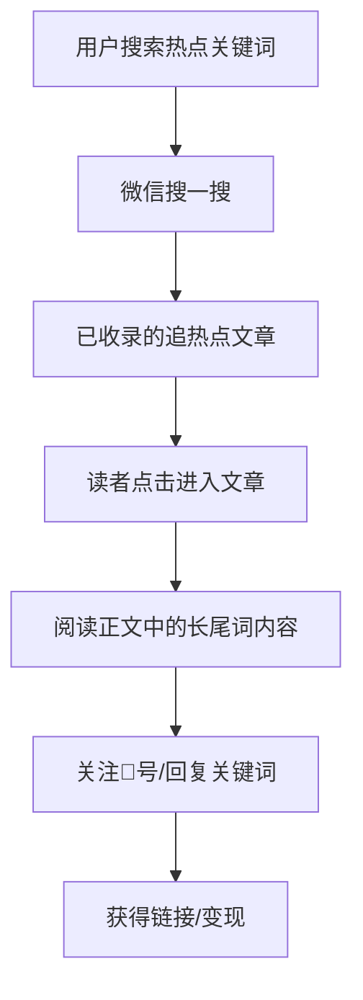

# 第 9 章 副业案例汇编 —— 从“经验分享”到“可复用的知识库”
作者：龙哥

## 学习目标

- 理解副业案例汇编的价值：从碎片信息到结构化知识地图的转变
- 掌握“主题+平台+数据结果”三段式标题格式的设计逻辑与作用
- 理解标题数字杠杆背后的锚定效应与收益预期传递机制
- 能区分案例汇编作为“导航入口”与原文作为“方法论载体”的不同角色
- 能批判性地评估标题数字所暗示的收益预期与实际案例风险之间的张力
- 理解案例汇编作为决策支持的“情报库”价值，识别热点事件中的商业机会
- 掌握从搜索引擎下拉词中发现用户潜在需求的方法
- 理解“信息差搬运”在平台间的内容迁移策略及其适用条件
- 能通过批量矩阵策略提升内容搜索命中率的底层逻辑
- 能区分“泛粉丝”与“精准粉丝”的场景，并制定二次变现策略

## 9.1 生活类比

想象你来到一座陌生的城市，手中拿着一张**城市美食导航地图**。这张地图把散落在城市各处的餐厅连成了可规划的路线——哪家的招牌菜值得专程拐进去，哪家的性价比高适合日常打卡。这就是整张地图的核心价值：它不是一个餐厅的介绍，而是把散落的餐厅组织成一个可供选择的系统。

在这个类比中，**案例汇编（周报）**就是整张地图。它按街区（日期）和菜系（主题）分区，把几十家餐厅的位置、特色、价位组织成一张一目了然的导航图。**案例标题**则是每个餐厅门口的招牌推荐语：“XX招牌菜，人均50元，回头客爆满”——一句话就把这家店的品类、价格区间和口碑浓缩在一起，让你站在门口就能做出初步判断。**标题数字**正是招牌上的客单价和评分，当你看到“人均50元”和“回头客爆满”这些数字时，几乎不用走进店里就能判断这家店是否值得一试——这就是数字带来的锚定效应。

然而，地图终究只是地图，真正的味道只有走进餐厅才能品尝。这就是**汇编与原文**的关系：汇编负责导航，原文承载方法论。地图上那些“今日特供”和“新店开业”的标记，就像汇编中的**热点事件情报**，提醒你哪里有最新鲜的商机——当你看到“行程码下线”这类标记时，你能迅速判断值不值得拐进去一探究竟。而那些藏在巷子深处的隐秘入口，只有懂行的人才找得到——这就是**长尾关键词与搜索流量**的价值：它们不在大街上显眼的位置，但熟门熟路的人总能通过这些暗门找到宝藏。

当你发现一家不错的店，你会希望它在每个路口都开一家分店，让更多人方便地找到它——这就是**批量矩阵**的底层逻辑：把一家店变成连锁分店，每家都开在人流量大的路口，无论你从哪个方向来都能路过它，自然有更多人进店消费。有时你会把东城的一家网红小吃搬到西城，西城的食客会觉得十分新鲜——这就是**信息差搬运**：同一道菜在不同街区的稀缺性不同，东城人吃腻了的，西城人可能正翘首以盼。

记住：地图不能替代美食本身，案例汇编的价值在于导航，而真正的“味道”（方法论细节）需要读者走进原文才能体会。

## 9.2 概念地图

```
副业案例汇编
├── 定义与价值
│   ├── 定期索引合集（按日期编号）   —— 龙哥赚钱周报
│   ├── 结构化知识地图（串联碎片信息）—— 降低检索成本
│   ├── 多平台多赛道覆盖（👸号/抖音/小红书/视频号/TikTok）
│   └── 情报库支撑（热点事件驱动商业机会）—— 行程码热点追涨粉
├── 核心组织形式
│   ├── 实操复盘条目（案例复盘）        —— 周报核心
│   ├── 案例标题格式（主题+平台+数据结果）—— 抓注意力
│   ├── 高密度索引（标题携带数字）      —— 传递可复制性
│   └── 关键词SEO（蹭热点词/下拉词/长尾词）—— 案例正文的流量挖掘
├── 内容策略延伸
│   ├── 搜索流量追热点（长尾词铺设）   —— 蹭微信搜一搜流量
│   ├── 批量做号矩阵（多账号内容差异化） —— 增加收录概率
│   └── 信息差搬运（A平台烂内容B平台爆）—— 渠道间内容迁移
└── 边界与局限
    ├── 导航入口非方法论载体（需读原文）  —— 汇编角色
    ├── 数字的幸存者偏差（掩盖风险）      —— 审慎评估
    └── 泛粉价值密度低（取关率高）        —— 需洗粉或二次变现
```

## 9.3 副业案例汇编 —— 让“散装经验”变成“导航地图”

> “一个定期汇编副业、自媒体、电商、AI应用等实操复盘文章的索引合集，按日期与主题分类。”
> ——《龙哥赚钱周报 202301-02 目录与索引》（来源：docs/202301-02/SUMMARY.md）

让我们从“为什么需要这个概念”开始。假设你是一位刚起步的副业探索者，你每天可能会在👸号、抖音、小红书、知乎上看到大量零散的案例分享。这些文章像是散落在海边的灯塔，各自发光却彼此孤立。当你需要判断“下一个项目该做什么”时，你发现信息分散在不同平台、不同账号、不同时间节点，检索成本极高，更难以形成系统化的认知。单个经验看得再多，你还是很难回答一个关键问题：这些零散的项目之间有什么共性？哪些赛道是被反复验证过的？哪些打法是可持续的？

副业案例汇编（以“龙哥赚钱周报”为代表）正是为解决这个问题而诞生的。从“单篇文章”到“案例汇编”再到“决策情报库”，这一演进过程可以被理解为三个层级：最底层是单篇实操复盘文章，它们各自独立、信息分散；中间层是汇编目录，按日期与主题将这些文章组织为可检索的结构，形成“导航地图”；最高层是情报库，读者不仅能按图索骥，还能通过热点事件感知商业机会、做出前瞻决策。“龙哥赚钱周报”最初收录的案例甚至可追溯至 2022 年 11 月（“龙哥赚钱周报 20221113-20230207”，来源：docs/202301-02/20230207_00.md），这本身就说明了汇编作为“积累型资产”的价值——时间越长，案例越丰富，决策参考价值越高。

> **副业案例汇编**定义（来源：《龙哥赚钱周报 202301-02 目录与索引》，docs/202301-02/SUMMARY.md）

```
副业案例汇编 = 定期发布的索引合集
             ├── 按日期编号（如 202301-02、230207）
             ├── 按主题分类（副业/自媒体/电商/AI应用）
             └── 收录约 40 篇独立实操复盘文章
```

这个定义展示了案例汇编的三大关键性质。第一，**高密度索引**：通过标题携带涨粉数、变现额、成本等具体数字，在标题层面传递“可复制性”与“收益预期”。第二，**多平台多赛道覆盖**：同时汇编👸号、抖音、小红书、视频号、TikTok 等平台及 AI 绘画、Web3、私域裂变等主题。第三，**结果导向**：大量标题包含具体收益或涨粉数字，强调实操复盘的落地性。

让我们看一个典型的例子。“龙哥赚钱周报 202301-02”汇编了约 40 篇覆盖副业、自媒体、电商、AI 应用等方向的实操复盘文章（来源：docs/202301-02/SUMMARY.md）。单个标题示例：“👸号追热点复盘：通过行程码一天涨粉4万+，直接变现6K+”（来源：docs/202301-02/AmKRdF2Z9oQjDExxxuAc18a5nbb.md）。你一眼就能看出：做什么（追热点）、在哪做（👸号）、赚多少（涨粉4万+，变现6K+）。

案例汇编也有明确的边界条件。汇编本身只是入口与导航，不承载实质方法论，读者仍需阅读原文获取细节。标题数字的“收益预期”可能掩盖个案的特殊性与风险，需结合原文审慎评估。更重要的是，汇编不仅能作为被动索引，更可以成为主动决策的情报库。当热点事件（如“行程码下线”）出现时，汇编中对应的复盘（如“一天涨粉4万+”）能成为判断“要不要追、怎么追”的决策参考——这就是从“看案例”到“用案例”的跃迁。

这里有一个设计上的取舍值得思考：为什么选择“汇编+索引”而非“全文收录”？如果直接将 40 篇原文全文收录进周报，虽然省去了读者跳转的麻烦，但周报会变成一本数百页的厚重合集，失去了“快速浏览、快速定位”的导航价值。汇编的选择恰恰是牺牲了“内容即所得”的便利，换取了“一眼扫尽全貌”的效率。正如地图不会把每道菜的烹饪过程写上去——它只需要告诉你方向，味道要你自己去尝。

## 9.4 案例标题格式 —— 用“主题+平台+数据结果”抓住注意力

> “每篇文章采用‘主题+平台+数据结果’的标题结构，如‘单直播间日进800美金-小时均100美金’或‘线上美业，不到2万成本到变现过百万’，以吸引读者并预览收益。”
> ——《龙哥赚钱周报 202301-02 目录与索引》（来源：docs/202301-02/SUMMARY.md）

先来理解“为什么需要这个概念”。汇编中数十篇文章并列呈现，读者需要在几秒钟内判断哪篇值得点开。副业案例的核心价值在于可复制性与收益预期，而标题是传递这些信号的第一载体，你需要一种标准化的标题结构来降低读者的筛选成本。

**案例标题格式**定义（来源：《龙哥赚钱周报 202301-02 目录与索引》，docs/202301-02/SUMMARY.md）

```
案例标题格式 = 主题 + 平台 + 数据结果
             ├── 主题：做什么（如追热点）
             ├── 平台：在哪做（如👸号）
             └── 数据结果：收益预期（如一天涨粉4万+，变现6K+）
```

这个公式展示了标题设计的三个关键性质。**信息密度高**：一个标题同时回答“做什么、在哪做、赚多少”三个关键问题，读者无需点开正文即可作出初步判断。**结果前置**：数据结果往往是读者最关心的部分，放在标题中有效激发点击欲。**可复制性暗示**：具体数字让读者感知到“别人能做到，我也可能做到”，这正是副业案例汇编的核心吸引力所在。

来看几个来自该周报目录的标题实例。第一个是“👸号追热点复盘：通过行程码一天涨粉4万+，直接变现6K+”（来源：docs/202301-02/SUMMARY.md），其中主题是“追热点”，平台是“👸号”，数据结果是“涨粉4万+、变现6K+”，三个要素一目了然。第二个是“实操复盘：10天时间，视频号从0到变现6000+，到场观过万，我做了什么？”（来源：docs/202301-02/SUMMARY.md），主题是“从0到变现”，平台是“视频号”，数据结果是“变现6000+、到场观过万”，并且“10天”这个时间维度进一步强化了“快”的可复制感。第三个是“线上美业，不到2万成本到变现过百万”（来源：docs/202301-02/SUMMARY.md），主题是“线上美业”，平台指向“小红书/私域”，数据结果以“成本2万、变现过百万”的成本收益对比极具冲击力。

第四个例子是“单直播间日进800美金-小时均100美金，价值8800可矩阵的tiktok娱乐直播项目”（来源：docs/202301-02/SUMMARY.md），主题是“娱乐直播”，平台是“TikTok”，数据结果是“日进800美金、小时均100美金”，并且“价值8800”和“可矩阵”这两个附加信息暗示了该项目的变现价值和可复制潜力。

从标题设计的演进来看，简单标题（如“👸号追热点复盘”）仅告知做什么，属于“告知型”；进阶标题加入平台信息（如“👸号追热点复盘”中的“👸号”），属于“定位型”；完整标题则同时包含主题+平台+数据结果（如“👸号追热点复盘：通过行程码一天涨粉4万+，直接变现6K+”），属于“说服型”——它不仅能告知读者“是什么”，更能说服读者“值得看”。这一演进揭示了标题格式设计的核心逻辑：信息越完整，读者的决策成本越低。

这些例子揭示了标题格式的边界条件：标题数据是结果复盘而非承诺，需警惕“幸存者偏差”；过度依赖数字吸引眼球，也可能牺牲对方法论的深度描述。你在设计自己的案例标题时，需要在“吸引点击”与“准确传达”之间找到平衡。

## 9.5 标题数字杠杆 —— 用具体数字撬动“可复制感”

> “通过标注涨粉数、变现额、成本等具体数字，周报可在标题层面传递‘可复制性’与‘收益预期’，以增强汇编的实用性。”
> ——《龙哥赚钱周报 202301-02 目录与索引》（来源：docs/202301-02/SUMMARY.md）

为什么需要“标题数字杠杆”这个概念？因为抽象描述（如“效果不错”）缺乏说服力，难以建立读者的信任与预期；而数字能瞬间锚定读者的收益认知，使其快速判断案例是否值得研读。案例汇编的实用性取决于读者是否能感知“复制后能获得什么”。

那么，数字锚定是如何一步步转化为案例吸引力的呢？这个过程可以分为四个递进环节。第一步，**感知**：具体数字（如“4万+”）为读者提供了一个清晰的收益参照系，使其在瞬间感知到该案例的量级，相当于在读者心中设定了一个“锚点”。第二步，**比较**：读者会不自觉地将这个锚点与自身的预期或过往认知进行比较，当数字显著高于预期时（“一天涨粉4万+”对大多数人而言是惊人的），关注度被瞬间拉高。第三步，**归因**：读者倾向于将这个高收益结果归因于“方法有效”而非“运气或资源”，从而产生“复制该方法即可获得类似结果”的逻辑暗示。第四步，**行动**：在上述认知的驱动下，读者更倾向于点击标题、阅读原文、甚或模仿操作。由此，一个数字完成了从“感知”到“行动”的完整转化链条。

**标题数字杠杆**定义（来源：《龙哥赚钱周报 202301-02 目录与索引》，docs/202301-02/SUMMARY.md）

$$
\text{案例吸引力} = \text{主题相关性} \times (\text{平台可信度} + \text{数字锚定})
$$

这个公式揭示了标题数字杠杆的三大关键性质。**锚定效应**：具体数字为读者提供一个清晰的收益参照系，例如“一天涨粉4万+”让读者瞬间感知到这个项目的高效性。**低成本传递**：不增加正文篇幅，仅通过标题即完成信息传递，这对信息密集的汇编目录尤为重要。**结果导向**：隐含“复制该方法即可获得类似结果”的逻辑暗示，这正是副业案例的独特吸引力。

让我们看一些来自汇编目录的真实例子（来源：docs/202301-02/SUMMARY.md）：“👸号追热点复盘：通过行程码一天涨粉4万+，直接变现6K+”以涨粉数和变现额直观展示结果；“追逐风口，AI绘画目前收益5W+”用收益数字证明AI赛道的变现潜力；另有“IP如何做到风骨体面且年入千万”将“体面”与“年入千万”并置，暗示高质量IP的长线价值。这些标题的共同特征是：每一个都携带一个具体、可感知的量化结果。

然而，从标题策略的演进来看，数字杠杆经历了从“描述结果”到“暗示可复制”再到“制造预期”的升级。早期的标题可能只是陈述事实（“👸号涨粉4万”），进阶版本开始强调时间维度以暗示效率（“一天涨粉4万”），完整的版本则叠加成本对比和平台信息（“不到2万成本到变现过百万”）来最大化预期制造。这是一个不断“加码”的过程——但加码的同时也在累积风险。

我们必须清醒地认识到标题数字的局限。数字是特定时空下的结果，平台规则、市场环境变化后可能失效；高度凝练可能掩盖投入成本、运气成分等关键前提。比如“一天涨粉4万+”读者看不到的是作者此前积累的 12 个👸号矩阵和👸号 SEO 能力（来源：docs/202301-02/AmKRdF2Z9oQjDExxxuAc18a5nbb.md）。因此，你在评估一个标题数字时，需要主动追问：这个数字背后的前提条件是什么？投入了多少成本？是一次性结果还是可持续模式？

这里同样存在一个设计取舍：为什么不用模糊描述（如“效果不错”）来避免误导？因为模糊描述虽然安全，却无法在信息密集的目录中抓住注意力。数字杠杆的选择本质上是在“吸引点击”与“可能误导”之间做出的权衡——精确的数字是双刃剑，它既能瞬间锚定读者的认知，也可能因信息缺失而产生幸存者偏差。关键在于读者需保持审慎，主动追问数字背后的前提与成本。

## 9.6 搜索流量追热点 —— 用“长尾词”在正文里铺设“暗门”

> “我们做的是搜索流量，那相关的搜索长尾词、搜索下拉框词语都可以放进来。文章被收录之后，读者搜索相关长尾词会搜到我们这篇文章。”
> ——《👸号追热点复盘》（来源：docs/202301-02/AmKRdF2Z9oQjDExxxuAc18a5nbb.md，P001）

先理解“为什么需要这个概念”。追热点光靠平台推荐流量不稳定，平台推荐是“看天吃饭”，而搜索流量是“主动狩猎”——只要文章被微信搜一搜收录，就能在用户主动搜索时被找到。微信搜一搜是👸号文章的流量蓝海，主动铺词才能被收录。区别于长期 SEO（将关键词放在标题），短期热点要求快速批量铺设长尾词。

**搜索流量追热点**定义（来源：《👸号追热点复盘》，docs/202301-02/AmKRdF2Z9oQjDExxxuAc18a5nbb.md）

```
搜索流量追热点 = 不坐等平台推荐
             ├── 主动在文章正文铺设搜索长尾词
             ├── 让文章被微信搜一搜收录
             └── 在用户搜索热点关键词时获取搜索流量
```

这个流程展示了搜索流量追热点的四个关键要点。**长尾词放正文而非标题**：这是与长期 SEO 的标志性区别，长期 SEO 将关键词放在标题，而追热点时期选择将词放在正文，以避免标题过于冗长影响点击率。**长尾词来源三法**：微信搜一搜下拉词、微信搜索栏相关搜索、5118 网站长尾词查询。**关键词颜色调暗淡**：这是兼顾阅读体验的细节技巧，避免密集的关键词破坏读者的阅读流畅性。**正文七八百字**：满足👸号在文中添加广告的要求，同时增加被收录的概率。

从流程上看，整个追热点文章的生产可以拆解为“找词—用词—收割”三个阶段，每一步都有其内在逻辑。

**找词阶段**是整个过程的地基。为什么优先使用微信搜一搜的下拉词？因为这些下拉词是平台根据海量用户的真实搜索行为自动统计生成的，它们代表了“用户最常输入的词语”，直接反映了用户的真实需求。为什么还要看微信搜索栏中的相关搜索？因为相关搜索是根据你当前搜索的关键词展示的关联词语，能帮你发现用户搜索时的不同变体表达。为什么第三招是 5118 网站？因为它提供专业的长尾词查询功能，能基于大数据为你扩充词库，覆盖更多潜在的搜索入口。这一步的逻辑是：**你的关键词覆盖越全，被不同搜索习惯的用户找到的概率就越大**。

**用词阶段**的核心在于“自然嵌入”。为什么要将关键词放在正文而非标题？因为追热点时期标题需要保持简洁和吸引眼球，而正文是算法收录的“内容池”。为什么要将关键词颜色调暗淡？因为如果关键词密集出现且颜色过于显眼，会破坏读者的阅读体验——读者是为热点内容而来的，不是来看关键词堆砌的。为什么要控制正文在七八百字左右？因为👸号文中广告的插入需要一定的内容长度，同时这个长度也足以自然容纳多组关键词而不显生硬。

**收割阶段**的关键在于“等待与承接”。文章发布后，系统需要时间收录，之后用户在搜索相关关键词时就能搜到你的文章。此时读者的点击路径是：用户在微信搜一搜输入热点关键词，微信搜一搜返回已收录的追热点文章，读者点击进入文章，阅读正文中的长尾词内容，进而关注👸号或回复关键词，最终获得链接或实现变现。

> 搜索流量追热点方法（来源：《👸号追热点复盘》，docs/202301-02/AmKRdF2Z9oQjDExxxuAc18a5nbb.md）

```
1. 打开微信搜一搜，输入热点关键词，记录所有下拉词（这些词来自真实用户搜索行为，代表高频需求）
2. 在微信搜索栏查看相关搜索，补充用户高频搜索词（发现搜索变体，扩大覆盖）
3. 使用 5118 网站查询长尾词，进一步扩充词库（用专业工具深度挖掘长尾入口）
4. 将所有长尾词自然嵌入正文，并将关键词颜色调暗淡（兼顾算法收录与阅读体验）
5. 控制正文在七八百字左右，满足文中广告插入要求（为变现预留位置）
6. 发布后等待系统收录，通过搜一搜获取搜索流量（等待算法完成收录，收割搜索流量）
```

这段伪代码展示了追热点文章的生产流程。整个流程的核心逻辑是：**内容是迎合平台算法的，而非追求文笔**。正如作者所说：“追热点文章不是需要文笔写的多好，内容迎合平台算法喜好能被收录就行。”（来源：docs/202301-02/AmKRdF2Z9oQjDExxxuAc18a5nbb.md，P001）



值得一提的是，这种从搜索下拉词中发现需求的方法并不局限于👸号场景。个人开发者在挖掘产品需求时同样可以使用类似策略：通过在应用商店、百度、微信、小红书、Google 等搜索框中观察下拉推荐词，就能发现用户真实遇到的搜索需求和问题（来源：docs/202301-02/DNGrdODFBowfk2xwkNCc5GGSnRd.md）。这说明“搜索词即需求”的底层逻辑具有跨场景的普适性。

## 9.7 批量做号矩阵 —— 用“数量”提升“命中率”

> “我用12个👸号，每个👸号8篇文章；总共发布了96篇文章，全部是这样子整合内容。要注意的一点是我96篇文章，每一篇内容都不一样；并且标题都不一样；这样做能够更好的增加被👸号系统收录的概率。”
> ——《👸号追热点复盘》（来源：docs/202301-02/AmKRdF2Z9oQjDExxxuAc18a5nbb.md，P001）

先理解“为什么需要这个概念”。单账号追热点命中概率低，平台搜索收录具有不确定性，多发才有更多被收录机会。如果把追热点看作“撒网捕鱼”，那么单账号就是一张小网，可能一条鱼都捕不到；而批量做号矩阵则是织一张大网，提高整体命中率。从“单号”到“矩阵”的演进，本质上是运营者从“靠运气”到“靠概率”的思维转变——单号是“赌一把”，矩阵是“用数量换确定性”。

**批量做号矩阵**定义（来源：《👸号追热点复盘》，docs/202301-02/AmKRdF2Z9oQjDExxxuAc18a5nbb.md）

```
批量做号矩阵 = 同时运营多个👸号
             ├── 每个号发多篇文章（案例中12个号 × 8篇 = 96篇）
             ├── 全部内容、标题各不相同
             └── 以增加被系统收录的概率
```

实际操作中，作者在追“行程码下线”热点时，使用了 12 个👸号、每个👸号发布 8 篇文章，共 96 篇，且每篇内容与标题都不相同（来源：docs/202301-02/AmKRdF2Z9oQjDExxxuAc18a5nbb.md，P001）。这背后的关键是“批量做号需保证内容差异性”定理：批量发布多篇文章时，每篇内容、标题保持各不相同，能显著提高被👸号算法收录的概率（来源：docs/202301-02/AmKRdF2Z9oQjDExxxuAc18a5nbb.md，P005）。表面上看是“量大管饱”，实质上是“在差异中求生存”——如果 96 篇文章内容雷同，平台可能只会收录其中一两篇，其余全部石沉大海；而差异化内容则让每一篇文章都成为独立的“搜索入口”，互不挤占。

这引出一个关键的数据验证。在追“行程码”热点中，9 个👸号累计新增粉丝 97385 人、取关 52430 人、净增 44955 人，取关率约 53.8%（来源：docs/202301-02/AmKRdF2Z9oQjDExxxuAc18a5nbb.md，P005）。这批数据说明了至少两个关键信号。其一，**批量矩阵的命中率是有效的**：12 个👸号中仅 9 个获得流量，其中 3 个未上排名，即 75% 的账号实现了有效涨粉——也就是说，每 4 个账号中有 3 个能命中搜索流量，这一比例远高于单号追热点的随机性。其二，**热点追粉天然伴随高取关**：超过一半的粉丝在关注后不久便取消关注，这说明热点吸引来的粉丝大多是“一次性围观者”，而非“长期读者”。这两个信号的叠加恰好为后续的“泛粉与洗粉”（详见 9.11 节）埋下伏笔——热点追粉的价值不在于粉丝的“忠诚度”，而在于“到手时的即时变现潜力”。

**批量做号矩阵的边界条件**同样值得注意。如果仅运营一两个账号追热点，建议尽量用自己的话转述文章变成原创文字，更容易被系统收录；而批量做号时，每篇内容与标题必须不同以增加收录概率（来源：docs/202301-02/AmKRdF2Z9oQjDExxxuAc18a5nbb.md，P005）。这意味着“批量做号”与“单号精做”的策略并不相同：前者靠数量取胜，后者靠质量取胜。你在选择策略时，需要先评估自己手里有多少个账号资源——只有一两个号时，与其广撒网，不如深耕原创内容提升单篇质量。

## 9.8 多源对照

不同素材对“副业案例汇编”及相关概念给出了各自视角的阐述。当我们把多篇素材并置观察时，会发现它们共同支撑了案例汇编的底层逻辑，但在视角和侧重上存在微妙差异。

### 共识

**共识一：标题数字的力量。**无论是《龙哥赚钱周报 202301-02 目录》（来源：docs/202301-02/SUMMARY.md）中大量标题携带的具体收益数字（如“一天涨粉4万+”“变现6K+”“变现过百万”），还是运营复盘者火火在《👸号追热点复盘》（来源：docs/202301-02/AmKRdF2Z9oQjDExxxuAc18a5nbb.md）中单日总变现约 1 万元的测算，都验证了“用具体数字传递收益预期”这一策略的有效性。

**共识二：“导航≠方法论”的角色区分。**《龙哥赚钱周报 202301-02 目录》（来源：docs/202301-02/SUMMARY.md）本身只是入口与导航，不承载实质方法论；读者仍需阅读原文获取细节。这一认知是案例汇编作为“结构化知识地图”的价值前提。

**共识三：热点事件是商业机会的信号。**无论是“行程码下线”这一政策热点带来的👸号追涨粉（来源：docs/202301-02/AmKRdF2Z9oQjDExxxuAc18a5nbb.md），还是“AI 绘画”这一技术热点两个月变现 5W+（来源：docs/202301-02/SUMMARY.md），热点事件始终是副业机会的重要触发点。

### 分歧

**分歧一：对“信息差搬运”的适用性判断不同。**《商业项目拆解》素材（来源：docs/202301-02/I9OAdzzs2oBliNxsmPjcHnBUnzf.md，P004）认为渠道间存在信息差，“有些项目在抖音上做得很烂的，但是如果你搬到小红书上面，瞬间就爆了”，这暗示了信息差搬运是普遍可行的低成本策略。而《抖音SEO蓝海》素材（来源：docs/202301-02/CZPydiVmgo2odMx0nWecf3DTn6e.md，P003）则强调“抖音的热度内容不一定在视频号爆”，并指出搜索流量蓝海的原因恰恰是多数人不懂搜索逻辑——这暗示了跨平台迁移需要评估平台调性差异与搜索逻辑差异，不能简单套用。也就是说，信息差搬运并非无条件成立，它对搬运者的优化能力和平台判断力提出了更高要求。

**分歧二：对批量矩阵的适用边界存在差异。**火火的《👸号追热点复盘》（来源：docs/202301-02/AmKRdF2Z9oQjDExxxuAc18a5nbb.md，P005）通过 12 个👸号 × 8 篇、75% 有效涨粉率的实证数据展示了批量矩阵策略的有效性，并给出了“单号追热点建议原创转述”的边界条件。而《龙哥赚钱周报 202301-02 目录》（来源：docs/202301-02/SUMMARY.md）中体现的更多是“多平台多赛道覆盖”的广度策略，即通过覆盖不同平台与主题来分散风险，而非在同一平台内的矩阵化操作。这两种思路反映了“垂直深耕”与“横向扩展”两种不同的风险分散策略。

**分歧三：对汇编角色定位的侧重不同。**部分素材（如《龙哥赚钱周报 202301-02 目录》，来源：docs/202301-02/SUMMARY.md）强调汇编作为**被动索引**的功能——读者按图索骥，找到想看的文章。而《👸号追热点复盘》（来源：docs/202301-02/AmKRdF2Z9oQjDExxxuAc18a5nbb.md）等实操素材则更强调汇编作为**决策情报库**的主动价值——通过热点事件捕捉商业机会，实现从“看案例”到“用案例”的跃迁。这两种定位并不矛盾，但代表了案例汇编不同的价值维度。

## 9.9 设计中的取舍

### 为什么一个看似“只是目录”的汇编，能比单篇文章更有价值？

一张按日期编号、按主题分类的周报目录看起来只是把几十篇文章链接在一起，为何它能比单篇文章更有价值？关键在于索引的**杠杆效应**。单篇文章解决的是“一个项目怎么做的”问题，而汇编解决的是“一批项目里哪个适合我”的问题——后者是更前置、更昂贵的决策。当读者面对数十个项目时，目录本身就是一张决策地图。就像一张美食地图远比一家餐厅的介绍更有价值——因为它让你看见了选择的全貌。但也正因如此，汇编止步于“导航”，无法替代“品尝”。它的价值边界恰好也是它的局限：给你方向，但“味道”仍需你亲自走进原文。

### 为什么要在标题中嵌入具体数字，而不是写“某👸号涨粉数万”？

用模糊的“数万”替代精确的“4万+”，听起来更安全。但标题数字杠杆的关键正是**精确性带来的可感知性**。“涨粉数万”让读者无法判断是 2 万还是 9 万，而“4万+”立刻锚定了一个具体的量级。与此同时，这种精确性也是一把双刃剑：它越是具体，就越容易让读者产生“别人能做到我也能做到”的乐观预期，并忽略背后的平台红利、账号矩阵、SEO 能力等前提条件。因此，“精确”与“误导”之间的平衡，是每一个标题设计者需要持续审视的张力。

### 为什么“信息差搬运”不等于“直接抄袭”？

信息差搬运的本质是“优化迁移”，而非“简单复制”。在抖音做烂的内容搬到小红书能爆，是因为两个平台的调性、用户画像、内容生态不同。但如果不做任何优化（封面、标题、文案结构、话题标签），那只是把“烂”原封不动地搬到了另一个地方——它依然很难在新的平台上获得生命力。从法律和伦理上看，信息差搬运的底线是“有实质性的二次创作”，需要优化而非简单复制，同时需要评估内容版权风险与平台规则差异。搬运的最终目标不是“复制内容”，而是“在新的平台上创造新的价值”——只有围绕目标平台的用户习惯和内容调性进行针对性改造，搬运才可能转化为爆款。

## 9.10 动手练习

*以下练习基于“龙哥赚钱周报”案例集改编，详见下方综合案例背景。*

1. **练习1：拆解标题——从“三段式”到“信息解码”**

   给定以下三个案例标题：
   1. “👸号追热点复盘：通过行程码一天涨粉4万+，直接变现6K+”
   2. “单直播间日进800美金-小时均100美金，价值8800可矩阵的tiktok娱乐直播项目”
   3. “线上美业，不到2万成本到变现过百万”

   请分别完成标注每个标题的“主题、平台、数据结果”三要素，判断每个标题中最吸引你的数字是什么并说明原因，推测每个案例可能投入的成本、周期与风险等任务。然后思考：标题数字传递的“收益预期”与实际案例风险之间可能存在哪些落差？如果你要为一个“小红书资料号一周变现”的案例起标题，你会怎么写？

2. **练习2：汇编设计——从零创建一份“迷你周报”**

   假设你手头有 5 篇真实的副业实操文章（来源不限），请为这 5 篇文章各设计一个符合“主题+平台+数据结果”格式的标题，设置一个合理的分类体系（按平台、按赛道或按变现方式均可），为你的“迷你周报”起一个名字和编号规则，并写一段 50 字以内的周报引言说明本周报的定位与价值。最后思考：你的分类依据是什么？为什么这样分？这样的汇编能帮助读者解决什么问题？不能解决什么问题？

3. **练习3：标题数字杠杆的“放大”与“失真”实验**

   同一案例事实，用三种不同的标题写法呈现：版本 A（无数字）“小红书资料号一周复盘”、版本 B（有数字）“小红书资料号一周变现6000+”、版本 C（夸大数字）“小红书资料号一周轻松月入过万”。请回答：三个版本对读者的吸引力排序如何、为什么？版本 B 与版本 C 在“可复制性暗示”上有何本质区别？当你看到版本 C 时，你的怀疑点有哪些？结合“幸存者偏差”概念，标题数字应该在“吸引”与“诚实”之间如何取舍？

4. **练习4：情报研判——从汇编中发现“风口信号”**

   假设你手中有某期周报，其中包含“👸号追热点复盘：通过行程码一天涨粉4万+，直接变现6K+”与“追逐风口，AI绘画目前收益5W+”两篇文章。请分析这两个案例分别对应什么类型的“热点事件”或“技术突破”，如果你要在下一个热点出现时提前布局，你会用哪些信号（如微信指数、平台规则变化、技术发布）来预判？从“行程码”到“AI绘画”，你能总结出热点变现的哪些共性规律？结合案例分析，“追热点”与“建能力”这两种打法各有什么优劣？

5. **练习5：长尾词挖掘——模拟一次“搜索流量”布局**

   假设你追一个热点事件（如“某明星官宣”），请用微信搜一搜、相关搜索、5118 三种方式各列出至少 3 个与热点相关的长尾关键词，将其中 5 个关键词自然地嵌入一篇 300 字左右的短文正文中，并设计一个符合“主题+平台+数据结果”格式的标题。然后思考：关键词应放在文章的哪些位置（标题、开头、正文、结尾）？为什么？如果只运营一个账号，你还会用“批量矩阵”策略吗？为什么？

6. **练习6：信息差搬运实验——跨平台内容迁移方案**

   假设你在抖音发现一个做得很烂但话题热度高的内容（如“如何用AI画画”），想搬到小红书。请先评估该内容在抖音“烂”的原因（数据差、画面差、还是内容同质化？），然后列出搬到小红书前需要做哪些优化（封面、标题、文案结构、话题标签等），最后预测该内容在小红书爆发的可能性与风险。然后思考：什么类型的内容适合跨平台搬运？什么类型不适合？信息差搬运与直接抄袭的边界在哪里？如何做到“优化搬运”而非“简单复制”？

## 9.11 本章小结

这一章中我们围绕“副业案例汇编”展开学习，理解了从碎片信息到结构化知识地图的转化逻辑。首先，我们认识了汇编的定义与价值：它是一种定期发布的索引合集，按日期编号与主题分类，将多篇独立实操复盘组织为可检索的目录，是“散装经验”到“导航地图”的转化载体。其次，我们拆解了案例标题的“主题+平台+数据结果”三段式格式，理解了它如何在几秒钟内抓住读者注意力。接着，我们深入探讨了标题数字杠杆的锚定效应与收益预期传递机制，并清醒认识到数字的幸存者偏差风险。然后，我们学习了汇编作为“情报库”的主动决策价值——通过热点事件捕捉商业机会，以及搜索流量追热点、批量做号矩阵、信息差搬运等延伸策略。最后，我们区分了汇编（导航入口）与原文（方法论载体）的不同角色，并理解了泛粉与洗粉的二次变现逻辑。

本章我们一起学习了以下概念：

| 概念 | 解释 |
|------|------|
| 副业案例汇编 | 定期发布的索引合集，按日期编号与主题分类，将多篇独立实操复盘组织为可检索的目录结构，是碎片信息到知识地图的转化载体 |
| 实操复盘类目 | 以“👸号追热点复盘”“视频号从0到变现”为代表的案例条目，构成周报的核心内容组织形式 |
| 案例标题格式 | “主题+平台+数据结果”三段式结构，一个标题同时回答“做什么、在哪做、赚多少” |
| 标题数字杠杆 | 在标题中嵌入涨粉数、变现额等具体数字，利用锚定效应传递收益预期，放大案例吸引力 |
| 多平台多赛道覆盖 | 汇编同时覆盖👸号、抖音、小红书、视频号、TikTok等平台及AI绘画、Web3等主题，呈多平台多赛道特征 |
| 搜索流量追热点 | 在文章正文铺设热搜相关长尾词，使文章被微信搜一搜收录以获得搜索流量，是热点收割的核心技术 |
| 批量做号矩阵 | 同时运营多个👸号且每篇内容标题各不相同，以增加被搜索收录的概率，是矩阵化运营的底层逻辑 |
| 长尾关键词 | 通过微信搜一搜下拉词、相关搜索、5118等工具获取的搜索词，置于文章正文以蹭搜索流量，是SEO的核心 |
| 信息差搬运 | 渠道间存在信息差，把A平台做烂的内容优化后搬到B平台可能瞬间爆火，是低成本内容获取的底层逻辑 |
| 导航入口与方法论载体 | 汇编本身只是入口与导航，不承载实质方法论，读者仍需阅读原文获取细节 |
| 幸存者偏差风险 | 标题数字是特定时空下的结果，可能掩盖投入成本、运气成分等前提，读者需审慎评估 |
| 泛粉与洗粉 | 追热点吸引的泛流量粉丝价值密度低、取关率高，可通过电商导购（淘宝客）或筛选高价值粉丝进行二次变现 |
| 情报库支撑体系 | 汇编不仅是被动索引，更是主动决策的情报来源——通过热点事件捕捉商业机会，实现从“看案例”到“用案例”的跃迁 |

下一章中，我们将进入“短视频带货 —— 从‘内容’到‘生意’的必修课”，系统梳理抖音、视频号等主流平台的短视频带货方法论，从赛道选择、内容生产、账号运营到变现转化，帮助你建立从内容到生意的完整闭环。该章的框架源于本教程的大纲设定，作为承接案例汇编与具体平台实操的过渡章节，其内容已在后续章节中详细展开。

