# 第 7 章 避坑与反思 —— 红线在哪里，如何走得更远

## 学习目标

- 理解商业项目拆解的核心逻辑：从“赚钱的别人”拆出“可复制的零件”
- 掌握六维评估模型（流量/销转/交付效率、客单价/毛利率/复购率）给项目算“复制账”
- 熟练运用“卖空气”预售验证与“非规范化生产”快速捏出产品模型
- 掌握软文撰写三板斧：复述问题建立信任、超长文博取算法、过审艺术保存活
- 理解“有效噱头/安慰剂效应”与“软件营销派”的认知套利底层逻辑
- 掌握“套话做局”与“信息差搬运”零成本获取方案与流量的高阶玩法
- 建立“前端流量定生死”的认知，学会“喂养算法”与“下拉词挖需求”搭建情报库
- 掌握项目管理“双案法”（策划案定方向+执行案保落地）与“止损点”设定
- 理解三大杠杆（人力/技术/资源）放大收入的层级与前提条件
- 认清红海赛道“后发制人”的确定性优势，避开“正统的病”与“自嗨式创新”

## 7.1 生活类比

想象副业变现是一场**“拆解名表、组装复刻、批量卖表”**的游戏：  
**商业项目拆解** = 拿放大镜拆解劳力士：不看表面光鲜，只拆机芯(流量)、发条(转化)、表带(交付)三大核心零件；  
**六维评估模型** = 给复刻表算账：走时准不准(效率维度)、卖价高不高(客单价)、利润厚不厚(毛利率)、客户会不会回购换表带(复购率)；  
**卖空气** = 先做张精美海报(预售页)发朋友圈收定金：定金够多再买机芯组装，定金不够直接退款、不亏一分钱；  
**非规范化生产** = 不走瑞士钟表厂正规流程，用3D打印+淘宝零件1周拼出能走时、能戴手上的“野路子”样机；  
**软文三板斧** = 卖表话术：先复述客户“手腕细/怕掉/想装X”痛点(信任) → 甩出100页画册(超长文/专业感) → 换个合规标题“高端商务配饰图鉴”过广告审核；  
**有效噱头/安慰剂** = 表盘印个“航天级防震/量子隐形”名字：机芯还是那块，但客户戴上就觉得“稳了”，甚至真抗摔了(心理暗示)；  
**软件营销派** = 别人发参数表(软营销)，你直接塞块会走的电子样机进客户手里(逼真App) → 客户一把玩：“这表真牛”，哪怕指针是贴纸；  
**套话做局** = 发帖：“我已经搞定劳力士机芯渠道了” → 吸来同行大佬 → 反问“大佬们渠道咋搞定的？” → 整理卖给想搞渠道的小白；  
**信息差搬运** = 把北京秀水街卖烂了的款式，优化包装运到三四线县城夜市 → 当地人从没见过 → 瞬间爆单；  
**喂养算法** = 每天去名表论坛点赞收藏“拆解贴/渠道贴” → 算法把你标记为“表商” → 首页天天刷到同行爆款/新渠道/避坑指南；  
**下拉词挖需求** = 在淘宝搜“劳力士” → 下拉出“劳力士绿水鬼/劳力士保养/劳力士回收” → 这就是用户真在搜、真在愁、真在买的细分生意；  
**双案法/止损点** = 开表行前先立军令状(策划案)：引流款(石英表)/盈利款(机械表)/高利款(镶钻表)；周周核账(执行案/红绿标)；亏超5万/3个月不回本即关门止损；  
**三大杠杆** = 人力：招兼职按SOP发朋友圈卖表；技术：软件批量采集同行朋友圈/自动发圈/群发；资源：找表厂老板谈独家授权/借钱投流；  
**红海不红/后发制人** = 表市场再红，也不缺一个年入百万的表商；别去发明新机芯(0-1创新)，去复制成熟款做微调(1-N复制)才是正道。

## 7.2 概念地图

副业变现实战体系（第7章核心）  
├── 核心方法论：商业项目拆解  
│   ├── 八步拆解法：找项目→拆流量/转化/交付→评估可复制性→定策略/团队/执行  
│   ├── 可复制性判定三标准：爆款非偶然、货源可寻、场景验证有需求  
│   └── 信息差搬运论：A平台烂内容→优化→B平台爆款（跨平台套利）  
├── 评估决策工具：六维评估模型  
│   ├── 效率维度（定可复制性）  
│   │   ├── 流量效率（时间/素材/流量）  
│   │   ├── 销转效率（专业度/SOP/一对多）  
│   │   └── 交付效率（时间/人力）  
│   ├── 财务维度（定收入上限/补偿短板）  
│   │   ├── 客单价  
│   │   ├── 毛利率  
│   │   └── 复购率  
│   └── 及格线：满足4/6维；效率短板→财务补  
├── 产品验证与生产：极低成本闭环  
│   ├── 卖空气/预售验证：制造“已有”假象→先收钱/测需求→卖不动止损  
│   ├── 非规范化生产：野路子/中文编程/现成组件→1周内出模型  
│   └── 软件本质即软文：反推开发流程，甚至不开发找现成交付  
├── 内容与转化技术：算法与人性套利  
│   ├── 软文三板斧：复述问题(信任) + 超长文(算法/SEO) + 过审艺术(生存)  
│   ├── 有效噱头/安慰剂效应：好名字/包装改变认知→驱动购买(边界:合法/兑现)  
│   ├── 软件营销派：App界面碾压纯文本，门槛筛选精准用户+强制分享裂变  
│   └── 套话做局：“已解决”口吻引同行→套方案→卖给未解决者  
├── 情报获取与需求发现  
│   ├── 喂养算法：点赞/收藏/停留驯养商业情报猎犬(专号/垂直/1-2月)  
│   └── 下拉词挖需求：搜索框自动补全=实时真实用户意图(跨平台互验)  
├── 项目管理与风控  
│   ├── 双案法：策划案(货盘分层/里程碑/止损点/放大点) + 执行案(表格化管控/红绿标记)  
│   └── 止损前置：时间/金钱/资源上限→到点未果果断切割(大闸蟹教训)  
└── 放大增长：三大杠杆  
    ├── 人力杠杆：SOP+低成本兼职(5-10min/条/按果付费)  
    ├── 技术杠杆：爬虫/RPA/伪原创/矩阵管理系统(边际成本最低)  
    └── 资源杠杆：资金投流/人脉合伙/渠道置换(门槛高/非核心)

## 7.3 商业项目拆解 —— 把“赚钱的别人”拆成“可复制的零件”

### 为什么需要这个概念？

绝大多数副业失败源于盲目创新，成功者都在复制已验证模式。我们需要一套标准化方法，将别人的成功案例转化为自己的可执行方案，避免“瞎折腾”，把时间花在拆解确定性项目上。

### 核心定义

> "拆下来之后，我就发现很多时候有些项目是完全可以复制的，是不需要投入几十万也可以复制的。复制了之后，用跟他一样的内容生产方式、转化链路，你也能拿到一定的结果。"
> 
> ——《I9OAdzzs2oBliNxsmPjcHnBUnzf.md》

> "通过刷抖音或者刷小红书的过程发现商业案例，再拆解复制这样的案例去形成一个商业模式，去发展自己的副业。"
> 
> ——《I9OAdzzs2oBliNxsmPjcHnBUnzf.md》

**商业项目拆解定义**（来源：《I9OAdzzs2oBliNxsmPjcHnBUnzf.md》）：从爆款内容中逆向提取**流量获取方式**、**转化链路**、**产品交付模式**三大核心模块。不是模仿表面文案，而是拆解底层商业逻辑：赛道（卖什么）、渠道（客户在哪）、转化（怎么成交）。

### 关键性质

- **可迁移性**：拆解出的SOP可直接套用或微调复用
- **低成本验证**：先拆解再决策，规避All in风险
- **信息差属性**：同一项目跨平台搬运即可产生新机会

### 典型例子

儿童游乐项目通过拆解挖掘机视频的内容模式，复制其流量获取与转化链路，仅用3个月实现变现40万。文川手写Logo项目拆解设计类账号的创意生产流程，将设计交付外包给大学生，赚取中间差价。艺术签名项目拆解签名类账号的引流话术，利用免费素材网完成交付，实现月入几千的稳定现金流。这些案例均来源于《I9OAdzzs2oBliNxsmPjcHnBUnzf.md》中的实战复盘。

### 多源对照：商业项目拆解的演进

不同素材对“商业项目拆解”的侧重点有所不同，我们将其并列呈现。

#### 共识

- **核心逻辑一致**：都是从已验证的爆款内容/案例出发，逆向提取流量、转化、交付三大模块。
- **复制而非创新**：均主张“后发制人”，让别人跑通0-1，自己负责1-N的标准化复制。
- **可复制性判定标准一致**：看爆款是否偶然、货源是否可寻、场景需求是否验证。

#### 分歧

| 维度 | 《I9OAdzzs2oBliNxsmPjcHnBUnzf.md》 (秦汉唐视角) | 《DNGrdODFBowfk2xwkNCc5GGSnRd.md》 (个人开发者视角) |
| :--- | :--- | :--- |
| **拆解对象** | 侧重**内容型/实体型副业**（游乐设备、手写Logo、艺术签名、抓娃娃），强调私域流量承接。 | 侧重**软件/工具型副业**（API接口、小程序、脚本），强调“软件本质即软文”、预售验证。 |
| **流量认知** | 提出**“私域痛点在前端流量”**定理，私域只是渠道，前端流量未通则一切归零。 | 认为**App下载门槛高反而是优势**，能精准过滤“看客”，筛选强需求用户。 |
| **交付模式** | 强调外包/现成素材/低成本交付（如大学生设计、免费素材网）。 | 提出**“非规范化生产”**，甚至“不开发软件，找现成软件交付”。 |
| **核心工具** | **八步拆解法**、**项目库**、**喂养算法**、**双案法**、**三大杠杆**。 | **卖空气/预售**、**软文三板斧**、**套话做局**、**下拉词挖需求**、**软件全球化**。 |

### 方法演进图

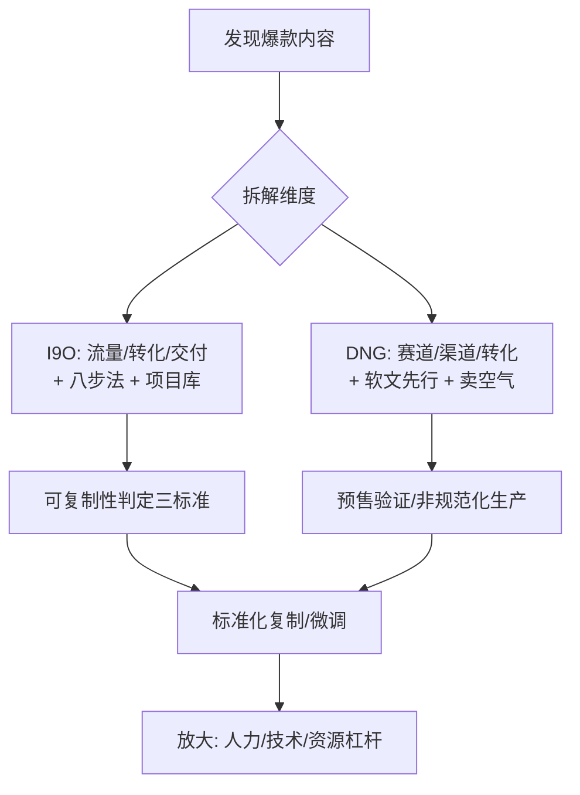

### 边界条件

- 仅适用于“货源非独家、场景验证有需求、爆款非偶然”的项目
- 需具备基础内容生产能力，纯小白需先练基本功
- 赛道红利期有限，需结合平台周期判断入场时机

## 7.4 六维评估模型 —— 给项目算一笔“复制账”

### 为什么需要这个概念？

直觉判断项目靠谱与否极不靠谱，需要量化尺子。必须区分“效率维度”（能不能复制放大）与“财务维度”（能赚多少钱），避免陷入“高流量但不赚钱”或“高客单但跑不通”的陷阱。

### 核心定义

> "任何项目都可以拆解成：「流量效率，销转效率，交付效率，客单价，毛利率，复购率」，这六个点"
> 
> "「六个点，满足的越多越好，满足四个点，及格」"
> 
> ——《NxhWdJj3UoPKvmxaBqkcz8wlntf.md》

**六维评估模型定义**（来源：《NxhWdJj3UoPKvmxaBqkcz8wlntf.md》）：将任意商业项目拆解为六个可量化指标：
- **效率维度（定可复制性）**：流量效率、销转效率、交付效率
- **财务维度（定收入上限/补偿短板）**：客单价、毛利率、复购率

#### 逐层拆解

**1. 流量效率** —— 以「时间、素材、流量」为指标。

推导过程：获取流量的核心投入是“时间”与“素材制作难度”，产出是“流量规模”。若在单位时间内，以低难度素材换取大流量，则该环节杠杆率极高。因此定义比例关系：
$$ \text{流量效率} \propto \frac{\text{获得流量}}{\text{时间投入} \times \text{素材难度}} $$
这个公式揭示了：**花的时间少、素材难度低、获得流量大，即为流量效率高**。例如花5分钟发朋友圈触达1000人，效率远高于花半小时拍视频仅获5000播放。

**2. 销转效率** —— 以「专业度」为指标。

推导过程：销售转化的本质是“销售时间的利用率”。专业度要求越高，越难标准化（SOP）、越难一对多，时间利用率越低。因此定义比例关系：
$$ \text{销转效率} \propto \frac{1}{\text{专业度要求}} \times \mathbb{1}_{\text{可SOP}} \times \mathbb{1}_{\text{一对多}} $$
这个公式揭示了：**专业度要求低（能SOP化）、能一对多、时间利用率高即为销转效率高**。网销按SOP即可，专业度要求低，故销转效率天然高于线下会销。

**3. 交付效率** —— 以「时间」为指标。

推导过程：交付环节消耗的核心资源是“人力时间”。支付即完成交付（如资料、低价课）耗时趋近零，效率最高；陪跑、咨询、定制化服务耗时长，效率低。因此定义比例关系：
$$ \text{交付效率} \propto \frac{1}{\text{交付耗时/人力}} $$
这个公式揭示了：**花的时间少（人力少），即为交付效率高。支付即完成交付（如资料、低价课）则效率最高。**

**4. 客单价** —— 单次交易金额。

**5. 毛利率** —— 扣除直接成本后利润占比。

**6. 复购率** —— 用户二次购买的比例。

### 关键定理

#### 三效率决定可复制性定理

> "流量效率高，意味着内容极其好复制，可以通过矩阵，培训等方式，把这一块单独拎出去，进行放大。"
> "如果流量效率，销转效率，交付效率，这三块有一块低的话，就很难复制放大，那就得在客单价，毛利率，复购率这三块下功夫"
> 
> ——《NxhWdJj3UoPKvmxaBqkcz8wlntf.md》

这个定理展示了：**三效率全高** → 赚多赚少只看流量，可矩阵化/培训放大；**任一效率短板** → 必须靠高客单、高毛利、高复购补偿收入。

#### 六维满足度及格线定理

> "「六个点，满足的越多越好，满足四个点，及格」"
> 
> ——《NxhWdJj3UoPKvmxaBqkcz8wlntf.md》

这个定理给出了项目筛选的硬性标准：**满足4/6维即为合格项目**。

### 典型案例对照表

以下是多个真实项目在六维模型上的定位对比，数据来源：《NxhWdJj3UoPKvmxaBqkcz8wlntf.md》中的案例拆解（小说推文、教育资料1.0/2.0、减肥食谱、项目拆解IP、知识付费）。

| 项目 | 流量效率 | 销转效率 | 交付效率 | 客单价 | 毛利率 | 复购率 | 月收益区间 | 核心洞察 |
| :--- | :---: | :---: | :---: | :---: | :---: | :---: | :--- | :--- |
| **小说推文** | 高 | 高 | 高 | 低 | 高 | 低 | 1k-2w | 三效率全高，但财务维度弱，天花板低 |
| **教育资料 1.0** | 高 | 高 | 高 | 低 | 高 | 低 | 1k-2w | 同小说推文，纯低客单模型 |
| **教育资料 2.0** | 高 | 高 | 高 | **高** | 中 | 低 | 2w-100w | **引入高客单合作转化**，量级跃迁 |
| **减肥食谱** | 高 | 高 | 中高 | 中高 | 高 | **高** | 10w-200w | **复购率高**（减肥是重复过程）支撑高收入 |
| **项目拆解IP** | **低** | 高 | **低** | **高** | **高** | 中高 | 10w-200w | **效率短板靠财务补**（高客单/高毛利） |
| **知识付费** | 高 | 高 | 高 | 高 | **极高(100%)** | 低 | 10w-500w | **六维全满足，毛利率封顶**，顶级模型 |

### 方法演进图

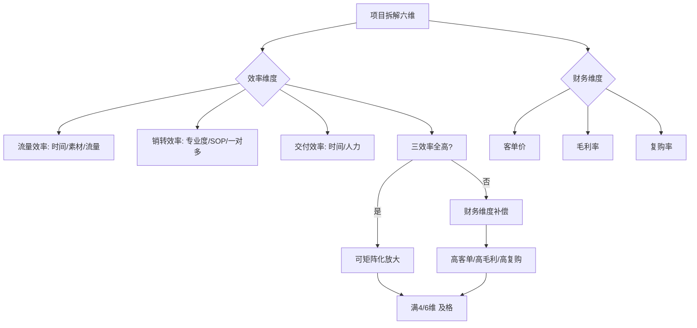

### 边界条件

- 仅作相对评估工具，不替代市场测试
- 行业特性不同，指标权重需动态调整（如重资产行业交付效率天然较低）
- 数据来源必须真实，杜绝幸存者偏差

## 7.5 卖空气 —— 制造“已有”的假象来预售验证

### 为什么需要这个概念？

传统“先开发后售卖”周期长、沉没成本高、死于无人买单。需要极低成本在开发前验证真实付费意愿，解决“需求假象”：用户口头说要≠真掏钱买。

### 核心定义

> "或者直接做个模型，上架开卖，卖空气，卖预售。卖不出去就没必要继续做了！"
> "多年经验总结一个观点：软件的本质就是软文。软件开发出来，怎么推广？还是通过写文章，发广告，介绍你这个软件，软件的最终的展现方式还是软文"
> 
> ——《DNGrdODFBowfk2xwkNCc5GGSnRd.md》

**卖空气/预售验证定义**（来源：《DNGrdODFBowfk2xwkNCc5GGSnRd.md》）：产品不存在时，用模型、截图、预售页制造“产品已就绪”假象，先收钱/测需求。核心逻辑：**软件本质是软文**，先写软文卖预售，卖得动再开发，卖不动直接止损。

### 关键性质

- **反直觉**：越早收钱越安全，免费试用反而验证不了商业价值
- **非欺诈**：承诺交付时间，买不出去退款，卖得出去再补交付
- **配合“非规范化生产”**：1周内捏出模型即可开卖

### 典型例子

淘客API问题：用“已解决”口吻写软文吸引同行加微信，套取真实方案后卖给未解决的精准客户，直接盈利几十万。羊了个羊爆火时：P图999999分截图，以“已开挂”口吻吸粉，游戏大火后套取真外挂变现。礼包软件：根本领不到礼包，但评论区全是“我领到了”的集体幻觉。以上案例均来源于《DNGrdODFBowfk2xwkNCc5GGSnRd.md》实证记录。

### 原文驱动的实操流程

> "我将这个问题用：已经解决的口吻写出来，软文中附加微信号，之后每天都有淘客大佬加我...总有解决的，也总有没解决的。把解决的套出来，卖给精准的，没解决的客户，直接盈利几十万！"
> "个人开发者研发一个软件的时间不应超过1周，超过1周的软件产品不适合个人开发者！"
> 
> ——《DNGrdODFBowfk2xwkNCc5GGSnRd.md》

**卖空气实操步骤（伪代码）**：

```
1. 定痛点：用"复述问题"法写文案，罗列目标用户3-5个具体症状/焦虑
2. 造假象：制作预售页/海报/朋友圈文案，含截图/目录/交付时间/价格/退款承诺
3. 投流测：在精准社群/朋友圈投放，统计：曝光/点击/咨询/支付意向/实际成交
4. 决策：
   IF 成交转化率 > 5% 且 单价 > 成本:
       立即启动非规范化生产交付
   ELSE:
       直接退款/道歉/止损，复盘痛点是否伪需求
```

这个伪代码展示了从“制造假象”到“数据决策”的标准化闭环，核心在于设定明确的**止损阈值**（转化率5%），避免陷入“再优化一下就能卖”的沉没成本陷阱。

### 边界条件

- 必须明确告知预售/交付周期，不可无限拖延
- 核心痛点必须真实存在，不能编造伪需求
- 法律红线：虚假宣传、收费不发货属违法，边界在“承诺兑现”

## 7.6 非规范化生产 —— 用“野路子”快速捏出产品模型

### 为什么需要这个概念？

正规开发流程（需求文档、评审、测试、上线）对个人开发者太重、太慢。个人核心优势是“快”，必须用最笨但最快的工具跑通闭环。避免“正统的病”：没正统的命，得了正统的病（过度工程化）。

### 核心定义

> "个人开发者需要的是'非规范化生产'俗称野路子"
> "非规范化生产的核心是：'降低成本''提升效率'"
> "就怕个人开发者'没有正统的命，得了正统的病！'"
> "个人开发者研发一个软件的时间不应超过1周，超过1周的软件产品不适合个人开发者！"
> 
> ——《DNGrdODFBowfk2xwkNCc5GGSnRd.md》

**非规范化生产定义**（来源：《DNGrdODFBowfk2xwkNCc5GGSnRd.md》）：放弃规范流程，用中文编程、低代码、现成组件拼装，1周内产出可演示模型。核心原则：降低成本、提升效率、贴近用户、靠近需求。产出物：不一定是完美代码，但必须是“能跑、能看、能卖”的模型。

### 关键性质

- **时间箱**：单项目研发≤1周，超时即砍
- **工具无关**：能解决问题的都是好工具（中文编程、RPA、现成API）
- **交付导向**：不写文档、不写测试、不重构，只做能给用户演示的东西

### 典型例子

用中文编程工具1天搭建小程序雏形；直接调用现成AI接口封装成“AI绘画小程序”上架变现；找现成开源项目改UI、改文案、换包名直接上架。这些均为《DNGrdODFBowfk2xwkNCc5GGSnRd.md》所述“野路子”生产方式的实战应用。

### 数据流图：从需求到变现的极简路径

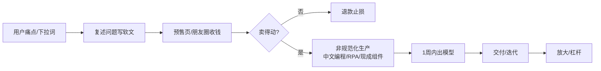

### 边界条件

- 仅适用于MVP验证期，规模化后需重构
- 核心逻辑复杂的项目（如支付、加密）不适用
- 团队协作场景需建立最低代码规范

## 7.7 软文撰写三板斧 —— 复述问题、超长文、过审艺术

### 为什么需要这个概念？

内容平台流量分发靠算法，不懂算法偏好=自嗨。用户不信任你，根本不加微信、不下单。审核机制是生死线，触碰红线=封号清零。

### 核心定义

**软文三板斧定义**（来源：《DNGrdODFBowfk2xwkNCc5GGSnRd.md》）：

1.  **复述问题**：罗列用户症状/痛点，建立“懂你”的信任锚点（如医生问诊）
2.  **超长文**：故意拉长字数、增加停留时间，骗过算法判定为“专业优质”
3.  **过审艺术**：干净截图+合集模板+隐性引导，让审核员觉得“无害/专业”而通过

### 逐层拆解

#### 1. 复述问题 —— 信任锚点

> "举例：就拿看病举例子，医生会问你：'有没有这个症状？有没有那个症状？'结果你发现：'都是我现在的症状'，所以你认为这个医生懂你的病，这次找对了！"
> "所以，这就是一种内容策略，用复述问题建立信任基础！"
> 
> ——《DNGrdODFBowfk2xwkNCc5GGSnRd.md》

这个策略展示了：**信任前置**。用户不关心你会不会治，只关心你懂不懂他的病。复述问题解决“信不信”。

#### 2. 超长文 —— 算法与SEO套利

> "文超长，字超多，审核员懒得看，就行了！可使用：合集、大全、汇总，之类模板，增加文章字数！"
> "用户在你这个文章的页面停留的时间越长，搜索引擎就会觉得你这个文章更专业"
> "知乎只要是长文，点赞收藏就多。看到200字有联系方式或者👸号，先加了在说，然后收藏点赞（反正看不完，以后也不会看）"
> 
> ——《DNGrdODFBowfk2xwkNCc5GGSnRd.md》

这个策略展示了**双重收益**：
- **算法欺骗**：停留时长↑ → 权重↑ → 分发↑
- **SEO红利**：长文天然覆盖长尾词 → 搜索流量↑
- **用户心理**：收藏=占有，点赞=认同，即便不看也完成互动

#### 3. 过审艺术 —— 生存技巧

> "核心是让自己变得至少看起来是无害的。"
> "之前提交一个证明材料，只提交了2页直接给我拒绝了，后面我乱七八糟提交了15页秒过。"
> 
> ——《DNGrdODFBowfk2xwkNCc5GGSnRd.md》

这个策略展示了**审核心理博弈**：
- **干净截图**：无违规水印/二维码/联系方式
- **合集模板**：“大全/汇总/合集”标题 → 审核员预判为“资源贴”而非“广告贴”
- **隐性引导**：“评论区扣1/主页置顶/私信关键词” → 规避敏感词拦截

### 关键性质总结

软文三板斧分别解决信任、分发、生存三大核心问题，形成组合拳：

| 板斧 | 解决核心问题 | 关键动作 | 反制风险 |
| :--- | :--- | :--- | :--- |
| **复述问题** | 信不信 | 罗列症状/痛点，像医生问诊 | 编造伪痛点 → 用户举报 |
| **超长文** | 专不专/存不存 | 合集/大全模板，故意拉长字数 | 全是水文 → 算法降权+用户举报 |
| **过审艺术** | 能不能活 | 干净截图+隐性引导+合集标题 | 平台规则迭代失效 |

### 方法演进图

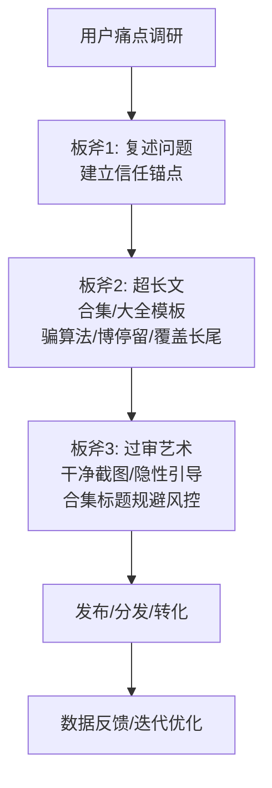

### 边界条件

- 复述问题≠编造问题，必须基于真实用户调研
- 超长文前20%必须有干货，全是水=用户举报+算法降权
- 过审技巧随平台规则迭代失效，核心仍是“提供价值”

## 7.8 有效噱头与安慰剂效应 —— 好名字能改变固有事实

### 为什么需要这个概念？

打破“产品必须解决需求”的教条，承认认知偏差的商业价值。理解“名字决定认知、认知决定支付”的心理机制。区分“合法营销包装”与“欺诈诈骗”的伦理边界。

### 核心定义

> "但还有一个观点没说，那就是：'不解决需求'，'也不是好的产品'，并不会影响赚钱的速度！"
> "医学上有一种安慰剂效应，说白了就是诈骗效应。一个糖豆卖的特别贵，就说这是救命药，你吃了也真管用，患者的康复率30%以上！"
> "连花之所以大卖，就是名字取得好，事实证明起个好名字，真的可以改变固有事实！"
> 
> ——《DNGrdODFBowfk2xwkNCc5GGSnRd.md》

**安慰剂效应/有效噱头定义**（来源：《DNGrdODFBowfk2xwkNCc5GGSnRd.md》）：
- **安慰剂效应**：产品无实质功效，但因用户相信有效而产生正向反馈（康复率30%+）
- **有效噱头**：好名字、好包装、好故事改变用户固有认知，驱动购买决策
- **连花清瘟案例**：名字取得好（连翘+金银花+清瘟），改变“大感冒用抗生素”固有事实

### 关键性质

- **心理账户**：用户买的不是功能，而是“确定性”和“安心感”
- **传播杠杆**：好名字自带传播属性，降低获客成本
- **护城河**：品牌认知一旦建立，比功能壁垒更持久

### 典型例子

礼包软件：根本领不到礼包，评论区全是“我领到了”的虚假好评。羊了个羊P图：999999分截图→吸粉→套真外挂变现。连花清瘟：疫情期大卖，核心是名字击中“清瘟”心理锚点。以上案例均来源于《DNGrdODFBowfk2xwkNCc5GGSnRd.md》观察记录。

### 方法演进图

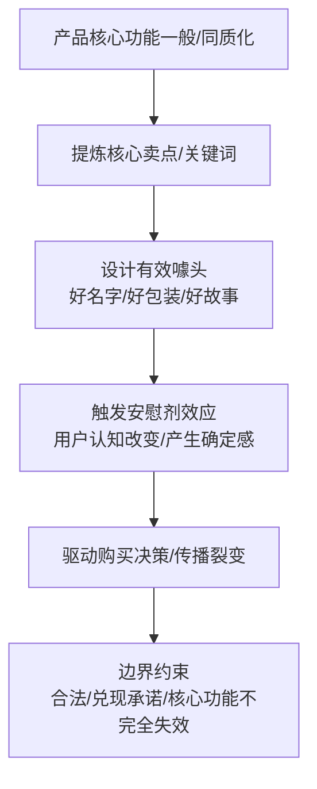

### 设计中的取舍

**为什么不用“踏实做产品”方案？**
- **Trade-off**：踏实做产品需要高研发成本、长周期、高失败率；“有效噱头”成本极低、见效极快、可快速试错。
- **伦理边界**：红线在“核心功能完全失效且无退款机制”（诈骗）、涉及医疗/金融/安全领域的虚假宣传（违法）。底线在“承诺兑现”：哪怕是糖豆，也要让用户吃出“安心感”并提供退款通道。

## 7.9 软件营销派 —— 用“魔法打败魔法”的碾压逻辑

### 为什么需要这个概念？

纯文本攻略（软营销）信任度低、转化弱、易被同质化。用户心智中“软件问题用软件解决”更具说服力。需要一种更高维度的营销形态碾压同行。

### 核心定义

> "软件营销派：核心是，看起来更逼真、更专业。广告隐藏的更深，更容易用户裂变"
> "弄一个APP告诉你，你下载这个APP，填上名字，就可以申请解封！"
> "我不仅有广告，我还强制你分享给别人后才能使用，这可比软文营销狠"
> "但是正因为App使用不方便，却可以当成优势利用一下...用户就会知道，有这么一个App，没有需求的用户不可能去下载。所以用户觉得：该App'真的具有该功能！'"
> 
> ——《DNGrdODFBowfk2xwkNCc5GGSnRd.md》

**软件营销派定义**（来源：《DNGrdODFBowfk2xwkNCc5GGSnRd.md》）：制作逼真App界面/演示视频/交互原型，替代纯文本教程。核心话术：软件问题就要用软件解决，用魔法打败魔法。嵌入强制分享/裂变机制：分享后才能用、看广告才能用。

### 关键性质

- **专业感溢出**：哪怕功能一样，App形态比文档显得专业10倍
- **门槛筛选**：下载安装门槛反而过滤“看客”，留下强需求用户
- **信任锚点**：用户看到App截图/操作流程，默认“功能真实存在”

### 典型例子

微信解封攻略：纯文本版 vs 伪装成“解封助手App”版，后者碾压。强制分享裂变：必须分享到3个群/朋友圈才能解锁功能。羊了个羊刷分器：做成App界面→用户信→强制分享→病毒传播。以上均为《DNGrdODFBowfk2xwkNCc5GGSnRd.md》实战复盘案例。

### 数据流图：软营销 vs 软件营销

```mermaid
graph TD
    subgraph 软营销派[纯文本攻略]
        A1[长文教程] --> B1[用户阅读]
        B1 --> C1[信任度: 低/中]
        C1 --> D1[转化: 靠文案说服]
        D1 --> E1[裂变: 靠利诱/求分享]
    end
    
    subgraph 软件营销派[逼真App界面]
        A2[App/H5演示页] --> B2[用户下载/操作]
        B2 --> C2[门槛筛选: 过滤看客]
        C2 --> D2[信任度: 高(默认功能真实)]
        D2 --> E2[转化: 体验即信任]
        E2 --> F2[裂变: 强制分享解锁/看广告]
    end
    
    style 软件营销派 fill:#e1f5fe
```

### 边界条件

- App上架审核难、推广成本高，常用H5/网页版/企业微信应用替代
- 功能若完全无法兑现，属虚假宣传风险
- 平台打击“诱导分享”行为，需隐蔽裂变路径

## 7.10 套话做局 —— 把“同行的方案”变成“自己的产品”

### 为什么需要这个概念？

自己不会技术/方案，但知道“问题存在”且“有人能解决”。需要一种零成本获取核心方案、反手变现的高阶玩法。利用人性“彰显优越感”心理，让大佬主动交出干货。

### 核心定义

> "我将这个问题用：已经解决的口吻写出来，软文中附加微信号，之后每天都有淘客大佬加我"
> "过了些天，我又反问加我的人'前几天有点忙没来得及回，你们解决了吗？'开始套话，怎么解决的？"
> "总有解决的，也总有没解决的。把解决的套出来，卖给精准的，没解决的客户，直接盈利几十万！"
> "套话之所以能成，主要是因为对方要彰显优越感"
> 
> ——《DNGrdODFBowfk2xwkNCc5GGSnRd.md》

**套话做局定义**（来源：《DNGrdODFBowfk2xwkNCc5GGSnRd.md》）：
1.  步骤1：以“已解决”口吻写软文/发帖，吸引同类问题者/同行加微信
2.  步骤2：过几天反问“大家解决了吗？”，套取真实可行方案
3.  步骤3：整理方案卖给“未解决”的精准客户，赚信息差利润

### 关键性质

- **零成本研发**：方案来自同行，自己只做整合包装
- **精准筛选**：加微信的都是同频人群，转化率极高
- **闭环自洽**：问题真实→需求真实→方案真实→付费真实

### 典型例子

淘客API难题：作者不会技术，用“已解决”帖吸几十大佬→套方案→卖几十万。羊了个羊：P图吸粉→游戏爆火→套真刷分软件→收割韭菜。各类“破解版/外挂/内部渠道”售卖：多为套话得来再倒卖。以上均为《DNGrdODFBowfk2xwkNCc5GGSnRd.md》实证案例。

### 时序图：套话做局全流程

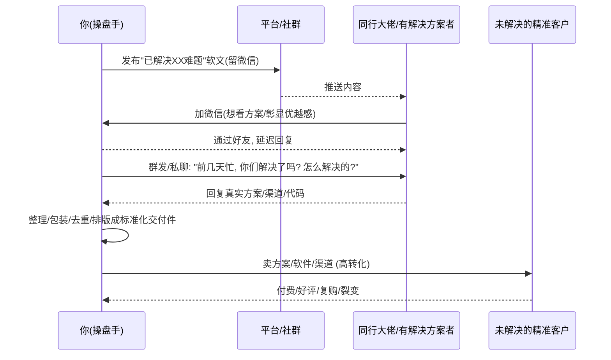

### 边界条件

- 伦理灰区：未经授权倒卖他人方案可能涉及侵权
- 依赖“问题真实存在”，伪需求套不出真方案
- 单次买卖为主，复购率低，需持续找新题材

## 7.11 信息差搬运论 —— A平台的“烂内容”就是B平台的爆款

### 为什么需要这个概念？

打破“内容已饱和”的认知，发现跨平台套利机会。降低内容生产成本：搬运优化≠原创，边际成本趋近零。理解平台算法差异：同一内容不同平台分发逻辑截然不同。

### 核心定义

> "渠道其实是有信息差的，我们做过很多项目，其实吃的就是信息差，有些项目在抖音上做得很烂的，但是如果你搬到小红书上面，瞬间就爆了。有些项目在小红书上面做的人很多了，那你把同样的内容优化一下，搬到抖音上，也有可能把它做爆。"
> 
> ——《I9OAdzzs2oBliNxsmPjcHnBUnzf.md》

**信息差搬运论定义**（来源：《I9OAdzzs2oBliNxsmPjcHnBUnzf.md》）：渠道间存在天然信息差：用户画像、算法偏好、内容生态不同。搬运非抄袭：需针对目标平台优化（标题、封面、节奏、话题标签）。核心公式：**爆款内容 × 平台适配优化 = 新平台爆款**。

### 关键性质

- **单向流动**：通常从成熟平台（抖音）流向新兴平台（小红书/视频号）
- **时间差**：先发制人，在目标平台建立首发优势
- **批量化**：可建立SOP/工具流水线，实现工业化搬运

### 典型例子

抖音做烂的项目→搬小红书瞬间爆（儿童游乐/艺术签名/文川手写）。小红书卷死的赛道→优化搬抖音/视频号→二次收割。知乎长文→改短视频脚本→抖音/视频号分发。以上案例均来源于《I9OAdzzs2oBliNxsmPjcHnBUnzf.md》实战记录。

### 方法对照：搬运 vs 抄袭

合规搬运与违规抄袭的核心区别在于**是否进行实质性改编与平台适配优化**：

| 维度 | **合规搬运/二创 (信息差套利)** | **违规抄袭/搬运** |
| :--- | :--- | :--- |
| **核心动作** | 爆款内容 × 平台适配优化 (换标题/封面/节奏/标签/去水印/混剪) | 直接下载上传，保留水印，不改标题，不改内容 |
| **法律风险** | 低 (构成实质性改编/合理使用) | 高 (侵犯信息网络传播权) |
| **平台风控** | 低 (通过原创检测/去重) | 高 (指纹识别/水印检测/原创保护) |
| **生命周期** | 长 (建立账号权重/粉丝资产) | 短 (号废换号/烧号模式) |
| **商业价值** | 高 (可沉淀私域/品牌/复购) | 低 (纯吃流量红利/一次性) |

### 方法演进图

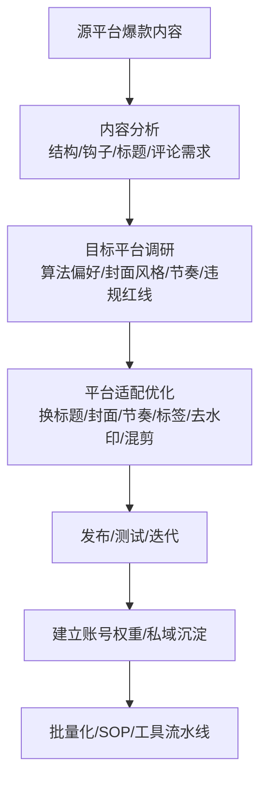

### 边界条件

- 版权红线：直接搬运原创内容侵权，必须二创/改编/授权
- 平台打击：水印检测、指纹识别、原创保护机制持续升级
- 生命周期：信息差窗口期短（3-6个月），需快进快出

## 7.12 喂养算法 —— 驯养一只“商业情报猎犬”

### 为什么需要这个概念？

被动刷信息=娱乐消遣，主动喂算法=商业雷达。平台算法是黑箱，但可通过显性行为（点赞/收藏/停留）显性引导。解决“不知道找什么项目/找不到好项目”的源头问题。

### 核心定义

> "无论是抖音还是小红书，还是今日头条，还是现在的👸号视频号，都是算法逻辑。我上面讲的几个案例、还有我自己拆过的几百个项目，很多都是通过喂养算法刷到的。"
> "我就不断的点赞收藏关注，然后坚持了一、两个月之后，它就不断地给我推送这些文章。"
> 
> ——《I9OAdzzs2oBliNxsmPjcHnBUnzf.md》

**喂养算法定义**（来源：《I9OAdzzs2oBliNxsmPjcHnBUnzf.md》）：在目标平台（抖音/小红书/👸号）批量点赞、收藏、关注、长停留商业类内容。持续1-2个月，算法模型标记你为“商业创作者/关注者”，持续推送同类优质案例。配合搜索/爬虫监测，构建立体情报获取体系。

### 关键性质

- **低成本**：零金钱投入，仅需时间纪律
- **复利效应**：喂养越久，推送越精准，形成专属商业情报流
- **可迁移**：换赛道/平台只需重新喂养新账号

### 典型例子

作者每天2小时泛读商业内容→喂养算法→刷到儿童游乐/文川手写/艺术签名等案例。建立项目库：每周整理飞书文档，几十个项目打分筛选。爬虫监测：技术配合监控竞品数据、爆款阈值。以上均为《I9OAdzzs2oBliNxsmPjcHnBUnzf.md》作者亲身实践。

### 方法演进图

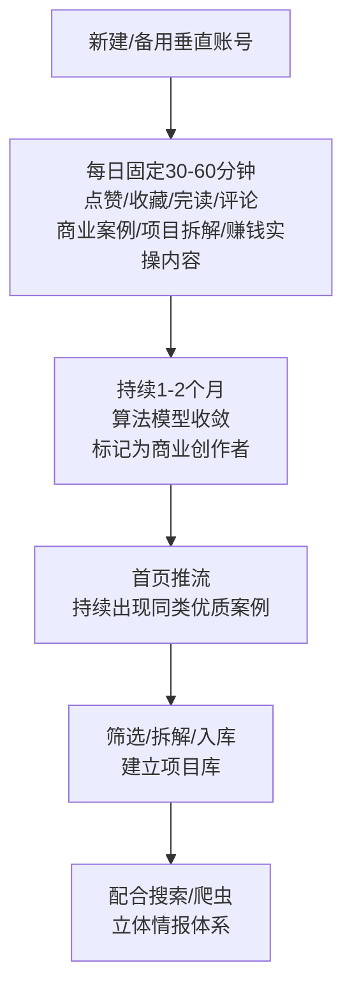

### 边界条件

- 账号垂直度：混杂娱乐内容会污染模型，需专号专用
- 算法周期：新号需1-2周冷启动，老号权重高见效快
- 信息过载：需建立筛选机制（真伪辨别/泛读/重点深读）

## 7.13 项目管理双案法 —— 策划案定方向，执行案保落地

### 为什么需要这个概念？

创意想法多、落地少，“自嗨”不产出结果。缺乏止损机制，陷入沉没成本泥潭（如大闸蟹案例）。团队协作无抓手，责任不清、进度失控。

### 核心定义

> "项目管理。我把它分为两个部分，一个叫策划案，一个叫执行案。策划案就是一个想法、规划、目标制定；执行案就是人员分工、分解执行、过程监控、结果复盘。"
> "策划案，包括你产品货盘是什么...100毫升的是要作为引流产品...500毫升的是盈利产品...1000毫升的是高利润套餐"
> "执行案是什么呢？某一年某一月的核心工作事项...完成的时候要把它标绿，然后未完成或者延期的要把它标红。"
> "止损点什么意思呢？就是你做这个事情不用继续了，你做这个事情的最大限度，你能够承担多大的损失。"
> "虽然我们当时做了4个月的时间，但是就挣了20来万。我从这个事情上我得出一个结论，我这辈子不会再碰电商。"
> 
> ——《I9OAdzzs2oBliNxsmPjcHnBUnzf.md》

**项目管理双案法定义**（来源：《I9OAdzzs2oBliNxsmPjcHnBUnzf.md》）：
- **策划案（想）**：产品货盘(引流/盈利/高利)、运营策略、目标、里程碑、**止损点**、放大点
- **执行案（做）**：时间、地点、事项、责任人、阶段目标的表格化管控（完成标绿/延期标红）
- **双轮驱动**：策划案管“有没有搞错方向”，执行案管“有没有干成事”

### 关键性质

- **止损前置**：启动前设定时间/金钱/资源上限，到点未果果断切割
- **里程碑量化**：关键节点可验证（如首单成交、流量破千、ROI>1）
- **货盘分层**：引流品(低价/免费)→盈利品(主力)→高利套餐(利润最大化)

### 典型例子

儿童游乐项目：策划案定2万加盟费/双渠道引流/3个月止损→执行案周复盘进度。大闸蟹教训：无止损点→做4个月虽赚20万但极其痛苦→立下“不喜欢不碰”铁律。作者个人：每周复盘执行案，红绿标记强制聚焦核心指标。以上均为《I9OAdzzs2oBliNxsmPjcHnBUnzf.md》实战复盘。

### 策划案 vs 执行案 对照表

策划案与执行案分工明确，前者管战略后者管战术：

| 维度 | **策划案** | **执行案** |
| :--- | :--- | :--- |
| **核心职能** | 定方向、定目标、定红线 | 管落地、管进度、管责任 |
| **关键要素** | 货盘分层、运营策略、目标、里程碑、**止损点**、放大点 | 时间、地点、事项、责任人、阶段目标、红绿标记 |
| **更新频率** | 低 (项目启动/重大调整时) | 高 (每日/每周更新) |
| **核心工具** | 思维导图/OnePager/飞书文档 | 甘特表/飞书表格/Notion/Excel |
| **判断标准** | 方向对不对？止损线在哪？ | 事项绿了没？红了怎么办？ |

### 方法演进图

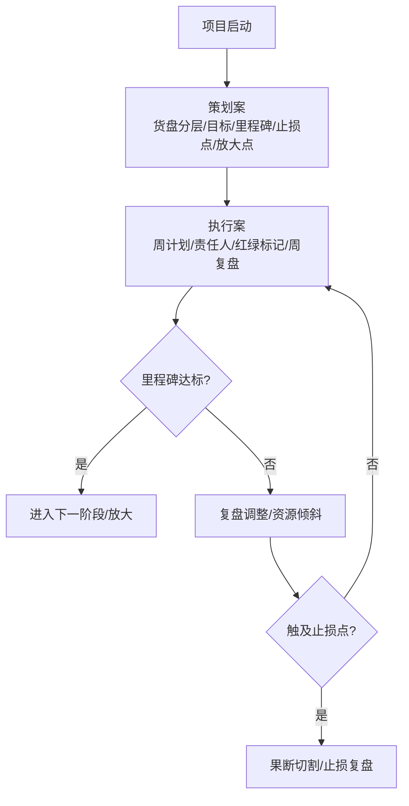

### 边界条件

- 个人独狼可简化为“周计划+周复盘”轻量版
- 策划案宜粗不宜细，核心是止损点和里程碑
- 执行案必须公开透明，团队共享，接受社会监督

## 7.14 三大杠杆放大法 —— 从月入3千到月入30万的复制公式

### 为什么需要这个概念？

单点跑通后，靠自己干永远有天花板（时间/精力有限）。必须把“会做”变成“会教人做/会让机器做/会借资源做”。复制放大是副业变全职、小生意变大生意的必经之路。

### 核心定义

> "人力杠杆。人力杠杆顾名思义是低成本的兼职。比如说要做小红书。我们招了很多兼职小伙伴，通过我们自己的内容生产模式，做成一个 SOP ，帮我们去做引流，5 到 10 分钟一篇笔记，引流加一个微信我给你多少钱。"
> "技术杠杆就是顾名思义通过软件释放你的双手。比如说你可以批量的把某一个领域的小红书笔记批量地扒一下，因为你要抄同行。...用这种工业化的流水线这种方式去完成。"
> "资源杠杆这边我就不多说了，其实就是资金、人脉，不太适合我们大多数人。"
> "有一个哥们，他是一个抓娃娃的高手...卖娃娃就能赚40多万一年...又发展了另外一个变现模式——收徒弟。我教你怎么去商场抓娃娃，收599一个学费...加起来，一年能给他赚个 100 来万。"
> 
> ——《I9OAdzzs2oBliNxsmPjcHnBUnzf.md》

**三大杠杆定义**（来源：《I9OAdzzs2oBliNxsmPjcHnBUnzf.md》）：
- **人力杠杆**：把内容生产/引流/客服做成SOP→招低成本兼职（5-10分钟/条）按结果付费
- **技术杠杆**：爬虫批量采集素材、RPA自动发布、伪原创工具去重、矩阵号管理系统
- **资源杠杆**：资金投流、人脉合伙、渠道置换、品牌授权（门槛高，非核心）

### 关键性质

- **杠杆层级**：技术 > 人力 > 资源（边际成本递增，可控性递减）
- **SOP先行**：无SOP不招人，无工具不放大，否则是“乱放大”
- **复制单元**：以“月入3000的号/店/号”为最小复制单元，复制30遍=月入9万

### 典型例子

小红书矩阵：招兼职按SOP发笔记，加一个微信付佣金，人力杠杆。批量搬运：软件扒同行笔记→二创→定时发布→矩阵收割，技术杠杆。抓娃娃收徒：卖娃娃(货)→收徒599元(课)→徒弟再卖娃娃(裂变)，资源杠杆。以上均为《I9OAdzzs2oBliNxsmPjcHnBUnzf.md》实证案例。

### 架构分层图：杠杆叠加模型

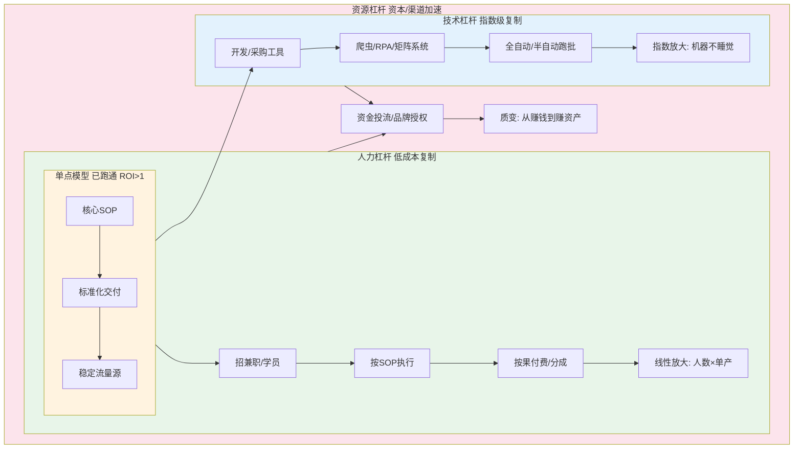

### 边界条件

- 前提：单点模型已跑通（ROI>1、流程SOP化、交付标准化）
- 管理半径：人力杠杆超5人需专人管，技术杠杆需懂技术或找靠谱外包
- 平台风控：矩阵操作极易触发关联封号，需设备/网络/主体隔离

## 7.15 通过下拉词发现需求 —— 从搜索框里“淘金”

### 为什么需要这个概念？

选品/选题最大难点：不知道用户真正在搜什么、愁什么。关键词工具数据滞后/付费，下拉词是实时、免费、真实的用户意图。解决“拍脑袋想需求”导致的无效生产。

### 核心定义

> "发现需求的方式也很简单，去应用商店找一些App名字，输入百度、微信、小红书，Google搜索框"
> "需求是抓住用户遇到问题,用户寻找解决办法产生的行为。围绕用户可能产生的行为场景，在行为中部署产品！"
> 
> ——《DNGrdODFBowfk2xwkNCc5GGSnRd.md》

**下拉词挖需求定义**（来源：《DNGrdODFBowfk2xwkNCc5GGSnRd.md》）：利用百度/微信/小红书/抖音/Google/应用商店搜索框的自动补全推荐词。这些词=真实用户高频搜索查询=真实痛点/需求/场景。核心动作：输核心词→记下拉词→输下拉词→再记下拉词→无限发散。

### 关键性质

- **实时性**：反映当下最热搜索意图，比指数工具快1-2周
- **长尾性**：多为长尾词，精准度高、竞争低、转化好
- **跨平台互验**：同一词在多平台都有下拉=超级强需求

### 典型例子

输入“微信解封”→下拉“微信解封辅助/微信解封平台/微信解封接单”→发现代解封需求。输入“AI绘画”→下拉“AI绘画关键词/AI绘画软件/AI绘画变现”→切中变现痛点。应用商店搜“去水印”→下拉“视频去水印/图片去水印/批量去水印”→细分工具需求。以上均为《DNGrdODFBowfk2xwkNCc5GGSnRd.md》实操方法演示。

### 方法演进图

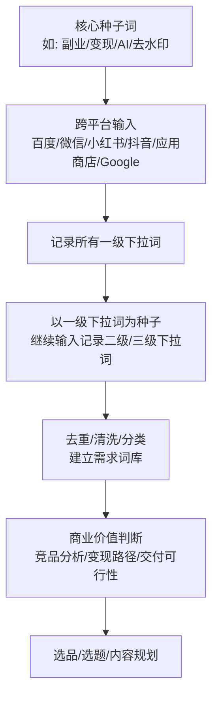

### 边界条件

- 仅反映搜索需求，不代表付费意愿，需结合商业价值判断
- 灰黑词下拉多（解封/刷单/外挂），需合规过滤
- 仅是需求发现起点，后续需验证竞品、变现路径、交付可行性

## 7.16 红海不红 —— 任何赛道都不缺一个年赚几十万的人

### 为什么需要这个概念？

打破“赛道太卷/竞争太大/晚入场没机会”的恐惧心理。重新定义竞争：竞争对手是“同质化低质内容”，而非“赛道本身”。给普通人建立信心：找到已验证项目做微调，比从零创新成功率高百倍。

### 核心定义

> "任何一个红海的赛道都不缺一个一年赚几十万的人，都不缺你一个一年赚几十万的人。"
> "所以你唯一能够要做的事情就是找到一个别人做过的事情，做了并且稳定有赚钱的项目。确定好赛道，给他们更匹配一点的调整就可以赚到钱。从 0 到100w，其实就是找到一个项目。"
> "有一个词叫做后发制人。就是你去做别人做过的事情，将其进行复制或者二次创作。"
> 
> ——《I9OAdzzs2oBliNxsmPjcHnBUnzf.md》

**红海不红/后发制人定义**（来源：《I9OAdzzs2oBliNxsmPjcHnBUnzf.md》）：
- **红海**=需求巨大+供给充分+验证充分，反而意味着“确定性机会最多”
- **核心策略**：不找蓝海，找红海里“已跑通、可复制、可微调”的成熟项目
- **后发制人**：让别人跑通0-1，你负责1-N的标准化复制

### 关键性质

- **天花板高**：红海市场容量大，哪怕分一杯羹也够个人富裕
- **容错率高**：模式成熟、教程多、工具全、供应链全
- **差异化微调**：换平台/换人设/换包装/换钩子/换交付，而非换赛道

### 典型例子

小说推文：极度红海，但坚持做的月入2万+大把。艺术签名：几块钱客单价，做得好的月入几万。抖音书单号/好物分享/知识付费：红海中的常青树。以上均为《I9OAdzzs2oBliNxsmPjcHnBUnzf.md》观察结论。

### 方法演进图

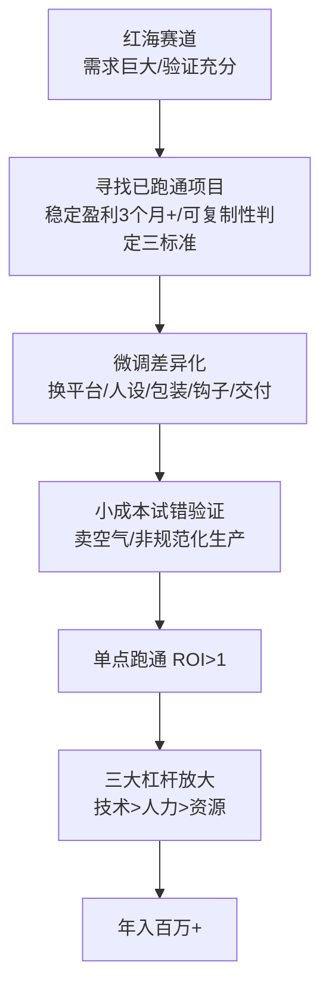

### 设计中的取舍

**为什么不去找“蓝海/新赛道”？**
- **Trade-off**：蓝海意味着“需求未验证、模式未跑通、工具链不全、供应链不全”，你要承担所有试错成本；红海意味着“有人帮你交学费了”，你只需付“复制成本”（微调成本）。
- **认知偏差**：新手倾向于高估“创新的价值”，低估“执行的难度”。后发制人把“不确定性”外包给先行者，自己只承担“执行风险”。

### 边界条件

- 必须有“微调能力”：内容生产/投流/转化/交付至少一项有优势
- 避开“平台严打期/政策红线/巨头垄断”绝对红海
- 切勿裸奔硬刚头部，要找细分缝隙（长尾人群/长尾需求/长尾渠道）

## 7.17 多源对照：核心概念的跨素材映射

本章核心概念在三份核心素材中的映射关系，帮助你建立统一认知。以下对照基于三份素材 `excerpts` 中实际出现的概念与论述整理。

| 核心概念 | 《I9OAdzzs2oBliNxsmPjcHnBUnzf.md》<br/>(秦汉唐·私域/项目拆解视角) | 《DNGrdODFBowfk2xwkNCc5GGSnRd.md》<br/>(个人开发者·软件/工具视角) | 《NxhWdJj3UoPKvmxaBqkcz8wlntf.md》<br/>(六维模型·评估决策视角) |
| :--- | :--- | :--- | :--- |
| **项目发现** | **喂养算法** + 搜索/爬虫 → 建立**项目库** | **下拉词挖需求** + 应用商店/搜索框 → 定选品/选题 | 隐性前置：六维模型用于**评估**发现的项目 |
| **核心方法** | **商业项目拆解** (八步法) | **软文先行/卖空气** + **非规范化生产** | **六维评估模型** (量化拆解) |
| **流量认知** | **前端流量定生死** (私域只是渠道) | **App门槛=精准筛选** (软件营销派) | **流量效率** (时间/素材/流量指标) |
| **转化认知** | 拆转化链路 (私域/直播/朋友圈) | **复述问题建信任** + **套话做局** | **销转效率** (专业度/SOP/一对多) |
| **交付认知** | 外包/现成素材/低成本 | **非规范化生产** / 找现成软件 | **交付效率** (时间/人力指标) |
| **产品验证** | 拆解评估可复制性 (三标准) | **卖空气/预售** (先收钱后开发) | 六维打分 (四维及格线) |
| **内容技术** | 未详述 (侧重私域运营) | **软文三板斧** / 软件营销派 / 有效噱头 | 隐性支撑：高效率源于标准化内容生产 |
| **放大路径** | **三大杠杆** (人力/技术/资源) | **软件全球化** / 矩阵化工具 | **财务维度补偿** (高客单/高毛利/高复购) |
| **风控核心** | **双案法** + **止损点** | 开发周期≤1周 / 合规过审 | 六维诊断 (效率短板→财务补/止损) |

## 7.18 设计中的取舍

### 为什么不用“原创创新/0-1发明”方案？
- **Trade-off**：0-1创新成功率<1%，试错成本极高，周期极长；1-N复制成功率>50%（有验证前提），成本可控，周期短（1-3个月）。
- **适用场景**：只有当你已积累足够资源/技术/品牌护城河，且红海红利耗尽时，才考虑0-1。

### 为什么不用“正规开发流程/完美产品”方案？
- **Trade-off**：正规流程适合团队/规模化阶段，个人阶段“完美”是“上线”的敌人。MVP阶段“能跑、能看、能卖”即合格。
- **认知陷阱**：“正统的病”让个人开发者在架构设计、技术选型、代码规范上耗费大量非增值时间。

### 为什么不用“纯靠内容/纯靠产品”单一维度？
- **Trade-off**：纯内容难变现（流量主收入低），纯产品难获客（无流量入口）。**内容即产品，产品即内容**（软件本质是软文），内容生产SOP化即产品交付标准化。

### 这种设计的核心 Trade-off 是什么？

| 维度 | **选择** | **放弃** | **代价** | **收益** |
| :--- | :--- | :--- | :--- | :--- |
| **创新度** | 微调/二创/复制 | 原创/发明 | 无护城河/易被复制 | 极低试错成本/极高确定性 |
| **开发模式** | 非规范化/野路子/1周 | 正规工程/完美代码 | 技术债/不可维护/难协作 | 极速验证/极低沉没成本 |
| **营销手段** | 认知套利/安慰剂/软件营销 | 实在功能/硬核技术 | 伦理争议/生命周期短 | 极高转化率/极低获客成本 |
| **放大路径** | 杠杆复制/SOP/工具 | 自身时间/精力 | 管理复杂度/平台风控 | 指数级收入/时间自由 |

## 7.19 动手练习

### 实战演练 1：六维模型给某项目“算账”

选取一个你熟悉的副业项目（如：小说推文、知识付费课程、闲鱼无货源、小红书艺术签名、抖音书单号等），按六维模型逐项打分（高/中/低）并简述理由：
1. 流量效率：获取流量耗时？素材难度？流量规模？
2. 销转效率：需不需要高专业度？能否SOP化一对多？
3. 交付效率：付款后需人工介入多久？能否自动化？
4. 客单价：单次交易金额？
5. 毛利率：扣除直接成本后利润占比？
6. 复购率：用户会不会二次购买？

**判断题**：该项目三效率是否全高？若有一项低，靠哪三个财务指标补偿？是否满足“四维及格线”？

**思考**：若要把该项目从月入3千放大到月入3万，优先拉动哪个杠杆（人力/技术/资源）？为什么？

### 实战演练 2：7天“卖空气”预售验证挑战

构思一个你想做但不确定需求的微型产品（如：某垂类资料合集、小工具脚本、付费社群入场券、定制化模板等），执行以下步骤：
1. **定痛点**：用“复述问题”法写一段200字文案，罗列目标用户3-5个具体症状/焦虑
2. **做预售页**：用笔记/海报/表单/朋友圈制造“产品已就绪/内测招募”假象（截图/目录/交付时间/价格/退款承诺）
3. **投流测试**：在精准社群/朋友圈/小号评论区投放预售文案，统计：曝光数、点击数、咨询数、支付意向数、实际成交数
4. **决策**：若成交转化率>5%且单价>成本→立即启动非规范化生产交付；若<5%→直接退款/道歉/止损，复盘痛点是否伪需求

**复盘问题**：预售文案的“复述问题”部分用户反应如何？超长文/合集模板是否提升了停留？有无触碰审核红线？

### 实战演练 3：喂养算法+下拉词 双轮驱动建立项目库

新注册/备用一个抖音/小红书/👸号账号，执行14天情报采集实验：
- **第1-7天（喂养算法）**：每天固定30分钟，仅点赞/收藏/完读/评论“副业案例/项目拆解/商业模式/赚钱实操”类内容，记录算法推荐内容的商业价值占比变化（第1天 vs 第7天）
- **第8-14天（下拉词挖需求）**：每天选3个核心词（如：副业、变现、引流、私域、选品、IP、AI、小程序），在抖音/小红书/微信/百度/应用商店搜索框输入，记录所有下拉长尾词，去重后建立“需求词库”

**产出**：整理一份《第7章实战项目库》飞书文档，含：项目名称、来源(算法推荐/下拉词/搜索)、赛道、渠道、流量模式、转化模式、交付模式、客单价、可复制性打分(1-5分)、止损点设定

**挑战**：从中筛选出1个“三效率均高、财务指标至少1项高、止损点清晰、你有资源优势”的项目，写出《策划案》草稿（货盘/里程碑/止损点）

### 实战演练 4：拆解一个“信息差搬运”跨平台机会

在抖音/快手搜索一个已饱和的热门赛道关键词（如：减肥食谱、英语启蒙、装修避坑、宝宝辅食），找到3个点赞>10w、评论区大量求资源/求购买的爆款视频
1. 分析其：内容结构(前3秒钩子/中间干货/结尾引导)、标题关键词、评论区高频需求词
2. 去小红书/视频号/👸号搜索同赛道，对比前10名内容的：标题差异、封面风格、节奏快慢、引导方式、违规风险点
3. 制作1条“优化版搬运内容”发布在目标平台：换标题(植入下拉长尾词)、换封面(高对比度/强引导)、调节奏(前3秒更猛/中间加字幕/结尾硬广)、加合集标签
4. 连续发布7天，记录：播放/阅读、点赞/收藏/评论、私信/评论区咨询量、转化加微信数

**复盘**：哪个平台的“信息差红利”最大？搬运优化的边际成本是多少？是否触发原创保护/水印检测？如何规避？

### 实战演练 5：软件营销派 vs 软营销派 A/B 测试

选一个你能搞定的微型工具/脚本/资料包（如：批量重命名工具、去水印脚本、考研资料合集、简历模板包），制作两套推广物料：
- **A版（软营销/纯文本）**：一篇3000字超长图文/笔记，含复述问题+详细教程/目录+合集截图+隐性引导加微信
- **B版（软件营销派）**：一个可点击的网页/H5/小程序/企微应用演示页，含逼真UI界面截图/交互演示GIF/核心功能按钮(点击弹窗引导分享/加微信解锁)

在同一私域流量池/社群/朋友圈不同时段各发一次，统计：点击率、分享率、加微信转化率、最终成交率

**分析**：B版的“下载/使用门槛”是否过滤了看客？强制分享裂变是否带来额外曝光？A版的超长文SEO长尾流量长期价值如何？

**决策**：你的主力推广形态选A还是B？还是A引流+B转化？

## 7.20 本章小结

这一章中我们学习、了解、讨论了副业变现的完整实战体系。首先，我们建立了**商业项目拆解**的核心方法论，通过八步法将“赚钱的别人”拆解为可复制的流量、转化、交付零件，并结合**信息差搬运论**跨平台套利；其次，我们掌握了**六维评估模型**这一决策尺子，用流量/销转/交付三效率判断可复制性，用客单价/毛利率/复购率判断收入天花板与补偿策略，设定“四维及格”硬性标准；接着，我们深入实操了**卖空气/预售验证**与**非规范化生产**的极低成本产品闭环，理解了“软件本质即软文”的反直觉逻辑；然后，我们拆解了**软文三板斧**（复述问题/超长文/过审艺术）、**有效噱头/安慰剂效应**、**软件营销派**、**套话做局**四大内容与转化技术，揭示了算法与人性套利的底层逻辑；接着，我们构建了**喂养算法**与**下拉词挖需求**双轮驱动的情报获取体系；最后，我们落地了**项目管理双案法**（策划案+执行案）与**止损点**前置机制，并理解了**三大杠杆**（技术>人力>资源）放大收入的层级与前提，确立了**红海不红/后发制人**的战略定力。

本章我们一起学习了以下概念：

| 概念 | 解释 |
|------|------|
| 商业项目拆解 | 从爆款内容逆向提取流量/转化/交付三大模块，按八步法标准化输出可复制SOP |
| 六维评估模型 | 流量/销转/交付效率(定可复制性) + 客单价/毛利率/复购率(定收入/补短板)，满四及格 |
| 卖空气/预售验证 | 产品不存在时制造假象先收钱测需求，卖得动再开发，卖不动即止损，零沉没成本 |
| 非规范化生产 | 个人开发者专用：抛弃正规流程，用野路子工具1周内捏出可演示、可交付、可卖的模型 |
| 软件本质即软文 | 软件最终靠软文推广，故可反推：先写软文卖预售，卖得动再开发或找现成交付 |
| 软文三板斧 | 复述问题(建立信任锚点) + 超长文(骗算法/博停留/覆盖长尾) + 过审艺术(干净截图+合集模板+隐性引导) |
| 有效噱头/安慰剂效应 | 好名字/包装/故事改变用户认知驱动购买(连花清瘟案例)，边界在合法承诺兑现与核心功能不完全失效 |
| 软件营销派 | 逼真App界面/演示视频碾压纯文本攻略：专业感溢出+下载门槛筛选精准用户+强制分享裂变 |
| 套话做局 | 以“已解决”口吻写软文引同行→反问套取真方案→包装卖给未解决精准客户，零成本研发 |
| 信息差搬运论 | 渠道间天然信息差：A平台烂内容经优化搬运到B平台成爆款，核心公式=爆款内容×平台适配优化 |
| 喂养算法 | 主动点赞/收藏/停留商业内容1-2月，驯养算法模型持续推送精准商业案例，建立专属情报流 |
| 下拉词挖需求 | 利用搜索框自动补全捕捉实时真实用户意图，跨平台互验的词=超级强需求，免费且超前 |
| 项目管理双案法 | 策划案管方向(货盘分层/目标/里程碑/止损点/放大点) + 执行案管落地(时间/地点/事项/责任人/红绿标) |
| 止损点 | 启动前设定时间/金钱/资源上限，到点未达标果断切割，避免沉没成本(大闸蟹案例：不喜欢不碰) |
| 三大杠杆放大 | 技术杠杆(爬虫/RPA/矩阵系统) > 人力杠杆(SOP+兼职) > 资源杠杆(资金/人脉)，前提：单点跑通+SOP化 |
| 红海不红/后发制人 | 任何红海赛道不缺年入几十万的人，核心找已验证项目做微调(换平台/人设/包装/钩子/交付)而非盲目创新 |

下一章中，我们将学习如何将这些零散的实战能力，系统性地整合为**个人商业操作系统**，构建你的“副业进化树”，实现从“会赚钱”到“会生钱”的跃迁。感谢你读到了这里，恭喜你，你已经掌握了副业变现从0到1、从1到N的核心方法论全景图。

