# 第 27 章 创业股权与商业模式创新
作者：龙哥

## 学习目标

- 理解 4C 动态量化股权分配模型的四个维度、权重区间及适用边界
- 掌握股权分配五步法的标准化操作流程与自评互评共识机制
- 洞察“中介费伪概念”背后的信息差商业本质与平台切入逻辑
- 掌握“蹭流截流开店”“二房东渠道”等低成本获客与变现策略
- 能识别初创团队股权设计中的常见误区（如时间投入仅看全职兼职、忽略合同配套）
- 能评估房产 O2O 平台模式在存量时代的可复制性与政策风险边界

## 27.1 生活类比

想象 4C 股权模型是一台**给“切蛋糕”装上“电子秤”的切分机**：**创始人身份** = 蛋糕的“所有权证”，谁兜底风险谁持有，虽不一定分最大块，但掌握切刀控制权；**岗位权重** = 配方里的“核心配料比例”，技术驱动型项目“研发粉”多放，销售驱动型“渠道糖”多放，30%-40% 决定蛋糕口味（核心竞争力）；**时间投入** = “揉面时长 × 发酵效果”，不光看全职/兼职（工时），更看面团有没有按里程碑发起来（产出匹配），还算你带没带来“酵母种子”（引入资源）；**资金投入** = “买原料的真金白银”，下注越重、越早、追加越勤，信心信号越强，分到 20%-50% 权重；**自评互评** = 合伙人围坐圆桌“品尝试吃版”达成共识：这配方大家都认可，才进大烤箱；**五步法** = 标准化 SOP：定配方→备料→定比例→打分→出成品单；**配套合同** = 烤好后的“保鲜膜+防篡改封条”：一致行动权锁控制权、期权池留后手、回购条款定退出价，防止出炉后翻脸。想象“胖龟找房”是**在传统中介“围墙”外搭了个“透明连廊”**：**中介费** = 围墙上的“过路费”，本质是信息差税（买房者不知房东电话）；**个人房屋分享平台** = 拆了墙搭连廊，让房东租客直接握手，平台只收“连廊维护费”（会员费/代办费/佣金）；**蹭流截流开店** = 在对手收费站隔壁搭个“免费通道”棚子，借他流量、打他脸；**二房东渠道** = 找到最怕“空置亏钱”的长租公寓老板，让他买单，租客免费住；**店中店/城市管家** = 把“免费通道”复制成连锁加盟亭，铺到高校/写字楼下的便利店、驿站里。

## 27.2 概念地图

第27章 创业股权与商业模式创新
├── 4C 动态量化股权分配模型
│   ├── 创始人身份（风险承担/控制权） —— 10%-30%
│   ├── 岗位权重（技术壁垒所在岗位） —— 30%-40%
│   ├── 时间投入（产出匹配里程碑+引入资源） —— 10%-25%
│   └── 资金投入（真金白银投票信心） —— 20%-50%
├── 股权分配五步法
│   ├── 步骤1：确定赛道类型（技术/资金驱动 × 自主/孵化）
│   ├── 步骤2：收集创始团队信息（全职/兼职、岗位、出资）
│   ├── 步骤3：自评互评锚定四维度权重比例（共识前置）
│   ├── 步骤4：各股东四维度 1-10 分打分得权重系数
│   └── 步骤5：加权计算初步股权比例（仅为起点）
├── 股权落地配套工具
│   ├── 一致行动权、期权池、分红奖励
│   ├── 回购权、优先清算权、领售权
│   └── 原则：内部不乱才能更好打市场
├── 信息差商业模式：胖龟找房
│   ├── 核心主张：中介费是信息差造成的伪概念/智商税
│   ├── 平台定位：个人房屋分享平台（非中介、非伪第三方）
│   ├── 变现组合：年费会员+开发商返佣+代办费+租房佣金（二房东付）
│   ├── 低成本获客三法
│   │   ├── 蹭流截流开店（开在标杆中介隔壁）
│   │   ├── 二房东渠道（空置即亏损、付费意愿最强）
│   │   └── 全域发掘租客（抖音/58/转转/豆瓣矩阵）
│   └── 标准化运营 SOP
│       ├── 房东电话获取（物业/水电费号/同行转化）
│       ├── 配房-带看-成交标准流程（3-5-7套匹配、密码锁自看、线上签约）
│       └── 城市合伙人/店中店裂变复制（城市管家+便利店/驿站联营）
└── 避坑与边界
├── 股权：时间投入≠全职兼职、初步比例非终点、共识机制失效则模型失效
├── 房产：外包选型避坑、招聘偏好应届生、抖音>自媒体>广播、警惕骗子融资
└── 周期：存量时代来临、政府 0 中介费平台形成政策性竞争

## 27.3 4C动态量化股权分配模型 —— 给切蛋糕装上“电子秤”

### 为什么需要这个概念？

初创团队常因股权分配不公导致拆伙，核心原因是对各自“重要程度”判断不一致。传统谈判式分配靠吵、靠关系，缺乏客观标准，事后难以服众。我们需要一个可量化、可复盘、能达成共识的工具，把定性争论变成定量计算。

> "今天给大家提供一个工具，这个工具的名称叫 4C 动态量化股权分配模型。4C中的C，就是资本的意思，资本我们分为人力资本和货币资本。再细分成4个维度的话，就是创始人身份、岗位权重、时间投入、资金投入。这四个维度是这个工具里面已经给大家植入的一个参数，这个参数是在一定的范围内波动的。"
> 
> ——《C0dydiFPCoBI3LxemwWcXpdxn2e.md》

### 核心定义

**4C 动态量化股权分配模型**将资本拆解为人力资本与货币资本，细分为四个维度，每个维度设定参考权重区间：

$$
\begin{aligned}
\text{创始人身份权重} &\in [10\%, 30\%] \\
\text{岗位权重} &\in [30\%, 40\%] \\
\text{时间投入权重} &\in [10\%, 25\%] \\
\text{资金投入权重} &\in [20\%, 50\%]
\end{aligned}
$$

**公式逐项释义**：
- 四个不等式分别给出四个维度的**允许波动范围**，而非固定数值。
- 区间源自“成百上千个案例积累下来的一个经验”，但文中未提供实测统计样本，故视为**经验性锚定区间**。
- 具体比例需结合赛道类型（技术驱动/资金驱动、自主/孵化）并在创始团队自评互评中锚定。

**为什么采用区间而非定值？**  
不同赛道的核心生产函数不同：技术驱动型项目的核心壁垒在研发岗，岗位权重上浮；资金驱动型项目的扩张速度受限于现金流，资金投入权重上浮。区间保留了“微调自由度”，让模型能在保持结构不变的前提下适配多样赛道。

### 关键性质

- **动态可调**：权重非固定，随赛道类型微调。技术驱动型项目岗位权重上浮，资金驱动型项目资金投入权重上浮。
- **共识机制**：必须经创始团队自评互评达成一致，否则模型失效。这是“切蛋糕前先试吃”的关键步骤。
- **起点非终点**：算出比例仅是起草，后续仍需配套一致行动权、期权池、回购条款等合同规范。

### 典型例子

儿童体能训练项目：三合伙人启动资金 200 万，经自评互评定岗位权重 7:2:1、时间投入 6:3:1，结合出资额算出最终股权比例。

### 边界条件

- 仅适用于早期初创团队，上市后或引入机构投资后需转为律师主导的法律架构设计。
- 若团队无法就维度权重达成共识，模型无法运转，需先解决信任问题。

### 方法演进图

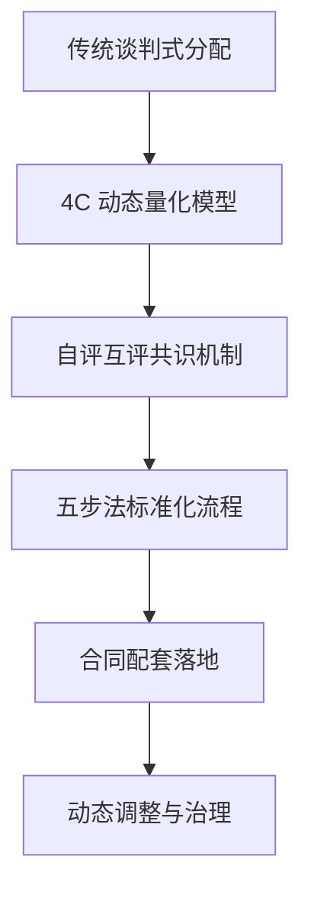

## 27.4 创始人身份 —— 谁兜底谁说了算

### 为什么需要这个概念？

公司对外必须只有一个声音，必须明确最终决策者和兜底者。很多团队把创始人当荣誉头衔分，导致出事时没人敢担责。

### 核心定义

**创始人身份**不是荣誉，而是风险承担者的代名词：谁愿无条件为项目兜底，谁就是创始人。在 4C 模型中权重 10%-30%，虽非最高但最关键，决定控制权归属。

> "创始人身份它其实是最重要的，我认为谁承担最大的风险，谁就最有控制整个企业的需要。……谁来最后承担这个兜底的人，那么我会认为这个人他就是发起人和创始人。……创始人身份的权重通常在10%-30%。"
> 
> ——《C0dydiFPCoBI3LxemwWcXpdxn2e.md》

> "在我看来，它其实代表着风险承担，就谁最后在兜底。当这个项目不成立或这个项目遇到了极大的风险，谁愿意无条件的去为这个项目兜底，那这个人就是创始人，他对这个项目的付出程度是跟其他的合伙人完全不一样。创始人的身份是要极度明确的，从一开始就要很明确，它是要能控制这个项目的，一家公司最后对外的时候，应该只有一个声音。"
> 
> ——《C0dydiFPCoBI3LxemwWcXpdxn2e.md》

这段话揭示了创始人身份的**三重含义**：风险兜底、决策控制、对外统一声音。权重虽只 10%-30%，却是控制权的“定海神针”。

### 关键性质

- **排他性**：一家公司只能有一个真正的创始人身份持有者（或明确的控制权集合）。
- **先发性**：必须从项目开始就极度明确，不能等出事再指定。
- **非财务性**：纯财务投资人（LP）不具备创始人身份，不参与运营控制。

### 典型例子

素材中儿童体能项目案例：小明作为发起人承担创始人身份，虽出资仅 50 万但掌握控制权。

### 演进与决策流程


## 27.5 岗位权重 —— 找到行业的“技术壁垒在哪个工位上”

### 为什么需要这个概念？

不同赛道核心竞争力所在岗位不同，技术驱动型重研发，销售驱动型重市场。合伙人常高估自己岗位价值，导致隐性矛盾随公司壮大爆发。

### 核心定义

**岗位权重**反映行业技术壁垒所在的关键岗位权重，权重区间 30%-40%。需结合赛道类型判断：技术驱动型项目研发岗权重高，资金驱动型项目渠道/销售岗权重高。

> "2.岗位权重，就是这个行业技术壁垒在哪里，那个岗位是最重要的。……这个分歧在我们前期做股权设计的时候，大家可能不容易发现，但是在公司发展壮大的过程中，越到后面越会产生一些隐患。……岗位权重通常在30%-40%。"
> 
> ——《C0dydiFPCoBI3LxemwWcXpdxn2e.md》

这段话指出岗位权重是**隐性冲突源**：前期不易察觉，后期最易引发利益撕裂。赛道定性直接决定“谁是主厨”。

### 关键性质

- **赛道相关性**：同一岗位在不同赛道权重天差地别。AI 项目重算法工程师，电商项目重供应链/运营。
- **动态迁移**：随公司发展阶段变化，核心岗位可能迁移（如早期重产品、后期重销售），需动态调整。
- **非职级等价**：避免将岗位权重等同于职级工资，二者维度不同。

### 典型例子

儿童体能项目：教练/运营岗为核心壁垒，小明负责该岗位获岗位权重系数 7，远高于小磊 2 和小胡 1。

### 赛道类型与岗位权重对照表

以下是赛道类型对岗位权重倾向的影响：

| 赛道类型 | 典型代表 | 核心岗位（高权重） | 次要岗位（低权重） |
|----------|----------|-------------------|-------------------|
| 技术驱动 × 自主创业 | AI、芯片、生物医药 | 研发/算法/技术合伙人 | 销售/运营/财务 |
| 技术驱动 × 集团孵化 | 大厂内部孵化项目 | 产品/技术落地负责人 | 市场/渠道 |
| 资金驱动 × 自主创业 | 房产中介、加盟连锁 | 渠道拓展/销售/BD | 产品/技术/行政 |
| 资金驱动 × 集团孵化 | 集团新业务线 | 资源整合/政府关系/财务 | 执行/运营 |

**表格引导语**：上表展示了“技术/资金驱动”与“自主/孵化”两个维度交叉形成的四类赛道，各类赛道的核心岗位与次要岗位差异，直接决定了岗位权重在 30%-40% 区间内的微调方向。

### 岗位权重随阶段迁移示意

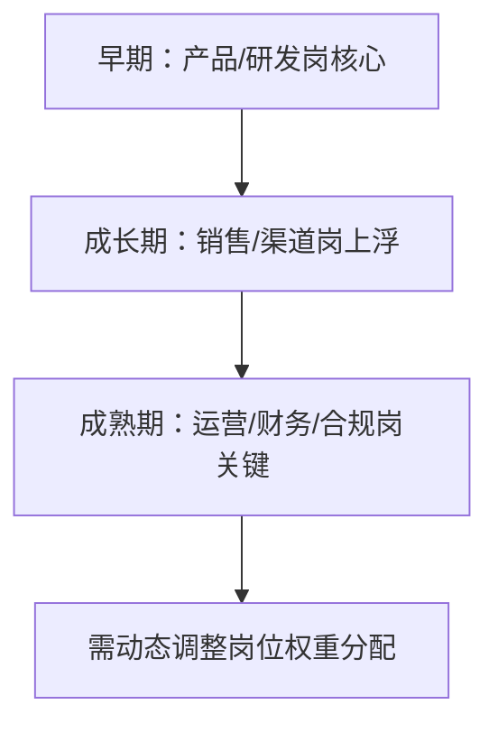

## 27.6 时间投入 —— 不止全职兼职，要看“产出匹配里程碑”

### 为什么需要这个概念？

约 60% 项目里除财务投资人外全员全职，单纯区分全职/兼职失去区分度。关键在于投入的时间精力是否匹配项目里程碑进展，以及愿意引入何种外部资源。

### 核心定义

**时间投入**衡量维度：投入时间精力大小 + 愿意引进的资源 + 产出是否匹配里程碑。权重区间 10%-25%，按 1-10 分制打分量化。

> "3.时间的投入，最简单的划分就是全职还是兼职，投入精力的大小等。时间投入的权重通常在10%-25%。"
> 
> ——《C0dydiFPCoBI3LxemwWcXpdxn2e.md》

> "但是大家有没有想过，就是其实有 60% 左右的项目，所有的合伙人除了纯财务投资人之外，其实都是全职参与的。只是说你全职参与的这个产出它是不是就能匹配的到这个项目的所有的进展，项目到达的里程碑是不是跟你全职参与有必然关系。所以我们前期在做股权设计的时候，就一定要讲清楚，这个时间投入，它对应的除了是我们投入的时间精力，还有我们愿意引进的资源，愿意为了这个项目付出多少，不单单只是一个全职兼职。"
> 
> ——《C0dydiFPCoBI3LxemwWcXpdxn2e.md》

这段对话揭示了**时间投入的三维度量化标准**：
1. **工时投入**：全职/兼职只是基础分
2. **里程碑匹配**：产出是否支撑关键节点（如 MVP 上线、首单成交、融资到账）
3. **资源外溢**：引入人脉、渠道、信息等隐性资源的能力

### 关键性质

- **里程碑绑定**：时间价值取决于业务进度匹配度，而非工时长短。
- **资源外溢**：含隐性引入资源（人脉、渠道、信息）能力。
- **兼职不等于低分**：若兼职引入关键资源可得高分。

### 典型例子

体能项目案例：小明全职运营匹配里程碑得 6 分，小磊兼职配合得 3 分，小胡仅出资不参与运营得 1 分。

### 边界条件

- 需前期约定里程碑标准，否则事后扯皮无据。
- 兼职不代表低分，若兼职引入关键资源可得高分。

### 多源对照：不同素材对“时间投入”理解的异同

**共识**：时间投入不应单纯等同于全职/兼职二分法，需结合产出与里程碑。

**分歧/补充**：
- 《C0dydiFPCoBI3LxemwWcXpdxn2e.md》强调“产出匹配里程碑 + 引入资源”双维度，权重 10%-25%；
- 《PglAdRMiIoVTRyxc4Q3cw8hvnWf.md》在团队搭建中提到“约 60% 的项目合伙人其实都全职参与，因此衡量时间投入不能只看全职兼职，更要看产出是否匹配项目里程碑及愿意引进的资源”，观点一致；
- 实操中常见误区：直接按全职=10分、兼职=5分打分，忽略里程碑匹配度与资源引入。

### 时间投入评分逻辑图

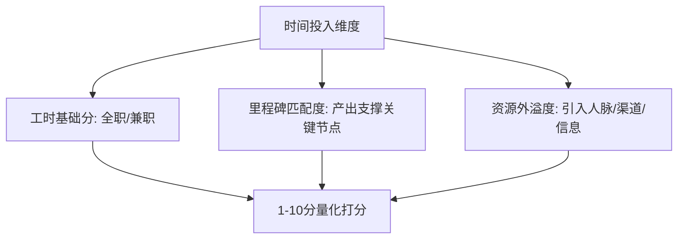

## 27.7 资金投入 —— 用真金白银投票表决信心

### 为什么需要这个概念？

资金投入不仅是输血，更是判断合伙人对项目信心和风险意愿的硬性信号。谁愿下重注，谁就更有动力推动项目成功。

### 核心定义

**资金投入**指项目前期实际到账出资额，权重区间 20%-50%。可通过出资比例、出资节点、是否追加投资等量化打分。

> "4.资金的投入。这个比较好理解，所有的项目都会有一个前期资金的投入。……我们可以通过时间投入和资金投入去判断这个合伙人他对项目的信心和他愿意承担多大的风险。资金投入的权重通常在20%-50%。"
> 
> ——《C0dydiFPCoBI3LxemwWcXpdxn2e.md》

### 关键性质

- **信号价值**：出资额度反映合伙人风险偏好与信心度。
- **杠杆作用**：资金驱动型项目中该维度权重上限可达 50%。
- **节点敏感**：资金到位节点（注册前/后、分期到账）影响实时权重计算。

### 典型例子

体能项目：小胡出资 150 万占启动资金 75%，资金投入系数最高；小明出资 50 万；小磊不出资系数最低。

### 边界条件

- 纯财务投资人（LP）仅参与资金投入维度，不参与其他三维度。
- 资金到位节点（注册前/后、分期到账）影响实时权重计算。

### 资金投入权重与赛道类型关系

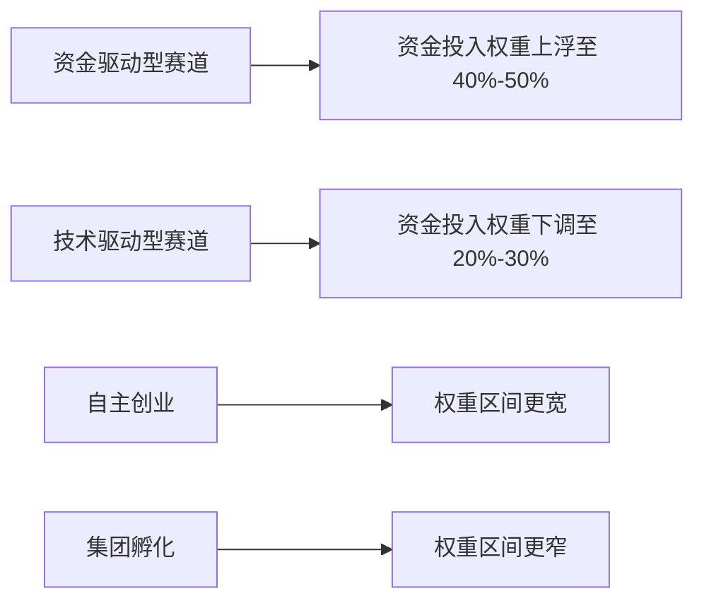

## 27.8 股权分配五步法 —— 从吵架到算账的标准化动作

### 为什么需要这个概念？

将主观博弈转化为标准化流程，降低沟通成本，提升公平感。给新手创业者提供“拿来即用”的操作手册。

### 核心定义

**股权分配五步法**具体操作流程：

```
步骤 1：确定行业赛道（技术/资金驱动 × 自主/孵化）定基础权重区间
步骤 2：收集创始团队信息（全职/兼职、岗位分工、出资额度）
步骤 3：自评互评确定四维度权重比例（达成共识是前提）
步骤 4：各股东四维度打分 1-10 分得权重系数
步骤 5：加权计算最终股权比例
```

> "在确认四个维度的权重比例后，我们会按照五步法来计算出各个股东的最终股权比例，下面带大家一起过一个真实案例。第一个步骤：确定行业和赛道……第二个步骤：收集创始团队信息……第三个步骤：确定每个维度的权重比例……第四个步骤：确定股东四个维度的权重系数……第五个步骤：计算出各个股东的股权比例。"
> 
> ——《C0dydiFPCoBI3LxemwWcXpdxn2e.md》

> "我们要先确定赛道，也就是你所处的行业，不同的赛道，对资金和技术的权重不一样。我们把行业分成2个维度四个类型，分别是技术驱动型/资金驱动型，以及自主创业型/集团孵化型……"
> 
> ——《C0dydiFPCoBI3LxemwWcXpdxn2e.md》

> "我们要开始收集合伙人的信息，也就是创始人的信息和其他联合创始人的信息。以及这个项目里面谁是全职，谁负责哪个岗位，各自出资额度等。"
> 
> ——《C0dydiFPCoBI3LxemwWcXpdxn2e.md》

> "这涉及到刚刚说的另一个工具，创始团队之间的自评和互评，从而达成一个共识，股东们要先认可这个赛道的这4个维度就是在这样的一个区间波动微调。"
> 
> ——《C0dydiFPCoBI3LxemwWcXpdxn2e.md》

> "我们确定了每个维度的权重比例之后，就要确定股东四个维度的权重系数，按从 1 到 10 各自去打分……"
> 
> ——《C0dydiFPCoBI3LxemwWcXpdxn2e.md》

### 关键性质

- **共识前置**：步骤 3 未达成共识则后续步骤无意义。
- **可追溯**：每步留痕，事后复盘有据可查。
- **仅输出初步比例**：必须配套法律文件（一致行动权、期权池、回购条款等）才能落地。

### 典型例子

体能项目完整演示：赛道定为自主创业 + 技术驱动型 → 收集三人信息 → 自评互评定权重 → 打分系数 → 算出比例。

### 计算公式

设四维度权重比例为 $W = [w_1, w_2, w_3, w_4]$（创始人身份、岗位权重、时间投入、资金投入），股东 $i$ 在四维度的权重系数为 $S_i = [s_{i1}, s_{i2}, s_{i3}, s_{i4}]$（1-10 分），则股东 $i$ 的加权得分：

$$
\text{Score}_i = \sum_{j=1}^{4} w_j \times s_{ij}
$$

初步股权比例：

$$
\text{Equity}_i = \frac{\text{Score}_i}{\sum_k \text{Score}_k} \times 100\%
$$

**公式逐项释义**：
- $w_j$：第 $j$ 个维度在自评互评中锚定的权重比例（如岗位权重 0.35），满足 $\sum w_j = 1$。
- $s_{ij}$：股东 $i$ 在第 $j$ 维度通过自评互评得到的 1-10 分系数（如小明岗位权重得 7 分）。
- **加权求和**：$\text{Score}_i$ 将四个维度的“重要性权重”与“个人贡献系数”逐项相乘再求和，体现“维度重要 × 个人在该维度表现”的乘积逻辑。
- **归一化**：除以所有股东得分之和，转为百分比，保证总和为 100%。

**为什么采用加权归一化？**  
该方法满足“维度正交、贡献可比、总和守恒”三条件：四维度覆盖人力/货币资本全景且两两正交；1-10 分制将异质贡献映射到同一量级；归一化将绝对分转为相对份额，直接对应工商登记比例。

### 五步法流程图

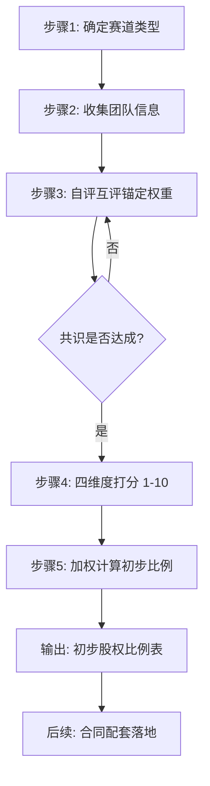

## 27.9 股权落地配套工具 —— 烤好蛋糕还要“保鲜膜+封条”

### 核心定义

算出初步比例只是起点，必须配套以下合同规范：

| 工具 | 作用 | 关键约定 |
|------|------|----------|
| 一致行动权 | 锁定控制权，防止表决分散 | 创始人持有表决权委托，重大事项一票否决 |
| 期权池 | 预留 10%-15% 吸引核心人才 | 行权价格、行权期限、回购条件 |
| 分红奖励 | 短期激励，不稀释股权 | 利润分红比例、触发条件 |
| 回购权 | 明确退出定价机制 | 回购价格公式（如净资产倍数/估值折扣）、触发事件 |
| 优先清算权 | 保护纯财务投资人(LP)下行 | 清算优先级、倍数上限 |
| 领售权 | 防止小股东阻碍整体出售 | 大股东卖股时强制小股东同比例卖出 |

> "这个股权比例分配是最最简单的一个环节，并不是说，按这个比例算出来的，就是最终体现在工商商事主体上的最后结果。在算完初步的股权分配后，我们还会有其他一系列的合同规范和调整，比如一致行动权，期权池，分红奖励，回购权，纯资金方投资的优先清算权，领售权，等等等等。"
> 
> ——《C0dydiFPCoBI3LxemwWcXpdxn2e.md》

**原则：内部不乱才能更好打市场。**

### 配套工具部署路线图

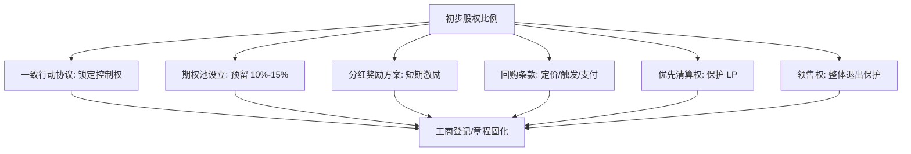

## 27.10 中介费伪概念 —— 信息差是中介费的唯一护城河

### 为什么需要这个概念？

传统中介靠垄断房东电话收取高额费用，用户痛点极强。互联网本质是消除信息不对称，中介费本质是“智商税”。

### 核心定义

**中介费伪概念**：中介费之所以能收取，仅因买房/租房者不知道业主联系电话。一旦信息透明化（平台直接连接房东租客），中介费即失去存在合理性。

> "我们不收中介费，是因为中介费本身就是个伪概念！为什么说是伪概念，因为是智商税，中介费为什么要收？就是因为买房及租房者不知道售房及出租转让业主的联系电话！如果买房者或者租房者知道房东电话！那么他们还会给中介公司掏中介费吗？nonononon，绝对不会！这叫什么？是不是信息不对等差造成的信息差？"
> 
> ——《PglAdRMiIoVTRyxc4Q3cw8hvnWf.md》

> "生意的本质就是信息差，在互联网里也存在大量的信息差生意。以这个信息差为市场的切入点我们创办了胖龟找房的 1.0——没有中介费的个人房屋分享平台。"
> 
> ——《PglAdRMiIoVTRyxc4Q3cw8hvnWf.md》

这段话揭示了**商业模式的第一性原理**：
1. 中介费 ≠ 服务定价，= 信息垄断定价
2. 平台价值 = 消除信息不对称
3. 盈利模式转移：从“收过路费”转为“收维护费/撮合费”

### 关键性质

- **伪概念本质**：非服务定价，纯信息垄断定价。
- **可被平台模式替代**：撮合交易 + 会员费/佣金/代办费。

### 典型例子

胖龟找房：自建小程序 + 线下门店，不收中介费，改收年费会员费、开发商返佣、代办费、租房佣金（由二房东承担）。

### 数据支撑

第一年运营成果：8 家门店，34 家店中店，新增 12110 名会员，转化胖龟会员 287 名，营收 104.7 万元，帮助会员省下 574 万中介费及 143 万代办费。

### 商业模式本质解构图

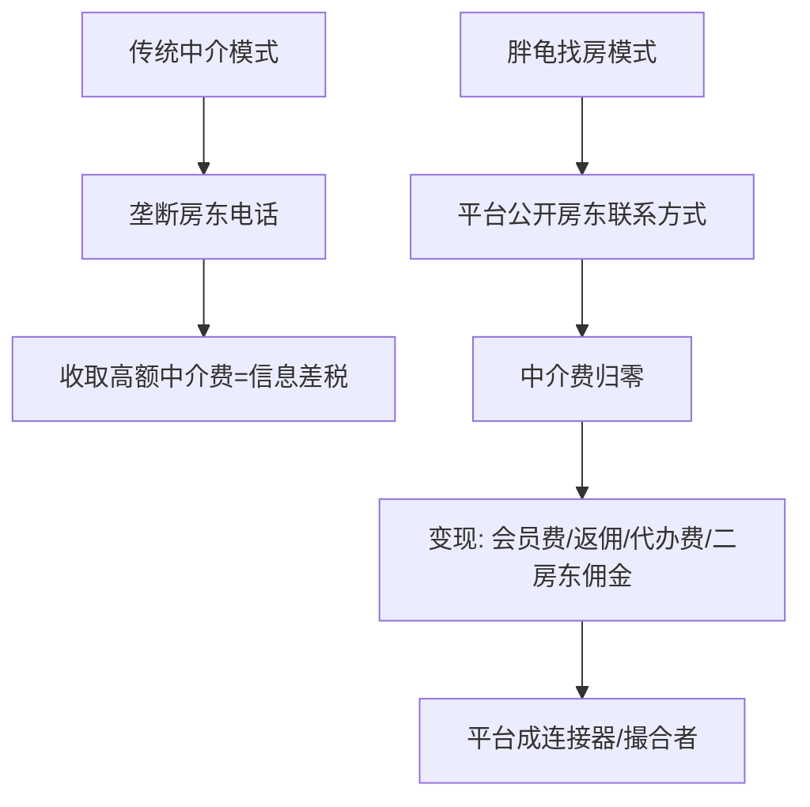

## 27.11 个人房屋分享平台 —— 做“连接器”而非“中介”

### 为什么需要这个概念？

58、安居客、贝壳本质是“网上中介公司”，联系人全是置业顾问。用户需要直接对接房东，而非被中介筛选、推销。

### 核心定义

**个人房屋分享平台**：定位为第三方平台，但不收中介费，仅提供信息撮合、工具赋能、流程 SOP。核心差异：联系人直接是房东/房主，平台不赚信息差钱。

> "我们不是房屋中介公司，因为我们不收取中介费！我们是第三方平台，但是又跟其他的第三方平台不一样，我们做的是个人房屋分享平台。58同城里面的房源有个人有中介，大多数置顶，首页的房源全是房屋中介的置业顾问发布的房源。安居客，贝壳找房，房天下，里面全是房源，但联系人全是各个房屋中介公司的置业顾问！（伪第三方平台，其实就是网上房屋中介公司...）"
> 
> ——《PglAdRMiIoVTRyxc4Q3cw8hvnWf.md》

> "因为平台上的客户全是有需求的，没有需求的客户是不需要来浏览的，那么活跃在胖龟找房里面的客户都是准客户。胖龟找房建立这个第三方平台撮合买方与卖方匹配，互利，解决需求及痛点，产生良性循环。"
> 
> ——《PglAdRMiIoVTRyxc4Q3cw8hvnWf.md》

### 关键性质

- **双边网络效应**：房源多 → 租客多 → 房东更愿挂房源。
- **信任机制**：平台提供合同模板、资金托管、带看 SOP 等信用增级服务。
- **准客户环境**：只有有需求的客户才会浏览平台，流量天然精准。

### 典型例子

胖龟找房 1.0/2.0/3.0 迭代：从卖房信息 → 居家生活平台 → 0 中介费租房平台。

### 边界条件

- 需自建房源库（物业、水电费号、同行转化三渠道）解决冷启动。
- 必须解决“房东不愿直面租客”的心理障碍（提供代看、代签服务）。

### 平台定位对比图

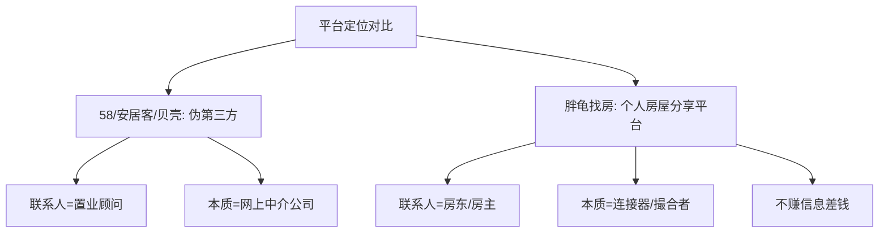

## 27.12 蹭流截流开店 —— 借对手流量打对手脸

### 为什么需要这个概念？

传统中介门店自带精准自然客流，新平台缺流量、缺信任。选址成本高、引流难，需低成本获取高意向客群。

### 核心定义

**蹭流截流开店**：在传统中介旗舰店隔壁开小店，门头打“0中介费”截流对手自然客流。仅做引流转化，不做重资产运营，利用对手品牌势能完成冷启动。

> "传统的中介店会有大量的客户到店，我们只需要在隔壁开一家小店，很小的一家店，就会有源源不断的客流通过我们店铺门前。只用做好引流跟转化就行了。用互联网的专有名词，就是蹭，蹭其他中介的流量，然后通过我们的门头标语：买二手房，租房，\"0\"中介费。来吸引用户到店，以达到截流的目的。"
> 
> ——《PglAdRMiIoVTRyxc4Q3cw8hvnWf.md》

> "一个典型的案例，我们这边有个涧西区，涧西区有个中介门店，该门店是整个洛阳市区里的标杆店跟销售冠军门店。我们在这个店的隔壁开了一家店，门头就是“0 中介费”。自从开了店以后，截流隔壁门店好多顾客，导致这家门店销售额接连下降，店员也不敢带顾客去店里面谈了。"
> 
> ——《PglAdRMiIoVTRyxc4Q3cw8hvnWf.md》

### 关键性质

- **成本不对等**：对手付房租养客流，己方付房租收客流。
- **心理冲击**：用户进对手店发现隔壁免中介费，极易转单。
- **仅适用标品高频**：租房、二手房等决策周期短、标准化高的业务。

### 典型例子

涧西区标杆中介店隔壁开店：截流大量顾客，导致对手销售额连降、店员不敢带客进店。

### 数据支撑

截流开店显著冲击对标门店业绩：对标门店销售额接连下降，店员不敢带客到店洽谈。

### 蹭流截流选址-转化闭环图


## 27.13 二房东渠道 —— 让最痛的人买单

### 为什么需要这个概念？

租房业务中，租客不愿付中介费，房东不愿管琐事。唯有二房东（长租公寓、分散式公寓运营方）因空置即亏损，有最强付费动力。

### 核心定义

**二房东渠道**：租房业务变现主体，由二房东承担原租客端的中介费/佣金。通过 58 同城、美团公寓、长租公寓老板等渠道批量获取二房东资源。

> "我们推演了很多，也会见了很多房东，最后我们找准了二房东这个渠道。因为二房东手上不单单就一间房子，他需要快速的让自己的房子租出去不能有空置，因为每空置一天，房租的费用就需要自行来承担。"
> 
> ——《PglAdRMiIoVTRyxc4Q3cw8hvnWf.md》

> "配房-带看-成交标准流程...由后台人员，根据租户提供的租房需求，按照公司的房源表进行精准匹配房源...引导客户自己去看房...联系房源所属的房东，二房东，管理公司等，在最短的时间内到房间内给客户签署租房合同..."
> 
> ——《PglAdRMiIoVTRyxc4Q3cw8hvnWf.md》

### 关键性质

- **痛点精准匹配**：二房东“空置一天损失一天房租” → 极强出房动力。
- **复购高、决策快**：二房东手握多套房源，单次成交即建立长期合作。
- **变现闭环**：配房-带看-成交全流程 SOP 服务二房东出房。

### 典型例子

胖龟找房租房业务：锁定二房东为付费方，配房-带看-成交全流程 SOP 服务二房东出房。

### 边界条件

- 需建立房东/二房端信任体系（合同规范、资金托管、维修响应）。
- 受限于城市租赁政策（如杭州政府自建 0 中介费平台形成政策性竞争）。

### 数据支撑

租房利润模型：单员工月两单即覆盖成本。洛阳单房月租金 1000-2000 元，基础员工底薪 3000 元，每月成交两单即可覆盖人力成本。

外地市场佣金显著高于本地：上海/杭州/深圳单房佣金可达 1-2 万，显著高于洛阳，因此向高流动人口城市扩张具备更高单产。

### 变现模型对比图

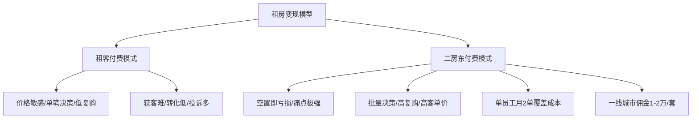

## 27.14 标准化运营 SOP —— 从“人治”到“法治”的复制基石

### 房东电话获取三渠道

素材提供了建立线下房源库的三条低成本获取房东电话的渠道：

| 渠道 | 操作方式 | 成本特征 |
|------|----------|----------|
| 物业关系 | 与物业建立关系，付费获取业主电话 | 明确付费、合规风险可控 |
| 水电费号码 | 通过水电费缴纳记录逆向查询业主电话 | 低成本、需渠道资源 |
| 同行转化 | 传统中介房源共享、客户共享，切入同行获取业主电话 | 零成本、需谈判技巧 |

**表格引导语**：上表为胖龟找房实测的三条获取房东电话的低成本渠道，物业付费最稳、水电费号最隐、同行转化最快，建议三渠道并行建立房源池。

> "物业：通过与物业建立起关系，给予一定的费用，拿到业主电话。水电费号码：通过水电费号，找到相应的单位人员获取业主电话。同行转化：传统的中介，房源共享，客户共享，切入同行，获取业主电话。"
> 
> ——《PglAdRMiIoVTRyxc4Q3cw8hvnWf.md》

### 租客全域发掘矩阵

通过多平台矩阵主动出击发掘有效租客：

- **抖音/快手/小红书**：搜索城市租房关键词，找热点笔记评论区有租房意向的用户，私聊破冰
- **58/安居客**：拼室友板块，主动联系发帖求租用户
- **转转/咸鱼**：租房模块下的求租广场，直接触达高意向用户
- **豆瓣/🧣/知乎**：各地租房超话、小组，发帖回复获取线索

**表格引导语**：下表汇总了胖龟找房实操的“全域发掘租客”四大平台矩阵，核心逻辑是“去流量池里捞有明确意向的鱼”，而非坐等上门。

| 平台类别 | 典型平台 | 核心玩法 | 意向强度 |
|----------|----------|----------|----------|
| 短视频/内容社区 | 抖音/快手/小红书 | 搜关键词→找热帖→评论区私聊破冰 | 高(主动询价/问房) |
| 分类信息/垂直租房 | 58/安居客 | 拼室友板块→联系发帖求租者 | 高(显性发帖求租) |
| 闲置交易/租房模块 | 转转/咸鱼 | 租房模块→求租广场→直接触达 | 高(平台自带租房入口) |
| 社区/讨论组 | 豆瓣/🧣/知乎 | 超话/小组→发帖回复获取线索 | 中高(社群信任度高) |

> "打开抖音，搜索 上海租房，找热点回复量最高的几个，点开评论区，找回复 博主：这个多少钱，这个还在吗，徐汇区某某还有房子吗，等等一系列的有租房欲望的人，那就给人私聊，破冰建立联系取得租房需求。转转，咸鱼，这些APP比较有意思，在主菜单上直接就有租房的模块，点开租房，找到求租广场...豆瓣，🧣，知乎，这一类的APP，比如🧣，有各地的租房超话，#杭州租房超话#上海租房超话，进入讨论组内，进行发帖，回复..."
> 
> ——《PglAdRMiIoVTRyxc4Q3cw8hvnWf.md》

### 配房-带看-成交标准流程

租房业务的标准化运营 SOP，实现“可复制、可考核、可培训”：

```
配房：后台按租户需求精准匹配 3-5-7 套房子，不满意的进行二配、三配
带看：提供位置+楼牌号+房间号+密码锁密码/钥匙存放位置，引导客户自看
成交：联系房东/二房东/管理公司，最短时间内到场签约，大量采用线上签约
```

**流程引导语**：上述三步构成“配-看-签”标准化闭环，后台按需求匹配 3-5-7 套房源（一配/二配/三配），前端提供密码锁/钥匙位置引导自看（降低人力陪看成本），成交端联系房源方最短时间内签约（含线上电子签），全流程可量化、可复盘、可培训新人。

> "由后台人员，根据租户提供的租房需求，按照公司的房源表进行精准匹配房源，每个需求会发对应的 3-5-7 套合适的房子，不满意的接着二配，三配等...客户想看哪个房子，我们会提供这个房子的位置、楼牌号、房间号、密码锁的密码，或者钥匙存放位置。引导客户自己去看房...一旦客户看中了，我们会联系房源所属的房东，二房东，管理公司等，在最短的时间内到房间内给客户签署租房合同，当然也有很大一部分都是线上签约。"
> 
> ——《PglAdRMiIoVTRyxc4Q3cw8hvnWf.md》

### 配房-带看-成交流程图

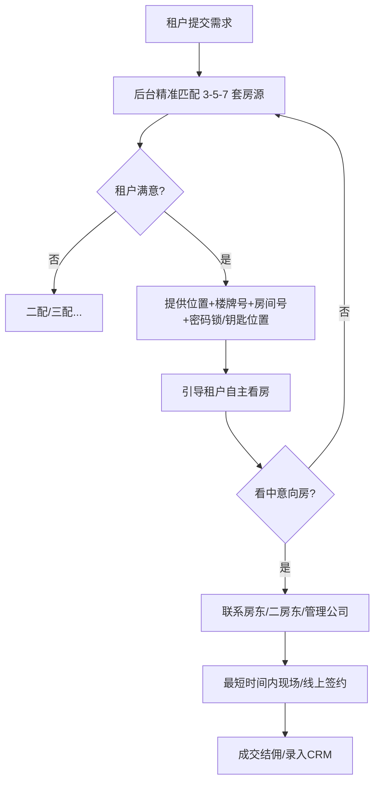

### 城市合伙人/店中店裂变复制

将本地跑通模型通过“区域合伙人计划——城市管家”复制到高流动人口城市：

- **平台提供**：房源库、配房人员、带看流程、小程序锁码分账
- **合伙人只需**：维护用户、聊天促单
- **落地业态**：便利店、菜鸟驿站、理发店等贴近顾客的社区业态

**模式引导语**：该模式将“重运营”拆解为“平台重资产（房源库/系统/流程）”+“合伙人轻运营（维护用户/聊天促单）”，通过小程序锁码分账实现利益绑定，快速在高校/写字楼周边的便利店、驿站、理发店铺设联营店中店。

> "单个房子的租金在我们这个城市大概在 1000-2000，每个基础员工的底薪大概在3000，每月成交两单，就能顾主成本。所以在项目跑通以后我们拓展了客服员工，通过人海战术获取更大的利润。将上海、杭州、深圳等数十万间合作房源整合到胖龟平台上...那里每年数以万计的毕业生蜂拥而至有庞大的需求市场...单个的房子佣金会更高，有高达 1-2w，也有 2000-3000 的总体来说是很不错的。我们通过区域合伙人计划——城市管家，快速让合伙人上手。我们有自己平台，房源库、配房人员、带看流程、合伙人只需要维护用户，聊天就行。"
> 
> ——《PglAdRMiIoVTRyxc4Q3cw8hvnWf.md》

### 城市合伙人裂变复制架构图

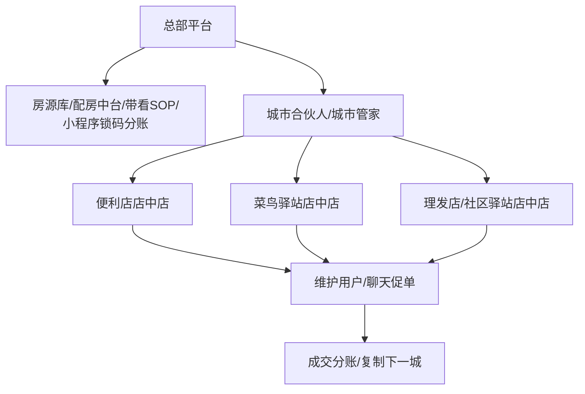

## 27.15 避坑指南与边界条件

### 股权设计常见误区

| 误区 | 正确认知 | 素材支撑 |
|------|----------|----------|
| 时间投入 = 全职/兼职二分法 | 时间投入 = 产出匹配里程碑 + 引入资源 | 《C0dydiFPCoBI3LxemwWcXpdxn2e.md》 |
| 初步算出比例 = 最终工商登记比例 | 初步比例仅为起点，需配套一致行动权、期权池、回购条款等 | 《C0dydiFPCoBI3LxemwWcXpdxn2e.md》 |
| 自评互评走过场 | 共识机制失效则模型失效，必须真达成一致 | 《C0dydiFPCoBI3LxemwWcXpdxn2e.md》 |
| 纯财务投资人参与岗位权重打分 | LP 仅参与资金投入维度 | 《C0dydiFPCoBI3LxemwWcXpdxn2e.md》 |
| 忽略赛道类型对权重的影响 | 技术/资金驱动、自主/孵化四类赛道权重区间不同 | 《C0dydiFPCoBI3LxemwWcXpdxn2e.md》 |

**表格引导语**：上表梳理了初创团队在股权设计时最易踩的五大坑，均源自对 4C 模型核心定义的误读或对五步法配套机制的忽视。

### 房产 O2O 创业避坑经验

| 领域 | 避坑原则 | 素材支撑 |
|------|----------|----------|
| 外包选型 | 深入实地考察团队构成/案例，最好吸纳技术合伙人 | 《PglAdRMiIoVTRyxc4Q3cw8hvnWf.md》 |
| 线下招聘 | 偏好应届毕业生，规避房产销售固化思维 | 《PglAdRMiIoVTRyxc4Q3cw8hvnWf.md》 |
| 营销投放 | 排序：抖音本地 > 本地自媒体 > 汽车广播（勿投） | 《PglAdRMiIoVTRyxc4Q3cw8hvnWf.md》 |
| 融资警惕 | 收费即警惕，最好有人推荐，勿盲目缴纳各种费用 | 《PglAdRMiIoVTRyxc4Q3cw8hvnWf.md》 |

**表格引导语**：上表为胖龟找房三年创业实战总结的四条避坑铁律，覆盖技术、人才、营销、融资四大创业核心环节，血泪教训直接可用。

### 数据支撑：投放渠道投产比实测

> "以此 抖音推广>本地自媒体>汽车广播...品牌营销这部分营销推广直接带来了 4000+的粉丝，付费会员大概在 100 多名，获客成本大概在 600 左右一名，投产比还不错。招商版块推广带了 100+的意向客户，最后成交变成加盟客户 5 位，单个加盟商成本在 8000 左右。因为我们有个 1w 左右的利润，所以也是有盈余的。汽车广播这个板块不建议大家做，薅羊毛的客户比较多~。这个版块我们大概扔进去 2w，水花都看不到。"
> 
> ——《PglAdRMiIoVTRyxc4Q3cw8hvnWf.md》

### 政策风险边界

存量时代来临，政府推出 0 中介费官方平台形成政策性竞争。素材作者宣称“2021年杭州上线‘0’中介费的政府平台机构，我们是不是提前了一步？”——这提示了**政策兜底型竞品**是模式复制的最大不确定性变量。

> "早在 2018 的时候国内的新建楼房已经开始走下坡路，大规模的城镇化建设也接近尾声。加上自 2019 年底疫情开始，老百姓们开始节衣缩食。国内房产销售已经从存量与增量市场并重的方向，开始迈入存量消费时代。任何一个行业都有其周期性...房地产行业正在进入低利率时期，房产中介未来会比较煎熬。"
> 
> ——《PglAdRMiIoVTRyxc4Q3cw8hvnWf.md》

> "ps：2021年杭州上线了\"0\"中介费的政府平台机构。我们是不是提前了一步？哈哈哈"
> 
> ——《PglAdRMiIoVTRyxc4Q3cw8hvnWf.md》

### 行业周期与政策风险演进图

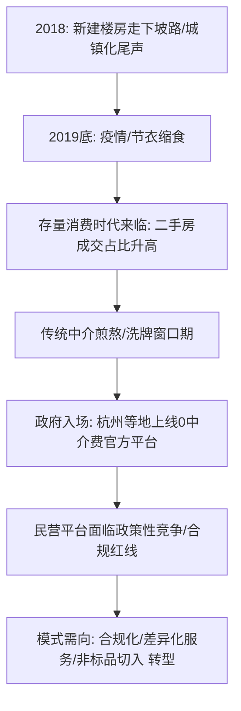

## 27.16 设计中的取舍

**为什么不用“平均主义”分股？**
平均分看似公平，实则最不公平：风险承担者、核心岗位、全投入者、大出资者的贡献被稀释。4C 模型通过四个维度差异化加权，将“重要程度”显性化、量化了。

**为什么“自评互评”是前置条件而非事后补救？**
股权分配的核心冲突在于“各自对重要程度的判断不一致”。若事前不通过自评互评对齐认知，事后算出任何比例都会被质疑。共识是模型运转的燃料，无共识则模型熄火。

**“蹭流截流”会不会被对手起诉/投诉？**
会。但素材实测：对手销售额下降、员工不敢带客，说明策略有效。风控预案：门头合规备案、话术不诋毁对手、保留证据应对恶意投诉。这是“借力打力”的博弈，而非违法侵权。

**为什么租房佣金让二房东付而非租客付？**
租客价格敏感、单笔决策、复购低；二房东“空置即亏损”痛点极强、批量决策、复购高。把钱向“最痛、最富、最快、最稳”的一方收，是商业模式设计的铁律。

**岗位权重为何强依赖赛道类型而非通用职级表？**
因为“技术壁垒在哪个工位上”随赛道根本性改变：AI 赛道算法工程师是核心，房产中介赛道渠道 BD 是核心。用通用职级表会导致核心岗位低配、非核心岗位高配，埋下后期撕裂隐患。

**时间投入为何绑定里程碑而非工时？**
约 60% 项目合伙人全职，工时失去区分度；唯有“产出是否支撑 MVP 上线、首单成交、融资到账等关键节点”才能区分真伪贡献。同时纳入“引入资源”维度，激励合伙人外溢人脉/渠道/信息。

**二房东渠道为何能成单边市场变现突破口？**
租房双边市场中，租客端“免费”是用户获取前提，房东端“懒/散”难规模化；二房东集中持房、空置即亏、决策快、复购高，天然适配“平台撮合+二房东付佣”的单边付费模型，打通了商业闭环。

## 27.17 动手练习

### 练习 1：手算一次 4C 股权分配

某 AI 应用初创团队（技术驱动型、自主创业），三合伙人：
- A（发起人/CEO/全职/研发负责/出资 100 万）
- B（CTO/全职/核心算法/出资 50 万）
- C（COO/兼职/渠道销售/出资 50 万）

启动资金 200 万。请按五步法完成：
1. 确定赛道类型，给出四维度基础权重区间
2. 设定自评互评后的最终权重比例（需说明理由）
3. 给三人四个维度各打 1-10 分（需结合“产出匹配里程碑”判断时间投入）
4. 计算各人加权得分与初步股权比例
5. 指出该比例落地工商前还需补充哪 3 类合同条款

### 练习 2：拆解“0中介费”商业模式画布

对照胖龟找房案例，填写下列九宫格关键点（每格 1-2 句）：

- **客户细分**：房东/二房东 vs 租客/买家，谁付费？谁免费？
- **价值主张**：对房东/二房东是什么？对租客/买家是什么？
- **渠道通路**：线上小程序+线下门店+店中店+自媒体矩阵，各自承担什么角色？
- **客户关系**：自助配房/密码锁自看/线上签约 vs 城市管家人工服务，如何平衡效率与信任？
- **收入来源**：年费会员/开发商返佣/代办费/租房佣金（二房东付），各占比估算？
- **核心资源**：房源库/小程序系统/标准化 SOP/品牌“0中介费”心智
- **关键业务**：获取房东电话→精准匹配→带看促成→裂变复制
- **重要合作**：物业/水电费单位/同行转化/便利店驿站联营/城市合伙人
- **成本结构**：人力（底薪+提成）/房租/获客推广/技术维护/法务合规

**追问**：若政府推出“0中介费”官方平台，画布中哪 2 块受冲击最大？如何调整？

### 练习 3：设计一次“蹭流截流”实战推演

假设你在二线城市做“0服务费家政平台”，传统家政公司门店月均自然进店 200 组意向客户。请完成：

1. 选址策略：开在哪家/哪类竞对隔壁？门头标语怎么写？（参考“0中介费”）
2. 店面最小配置：面积/人员/物料，仅保留“引流+转化”功能
3. 引流转化话术：进店客户前 3 句怎么说？（对标“买房租房 0 中介费”）
4. 后端承接：如何把“蹭来的流量”转为自有平台用户？（小程序/企微/会员卡）
5. 风控预案：竞对恶意投诉/门头遮挡/员工被挖角，各准备 1 条应对动作
6. 复制判据：单店模型跑通的 3 个量化指标（参考“月两单覆盖成本”）

### 练习 4：股权陷阱排查清单

某团队已按 4C 模型算出初步比例：创始人 40%、联创 A 35%、联创 B 25%。请列出至少 5 个“签工商前必查”的红旗项（如：创始人身份是否已签一致行动协议？期权池是否预留 10%-15%？回购价格公式是否约定？纯财务投资人是否误参与岗位权重打分？时间投入是否仅凭全职/兼职口头约定？）。

针对每个红旗项，写出对应的合同条款名称与核心约定一句话。

## 27.18 本章小结

这一章中我们学习了如何用**4C 动态量化股权分配模型**给创业初期的“切蛋糕”装上电子秤，将定性争论转为定量计算；掌握了**股权分配五步法**从赛道定型到加权出比例的标准化流程，以及**合同配套工具**（一致行动权、期权池、回购条款等）把算出的比例落地为可执行的治理结构。随后我们深入剖析了**胖龟找房**这个“信息差商业模式”标杆案例：看透了“中介费伪概念”的本质，理解了“个人房屋分享平台”做连接器而非中介的定位差异，实操了“蹭流截流开店”“二房东渠道”“全域发掘租客”三大低成本获客法，并拆解了“配房-带看-成交”“城市合伙人/店中店”可复制的运营 SOP。最后我们梳理了股权设计与房产创业的**避坑红线**：时间投入≠全职兼职、初步比例非终点、外包选型必实地、招聘偏好应届生、投放排序抖音>自媒体>广播、警惕收费融资骗局、警惕政府平台政策性竞争。

本章我们一起学习了以下概念：

| 概念 | 解释 |
|------|------|
| 4C 动态量化股权分配模型 | 将股权分配拆解为创始人身份、岗位权重、时间投入、资金投入四个可量化维度，各带参考权重区间，将定性争论转为定量计算 |
| 创始人身份 | 代表风险兜底者与最终控制权，权重 10%-30%，必须从一开始极度明确，公司对外只能有一个声音 |
| 岗位权重 | 反映行业技术壁垒所在关键岗位，权重 30%-40%，随赛道类型（技术/资金驱动）动态调整，隐性冲突源 |
| 时间投入 | 衡量产出是否匹配项目里程碑及愿意引入的资源，权重 10%-25%，非单纯全职/兼职二分法 |
| 资金投入 | 真金白银投票表决信心与风险意愿，权重 20%-50%，纯财务投资人仅参与此维度 |
| 股权分配五步法 | 确定赛道→收集信息→自评互评定权重→打分定系数→加权算比例，共识前置，结果仅为起点 |
| 股权落地配套工具 | 一致行动权、期权池、分红奖励、回购权、优先清算权、领售权等合同规范，内部不乱才能打市场 |
| 中介费伪概念 | 中介费本质是买房/租房者不知房东电话造成的信息差智商税，信息透明化即可取消 |
| 个人房屋分享平台 | 非中介、非伪第三方平台，直接撮合房东与租客/买家，联系人即房源持有者 |
| 蹭流截流开店 | 在传统中介旗舰店隔壁开小店，以“0中介费”门头截流对手自然客流，仅做引流转化 |
| 二房东渠道 | 租房业务变现主体，二房东因空置即亏损付费意愿最强、决策快、复购高 |
| 全域发掘租客 | 抖音/快手/小红书评论区私聊、58 安居客拼室友、转转咸鱼求租广场、豆瓣🧣知乎超话小组矩阵主动出击 |
| 配房-带看-成交 SOP | 后台精准匹配 3-5-7 套→提供位置+密码锁引导自看→联系房东最短时间内签约（含线上签约） |
| 城市合伙人/店中店 | 以城市管家模式复制扩张至高流动城市，在便利店/驿站/理发店设联营店中店，小程序锁码分账 |
| 避坑指南 | 外包选型须实地考察/吸纳技术合伙人；招聘偏好应届生规避固化思维；投放排序抖音>本地自媒体>汽车广播；融资警惕收费骗子公司 |

下一章中，我们将学习如何从“单点跑通”走向“矩阵放大”，掌握团队搭建、治理升级与规模化复制的方法论，敬请期待。

