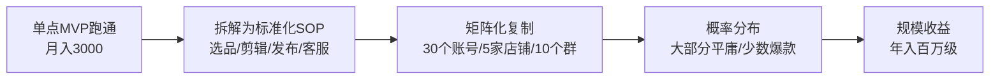

# 第 41 章 杠杆复制与放大 —— 从“单点盈利”到“系统增长”
作者：龙哥

## 学习目标

- 理解“先跑通再复制”的最小闭环验证逻辑，能判断一个项目是否具备放大潜力
- 掌握剥离式拆解法，能将模糊的业务方向拆解为可执行的100个具体问题
- 区分买卖、生意、商业三个层级的赚钱方式，并规划个人从卖劳动力到卖模式的跃迁路径
- 掌握OKR的制定与执行要点，能将战略目标转化为可量化、可追踪的团队动作
- 理解人力资源杠杆的原理，能识别自己业务中可外包的重复性工作
- 掌握矩阵化复制的概率逻辑与质量底线，能评估其适用条件与平台风险
- 理解招商加盟四种级别的难度与价值差异，能判断自身阶段适合的模式
- 掌握健康扩张三关（单店模型、区域验证、财务健康），能评估一个模式是否具备可复制条件
- 理解股权顶层设计四要素（控制权、进入、分配、退出），能设计初步的合伙人股权框架
- 理解三会一层的公司治理结构，能认识到战略决策失误才是公司失败的深层原因
- 掌握财富积累四阶段与人生四阶段的对应关系，能定位自身所处阶段并规划跃迁路径
- 学会识别增长瓶颈的“被绑架”陷阱，能从追求增长切换为价值创造视角
- 掌握流量价值公式（规模×相关性×信任度），能评估自身流量的真实变现潜力
- 理解博弈视角下的成交闭环（需求、信任、购买力），能设计让付费方主动买单的机制
- 掌握合格总结三要素与5WHY分析法，能以事实而非观点驱动战略复盘
- 理解平台合规底线与风险分级意识，能在放大规模的同时控制系统性风险

## 41.1 生活类比

想象你是一个刚开张的小饭馆老板。你并没有一上来就贷款装修豪华大厅，而是先用一道拿手菜和几张桌椅开张，证明有人愿意付钱吃饭，这就是最小MVP闭环的逻辑——先用最简单方式验证商业模式，完成第一单。为了把“生意好”这个模糊目标落地，你把它拆成“买菜、洗菜、炒菜、上菜、收钱”等一个个具体动作，这就是剥离式拆解，把大方向变成100个可执行的小问题。你发现自己端菜是买卖，收入受限于个人时间；招服务员帮你端菜是生意，靠渠道复制赚钱；而把菜谱和流程标准化复制开连锁店才是商业，靠系统赚钱。你把“年底赚到10万”拆成“每月卖500份招牌菜”这样的量化指标，并且每月复盘“实际卖了多少、差在哪道菜”，这就是OKR与复盘体系。门口路过1000人是流量规模，只有10个是想吃辣的体现了交易相关性，其中只有3个相信你比隔壁好吃才会掏钱，这就是流量价值公式（规模×相关性×信任度）的真实写照。如果老板满脑子只想着“今年必须翻倍”，就会开始偷工减料、盲目跟风，反而把老顾客都得罪了，这就是被“想拥有的东西绑架”的增长瓶颈怪圈。破局之道是切换到价值创造视角：与其想“我怎么赚更多”，不如想“我怎么让顾客更满意”，顾客满意了回头客自然多。在街角开3家分店，即使一家冷清，另外两家也可能爆满，整体不亏，这就是矩阵化复制用概率对抗不确定性。先确保一家店盈利稳定，再在同区域开第二家验证可行性，而不是一次性在全国铺100家，这就是健康扩张三关的铁律。给厨师和服务员都签好合同、列明岗位考核表，就像给枪配上子弹，真出纠纷时才能保护自己，这就是劳动合规底线。就像聪明的老板不会一上来就砸钱开大酒楼，而是先跑通最小模型、拆解流程、建立标准，再一步步复制放大，才能真正做大做强。

## 41.2 概念地图

第10章 杠杆复制与放大
├── 放大前提：盈利验证
│   ├── 最小MVP闭环（产品-流量-销售-交付） —— 20230207_06/20230207_03
│   ├── “跑通再复制”原则 —— 20230207_06/20230207_03
│   ├── MVP先卖后做论（卖想法而非做产品） —— 20230207_06
│   └── 单点盈利的规模潜力评估 —— 20230207_06/20230207_03
├── 问题拆解方法
│   ├── 剥离式拆解：10个大问题 → 100个小问题 —— 20230207_06/20230207_03
│   └── 团队精力聚焦于可执行小问题 —— 20230207_06
├── 商业模式分级与财富阶段
│   ├── 买卖（出卖劳动力） —— 20230207_06
│   ├── 生意（代理商/多次卖出） —— 20230207_06
│   ├── 商业（可复制放大的系统） —— 20230207_06
│   └── 财富积累四阶段与人生四阶段 —— 20230207_06
├── 执行管理工具
│   ├── OKR：战略坚定、KR驱动O、可衡量标准 —— 20230207_06
│   ├── MVP验证最不确定因素 —— 20230207_06
│   ├── 高频同步与问题暴露 —— 20230207_06
│   ├── 合格总结三要素 + 5WHY分析法 —— 20230207_04
│   └── 事实与观点区分 —— 20230207_04
├── 杠杆类型
│   ├── 人力资源杠杆（雇人释放时间） —— 20230207_03
│   ├── 流量价值公式（规模×相关性×信任度） —— 20230207_06
│   ├── 社群分销增长公式（供应链×顶层设计×动员） —— 20230207_08
│   ├── 矩阵化复制（怼量对抗不确定性） —— 20230207_11
│   └── 招商加盟杠杆
│       ├── 轻量级（卖技术/料包） —— 20230207_11
│       ├── 中量级（卖设备/服务） —— 20230207_11
│       ├── 重量级（卖品牌） —— 20230207_11
│       ├── 魔鬼级（卖特许权） —— 20230207_11
│       └── 健康扩张三关（单店-区域-财务） —— 20230207_11
├── 治理与制度保障
│   ├── 股权顶层设计四要素
│   │   ├── 顶层控制权（操盘者+责任心） —— 20230207_06
│   │   ├── 进入机制（资金/资源/技术） —— 20230207_06
│   │   ├── 分配机制（静态+动态） —— 20230207_06
│   │   └── 退出机制（时间/回购） —— 20230207_06
│   ├── 三会一层治理结构
│   │   ├── 股东会（最高权力） —— 20230207_06
│   │   ├── 董事会（决策） —— 20230207_06
│   │   ├── 监事会（监管） —— 20230207_06
│   │   └── 高管层（执行） —— 20230207_06
│   └── 劳动合规底线（合同附件+辞退流程） —— 20230207_08
├── 增长瓶颈与价值创造
│   ├── 被想拥有的东西绑架（增长瓶颈怪圈） —— 20230207_07
│   ├── 价值创造视角：从“我如何得到”到“我如何被奖赏” —— 20230207_07
│   ├── 战略非目标论：目标是对象不是战略 —— 20230207_07
│   └── 不流动稀缺资源价值优先论 —— 20230207_07
└── 战略复盘与风险底线
    ├── 卓越策略师五大能力 —— 20230207_04
    ├── 商业模式画布道术器用四层分析法 —— 20230207_04
    ├── 平台内容合规审核与离线分发 —— 20230207_10
    └── 竞争优势来自贡献视角（争是不争） —— 20230207_07

## 41.3 盈利验证与放大 —— 从“跑通”到“复制”的最小闭环

### 为什么需要这个概念？

你是否有过这样的经历：看到一个项目火，立马投入大量时间、金钱去开发产品、搭建团队、买流量，结果三个月后发现根本没人买单？或者，你已经在小范围跑通了，想放大，却发现根本复制不起来，因为核心环节全在你自己手里，一离开你就瘫痪？这就是为什么我们要先讲“盈利验证”。新项目启动时，最容易犯的错不是“动作太慢”，而是“追求完美”。你想把产品打磨到极致，想把品牌设计得高大上，想把流程跑得无比顺滑——但市场不买账。市场只认一个指标：有人愿意为此付费。

素材中反复强调：“不要追求完美，用最快速度跑通盈利模型——先用最简单方式验证商业模式（完成第一单）”（来源：20230207_06）。哪怕只赚一元钱，只要能无限放大，就是年赚百万的项目。

### 核心定义：最小MVP闭环

最小MVP闭环（来源：20230207_06）：用最快速度、最低成本完成“产品—流量—销售—交付”的最小可行闭环，哪怕只赚一元钱，作为放大前的验证。

这个闭环包含四个必须打通的环节：
1. 产品：不一定要是成品，可以是“想法”、预售页、模型图、甚至一段视频演示。
2. 流量：不一定要大，只要能触达首批种子用户（如朋友圈、社群、小红书搜索流量）。
3. 销售：完成第一笔交易，收到真金白银的预售金或全款。
4. 交付：兑现承诺，哪怕是人工服务、文档发送、远程指导。

这个定义展示了：验证的核心不是“做出产品”，而是“卖出产品”。

### 关键方法：MVP先卖后做

MVP先卖后做法（来源：20230207_06）：

1. 确定要测试的产品概念（如“教宝妈做辅食的视频课”）
2. 不制作课程，先制作一个“招生简章/预售页”，包含大纲、价格、交付承诺
3. 在精准流量池（如宝妈群、小红书笔记）投放预售信息
4. 设定验证标准：聊了100人，只有几个买 → 需求不成立，止损；20-30人购买并交预售金 → 需求成立，启动开发
3. 短时间内并行测试多个产品概念，筛选胜出者

这段伪代码展示了：用“卖想法”替代“做产品”，把不确定性前置，用真金白银的购买意愿作为唯一试金石。素材明确指出：“筛选大于培养，尝试次数多了就知道哪个是比较好的方案”（来源：20230207_06）。

### 从“跑通”到“复制”：矩阵化放大的概率逻辑

一旦最小闭环跑通（如月入3000元的单号模型），下一步不是“优化单号”，而是“复制单号”。

素材指出：“把月入3000的号复制30多遍不难，把盈利的事情重复做；哪怕只赚一元钱，只要能无限放大就是年赚百万的项目”（来源：20230207_06）。

这里有一个关键的概率逻辑：单点成功有偶然性，但批量复制能把偶然变成必然。素材中的抖音带货案例印证了这一点：“在保证视频质量的前提下大量发布拼接剪辑带货视频增加爆单概率，即使绝大多数视频流量惨淡（点赞超500的仅10个、大部分个位数点赞甚至0），纯靠怼量不开直播累计带货10万+”（来源：20230207_11）。

数据流图：单点验证 → 标准化SOP → 矩阵化复制 → 规模收益

边界条件提示：并非所有项目都适合“怼量”复制。需评估边际成本是否足够低（内容/代码/虚拟产品边际成本≈0，实体/重服务边际成本高），标准化程度是否足够高（能否写成新人照着做就能出结果的SOP），平台风险是否可控（矩阵号易被判关联限流，需有隔离方案）。

---

## 41.4 剥离式拆解 —— 把“大方向”拆成“可执行的100个小问题”

### 为什么需要这个概念？

很多老板、操盘手开会时说：“我们要搞流量”、“要提转化”、“要做品牌”。听起来振奋人心，但落到执行层，大家不知道具体干什么。模糊的目标是执行力的黑洞。素材给出的解法极其简单粗暴：剥离式拆解。

### 核心定义：剥离式拆解法

剥离式拆解法（来源：20230207_06）：从客户群体最需要解决的10个大问题出发，将每个大问题继续拆解为10个小问题，最终得到100个具体问题。你和团队最该投入时间和精力的地方，就是这100个可执行的小问题。

这个定义展示了：战略的落地，不是写在墙上的口号，而是拆解到每个人每天待办清单里的具体动作。

### 实操步骤演示

假设你是私域运营负责人，目标是“团队月入10万”。

第一层：提炼10个大问题（客户视角）

| 大问题编号 | 客户核心诉求（大问题） |
| :--- | :--- |
| Q1 | 从哪里源源不断搞来精准流量？ |
| Q2 | 怎么让进群用户愿意开口说话？ |
| Q3 | 怎么把聊天记录转化为订单？ |
| Q4 | 怎么让客户复购、转介绍？ |
| Q5 | 怎么选品才能既好卖又赚钱？ |
| Q6 | 怎么建立标准化的服务流程？ |
| Q7 | 怎么管控团队每天的产出？ |
| Q8 | 怎么应对平台封号/限流风险？ |
| Q9 | 怎么把单店模型复制到同城？ |
| Q10 | 怎么设计股权/分红留住核心骨干？ |

第二层：每个大问题拆10个小问题（执行视角）——以Q1为例

| 小问题编号 | 具体执行动作（小问题） | 负责人 | 完成标准 | 截止时间 |
| :--- | :--- | :--- | :--- | :--- |
| Q1-1 | 整理过去3个月所有引流渠道的成本/转化数据表 | 运营专员A | 交付一份含CAC、ROI的Excel | 本周三下班前 |
| Q1-2 | 测试小红书搜索SEO流量：布局50个长尾词，发20篇笔记 | 运营专员B | 50词覆盖率100%，20篇收录 | 下周五前 |
| Q1-3 | 复制竞品抖音直播间引流话术，制作3个版本测试 | 内容专员C | 3个话术脚本，各测1小时 | 下周三前 |
| Q1-4 | 搭建视频号直播间“企微弹出+金句卡片”引流链路 | 技术专员D | 实测1小时加人>50 | 下周五前 |
| Q1-5 | 谈下3个同城KOL/社群主互推合作 | BD专员E | 签署合作协议，排期发布 | 下周三前 |
| Q1-6 | 建立“引流渠道-进线成本-私域转化率”周度看板 | 运营主管 | 看板上线，数据自动更新 | 本周五前 |
| Q1-7 | 设计“老带新”裂变海报与话术包 | 设计/文案 | 海报3版，话术5套 | 下周三前 |
| Q1-8 | 采购/开发一批低成本引流诱饵（资料/试用/实物） | 供应链 | 到货/上线，单成本<5元 | 下周五前 |
| Q1-9 | 制定“种子用户激活计划”：首单送礼+专属服务 | 客服组长 | 方案落地，首周激活率>30% | 下周五前 |
| Q1-10 | 复盘上月所有失败引流动作，归因并归档 | 运营主管 | 产出一份《引流避坑指南v1.0》 | 本周五前 |

同理，Q2-Q10 各拆10条，共100条。团队开会时，不再讨论“怎搞流量”，而是认领Q1-1 到 Q1-10。

这张表展示了：剥离式拆解把“战略模糊地带”变成了“执行确定性清单”，每个小问题都具备“谁做、做到什么程度、何时做”三要素。

### 边界条件

拆解前提必须基于对客户需求的深入理解，否则拆出来的100个问题可能全是“自嗨式动作”。100个问题不是同等重要，需用ICE模型（影响力 Impact、信心 Confidence、易用性 Ease）打分，聚焦Top 20。市场变了、产品变了、团队变了，问题清单要随之迭代，建议月度复盘时同步更新。

---

## 41.5 买卖、生意、商业三分论与财富阶梯 —— 从“卖劳动力”到“卖模式”的跃迁

### 为什么需要这个概念？

很多人干了十年还是“高级打工仔”，因为没看清赚钱模式的层级差异。素材一针见血地划分了三个层级：

### 核心定义：三个层级

买卖 / 生意 / 商业（来源：20230207_06）

| 层级 | 核心特征 | 典型角色 | 收入天花板 | 关键约束 |
| :--- | :--- | :--- | :--- | :--- |
| **买卖** | 自己做所有事，出卖劳动力/时间 | 自由职业者、个体户、超级销冠 | 受限于个人时间上限（24h/天） | 个人精力、技能熟练度 |
| **生意** | 有团队/渠道/代理帮你卖，靠复制赚钱 | 团队长、区域代理、连锁加盟商 | 受限于管理半径、渠道宽度 | 管理能力、渠道控制力 |
| **商业** | 建立可复制放大的系统/模式，靠系统赚钱 | 系统设计者、平台方、品牌方 | 理论上无上限（边际成本递减） | 系统设计能力、组织架构、治理结构 |

素材指出：“商业的本质是卖卖卖，就是你能给别人创造价值，而创造得这个价值只要是客户所需要的就可以不断的去卖”（来源：20230207_06）。

这个定义展示了：从买卖到商业，本质是从“靠人”到“靠系统”的跃迁。

### 财富积累四阶段与人生四阶段对应表

素材进一步将这三个层级映射为个人成长的四阶段跃迁路径：

| 财富阶段 | 核心动作 | 对应人生阶段 | 典型年龄 | 关键任务 |
| :--- | :--- | :--- | :--- | :--- |
| **第一阶段：出卖劳动力** | 打工、接单、卖时间 | 初入职场（扩广度） | 30岁前 | 尝试不同行业/岗位，积累技能、认知、人脉 |
| **第二阶段：一份时间多次卖** | 写书、卖课、录视频、做标准化产品 | 中年危机（做管理、拉高度） | 30-40岁 | 建立个人IP、内容资产、可复制交付件 |
| **第三阶段：购买他人时间** | 招人、建团队、搭中台、做老板 | 第二曲线（副业/改命机会） | 40-50岁 | 从“自己干”转“让别人干”，建立管理/SOP体系 |
| **第四阶段：钱生钱** | 投资、股权、基金、并购 | 复制商业放大（钱生钱） | 50岁+ | 资本运作、战略投资、生态布局 |

素材指出：“第一阶段，出卖劳动力……第二阶段是一份时间多次卖……第三个阶段是什么？购买他人时间……第四个阶段，就是去钱生钱了……你就是投资”（来源：20230207_06）。

“人生四个阶段，第一阶段：初入职场（30岁以前）……在这个阶段你要不断的长见识……第二阶段，中年危机，在这个阶段一定要去做管理……第三个阶段的话，其实我就是你要开始在你的主业以外，你要去寻找自己的第二曲线……第四个阶段其实就是你在第二曲线找到了一个MVP……然后组建团队给它放大”（来源：20230207_06）。

这张表展示了：财富跃迁不是靠“更努力地打工”，而是靠“改变赚钱模式的层级”。每个阶段的跃迁都需要前一阶段的资源积累做支撑，不可跳跃。

### 自我诊断：你在哪个阶段？

请诚实回答：你的收入如果停止工作3个月，会归零吗？是，你在第一阶段。你有没有“睡着也在赚钱”的资产（课程、书、软件、授权体系）？有，你进入第二阶段。你的业务离开你本人，还能正常运转3个月以上吗？能，你在第三阶段。你的主要精力是否花在“配置资本/选择赛道/搭建生态”而非“解决具体业务问题”？是，你在第四阶段。

---

## 41.6 OKR执行与复盘体系 —— 让“战略”变成“每天的动作”

### 为什么需要这个概念？

战略定得再好，不落地等于零。素材指出：“战略坚定是最底层的成功要素；KR必须直接推动O，O要有可衡量标准”（来源：20230207_06）。但现实中，大部分团队的OKR要么O定得虚（如“提升品牌影响力”），要么KR与O无关（如O是“提升转化率”，KR却是“发100篇小红书笔记”）。

### 核心定义：OKR设计三原则

OKR执行要点（来源：20230207_06）：
1. 战略坚定：O必须来源于经深思熟虑的战略，而非拍脑袋的愿望。一旦定下，一个季度不轻易改。
2. KR直推O：每个KR必须是O达成的必要条件或充分条件的组成部分。问一句：“如果这个KR完成了，O一定更接近达成吗？”如果是“未必”，删掉。
3. O可衡量：O必须包含数字、时间、范围。如“私域用户达1000人”优于“做大私域”。

### 执行机制：MVP验证 + 高频同步 + 问题暴露

| 机制 | 核心动作 | 频率/节点 | 目的 |
| :--- | :--- | :--- | :--- |
| MVP验证最不确定因素 | 针对本季度最大不确定性（如“新品是否值得开发”），设计最小实验验证 | 季度初第1-2周 | 避免在错误方向上投入大量资源 |
| 关键角色高频同步 | 核心成员（产品/运营/销售/财务）对齐进度、卡点、资源需求 | 每周1次固定例会 + 每日15min站会 | 保持信息同步，快速决策 |
| 增加问题暴露场景和勇气 | 建立“周复盘/月复盘”机制，鼓励暴露坏消息，奖励发现问题 | 每周/每月 | 过程管理有了量化的目标和明确的时间节点，团队效率至少提升50%（来源：20230207_06） |

### 复盘体系：合格总结三要素 + 5WHY分析法

合格总结三要素（来源：20230207_04）：
一次合格的总结必须带有下方三个因素：
1. 总结与目标的比对。
2. 要事实，不要观点。
3. 能够帮助发现问题。

5WHY分析法（来源：20230207_04）：
连续用5个WHY来探寻问题发生的真实原因：
1WHY：为什么老板骂我？因为我今天迟到了。
2WHY：为什么我会迟到？因为我起床晚了。
3WHY：为什么会起床晚？因为天杀的闹钟没响。
4WHY：为什么闹钟没响？因为它没有电了。
5WHY：为什么闹钟没电？因为我忘记了换电池。
根因：缺乏“设备维护提醒机制”，而非“员工不自觉”。

事实与观点区分（来源：20230207_04）：
我们一定要知道自己和对方说出口的每一句话，到底哪一句是观点，哪一句是事实。我今年业绩做的不好，这句话是观点还是事实？——观点！只有中性的、能够用数字和证据支撑的才是事实，例如：我今年完成了83%的年度业绩目标。

这个体系展示了：复盘的目的不是“汇报工作”或“找借口”，而是“发现问题、定位根因、改进动作”。

---

## 41.7 人力资源杠杆 —— 用“雇人”撬动“个人天花板”

### 为什么需要这个概念？

当你完成了“买卖→生意”的跃迁，核心动作只有一个：花钱买别人的时间。

### 核心定义

人力资源杠杆（来源：20230207_03）：
“拿出你现在收入的一部分，别舍不得，这是必须要花的钱，把重复的基础的活整理出来，安排给其他人，可以是家里的亲戚，可以是同学朋友，让他们开始给你兼职干活。一旦你习惯了这样的方式，不断的通过花钱找人帮你干活，你就开始成为一个老板，赚钱的杠杆就有了”（来源：20230207_03）。

### 可外包工作的识别清单

回顾你一周的工作，把每件事贴标签：

| 工作内容 | 类型 | 是否可外包 | 外包成本预估 | 节省时间投向 |
| :--- | :--- | :--- | :--- | :--- |
| 剪辑短视频 | 重复性基础工作 | 是 | 20-50元/条 | 选题策划、商务谈判 |
| 回复通用咨询/售后 | 重复性基础工作 | 是 | 3000-5000元/月兼职 | 高客单客户深度服务 |
| 整理数据、做表格 | 重复性基础工作 | 是 | 100-200元/天 | 数据分析、策略复盘 |
| 制定季度战略 | 高价值决策 | 否 | - | - |
| 核心大客户谈判 | 高价值决策 | 否 | - | - |
| 学习新AI工具/新玩法 | 成长性学习 | 否（但可内部分享） | - | - |

素材中的社群分销案例印证了杠杆的极致：社群分销增长公式：收入增长=供应链强度 × 顶层设计 × 动员能力……书里有品0预算冷启动，第一个月进来10万分销员，2年做到80万+分销员、1.5亿销售额（来源：20230207_08）。这里的“动员能力”，本质上就是让成千上万个普通人（分销员）替你卖货——这是人力杠杆的规模化形态。

发圈动力公式：发圈动力 = 佣金 / 设计交压力。产品要有社交货币价值，让分销员“发朋友圈没有压力、反而有面子”（来源：20230207_08）。

---

## 41.8 流量价值评估 —— 规模、相关性与信任度的乘积逻辑

### 为什么需要这个概念？

你看到一篇文章10万+阅读、一个视频100万播放，会不会焦虑？别焦虑，那可能只是“数据”，不是“流量”。

### 核心定义：流量价值公式

流量价值公式（来源：20230207_06）：

$$ \text{流量价值} = \text{流量规模} \times \text{交易相关性} \times \text{信任度} $$

素材指出：“流量规模只解决连接的问题，不解决交易的问题。比流量规模重要的是流量相关性……信任度怎么看？有的连接带来的价值有限，这和连接给UV带来的感受有关……不轻易连接，但连接必有价值”（来源：20230207_06）。

这个公式展示了：流量的三个维度是乘法关系，任一项为0，整体价值即为0。

**公式推导逻辑：** 为什么是乘法而非加法？因为交易的发生需要三个条件同时满足：用户必须在场（规模>0）、用户必须有需求（相关性>0）、用户必须信任你（信任度>0）。任一环节缺失，交易链条即断裂，价值归零。这与转化漏斗的逻辑一致：曝光数 × 点击率 × 转化率 = 订单数。各因子的量化方式：流量规模可统计好友数/粉丝数/群成员数；交易相关性可通过标签分层、意向测试估算“有需求人数/总人数”；信任度可通过历史转化率、复购率、推荐转化率近似。临界点在于：当相关性或信任度极低（<5%）时，单纯堆规模边际收益递减，应优先提升后两项。

这个公式的作用在于：它把“流量”从虚荣指标还原为“可变现资产”，指导你把有限精力投在边际收益最高的维度上——对大多数早期项目，提升相关性和信任度的ROI远高于盲目买量。

### 实战评估表：你的流量池值多少钱？

| 维度 | 定义 | 你的现状估算 | 评分(1-10) | 改进杠杆 |
| :--- | :--- | :--- | :---: | :--- |
| **流量规模** | 好友数/粉丝数/群成员数 | 例：私域好友5000 | 5 | 裂变、投流、矩阵号 |
| **交易相关性** | 其中对你的产品有真实需求的比例 | 例：做减肥餐，5000好友里1000想减肥 = 20% | 2 | 精准引流、标签分层、清洗泛粉 |
| **信任度** | 其中会因你推荐直接下单的比例 | 例：1000需求者里200信任你 = 20% | 2 | 专业内容输出、案例见证、长期陪伴 |
| **有效流量价值** | 5000 × 20% × 20% = **200人** | | | |

你的瓶颈在哪里？以上例中，规模5分，但相关性和信任度只有2分。提升相关性和信任度的边际收益远高于盲目加粉。

素材强调：“要从第一个粉丝就开始变现，流量就像是一张门票，有效期内你不用掉，就会变成一张废纸。能够变现的流量才叫流量，不能变现的流量只能叫做数据”（来源：20230207_06）。

---

## 41.9 矩阵化复制 —— 用“怼量”对抗“不确定性”的爆单哲学

### 核心定义

矩阵化复制（来源：20230207_11）：在保证视频质量的前提下，大量发布（矩阵化、多发）拼接剪辑的带货视频，以增加爆单概率。哪怕绝大多数视频流量惨淡，仅靠少数爆款也能实现可观的整体收益。

### 概率模型与质量底线

| 指标 | 实测数据（素材案例） | 启示 |
| :--- | :--- | :--- |
| 总发布视频数 | 数百/数千条 | 基数大，概率生效 |
| 点赞>500的爆款数 | 仅10个 | 爆款率极低（<1%） |
| 点赞个位数/0的视频 | 大多数 | 长尾分布是常态 |
| 累计带货GMV | 10万+ | 少数爆款支撑整体收益 |

关键约束：
1. 质量底线：不是垃圾内容，而是“合格的标准化内容”（完播率、完读率达标、无违规）。
2. 差异化处理：同一素材通过“换BGM、换剪辑节奏、换文案、换封面、混剪”生成差异化版本，规避同质化判重。
3. 平台风控：矩阵号需做好设备隔离、IP隔离、注册主体隔离，防止关联封号。

---

## 41.10 招商加盟四级别 —— 从“卖技术”到“卖特许权”的进阶阶梯

### 核心定义：四级模式对照表

招商加盟四级别（来源：20230207_11）：

| 级别 | 核心卖点 | 品牌方操作难度 | 加盟商获得资产 | 典型案例 | 利润模式 |
| :--- | :--- | :---: | :--- | :--- | :--- |
| **轻量级** | 卖技术、卖料包、卖SOP | 低（整理文档/工具包） | 操作手册、配方、渠道联系方式 | 奶茶配方包、美甲教程、SEO SOP | 一次性技术转让费 + 长期物料差价 |
| **中量级** | 卖设备、卖服务、卖选址装修 | 中（需供应链/工程/运营支撑） | 设备使用权、统一装修、运营扶持 | 餐饮中央厨房设备、共享充电宝、自助洗车 | 设备租金/售价 + 服务费/物料返利 |
| **重量级** | 卖品牌、卖管理体系、卖流量 | 高（需强品牌势能、成熟中台） | 品牌授权、全套管理系统、总部引流 | 肯德基/麦当劳早期、瑞幸、蜜雪冰城 | 品牌使用费/保证金 + 物料强制采购 + 营业额分成 |
| **魔鬼级** | 卖特许权（可转让、可继承） | 极高（完善法律/金融/治理体系） | 作为资产可转让继承的经营权 | 麦当劳成熟期、7-Eleven、高德地图代理 | 特许权转让费 + 长期分红 + 资产增值 |

素材指出：“魔鬼级的加盟是最难实现的一种，我称之为卖特许权。说白了，就是加盟了某个品牌之后，这个品牌的特许权是可以作为资产进行转移和继承的”（来源：20230207_11）。

“对比即将上市的蜜雪冰城和已经上市的奈雪的茶（21年19亿利润 VS 亏损1.5亿），大概能代表加盟模式和直营模式的现状……加盟品牌的利润能力要比直营品牌高非常非常多”（来源：20230207_11）。

这个对照表展示了：级别越高，品牌方前期投入越大、门槛越高，但一旦跑通，规模效应与护城河越强。新手切忌“一步到位”想做魔鬼级，应从轻量级起步，跑通单店模型后逐级进阶。

---

## 41.11 健康扩张三关 —— 单店模型、区域验证与财务健康的复制铁律

### 核心定义

健康扩张三关（来源：20230207_11）：开放加盟前必须先跑通单店模型（单店盈利），再进行区域模型验证（多店复制），只有当模型健康且可复制时，规模化扩张才具可持续性。最新评估标准：
1. 各种门店模型要测算到位
2. 单店模型的财务模型要健康
3. 要实现一定范围内的区域模型验证
4. 该区域模型的复制性和财务模型要达标

### 三关验证清单

| 关卡 | 核心指标 | 合格线示例 | 验证方法 |
| :--- | :--- | :--- | :--- |
| **第一关：单店模型** | 回本周期、月净利、现金流、标准化程度 | 回本≤6个月，月净利≥3万，全流程SOP化 | 直营店/样板间实测3-6个月 |
| **第二关：区域验证** | 2-3个不同区域（商圈/城市）复制成功率 | 3店中≥2店达标单店模型指标 | 选取不同商圈/城市开直营/合伙店 |
| **第三关：财务健康** | 毛利率、净利率、复购率、现金流安全边际 | 毛利>40%，净利>15%，复购>30%，现金流覆盖6个月固定成本 | 审计级财务模型测算+压力测试 |

素材警示：“打造一个好的产品，需要先解决单店模型的问题，等到单店模型跑通之后，再开始批量化复制，实现规模化增长”（来源：20230207_11）。带病扩张（单店不盈利、靠加盟费回血）是连锁品牌死亡的第一大原因。

---

## 41.12 股权顶层设计与劳动合规 —— 控制权、进入、分配、退出与“合同配子弹”

### 股权顶层设计四要素

股权顶层设计四要素（来源：20230207_06）：

| 要素 | 核心原则 | 具体机制示例 |
| :--- | :--- | :--- |
| **顶层控制权** | 有操盘能力、有责任心的好人拥有控制权，公司对外只能有一个声音 | 创始人持股>51% 或 AB股结构、一致行动人协议锁定投票权 |
| **进入机制** | 不同资源类型对应不同进入方式，拒绝“凑份子” | 资金型：溢价入股（估值溢价20%-50%）；资源型：对赌入股（达成业绩释放股份）；技术型：专利/技术作价入股（经第三方评估） |
| **分配机制** | 静态分配（注册时）+ 动态调整（里程碑触发） | 期权池10%-15%，每年按业绩/贡献行权；动态调整条款：未达标回购、超额增发 |
| **退出机制** | 约定退出时间限制、回购原则、回购价格公式 | 锁定期3-5年；退出时按“净资产×系数”或“估值×折扣”回购；恶意退出/竞业触发惩罚性回购 |

素材指出：“内部不乱才能更好打市场，但不存在放之四海而皆准的方案”（来源：20230207_06）。

### 劳动合规底线：合同是枪，附件是子弹

劳动合同有效性理论（来源：20230207_08）：

一份有效的劳动合同，不止只是劳动合同，而是一定是包含了岗位考核表、公司规章制度、廉洁自律协议、员工保密协议等附件。劳动合同就等于是一把枪，而这些附件，就是子弹。你的枪再好，没有子弹也是无济于事。

必备附件清单（子弹）：

| 附件 | 核心作用 | 缺失后果 |
| :--- | :--- | :--- |
| **岗位考核表（含周考核/月考核）** | 绩效不合格辞退的铁证 | 无法合法辞退不胜任员工，被判违法解除赔2N |
| **公司规章制度（员工手册）** | 违纪处分依据、保密/竞业限制依据 | 员工泄密、跳槽竞品无法追责 |
| **廉洁自律协议** | 商业贿赂、公款私用、利益输送的红线 | 贪腐案发公司担连带责任，无法追偿 |
| **员工保密协议** | 核心数据/客户名单/技术秘密保护 | 核心资产流失无法律救济 |

辞退损失最小化原则（来源：20230207_08）：
1. 安排会表达的人去谈（法务/HR/创始人）
2. 引导签署离职表：原因写“个人原因”，公司不盖章（避免被认定公司同意辞职需赔N+1）
3. 离职当天结清工资（避免拖欠工资加罚）
4. 收集证据留存（考核记录、违纪录音/截图、交接清单）

---

## 41.13 三会一层与战略归属 —— 公司治理的“四权分立”与战略的源头

### 核心定义：三会一层治理结构

三会一层（来源：20230207_06）：

| 机构 | 性质 | 核心职权 | 产生方式 |
| :--- | :--- | :--- | :--- |
| **股东（大）会** | 最高权力机构 | 决定公司重大事项（增资减资、合并分立、修改章程、利润分配）、选任董事/监事 | 全体股东组成，按出资比例/持股比例行使表决权 |
| **董事会/执行董事** | 决策机构 | 制定战略方针、决策重大投融资、聘任/解聘高管、设立内部机构 | 股东会选任，任期3年可连选 |
| **监事会** | 监管机构 | 监督董事/高管履职合规性、查账、提议罢免违规董事/高管 | 股东会选任，职工代表参与，不兼任董事/高管 |
| **高管层** | 执行机构 | 落地战略、日常经营管理、组织架构设计、具体业务指挥 | 董事会聘任，对董事会负责 |

权力流向：股东会 → 选任 → 董事会/监事会 → 董事会 → 聘任/监督 → 高管层 → 执行 → 向董事会汇报 → 监事会监督 → 向股东会汇报。形成闭环制衡。

### 战略非目标论：战略是治理层的事，不是执行层的事

素材指出：“所以，公司如果经营不善或者倒闭，更多的原因，不是下面的管理层、执行层，而是治理层‘三会一层’”（来源：20230207_06）。

“战略，既不是一朝一夕的事，也不是朝令夕改的事。战略，是三会一层要做的事”（来源：20230207_06）。

“目标是战略的对象或结果，但目标本身不是战略——比如读书群里有人说他的战略是：帮助一万个人赚到钱。这就是对战略的一个巨大误解。因为帮助一万人赚到钱，这是一个目标，它不是战略”（来源：20230207_07）。

这个论断展示了：战略是“画地图、选路径、定计划”的顶层设计（治理层干的事），目标是“到达目的地”的里程碑（执行层对标的事）。混淆二者，会导致“战略天天改、执行没方向”。

---

## 41.14 增长瓶颈与价值创造 —— 从“追增长”到“被奖赏”的战略心法

### 核心洞察：增长瓶颈怪圈

增长瓶颈怪圈（来源：20230207_07）：

“进入增长瓶颈的一个典型现象，就是越想要增长，却距离想要的增长越远。如果用一句话来形容这种现象，那就是我们被我们想拥有的东西绑架了”（来源：20230207_07）。

被绑架后的三种典型症状：
1. 投机跟风：不做开创性事，盯着对手动作抄作业。
2. 计算利弊：天天算ROI、算得失、算怎么薅羊毛，不关注用户价值。
3. 抓取资源：榨干现有流量、透支透支团队、砸品牌换短期GMV。

### 破局之道：价值创造视角的三种勇气

价值创造视角（来源：20230207_07）：

“破除增长焦虑唯一的方法，就是怎么从追求增长的视角，切换成价值创造的视角。从一个‘我如何得到增长’，变成‘我如何成为一个值得被奖赏增长的人’。真正要去摆脱这种视角，最难的不在于方法论，而是3种‘勇气’：
1. 面向未来而非面向过去的勇气——只有觉得未来的自己更大，远比过去已经创造出来的自己要大，才能真正洞察到趋势，并且不断去开创未来。
2. 面向用户而非计算利弊的勇气——把视角切换为‘我如果想要去解决用户的问题，应该怎么做？’，就会发现，答案更容易找了。
3. 积累价值而非抓取资源的勇气——识别在我当前的环境中，最稀缺的、最不流动的是什么，如果整体的优化目标本着这些，就会形成正向的价值积累。”

### 不流动稀缺资源价值优先论

素材指出：“实际上，这也是一个奇怪的现象，我们花费了太多的精力去抓住无限的、流动的东西，而非关注真正稀缺的、不变的东西。对一个品牌来说，销售额几乎是无限的而且每年都在改变，但是用户对你高端品牌的心智是稀缺的”（来源：20230207_07）。

资产分类对照：

| 资产类型 | 是否流动 | 稀缺性 | 典型例子 | 战略建议 |
| :--- | :--- | :--- | :--- | :--- |
| **流动性资产** | 高（易买卖、易波动） | 低（可复制、可替代） | 现金流、DAU、单月GMV、广告位 | 必要运营指标，不可作为战略核心 |
| **不流动稀缺资产** | 低（难买卖、难复制） | 高（护城河核心） | 品牌心智、核心数据资产、核心人才组织、用户深度信任、专利/版权、政府牌照 | 战略资源优先配置、长期主义积累 |

“八项规定后大量的中高端白酒品牌，降价砸了牌子，几乎只有茅台认为品牌才是最重要的资产，不会用品牌和品质的牺牲去换销售额”（来源：20230207_07）。

---

## 41.15 战略复盘与合规底线 —— 用“事实”和“规则”为放大护航

### 卓越策略师五大能力

卓越策略师五大能力（来源：20230207_04）：

| 能力 | 核心标准 | 素材金句 |
| :--- | :--- | :--- |
| **扎实的调研能力** | 压倒性投入一线调研，非办公室头脑风暴 | “对调研的压倒性投入，就是对客户的负责。每一次调研背后，可能是十几个竞品分析，十几万字访谈，不计其数的行业报告。策略师不是一个白领，而是一个蓝领。” |
| **清晰逻辑的归纳总结能力** | 基于事实归纳，而非主观臆造 | “搜尽奇峰打草稿——懂得搜奇峰是懂得妙理，多打草图是能用苦功。” |
| **把控全局的项目管理能力** | 严格时间节点、里程碑、资源协调 | “每一个项目都有着严格的提案时间……这些都需要清楚的规划和时间意识。” |
| **让人难以怀疑的决断力** | 关键时刻敢拍板、担责任、给确定性 | “策略师能够成为让客户可以依赖的人，而不只是简单的需求执行方。” |
| **面向内外部的双重叙事能力** | 对上（老板/投资人）讲商业逻辑，对下（团队/用户）讲使命价值 | “提案和汇报时会同时兼具面向客户和消费者的两种视角。” |

### 商业模式画布：道术器用四层分析法

商业模式画布道术器用四层分析法（来源：20230207_04）：

| 层级 | 核心问题 | 产出物 |
| :--- | :--- | :--- |
| **道** | 商业模式本质是什么？ | 一句话：用XX产品/服务，解决XX客户的XX痛点，赚XX钱 |
| **术** | 解决方案的9个关键维度 | 客户、价值、渠道、关系、资源、伙伴、活动、成本、收入（标准画布9宫格） |
| **器** | 承载上述9板块的工具/平台 | CRM、私域工具、自动化流程、ERP、数据看板、AI工具链 |
| **用** | 执行力与业务流迭代 | SOP迭代频次、复盘机制、组织进化速度、文化渗透度 |

素材指出：“商业模式画布，是我用的众多商业工具里面，用得最多的一个，也是帮我赚钱赚最多的一个。用道、术、器、用四个层面讲清楚并运行所有项目”（来源：20230207_04）。

### 平台合规底线：野路子的尽头是合规

平台内容合规审核（来源：20230207_10）：

“本周周报被语雀判违规了，无法上传。大家可以先用离线版查看，有感觉哪块比较敏感的跟小懒说，小懒去除一下再上传”（来源：20230207_10）。

应对策略：
1. 离线版分发渠道常态化：网盘、私域群、邮件列表、自建站点。
2. 敏感内容预审机制：发布前跑一遍关键词库、人工抽检。
3. 多平台同步备份：不依赖单一平台流量入口。
4. 合规优先于技巧：依赖平台算法漏洞，一旦规则收紧即被连根拔起。给出“合规优先”的建议。

---

## 41.16 多源对照：不同素材对核心概念的支撑与差异

### 共识：跑通再复制、系统大于个人、合规是底线

| 核心概念 | 20230207_06 | 20230207_03 | 20230207_11 | 20230207_07 | 20230207_04 |
| :--- | :--- | :--- | :--- | :--- | :--- |
| MVP先验证 | ✅ 核心主张 | ✅ 实操案例 | ✅ 美团电商80元跑通 | ⬜ | ⬜ |
| 剥离式拆解 | ✅ 10大问题→100小问题 | ⬜ | ⬜ | ⬜ | ⬜ |
| 买卖/生意/商业 | ✅ 三分论+四阶段 | ✅ 副业转老板路径 | ⬜ | ⬜ | ⬜ |
| OKR/复盘体系 | ✅ 战略坚定+KR推O | ⬜ | ⬜ | ⬜ | ✅ 合格总结+5WHY+事实观点 |
| 人力杠杆 | ⬜ | ✅ 雇人释放时间 | ⬜ | ⬜ | ⬜ |
| 流量价值公式 | ✅ 规模×相关性×信任度 | ✅ 私域单客价/实时ROI | ⬜ | ⬜ | ⬜ |
| 矩阵化复制 | ⬜ | ⬜ | ✅ 怼量/店群/分销裂变 | ⬜ | ⬜ |
| 加盟分级/健康扩张 | ⬜ | ⬜ | ✅ 四级别/三关验证 | ⬜ | ⬜ |
| 股权/治理/合规 | ✅ 四要素/三会一层 | ✅ 劳动合同/辞退流程 | ⬜ | ⬜ | ⬜ |
| 增长瓶颈/价值创造 | ⬜ | ⬜ | ⬜ | ✅ 三勇气/稀缺资产/争是不争 | ⬜ |
| 策略师能力/画布 | ⬜ | ⬜ | ⬜ | ⬜ | ✅ 五大能力/道术器用 |

### 分歧与互补

| 维度 | 差异点 | 综合建议 |
| :--- | :--- | :--- |
| 验证速度 vs 质量 | 06主张“先行动、最小成本、快速筛选”；11强调“完成比完美重要，但需了解平台规则” | 最小可行性验证（MVP）前置，合规红线不可碰，其余全速跑。 |
| 加盟模式选择 | 11给出四级分级，建议循序渐进；08提到蜜雪冰城加盟优于直营 | 轻量级起步验证模型，重量级/魔鬼级需品牌势能与治理成熟后再上。 |
| 增长策略 | 06侧重流量运营技术（切片/流速/合并）；07侧重认知升维（视角切换/稀缺资产） | 技术手段解决“如何获客”，认知框架决定“获谁的客、留谁的客、卖什么货”。两手都要硬。 |

---

## 41.17 设计中的取舍

### 为什么不用“全员销售/全员运营”代替“雇专人/建分销”？

问：很多早期创业者觉得“省钱”，让所有人（包括产品、技术、财务）都去拉客户、发朋友圈、做客服，为什么不推荐？

答：因为专业分工的边际收益递增，全员泛化的边际收益递减。产品/技术人员的核心杠杆是“代码/产品”的复用价值，去跑销售是高维能力打低维仗，性价比极低。素材明确：“副业收入增长疲惫时拿出部分收入招聘他人处理重复基础工作，释放自己精力成为老板”（来源：20230207_03）。核心是买“低成本、可替代”的时间，卖“高价值、不可替代”的时间。全员销售适合“全员信仰、全员高客单、全员强关系”的极早期（<5人），一旦规模化，必须建立专业分工体系（运营/销售/客服/交付），否则管理成本爆炸。

### 矩阵化复制 vs 精品化运营：怎么选？

| 维度 | 矩阵化复制（怼量） | 精品化运营（做IP/做品牌） |
| :--- | :--- | :--- |
| 适用产品 | 标品、低客单、决策链短、素材易获取 | 非标品、高客单、决策链长、需深度信任 |
| 核心杠杆 | 概率、数量、边际成本≈0 | 信任、品牌、稀缺性、不可复制性 |
| 团队要求 | 执行力强、SOP完善、抗压 | 创意强、专业度高、抗周期 |
| 风险 | 平台打击、同质化、账号资产贬值 | 周期长、不确定性高、依赖核心个人 |
| 素材案例 | 抖音带货怼量、视频号店群、捡漏群 | 超垂直个人IP、高客单私域、品牌加盟 |

取舍建议：
0-1阶段：精品化验证模型（跑通单店/单号/单群）。
1-10阶段：矩阵化放大（复制已验证模型）。
10-100阶段：精品化建品牌/做护城河（沉淀不流动稀缺资产）。
成熟期：矩阵（流量端）+ 精品（转化端/品牌端）双轮驱动。

---

## 41.18 动手练习

### 练习 1：用“最小MVP闭环”评估你身边的项目
选择一个你感兴趣的副业项目（如小红书带货、短视频引流、知识付费等）：
1. 画出该项目的“产品—流量—销售—交付”最小闭环
2. 回答以下问题：
   - 完成第一单的最小成本和时间是多少？
   - 用什么指标判断该闭环已经“跑通”？（如：第一个付费用户、第一笔100元收入）
   - 该模式是否具备可复制性？放大10倍的瓶颈在哪里（资金/人力/流量/交付）？
   - 评估该项目是否值得放大，给出你的判断依据。

### 练习 2：剥离式拆解：把“月入10万”拆成可执行动作
假设你是一名私域运营操盘手，目标是“团队月入10万”：
1. 先定义需要解决的10个大问题（如流量获取、转化提升、复购运营、团队管理等）
2. 选择其中2个大问题，各拆解为10个小问题（共20个）
3. 为每个小问题标注：负责角色、完成标准、时间节点
4. 反思：拆解后的问题是否具备可操作性？哪些问题是高优先级？如何排序取舍？

### 练习 3：判断你的项目属于“买卖、生意还是商业”
分析你目前从事的工作或副业：
1. 判断它属于哪一层级：
   - 买卖：所有事情都需要自己完成，收入与时间直接挂钩
   - 生意：有团队/渠道/代理帮你卖出产品或服务
   - 商业：建立了可复制放大的标准化模式与系统
2. 结合“财富积累四阶段”：
   - 你目前处于哪个财富阶段？
   - 下一阶段的跃迁路径是什么？（如从“一份时间多次卖”到“购买他人时间”需要哪些资源与能力？）
   - 这一跃迁过程中最大的障碍是什么？如何克服？

### 练习 4：为你的项目设计OKR并配套复盘机制
选择一个你正在推进的业务目标（如“3个月内私域用户达到1000人”）：
1. 设定1个核心目标（O），确保其具备可衡量标准
2. 分解为3-4个关键结果（KR），验证每个KR是否直接推动O的实现
3. 确定其中最不确定的假设，设计一个最小MVP来验证它
4. 制定执行计划：明确同步频率、问题暴露机制、负责人与时间节点
5. 设计复盘机制：用“合格总结三要素”写周复盘；用“5WHY分析法”追问一个未达标KR的根因
6. 优化：假设团队效率提升50%，你的OKR设计会如何调整？

### 练习 5：人力资源杠杆：识别可外包清单
回顾你一周的工作时间分配：
1. 列出你本周做的所有事情（越细越好）
2. 对每件事标注类型：高价值决策 / 重复性基础工作 / 成长性学习
3. 从中选出3项可以外包/委托给他人的重复性工作：
   - 每项工作外包的预估成本是多少？
   - 外包后节省的时间可以投入到什么更高价值的事情上？
   - 你更倾向于雇兼职还是用工具替代？为什么？
4. 制定一个30天内的外包落地计划（选人、交接、SOP化）

### 练习 6：用“流量价值公式”评估你的流量池
回顾你现有的私域或公域流量池：
1. 填写你的“流量价值三要素评估表”：
   - 流量规模：你有多少好友/粉丝/群成员？
   - 交易相关性：其中多少人对你的产品有真实需求？（估一个比例）
   - 信任度：多少人会因为你的推荐直接下单？（估一个比例）
2. 计算你的“有效流量”规模，并回答：
   - 你的流量价值瓶颈在哪个维度？（规模不足/相关性低/信任度弱？）
   - 哪一项投入的边际收益最高？为什么？
3. 用“能够变现的流量才叫流量”这一标准，评估你现在的第一个粉丝是否可以开始变现，给出理由。

### 练习 7：模拟招商加盟：你的品牌处于哪个级别？
假设你想把自己的副业模式做成加盟体系：
1. 判断你最适合的加盟级别：轻量级/中量级/重量级/魔鬼级
2. 根据级别回答：
   - 你的“单店模型”是否已跑通？单店盈利数据是什么？
   - 是否完成了区域模型验证？在哪些区域验证过？
   - 你的财务模型是否健康（毛利率、回本周期、复购率）？
   - 该加盟模式的运营复杂度和风险如何评估？
3. 制定一个从当前级别向上跃迁的路径规划。

### 练习 8：股权设计模拟：为你的团队分配股权
假设你与2位合伙人共同创立一家公司：
1. 根据四要素设计股权框架：
   - 顶层控制权：谁应拥有控制权？理由是什么？
   - 进入机制：三位股东分别以什么方式进入（资金/资源/技术/全职操盘）？各占多少初始比例？
   - 分配机制：设计静态分配比例 + 动态调整规则（如里程碑达成后的股权调整）
   - 退出机制：约定退出时间限制、回购原则和回购价格计算方式
2. 画出三会一层的治理框架图
3. 配好“劳动合规的子弹”：列出劳动合同必须包含的附件清单；思考：如果合伙人中途退出且带走核心客户，你的合同体系能否保护公司？
4. 反思：你的设计如何避免“合伙拆伙”的常见坑？是否存在“前期重要程度判断不一致”的风险？如何通过自评互评达成共识？还需要哪些配套法律文件？

### 练习 9：诊断你的“增长瓶颈”：被想拥有的东西绑架了吗？
回顾你（或你所在团队）最近半年的增长状态：
1. 判断是否存在“增长瓶颈怪圈”的三种症状：
   - 是否变得投机跟风、跟随对手而非做开创性事情？
   - 是否开始天天计算利弊得失而非关注用户？
   - 是否在抓取身边资源/流量而非积累长期价值？
2. 如果存在以上症状，尝试做一次视角切换：
   - 把“我如何得到增长”改成“我如何成为一个值得被奖赏增长的人”
   - 列出你当前环境中“最稀缺、最不流动”的3样资产（品牌、数据、人才、信任等）
   - 回答：你下一步的最优投入是否应该聚焦在这3样资产上？
3. 用“战略非目标论”检验你最近的战略表述：
   - 你定的是“目标”还是“战略”？
   - 如果你的目标是“月入10万”，你能说清“不做什么”吗？

### 练习 10：用“卓越策略师五大能力”和“商业模式画布”重构你的项目
选取你正在做的一个副业项目：
1. 用“商业模式画布道术器用”四层分析法拆解它：
   - 道：用一句话说清商业模式（用XX产品/服务，解决XX客户的XX痛点，赚XX钱）
   - 术：列出9个关键维度（客户、价值、渠道、关系、资源、伙伴、活动、成本、收入）
   - 器：你用了哪些工具/平台承载这9个板块？
   - 用：你的执行力如何？业务流如何迭代？
2. 对照“卓越策略师五大能力”自评：
   - 调研能力、归纳总结能力、项目管理能力、决断力、叙事能力
3. 找出最薄弱的1-2项能力，制定一个30天的提升计划。

---

## 41.19 本章小结

这一章中我们学习了如何将一个经过验证的单点盈利模型，通过系统化的方法复制放大为可持续增长的商业系统。首先我们理解了“先跑通再复制”的最小MVP闭环逻辑，掌握了MVP先卖后做的验证方法；其次我们掌握了剥离式拆解法，能将模糊的业务方向拆解为100个可执行的具体问题；接着我们区分了买卖、生意、商业三个层级的赚钱方式，并结合财富积累四阶段与人生四阶段规划了个人跃迁路径；然后我们学习了OKR的制定与执行要点，以及合格总结三要素与5WHY分析法，建立了以事实驱动的战略复盘体系；随后我们理解了人力资源杠杆、流量价值公式、社群分销增长公式等核心杠杆模型，并掌握了矩阵化复制的概率逻辑与质量底线；之后我们深入剖析了招商加盟的四种级别与健康扩张三关，理解了股权顶层设计四要素与三会一层治理结构，筑牢了放大过程中的制度保障；最后我们识别了增长瓶颈怪圈的本质，掌握了从追求增长转向价值创造的三种勇气与不流动稀缺资产优先论，并确立了平台合规底线与风险分级意识。

本章我们一起学习了以下概念：

| 概念 | 解释 |
| :--- | :--- |
| 最小MVP闭环 | 用最快速度、最低成本跑通“产品—流量—销售—交付”的完整商业循环，哪怕只赚一元钱，作为放大前的验证 |
| MVP先卖后做 | 验证产品应优先卖想法而非做产品，通过高意向付费人数（如20-30人交预售金）判断需求是否成立 |
| 剥离式拆解 | 将客户最需要的10个大问题各拆解为10个小问题，得到100个可执行的具体行动项，团队精力聚焦于此 |
| 买卖/生意/商业 | 买卖是出卖劳动力，生意是通过渠道复制赚钱，商业是建立可复制放大的系统模式 |
| 财富积累四阶段 | 出卖劳动力→一份时间多次卖→购买他人时间→钱生钱，依次递进不可跳跃，对应人生四阶段（扩广度/做管理/找副业/复制放大） |
| OKR执行 | 战略坚定为底层，KR直接推动O且O可衡量，配以MVP验证最不确定因素和高频同步机制 |
| 合格总结三要素 | 总结必须包含与目标的比对、用事实而非观点、能够帮助发现问题；配合5WHY分析法深挖根因 |
| 事实与观点 | 事实是中性的、能用数字和证据支撑的；观点因人而异、基于立场层次差异，决策时必须区分两者 |
| 人力资源杠杆 | 花钱雇人处理重复性基础工作，释放自己精力从执行者转变为管理者，建立赚钱杠杆 |
| 流量价值公式 | 流量价值=流量规模×交易相关性×信任度，规模只解决连接问题，相关性和信任度决定交易转化 |
| 社群分销增长公式 | 收入增长=供应链强度×顶层设计×动员能力，供应链是基础、顶层设计是杠杆、动员能力是放大器 |
| 矩阵化复制 | 在保证质量底线的前提下大量发布内容以增加爆单概率，用数量对冲单点不确定性 |
| 招商加盟四级别 | 按难度分为轻量级（卖技术）、中量级（卖设备）、重量级（卖品牌）、魔鬼级（卖特许权），价值与门槛递增 |
| 健康扩张三关 | 开放加盟前必须先跑通单店模型、验证区域模型、确保财务模型健康，避免带病扩张 |
| 股权顶层设计四要素 | 围绕顶层控制权、进入机制（资金/资源/技术差异化进入）、分配机制（静态+动态）、退出机制（约束+回购）展开 |
| 三会一层 | 股东会、董事会、监事会、高管层四机构权责分离相互制衡，公司经营不善的深层原因多在治理层而非执行层 |
| 增长瓶颈怪圈 | 当企业或个人被增长的预期绑架，会陷入越追求增长反而距离增长越远的恶性循环，表现为投机跟风、计算利弊、抓取资源 |
| 价值创造视角 | 破解增长焦虑的唯一方法是切换为“我如何成为一个值得被奖赏增长的人”，需要面向未来、面向用户、积累价值的三种勇气 |
| 战略非目标论 | 目标是战略的对象或结果但目标本身不是战略，战略应形成自始至终的指导原则并发挥自身禀赋 |
| 不流动稀缺资源价值优先 | 应优先投入时间去积累当前环境中真正稀缺、不流动的资产（品牌、数据、人才、信任等），而非追逐无限流动的短期资源 |
| 劳动合规底线 | 一份有效的劳动合同必须包含岗位考核表、规章制度、廉洁协议、保密协议等附件，合同是枪、附件是子弹 |
| 平台合规审核 | 在线内容平台会对上传内容进行违规判定，导致内容无法正常公开显示，需提供离线版分发等替代方案 |
| 卓越策略师五大能力 | 调研能力、归纳总结能力、项目管理能力、决断力、双重叙事能力，是制定高质量战略的素质基础 |
| 商业模式画布道术器用 | 道为商业模式本质，术为解决方案9个关键维度，器为载体工具平台，用为执行力与业务流迭代 |

下一章中，我们将学习认知升维与长期主义——从“赚快钱”到“复利人生”，将视野从具体项目操作提升到长期主义的人生复利系统，通过“利他即利己”“战略发挥优势”“不流动稀缺资源优先”等认知框架，帮助你建立可持续的个人成长与财富积累哲学。

