# 第 42 章 实操方法论体系

## 学习目标

- 理解MVP先卖后做的核心逻辑与验证标准
- 掌握商业拆解复制的全流程与可复制性判断标准
- 掌握流量价值公式与实时真实ROI核算方法
- 理解私域单客价思维与五位一体成交飞轮的运营逻辑
- 掌握捡漏群模型的选品、排品、演员氛围与放大路径
- 理解视频号直播+私域的长短线结合模型与引流工具应用
- 掌握抖音本地生活爆品逻辑、POI加热与矩阵打法
- 掌握无货源店群矩阵的暴力铺品、选品标准与合规底线
- 掌握高净值客户销售的买家系统破局法与核心痛点洞察
- 理解股权顶层设计四要素（控制权/进入/分配/退出）与合同配套
- 理解内在比赛理论、盲目自信、成功体验唤醒与俯视学习法
- 掌握战略即选择的本质、发挥优势法与不流动稀缺资源优先论
- 建立平台周期认知（铺货/动销/精细化/玩趋势）与红利窗口判断力
- 建立风控合规体系：劳动法合规、平台规则敬畏、止损决策与避坑指南

## 42.1 生活类比

想象创业像在丛林中狩猎。造弓箭前先在泥地上画靶子，问路过的猎人：“这靶子画得准不准？给钱我就按这造”，这就是MVP先卖后做；别人已经打到猎物了，你不用重新发明弓箭，直接量他的弓长、箭重、瞄准姿势，照葫芦画瓢，这就是商业拆解复制；进山打猎：规模是“看到多少兽群”，相关性是“这些兽是不是你想打的”，信任度是“它们敢不敢让你走近开枪”，三者相乘才是流量价值公式；不是每次打一只兔子算账，而是把兔子养在自家后院，年年繁殖、代代收成，算的是“一窝兔子的总价值”，这就是私域单客价；在集市上摆个摊，喊着“原价三折”，还雇了30个托排队抢购，路人一看“这么抢手”跟着下单，你赚中间商差价，这就是捡漏群模型；既在大街上吆喝卖艺(直播短爆发)，又把回头客领回家里坐馆喝茶(私域长复购)，吆喝是为领人进屋，坐馆是为年年收钱，这就是视频号直播+私域；给实体店装上“数字招牌”(POI)，挂个“爆款引流款”(9.9元团购)，再雇人排队造势，让附近刷视频的人“被算法推着”进店消费，这就是抖音本地生活；不用养牛、不用盖牛棚，直接去别人牧场按斤收奶(采集铺货)，贴上自己牌子卖，开50个摊位(矩阵)，哪个摊位出奶快重点供哪个，这就是无货源店群；别推销“这把刀多锋利”，要聊“大哥，您最怕啥？怕失控对吧？我帮您把控全局”，卖的不是刀，是“掌控感”，这就是高净值销售；开公司像立家规：谁掌印(控制权)、进门交多少银子(进入机制)、年底怎么分红(分配机制)、闹翻了怎么散伙(退出机制)，规矩立得早，家业才传得久，这就是股权顶层设计；两个自我在打架：表意识说“我能行”，潜意识说“你不行”。赢了潜意识那场仗，外面的仗才有资格去打，这就是内在比赛；背包只能装20公斤，你非要把金子、石头、羽毛全塞进去，最后累死在半路。战略是狠心把石头扔了，只带金子上路，这就是战略即选择；进淘金镇：早到(铺货期)随便挖挖都是金子；晚到(精细化期)得买昂贵设备、雇专业队、还得防着镇长收税(合规)，红利全在“早”字上，这就是平台周期；带着放大镜、指南针、急救包进丛林：劳动合同是“指南针”防迷路，平台规则是“地图”防陷阱，止损线是“急救包”防失血过多死林里，这就是风控合规。

## 42.2 概念地图

第42章 实操方法论体系
├── 验证与起盘
│   ├── MVP先卖后做  —— 20230207_06/08/09/11
│   │   ├── 核心：先卖想法/预售，非先做产品
│   │   ├── 标准：聊100人，20-30人交预售金
│   │   └── 原则：筛选大于培养，速度优于完美
│   ├── 商业拆解复制  —— 20230207_03/08/09/11
│   │   ├── 流程：发现案例→拆全链路→判可复制→低门槛复制→快速变现
│   │   ├── 判断：货源非独家、场景验证有需求、无核心壁垒
│   │   └── 边界：仅适用成熟模式/非强壁垒/标品弱非标
│   └── 平台周期与红利窗口  —— 20230207_01/06/08/11
│       ├── 四周期：铺货期→动销期→精细化期→玩趋势期
│       ├── 红利窗口：铺货-动销交界期（高流量/低商业化/规则宽松）
│       └── 确定性窗口：如2023春节后2-3月疫情平稳期
├── 流量与变现模型
│   ├── 流量价值公式  —— 20230207_06
│   │   ├── 公式：价值=规模×相关性×信任度
│   │   ├── 乘法模型：任一维度为0总值为0
│   │   └── 私域放大器：信任度杠杆显著提升LTV与ROI
│   ├── 实时真实ROI  —— 20230207_06
│   │   ├── 核算：直播ROI+私域年产值
│   │   └── 案例：纯直播2.5→加私域3.5-4.5
│   ├── 私域单客价思维  —— 20230207_03/06/08/11
│   │   ├── 定义：单用户生命周期总GMV
│   │   ├── 公式：销售额=客户数×单客价
│   │   └── 核心：复购>拉新，信任为前提，产品矩阵支撑
│   ├── 五位一体成交飞轮  —— 20230207_06
│   │   └── 破冰→诊断→方案→信任→成交，解决三个为什么
│   ├── 捡漏群模型  —— 20230207_03/06/08/11
│   │   ├── 定义：企微500人群+1-3折品+演员氛围+淘客佣金
│   │   ├── 核心：演员是灵魂(有无差≥1倍)、精推文案节奏、标品看价/非标看转化
│   │   └── 放大：矩阵化复制群数量，摊薄运营成本
│   ├── 视频号直播+私域  —— 20230207_03/06/08/11
│   │   ├── 模型：直播(短爆发/获新)+私域(长复购/高LTV)
│   │   ├── 引流：企微弹窗/金句卡片(不跳出直播环境，小时加200人)
│   │   ├── 承接：爆单法(同款建合集/双路发视频/立马开直播双频共振)
│   │   └── 无人直播：自研硬件规避检测+真实素材拟真，单场116.8万
│   ├── 抖音本地生活  —— 20230207_03/06/11
│   │   ├── 核心：POI门店页+爆品(无爆品不推广)+矩阵(达人/自播/员工/素人)
│   │   ├── 关键：POI加热第一课、短视频+直播双引擎、好评率生命线、本地推工具
│   │   └── 空间：美团880万覆盖全国 vs 抖音仅一二线，预计10倍增长
│   └── 无货源店群矩阵  —— 20230207_08/11/06
│       ├── 逻辑：平台缺货=机会，无货源(采集/一件代发)+店群(≥5店矩阵对抗不确定性)
│       ├── 选品：品牌/标品/销量优先、官方价≥150、避劝退类目
│       ├── 模型：单店日销~1122/毛利30%/日利300-400/月利1万+，达人爆单额外几万
│       └── 底线：旗舰店买授权、不碰侵权/高售后、严守发货时效
├── 销售与组织进阶
│   ├── 高净值销售破局法  —— 20230207_08/11/06
│   │   ├── 买家系统vs卖家系统：买家本能防御(撒谎/给希望/躲藏)，破局先跳出
│   │   ├── 需求vs痛点：需求理性/平静，痛点情绪驱动，仅痛点成交
│   │   ├── 核心痛点：失去掌控权(富一代/创一代最怕，由奢入俭难)
│   │   ├── 三步破局：①引起好奇(反问/布置功课)→②上升痛点+重塑概念建权威→③灵魂三问(聊孩子/谈自己/谈传承)形成依赖
│   │   └── 合作思维：非对立博弈，利他共赢(省精力/加速回笼/规避风险)
│   └── 股权顶层设计四要素  —— 20230207_03/06/08/11
│       ├── 控制权：有操盘能力/责任心的好人拥有(AB股/一致行动/否决权)，对外一个声音
│       ├── 进入机制：资金型溢价入/资源型对赌入/技术型专利入，拒情怀/关系入股
│       ├── 分配机制：静态分配+动态调整(里程碑/贡献/绩效)，预留期权池10-15%
│       ├── 退出机制：时间约束(4年归属/1年悬崖)、回购原则(原价/净资产/估值)、优先清算权
│       └── 合同配套：股权协议+章程+投资协议+期权计划+回购协议+保密/竞业协议
├── 心法与战略认知
│   ├── 内在比赛理论  —— 20230207_01/03/07
│   │   ├── 自我一(理性/显意识)vs自我二(潜意识/感性)，内在比赛定外在成败
│   │   ├── 盲目自信：'我领域我是王'的潜意识信念，理性选择
│   │   ├── 成功是成功之母：成功体验累积自信推动更大成功(反'失败是成功之母')
│   │   ├── 唤醒成功体验法：怂时回顾过往成功(哪怕微小)重建自信锚点
│   │   └── 俯视学习法：战略俯视(我是王来学)+战术重视(跪着学细节)
│   └── 战略即选择  —— 20230207_03/06/07
│       ├── 本质：取舍，关键在'不做什么'，非贪多求全
│       ├── 三段论：目的=相对优势、形式=自始至终指导原则、基石=发挥禀赋(劣势不可为战略)
│       ├── 发挥优势法：审筹码(优势)→定出牌(怎么用优势获结果)→补短板
│       ├── 视角切换：追求增长→价值创造，需三勇气(向未来/向用户/积累价值)
│       ├── 不流动稀缺资源优先：品牌/数据/人才/信任>销售额/DAU/权力
│       └── 战略稳于执行：治理层(三会一层)定战略，执行层只管落地，非朝令夕改
└── 风控与合规底线
    ├── 劳动法合规  —— 20230207_08
    │   ├── 有效合同：合同是枪，附件(考核/规章/廉洁/保密)是子弹，缺一不可
    │   ├── 辞退最小化：会谈技巧/离职表(个人原因不盖章)/当天结清工资/证据固化
    │   └── 案例：三纠纷赔2.25万+4500+2500，教训：及时签/建周考核/完善体系
    ├── 平台规则敬畏  —— 20230207_11
    │   ├── 本质：平台通过限流/违禁词/处罚分配流量偏好，反向推导获合规/规避策略
    │   ├── 无人直播风险：雷同限流/原创举报/判录播罚款/批量做号重罚，硬改机寿命10分钟-10天
    │   └── TEMU标品议价极小：预留10%利润，超1688视无诚意压价，需侧重非标
    ├── 止损决策  —— 20230207_06/08/11
    │   ├── 非刚需不做：10年4败/负债百万，链条太长推不动，项目本性成就人
    │   ├── 无壁垒=买试错：普通人项目几乎无绝对壁垒，培训本质=付费买别人试错时间
    │   ├── AI小程序放弃：预算超/无执照/工期长/流量99%靠👸号→理性止损
    │   └── 克制止损：直播有警告/断播即停、被罚当天不播、见好就收(账号>单场流量)
    └── 避坑指南  —— 20230207_07/04/11
        ├── 优雅亏大钱三步骤(反讽)：做不懂的事+加杠杆/重仓+不止损不止盈=必亏
        ├── 反期望定理：反着亏钱步骤做也不保证赚钱，亏钱是赚钱必经环节
        ├── Web3生存箴言：见好就收/有利必跑/狠心出货/切勿幻想/变现为王
        └── 合规成本随规模升：早布局低成本，灰色地带收益高寿命短不可作核心业务

## 42.3 MVP先卖后做 —— 用预售验证需求的“试金石”

### 为什么需要这个概念？

传统开发模式“先做产品后卖”成本高、周期长、风险大，一旦无人买单即血本无归。创业者常陷入“自我感动”式造产品，忽略市场真实付费意愿。我们需要一种低成本、高确定性的验证手段，在投入大量资源前确认需求存在。

> "比如最重要的是先卖产品的想法，而不是做产品。如果聊了 100 个人，只有几个人买，肯定有问题；如果 20-30 个人购买，交了预售金，那这个不确定因素就解决了。这样我们就能够在短时间内测试几十个产品，最后得出一个正确选项，这是最好的验证方式。因为筛选大于培养，尝试次数多了就知道哪个是比较好的方案。"
> 
> ——《20230207_06.md》

### 核心定义

**MVP（Minimum Viable Product）验证核心**：先卖想法/预售，而非先做产品。通过高意向付费人数（如聊100人，20-30人交预售金）判断需求是否成立。解决“不确定因素”：若预售达标，证明核心风险点已消除，再投入开发。

### 关键性质

- **筛选大于培养**：尝试次数多了自然知道哪个方案好，而非在单一项目上死磕
- **速度优于完美**：短时间内可测试几十个产品想法，快速试错
- **预售金作为硬指标**：只有真金白银的承诺才能证明真实需求，口头意向不算数

### 典型例子

**AI绘画小程序开发**：因预算超期、无执照、工期长、流量风险，理性止损放弃。

> "最终我放弃了，原因如下：1.预算远远超出了预期... 2.没有个体和公司执照... 3.工期在 15-20 天左右，对于热点来说，这个时间怕是早就凉透了。4.最为关键的一点，虽然微信搜索指数 AI 绘画出现了异常值，但这次的流量 99%来自于👸号。"
> 
> ——《20230207_08.md》

**外卖CPS与副业课程**：资源梳理后验证可行，3个月赚100万、总利润超300万。

> "我总结了一套成功的方法（需要结合生财使用），帮助我扭转局面，3个月赚了100万，总利润超过300w...外卖cps：第一天就实现盈利100块钱+、2个月盈利做到10w/月、第3个月盈利突破20w/月，总盈利超过200万+...副业课程：3个月盈利100w+"
> 
> ——《20230207_09.md》

**闲鱼倒爷套利**：先小额买卖验证利润空间（飞利浦音响5台购入1400卖出2250），再放大操作。

> "尝试一：低买高卖5台飞利浦音响，总价1400购入，2250卖出。尝试二：低买高卖20个360U盘，总价300购入，550卖出。"
> 
> ——《20230207_11.md》

### 边界条件

- 仅适用于可预售、可标准化交付的产品/服务，重度定制化、强交互类产品难以预售验证
- 预售样本需具备代表性：测试对象必须是目标付费人群，而非亲友捧场
- 法律合规风险：预售需明确退款机制，避免因交付失败引发消费纠纷或监管介入

### 方法演进图

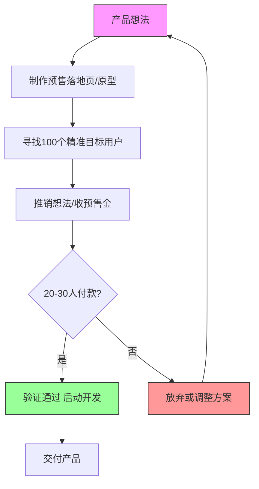

---

## 42.4 商业拆解复制 —— 把“别人的成功”拆成“自己的SOP”

### 为什么需要这个概念？

从零创新成功率极低，且易踩隐形坑；已验证项目的商业模式、流量渠道、转化话术均可复用。普通人缺乏资源整合能力，需通过“抄作业”快速跨越新手期，降低认知门槛。素材中反复强调：同行是最好的老师，抄同行是最快途径。

> "同行就是最好的老师，抄同行永远是做项目最快的途径，能避开多数弯路和无用功。每个项目都有关键词，通过关键词在各个推广渠道搜索这个项目的关键词就一定可以找到同行。我们以客户的角度去思考如果我想要买这个产品，我会在哪去搜关键词，自然也可以找到同行的流量渠道。"
> 
> ——《20230207_03.md》

### 核心定义

**商业拆解复制全流程**：发现商业案例（刷短视频/搜关键词）→ 拆解全链路（前端内容/引流钩子/后端转化/交付/变现）→ 判断可复制性（货源非独家/场景验证有需求/无核心壁垒）→ 低门槛复制（找代工/合作👸号/搭建矩阵）→ 快速变现。

**核心判断标准**：货源非独家、消费场景验证有需求、无不可复制的核心壁垒（如独家专利、顶级IP）。

> "拆下来之后，我就发现很多时候有些项目是完全可以复制的，是不需要投入几十万也可以复制的。分析完上述内容后，我基本上判断这个项目是可以复制的。首先，这个视频爆得偶然；其次，他货源不是他自己的；最后，这个消费场景经过验证是证明是有需求的。"
> 
> ——《20230207_08.md》

### 关键性质

- **信息差套利**：利用认知差、渠道差、执行力差获利，而非技术创新
- **确定性大于偶然性**：设计多条腿走路的渠道（如公域+私域、分销+自营），不赌单一爆款
- **复制边际成本递减**：首单跑通后，后续复制成本极低，利润率上升

### 典型例子

**儿童游乐项目**：拆解爆款视频→判断可复制→3个月招40+加盟商变现40万。

> "三个月时间内我们招了 40 多个加盟商，2 万一个就是 80 多万，刨去各种成本费用，基本上半个月我们赚了 40 万。"
> 
> ——《20230207_08.md`

**美团电商**：发现机会→80元跑通MVP→2个月扩展30家店、单店月利6k-12k。

> "第一家店跑通最小MVP仅仅花费了80元...截止到10月美团电商全类目商家仅2000多家，我们应该是百货类目入驻的全国前300名。"
> 
> ——《20230207_11.md`

**书里有品童书分销**：0预算冷启动→触达核心节点→指数级裂变→2年80万分销员、1.5亿销售额。

> "2020 年 4 月上线，第一个月没有花一分钱投放，进来 10 万宝妈和老师做分销员...80 万+的分销员...1.5 亿销售额"
> 
> ——《20230207_08.md`

### 边界条件

- 仅适用于“成熟模式、非强壁垒、标品/弱非标”项目，重运营/重技术/重品牌护城河项目难复制
- 必须合规操作：避免侵权、违规搬运、虚假宣传，平台风控收紧会瞬间失效
- 核心资源不可控风险：依赖第三方货源/平台流量/合作渠道，一旦断供或涨价模式失效
- 同质化竞争陷阱：入局者多导致流量成本上升、转化率下降，红利期极短（通常3-6个月）

### 方法演进图

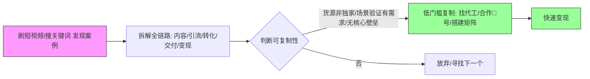

---

## 42.5 流量价值公式 —— 让流量从“虚荣指标”变成“可计算资产”

### 为什么需要这个概念？

创业者常迷恋UV/PV/点赞等虚荣指标，忽略流量的商业本质——能否转化为交易。同等规模流量，价值差异巨大（如泛粉vs精准粉、公域vs私域），缺乏量化评估工具。我们需要一个公式指导流量获取策略：不盲目追规模，而追“相关性×信任度”的高价值流量。

### 核心定义

**流量价值公式**（来源：《20230207_06.md》）

$$
\text{流量价值} = \text{流量规模} \times \text{交易相关性} \times \text{信任度}
$$

- **流量规模**：解决“连接”问题（有多少人看到）
- **交易相关性**：解决“需求匹配”问题（看到的人是否需要）
- **信任度**：解决“成交”问题（是否相信你、敢付费）

这个公式展示了流量商业价值的三要素乘法关系：任一维度为0，总价值即为0。

### 公式推导与解释

这个公式的推导逻辑源于对流量商业转化的拆解：流量要产生交易，必须经历三个关卡。第一，**规模**决定有多少人进入漏斗入口，解决“见面”的问题；第二，**相关性**决定入口人群中有多少是目标需求人群，解决“对上号”的问题；第三，**信任度**决定目标人群中有多少敢于掏钱，解决“成交”的问题。三个关卡是串联关系，任一关卡为零（如流量巨大但全是泛粉相关性为零，或精准流量但零信任），最终交易即为零。因此采用乘法模型而非加法模型。

> "有时候我们面对一篇阅读量很高的文章、一篇赞藏很高的小红书笔记、一个很火的抖音视频，会感到困惑或焦虑。因为我们只看到了表层的流量规模，有些慌张，但流量规模只解决连接的问题，不解决交易的问题。比流量规模更重要的是流量相关性...信任度怎么看？有的连接带来的价值有限，这和连接给UV带来的感受有关...不轻易连接，但连接必有价值。"
> 
> ——《20230207_06.md》

**这个公式的作用**：它将模糊的“流量质量”拆解为三个可诊断、可优化的工程指标。当ROI不达标时，可按公式定位瓶颈：是规模不够（需加大投放/拓渠道）、相关性不够（需调整定向/换渠道/优化素材钩子）、还是信任度不够（需引入背书/案例/私域沉淀/时间积累）。私域之所以能显著提升ROI，本质上是通过“信任度”杠杆，将流量价值公式中的第三项拉高，进而撬动LTV与复购。

### 关键性质

**乘法模型**：任一维度为0，总价值为0（如精准流量但零信任=不成交）。

**私域放大器**：私域流量通过“信任度”杠杆，显著提升单客价（LTV）与复购，使ROI从2.5跃升至3.5-4.5。

> "roi2.5 也就是我 100 万的营业额，需要有 40 万的广告投放，那么在这 40 万的投放算到私域中，我将额外有 100 万×60%×60/150=24 万的私域营业额...这么一算我的 roi 就从 2.5 提升到了 3.5。"
> 
> ——《20230207_06.md`

**流速悖论**：流量太快（无停留）或太慢（无规模）均无价值，需控制“流速”增加停留时间。

> "流量的速度太快、没有停留、规模再大也没有用，流量一直停留不动也不行，等于没有了规模。流量的核心是流和量，就要流动也要停留、不快不慢、持续不断，这样的流量价值才是最大的。"
> 
> ——《20230207_06.md`

### 典型例子

**视频号直播+私域**：150客单价、进粉率60%、月产值8-15元条件下，纯直播ROI 2.5，加私域后3.5-4.5。

**捡漏群**：通过演员氛围、精推文案、催单节奏，将泛流量转化为高信任、高复购的私域资产，月佣百万级。

**抖音本地生活**：无爆品不推广，POI加热+短视频矩阵+直播承接，验证10倍增长空间。

### 边界条件

- 信任度难量化：依赖主观感知，需通过“互动率、复购率、私域进线率”等代理指标侧写
- 相关性随平台/品类变化：同一流量在不同业务模型下价值截然不同，不可跨业务套用公式参数
- 长尾效应滞后：SEO/内容流量见效慢（1-3个月），短期现金流紧张时难支撑验证

### 方法演进图

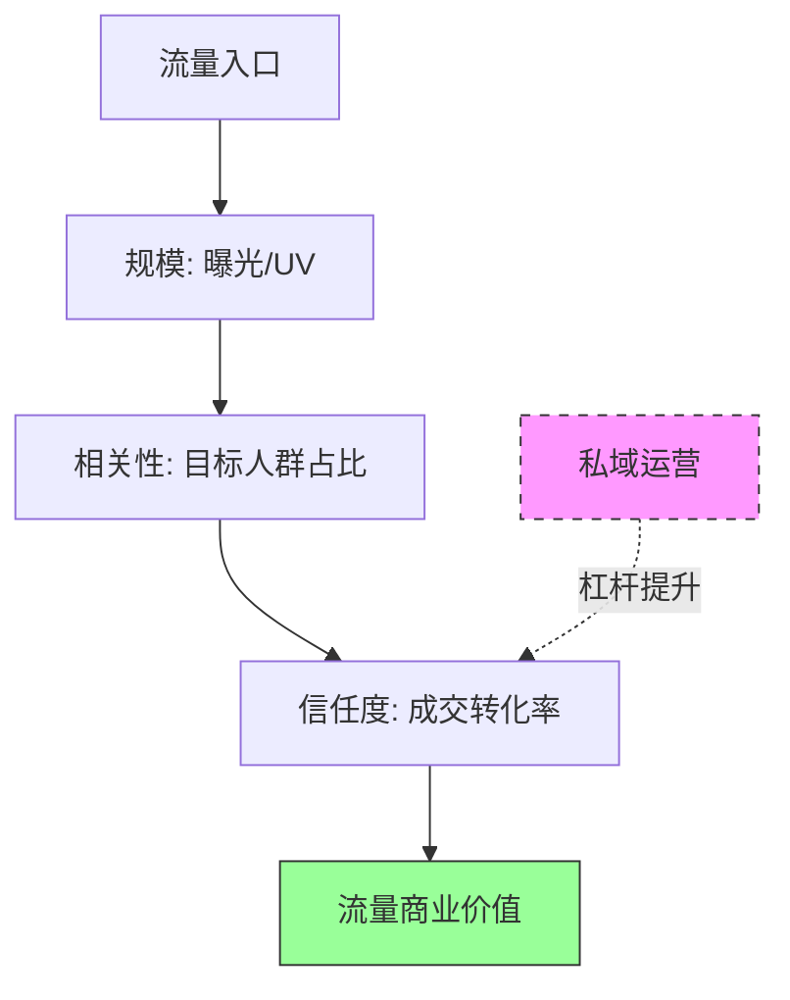

---

## 42.6 实时真实ROI —— 含私域产值的综合核算

### 核心定义

**实时真实ROI** = 直播间直接ROI + 私域年产值贡献的ROI。将私域流量产生的额外年产值计入投放产出后综合计算得到的投产比。

### 核算公式推导与逐步解释（来源：《20230207_06.md》）

设：
- 客单价 $n$ = 150元
- 毛利率 $q$ 
- 广告投入 $y$ = 40万
- 直播间除退货后营业额 $z$ = 100万
- 私域进线率 60%（合格线）
- 月产值 $p$ = 8-15元/人

**第一步：计算纯直播利润与ROI**
$$
\text{纯直播利润} = q \times z - y
$$
$$
\text{纯直播ROI} = \frac{q \times z}{y} = 2.5
$$
（即：投40万广告，产生100万营业额，扣除成本后利润率对应ROI 2.5）

**第二步：计算私域月增值**
每个进私域用户月产值 $p$，进线人数为总成交客数 $\times$ 进线率：
$$
\text{进线人数} = \frac{z}{n} \times 60\%
$$
$$
\text{私域月增值} = \frac{z}{n} \times 60\% \times p
$$
（前3月按80%衰减系数计算，后续视维护情况）

> "我们 150 客单价的产品，进粉率 60%的情况下，月产值只能做到 8……年产值算完衰减，能到 60。"
> 
> ——《20230207_06.md`

**第三步：计算私域年产值累计**
将月增值按衰减曲线累加得年产值（文中测算为60元/人年产值，对应总额24万）。

**第四步：计算综合ROI（实时真实ROI）**
$$
\text{综合ROI} = \frac{\text{纯直播利润} + \text{私域年产值累计}}{y} = \frac{q \times z - y + \text{私域年产值}}{y}
$$
代入数据：私域年产值约24万，综合ROI从2.5提升至3.5；若月产值翻倍（$p=16$），私域年产值增至约48万，综合ROI提升至4.5。

> "这么一算我的 roi 就从 2.5 提升到了 3.5……翻个倍的话 roi 就能提升到 4.5。"
> 
> ——《20230207_06.md`

**这个公式的作用**：它揭示了私域运营对投资回报率的杠杆放大作用——私域流量无需额外投放成本（分子增加、分母不变），却能贡献持续复购，显著拉高整体ROI。这也是“长短线结合”模型（视频号直播+私域）的核心数学支撑。

### 案例验证

> "我们 150 客单价的产品，进粉率 60%的情况下，月产值只能做到 8……年产值算完衰减，能到 60。这么一算我的 roi 就从 2.5 提升到了 3.5……翻个倍的话 roi 就能提升到 4.5。"
> 
> ——《20230207_06.md`

### 方法演进图

```mermaid
graph TD
    A[广告投入 y] --> B[直播间营业额 z]
    B --> C[纯直播利润 = q*z - y]
    C --> D[纯直播ROI = q*z/y = 2.5]
    B --> E[进线人数 = z/n * 60%]
    E --> F[私域月增值 = 进线人数 * p]
    F --> G[私域年产值累计 (衰减求和)]
    G --> H[综合利润 = 纯直播利润 + 私域年产值]
    H --> I[实时真实ROI = 综合利润 / y = 3.5-4.5]
    style D fill:#f99,stroke:#333
    style I fill:#9f9,stroke:#333
```

---

## 42.7 私域单客价思维 —— 从“单次客单价”到“全生命周期价值”

### 为什么需要这个概念？

传统电商关注“客单价”（AOV），导致过度投入获客（CAC），忽视存量用户的复购金矿。公域流量成本持续走高，单次交易利润微薄甚至亏损，唯有私域高复购、高LTV才能回本盈利。

> "电商有个'客单价'的概念，而在私域流量运营的思维下，真正值得关注的不是'客单价'，而是'单客价'，就是一个消费者总共贡献了多少销售额。"
> 
> ——《20230207_03.md》

### 核心定义

**单客价** = 单个消费者在生命周期内贡献的总销售额（GMV）。

**核心公式推导与变形解释**：

传统电商公式：
$$
\text{销售额} = \text{客户数} \times \text{客单价} \times \text{复购频次}
$$

私域单客价公式将“客单价 × 频次”合并为“单客价（LTV）”，得到：
$$
\text{销售额} = \text{客户数} \times \text{单客价}
$$

**为什么要这样变形？** 因为在私域运营中，单个用户的生命周期价值（LTV）是可测算、可运营、可最大化的核心指标。传统公式将频次与客单价分离，掩盖了“运营同一个用户多次购买”的连续性；而单客价公式直接聚焦于“单个用户总贡献”，倒逼运营关注：如何拉长生命周期、如何提升复购率、如何设计产品阶梯承接用户全周期需求。这就是从“打猎思维”（单次转化）到“种田思维”（全周期经营）的数学表达。

> "电商有个'客单价'的概念，而在私域流量运营的思维下，真正值得关注的不是'客单价'，而是'单客价'，就是一个消费者总共贡献了多少销售额。"
> 
> ——《20230207_03.md`

**运营目标**：拉长用户生命周期、增加复购频次、提升客单价 → 最大化单客价。

### 关键性质

- **复购比拉新更重要**：获取新客成本是留存老客的5-25倍，私域核心是“种田”而非“打猎”
- **信任是前提**：私域成交依赖“五位一体成交飞轮”建立深度信任
- **产品矩阵支撑**：需有前端引流品、中端利润品、后端高客单品构成产品阶梯，承接用户全生命周期需求

### 典型例子

**胎毛纪念品项目**：2万精准宝妈私域，7000单变现，结合副业培训/无货源/淘客总变现超100万。

> "结果从抖音导流 2 万私域的，都是精准的宝妈好友，完成了 7000 单的胎毛纪念品变现。在副业赚钱上变现大概有 30 万左右。"
> 
> ——《20230207_03.md`

**捡漏群**：单群生命周期约2年，回本后月利1000元，21个月产生2.1万纯利，投资回报率3-4倍。

> "回本之后，单群单日产出 30 来讲，假设有 100 个群，一天就是 3000 利润，有 1000 个群，一天就是 30000，那么一个月就是 90W。假设一个社群 7000 成本，3 个月回本，之后每个月可以产生 1000 的利润，21 个月还能产生 2.1W 的纯利润。"
> 
> ——《20230207_03.md`

**社群分销**：书里有品通过核心节点裂变，80万+分销员、1.5亿销售额，单客价极高。

> "2020 年 4 月上线，第一个月没有花一分钱投放，进来 10 万宝妈和老师做分销员...80 万+的分销员...1.5 亿销售额"
> 
> ——《20230207_08.md`

### 边界条件

- 运营成本高：需投入大量人力做社群运营、1v1咨询、售后服务，边际成本不为零
- 规模受限：私域流量池有上限（微信好友上限、社群管理半径），难以像公域广告无限放量
- 合规风险：高频营销、诱导分享、违规承诺易触发平台封号/投诉，需严控话术与频次
- 依赖核心人员：头部销售/运营离职易带走客户资源，需建立SOP与客户资产归属机制

### 方法演进图


---

## 42.8 五位一体成交飞轮 —— 私域成交的标准化动作

### 核心定义

**五位一体成交飞轮**（来源：《20230207_06.md》）

私域一对一成交五步法，解决客户三个核心疑虑：
1. **破冰** —— 好感建立
2. **诊断** —— 放大需求
3. **方案** —— 成交铺垫
4. **信任** —— 突破抗拒
5. **成交** —— 引导下单

> "私域成交有逻辑、有章法…我把整套成交逻辑整理成了五位一体成交飞轮：①破冰——好感建立、②诊断——放大需求、③方案——成交铺垫、④信任——突破抗拒、⑤成交——引导下单。多数犹豫不决的客户，究其根本都是因为三个原因：为什么必须买？为什么跟你买？为什么现在买？"
> 
> ——《20230207_06.md`

**这个模型的作用**：它将非标的销售过程标准化为可复制的SOP。每一步都有明确的心理目标（好感→需求放大→方案预期→信任锚点→行动触发）和对应话术库，解决了“私域成交靠天赋、难复制”的痛点，使普通销售也能通过流程执行达成高转化。

### 方法演进图

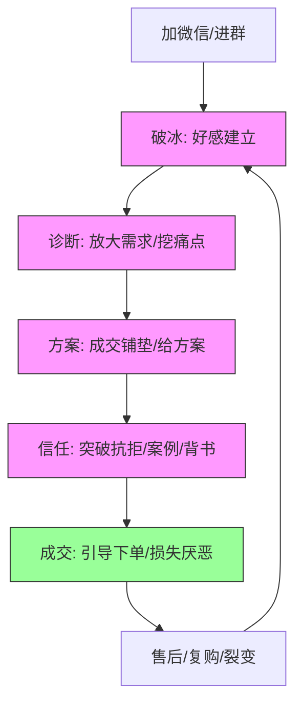

---

## 42.9 捡漏群模型 —— 用“演员+极致性价比”打造社群印钞机

### 为什么需要这个概念？

普通社群活跃度低、转化差、生命周期短，缺乏标准化复制模型。电商佣金模式竞争激烈，需通过“超高性价比（1-3折）”+“稀缺感/从众心理”突围。

### 核心定义

**捡漏群**：以企业微信为载体，建立500人大群，每天精推1个主品（原价1-3折），配合30-50个演员（托）营造抢购氛围，通过淘客佣金变现。

**核心要素**：稳定企微主体 + 靠谱流量 + 精细化运营（选品/排品/文案/催单/演员） + 规模化矩阵 + 多重变现。

### 关键性质

- **演员是灵魂**：有演员 vs 无演员，社群产出相差≥1倍；演员模仿真实用户抢单/晒单/催单，制造“爆单假象”触发从众心理。

> "一个群必须有 20 个以上的演员，确保整个群的发品节奏。演员是捡漏群的灵魂，有演员和没演员的情况，社群产出起码相差一半以上。"
> 
> ——《20230207_03.md`

- **精推文案节奏**：预告→秒杀→4-6次递进式催单→隔天预告，全天候覆盖用户不同时段
- **选品逻辑**：标品看价格/销量、非标看转化率/社交货币；定向招商群/选品网站/同行群三大渠道
- **矩阵化放大**：单群上限500人，通过裂变/投放/合伙人快速复制群数量，规模化摊薄运营成本

### 典型例子

**作者团队**：新起盘<1000群月佣100万+，单群成本3500-1万、回本2-3个月。

> "目前今年新起的盘不到 1000 个群，月佣在 100w+。今年很多同行通过捡漏群和美妆小样群赚得盆满钵满，月佣百 W 的大有人在，我身边还有大的团队社群数量达到万个以上，月佣在几千个 W。"
> 
> ——《20230207_03.md`

**书里有品**：童书分销，0预算冷启动触达核心KOL→指数级裂变→2年80万分销员、1.5亿销售额。

> "2020 年 4 月上线，第一个月没有花一分钱投放，进来 10 万宝妈和老师做分销员...80 万+的分销员...1.5 亿销售额"
> 
> ——《20230207_08.md`

### 边界条件

- 平台风控高压：企微反封号机制严、群发频率限制、诱导分享违规
- 演员管理成本：招募、培训、排班、考核30-50演员/群，人力成本随群数量线性增长
- 供应链依赖：强依赖稳定、低价、高佣、发货及时的供应链
- 用户价值递减：同质化“捡漏”久了用户疲劳、信任度下降、取关率升高

### 方法演进图

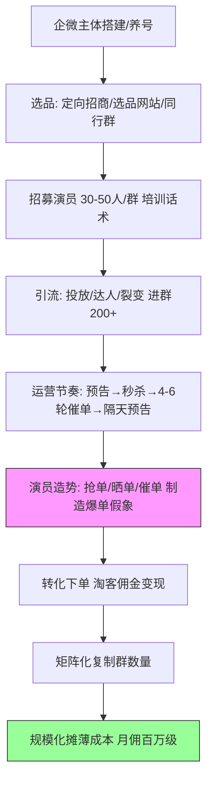

---

## 42.10 视频号直播+私域 —— 长短线结合的“现金奶牛”

### 为什么需要这个概念？

单一公域直播：流量易衰减、平台抽成高、无用户资产沉淀、抗风险极弱。单一私域运营：获客慢、冷启动难、缺乏爆发力、现金流不稳定。素材核心洞见：视频号直播（短期爆发、获新快）+ 私域运营（长期复购、高LTV、抗衰减）= 长短线结合的最优模型。

### 核心定义

- **前端**：视频号直播间（低门槛、高转化、可挂企微/金句卡片引流）
- **中端**：企微/个人微信私域池（分层运营、标签化、SOP服务）
- **后端**：多元变现产品矩阵（低客单引流品、中客单利润品、高客单复购品）
- **核心指标**：直播间ROI + 私域年产值 = 实时真实ROI

### 关键性质

- **引流丝滑**：企微弹窗、金句卡片不跳出直播环境即可加微信，一小时加200人。

> "第一个，用好企业微信，直播时候点弹出，引流到私人微信...可以不用跳出直播环境，直接完成转化。第二个...金句卡片。昨天开了个直播，一小时吧，加到私人微信近 200 人，生财新年预约人数 51 个，加曹大星球 49 个。"
> 
> ——《20230207_03.md`

- **私域放大ROI**：进粉率60%合格，月产值8-15元/人，综合ROI从2.5提升至3.5-4.5。
- **爆单承接法**：视频爆了立马上传同内容建合集、流量视频与带货视频双路、爆了立马开直播双频共振。

> "视频一爆，立马上传同内容的视频，并创建合集，大概率能把新的视频带爆...视频一爆，立马开直播，双频共振。"
> 
> ——《20230207_06.md`

- **无人直播天花板高**：自研硬件规避检测+真实素材拟真，单场销售额116.8万超真人。

> "我在抖音的一场直播，7 月 16 号一天卖了 116.8 万，无人直播能拉到的销售额，甚至比大多数真人直播都要高。打开直播伴侣--添加摄像头--选中盒子--开播。开播内容就是你拷贝在盒子上的内容，这个方法可以防止系统检测。"
> 
> ——《20230207_08.md》/《20230207_11.md`

### 边界条件

- 视频号平台规则收紧风险：引流工具随时可能失效，需备多套方案
- 无人直播违规风险：平台打击录播/雷同/无人值守，硬件寿命短（10分钟-10天），属灰色地带
- 私域运营重运营：需专业销售团队执行“五位一体成交飞轮”，人力成本高、标准化难
- 直播间流量波动大：受算法/竞品/违规影响极大，单场爆单不可复制，需矩阵化稳产出

### 方法演进图

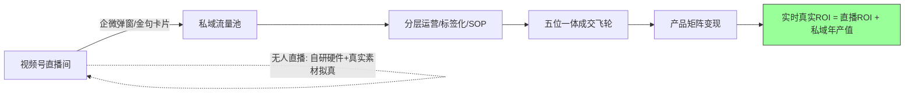

---

## 42.11 抖音本地生活 —— 实体门店的“数字化翻身仗”

### 为什么需要这个概念？

传统实体门店：获客成本高、依赖大众点评/美团高佣、无私域沉淀、营销手段单一。抖音本地生活：算法分发流量（非订阅制）、同城精准触达、视频/直播直观展示、POI门店页承接转化。

> "美团平台活跃商家数量达到 880 万家，基本覆盖全国全部地级市，而抖音本地生活仅覆盖了一线及新一线全部城市，但在二三线城市覆盖率较低，还有巨大的增长空间。"
> 
> ——《20230207_03.md》/《20230207_06.md`

### 核心定义

- **POI（Point of Interest）门店页**：抖音本地生活的核心落地页，集团购券、预约、导航、评价于一体
- **爆品**：单品高性价比、强视觉冲击、高转化率的引流款，是推广的前提（“无爆品不推广”）
- **矩阵打法**：达人探店/自播/员工号/素人号多账号协同，覆盖同城不同人群圈层

### 关键性质

- **POI加热是第一课**：通过达人/投放/活动拉高POI权重，获得免费自然流量曝光
- **短视频+直播双引擎**：短视频获精准流量、直播高转化承接、团购券核销到店闭环
- **好评率=生命线**：差评直接影响POI权重与转化，需SOP化运营（好评返现/差评预警/运营介入）
- **投放工具迭代**：2023年全面切换为“本地推”+外卖打开，门槛降低、定向更精准

### 典型例子

**书画门店**：引爆同城流量（微信群+爆店码）→ 裂变流量（66元定金卡+拼团）→ 转化到店（造节+群接龙），20天收款160万、裂变4000宝妈群。

> "主要环节分为这几块：1、引爆同城流量；2、裂变自有流量；3、转化到店流量。通过这样的方式，裂变了 4000 人左右的微信群，95%以上的都是宝妈。定金卡的数量在 624 张……通过这三步走，转化了 160 万。"
> 
> ——《20230207_03.md`

**抖音爆单承接**：视频爆→传同款建合集→双路发视频→立马开直播→日入1.8-3万。

> "A 账号…这两条视频让我日入 1.8W；B 账号…连续直播了三四天，每天至少十个小时，最高日佣 3W。"
> 
> ——《20230207_06.md》/《20230207_11.md`

### 边界条件

- 强依赖线下履约：到店体验差→差评→POI权重崩→流量断，运营重心在线下而非线上
- 非标品类难复制：餐饮/美容/教培标准化程度不同，SOP复制难度大
- 区域差异巨大：一线城市流量贵/竞争烈，三四线城市流量便宜但用户付费力弱
- 平台规则变动快：从DOU+到本地推、从团购到外卖，打法半年一变

### 方法演进图

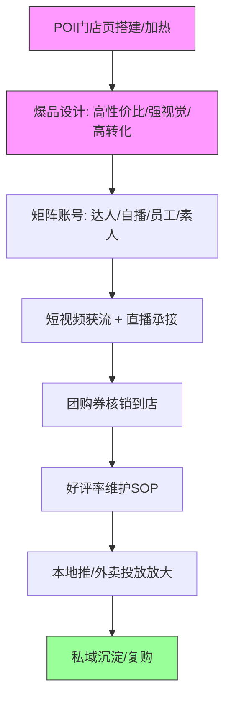

---

## 42.12 无货源店群矩阵 —— 用“铺货概率”对抗“不确定性”

### 为什么需要这个概念？

传统电商：选品难、备货压资金、发货慢、SKU管理重，个人/小团队难承担。视频号/抖音/美团等新平台：后端商品稀缺、流量红利期、平台扶持商家入驻。

> "视频号后端能挣钱的根本原因是因为后端商品的缺乏，视频号选品库整体依旧还是不够多不够丰富的。所以即使现在去做暴力铺品依旧能出单，而且一定要做店群，去多做店，数量越多越好，越多越稳定，最起码要做 5 个以上的店铺，要用矩阵思维来对抗不确定性！"
> 
> ——《20230207_08.md`

### 核心定义

- **无货源**：无库存、无发货，通过采集工具从拼多多/1688/同平台采集商品，加价上架，出单后下单代发
- **店群**：最少5个以上店铺（旗舰店买授权/普通店刷入池），矩阵思维对抗单店不确定性（限流/违规/断流）
- **优选联盟/精选联盟**：平台官方选品池，入池即获得达人带货资源，无需自主引流

### 关键性质

- **暴力铺品**：不精选、广撒网、靠量出单，视频号后端商品缺乏使得即使暴力铺品也能出单
- **选品标准**：品牌货优先、标品优先、销量大优先、官方价≥150元、避开劝退类目
- **利润模型**：单店日营业额~1122元、毛利30%、日利300-400元、月利1万+、10店月入10万+、达人爆单额外几万

> "今天这 7 个店营业额加起来 7858，平均到单店营业额就是 1122，正常毛利在 30%左右，单店一天的利润也就 3，400 左右。多起一些店，再精细点做，平均一个店能做到月利润 1W 左右，做 10 个店就是 10W 了！"
> 
> ——《20230207_08.md`

- **合规底线**：旗舰店买授权（300元/年）、不碰侵权/违禁/高售后品类、发货时效严守平台规则

### 典型例子

**视频号店群**：7店日销7858元、单店均1122元、毛利30%、精细运营单店月利1万、10店10万。

> "今天这 7 个店营业额加起来 7858，平均到单店营业额就是 1122，正常毛利在 30%左右，单店一天的利润也就 3，400 左右。多起一些店，再精细点做，平均一个店能做到月利润 1W 左右，做 10 个店就是 10W 了！"
> 
> ——《20230207_08.md`

**美团电商**：80元跑通MVP、2个月30店、单店月利6k-12k（零运营未优化）、百货类目前全国前300。

> "第一家店跑通最小MVP仅仅花费了80元...截止到10月美团电商全类目商家仅2000多家，我们应该是百货类目入驻的全国前300名。"
> 
> ——《20230207_11.md`

**抖音矩阵带货**：纯靠怼量（点赞>500仅10条、多为个位数/0）、不开直播、累计带货10万+。

> "在保证视频质量的前提下，量怼的越多，爆单的概率肯定就越大...一个号，纯靠发带货视频，不开直播，累计带货10万+。"
> 
> ——《20230207_11.md`

### 边界条件

- 平台打击升级：从鼓励入驻转为严管体验分（DSR/发货/售后/违规），店群模式易被判“无实质经营”封店
- 供应链不可控：上游拼多多/1688商家涨价/断货/发货慢/质量差，直接导致店铺体验分暴跌
- 利润薄、现金流压力大：垫资垫付、退款周期长、佣金结算慢，资金链断裂是店群最大死因
- 无品牌资产：纯靠平台分发流量，无私域沉淀、无品牌溢价、无护城河

### 方法演进图

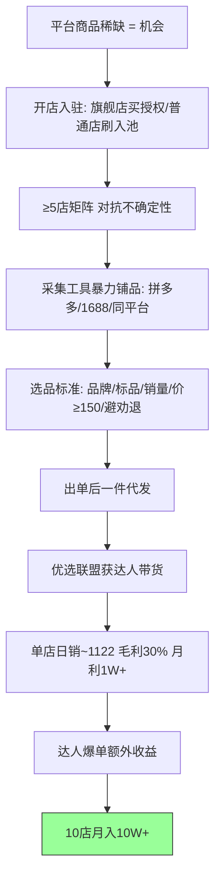

---

## 42.13 高净值销售破局法 —— 卖的不是产品，是“掌控感”

### 为什么需要这个概念？

高净值客户（HNWI）抗销售、决策理性、信息获取渠道广、传统“挖需求-讲卖点-逼单”完全失效。素材核心洞见：富人最大痛点不是“缺钱”也不是“缺产品”，而是“失去掌控权”（恐惧源于未知）。

### 核心定义

**买家系统 vs 卖家系统**：买家本能启动防御（撒谎/给希望/躲藏），卖家按流程走必死；破局必先跳出买家系统。

> "通常当一个人你知道他是销售，你出现在他面前的时候...我们会开始自我保护起来。这些行为在买家系统里就是一个本能，叫撒谎。"
> 
> ——《20230207_08.md`

**需求 vs 痛点**：需求=理性/平静/无情绪动力；痛点=情绪驱动/恐惧/焦虑/渴望 → 只有上升为痛点才会成交。

> "需求和痛点的差别在什么呢？我以为我需要这个东西，它没有什么情绪的动力。当客户很平静的时候，都是需求，不是痛点。情绪动力是客户花钱的最根本的点，大客户也逃不掉。"
> 
> ——《20230207_08.md`

**核心痛点**：失去掌控权（富一代/创一代最怕），由奢入俭难，一旦失控恐惧极大。

> "你不用学那么多，你只要知道他最大的痛点就是失去掌控权，恐惧源于未知。对一个一直拥有掌控权的人来说更可怕。因为由奢入俭难。"
> 
> ——《20230207_08.md`

### 关键性质

**三步破局法**：
1. **引起好奇**（反问/布置功课/谈趣味价值） → 跳出买家系统
2. **上升痛点+重塑概念**（建立权威） → 将“家族信托”重塑为“家族宪法/防火墙/掌控仪”
3. **灵魂三问形成依赖**（聊孩子/谈自己/谈传承） → 引导客户自我暴露焦虑与渴望

> "引起好奇的方法，我通常先反问或者是先给客户布置功课。我就对高净值客户说，我要和你谈的不是钱的问题，是一个趣味性的问题和价值的问题。"
> 
> ——《20230207_08.md`

**信任前于成交**：成交三要素（需求、信任、购买力），信任前提是提供价值解决需求，而非推销产品。

> "成交的核心三个要素：需求、信任、购买力。成交的前提是信任，信任的前提是能提供用户需要的价值、解决用户的需求。"
> 
> ——《20230207_08.md`

**合作思维谈判**：非对立博弈，而利他共赢（帮对方省精力/加速回笼/规避风险）。

> "采用合作思维，我和他不是对立关系，而是合作共赢，即利他思维，利他即利己，所以合作思维逻辑成立。"
> 
> ——《20230207_08.md`

### 典型例子

**高净值销售实战**：通过“聊孩子/谈传承”切入，而非谈产品参数，建立情感连接与信任锚点。

**闲鱼倒爷合作思维**：为对方节省精力、加速资金回笼，释放利他信号促成低价收货。

> "采用合作思维，我和他不是对立关系，而是合作共赢，即利他思维，利他即利己，所以合作思维逻辑成立。"
> 
> ——《20230207_11.md`

**发圈动力公式**：佣金/社交压力；产品有社交货币价值（如好书展示好妈妈形象）→ 正向价值观驱动疯狂发圈。

> "发圈动力=佣金/设计交压力。发朋友圈介绍好书，展示出的是爱阅读爱学习爱教育的好妈妈形象，正向价值观，所以大家都疯狂发圈。"
> 
> ——《20230207_08.md`

### 边界条件

- 仅适用于高客单、高决策周期、强信任依赖的非标/半标品（保险、房产、高端医疗、家族办公、大额投资）
- 对销售人员素质要求极高：需懂心理学/财税法/资产配置/家族传承，且具备高情商与长期主义耐力
- 合规红线：严禁虚假承诺、误导销售、利用恐惧诱导，金融/保健品等强监管领域易触刑法
- 规模化难：高度依赖个人IP与非标服务，难以SOP化复制，扩张靠“合伙人/学徒制”而非标准化复制

### 方法演进图

```mermaid
graph TD
    A[高净值客户 防御机制全开] --> B[跳出卖家系统]
    B --> C[步骤1: 引起好奇 反问/布置功课]
    C --> D[步骤2: 上升痛点(失去掌控权) 重塑概念建权威]
    D --> E[步骤3: 灵魂三问 聊孩子/谈自己/谈传承]
    E --> F[形成深度依赖与信任]
    F --> G[合作思维谈判: 利他共赢]
    G --> H[成交: 卖的是掌控感/确定性]
    style C fill:#f9f,stroke:#333
    style D fill:#f9f,stroke:#333
    style E fill:#f9f,stroke:#333
    style H fill:#9f9,stroke:#333
```

---

## 42.14 股权顶层设计四要素 —— 从“分蛋糕”到“设计游戏规则”

### 为什么需要这个概念？

90%创业团队死于内斗，核心是股权模糊、机制缺失、预期不一、退出无门。平均分配/大哥说了算/投钱多占股多，均为原始粗暴模式，无法支撑规模化与融资。

### 核心定义

**股权顶层设计四要素**（来源：《20230207_03/06/08/11.md》）

1. **顶层控制权**：有操盘能力、有责任心的好人拥有控制权（AB股/一致行动/否决权），对外仅一个声音
2. **进入机制**：资金型溢价入、资源型对赌入、技术型专利入，拒绝“情怀入股/关系入股”
3. **分配机制**：静态分配（启动时）+ 动态调整（里程碑/贡献/绩效），预留期权池（10-15%）激励核心骨干
4. **退出机制**：时间约束（如4年归属/1年悬崖）、回购原则（原价/净资产/估值）、回购价格、优先清算权

### 关键性质

- **股权是动态契约**：非一次性切蛋糕，而是随阶段、贡献、风险动态调整的利益捆绑工具
- **控制权>收益权**：创始人必须掌握控制权（>67%或AB股/一致行动），否则战略随大股东意志漂移
- **合同是枪、附件是子弹**：股权协议+章程+投资协议+期权计划+回购协议+保密/竞业协议，缺一不可

> "劳动合同就等于是一把枪，而这些附件，就是子弹。你的枪再好，没有子弹也是无济于事。"
> 
> ——《20230207_08.md`

- **五步法量化**：岗位权重×时间投入×资金投入×创始人身份×资源价值，自评互评达成共识

### 典型例子

**作者股权实操**：五步法计算比例只是起点，仍需一致行动权/期权池/分红/回购/优先清算/领售权等合同规范。

**融资避坑**：警惕收各种费用的骗子公司，正规机构不收前置费，最好有人推荐背书。

> "按照品牌方操作的难度，加盟模式一共分为四个级别六种类型：轻量级、中量级、重量级和魔鬼级。魔鬼级的加盟是最难实现的一种，我称之为卖特许权。"
> 
> ——《20230207_11.md`

> "好的名字=低触达成本+低理解成本+低记忆成本+好体验理由+低传播成本+好的延展空间"
> 
> ——《20230207_11.md`

### 边界条件

- 无通用标准模板：每家公司业务模式/阶段/团队/愿景不同，方案须定制，照搬模板必坑
- 法律强制约束有限：公司法/合同法兜底，但商业博弈中“契约精神”常失效
- 早期过度设计=束缚：种子期/天使期核心是活下来、跑通模型，复杂股权结构反而增加沟通成本
- 人性贪婪恐惧：利益面前契约脆弱，唯有“利益绑定+价值观共鸣+利他文化”能延长团队半衰期

### 方法演进图

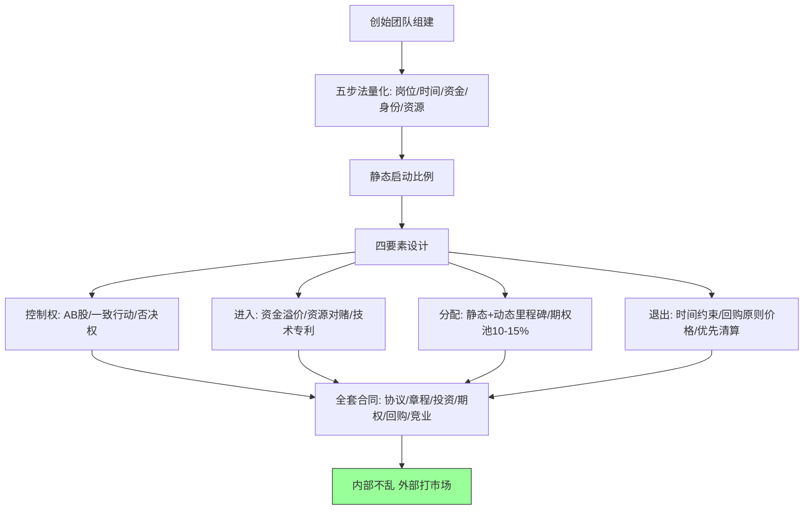

---

## 42.15 内在比赛理论 —— 赢了自己，才能赢世界

### 为什么需要这个概念？

创业者常陷入“战术勤奋掩盖战略懒惰”，外在努力掩盖内在恐惧、怀疑、不配得感。素材引用《身心合一的奇迹力量》：自我一（理性/表意识）vs 自我二（潜意识/感性），外在比赛输赢取决于内在比赛。

> "人，有两个自我，分别是自我一、自我二。自我一，对应着理性，是一般意义上的自我。自我二，对应着感性，或者说对应着潜意识。任何一个比赛，实际上是同时进行的两场比赛，内在比赛和外在比赛。内在比赛，也就是英文书名里的'Inner Game'，这是最容易被人忽视的。人们往往容易忽略的是，如果自我二（也就是潜意识），并不认可这个目标的时候，会输掉内在比赛。一旦输掉内部比赛，外在比赛也会输。"
> 
> ——《20230207_01.md`

### 核心定义

- **内在比赛**：潜意识（自我二）是否真正认可目标、相信配得、允许成功
- **外在比赛**：市场竞争、业绩指标、融资谈判、团队管理等显性对抗
- **核心因果**：输掉内在比赛 → 必然输掉外在比赛；赢内在 → 外在大概率赢

### 关键性质

- **盲目自信是理性选择**：创业者需“在我的领域我就是国王”的潜意识信念，永远不要低估一个高估自己的人。

> "一言以蔽之：你需要盲目的自信。因为盲目的自信和乐观，是创业者的理性选择。这样'舍我其谁''在我的领域，我就是国王'的心态，才是创业者真正需要的心态！"
> 
> ——《20230207_01.md`

- **成功是成功之母**：过去成功体验在潜意识累积自信，推动后续更大成功（反“失败是成功之母”）。

> "失败不是成功之母，成功才是成功之母。我一个成功体验，推动一个又一个的成功体验。成功，才是成功之母。"
> 
> ——《20230207_01.md`

- **唤醒成功体验法**：怂/不自信时，主动回顾过往成功（哪怕微小），重建潜意识自信锚点。

> "当自己内心很怂、不自信的时候，你需要回顾下自己成功的经历，唤醒自己的成功体验。比如，一些优秀的推销员，在开展一天的工作时，会先去找一些优质的客户，或者推销一些容易卖的产品，通过这种方式去制造成功体验。这份体验，会帮助他更好地开展一天的工作。"
> 
> ——《20230207_01.md`

- **俯视学习法**：战略上俯视（我是国王来学）、战术上重视（跪着学细节），跪着学习的人打不赢内在比赛。

> "我的答案是：别跪着学！要俯视！你就是国王，把生财有术的帖子，当成奏折来看。毛主席说，战略上藐视敌人，战术上重视敌人。跪着学生财有术的人，打不赢内在比赛。"
> 
> ——《20230207_01.md`

### 典型例子

**老虎伍兹**：丑闻离婚后潜意识“不可战胜”崩塌，两个月丢世界第一、几年跌出前100，技术未变但信念碎了。

> "性丑闻离婚后两个月丢掉世界第一头衔，在往后几年，甚至跌出过世界排名前 100...因为性丑闻，老虎伍兹输掉了自己的内在比赛。"
> 
> ——《20230207_01.md`

**李宗伟vs林丹**：37次交手输25次，技术不分伯仲，核心是潜意识层面内在比赛落败。

> "李宗伟不是输给了林丹，是输给了自己。"
> 
> ——《20230207_01.md`

**作者执行力变现**：4个月加4000好友微信号被亦仁7万收购、因执行力被邀请生财办公室。

> "执行力是值钱的，执行力是可以变现的...亦仁大概花了 7W 买了她坚持 4 个月加了 4000 多好友的微信号。"
> 
> ——《20230207_03.md`

### 边界条件

- 非盲目乐观：盲目自信建立在“能力圈内/已验证模型/可控风险”基础上，而非无视现实的妄想
- 需配合外在实操：内在比赛赢了只是“入场券”，外在仍需MVP验证、流量获取、交付运营等硬功夫
- 幸存者偏差：素材多为成功者复盘，失败者同样可能“盲目自信”却因能力/运气/时机不足而死
- 心理防御机制：过度“成功体验唤醒”可能掩盖真实风险信号，导致“确认偏误”拒绝止损转向

### 方法演进图

```mermaid
graph TD
    A[目标/挑战] --> B{内在比赛: 自我二(潜意识)认可?}
    B -- 否 --> C[输掉内在比赛] --> D[必然输掉外在比赛]
    B -- 是 --> E[赢下内在比赛] --> F[外在比赛大概率赢]
    G[盲目自信: 我领域我是王] -.->|潜意识锚点| B
    H[成功体验累积] -.->|强化自信| G
    I[唤醒成功体验: 回顾微小胜利] -.->|重建锚点| H
    J[俯视学习: 战略俯视/战术重视] -.->|心态校准| G
    style F fill:#9f9,stroke:#333
    style D fill:#f99,stroke:#333
```

---

## 42.16 战略即选择 —— 最重要的是决定“不做什么”

### 为什么需要这个概念？

创业者常陷入“机会主义”陷阱：见好项目就想做、见新平台就想上、见竞品就想跟，导致资源分散、战略模糊、执行变形。素材核心主张：战略的本质是取舍，关键决策在于明确“不做什么”，而非贪多求全。

> "什么是战略呢？就是选择。选择，其最重要的就是不做什么，而不是做什么。"
> 
> ——《20230207_07.md`

### 核心定义

**战略三段论**（来源：《20230207_07.md》）

1. **目的** = 获得相对优势
2. **形式** = 自始至终的指导原则
3. **基石** = 发挥禀赋（劣势不能做战略方向）

**战略发挥优势法**：先审视手中筹码（优势/资源/能力）→ 再决定怎么打牌（如何用优势获结果）→ 补齐短板。

> "战略就是先审视自己手里的筹码，也就是自己的优势，然后再决定自己怎么打牌，也就是如何运用自己的优势来获得你想要的结果。"
> 
> ——《20230207_07.md`

**战略稳于执行**：战略非朝令夕改、非一朝一夕，是“三会一层”（治理层）的事，执行层只管落地。

> "战略，既不是一朝一夕的事，也不是朝令夕改的事。战略，是三会一层要做的事。"
> 
> ——《20230207_06.md`

### 关键性质

- **视角切换破局**：从“追求增长”→“价值创造”，需三种勇气：面向未来非过去、面向用户非利弊、积累价值非抓取资源。

> "真正要去摆脱这种视角，最难的不在于方法论，而是 3 种'勇气'：面向未来而非面向过去的勇气；面向用户而非计算利弊的勇气；积累价值而非抓取资源的勇气。"
> 
> ——《20230207_07.md`

- **不流动稀缺资源优先**：销售额/DAU/权力是流动无限的；品牌/数据/人才/信任是稀缺不流动的，优先积累后者。

> "实际上，这也是一个奇怪的现象，我们花费了太多的精力去抓住无限的、流动的东西，而非关注真正稀缺的、不变的东西。对一个品牌来说，销售额几乎是无限的而且每年都在改变，但是用户对你高端品牌的心智是稀缺的。"
> 
> ——《20230207_07.md`

- **重构成功归因**：复盘不问“坚持了什么”，而问“抓住了什么机会/打破了什么惯例”，避免用过去定义未来。

### 典型例子

**苏联/美国冷战**：美“强加成本”战略（毒刺导弹/压油价/星球大战）迫使苏联高防守成本+造血破坏→拖垮苏联。

> "你看，美国所有的行动，都是遵守一个战略指导原则，就是让苏联增加成本。这叫做'强加成本'战略。"
> 
> ——《20230207_07.md`

**LV/耐克/索尼/宝洁**：抓住大趋势（铁路/电视/晶体管/广播）做开创性举动（旅行箱/赞助球星/随身听/全国品牌）实现巨大增长。

> "LV 率先开发出轻便、耐磨损的旅行箱，抓住了 19 世纪欧洲火车普及的机会；NIKE 通过赞助顶级球星的方式抓住了电视转播崛起的机会；索尼抓住了晶体管技术的突破开发随身听等等。"
> 
> ——《20230207_07.md`

**柯达陷阱**：自认成功源于“坚持成像品质”，实则源于“低价便捷相机抓住大众化趋势”，用过去定义自己错失数码趋势。

> "柯达认为自己成功的重要法门是坚持成像的品质和性能（这个 belief 也在一定程度上限制了它们进入更加便捷但是成像品质相对低的数码相机市场）。它最初成功的法门并不是高品质，而是抓住技术趋势开发适合更多人群的便捷性产品。"
> 
> ——《20230207_07.md`

### 边界条件

- 战略需随环境演进：指导原则不变，但具体路径/战术须随平台周期/技术范式/竞争格局动态调整
- 中小微企业战略=生存策略：早期战略往往是“活下去/跑通MVP/找到PMF”，而非宏大叙事
- 执行偏差放大战略错误：战略微小偏差，经执行层层放大后变成致命伤
- 信息不对称下的决策：创业者常在信息不全时做战略抉择，需建立“低成本试错/快速反馈/果断止损”纠错机制

### 方法演进图

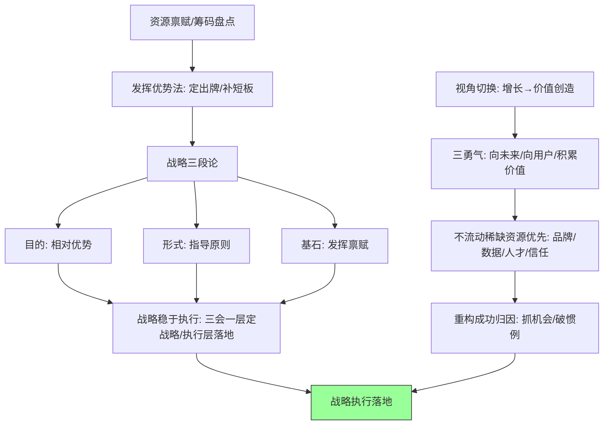

---

## 42.17 平台周期与红利窗口 —— 在“高流量低商业化”期入场

### 为什么需要这个概念？

所有平台遵循相同演进规律：铺货期→动销期→精细化期→玩趋势期，早期红利最大、门槛最低、竞争最弱。创业者常错过红利期（观望/犹豫/不懂规则），或在存量期硬冲（成本高/规则严/ROI低），需建立“平台钟”认知。

### 核心定义

**四周期模型**（来源：《20230207_11.md》）

1. **铺货期**：鼓励上架、宽进宽出、流量免费分发
2. **动销期**：考核销量/动销率、清僵尸链接
3. **精细化期**：重服务/体验/合规/内容质量、清洗劣币
4. **玩趋势期**：玩直播/短视频/私域/品牌/出海、头部固化

**红利窗口**：通常在铺货期-动销期交界（高流量、低商业化、规则宽松），普通人最易切入。

**确定性窗口期**：如2023春节后2-3个月疫情平稳期（类比香港数据），为全年最关键3-6个月机会窗。

> "通过香港疫情数据类比推演：大陆首轮大规模感染后有2-3个月疫情平稳期，之后才进入第二波感染峰值——2023年春天是相对确定的稳定期，是生意人与投资者看重的窗口期。"
> 
> ——《20230207_01.md`

### 关键性质

- **完成比完美重要**：美团电商80元跑通MVP、2个月30店，验证“新平台初期红利+极速执行”组合拳。

> "第一家店跑通最小MVP仅仅花费了80元...截止到10月美团电商全类目商家仅2000多家，我们应该是百货类目入驻的全国前300名。"
> 
> ——《20230207_11.md`

- **平台战略跟随**：增长期激进投放/抢占心智；存量期合规深耕/精细化运营/找自身原因，否则被清理。
- **技术基建决定响应速度**：ChatGPT热点十几分钟上线👸号/小程序/镜像站，消耗50万请求，基建好才能接得住风口。

> "第一个推出该功能，并且第一名的名字在手里，必然会拿到最多的搜索流量...我又花了十几分钟，写了一百多行代码，成了全网首个把'ChatGPT'集成到👸号的人。"
> 
> ——《20230207_06.md》/《20230207_11.md`

- **SEO长尾福利**：SEO思维内容3-5年后仍享流量福利，<200篇内容大半月不更新仍日有咨询。

> "用SEO思维去发布的内容，那怕3年5年你依然可以享受到这个内容的福利。"
> 
> ——《20230207_11.md`

### 典型例子

**TikTok睡播**：平台早期高流量低商业化，单小时均100美金、峰值在线4.2万、新号2天破500，简陋直播间也能破万在线。

**抖音本地生活**：覆盖一二线、二三线空白、外卖打开+本地推上线→预计10倍增长。

**AI绘画/ChatGPT风口**：技术基建就绪者十几分钟接入、抢占搜索首名、吃尽红利。

### 边界条件

- 红利期不可预测长度：可能3个月、可能3年，赌周期长短极难
- 平台规则突变风险：算法调整/政策收紧/接口关停/封号潮，单一平台依赖极危险
- 伪红利陷阱：平台补贴/活动/流量扶持看似红利，实则收割商家（如TEMU压价至1688持平）
- 团队/资源跟不上：红利期需极速扩张，组织能力/现金流/供应链跟不上会噎死

### 方法演进图

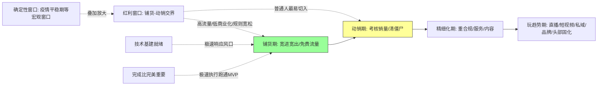

---

## 42.18 风险管理与合规底线 —— 优雅止损、合规经营、避开“优雅亏大钱”陷阱

### 为什么需要这个概念？

创业/副业充满不确定性，无风控意识必死无疑。素材系统梳理：劳动法合规、平台规则敬畏、投资止损、项目甄别、合同规范。“优雅亏大钱三步骤”反讽揭示核心死因：做不懂的事+加杠杆/重仓+不止损不止盈 = 必亏大钱。合规非成本、是资产。

### 核心定义

**劳动合同有效性**：合同是枪，附件（考核表/规章/廉洁/保密）是子弹，缺一不可。

> "劳动合同就等于是一把枪，而这些附件，就是子弹。你的枪再好，没有子弹也是无济于事。"
> 
> ——《20230207_08.md`

**辞退损失最小化**：会谈技巧/离职表签署（个人原因不盖章）/当天结清工资/证据固化，只能减损不能免责。

**平台风控本质**：平台通过限流/违禁词/处罚分配流量偏好，反向推导可获合规/规避策略。

**非刚需项目不做**：10年4次失败/负债百万教训，链条太长推不动，项目本性成就人。

> "本人创业 10 年创业失败 4 次，负债百万靠自媒体上的岸…不够刚需的事情现在一律不敢做了…最终是项目的本性成就人，而不是人去推动一个不够刚需的项目。"
> 
> ——《20230207_06.md`

**无壁垒项目=买试错经验**：普通人能碰的项目几乎无绝对壁垒，培训本质=付费买别人试错时间。

> "目前我们普通人能接触到的互联网项目不是科研项目，本质上讲几乎是没有任何壁垒的……所以市面上所有项目培训的本质就是付费买别人的试错经验和时间。"
> 
> ——《20230207_03.md》/《20230207_06.md`

### 关键性质

- **止损是策略非认输**：AI绘画小程序因预算/执照/工期/流量风险理性放弃，非盲目坚持。

> "最终我放弃了，原因如下：1.预算远远超出了预期... 2.没有个体和公司执照... 3.工期在 15-20 天左右... 4.最为关键的一点，虽然微信搜索指数 AI 绘画出现了异常值，但这次的流量 99%来自于👸号。"
> 
> ——《20230207_08.md`

- **克制止损**：直播有警告/断播即停、被罚当天不播、见好就收，账号>单场流量。

> "被处罚后当天不应再播，要见好就收、及时止损。"
> 
> ——《20230207_03.md》/《20230207_06.md》/《20230207_11.md`

- **反期望定理**：反着亏钱步骤做也不保证赚钱，亏钱是赚钱路上必经环节，舍弃亏钱=舍弃赚钱。

> "如果你要问，那我反着来，就能保证赚钱吗？我也希望可以，但很不幸不能，无论多厉害的高手，亏钱是赚钱路上的不可缺少的部分。舍弃了亏钱，就意味着舍弃赚钱。"
> 
> ——《20230207_07.md`

- **Web3生存20字箴言**：见好就收、有利必跑、狠心出货、切勿幻想、变现为王。

> "时刻牢记20字箴言，见好就收，有利必跑，狠心出货，切勿幻想，变现为王。"
> 
> ——《20230207_04.md》/《20230207_11.md`

### 典型例子

**劳动纠纷三案例**：品牌部赔22500、运营部赔4500、短视频部赔2500 → 总结：及时签合同、建周考核、完善体系。

> "案例一：品牌部张先生劳动纠纷事件...赔付了 22500 元...案例二：运营部徐女士劳动纠纷事件...赔付了 4500 元...劳动合同一定要及时去签，特别是遇到一些节假日时...员工一定要考核，同时一定要建立周考核表"
> 
> ——《20230207_08.md`

**非刚需失败**：作者10年创业4败/负债百万靠自媒体上岸，总结“非刚需不做”。

**AI小程序放弃**：预算超期/无执照/工期长/流量99%靠👸号 → 理性止损。

**TikTok无人直播硬改机**：10分钟-10天寿命、卖手机一锤子买卖、朋友买5-6十部谷歌3风控进不去无售后。

> "第二种是直播手机...这些机型我们都测试过，时间短的仅仅十分钟，直播间就不见人了，慢的话跑个十天半个月的也就不行了...硬改设备我不建议尝试，我有个朋友，买了五六十部谷歌3手机，刚开始没有问题，后来风控，直播间进不去，卖手机的也不给解决。"
> 
> ——《20230207_11.md`

**TEMU标品议价极小**：小二预留10%利润、超1688视为无诚意压价、需侧重非标品。

> "之前我也跟小二聊过，他们会给商家预留10%左右的利润空间，对商家中报价超过1688同款比较多的，直接视为没有诚意，会减少跟这类商家的合作。"
> 
> ——《20230207_11.md`

### 边界条件

- 合规成本随规模上升：小微团队易忽视合规，规模化后合规部门成标配，早布局低成本
- 灰色地带收益高但寿命短：无人直播/搬运/擦边/诱导分享等玩法，平台收紧即归零，不可作为核心长期业务
- 法律滞后于创新：新模式法规空白期，合规边界模糊，需自律+法律顾问双重保障
- 风控过度=机会成本：过度规避风险导致错失红利窗口，需在“合规底线”内“激进试错”，平衡攻防

### 方法演进图

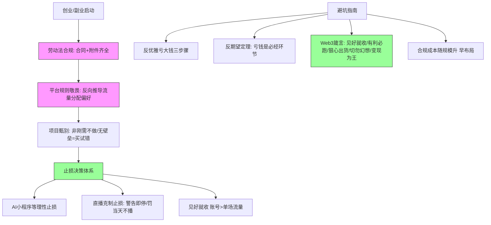

---

## 42.19 多源对照

本节系统梳理核心概念在多份素材中的交叉验证与差异，按概念维度逐一展开。

### 42.19.1 内在比赛/潜意识决定成败

**共识**：
- 《20230207_01.md》引用《身心合一的奇迹力量》系统阐述自我一/自我二与内在/外在比赛框架
- 《20230207_03.md》通过执行力变现案例（宝妈微信号、作者被邀请）侧面印证：持续执行力源于内在信念的确定性
- 《20230207_07.md》从战略视角论述“被想拥有的东西绑架”即潜意识层面的恐惧与匮乏感导致战略失焦

**分歧**：
- 《20230207_01.md》强调“盲目自信”是理性选择，建议主观能动性极强
- 《20230207_07.md》更强调“价值创造视角”的客观性，认为需三种“勇气”而非单纯自信
- 《20230207_03.md》侧重“执行力可变现”的外部验证，而非内在心理建设

### 42.19.2 平台周期/红利窗口

**共识**：
- 《20230207_01.md》《20230207_06.md》《20230207_08.md》《20230207_11.md》均认同平台存在生命周期，早期红利最大
- 多源素材均用“以史为鉴”法：淘系→拼多多→抖音→视频号→美团→TEMU，验证周期相似性

**分歧**：
- 《20230207_01.md》用疫情数据推演“确定性窗口”，属宏观周期判断
- 《20230207_11.md》提出“平台电商四周期”具体模型，属微观操作指南
- 《20230207_08.md》强调“平台生命周期与投放策略调整”，关注存量期合规生存

### 42.19.3 高净值销售破局法

**共识**：
- 《20230207_08.md》系统给出“买家系统/卖家系统”破局框架、三步破局法与灵魂三问
- 《20230207_11.md》以闲鱼倒爷案例验证“合作思维/利他谈判”在低价收货中的实战有效性
- 《20230207_06.md》以“成交三要素/五位一体成交飞轮”提供私域成交的标准化SOP，与高净值销售的信任建立逻辑互补

**分歧**：
- 《20230207_08.md》聚焦高净值客户“失去掌控权”核心痛点，强调概念重塑与心理依赖
- 《20230207_11.md》侧重中低客单产品的“合作思维”操作，痛点层级较浅
- 《20230207_06.md》提供通用私域成交流程，未区分客户净值层级

### 42.19.4 股权顶层设计四要素

**共识**：
- 《20230207_03.md》提出“股权分配五步法”量化启动比例
- 《20230207_06.md》系统阐述“控制权/进入/分配/退出”四要素与“三会一层”治理关系
- 《20230207_08.md》以“劳动合同=枪、附件=子弹”类比强调合同配套刚性
- 《20230207_11.md》给出“加盟四级别/好名字公式/健康单店模型”作为股权/品牌扩张的实操参照

**分歧**：
- 《20230207_03.md》侧重启动期量化算法
- 《20230207_06.md》侧重治理层面的顶层架构设计
- 《20230207_08.md》侧重法律文本的刚性兜底
- 《20230207_11.md》侧重业务扩张模式（加盟/品牌）对股权结构的反向要求

### 42.19.5 视频号直播+私域

**共识**：
- 《20230207_03.md》首提“长短线结合”属性，给出企微弹窗/金句卡片引流实测数据（小时加200人）
- 《20230207_06.md》提供ROI核算公式（纯直播2.5→含私域3.5-4.5）与爆单承接法（合集/双路/双频共振）
- 《20230207_08.md》披露无人直播自研硬件（黑盒子伪装摄像头）单场116.8万实测数据
- 《20230207_11.md》补全无人直播操作细节（直播伴侣添加摄像头选中盒子）与抖音带货爆单承接案例

**分歧**：
- 《20230207_03.md》侧重引流工具与私域沉淀
- 《20230207_06.md》侧重ROI数学模型与爆单运营节奏
- 《20230207_08/11.md》侧重无人直播技术实现与灰色地带风控对抗

### 42.19.6 捡漏群模型

**共识**：
- 《20230207_03.md》给出全运营SOP（选品渠道/排品节奏/精推文案/催单轮次/演员规模30-50）
- 《20230207_06.md》给出ROI核算与私域单客价视角的长期价值验证
- 《20230207_08.md》给出社群分销冷启动法（触达核心节点→指数级裂变）与“书里有品”案例
- 《20230207_11.md》以闲鱼倒爷“合作思维/选品标准”互补验证供应链端可复制性

**分歧**：
- 《20230207_03.md》聚焦单群精细化运营与矩阵化放大
- 《20230207_06.md》聚焦私域流量的财务建模与ROI放大
- 《20230207_08.md》聚焦分销裂变的供应链/顶层设计/动员能力公式
- 《20230207_11.md》聚焦供应链端的选品避坑与谈判心法

### 42.19.7 抖音本地生活

**共识**：
- 《20230207_03.md》给出“三步走”门店收款法（引爆同城/裂变自有/转化到店）与160万/20天实测
- 《20230207_06.md》给出“无爆品不推广”铁律与爆单承接法（合集/双路/双频）
- 《20230207_11.md》给出“美团880万 vs 抖音一二线”10倍空间判断、本地推/外卖工具迭代、健康单店模型新标准

**分歧**：
- 《20230207_03.md》侧重门店自运营的流量闭环
- 《20230207_06.md》侧重达人/矩阵视频的爆单承接节奏
- 《20230207_11.md》侧重平台宏观机会窗口与加盟/品牌扩张的标准化判据

### 42.19.8 无货源店群矩阵

**共识**：
- 《20230207_08.md》给出视频号店群核心逻辑（后端缺货=机会）、操作全流程（开店/入池/采集/铺货/代发）与单店盈利模型（日销1122/毛利30%/月利1万）
- 《20230207_11.md》给出美团电商80元MVP、30店扩张、抖音怼量带货10万+、选品标准（品牌/标品/销量/价≥150/避劝退）
- 《20230207_06.md》以“平台生命周期与投放策略”解释为何新平台初期暴力铺品可行、存量期必死

**分歧**：
- 《20230207_08.md》聚焦视频号优选联盟/旗舰店授权的特定玩法
- 《20230207_11.md》聚焦跨平台（美团/抖音/闲鱼）的通用无货源方法论
- 《20230207_06.md》聚焦平台周期视角下的战略进退时机

---

## 42.20 设计中的取舍

### 为什么不用“完美产品后再上市”而是“MVP先卖后做”？

**背景对比**：传统“完美产品后上市”模式要求在用户见到产品前完成全部研发、生产、库存备货，典型周期3-6个月，沉没成本包含研发人力、模具开模、首批备货、仓储物流等，动辄几十万至百万级投入。一旦上市发现无人买单，全部沉没成本打水漂，且因库存积压导致现金流窒息。

**核心权衡**：MVP“先卖后做”仅需制作落地页/原型/演示视频，成本几百至几千元，周期缩短至几天。通过预售收款验证需求，若20-30人/100人付款则绿灯开发；若仅几人付款则直接砍项目，沉没成本仅限落地页制作费。代价是可能面临退款风险（技术无法实现承诺功能），但可通过“未上线全额退”条款、分阶段交付、赠送替代权益等方式控制。

**决策理由**：在不确定性极高的早期创业阶段，**时间成本与机会成本远大于小额资金风险**。快速试错、筛选大于培养，用极低成本排除90%的伪需求，将宝贵资源集中在真实需求上。

**取舍结论**：选择**时间成本优于资金风险**，用“先卖后做”换取在有限生命周期内的最大试错次数。

---

### 为什么不用“自主研发供应链”而是“无货源店群”？

**背景对比**：自主供应链需重资产投入（选品开发、寻厂打样、模具开模、首批生产、质检、仓储物流体系建设），周期3-6个月，启动资金通常50万起步，且承担库存积压、滞销报废、质量售后全链条风险。适合已验证PMF、有稳定大单支撑的成熟期公司。

**核心权衡**：无货源模式零库存、零发货、零售后一线处理，通过采集工具（至尊宝/蜘蛛/自研）从拼多多/1688/同平台一键搬运上架，出单后下单代发。启动成本仅含店铺保证金、软件会员费、少量测品单，通常<5万元即可跑通单店MVP。代价是毛利较薄（通常15-30%）、供应链不可控（上游涨价/断货/发货慢直接打击DSR）、易被平台判定“无实质经营”封店、无品牌资产积累。

**决策理由**：在平台红利期（铺货期-动销期），**流量红利窗口短（3-6个月）、平台缺货严重、规则宽松**，此时“完成比完美重要”，用矩阵化店群（≥5店）对抗单店不确定性，以概率换确定性，快速收割红利。若试图自建供应链，等供应链跑通时红利期已过。

**取舍结论**：红利期选择**资产轻、响应快、概率赢**的无货源矩阵；待跑通模型、积累资金、验证爆款后，再考虑自建供应链提升毛利与护城河。

---

### 为什么不用“广撒网获客”而是“私域单客价深耕”？

**背景对比**：公域广撒网（信息流广告/千川投放/DOU+）边际获客成本（CAC）指数级上升，2023年多数赛道单次转化ROI已趋近1（即赚吆喝、不赚钱）。单次交易模型下，客户终身价值（LTV）≈首单客单价，复购率极低，无法覆盖持续上涨的CAC。

**核心权衡**：私域单客价模型将运营重心从“拉新”转移到“留存与复购”。通过“五位一体成交飞轮”建立深度信任，配置“引流品-利润品-高客单品”产品阶梯，将用户生命周期从单次拉长至12-24个月，LTV可达首单的3-5倍。代价是运营重（需专业销售团队1v1服务、社群运营、内容生产）、规模受限（微信好友/群上限、人力管理半径）、合规风险高（诱导分享/高频营销易封号）。

**决策理由**：当公域CAC > 首单利润时，**单次交易模型必死无疑**。唯有通过私域深耕将LTV拉高至CAC的3-5倍，才能实现ROI>1的可持续盈利。素材实测：纯直播ROI 2.5，加私域后实时真实ROI达3.5-4.5，私域贡献了40-80%的增量利润。

**取舍结论**：成熟期选择**单客深度优于流量规模**，用“种田思维”替代“打猎思维”，以复购摊薄获客成本。

---

### 为什么不用“平均分配股权”而是“四要素动态设计”？

**背景对比**：平均分配（如三人各33%、二人五五开）看似公平，实则埋下决策瘫痪（无控制人）、融资受阻（投资人要求明确控制权）、核心人才流失（无期权池激励）、贡献不匹配（早期全职vs后期兼职同股）等致命隐患。

**核心权衡**：四要素动态设计（控制权/进入/分配/退出）虽增加法律成本（股权协议/章程/投资协议/期权计划/回购协议/竞业协议6+份文件）、早期沟通成本（五步法量化、自评互评、多轮博弈），但能锁定创始人控制权（AB股/一致行动/否决权）、设定差异化进入门槛（资金溢价/资源对赌/技术专利）、建立动态调整机制（里程碑/贡献/绩效触发重新分配）、预设退出规则（时间约束/回购价格/优先清算），实现“内部不乱、外部打市场”。

**决策理由**：**短期公平换来长期混乱，长期可控需忍受短期复杂**。创业团队90%死于内斗，核心是股权模糊。唯有在启动期就完成顶层设计，随阶段动态调整，才能支撑规模化与融资。

**取舍结论**：选择**长期可控优于短期公平**，用动态契约替代静态切蛋糕，以治理确定性换取业务执行确定性。

---

## 42.21 动手练习

### 练习 1：MVP预售验证实战推演

假设你想开发一款‘AI生成宝宝起名’小程序：
1. 设计一个预售落地页，包含核心卖点（如：结合八字/五格/寓意、秒出100个名字、附诗词出处）、价格（如19.9元/次）和预售承诺（如：7天内上线，未上线全额退款）。
2. 在目标人群聚集地（孕妈群、育儿论坛、小红书评论区）发布预售信息，目标：与100个精准用户对话。
3. 统计结果：若有20-30人付款，则验证通过，启动开发；若仅几人付款，则直接放弃或调整方案。

**回答问题**：
- 为什么要求‘交预售金’而不是‘口头答应买’？
- 测试样本‘100人’从何而来？如何保证是目标付费人群而非亲友捧场？
- 若预售达标但开发后发现技术无法实现承诺功能，如何处理退款与信誉风险？

### 练习 2：商业拆解复制：拆解一个‘儿童游乐加盟’项目

在抖音/视频号搜索‘儿童游乐场加盟’‘无动力乐园’，找到3个播放量>10万、有联系方式的竞品账号。按以下维度拆解并填表：
1. 前端内容：视频形式（实拍/动画/图文）、钩子（前3秒）、卖点（占地少/回本快/免设计）、引流钩子（加微信送选址指南/投资测算表）。
2. 转化话术：加微信后的自动回复、销售沟通脚本（如何处理‘没钱’‘没地’‘怕亏’异议）、成交流程（看视频→加微→寄资料→邀到店/视频验厂→签约）。
3. 后端交付：选址标准、设备清单、装修标准化程度、运营扶持（带教/巡店/活动方案）、供应链（设备自产/代工/采购）。
4. 判断可复制性：货源是否独家？消费场景是否验证？核心壁垒（专利/品牌/资质）是否可绕过？

**回答问题**：
- 若货源非独家但竞品已签区域独家，如何破局？
- 拆解出的‘运营扶持’若对方不履行，你的复制项目如何兜底？
- 该项目红利期预估多久？依据是什么？

### 练习 3：流量价值公式与ROI核算实战

某教育培训项目数据：
- 公域引流成本：获客成本CAC=80元/人（表单线索）
- 线索转化率：加微信率=40%，进群率=60%，成交率（首单）=15%
- 首单客单价：299元，毛利率=70%
- 私域运营：月复购率=10%，月流失率=5%，人均月复购客单价=199元，运营成本=5元/人/月

**计算**：
1. 单次转化ROI（仅算首单）
2. 用户生命周期价值（LTV，按12个月衰减估算）
3. 实时真实ROI（含私域产值）

**回答问题**：
- 若流量规模扩大10倍，但相关性下降20%、信任度下降30%，ROI会如何变化？
- 如何通过‘流量切片分析’找出相关性下降的具体渠道？
- 私域运营成本随规模增长是线性还是边际递减？关键拐点在哪里？

### 练习 4：捡漏群冷启动与单群模型测算

计划启动‘美妆捡漏群’，初始预算2万元。
1. 主体搭建：注册企业微信、认证（300元）、养号7天。
2. 选品：从大淘客/好单库/定向招商群筛选10款‘官方价≥150元、佣金率≥20%、近30天销量≥1000、非劝退类目’的标品，谈定专属链接/高佣。
3. 招募演员：招募10个兼职（日结30元/人），培训话术（抢单/晒单/催单/凑单），排班覆盖10:00-22:00。
4. 引流：投放3000元抖音/视频号同城广告/达人探店，预计进群200人。
5. 运营节奏：每日1主品+2辅品，精推文案100+条，催单4-6轮。

**测算**：
- 单群成本（主体分摊+选品/演员/引流/运营）=？
- 回本所需月佣金=？预计回本周期=？个月
- 单群稳定期月净利=？投资回报率（2年）=？

**回答问题**：
- 演员管理成本随群数量线性增长，如何用‘演员池+排班系统’压低边际成本？
- 供应链断供/涨价/发货慢导致DSR<4.5时，应急预案是什么？
- 用户疲劳期（取关率>5%/月）来临前，如何通过‘品类轮换/玩法创新’延长生命周期？

### 练习 5：高净值客户销售破局话术设计

场景：你销售‘家族信托/资产配置’服务，客户是某制造业创一代企业主（资产2亿+），极其抗拒销售。

**设计三步破局话术**：
1. 引起好奇（反问/布置功课）：设计1个反问或1份‘功课单’，让客户主动回复、跳出买家系统。
2. 上升痛点+重塑概念：围绕‘失去掌控权’（如：企业传承断层/资产穿透风险/婚姻分割隐患），重塑‘家族信托’概念为‘家族宪法/防火墙/掌控仪’。
3. 灵魂三问形成依赖：设计‘聊孩子’‘聊自己’‘聊传承’三组深度提问，引导客户自我暴露焦虑与渴望。

**回答问题**：
- 为什么‘聊产品参数/收益率’在高净值客户面前必死？
- ‘合作思维’在谈判中如何体现？给出2个具体‘利他’话术示例（如：帮客户省律师费/规避税务风险）。
- 若客户始终不回复‘功课单’，判断是‘痛点不够’还是‘信任不够’？后续动作是什么？

### 练习 6：股权顶层设计实战：为‘捡漏群矩阵公司’设计股权结构

背景：你（创始人，全职操盘、出资50万、核心供应链/运营体系）、合伙人A（兼职、出资30万、负责法务/财税/融资）、合伙人B（全职、出资0、核心技术/自动化工具开发）、核心员工C/D（全职、无出资、运营主管/选品主管）。

**按四要素设计**：
1. 控制权：创始人持股比例？AB股/一致行动人/否决权如何设计？
2. 进入机制：合伙人A资金型溢价入（估值多少？）、合伙人B技术型专利入（专利归属谁？）、员工C/D期权入（行权价/归属期/悬崖期）。
3. 分配机制：静态启动比例？动态调整触发条件（GMV/利润/团队规模里程碑）？期权池预留比例？
4. 退出机制：自愿退出回购价格（原价/净资产/估值折扣）？强制退出触发条件（竞业/失职/刑事）？公司回购资金来源？

**回答问题**：
- 创始人控制权<67%时，如何通过‘一致行动人协议’实质控制董事会/股东会？
- 合伙人B‘技术入股’若核心代码未注册软著/专利，法律风险如何规避？
- 公司盈利后，分红权与回购权冲突如何条款化解决？

### 练习 7：内在比赛自我诊断与成功体验唤醒

1. 自我诊断：列出你当前正在推进的3个核心目标（如：月入5万/组建5人团队/上线1款产品）。对每个目标，诚实回答：潜意识里，我真信‘我配得上/我能行/这事成’吗？（1-10分打分）。
2. 成功体验唤醒：回顾过去3年，找出3个‘虽小但确定’的成功体验（如：某次谈成难客户/某篇文爆了/某次考试逆袭）。用STAR法则复盘每个体验：情境(S)、任务(T)、行动(A)、结果(R)。
3. 俯视学习计划：针对当前最恐惧/最拖延的1项战略任务（如：融资/招合伙人/上线核心功能），列出‘向谁学’（3个已达成该目标的人）、『学什么’（3个关键动作/决策）、『怎么学’（付费咨询/请吃饭/旁听会议），并设定‘战略俯视’心理暗示语。

**回答问题**：
- 打分<7分的目标，是‘能力不足’还是‘潜意识不认可’？如何区分？
- 成功体验唤醒后，如何防止变成‘幸存者偏差’式的盲目自信（忽视真实风险）？
- 俯视学习中，如何判断对方建议是‘战术细节’还是‘战略方向’？前者跪着学，后者俯视听。

### 练习 8：平台周期判断与红利窗口捕捉：以‘小红书本地生活’为例

资料：小红书2023年重点扶持本地生活，推出‘团购挂载’‘笔记领券’‘达人探店任务’，商家入驻门槛放宽，流量扶持明显，但结算周期长、运营工具不完善、用户购买心智未成熟。

**判断**：
1. 该平台处于四周期中的哪个阶段？依据是什么？
2. 红利窗口预计持续多久？关键信号（如：官方招商大会/头部达人入局/结算周期缩短/违规处罚收紧）是什么？
3. 你的资源禀赋（供应链/内容能力/投放预算/团队）适合在哪个阶段入场？
4. 制定‘快进快出’执行计划：MVP验证（1周）、单店跑通（1月）、矩阵复制（3月）、品牌沉淀/私域沉淀（6月）。

**回答问题**：
- 若平台规则突变（如：禁止引流/大幅压佣/封杀店群），你的‘止损线’在哪里？
- 如何用‘技术基建’（如：自动采集/发布/回复/数据看板）压缩单店运营成本，实现‘完成比完美重要’？
- 红利期结束后，该业务模型能否迁移至下一个‘铺货期’平台？核心可迁移资产是什么？

---

## 42.22 本章小结

这一章中我们系统构建了副业与创业的实操方法论体系。首先从**验证与起盘**切入，讲解了MVP先卖后做用预售验证需求、商业拆解复制把同行成功拆解为可复制SOP、平台四周期与红利窗口判断在铺货-动销交界期入场。其次深入**流量与变现模型**，推导流量价值公式（规模×相关性×信任度）、实时真实ROI核算含私域产值、私域单客价思维聚焦生命周期总GMV、五位一体成交飞轮标准化私域成交、捡漏群模型用演员氛围+极致性价比打造社群印钞机、视频号直播+私域长短线结合模型、抖音本地生活POI加热+爆品+矩阵打法、无货源店群矩阵暴力铺品对抗不确定性。接着进入**销售与组织进阶**，剖析高净值销售买家系统破局法与失去掌控权核心痛点、股权顶层设计四要素（控制权/进入/分配/退出）与全套合同配套。随后升维到**心法与战略认知**，阐述内在比赛理论（自我二定外在成败）、盲目自信为理性选择、成功体验唤醒与俯视学习法、战略即选择（关键定不做什么）、发挥优势法、不流动稀缺资源优先论、战略稳于执行。最后筑牢**风控与合规底线**，涵盖劳动法合规（合同即枪附件即子弹）、平台规则敬畏（反向推导流量分配）、止损决策（非刚需不做/无壁垒=买试错/理性放弃/克制止损）、避坑指南（优雅亏大钱反讽/反期望定理/Web3箴言）。

本章我们一起学习了以下概念：

| 概念 | 解释 |
|------|------|
| MVP先卖后做 | 用预售验证需求，聊100人20-30人交定金即通过，筛选大于培养，短时间测试几十个产品 |
| 商业拆解复制 | 抄同行最快：拆全链路(内容/引流/转化/交付)，判可复制(货源非独家/场景验证/无核心壁垒)，低门槛复制变现 |
| 流量价值公式 | 价值=规模×相关性×信任度，乘法模型任一为0总值为0，私域通过信任度杠杆显著提升ROI |
| 实时真实ROI | 含私域年产值的综合投产比，案例中纯直播2.5→加私域后3.5-4.5 |
| 私域单客价 | 单用户生命周期总GMV，销售额=客户数×单客价，核心靠复购>拉新、信任前提、产品矩阵支撑 |
| 五位一体成交飞轮 | 破冰(好感)→诊断(放大需求)→方案(铺垫)→信任(突破抗拒)→成交(引导)，解决为什么买/为什么跟你买/为什么现在买 |
| 捡漏群模型 | 企微500人群+1-3折品+30-50演员氛围+淘客佣金，演员有无差≥1倍，矩阵化放大单群月利~1000元，生命周期约2年 |
| 视频号直播+私域 | 长短线结合：直播短爆发获新+私域长复购高LTV，企微弹窗/金句卡片小时引流200人，无人直播自研硬件单场116.8万 |
| 抖音本地生活 | POI门店页+爆品(无爆品不推广)+矩阵打法，美团880万覆盖全国vs抖音仅一二线，预计10倍增长空间 |
| 无货源店群矩阵 | 平台缺货=机会，采集铺品+≥5店矩阵对抗不确定性，单店日销~1122/毛利30%/月利1万+，达人爆单额外收益 |
| 高净值销售破局 | 买家系统防御→跳出系统引起好奇→需求上升痛点(核心:失去掌控权)→重塑概念建权威→灵魂三问形成依赖，合作思维利他共赢 |
| 股权顶层设计四要素 | 控制权(操盘者/责任人)→进入(资金溢价/资源对赌/技术专利)→分配(静态+动态+期权池)→退出(时间约束/回购原则价格/优先清算)，配套全套合同 |
| 内在比赛理论 | 自我二(潜意识)认可目标才能赢外在比赛，盲目自信是理性选择，成功是成功之母，唤醒成功体验，俯视学习(战略藐视/战术重视) |
| 战略即选择 | 本质是取舍，关键定'不做什么'，发挥优势补短板，从追求增长切价值创造(三勇气)，积累不流动稀缺资源(品牌/数据/人才/信任) |
| 平台四周期 | 铺货→动销→精细化→玩趋势，红利在铺货-动销交界，以史为鉴预判新平台(美团似淘系/视频号似抖音) |
| 风控合规底线 | 劳动合同含附件(考核/规章/廉洁/保密)才有效，辞退只能减损，非刚需不做/无壁垒=买试错，止损是策略非认输，Web3箴言：见好就收/有利必跑/狠心出货/切勿幻想/变现为王 |

下一章中，我们将学习如何将这些实操方法论内化为个人的认知体系，并探讨在AI时代如何构建个人的长期复利护城河。


