# 第 18 章 流量冷启动 —— 从“无人问津”到“第一批客户”

## 学习目标

- 理解私域的本质是长远而忠诚的客户关系，而非单纯的好友数量
- 掌握销售额三要素公式，并能据此分析业务增长的潜在杠杆
- 学会运用个人品牌、群红策略和抱大腿三种路径实现冷启动
- 理解知识营销作为被动引流方式的核心逻辑与适用场景
- 掌握裂变营销的两种基本模型，并能分析其失效原因与叠加策略
- 理解私域转化的信任积累机制与精细化运营链路

## 18.1 生活类比：老友记里的咖啡店

想象经营私域就像经营一家**老友记里的咖啡店**。在这家咖啡店里，最有价值的资产不是你每天迎来送往的陌生面孔，而是那些与你关系深厚、愿意每周都来的熟客。他们了解你的手冲脾气，你记得他们的口味偏好——私域的本质正是你和常客之间建立的信任与情谊，而非店里涌进过多少生面孔。咖啡店的营收往往不取决于一次涌入多少客人，而取决于“进店人数 × 人均消费 × 回头次数”这三驾马车并驱——这正是销售额三要素公式的直观图景。如果你在某个街区的“手冲最专业”小有名气，这就是你的个人品牌；你不在大马路上发传单，而是在社区兴趣小组里成为公认的咖啡达人，这就是群红策略；你开店之余在社区分享“如何在家冲出一杯好咖啡”的教程、吸引同好上门，这就是知识营销。当老顾客觉得咖啡好喝、主动拉朋友来办卡，朋友再拉朋友，形成口碑扩散——这就是裂变营销。但熟客不是第一次进店就办卡，而是你无数次用心服务、几次恰到好处的推荐之后，他才成为忠实会员——这就是"有间隔的重复触达"。在这漫长的信任积累过程中，你每一次真诚的服务、每一次专业的解答，都在往顾客心中的"信任账户"里存下一笔"存款"——只有余额充足时，顾客才会下定决心办卡。最终，你从散客中筛出最懂咖啡的几位老饕，为他们定制专属手冲、预留新品优先品尝权——这就是铁粉精细化运营。而你发起的“咖啡打卡赢免单”活动，顾客越坚持、你越赚钱，双方都赢——这才是一套利益一致的健康规则。

## 18.2 概念地图

```
私域流量冷启动与裂变
├── 底层认知
│   ├── 私域的本质：长远而忠诚的客户关系 —— VAA8dQLTZolMlJx1jxrcKaPrnzd
│   ├── 销售额三要素公式：客户数 × 客单价 × 购买频次 —— VAA8dQLTZolMlJx1jxrcKaPrnzd
│   └── 好友质量 > 好友数量（信任驱动、复利属性）—— VAA8dQLTZolMlJx1jxrcKaPrnzd
├── 冷启动三法
│   ├── 个人品牌：差异化身份标签 —— VAA8dQLTZolMlJx1jxrcKaPrnzd
│   ├── 群红策略：有限竞争的社群红人 —— VAA8dQLTZolMlJx1jxrcKaPrnzd
│   └── 抱大腿：用可交换价值撬动贵人 —— VAA8dQLTZolMlJx1jxrcKaPrnzd
├── 引流方法
│   ├── 知识营销：把干货内容化，被动吸引精准客户 —— VAA8dQLTZolMlJx1jxrcKaPrnzd
│   └── 公域平台内容分发（如“人人都是产品经理”）—— VAA8dQLTZolMlJx1jxrcKaPrnzd
├── 放大策略
│   ├── 裂变营销：团队裂变（自上而下树状）—— VAA8dQLTZolMlJx1jxrcKaPrnzd
│   ├── 裂变营销：用户裂变（自下而上网状）—— VAA8dQLTZolMlJx1jxrcKaPrnzd
│   └── 战队PK：用户裂变叠加团队裂变，破解断层 —— VAA8dQLTZolMlJx1jxrcKaPrnzd
│       └──（父级：放大策略 → 裂变营销）
├── 信任转化
│   ├── 成交取决于“有间隔的重复次数”—— HfJEd0huioyShvxowVfcOMQYnHb
│   └── 铁粉精细化运营：广撒网→精细化→筛铁粉—— ELHqdhiI5oSQAxxItLJctNAhnah
└── 健康社群规则
    ├── 利益一致性：挑战成功大家获得更多 —— ELHqdhiI5oSQAxxItLJctNAhnah
    └── 钩子理论：引流钩子不必是出售产品 —— ELHqdhiI5oSQAxxItLJctNAhnah
```

## 18.3 私域的本质 —— 从“好友列表”到“信任账户”

### 为什么需要这个概念？

很多人把私域运营简单等同于“加更多好友”，以为好友数量就等于销售额。这好比把咖啡店里的人头数当作营业额——但事实恰恰相反：如果你搞不清私域的本质，就会陷入“数量崇拜”，越做越累却不赚钱。

> “私域的本质，是长远而忠诚的客户关系！什么样的关系才能长远而忠诚？不是只有用户了解你，而是我们彼此了解！把用户当朋友，关系才能更紧密！”
> —— 阿may，《无资源无资本，如何搞定冷启动流量》[VAA8dQLTZolMlJx1jxrcKaPrnzd, p.1]

> **私域的本质** 定义（来源：《无资源无资本，如何搞定冷启动流量》[VAA8dQLTZolMlJx1jxrcKaPrnzd]）
>
> $$
> \text{私域运营的核心} = \text{有信任度、有粘性的长远客户关系} \notag
> $$

为什么这个等式成立？可以从两个维度来解析：

- **构成的维度**：等式右侧的“信任度”与“粘性”是衡量关系质量的**两个核心指标**。信任度决定了用户是否愿意付费，粘性决定了用户是否愿意持续付费。二者共同构成了“长远客户关系”这一结果。
- **因果的维度**：等式左边“私域运营的核心”是一个**结果变量**，右边则是该结果的**构成来源**——即没有信任度和粘性，“长远客户关系”便无从谈起。因此该等式揭示的是“目标—要素”的构成关系，而非简单的等同关系。

这个公式的实际指导意义在于：它把看似模糊的“私域运营”转化为两个可操作的抓手——**提升信任度与增强粘性**。运营者不再需要纠结“什么是好的私域”，只需要问自己两个问题：我的用户信任我吗？我的用户愿意持续互动吗？凡是有助于这两个指标的行动都值得做，凡是无助于甚至损害这两个指标的“伪运营”（如无差别群发广告）都应当舍弃。这为日常运营工作提供了清晰的决策标尺。

具体而言，私域关系之所以**长远而忠诚**，源于三个核心性质：

- **信任驱动**：成交的催化剂是信任，而非信息推送。在私域场景中，用户面对的不再是匿名的流量，而是一个有温度、可追溯的个体；每一次真诚互动都在为“信任账户”充值，最终让成交成为信任积累的自然结果，而非冷冰冰的推销。
- **复利属性**：关系越深，复购率越高，客户终身价值越大。私域运营并不追求单次交易的利润最大化，而是着眼于客户全生命周期的价值挖掘——一次满意的服务，可能带来后续十次复购与多次转介绍，这正是“复利”在经济回报上的体现。
- **抗风险性**：即使公域流量波动（如平台算法调整、投放成本上涨），私域关系依然稳定。因为基于信任的客户关系不会因外部环境变化而轻易断裂，这为业务提供了穿越周期的缓冲垫。

下面这张流程图展示了私域关系从建立到产生复利回报的完整路径：

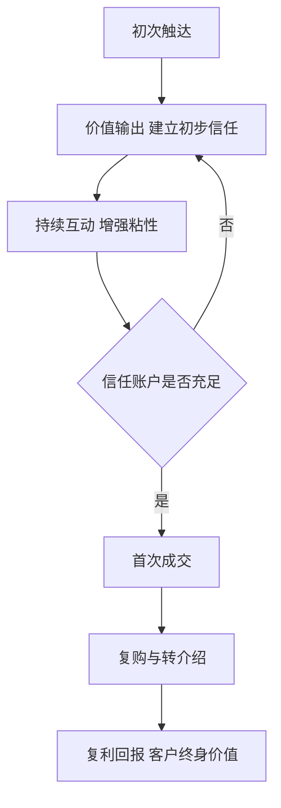

### 数据验证：好友越多真的越好吗？

阿may给出了两组极具冲击力的对比数据。下表展示了这两组数据的核心差异，我们可以这样来看：**两组对比的核心差异在于“好友质量”而非“好友数量”**。

| 对比组 | 好友数量 | 成交结果 | 结论 |
|--------|---------|---------|------|
| 公司资源 | 4万好友 | 转化20人 | 数量多但转化低 |
| 个人资源 | 3万好友 | 转化80人（4倍） | 精准好友转化率更高 |
| 朋友A | 800好友 | 月成交超20万元 | 小而美的高粘性 |
| 朋友B | 3万好友 | 月成交仅5万元 | 大而无当的低效 |

第一组对比中，阿may在推广生财有术时，公司4万好友只转化了20人，而她个人3万好友却转化了80人——成交是公司资源的4倍。第二组对比更戏剧化：一个朋友只有800微信好友，每月却能成交超过20万元；另一个朋友有3万好友，每月仅成交5万元——好友数量相差近40倍，成交额却不足别人的四分之一。

这两组数据指向同一个结论：**好友质量远胜于好友数量**。这背后的逻辑是——信任度和粘性才是成交的催化剂，而非信息触达的广度。你可以把这理解为“信任账户”：每笔成交都是一次“取款”，而之前的每一次价值输出、每一次真诚互动都在“存款”。

### 边界条件

需要强调的是，私域关系需要长期维护投入，短期内难以看到回报。此外，如果产品本身无复购价值或缺乏信任基础，私域关系也难以成为成交杠杆。正如阿may所言：“有信任度、有粘性的好友，远胜过泛泛之交” [VAA8dQLTZolMlJx1jxrcKaPrnzd, p.2]。这句话值得反复咀嚼——它把私域运营的注意力从“数量”拉回“质量”。

### 设计中的取舍

**为什么不用“好友数量”作为核心指标？**

好友数量是一个表面光鲜但极易误导的指标。以数量为导向，运营者会把精力全部投入引流动作——加更多好友、进更多群、发更多广告。但这必然导致“关系稀释”：好友越多，你越难以深度经营每一段关系，信任度自然下降。**这种设计的 trade-off 在于**：短期内用数量换取了表面的繁荣（好友数增长），却牺牲了长期的核心资产（信任关系）。这也是为什么4万好友的转化反而不如3万好友——数量的增长带来了管理成本的上升和平均信任度的稀释。因此，私域运营应放弃“数量思维”，转而追求“质量思维”，把精力放在深度经营少量高价值关系上。

## 18.4 销售额三要素公式 —— 从“只盯客户数”到“三驾马车并驱”

### 为什么需要这个概念？

绝大多数从业者评估业务时只盯着“客户数”这个指标，但销售额并不只由客户数决定。只盯一个变量，会忽略复购这一利润引擎，导致增长见顶。理解这个公式，是为了帮你建立全局的增长视角，识别出除拉新之外的另外两个增长杠杆。

> “计算销售额有条公式：销售额=客户数×客单价×购买频次。以往的我们，都太过关注客户数这个指标了，而大大忽略了客单价和购买频次。企业营收也有28原则，20%的客户给你带来80%的利润，复购比拉新更重要！”
> —— 阿may，《无资源无资本，如何搞定冷启动流量》[VAA8dQLTZolMlJx1jxrcKaPrnzd, p.3]

> **销售额三要素公式** 定义（来源：《无资源无资本，如何搞定冷启动流量》[VAA8dQLTZolMlJx1jxrcKaPrnzd, p.3]）
>
> $$
> \text{销售额（GMV）} = \text{客户数} \times \text{客单价} \times \text{购买频次} \tag{18.1}
> $$

为什么三个变量是**相乘**而非相加？这是理解该公式的关键。我们可以做一个思想实验：

- 假设某店铺有100个客户，客单价100元，人均购买1次，则销售额为 $100 \times 100 \times 1 = 10{,}000$ 元。
- 若将客户数提升至200，销售额变为 $200 \times 100 \times 1 = 20{,}000$ 元，恰好翻倍。
- 若同时将客单价提升至200元，则销售额变为 $200 \times 200 \times 1 = 40{,}000$ 元，变为最初的4倍而非2倍。

这说明，**乘法关系体现了三个变量的“杠杆联动效应”**：任何一个变量的提升，都会等比例地作用于总销售额；而当多个变量同时提升时，总销售额会呈现复利式的增长。这正是它区别于“加和关系”的根本原因——加和只能带来线性增长，乘法才能带来指数放大。因此，公式（18.1）从根本上揭示了销售额增长的三大独立杠杆，以及“三管齐下”时产生的倍增威力。

公式（18.1）展示了三个核心性质，对业务实践有直接的指导意义：

1. **乘法关系**：任何一个变量翻倍，总销售额即翻倍——这告诉我们增长有三条可独立发力的杠杆：拉新（客户数）、提价（客单价）、促复购（购买频次）。
2. **复购权重**：公式右侧的三项并非同等地位——企业营收服从二八定律，20%的老客户贡献80%的利润，因此**复购比拉新更重要**。
3. **战略指导**：公式指出了三条可独立发力的增长杠杆——拉新、提价、促复购，帮助经营者根据自身业务阶段选择发力重点。

这个公式**最被低估的部分是第三项“购买频次”**。阿may分享了自己过去的转变：以前只关注“客户数”，后来转向提高客单价和复购率后，客单价从几千元提升到10万元 [VAA8dQLTZolMlJx1jxrcKaPrnzd, p.3]。每次成交的客户都有机会复购，如果你只有一个产品SKU，相当于把复购的机会直接砍掉了——这提醒我们，产品结构设计本身就是影响复购率的关键变量。

### 三要素联动图

下表展示了三个要素如何共同作用于总销售额，以及每个要素对应的业务动作，帮助你直观理解“三驾马车”的联动关系：

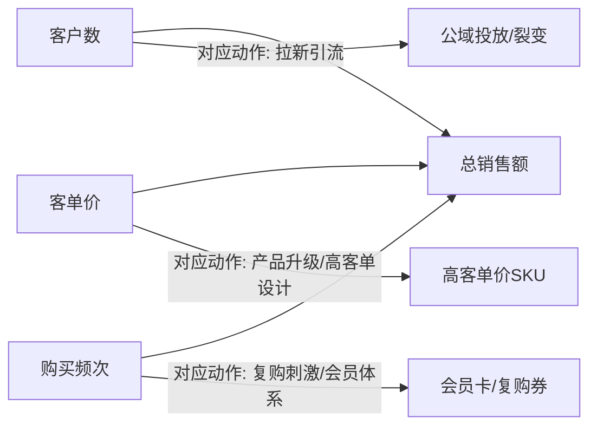

### 边界条件

三个变量并非完全独立——过度提高客单价可能降低购买频次。公式更适用于C端零售场景，对于项目制、一次性客制化的B端生意适用性有限 [VAA8dQLTZolMlJx1jxrcKaPrnzd, p.3]。

### 设计中的取舍

**为什么不能只抓“客户数”这一个杠杆？**

客户数固然是增长的基础，但单纯依赖这一变量具有明显的天花板：拉新成本随竞争加剧而不断上升，且新客户的转化率通常低于老客户。**这种设计的 trade-off 在于**：把全部资源投入拉新，短期内可能看到客户数增长，但代价是忽视了客单价和复购频次这两个成本更低、回报更稳定的杠杆。特别是复购，几乎不需要额外的获客成本，却能贡献大部分利润（二八定律）。因此，成熟的增长策略应该三管齐下，而非单点发力。

## 18.5 冷启动三法之一：个人品牌 —— 普通人的“差异化身份证”

### 为什么需要这个概念？

无资源、无资本的普通人在公域平台面临“无限竞争”，很难突围。需要一个能快速建立信任、让用户主动找上门的身份标签。个人品牌是普通人起盘成本最低、复利最强的杠杆。

> “所以她就要强化她在品牌营销上的标签，这样一来，她就是营销圈里最懂投资的，是投资圈里最懂品牌营销的，这就是一种差异化的身份。这种差异化的身份可以帮助到她获得流量。而且这种获得流量的方式其实是几何倍数的速度。我认为，垂直行业的专家也将会是普通人，做个人品牌最好的切入口！也是我们普通人起盘最好的切入口！”
> —— 阿may，《无资源无资本，如何搞定冷启动流量》[VAA8dQLTZolMlJx1jxrcKaPrnzd, p.4]

> **个人品牌** 定义（来源：《无资源无资本，如何搞定冷启动流量》[VAA8dQLTZolMlJx1jxrcKaPrnzd]）
>
> $$
> \text{个人品牌} = \text{差异化身份标签} = \text{在某垂直领域中强化“唯一性”定位} \notag
> $$
>
> 例如：$\text{“营销圈里最懂投资，投资圈里最懂品牌营销”}$

**公式解读**：该公式的构成逻辑清晰可循——等式左侧的“个人品牌”是一个外在结果，右侧的“差异化身份标签”是构建该结果的核心手段。“差异化身份标签”又能进一步分解为两个要素——“垂直领域”（解决“在哪竞争”的问题）与“唯一性定位”（解决“如何胜出”的问题）。这种层层分解的关系，使得公式从抽象概念落地为可执行的定位策略。

**作用概述**：这个公式对实际运营的指导意义在于，它明确了打造个人品牌的第一步不是“写文章”或“做视频”，而是**先找到自己的差异化身份标签**——一个能一句话说清、让目标人群记住你的定位。标签一旦确立，所有内容输出、社交互动都围绕这一标签展开，流量与信任便会自然积累。

这个定义揭示了**差异化身份标签**的核心在于清晰的差异化定位：不是“更好的同类”，而是“不同类的唯一”。阿may在打磨“增长女黑客”标签之前，微信好友只有200多人、想找工作还要投简历；打造标签后，大量牛人大咖主动找上门来介绍项目资源——这就是个人品牌的杠杆效应 [VAA8dQLTZolMlJx1jxrcKaPrnzd, p.4]。

**关键词：几何级数传播**。下图展示了个人品牌从定位到传播放大的自增强循环——需注意，这一机制的核心驱动力正是阿may强调的“几何级数传播”：标签清晰的人更容易被记住、被转介绍，每一个接触过你的人，都可能成为你的“传播节点”，从而让影响力以指数而非线性的速度扩散。标签不仅带来了流量，还在与人交往的过程中快速建立了信任。

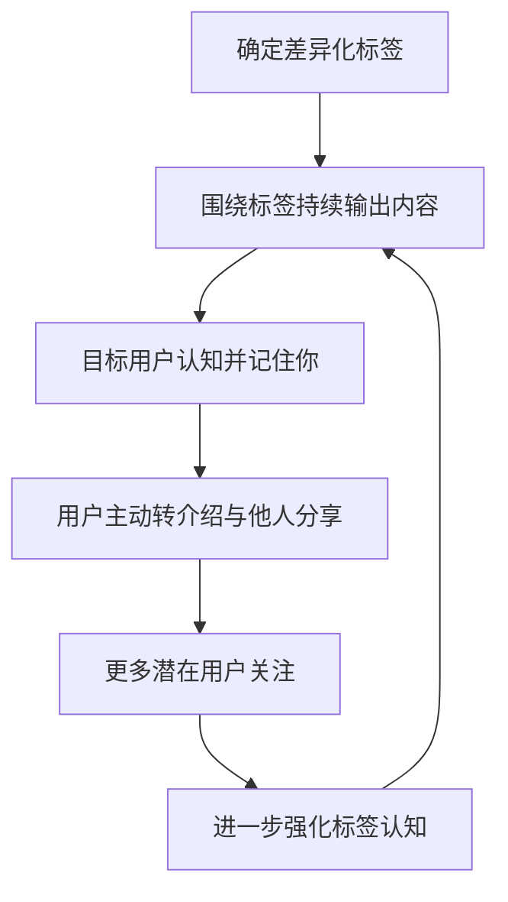

### 边界条件

个人品牌需要持续输出与维护，标签名不副实会反噬信任。过于泛化的标签（如“什么都懂”）反而无法形成记忆点。建议从垂直行业的“专家”定位切入——这正是普通人做个人品牌最好的方式 [VAA8dQLTZolMlJx1jxrcKaPrnzd, p.4]。

### 设计中的取舍

**为什么不去做公域“网红”，而要选择个人品牌？**

公域“网红”依靠算法推荐，内容需要在“无限竞争”中脱颖而出，不确定性极高；即便爆红，流量也属于平台而非个人，难以沉淀。**这种设计的 trade-off 在于**：公域网红追求的是短期的爆发式曝光（高收益），但代价是极高的不确定性、持续的内容生产压力，以及流量的不可控性。而个人品牌则放弃了“一夜爆红”的幻想，换取的是**复利式的资产积累**——标签一旦在目标人群中建立，会持续带来精准流量，且这类流量天然带着信任基础，转化率远高于公域泛流量。对普通人而言，后者的风险收益比明显更优。

## 18.6 冷启动三法之二：群红策略 —— 从“无限竞争的网红”到“有限竞争的社群红人”

### 为什么需要这个概念？

普通人做抖音、小红书、👸号等公域平台，面对的是算法筛选和无限竞争。若无独特创新，内容很容易被淹没在人海中。需要一种更低门槛、更容易建立信任的起盘路径。

> “我认为，普通人做个人IP最好的起盘方式，不是去做抖音、小红书、知乎、👸号等，而是扎扎实实地做好社群的群红。社群的群红是有限竞争！不要一开始就把自己定位要去做‘网红’，而是想办法让自己变成‘群红’！这种模式，很好复制，比去做抖音，要容易复制多了。”
> —— 阿may，《无资源无资本，如何搞定冷启动流量》[VAA8dQLTZolMlJx1jxrcKaPrnzd, p.5]

这段话提出了一个**反直觉的主张**：在人人争当“网红”的时代，普通人更优的起盘路径是成为“群红”。

> **群红策略** 定义（来源：《无资源无资本，如何搞定冷启动流量》[VAA8dQLTZolMlJx1jxrcKaPrnzd]）
>
> $$
> \text{群红} = \text{在垂直社群（几十到几千人）中通过持续分享价值、展示特点而成为有影响力的人} \notag
> $$

**公式解读**：该定义可以通过要素拆解来理解其内在逻辑。“垂直社群”限定了竞争场域——这是一个**小范围的、同质化的环境**；“持续分享价值”是实现路径——这是**个人主动付出的过程**；“有影响力”是最终结果——这是**长期付出的回报**。三者构成“低门槛进入→价值输出→影响力积累”的递进链：先选择一个你能进入的小社群（门槛低），再通过持续输出价值（付出），最后自然积累起影响力（回报）。没有“垂直社群”的限定，“持续分享价值”就失去了聚焦的场域；没有“持续分享价值”的付出，“有影响力”便无从谈起。

**作用概述**：这个定义的作用在于为普通人指明了一条可复制的路径：与其在无限竞争的公域中挣扎，不如在一个有限的社群内，通过持续的价值输出积累影响力。它把“成为红人”从高不可攀的梦想，变成了一个可以按步骤执行的工程。

我们将“群红”与“网红”做一次系统性对比，**下表清晰地展示了两种路径在竞争环境、信任建立、复制难度和起盘门槛四个维度上的本质差异**：

| 维度 | 网红（公域） | 群红（社群） |
|------|-------------|-------------|
| 竞争环境 | 无限竞争，面对算法筛选 | 有限竞争，对手少且同质化低 |
| 信任建立 | 需通过内容海量触达，周期长 | 互动频繁、关系紧密，易建真实信任 |
| 复制难度 | 需持续产出爆款内容 | 模式简单，可迁移到多个垂直社群 |
| 起盘门槛 | 需理解平台算法与流量机制 | 只需在一个小圈子内建立口碑 |

这张对比表展示了：**群红策略的核心优势在于“有限竞争”**。阿may认为，普通人如果去做公域，面对的是无限竞争——如果没有好的创新，很容易被别人赶超、淹没在人海当中。而社群群红的竞争是有限的——在一个几十到几千人的社群里，你更容易展示特点和标签、建立信任并获得铁杆粉丝。

**实操提示**：找到目标社群的前提是明确目标人群——“当细分到素描、吉他这一层时，你就会发现，再去寻找这样的社群，就容易多了！明确目标人群，是做销售、做推广的前提！”如果目标客户定位太泛（如“艺术”），根本找不到社群 [VAA8dQLTZolMlJx1jxrcKaPrnzd, p.5]。

下图展示了从“明确人群”到“成为群红”的完整操作链路：

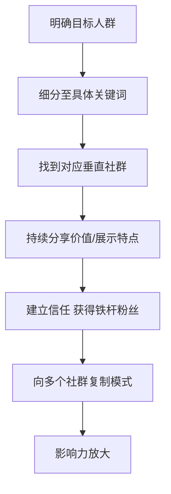

### 边界条件

需要有持续输出有价值内容的能力，纯“混脸熟”无法形成信任。单一社群天花板有限，需在多个社群复制才能放大影响力。

### 设计中的取舍

**为什么不做“网红”而要做“群红”？**

“网红”路径看似光鲜，但其背后是**极低成功概率与极高投入**的博弈：你需要不断产出爆款内容以对抗算法的不确定性，而公域算法随时可能让你的努力归零。**这种设计的 trade-off 在于**：做“网红”是用“高投入、高风险”去博取“高曝光”；而做“群红”则是主动放弃全网知名度，换取“高转化、高信任、低门槛”的确定性收益。社群虽小，但成员间的关系密度远高于公域的弱连接——一个小社群里的100个铁杆粉丝，商业价值可能超过10万个泛粉。对资源有限的普通人而言，“群红”显然是更优的风险收益选择。

## 18.7 冷启动三法之三：抱大腿 —— 用“可交换价值”而非“金钱”撬动贵人

### 为什么需要这个概念？

普通人创业最大的瓶颈是缺资源、缺背书、缺贵人。很多人以为“抱大腿”就是请客送礼、花钱买关系，却往往碰壁。需要理解借势的正确打开方式，才能撬动杠杆。

> “人生不要只靠自己傻傻奋斗，一定要有老师，一定要有贵人，否则没有任何机会成功。1、要抱行业的大腿（站对风口）2、要抱行业里有影响力的人的大腿（找准贵人）。抱大腿不能靠钱去换，因为大腿不缺钱……靠什么去交换呢？你要去创造资源、创造价值！正所谓‘你不牛逼，认识再多牛逼的人也与你无关’，抱大腿一定要提供可交换的价值。”
> —— 阿may，《无资源无资本，如何搞定冷启动流量》[VAA8dQLTZolMlJx1jxrcKaPrnzd, p.5]

很多人以为“抱大腿”就是请客送礼、花钱买关系，却往往碰壁。这段话点破了借势的正确打开方式。

> **抱大腿** 定义（来源：《无资源无资本，如何搞定冷启动流量》[VAA8dQLTZolMlJx1jxrcKaPrnzd]）
>
> $$
> \text{抱大腿} = \text{与牛人、行业领袖和权威平台建立价值链接与合作} \notag
> $$
>
> 其中包含两个层面：
> $$
> \text{抱大腿} = \sum \left( \text{抱行业的大腿（站对风口）} + \text{抱行业里有影响力的人的大腿（找准贵人）} \right) \notag
> $$

**公式解读**：这里需要特别说明**求和符号 $\Sigma$ 的“非数值叠加”含义**。在数学中，$\Sigma$ 通常表示数值的累加；但在此处，它并非表示“两个数值相加”，而是表示**策略维度的叠加组合**——即“抱大腿”是一个多维度、可叠加的策略集合：既要从宏观上站在行业的风口（选择正确的赛道），又要从微观上链接关键人物（找到能提携你的贵人）。**两个维度都做到，才能实现借势效应的最大化；只做其一，效果将大打折扣**。

**作用概述**：这个定义对实际运营的指导意义在于，它打破了“抱大腿=金钱交易”的庸俗理解，指出了一条基于价值创造的可持续路径——**先创造价值，再寻求链接**。它提醒运营者：在寻找贵人之前，先问自己“我能提供什么价值”，而不是“我能付出多少钱”。

这个定义的精髓在于**“价值交换”逻辑**，具体可以从以下三个层面来理解：

- **大腿不缺钱，缺的是资源和价值**——因此必须创造可交换的价值，而非试图用金钱开路。金钱能买来一次见面，但买不来真正的背书与合作。
- **对于普通人，练好一身本领就是最好的抱大腿方式**——个人核心能力就是抱大腿的“敲门砖”和“可持续燃料”；本领是唯一可以随身携带、随时增值的资产。
- **一旦你有价值，大腿也会自然主动来结识你**——这就是“吸引法则”：当你足够优秀时，贵人会主动靠近，合作将随之而来。

阿may强调“练好一身本领”——这是普通人“抱大腿”的底层逻辑。在你创造可交换价值之前，任何“人脉”都是空中楼阁。为了更好地理解这一从“价值积累”到“贵人合作”的完整路径，下图展示了其中的关键节点：

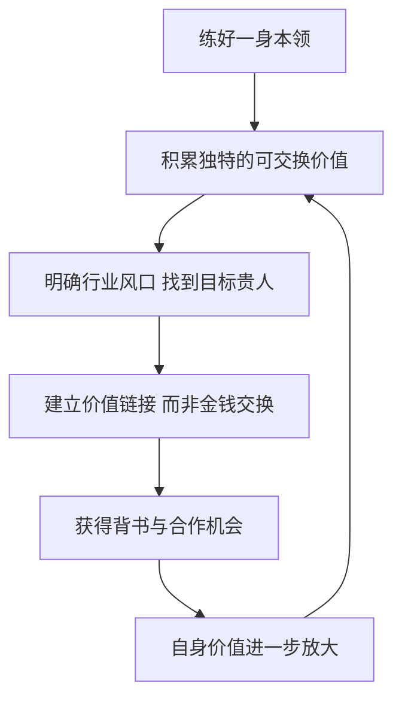

**实战验证**：阿may的“增长饭局”就是“抱大腿”理念的实践。她在广州只做了4场增长饭局，深入沟通了接近50人，就创造了30万的业绩。而且因为对用户的深入沟通和了解，搭建出更多合作方式，客单价从几千元提升到10万元——这就是“可交换价值”带来的杠杆 [VAA8dQLTZolMlJx1jxrcKaPrnzd, p.6]。

### 边界条件

需要自身具备某方面的独特能力或资源，单纯索取无法维系。要避免“伪抱大腿”——只晒合影、只加微信而无实质合作。

### 设计中的取舍

**为什么不能靠“金钱”去抱大腿？**

金钱的交易是一次性的、对等的，无法产生持续的合作关系。大腿不缺钱，你用钱买来的“链接”在他眼中毫无稀缺性。**这种设计的 trade-off 在于**：用钱换来的合作，买到的只是短期的一次性背书，且无法沉淀为长期的信任资产；而“价值交换”虽然前期投入大、见效慢（需要先练好本领），但一旦形成，就会成为持续增值的关系资产。从长期主义视角看，“积累价值”的性价比远超“花钱开路”。

## 18.8 知识营销 —— 让“干货”替你吸引精准客户

### 为什么需要这个概念？

传统的主动销售（发硬广、群发广告）越来越遭人反感，效果递减。用户对“被推销”天然有防备心理。需要一种不打扰、靠吸引来完成获客的被动引流方式。

> “现在呢，比较流行的是什么？去推广你这个产品的知识，通过知识吸引到你的精准客户。传统销售是主动销售，就是发硬广……而知识营销是被动引流，他们会把自己的营销内容化，变成‘分享’、变成‘硬核干货’。我有些文章，发布到自己的👸号，只有一两千的阅读，但是发布到人人都是产品经理的网站上，却有几万的阅读，而我在那里发布内容，其实很简单，就是把我👸号的内容，复制过去，稍微修改一下即可。”
> —— 阿may，《无资源无资本，如何搞定冷启动流量》[VAA8dQLTZolMlJx1jxrcKaPrnzd, p.6]

传统的主动销售（发硬广、群发广告）越来越遭人反感，效果递减。用户对“被推销”天然有防备心理——知识营销提供了一种不打扰、靠吸引的获客方式。

> **知识营销** 定义（来源：《无资源无资本，如何搞定冷启动流量》[VAA8dQLTZolMlJx1jxrcKaPrnzd]）
>
> $$
> \text{知识营销} = \text{通过推广产品相关的知识内容来吸引精准客户，而非直接推销产品} \notag
> $$
>
> 核心做法：
> $$
> \text{营销内容化} = \text{把产品卖点转为“分享”} + \text{把销售话术转为“硬核干货”} \notag
> $$

**公式解读**：这里需要解释为何“卖点转分享 + 话术转干货”即构成完整的“营销内容化”。我们可以从两个维度来理解：**“卖点转分享”改变了内容的形式**——从“自卖自夸的广告”变成“对用户有用的信息”，这降低了用户的防备心理；**“话术转干货”改变了内容的实质**——从“说服语言”变成“价值信息”，这为用户提供了实实在在的帮助。**“形式”与“实质”的双重转换**，共同构成了完整的“内容化”——缺了任何一方，内容化都不完整：只有形式转换而实质不变，干货会变成“伪干货”；只有实质转换而形式不变，则无法吸引用户主动阅读。二者的结合，才是知识营销的精髓。

**作用概述**：这个公式揭示了知识营销的三大关键性质。下表总结了这些性质及其对获客的实际意义，**可以看出，知识营销本质上是一种“用内容换取信任与注意力”的策略**：

| 性质 | 说明 | 类比 |
|------|------|------|
| 被动引流 | 用户因内容搜索或刷到而主动关注，而非被硬推 | 像磁铁吸引铁屑，而非渔夫撒网 |
| 信任前置 | 在成交前通过知识输出了价值，建立初步信任 | 相当于提前“试用”了你的人 |
| 适合高客单 | 尤其适合需要长时间决策的高客单价产品 | 决策越重，越需要知识支撑 |

**典型案例**：阿may将👸号文章同步到“人人都是产品经理”网站，同一篇内容的阅读量从一两千提升到几万 [VAA8dQLTZolMlJx1jxrcKaPrnzd, p.6]。这个案例告诉我们——**高质量的干货内容在任何平台都是稀缺资源**，平台方愿意给好内容更大的曝光。

### 知识营销引流的完整链路

下图展示了知识营销从内容生产到客户转化的完整流程，帮助你把“写文章”到“成交”之间的每一环都看清楚：

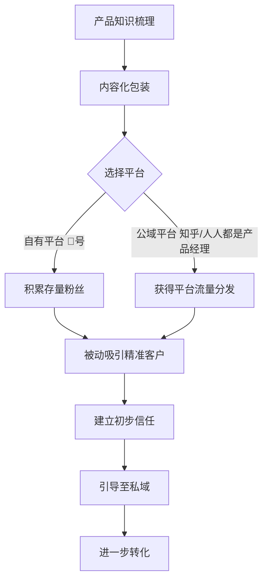

**内容化包装的操作要点**：上图中的“内容化包装”是知识营销的关键一步，具体操作方法是——把自己要推销的产品卖点，**翻译成用户关心的知识问题**。例如，你卖的是理财课程，不要写“课程包含XX模块”，而应写“普通人如何跑赢通胀”；你卖的是育儿产品，不要写“产品含XX成分”，而应写“宝宝辅食的三大误区”。同时，把销售话术“翻译”成干货——将“快来买”换成“你可以这样做”。**先列出产品的3-5个核心卖点，再为每个卖点找到一个用户痛点，最后以解决该痛点的知识型内容呈现**——这就是“内容化包装”的落地方法。

### 多源对照：知识营销的共识与补充

下表对比了两位素材作者对“知识营销（内容引流）”的不同侧重：

| 来源 | 侧重点 | 补充观点 |
|------|--------|---------|
| 阿may [VAA8dQLTZolMlJx1jxrcKaPrnzd] | 内容化 = 把营销变成“分享” | 强调从“主动硬广”到“被动引流”的转变 |
| 丽丽 [ELHqdhiI5oSQAxxItLJctNAhnah] | 钩子理论外延 | 泛内容引流虽不精准，但能引入私域、保留转化可能 |

#### 共识：内容先行、被动吸引

两位作者都认同知识营销（内容引流）是被动引流的核心方式——通过输出内容价值吸引精准客户，而非主动推销。“内容先行、被动吸引”是知识营销的底层逻辑。

#### 分歧：对“内容精准度”的要求不同

阿may强调内容要“硬核干货”、价值密度高，内容应该直接吸引到精准的目标客户；而丽丽则指出——泛内容引流虽然不够精准，但只要用户进了私域，就有转化可能（概率为0只是最坏情况）——“如果用户不进私域，那在私域带货成功的概率为0”。这一分歧的实质在于：内容是该“精准命中”还是该“广泛圈人”，取决于引流目标——若要直接成交，内容需精准；若要引入私域慢慢养，泛内容亦可。

**边界条件**：需长期持续输出高质量内容，见效周期较慢。内容受众与产品买家若错位，则流量难以转化为销售。但根据“钩子理论”，只要泛内容能引流到产品目标人群，就是好钩子——不必苛求内容即产品 [VAA8dQLTZolMlJx1jxrcKaPrnzd, p.6][ELHqdhiI5oSQAxxItLJctNAhnah, p.5]。

### 设计中的取舍

**为什么不直接用硬广，而要绕一个圈子做“知识营销”？**

硬广的优势在于“直达”——直接把产品信息推给用户，看似高效。但其致命缺陷在于**触发用户的防御心理**，导致信息被自动过滤，甚至引发反感。**这种设计的 trade-off 在于**：硬广是用“打扰”换“曝光”（低信任、低转化），而知识营销是用“延迟满足”换“信任前置”（高信任、高转化）。知识营销的“慢”，换来的是用户主动上门的“准”。在用户决策成本高的领域（如高客单价产品），这种取舍是值得的。

## 18.9 裂变营销 —— 只靠自己转发，永远等不来指数增长

### 为什么需要这个概念？

流量获取的最快方式不是“自己拉新”，而是让用户帮你“拉新”。但大部分裂变活动效果差，是因为用户只转发一层就断层了。需要理解裂变的底层模型，才能设计出真正能滚起来雪球的活动。

> “第一种是团队裂变，这是一种自上而下的裂变模型……这个模型，是有明确清晰的上下级推荐关系的，常见的微商团队、经销商网络、社交电商等玩法，就是靠这种模型搭建起来的。第二种是用户裂变，这是一种自下而上的裂变模型。大部分裂变营销活动策划者策划的活动之所以效果不好，往往最大的原因是在于，只有激发层的用户愿意分享，到了第三层裂变层，就断层了。因此就根本裂变不动！”
> —— 阿may，《无资源无资本，如何搞定冷启动流量》[VAA8dQLTZolMlJx1jxrcKaPrnzd, p.7]

流量获取的最快方式不是“自己拉新”，而是让用户帮你“拉新”。但为什么大部分裂变活动效果差？因为用户只转发一层就断层了。

> **裂变营销** 定义（来源：《无资源无资本，如何搞定冷启动流量》[VAA8dQLTZolMlJx1jxrcKaPrnzd]）
>
> $$
> \text{裂变营销} = \text{通过设计利益诱饵或社交机制，激励用户主动分享、邀请新用户参与的营销方式} \notag
> $$

**公式解读**：裂变营销的公式揭示了其**运转的底层逻辑**——裂变的驱动力 = **利益诱饵（外部激励） + 社交机制（内部动机）**。二者为何缺一不可？我们可以从“动力来源”和“持续性”两个维度来逐步推导：

先看**仅有利益诱饵**的情况（如“邀请得红包”）：利益诱饵确实能在第一层激发用户的分享行为——用户为了获得奖励而转发。但问题在于，**这种驱动的持续性极差**——当第一层用户拿到奖励后，他的分享动机即刻耗尽，他没有动力去推动第二层、第三层的传播。利益诱饵解决的是“首次分享”的启动问题，但解决不了“持续分享”的维持问题。

再看**仅有社交机制**的情况（如纯粹的内容趣味分享）：用户在社交动机驱动下可能乐于转发一次，但**缺乏重复传播的强制力**——没有利益回报，用户凭什么帮你一层层传播下去？社交机制解决了“自然扩散”的氛围问题，但无法提供“主动推动”的驱动力。

将两者对比即可看出：**利益诱饵解决“启动”，社交机制解决“持续”，二者分别对应裂变链条上的不同环节，缺一不可**。只有利益诱饵与社交机制双轮驱动，裂变才能既启动又持续——这正是“内外双驱”的完整含义。

裂变营销有两种基本模型，它们在结构与驱动力上截然不同。**下表从结构、关系、驱动力和典型案例四个维度对两种模型进行了系统对比**：

| 维度 | 团队裂变 | 用户裂变 |
|------|---------|---------|
| 结构 | 自上而下，树状结构 | 自下而上，网状结构 |
| 关系 | 有明确的上下级推荐关系 | 用户之间是社交网络状态，彼此可能互相认识 |
| 驱动力 | “躺赚逻辑”——加入早、层级高者可享被动收益 | “圈层效应”——需针对不同人群设计不同玩法 |
| 典型案例 | 微商团队、经销商网络、社交电商 | 口碑传播、裂变营销活动 |

下图展示了从“团队裂变/用户裂变”到“战队PK叠加”的演进逻辑，帮助你理解三种玩法之间的关系：

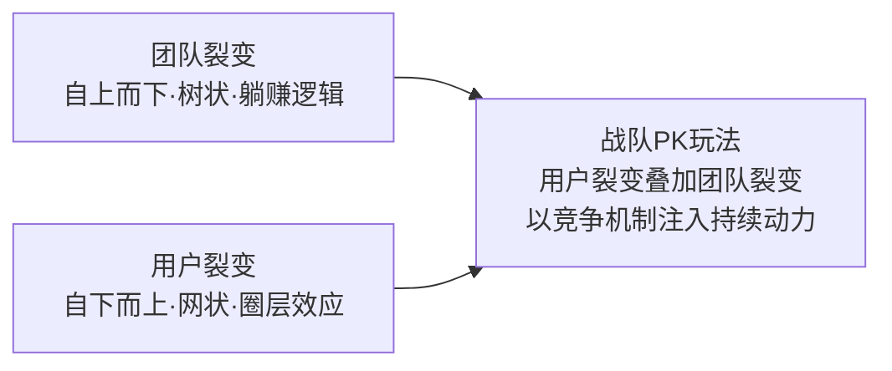

这张演进图的核心逻辑是：**战队PK并非第三种独立的裂变模型，而是“用户裂变”与“团队裂变”的策略性叠加**——它既保留了用户裂变“自下而上、社交网络”的传播形态，又在其中植入了团队裂变“上下级、树状”的竞争结构。通过这种叠加，原本各自有缺陷的两种模型互补短板，形成了更强大的裂变引擎。

### 关键问题：裂变为什么会在第三层断层？

阿may指出：**大部分裂变活动效果差的根源，是只有激发层的用户愿意分享，到了第三层裂变层就断层了**。为什么？

- 第一层（激发层）：被利益诱饵直接触动的人，积极性最高
- 第二层（传播层）：被朋友的分享“安利”到的人，动力衰减
- 第三层（裂变层）：信息被二次转发后，触动力度大幅下降，用户失去分享动力

这种“动力衰减”并非偶然，而是裂变设计的普遍困境。下图展示了裂变传播中的“断层”问题：

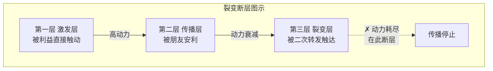

### 解法：战队PK玩法 —— 用户裂变叠加团队裂变

> “我们会在用户裂变的营销活动玩法的基础上，还会叠加一层‘团队裂变’的玩法，这种玩法我们称之为‘战队PK’的玩法，也就是组织中的动销系统。”
> —— 阿may，《无资源无资本，如何搞定冷启动流量》[VAA8dQLTZolMlJx1jxrcKaPrnzd, p.7]

> **战队PK** 方法（来源：《无资源无资本，如何搞定冷启动流量》[VAA8dQLTZolMlJx1jxrcKaPrnzd, p.7]）

```
1. 设计一个用户裂变营销活动（利益诱饵：如免费课程、优惠券）
2. 在用户裂变之上叠加“团队裂变”机制
3. 将参与者分为若干“战队”（团队）
4. 以战队为单位进行PK（比拼拉新人数、成交额等）
5. 胜出的战队获得额外奖励（如更高比例佣金、额外奖品）
```

这段伪代码展示了战队PK破解裂变断层的核心逻辑：**在用户自发的“分享—邀请”之外，增加一层团队竞争机制**。每个用户被绑定到一个战队中，他的每次分享不仅是个人行为，还关系到整队的胜负——这就把“躺赚”和“圈层”两种动力整合到了一起。

**为什么叠加团队裂变能在第三层注入新的动力？** 关键在于**“责任绑定”与“荣誉驱动”**两个心理机制：

- **责任绑定**：在纯用户裂变中，第三层用户与被邀请者之间是“陌生人关系”——他转发了，但没人监督他是否持续转发。而在战队PK中，第三层用户是“战队的一员”——他的不分享直接拖累队友的排名，这种“不给团队拖后腿”的责任感，会驱动他继续分享。
- **荣誉驱动**：纯粹的利益诱饵在第三层衰减，是因为“那点小奖励”不足以让人继续转发。但在战队PK中，第三层用户面对的不只是利益，还有“我们队能不能赢”的集体荣誉感，以及“赢了能炫耀”的社交货币。这些**非物质的驱动力**，恰恰是利益诱饵无法提供的。

因此，**团队裂变叠加的并非利益，而是“责任”与“荣誉”这两种可持续的动力**——这才是破解断层的根本机制。

### 方法演进图

下图完整展示了从“诱饵设计”到“裂变结果验证”的完整流程，呈现出战队PK如何系统性破解断层问题：

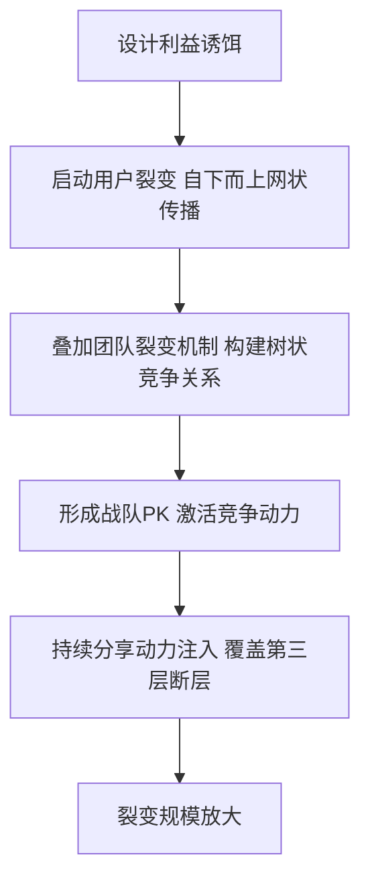

**实战验证**：阿may操盘的跨境电商峰会，通过“活动裂变+战队PK”的组合玩法，3天内裂变近6000名用户报名线下活动。加上主办方助推，最终活动报名人数累积1.8万人，到展会现场4000人——火爆到警察到场维持秩序，还有1万人只能在场外听分享 [VAA8dQLTZolMlJx1jxrcKaPrnzd, p.8]。这些数据表明，**叠加战队PK玩法后，裂变不仅没有在第三层断层，反而持续加速**。

### 边界条件

需要有足够吸引力的诱饵或社交货币，否则用户没有分享动力。裂变需要精准种子用户启动，冷启动阶段效果有限。

### 设计中的取舍

**为什么简单的“利益诱饵”裂变往往失败？**

利益诱饵看似直接有效，但它存在一个根本缺陷——**激励效果随传播层级递增而递减**。第一层用户被诱饵直接触动，动力最强；但第二层、第三层用户只是听朋友转述，“诱饵”的吸引力已经大幅衰减。**这种设计的 trade-off 在于**：单纯的利益诱饵（如“邀请得红包”）是用“一次性小利”换取“一次性转发”，缺乏持续激励；而叠加“团队竞争”（战队PK）虽然增加了机制设计的复杂度，却引入了“荣誉感”、“归属感”和“竞争压力”等多重心理驱动，让每一层传播都有了新的动力来源。为对抗人性中的“动力衰减”，多花设计成本是值得的。

## 18.10 信任转化 —— 成交前的“有间隔的重复次数”与铁粉运营

### 为什么需要这个概念？

很多运营者打完广告没成交就陷入自我怀疑，甚至放弃。实际上，成交不是一次广告的“临门一脚”，而是前期无数次价值输出与信任积累的结果。需要理解成交的心理学机制，才能合理设计转化节奏。

> “打广告，是成交前的最后一步，而不是唯一的步骤！在打广告之前，还有：价值输出、个性展现、信任建立。我发现，打动别人，让人下单这事，除了强度之外，还有【有间隔的重复次数】。有些人会在认识你的第一天就买单。而有些人会在第10天、第30天、第50天、第100天...第N次看到你的干货，看到你的生活，了解你这人的性格、三观，第N次被你触动后，才会买单的。”
> —— 佚名作者，《如何破除打广告的认知和心态卡点》[HfJEd0huioyShvxowVfcOMQYnHb, p.1]

很多运营者打完广告没成交就陷入自我怀疑，甚至放弃。实际上，成交不是一次广告的“临门一脚”，而是前期无数次价值输出与信任积累的结果。

> **有间隔的重复次数** 定义（来源：《如何破除打广告的认知和心态卡点》[HfJEd0huioyShvxowVfcOMQYnHb]）
>
> $$
> \text{成交概率} \propto \text{价值输出次数} \times \text{时间间隔优化} \times \text{信任建立} \notag
> $$

**公式解读**：这里需要特别说明**比例符号 $\propto$ 的含义**——它表示“成交概率”与右侧三项的乘积**成正比例关系**：右侧任一因素的提升都会等比例提高成交概率。但这一关系**并非精确的数学等式**，而是一种**方向性的指导**——它告诉运营者“提升哪些因素能提高成交概率”，而非给出精确的数值预测。为什么是“三次触动”而不是“一次强刺激”？因为这个公式揭示了成交的**概率模型**：成交并非由单次强刺激（“强度”）决定，而是由“价值输出次数”、“时间间隔优化”和“信任建立”三个因素的乘积效应共同决定。高强度的单次广告无法替代持续的价值输出（“次数”），且“间隔”的节奏感比“刷屏”更重要。

**作用概述**：该公式的实操指导意义在于，它把“成交前要做什么”从模糊的直觉转化为三个可量化的操作维度——你输出了多少次价值？时间间隔是否合理？信任建立是否充分？这为设计转化节奏提供了清晰的框架。

其中，三个核心变量各有侧重，我们可以从以下三个层面来理解它们的具体操作含义：

- **重复有间隔**：不是疯狂刷屏，而是有节奏地持续输出价值。间隔的存在给了用户“消化与回味”的空间——过度频繁的触达会从“价值输出”变成“信息骚扰”。
- **信任前置**：价值输出与个性展现先于广告，广告只是最后的引爆点。用户是先相信了你这个人，然后才相信你的产品。
- **时间效应**：不同的人需要多次（3次、10次、30天、100天）被你触动后才会买单。正如素材所言，有人第一天就买单，有人需要第100天——转化是一个“概率累积”的过程。

### 广告本质：放大与筛选

> “打广告这动作，本质是一种「放大」和「筛选」。让喜欢你的人，更深入的理解你在做的事情……喜欢你的人，更喜欢你；不喜欢你的人，更烦你。此为「放大」。喜欢你的人，觉得你的广告，是一个能更好的了解你的窗口……此为筛选。”
> —— 佚名作者，《如何破除打广告的认知和心态卡点》[HfJEd0huioyShvxowVfcOMQYnHb, p.2]

这段话揭示了广告的正确心法：广告不是“说服所有人”，而是“放大喜欢你的人的理解，筛选出愿意靠近你的人”。理解了这一点，你就不会因为部分人的反感而不敢打广告——因为对于无关人员是“打扰”的东西，对于你的客户恰是一种“吸引”。不打广告，就无法吸引你的客户 [HfJEd0huioyShvxowVfcOMQYnHb, p.2]。

### 铁粉精细化运营：从“广撒网”到“复利回报”

> “用心地精细化对铁粉，获得复利。一年卖货120W需要运营多少位用户？泳怡的答案是800位。项目逻辑是先广撒网，从各种精准的宝妈流量池积累40位种子用户，在精细化运营前期用户获取信任后，筛选其中的铁粉进行转介绍、转卖，最终实现总购买次数16000+次。”
> —— 丽丽，《2023元旦“云监工”挑战复盘》[ELHqdhiI5oSQAxxItLJctNAhnah, p.6]

> **铁粉精细化运营** 方法（来源：《2023元旦“云监工”挑战复盘》[ELHqdhiI5oSQAxxItLJctNAhnah]）

```
1. 广撒网：从精准的垂直流量池（如宝妈群）积累种子用户
2. 精细化：用心运营前期用户，获取深度信任
3. 筛铁粉：识别高活跃、高复购、高转发的核心用户
4. 转介绍：鼓励铁粉转介绍新客户
5. 复利循环：铁粉带来新用户，新用户又转化为铁粉
```

这套五步法的核心是**“从数量到质量”的运营升级**：泳怡仅运营800位用户就实现了120万年销售额、总购买次数16000+次——平均每位用户购买20次。这表明**高粘性社群的核心不是用户多，而是用户深**。

下面这张流程图完整展示了铁粉精细化运营“由广到深”的演进路径：

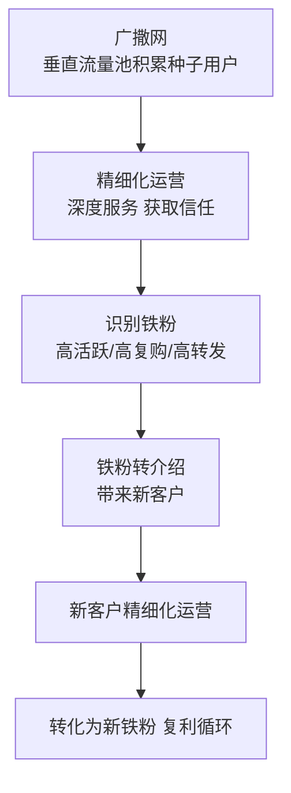

**流程图与方法步骤的对应关系**：上图中的流程节点与方法列表的五步法一一对应——“广撒网”对应步骤1（从垂直流量池积累种子用户），“精细化运营”对应步骤2（深度服务获取信任），“识别铁粉”对应步骤3（筛选高活跃、高复购核心用户），“铁粉转介绍”对应步骤4（鼓励转介绍新客户），“新客户精细化运营”与“转化为新铁粉”共同对应步骤5（复利循环——新用户经过精细化运营后转化为新铁粉，开启下一轮循环）。**流程图的环形闭合结构，正是“复利”的图形化表达**——每一轮循环都为下一轮积累了更多铁粉。

### 多源对照：信任积累的不同侧重

下表对比了两位作者对“信任积累”的不同视角，两人分别从“转化节奏”与“运营链路”两个维度，对“信任如何转化为成交”给出了互补的回答：

| 来源 | 侧重点 | 关键观点 |
|------|--------|---------|
| 佚名作者 [HfJEd0huioyShvxowVfcOMQYnHb] | 转化节奏 | 成交依赖“有间隔的重复次数”，广告只是临门一脚 |
| 丽丽 [ELHqdhiI5oSQAxxItLJctNAhnah] | 运营链路 | 广撒网→精细化→筛铁粉→转介绍，实现复利 |

#### 共识：成交依赖前期持续的价值输出与信任建立

两位作者都认为成交不是一次触发的“临门一脚”，而是前期无数次价值输出与信任建立的自然结果。没有前期的信任积累，任何成交技巧都无从谈起。

#### 分歧：一个讲“心法”，一个讲“手法”

前者（佚名作者）强调“有间隔的重复”的节奏感——不同用户需要不同的触动次数，有人第一次被触动就买单，有人要到第100天才买单；后者（丽丽）则从运营角度给出了一套系统性的“链路设计”——种子用户怎么来、铁粉怎么筛、复利怎么转。**两者的关系是“心法”与“手法”的关系**：前者告诉你“为什么要慢慢来”，后者告诉你“具体怎么慢慢来”。

### 边界条件

信任积累需建立在高质量产品与服务之上，纯营销无法持续。转化周期较长，不适合追求短期爆发的场景。

### 设计中的取舍

**为什么不能靠“高强度刷屏”来促成转化？**

高强度、无间隔的刷屏看似增加了“触达次数”，但其本质是**用“打扰”换取“曝光”**。用户可能会记住你，但记住的是“厌烦”而非“信任”。**这种设计的 trade-off 在于**：刷屏的高频触达换来的是一次性的注意力，却透支了长期的信任关系；而“有间隔的重复触达”是在“保持存在感”与“给予空间”之间寻找平衡——它放弃了短期内的“强刺激”，换取了长期内的“高转化可能”。在信任驱动的私域场景中，后者才是可持续的策略。

## 18.11 健康社群规则 —— 从“利益对立”到“三方共赢”

### 为什么需要这个概念？

很多社群/挑战群运营者设计了“失败瓜分红包”的机制——短期有效但长期损耗信任。群主与成员的利益对立，会导致运营不可持续。需要理解健康规则的设计原则，才能构建自动运转的社群生态。

> “以前我见过一些目标挑战群，规则一般只是挑战失败后瓜分1000元或XXXX元。这是不太健康的，这会把群主、群友的利益对立起来。所以我的规则中设置的是如果我挑战成功了，大家能获得更多。另外规则中挑战失败瓜分的金额设置得很低，这能筛选掉只是被红包吸引的人。”
> —— 丽丽，《2023元旦“云监工”挑战复盘》[ELHqdhiI5oSQAxxItLJctNAhnah, p.5]

很多社群/挑战群运营者设计了“失败瓜分红包”的机制——短期有效但长期损耗信任。健康的规则应该让群主与成员利益一致。

> **利益一致性规则** 定义（来源：《2023元旦“云监工”挑战复盘》[ELHqdhiI5oSQAxxItLJctNAhnah]）
>
> $$
> \text{健康规则} = \text{群主挑战成功，大家获得更多} \notag
> $$
>
> 而非：
> $$
> \text{不健康规则} = \text{群主挑战失败，大家瓜分红包} \notag
> $$

**公式解读**：以上两个对立规则构成了该定义的“正反合”结构——通过对比呈现两种规则的本质差异。那么，为什么“成功大家获得更多”在心理激励上优于“失败瓜分红包”？我们可以从**激励方向**与**心理动力**两个维度来逐步推导：

先看**激励方向**。在“失败瓜分红包”的规则下，群主与成员站在**对立面**——成员的收益（瓜分红包）依赖于群主的失败，因此成员内心会**期待群主失败**（哪怕只是潜意识），甚至在群主遇到困难时冷眼旁观。这种对立让群主与成员之间形成了一种“零和博弈”：群主的损失就是成员的收益。

再看**心理动力**。“失败瓜分红包”给成员提供的是**消极的期待动力**（盼群主输），这种动力是消耗性的、不持久的——它只在群主“快要失败”的时候才激活，而且一旦群主真的失败了、红包瓜分完了，这种动力就彻底消失。而“成功大家获得更多”给成员提供的是**积极的参与动力**（帮群主赢）——这种动力是建设性的、可持续的，因为每个人都渴望成为“胜利团队”的一员。

将两者对比，核心差异便清晰了：**“失败瓜分红包”将群主与成员置于利益对立面，“成功大家获得更多”则将双方绑定为利益共同体**。前者是“零和博弈”（有人赢就有人输），后者是“正和博弈”（群主的努力直接惠及所有成员，成员的帮助也直接助力群主成功）。“正和博弈”之所以优于“零和博弈”，根本原因在于它让双方的利益方向一致，从而能够持续地互相赋能。

**作用概述**：该公式的实操指导意义在于，它提供了一条**可检验的规则设计原则**——你的规则让群主越努力，成员收益越大吗？如果是，这就是正向循环；如果是反的，就要警惕可持续性风险。

这个定义的妙处在于**用规则设计而非个人自觉来保障可持续性**，具体体现在三个层面：

- **利益一致性**：群主越努力，成员收益越大，形成正向循环。群主的成功直接惠及所有成员，这使得成员有动力去“帮助”群主成功，而非“围观”甚至“期待”群主失败。
- **门槛筛选**：低额失败基金可筛选掉纯粹被红包吸引的泛用户，留下真正关注成长的铁杆。低额的“失败成本”天然过滤了“投机者”，留下的成员更看重成长价值而非红包收益。
- **三方共赢**：健康的社群生态能让老师、分享者、普通学员都从中获益——老师获得成果与口碑，分享者获得曝光与认可，学员获得知识与激励。

**典型案例**：丽丽的“云监工”快闪群——挑战成功送心得+优惠+盲盒，失败仅瓜分200元。结果3天招募102人、超额完成挑战、群内意外变成“夸夸群”产生强激励。这个结果验证了利益一致性规则的有效性 [ELHqdhiI5oSQAxxItLJctNAhnah]。在约2天多时间内招募到102位云监工，并顺利完成“3天读50篇写5000字”的挑战，实际可在1天内完成——这验证了云监工玩法特别适合普通人 [ELHqdhiI5oSQAxxItLJctNAhnah, p.3]。此外，该群意外转化为“夸夸群”产生了强激励与陪伴的正反馈循环 [ELHqdhiI5oSQAxxItLJctNAhnah, p.4]。

### 补充：钩子理论

> “为了在私域卖货或做转化，引流的钩子不一定必须就是出售的产品，只要能引流到产品目标人群的钩子，就是好钩子。虽然用泛内容引流的用户没那么精准，但如果用户不进私域，那在私域带货成功的概率为0。”
> —— 丽丽，《2023元旦“云监工”挑战复盘》[ELHqdhiI5oSQAxxItLJctNAhnah, p.4]

**钩子理论**的核心在于：引流钩子不必是产品本身，只要能引流到目标人群就是好钩子。这极大地拓宽了引流的思路——你可以在公域用泛内容（如育儿知识、职场技巧）吸引用户，只要他们进入私域就有转化可能。下图展示了“钩子理论”如何将泛流量引入私域并开启转化可能性：

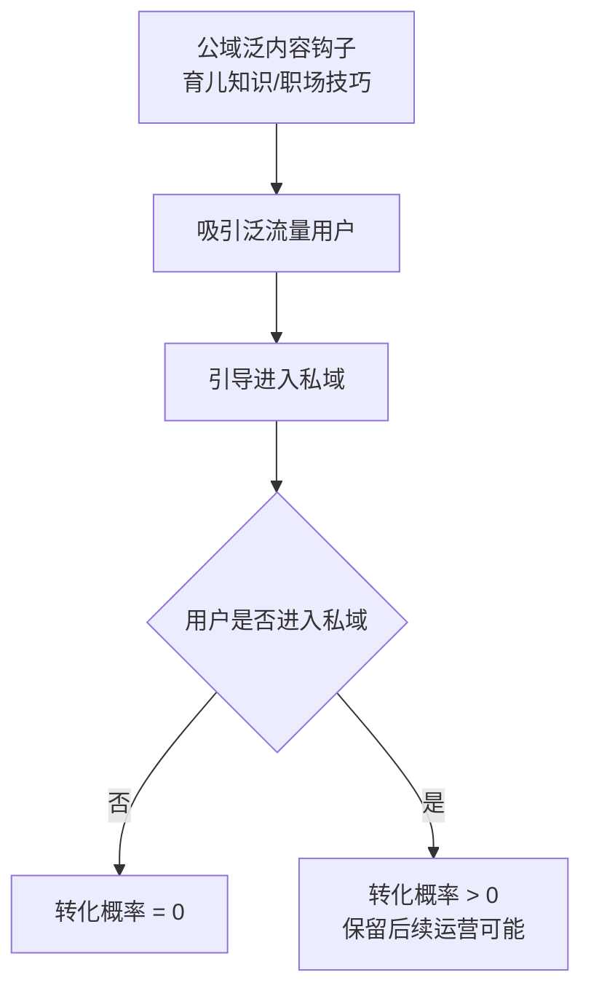

### 边界条件

需要群主有足够的内容/价值输出能力，否则“成功后大家获得更多”也无从谈起。纯靠机制无法替代优质内容，机制是放大器而非内容本身。

### 设计中的取舍

**为什么不能用“失败瓜分高额红包”来吸引用户？**

“失败瓜分红包”看似是一个极具吸引力的“钩子”——用户稳赚不赔。但它有一个致命的副作用：**它让用户期待群主失败**。在这种心理暗示下，用户不仅不会帮助群主成功，反而可能在群主遇到困难时冷眼旁观甚至幸灾乐祸。**这种设计的 trade-off 在于**：短期内你用“红包”换来了“报名量”（虚增的活跃度），却牺牲了长期的核心竞争力——社群的正向氛围与成员的深度参与。而“挑战成功大家获得更多”的规则，虽然吸引力不如“瓜分红包”那样直接，却能把群主与成员变成“命运共同体”，这才是社群可持续的根本。

## 18.12 设计中的取舍

### 为什么私域不追求好友数量而追求质量？

这是本章反复出现的问题。如果用“数量”驱动，你会把精力花在引流动作上——加更多好友、进更多群、发更多广告。但数据说明一切：4万好友的转化不如3万好友，3万好友的成交不如800好友。**数量驱动的最大问题是“关系稀释”**——好友越多，你越难以深度经营每一段关系，信任度自然下降。而质量驱动的逻辑是：少量高信任度的用户带来稳定成交，且复购率高、转介率高，边际成本趋近于零。这是从“流量思维”到“留量思维”的根本转变。

### 为什么裂变活动往往在第三层断层？

多数裂变活动设计者只关注了“诱饵力度”，而忽略了传播的动力衰减问题。诱饵对第一层用户（被直接触动）很有效，但对第二层、第三层用户（通过朋友的朋友触达）的吸引力大幅衰减——这就是断层。破解之道就是战队PK：用团队竞争机制在每一层都注入新的分享动力。这个取舍的本质是——你愿意花多少设计成本来对抗“人性衰减”。

### 为什么“知识营销”优于“硬广”？

知识营销与硬广的选择，本质上是**“短期效率”与“长期资产”**的取舍。硬广的“直达”看似高效，但无法沉淀信任，且容易引发用户反感；知识营销虽需长期投入，但每一篇干货内容都在为你的“信任账户”存款，其价值会随时间复利增长。对于追求长期主义的私域运营者，知识营销是更优的策略。

### 为什么“群红”优于“网红”？

“群红”与“网红”的选择，本质上是**“概率”与“确定性”**的取舍。做“网红”是在无限竞争中博取一个极小概率的爆红机会；而做“群红”则是在有限社群中，通过持续的价值输出获得确定性的影响力。前者高收益但极不确定，后者收益天花板较低但稳健可复制。对于资源有限的普通人，“确定性”远比“可能性”重要。

## 18.13 动手练习

**练习一：案例诊断——谁的私域经营更健康？**

对比以下两个私域运营案例：

案例A：运营者拥有3万好友，月成交额5万元，但朋友圈广告频繁，用户互动率低。

案例B：运营者只有800好友，但通过精细化服务和深度互动，月成交额超过20万元。

请回答：

1. 根据“销售额三要素公式”和“私域的本质”，分析两个案例的差异在哪里？
2. 如果你是案例A的运营者，你会如何调整策略？请给出至少三条具体可执行的建议。

**练习二：模拟操盘——为“零基础”的普通人设计冷启动方案**

假设你是一位没有任何资源和背景的普通人，希望进入“宠物营养”这个垂直领域创业。请基于本章学习的知识，设计一份为期3个月的冷启动方案：

1. 如何运用“个人品牌”理论为自己打造一个差异化的身份标签？
2. 如何运用“群红策略”找到并进入目标社群？你会如何在这些社群中建立信任？
3. 结合“知识营销”和“抱大腿”，规划你的内容输出列表和潜在合作对象类型。

最终请以文字形式完整阐述你的方案。

**练习三：模型分析——设计一次“战队PK”裂变活动**


1. 根据“团队裂变”和“用户裂变”的定义，分析“战队PK”玩法是如何叠加这两种模型的？
2. 请为你的社群设计一个“战队PK”裂变方案，包含：活动诱饵是什么？如何分组？PK规则如何设定才能确保多数参与者有动力持续分享？
3. 分析你的方案中，如何避免“裂变到第三层就断层”的常见问题？

**练习四：信任积累模拟——拆解一次成交前的“铺垫”链路**

假设你是一位理财顾问，微信里有500位潜在客户，但你从未主动推销过产品。请运用“有间隔的重复次数”与“铁粉精细化运营”的思路，设计一个90天的信任培育计划：

1. 你计划在这90天内发布多少条朋友圈？内容类型如何搭配（干货/生活/软广）？
2. 你如何识别并筛选出其中的“铁粉”？（给出至少3个识别信号）
3. 当你开始私聊转化时，如何判断对方是否已经到了“该下单”的时机？

## 18.14 本章小结

这一章中我们系统学习了私域流量冷启动与裂变的完整方法论。首先，我们重新理解了私域的本质——它核心是与用户建立有信任度、有粘性的长远关系，而非追求好友数量，并通过两组真实对比数据验证了“好友质量远胜于好友数量”这一核心主张。其次，我们掌握了销售额三要素公式——销售额=客户数×客单价×购买频次，明白了复购比拉新更重要、20%的老客户贡献80%利润的增长逻辑。接着，我们学习了冷启动三法——个人品牌（差异化身份标签）、群红策略（有限竞争的社群红人）和抱大腿（用可交换价值撬动贵人），三者分别从定位、社群和借势三个维度解决了“第一批客户从哪来”的问题。随后，我们深入理解了知识营销作为被动引流方式的核心逻辑——把营销内容化，用干货吸引精准客户而非主动推销。在放大端，我们拆解了裂变营销的两种基本模型（团队裂变自上而下、用户裂变自下而上），并掌握了“战队PK”叠加玩法如何破解第三层断层的难题。在信任转化环节，我们理解了成交取决于“有间隔的重复次数”而非一次广告的轰炸，以及如何通过铁粉精细化运营实现从数量到质量的运营升级。最后，我们学习了**健康社群规则**——通过“利益一致性”的设计（群主成功大家获益更多）让群主与成员从利益对立走向三方共赢，并掌握了“钩子理论”对引流策略的拓展意义。

本章我们一起学习了以下概念：

| 概念 | 解释 |
|------|------|
| 私域的本质 | 核心是与用户建立有信任度、有粘性的长远关系，而非追求好友数量 |
| 销售额三要素公式 | 销售额 = 客户数 × 客单价 × 购买频次，是指导增长的三驾马车 |
| 复购比拉新更重要 | 企业营收服从二八定律，20%的老客户贡献80%的利润 |
| 个人品牌 | 一种“差异化身份标签”，是普通人起盘成本最低、复利最强的信任杠杆 |
| 群红策略 | 在有限竞争的垂直社群中成为红人，是普通人做个人IP最佳的起盘方式 |
| 抱大腿 | 借势的本质是用“可交换价值”而非金钱撬动贵人，练好本领是最好方式 |
| 知识营销 | 通过推广产品相关知识而非产品本身来被动吸引精准客户的引流方式 |
| 裂变营销 | 通过设计利益诱饵激励用户主动分享的营销方式，有团队裂变与用户裂变两种模型 |
| 战队PK | 在用户裂变基础上叠加团队裂变，以PK机制破解裂变第三层断层的叠加玩法 |
| 有间隔的重复次数 | 成交依赖前期持续的价值输出与信任建立，用户需被多次触动后才买单 |
| 利益一致性规则 | 健康的社群规则应让群主与成员利益一致，如“挑战成功大家获得更多” |
| 铁粉精细化运营 | 先广撒网积累用户，再精细化运营筛出铁粉，通过转介绍与复购实现复利 |

下一章中，我们将进入“高效社群运营”的专题学习——从本章“流量冷启动”的获客思维，转向“流量进来后如何接住并持续变现”的深度运营。你将学会三大交付策略（把时间卖多次、撬动学员时间、让学员意识到责任），用“操作手册+直播录播+百问百答”替代低效的1v1沟通，并理解如何通过“优秀学员分享机制”实现老师、分享者、普通学员的三方共赢。下一章将从获客思维转向深度运营思维，帮助你实现从流量到留量的关键跨越。

