# 第 11 章 短视频对标与引流转化方法论

## 学习目标

- 理解官方实时数据在短视频对标中的战略价值，区分官方平台与第三方工具的本质差异
- 掌握黑马小达人样本策略的核心逻辑，能够按'低粉高销'标准筛选可模仿的对标对象
- 掌握脚本模板复用方法，理解'已验证爆款'相比盲目原创的成功率优势
- 理解蓝海与红海赛道判断的相对性与动态性，掌握选赛道的综合调研方法
- 掌握三厨狂喜定位原则，能平衡自身热爱、用户需求与平台偏好三者关系
- 掌握用户心动公式与钩子设计原则，理解'给他看一半'的引流转化心理学机制
- 理解虚荣指标与真实转化指标的差异，能基于商业模式识别关键数据指标
- 掌握连爆技术与评论区引爆方法，具备将偶发爆款转化为持续流量产出的能力
- 理解视频号新号流量扶持机制与'加字引导'在搬运视频中的出单关键作用
- 掌握小说推文精细化运营（选文垂直、剧情前置、逐项拆解）的完整SOP

## 11.1 生活类比：一位渔夫的全流程作业

想象你是一名**渔夫**，正在寻找最佳的捕鱼水域。首先，你需要一台官方的"鱼群探测雷达"（对标方法论）——巨量百应创意中心就像雷达一样，实时、精准地锁定鱼群最密集的区域，而不是仅靠肉眼观察水面（第三方工具）。当你扫描到鱼群后，不要盯着那些满载而归的大渔船（大达人）学习，他们的渔获量在很大程度上来自船大、设备好、人手多，这些条件你复制不来；相反，那些小船却满载的小渔民（低粉高销的黑马小达人）才是你该观察的对象——他们的技巧更容易被你这条小船复制。

选定水域后，你要辨别这片水域是"鱼多竞争少"的蓝海，还是"鱼少竞争多"的拥挤渔场（红海）；但要留意——今天的好水域明天可能就挤满了船，蓝海是动态变化的。同时，你要选择一条"你喜欢钓、鱼喜欢咬钩、渔场规则鼓励"的路线（三厨狂喜），三者缺一不可，否则难以长久坚持。撒网时，别忘了用"鱼饵只露半截"来引诱鱼咬钩（钩子：给他看一半）——展示资料的冰山一角，用剩余部分激发用户的索取欲望。当你开始收网时，要记住"网眼好看"（点赞收藏）远不如"网里有鱼"（评论求分享、私域导流）重要——渔夫的成就不看网好不好看，看桶里有多少鱼（虚荣指标 vs 真实转化）。找到一处鱼群密集的水域后，要持续下网（连爆技术），而不是每次换一个陌生的地方从零开始——火过的内容大概率还会火。

如果你的渔场太冷清，就像集市上先安排几个"托儿"聚在摊位前围观（引爆评论区），路过的行人看到热闹就会纷纷驻足——三人成虎，羊群效应让冷启动热起来。

而视频号新号流量扶持，则像**新店开业**的"全场打折"：平台用流量扶持吸引新商家入驻，7天黄金期内发视频容易破万播放——要抓住这波"店庆红利"拼命上货（发视频）。别忘了，有时候出单的关键不是商品本身，而是那句抓住人心的"加字"——就像在**商品包装上贴标语**：同样一件商品，贴上"今日特惠、限量抢购"的醒目标签，销量立刻不同。

如果你是做小说推文的，则更应像一位**美食家**挑选食材：选文垂直化是"只选当季、产地直供的食材"（锁定优质作者与专栏），核心剧情前置是"把最诱人的一道菜端到门口"（把精彩部分前置到开头）——每一步都精益求精。

## 11.2 概念地图

```
短视频对标与资料号引流方法论
├── 对标方法论
│   ├── 官方实时爆款视频库（巨量百应创意中心）  —— P001（CGZ4dZq4ZoSFT4xUmFecNpk4nNe，即《RPA 采集爆款视频与对标方法论》）
│   │   ├── 实时性优于第三方工具（抖查查/蝉妈妈）
│   │   └── 按行业/等级/周期分层筛选
│   ├── 黑马小达人样本策略                    —— P001
│   │   ├── 低粉高销去除粉丝基础加成
│   │   └── 对普通小达人更具可迁移性
│   ├── 脚本模板复用                          —— P001
│   │   ├── 替换文案+更换产品的二次创作
│   │   └── 飞书妙记语音转文字提取脚本
│   └── RPA批量采集（影刀）                    —— P001
│       ├── 搜索采集与分类采集双机器人
│       └── 替代人工与第三方工具的自动化
├── 赛道选择与定位
│   ├── 蓝海与红海                            —— P002（IpCcdJ9NAoAt4pxKKV5c5sfenZc，即《小红书资料号从零到一实操复盘》）
│   │   ├── 相对性：大赛道红海中存在细分蓝海
│   │   ├── 动态性：随入场增多蓝海变红
│   │   └── 判断标准：供不应求 vs 供大于求
│   └── 三厨狂喜定位                            —— P002
│       ├── 自己喜欢（内驱力）
│       ├── 用户喜欢（用户需求）
│       └── 平台喜欢（顺应算法）
├── 引流转化核心机制
│   ├── 用户心动公式                            —— P002
│   │   ├── 自己少费力（最省力法则）
│   │   ├── 神器/方法/秘籍（帮助）
│   │   └── 马上实现愿望（及时享受）
│   ├── 钩子（给他看一半）                      —— P002
│   │   ├── 冰山一角展示制造悬念
│   │   ├── 低门槛指令降低行动成本
│   │   └── 转化率相差可达5倍以上
│   └── 虚荣指标 vs 真实转化指标                —— P002
│       ├── 点赞收藏=观赏价值（虚荣）
│       └── 评论互动/私域导流=商业价值（真实）
├── 流量持续与放大技术
│   ├── 连爆技术                               —— P002
│   │   ├── 先复制别人的爆款
│   │   ├── 测试跑出自己的爆款
│   │   ├── 持续复抄自己的爆款
│   │   └── 流量衰减后换下一个爆款
│   └── 引爆评论区（羊群效应）                  —— P002
│       ├── 引导关注+扣随机数字
│       ├── 3个小号带头评论（三人成虎）
│       └── 从众心理带动真实互动
├── 基础支撑技术与进阶玩法
│   ├── 小说推文精细化运营                      —— P006（ZcEdd0xTCo1K5IxwCyLccKUynOb，即《小说推文精细化运营实操指南》）
│   │   ├── 选文垂直化（作者垂直+专栏垂直）
│   │   ├── 核心剧情前置（提高5s完播率）
│   │   ├── 关键词说白话（简单易输入）
│   │   ├── 背景素材去重（降低重复率）
│   │   └── 评论区造互动（小号引导+置顶关键词）
│   ├── 视频号新号起量（新号流量扶持）          —— P003（Lg2vd5GWHoqhBbxuT5LcThEpncb，即《视频号新号起量实操复盘》）
│   │   ├── 新号7天流量扶持期（发视频易破万）
│   │   ├── 选品即定人群找需求（垂直需求品优先）
│   │   ├── 视频搬运去重流水线（放大/翻转/BGM/加字）
│   │   ├── 加字引导出单（人设化、场景化文案）
│   │   └── 直播话术扒取与样品展示提升转化
│   └── 公转私自动化的官方通道优先原则          —— P004（QbBKdHvfiofIUNxDlmjceWbfnqh，即《抖音公转私自动化玩法及防封策略》）
│       ├── 账号类型权限矩阵（蓝V/半蓝/员工号/黄V/个人号）
│       ├── 五大转化入口（主页/评论/私信/直播/群）
│       └── 风险分级（官方>接口>第三方App>小程序）
```

## 11.3 对标方法论 —— 让平台的实时数据成为你的"作战地图"

**为什么你需要一个"官方雷达"？**

在短视频带货领域，盲目原创就像在黑暗中射箭——你射出的箭可能偏离目标十万八千里，甚至根本不知道自己是否射中了靶子。除非你是天赋异禀的创作者，否则你无法保证自己的内容既符合用户喜好，又能获得商业上的成功。

> "对标对标，这里上榜的，出成绩的，最新的，不就是最好的对标吗？"
>
> ——《P001》（CGZ4dZq4ZoSFT4xUmFecNpk4nNe，即《RPA 采集爆款视频与对标方法论》）[P001, p.1]

这段话揭示了短视频带货的一个残酷现实与一个巨大机会：残酷在于——每天有数以百万计的视频被创作出来，但只有极少数能成为爆款；机会在于——这些爆款视频本身就是最直观的"标准答案"，它们已经被市场验证过，而你只需要找到它们、学习它们、模仿它们。

**官方平台 vs 第三方工具：一场关于"数据实时性"的战争**

> "这里是比抖查查蝉妈妈这些第三方要更准确的行业优秀爆款视频库。对于上不了热榜的来说，这里更容易找到同行的东西。"
>
> ——《P001》（CGZ4dZq4ZoSFT4xUmFecNpk4nNe，即《RPA 采集爆款视频与对标方法论》）[P001, p.1]

**对标方法论定义**（来源：《P001》（CGZ4dZq4ZoSFT4xUmFecNpk4nNe，《RPA 采集爆款视频与对标方法论》））

> 以短视频行业官方平台（如巨量百应创意中心）实时更新的爆款视频库与创意搜索作为对标依据，筛选出高GMV、低粉丝量的"黑马"视频进行学习与模仿，而非依赖第三方工具或大达人样本。

要理解这个方法论的威力，我们需要先看一个关键的对比。为了更直观地说明官方平台的优势，下表对两类工具的关键差异进行了对比：

| 维度 | 官方平台（巨量百应创意中心） | 第三方工具（抖查查/蝉妈妈） |
|------|------------------------------|----------------------------|
| 数据来源 | 抖音官方直接提供 | 第三方抓取与估算 |
| 实时性 | 实时更新，最新爆款即时上榜 | 存在延迟，可能错过早期信号 |
| 准确性 | 精确到单条视频GMV、粉丝量 | 存在估算偏差 |
| 分层能力 | 按行业/等级/周期多维筛选 | 筛选维度受限 |
| 对普通玩家的价值 | 能看到"上不了热榜"的同行数据 | 更关注头部大V |

这个表格展示了官方平台在数据实时性和准确性上的压倒性优势。**为什么实时性如此关键？** 因为短视频的流量窗口是动态的——今天爆火的视频类型，明天可能就被新趋势取代。如果你依赖延迟数天的第三方数据，等你发现某个爆款模式时，竞争已经完全白热化。而官方平台让你能第一时间看到"此刻正在爆"的视频，抢占先机。

**黑马小达人：为什么要学"小船满载"的小渔民？**

> "我的思路是找那种，粉丝量少，但是销量高的视频，做参考。这种黑马小达人更是我们小达人适合学习的对象，毕竟大达人都是有粉丝基础加成在的，销量天然会高一点。"
>
> ——《P001》（CGZ4dZq4ZoSFT4xUmFecNpk4nNe，即《RPA 采集爆款视频与对标方法论》）[P001, p.1]

**黑马小达人样本策略**（来源：《P001》（CGZ4dZq4ZoSFT4xUmFecNpk4nNe，《RPA 采集爆款视频与对标方法论》））

> 在采集数据后，优先筛选"粉丝量少但销量高"的视频作为学习对象，因为大达人有粉丝基础加成，销量天然偏高，黑马小达人更适合小达人用户对标学习。

这个策略的本质是**去除干扰变量**。大达人的高销量中，有多少归因于内容本身？有多少归因于百万粉丝的基数效应？你无法区分。但一个只有几百粉丝却单条视频带货几十万的账号，其成功几乎必然归因于内容策略和选品策略——这正是你可以学习和复制的部分。

一个典型的例子：你刷巨量百应创意中心，看到一个粉丝量只有 500 的账号，某条视频带货 GMV 却达到 30 万。你就会明白，这个账号的内容里一定有什么'魔法'值得你深挖。

**脚本模板复用：让"已验证的爆款"为你持续产单**

> "好的脚本大概率是不会过时的，一个脚本模板，改改文案换个产品推，成功率大概也比瞎原创要好一点吧。好记性不如烂笔头，不如全部下载保存起来吧。"
>
> ——《P001》（CGZ4dZq4ZoSFT4xUmFecNpk4nNe，即《RPA 采集爆款视频与对标方法论》）[P001, p.1]

**脚本模板复用方法**（来源：《P001》（CGZ4dZq4ZoSFT4xUmFecNpk4nNe，《RPA 采集爆款视频与对标方法论》））

```
1. 从巨量百应创意中心筛选爆款视频（优先黑马小达人）
2. 批量下载视频（支持无水印）
3. 用飞书妙记将视频语音转为文字脚本
4. 将脚本存入素材库，按品类/结构分类
5. 新内容创作时：替换文案 + 更换产品，进行二次创作
6. 发布后监控数据，流量衰减则换下一个模板
```

这段伪代码展示了一个完整的"爆款脚本工业化流水线"。**核心逻辑**：爆款脚本的底层结构（叙事节奏、情绪曲线、信息密度）变化缓慢，而具体文案和产品则可以随意替换。与其每次从零开始"瞎原创"，不如站在已验证的框架上进行微创新，成功率自然大幅提升（《P001》，CGZ4dZq4ZoSFT4xUmFecNpk4nNe）。具体来说，每一个步骤都需要落实到行动中：

第一，从巨量百应创意中心的"爆款视频"和"创意搜索"两个模块中，筛选出符合你目标行业的爆款视频，优先选择那些粉丝量少但销量高的"黑马"视频。第二，利用平台支持的无水印下载功能，将选中的视频批量下载到本地。第三，将下载好的视频导入飞书妙记，利用其语音转文字功能，将视频中的口播内容提取为可编辑的文字脚本。第四，将这些脚本按照品类、结构、情绪曲线等维度分类存入你的素材库，形成可检索的"爆款脚本库"。第五，在新内容创作时，从素材库中挑出与当前产品匹配的脚本模板，替换其中的文案和产品信息，进行二次创作。第六，发布后持续监控数据表现——如果流量衰减，就换下一个模板；如果数据不错，就持续复用。

**RPA 批量采集：让机器人替你"盯盘"**

> "rpa 更自由吧，只要你有想法，加上一点点的编程思维，即使你不是专业的程序员，也能写出来能用的脚本。我不是程序员，最多算个半吊子的产品经理。"
>
> ——《P001》（CGZ4dZq4ZoSFT4xUmFecNpk4nNe，即《RPA 采集爆款视频与对标方法论》）[P001, p.1]

对标方法论的最后一块拼图是自动化采集。作者基于影刀 RPA 工具开发了两个机器人：一个是"爆款视频搜索采集"（输入搜索词/商品名，自动采集创意搜索的数据并导出表格），另一个是"爆款视频分类采集"（按大行业/子行业类目、作者等级、时间周期筛选爆款视频库）。前者适合选品定向搜索，后者适合赛道扫描。

以上四个环节——官方平台、黑马筛选、脚本复用、RPA 采集——共同构成了一个完整的方法论闭环。下面我们把这个整体流程用一张图概括出来：

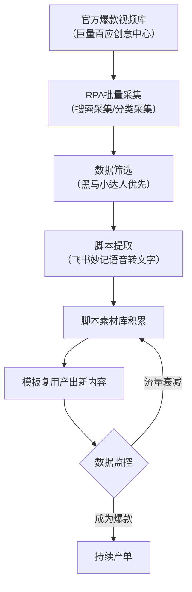

具体到 RPA 采集环节，其内部的数据流可以细化为：

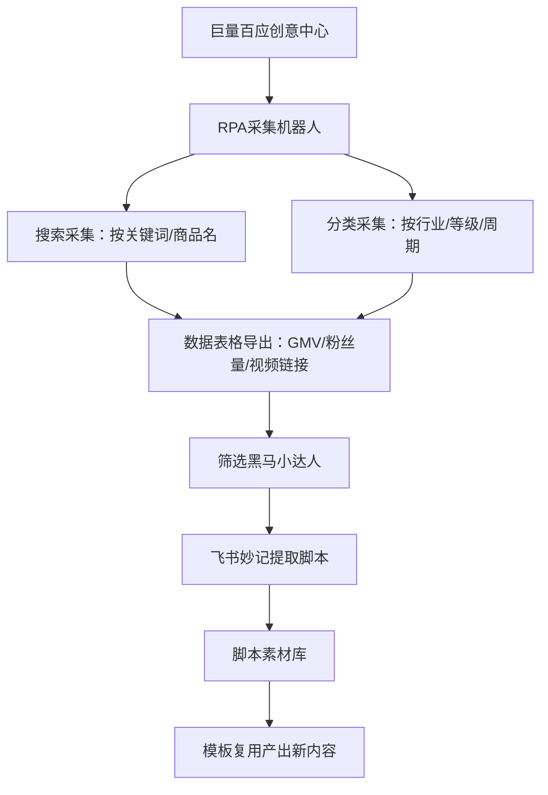

**RPA 的价值**不仅在于省时省力，更在于它让"系统性对标"成为可能——你可以持续地、大规模地采集和分析爆款数据，而不是依赖偶尔的灵光一现。

**边界条件**

对标方法论并非万能。它适用于内容同质化严重、竞争激烈的短视频带货领域，其核心价值在于降低"瞎原创"带来的不确定性。但对于创新驱动的品牌，过度依赖对标可能导致缺乏差异化。同时，该方法依赖官方平台数据的可靠性，若平台数据有偏差则方法论失效。

## 11.4 蓝海与红海 —— 从"狼多肉少"到"狼少肉多"的赛道判断

**为什么选赛道比努力更重要？**

你可能听过无数次"选择大于努力"，在短视频领域，这句话的杀伤力在于：你选择的赛道直接决定了你的竞争难度、流量天花板和变现效率。在这个赛道选错了方向，你越努力，距离成功越远。

> "红海：狼多肉少；蓝海：狼少肉多。有些是大赛道看起来蓝海，部分细分领域已经打破头了；有些是大赛道看起来红海，部分细分领域还是很空白。本质：供不应求还是供大于求。血的教训：选择大于努力，选择不对，努力白费！"
>
> ——《P002》（IpCcdJ9NAoAt4pxKKV5c5sfenZc，即《小红书资料号从零到一实操复盘》）[P002, p.1]

**蓝海与红海定义**（来源：《P002》（IpCcdJ9NAoAt4pxKKV5c5sfenZc，《小红书资料号从零到一实操复盘》））

> 红海指竞争激烈、同行实力强的领域（狼多肉少），蓝海指竞争少、机会多的细分赛道（狼少肉多）；本质是供不应求还是供大于求。

这个定义听起来简单，但关键在于理解它的两个核心属性：

**相对性**：在一个看似红海的大赛道中，往往存在蓝海的细分领域；反之亦然。比如"小学教育"是大赛道，但"小学英语"可能比"小学语文"竞争小得多。

**动态性**：随着入场者增多，蓝海会逐渐变红。你今天发现的机会，可能三个月后就被挤满。

那么如何判断一个赛道是蓝海还是红海？以下是四步法：

**找蓝海赛道的四步法**（来源：《P002》（IpCcdJ9NAoAt4pxKKV5c5sfenZc，《小红书资料号从零到一实操复盘》）[P002, p.2-3]）

```
1. 搜索下拉词调研：搜索关键词，查看二级类目下拉词 → 判断赛道是否符合平台调性和生态环境
2. 找头部：查看是否有大头部垄断流量 → 有认证号入场但未做细分，则细分领域仍有机会
3. 对比最新 vs 最热：比较24小时内"最新"与"最热"笔记的数量差异 → 数量差距越大，竞争差异越明显
4. 多刷星球内容：交叉验证，结合社群信息判断趋势
```

我们来拆解每一步的逻辑：

**第一步**是"看平台调性"。每个平台都有自己的内容生态和用户偏好，你需要确认你的赛道是否符合这个平台的"气质"。**第二步**是"看头部垄断程度"。如果一个赛道已经有超级头部账号，且几乎覆盖了所有细分领域，那后来者很难突破；但如果头部账号尚未做细分（比如只做"小学语文"全科，没有专做"一年级"），那么细分领域就是蓝海。

**第三步**是最核心的量化对比——通过对比"最新"和"最热"笔记的数量差异来判断供需关系。以下是我们经过实操验证的供需对比公式：

**供需对比公式**（来源：《P002》（IpCcdJ9NAoAt4pxKKV5c5sfenZc，《小红书资料号从零到一实操复盘》））

$$
\text{竞争强度} = \frac{\text{24小时内新发布笔记数量}}{\text{最热笔记的平均互动量}}
$$

在这个公式中，分子越大表示供给越多（狼越多），分母越大表示需求越旺盛（肉越多）。一个实操案例可以说明这一点：作者对比了"小学语文"和"小学英语"两个赛道——语文类目 24 小时内笔记数量是英语的 5-10 倍，但两个赛道最热笔记的点赞数基本在一个量级（说明用户需求相似），因此英语类目竞争更小、更好做。这就像 24 小时内语文笔记发布 100 篇、英语笔记发布 10 篇——发一篇语文的竞争者 100 个，发英语只需要跑赢 10 个人。

需要注意的是，这个公式是基于实操经验的量化近似，而非严格的数学定义。其局限性在于：分子和分母来自不同维度的数据（供给端的发布量 vs 需求端的互动量），并无统一的标准量纲；同时，"最热笔记的平均互动量"会受爆款极端值的干扰。因此，它更适用于供给与需求代理指标都容易获取的赛道初筛场景——作为一个直观的对比思路，辅助你快速判断竞争强度，而非追求精确的数值预测。在正式决策前，建议结合第 1、2、4 步做交叉验证。

**第四步**是"多刷星球内容"。在生财有术等社群中，基本不存在信息差——多刷多看，总有不期而遇的精彩。这一步强调的是交叉验证，避免单一信息来源的判断偏差。

**核心洞察**：选赛道不是看绝对值（市场规模），而是看相对值（供需比例）。一个市场规模小但供给更小的细分赛道，比一个规模大但供给过剩的赛道更有价值。

**用'三厨狂喜'定位原则锁定最佳切入赛道**

> "三厨狂喜：自己喜欢，用户喜欢，平台喜欢。我喜欢：赚钱的过程往往是磕磕绊绊……我想做自己热爱的事情是最好的内驱了。"
>
> ——《P002》（IpCcdJ9NAoAt4pxKKV5c5sfenZc，即《小红书资料号从零到一实操复盘》）[P002, p.4]

**三厨狂喜定位法**（来源：《P002》（IpCcdJ9NAoAt4pxKKV5c5sfenZc，《小红书资料号从零到一实操复盘》））

> 赛道选择的黄金定位原则，即所选内容同时满足"自己喜欢"（内驱力）、"用户喜欢"（用户需求）和"平台喜欢"（顺应平台算法）三个条件。

我们可以将三个条件可视化为维恩图：

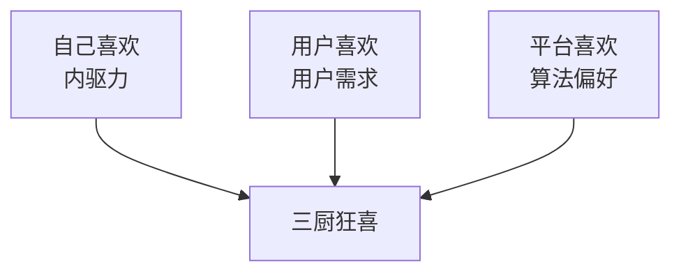

**为什么"自己喜欢"如此重要？** 因为赚钱的过程往往是磕磕绊绊的——如果你做的事自己都不热爱，很难在困难期坚持下来。**为什么"用户喜欢"是前提？** 因为你的内容最终要服务用户需求，自嗨式的内容无法持续获得市场反馈。**为什么"平台喜欢"不可或缺？** 因为不懂顺应平台算法，再好的内容也难获得流量倾斜。一个实践建议是：干货内容和营销内容可以结合，按 28 开——10 篇内容里 8 篇营销、2 篇干货。

**边界条件**

三厨狂喜的理想状态难以一步到位，往往需要动态调整，在运营过程中不断寻找三者的交集。过分追求平台喜欢而牺牲自己的热爱，难以长期坚持。

## 11.5 引流转化核心机制 —— 心动、钩子、虚荣指标与连爆技术

**为什么你的笔记有流量却没有转化？**

"有流量没转化"是内容创作者最常见的困惑——一篇笔记点赞过万，但评论区只有零星几条，私域导流更是寥寥无几。问题的根源往往不在于内容质量，而在于你忽略了最关键的转化机制。

### 用户心动公式 —— 让用户"心动"进而"行动"

> "用户心动公式：购买欲=自己少费力（最省力法则）+神器/方法/秘籍（帮助）+马上现实愿望（及时享受）。重点：用户要的是感觉，是心动的感觉！！！感觉到了没什么不可以。用户更愿意躺着就成学霸，一'觉'封神！"
>
> ——《P002》（IpCcdJ9NAoAt4pxKKV5c5sfenZc，即《小红书资料号从零到一实操复盘》）[P002, p.4]

**用户心动公式**（来源：《P002》（IpCcdJ9NAoAt4pxKKV5c5sfenZc，《小红书资料号从零到一实操复盘》））

$$
\text{购买欲} = \text{自己少费力} + \text{神器/方法/秘籍} + \text{马上实现愿望}
$$

这个公式展示了从用户购买心理出发的转化逻辑：

**第一项"自己少费力"**利用了人类"最省力法则"——用户希望用最少的努力获得最大的成果；**第二项"神器/方法/秘籍"**提供了具体帮助——用户在寻找能解决问题的"工具"；**第三项"马上实现愿望"**利用了"及时享受"心理——用户希望立刻看到效果。

需要说明的是，这个公式属于经验性心理模型而非严格科学公式，它来自实操总结，主要用于文案创作指导——它帮助你把抽象的用户心理拆解为可操作的文案要素，而不是一种精确的量化预测工具。比如"搞懂这些语法，能考 130+"——"搞懂这些语法"是自己少费力（学会语法比大量刷题省力），"语法"是方法，"能考 130+"是马上实现愿望。

为了让这个公式更直观地指导你的文案创作，我们用一张流程图展示从用户接触到心动再到行动的完整链路：


这张图展示了用户心动公式的运作机制：三个要素层层递进，最终汇聚成"心动"的感觉，驱动用户从被动浏览转向主动行动。**核心洞察**：用户要的是感觉，是心动的感觉——感觉到了，没什么不可以。

### 钩子 —— "给他看一半"的引流魔法

> "这个就是老大亦仁说的资料号钩子的核心原则：给他看一半，剩下一半用来诱惑他，很坏，但屡试不爽！钩子是资料号的灵魂，做资料号首要考虑引流转化，而不是点赞收藏。"
>
> ——《P002》（IpCcdJ9NAoAt4pxKKV5c5sfenZc，即《小红书资料号从零到一实操复盘》）[P002, p.4]

**钩子定义**（来源：《P002》（IpCcdJ9NAoAt4pxKKV5c5sfenZc，《小红书资料号从零到一实操复盘》））

> 在资料号笔记中，通过展示部分资料（冰山一角）以激发用户索取完整资料的行为，是引流转化的核心转化工具。

笔者用两篇内容完全相同的同行笔记数据来验证钩子的威力。以下是对比数据：

| 笔记 | 点赞数 | 评论数 | 转化逻辑 |
|------|--------|--------|----------|
| 笔记 A | 1980 | 35 | 展示了全部资料内容，用户围观完毕即离开 |
| 笔记 B | 500 | 230 | 只展示 4 篇，暗示还有 96 篇，评论区求分享 |

两个笔记的内容完全一样，差别仅在于钩子设计的差异，转化率（评论/点赞比）相差了 **5 倍以上**。一个点赞近 2000、评论才 35，另一个点赞 500、评论 230。这就是"给他看一半"的威力——展示冰山一角后，告诉用户"快到碗里来，还有更多"。

**钩子设计三步法**（来源：《P002》（IpCcdJ9NAoAt4pxKKV5c5sfenZc，《小红书资料号从零到一实操复盘》）[P002, p.5]）

```
1. 找到拥有好钩子的笔记：刷同行，参考评论区（求分享、求链接）识别赚钱笔记
2. 获取高需求钩子：固定刷同行+建立专辑分类收藏+私聊同行要资料
3. 制作自己的钩子：对同行资料修改加工（去水印、转文字排版）成为自己的引流利器
```

这段伪代码展示了钩子从发现到制作的全流程。我们来逐步解读：

**第一步**，找到拥有好钩子的笔记。方法是持续刷同行的内容，重点关注评论区——如果某篇笔记的评论区大量出现"求分享""求链接"等字样，这篇笔记就是被市场验证过的"赚钱笔记"。**第二步**，获取高需求钩子。每天固定花半小时刷同行，只要发现带有好钩子的笔记就收藏，建立专辑分类保存；必要时可以私聊同行索要资料或购买。**第三步**，制作自己的钩子。拿到同行的钩子资料后，经过修改加工（去水印、转文字排版）——"修修改改以后就是自己的引流利器了"。

**关键要点**：好的钩子不是凭空设计的，而是从市场反馈中提取的——那些评论区"求分享"声不断的笔记，就是已经验证过的好钩子。

为了更直观地展示钩子在引流转化中的核心位置，我们用一张流程图来呈现：

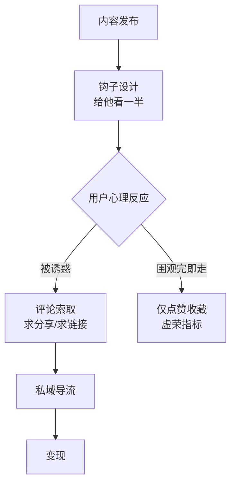

这张图清晰地展示了钩子设计的核心作用：它决定了用户是被"诱惑"着走向评论索取，还是"围观完即走"。**钩子设计的本质**是制造信息差——你展示的"冰山一角"越吸引人，剩余的"冰山主体"越让人渴望，用户的索取动机就越强。

### 虚荣指标 vs 真实转化指标 —— 别让"点赞收藏"蒙蔽你的商业双眼

> "资料号重点：不迷恋虚荣指标（点赞收藏）。资料号不靠带货，用户的点赞和收藏只能让自己感觉很好，而评论的用户才是我们真正的衣食父母！"
>
> ——《P002》（IpCcdJ9NAoAt4pxKKV5c5sfenZc，即《小红书资料号从零到一实操复盘》）[P002, p.3]

**虚荣指标定义**（来源：《P002》（IpCcdJ9NAoAt4pxKKV5c5sfenZc，《小红书资料号从零到一实操复盘》））

> 指点赞、收藏等对资料号实际变现价值不大的数据指标；而真正决定转化的是评论区互动（求分享、求链接）和私域导流量。

在传统的品牌营销中，点赞和收藏是衡量内容受欢迎程度的重要指标。但在资料号的商业逻辑中，它们只是"虚荣指标"——因为它们无法直接带来转化。以下是对两类指标的对比：

| 指标类型 | 具体指标 | 反映的价值 | 对资料号的意义 |
|----------|----------|------------|----------------|
| 虚荣指标 | 点赞、收藏 | 观赏价值（内容好看） | 低——用户看完即走 |
| 真实指标 | 评论求分享、私域导流 | 商业价值（用户有需求） | 高——用户主动索取，已是精准客户 |

**核心逻辑**：点赞收藏的用户，看完就走了——他们是"围观群众"；评论求分享的用户，已经产生了索取行为——他们是"意向客户"。对资料号而言，后者才是真正的"衣食父母"。实际运营中，放弃虚荣指标、做好钩子，平均 1 篇笔记可以引流到 20-30 人。

为了帮助你更清晰地认识两类指标在转化链路中的不同位置，我们用一张流程对比图展示：

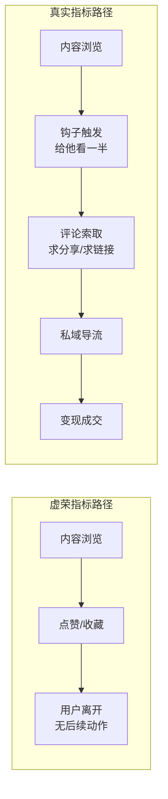

这张对比图揭示了两种指标路径的本质差异：虚荣指标路径在"点赞/收藏"后就终止了，用户没有产生任何商业行为；而真实指标路径通过钩子触发，引导用户一路走向评论索取、私域导流直至变现成交。**判断一个指标是否为"虚荣"的核心标准**是：它是否与你的商业模式直接挂钩——对于资料号，评论互动就是真实指标；对于品牌广告号，点赞收藏可能反而是核心指标。

### 连爆技术 —— 让"爆款"成为常态而非偶然

> "方法：先复制别人的爆款，不断测试，直到跑出来自己的爆款，接下来要做的就是抄自己的爆款。原理就是火过的内容大概率还会火。只要有数据不错的笔记我们就要一直怼，直到没流量，这个期间呢，我们可以一天发 2 篇。"
>
> ——《P002》（IpCcdJ9NAoAt4pxKKV5c5sfenZc，即《小红书资料号从零到一实操复盘》）[P002, p.6]

**连爆技术**（来源：《P002》（IpCcdJ9NAoAt4pxKKV5c5sfenZc，《小红书资料号从零到一实操复盘》））

> 基于"爆款都是重复的"原理，先复制别人的爆款，不断测试直到跑出自己的爆款；之后持续复抄自己的爆款，直到流量衰减再换下一个爆款。

这个方法的本质是将"爆款"从偶然变成可管理的持续产出：

```
阶段一：复制 → 直接模仿别人的爆款笔记（标题、封面、钩子）
阶段二：测试 → 发布多个变体，用数据找出自己的爆款
阶段三：复抄 → 持续重复发布自己的爆款（一天2篇，1篇重复爆款+1篇测试新品）
阶段四：迭代 → 旧爆款流量衰减后，换用新的爆款模板
```

这个流程的价值在于**由被动变主动**——不再等待灵感降临，而是将爆款生产变成一条可重复的流水线。与之配套的一个方法是用"杂交法"生成爆款标题：搜索关键词并翻看最热前十笔记，会发现高频关键词就那么几个（如"唯唯诺诺""央视推荐""格局炸裂"），直接提取这些关键词进行排列组合，产出的标题自带爆款基因。最热前 8 中，有 6 个的标题几乎一样——这说明爆款真的是重复的。

连爆技术的完整操作路径及其与数据监控的关系，可以用下面的流程图表达：

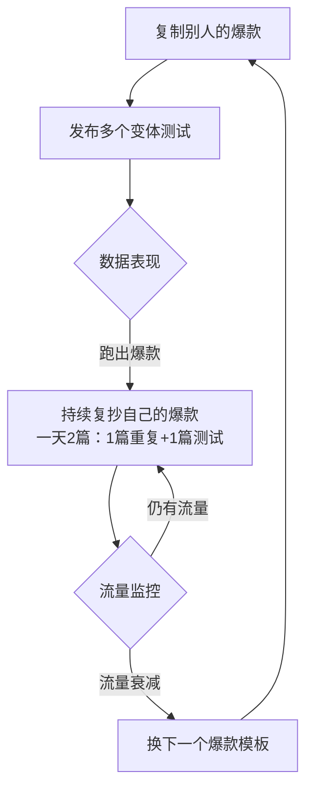

这张图展示了连爆技术的完整循环：从复制到测试，从复抄到迭代，形成一个闭环。**核心原则**：只要有数据不错的笔记就要一直怼，直到没流量——这个期间可以一天发 2 篇，1 篇重复发爆款收割流量，1 篇测试新模板寻找下一个爆款。

### 引爆评论区 —— 用"羊群效应"让冷启动热起来

> "1.引导关注+扣随机数字（给出简单指令，同时这个指令有利于我们做数据）；2.拿 3 个小号自己先评论（激发羊群效应，三人成虎 3 个就够了）；第二天起来都是果然爆发了，都是 99+（有时候真的就是只缺个领头的，一个简单的小动作既刺激了用户又提高了笔记分数）。"
>
> ——《P002》（IpCcdJ9NAoAt4pxKKV5c5sfenZc，即《小红书资料号从零到一实操复盘》）[P002, p.6]

**引爆评论区操作法**（来源：《P002》（IpCcdJ9NAoAt4pxKKV5c5sfenZc，《小红书资料号从零到一实操复盘》））

```
1. 发布笔记后，用大号在评论区引导关注 + 扣随机数字（如"想要完整版扣 1"）
2. 用 2-3 个小号带头评论，制造"已经有人在互动"的假象
3. 小号的评论内容要自然（如"已扣，求分享"），起到示范作用
4. 观察数据，持续引导真实用户参与互动
```

这个方法的底层心理机制是**羊群效应**（三人成虎）：用户看到评论区已经有很多人互动，会倾向于认为这条内容有价值，从而跟着参与。整个过程遵循一条清晰的数据流路径——从大号发出引导指令开始，到小号带头营造氛围，再到激发真实用户的从众心理，最终形成大规模真实互动。这条路径可以用下图直观展示：


一个真实的案例：作者发布一篇笔记，晚上半小时只有 50 赞、0 评论；他用大号引导 + 2 个小号带头评论后，睡前收到几个用户评论；第二天醒来评论区爆发到 99+。很多时候，缺的只是一个"领头的"。

**边界条件**

以上引流转化机制适用于资料号、知识付费等虚拟产品，对于高客单价或需要深度决策的商品，还需加入信任背书等要素。同时，钩子设计需避免过度承诺或虚假宣传，确保所展示的"冰山一角"是真实且高质量的。引爆评论区需在平台规则允许的范围内使用，过度使用可能被判定为"刷量"。

下面是这些机制之间的数据流关系（基于《P002》（IpCcdJ9NAoAt4pxKKV5c5sfenZc）[P002, p.6]）：

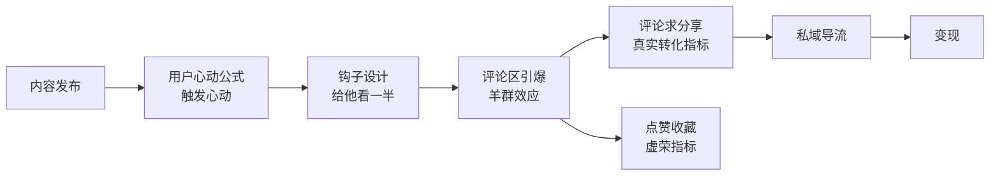

这个数据流展示了从内容发布到变现的完整链路：**心动公式**解决"用户为什么要点进来"，**钩子**解决"用户为什么要求索取"，**评论区引爆**解决"用户为什么要跟着互动"，最终引导到私域。而点赞收藏虽然也在过程中产生，但并不是商业价值指向。

## 11.6 小说推文精细化运营 —— 从"粗放搬运"到"吃货级选材"

**为什么粗放搬运已经行不通了？**

在小说推文赛道早期，随便搬运一篇热门小说就能获得不错的数据。但随着平台打击力度加大和内容同质化加剧，这种"粗放式"打法已经难以为继。精细化运营成为了幸存者的必修课。

> "选文是小说推文项目的绝对核心。选文可分为两个步骤，首先是找到充足的、优质的文章来源，其次是筛选出符合账号定位、有爆文潜力的文章。"
>
> ——《P006》（ZcEdd0xTCo1K5IxwCyLccKUynOb，即《小说推文精细化运营实操指南》）[P006, p.1]

**小说推文精细化运营定义**（来源：《P006》（ZcEdd0xTCo1K5IxwCyLccKUynOb，《小说推文精细化运营实操指南》））

> 指针对小说推文项目的系统化运营方法，核心涵盖选文垂直化（作者垂直+专栏垂直）、核心剧情前置（提高5s完播率）、关键词说白话（简单易输入）、背景素材去重（降低重复率）与评论区造互动（小号引导）等环节。

整个运营流程可以分为四个环节，我们用一张流程图展示：

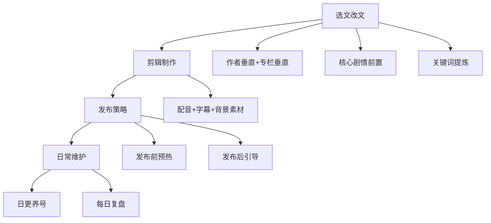

### 选文垂直化：作者垂直 + 专栏垂直

**作者垂直**是抓住知乎优质作者作为稳定文章来源：

> "抓住了作者，就可以说抓住了稳定的文章来源。不需要经常去翻阅问题的新回答，把重心从问题上移到回答问题的人身上。关注 8~10 个符合账号定位的优质作者，在知乎-动态里可以看到他们每天点赞的文章、关注的问题、发布的回答还有他们关注的作者，顺腾摸瓜挨个找下去。"
>
> ——《P006》（ZcEdd0xTCo1K5IxwCyLccKUynOb，即《小说推文精细化运营实操指南》）[P006, p.1]

**专栏垂直**则是借助盐选专栏实现同类型文章的高效扩充：

> "专栏收纳的是同一主题或者同一作者的优质文章，相当于知乎的编辑事先帮我们筛选一遍。从专栏里选文章对账号的'垂直'帮助很大，因为优质作者们很少会死磕某一类文章，我们也不可能只发一个作者的文章，但我们可以瞄准了一个专栏使劲薅。"
>
> ——《P006》（ZcEdd0xTCo1K5IxwCyLccKUynOb，即《小说推文精细化运营实操指南》）[P006, p.2]

两者的关系，可以用一个简单的公式表示：

$$
\text{优质文章来源} = \text{作者垂直（稳定首发）} + \text{专栏垂直（同类型扩充）}
$$

这个公式展示了精细化的选文策略。**作者垂直**解决的是"有没有稳定、高质量的新文章"的问题——优质作者是最稳定的文章产出者，而且通过关注他们，你能在文章首发时就拿到手、抢占关键词先机。**专栏垂直**解决的是"如何快速扩充同类型文章"的问题——盐选专栏是知乎编辑已经帮你筛选过一遍的优质文章集合。两者结合，实现"既有源头活水，又有同类型扩充"。

### 核心剧情前置：把最精彩的部分端到门口

> "有些文章的开头第一、二句话并没有那么吸引人，只是在陈述一件平淡的事，读到中后期才能体会到它的精彩之处，俗称'中开高走'或者'低开高走'。如何提高 5s 完播率乃至整体完播率？这些个问题转化一下就是：如何把文章的精彩部分在开头就呈现给观众？"
>
> ——《P006》（ZcEdd0xTCo1K5IxwCyLccKUynOb，即《小说推文精细化运营实操指南》）[P006, p.3]

**为什么核心剧情前置能提升 5s 完播率？**

短视频的推荐机制高度依赖完播率，尤其是前 5 秒——如果观众在开头 5 秒内就划走，视频就难以获得推荐。而知乎小说普遍存在"中开高走"的问题——开头平淡，读到中后期才精彩。两者形成了尖锐的矛盾：你的视频要用最平淡的部分去吸引观众？这显然是南辕北辙。

**改文套路化**（来源：《P006》（ZcEdd0xTCo1K5IxwCyLccKUynOb，《小说推文精细化运营实操指南》）[P006, p.3-4]）

```
1. 通读文章，熟悉剧情发展脉络
2. 提炼核心剧情的关键词（角色、悬念、反差、泪点）
3. 将核心剧情前置到视频开头
4. 添加情绪修饰词（"竟然""偏偏""非要"）
5. 删减对剧情发展毫无贡献的文字，精简篇幅
```

我们来逐步解读这个套路化的改文流程：**第一步**，通读文章是必须的——在通读的过程中熟悉剧情发展的脉络，为后续的关键词提炼打好基础。**第二步**，提炼核心剧情的关键词——包括角色、悬念、反差、泪点等能抓人眼球的要素。**第三步**，将提炼出的核心剧情前置到视频开头——这是改文的核心动作。**第四步**，在核心剧情前置后，适当添加一些能够调动情绪的修饰词，比如"竟然""偏偏""非要"等。**第五步**，对剧情发展毫无贡献的文字完全可以删去，用来精简篇幅。

一个实操案例是：作者将一篇"中开高走"的文章，把最精彩的情节（如"分手""千金"）提炼成关键词并前置到开头，完播率从 40% 提升至 65-70%。这就是精细化运营的直接收益。

核心剧情前置的操作逻辑可以用一条简单的流程链来概括：

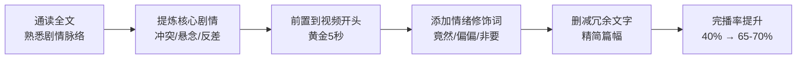

### 关键词说白话与背景素材去重

> "关键词是拿到后切换到另一个 app 键入搜索的，越简单越容易输入越好，一眼就能记下来最好。关键词最好能够明示、暗含文章核心剧情，如'分手''千金'，或者包含文中某个重要的道具。"
>
> ——《P006》（ZcEdd0xTCo1K5IxwCyLccKUynOb，即《小说推文精细化运营实操指南》）[P006, p.4]

**选关键词的三个原则**（来源：《P006》（ZcEdd0xTCo1K5IxwCyLccKUynOb，《小说推文精细化运营实操指南》））

```
1. 准确：关键词要准确反映核心剧情的内容
2. 简洁：尽量简洁，避免冗长，一眼就能记住
3. 可读：一定让自己看得懂（避免生僻词、敏感词）
```

关键词是观众在另一个 app 搜索的"入口"，越是简单通俗，越能降低搜索成本、提升转化概率。同时要避开人名、地名、职务等敏感词，防止触发平台审核。

> "重复率低，越低越好，人无我有最好。素材质量高，越高越好。来源稀缺，门槛越高越好。"
>
> ——《P006》（ZcEdd0xTCo1K5IxwCyLccKUynOb，即《小说推文精细化运营实操指南》）[P006, p.5]

**背景素材去重**解决两个层面的重复问题：一是**平台层面的去重**——重复率过高的素材可能被平台判定为搬运；二是**观众层面的去重**——观众刷到十几条视频都是同类型的甜点素材，容易产生审美疲劳。选择来源稀缺、质量高的素材，可以同时满足平台过审和观众观感。

从选文改文到发布维护，关键词设计与素材去重贯穿始终，其内部流程可以概括为：

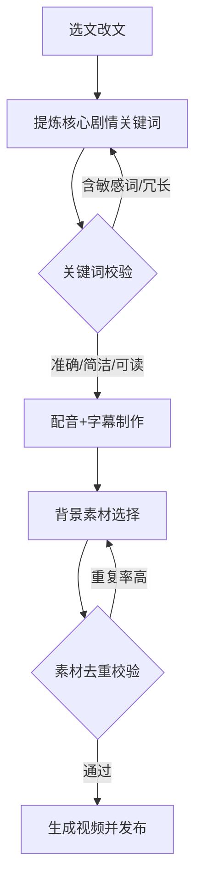

### 发布策略与日常维护

**发布策略**需要在"发布前预热"和"发布后引导"两个环节精细化操作：

> "发布每一条视频前的 5~15 分钟就该上线了，开始刷一刷同行视频，给视频点点赞，在同行评论区留言。播放量过 5k 就可以主动引导了，等有一条视频过 15w 播放量后就可以置顶引导了。"
>
> ——《P006》（ZcEdd0xTCo1K5IxwCyLccKUynOb，即《小说推文精细化运营实操指南》）[P006, p.6]

**日常维护**则包括日更养号与每日复盘。日更能让账号内容保持新鲜和丰富，既维护粉丝忠诚度、吸引潜在粉丝关注，也能不断提高账号权重。同时每天最好保证一个半到两个小时的活跃时间。**每日复盘**则通过内容分析（完播率、播放量、评论量）、粉丝分析（画像、匹配度）和策略分析（发布时间、话题标签、引导方式）三个维度，持续优化运营细节。

发布策略与日常维护的具体流程，可用以下时序图概括：

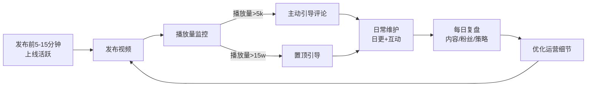

**边界条件**

精细化运营需要投入时间进行选文、改文、剪辑与互动，对个人玩家的日投入有较高要求（参考案例为 1.5 小时/天）。该方法更适合小说推文领域，其他内容赛道的适配度需另行评估。

## 11.7 多源对照：视频号新号起量与公转私防封的跨素材共识与分歧

视频号新号起量与公转私防封虽然分属不同素材（P003 与 P004），但在"平台新号扶持机制""选品方法论"与"风控优先原则"三个维度上形成共识与分歧。

### 共识

**第一，平台对"新号"存在流量扶持机制。** P003 通过实操验证了新号前 7 天发视频容易破万播放，并据此提出"在扶持期内集中发力、快速测试内容方向"的策略：

> "圈友诚不欺我也，新号果然是有流量扶持的，这个视频号还真可以搞。"
>
> ——《P003》（Lg2vd5GWHoqhBbxuT5LcThEpncb，即《视频号新号起量实操复盘》）[P003, p.1]

P004 虽然没有直接讨论新号扶持，但其"员工号作为矩阵号延伸可节约认证成本"的思路，本质上也是利用平台对新账号的宽松期来低成本扩张：

> "员工号可作为矩阵号的延伸，帮助企业节约认证成本，员工号跳转主页"
>
> ——《P004》（QbBKdHvfiofIUNxDlmjceWbfnqh，即《抖音公转私自动化玩法及防封策略》）[P004, p.1]

**第二，选品的本质是"定人群找需求"。** P003 提出"选品其实就是定人群然后找需求"，并建议优先选择垂直需求品（运动、保养）而非通用品：

> "选品其实就是定人群然后找需求，大家能理解这句话，就很好选品了。"
>
> ——《P003》（Lg2vd5GWHoqhBbxuT5LcThEpncb，即《视频号新号起量实操复盘》）[P003, p.1]

P002（资料号素材，来自《小红书资料号从零到一实操复盘》，IpCcdJ9NAoAt4pxKKV5c5sfenZc）虽然来自小红书资料号赛道，但其"选赛道要看用户画像与细分需求"的方法与 P003 高度一致——两者都强调：从目标人群的真实痛点出发，而不是从产品本身出发。

**第三，风控与防封的核心原则是先保命再赚钱。** P004 提出了"官方通道优先"的风险分级框架和"抖音端与微信端双线防封"原则：

> "所有的防封措施必须同时针对两端考量，否则一方出问题，都会导致转化路径断裂。"
>
> ——《P004》（QbBKdHvfiofIUNxDlmjceWbfnqh，即《抖音公转私自动化玩法及防封策略》）[P004, p.1]

P003 虽然来自视频号赛道，但其作者也明确提到"视频号封号与限流风险：因'无意义直播'封禁一天"，并据此调整直播节奏——两家都认同：账号安全是持续运营的前提，一切打法必须建立在可控风险之上。

### 分歧

**第一，对"新号流量扶持期时长"的认知有差异。** P003 提到"听说是新号有 7 天的流量扶持"，但其作者实操发现"现在我最开始 3 个号都过了七天，我倒是没觉得流量有差很多"：

> "我听说是新号有7天的流量扶持？现在我最开始3个号都过了七天，我倒是没觉得流量有差很多。"
>
> ——《P003》（Lg2vd5GWHoqhBbxuT5LcThEpncb，即《视频号新号起量实操复盘》）[P003, p.1]

即扶持期的实际时长可能因人而异；P004 并没有讨论具体时长，而是更强调账号类型（蓝V、半蓝、员工号）的权限差异。这说明"7天流量扶持"更像一个经验性结论，而非平台明文规则。*关于扶持期时长的精确界定，目前仅依赖单一作者的实操观察，缺乏平台官方规则文档或更多实操复现数据的交叉验证*`[需要补充文献：方向为平台官方规则文档或更多实操复现数据]`。

**第二，对"加字引导"在内容生产中的权重判断不同。** P003 作者明确主张"有时候出单可能不是因为视频，而是你加的字抓住了用户"，将"加字引导"视为搬运视频出单的关键：

> "有时候出单可能不是因为视频，而是你加的字抓住了用户。"
>
> ——《P003》（Lg2vd5GWHoqhBbxuT5LcThEpncb，即《视频号新号起量实操复盘》）[P003, p.1]

P006（小说推文素材）虽然也强调"关键词说白话"和"评论区造互动"，但其核心是选文和改文，而非简单加字——这反映了两者在"泛带货视频"与"小说推文"两种不同内容形态下对转化环节的判断差异。

**第三，在"起号策略"上存在激进与稳健的分歧。** P003 作者提出"新号七天内可作死大量发视频冲量的激进玩法假设"——用几十上百条视频堆出数百万播放，扶持期结束就换号：

> "在7天扶持期内作死的发视频，一个视频几千一万的，几十个视频就是几十万，几百个就是几百万，然后7天时间过了就换号。"
>
> ——《P003》（Lg2vd5GWHoqhBbxuT5LcThEpncb，即《视频号新号起量实操复盘》）[P003, p.1]

而 P004 的"官方通道优先 + 双线防封"策略则更强调长期主义和稳定运营。前者追求在窗口期内最大化流量，后者追求在合规框架内持续转化——两者的取舍反映了"短期红利 vs 长期安全"的不同偏好。

## 11.8 设计中的取舍

**问：为什么对标要优先用官方平台而非第三方工具？**

很多从业者习惯用抖查查、蝉妈妈等第三方工具，因为它们"看起来数据更全"。但官方平台（巨量百应创意中心）的价值在于**实时性和准确性**——你看到的数据是抖音官方直接提供的，不存在估算偏差。第三方工具的数据不仅要经过抓取和估算，还存在延迟，等你发现某个爆款模式时，竞争可能已经白热化。这个取舍的本质是：**用官方的"小数据"换取更快的决策速度**。代价是官方平台的筛选维度可能不如第三方灵活，但"实时"本身已经是最重要的维度。

为了更直观地展示这个取舍逻辑，我们用一张决策流程图来呈现：

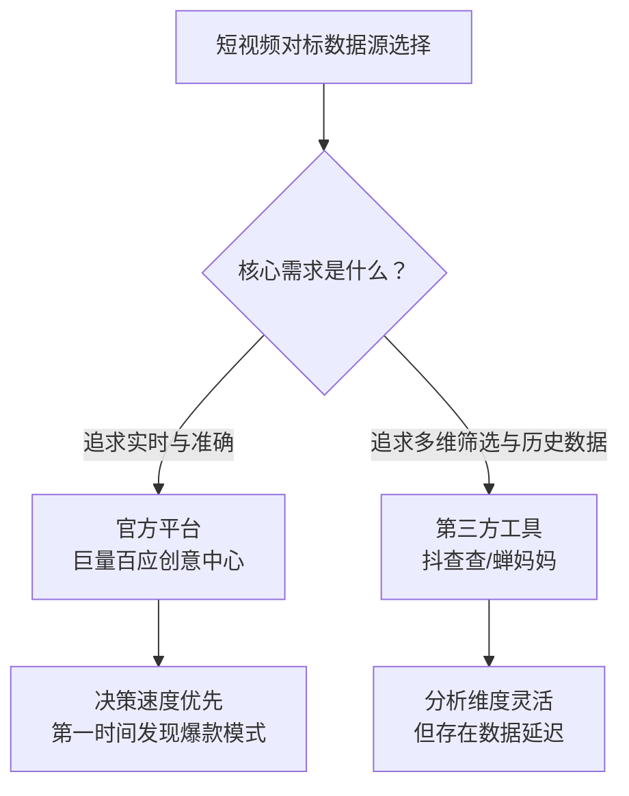

**问：为什么"黑马小达人"比"大达人"更适合作为学习对象？**

大达人拥有粉丝基础加成——他们有百万粉丝，随便发一条视频都有基础播放量和互动量，其销量天然偏高。问题在于：你无法区分他们的成功有多少来自内容本身、多少来自粉丝存量。而黑马小达人（低粉高销）没有这个干扰变量——他们的高销量几乎必然归因于内容策略和选品策略。这个取舍的本质是：**用"小样本"换取"高可迁移性"**。代价是你学到的打法可能更适合起步阶段，当账号成长到一定规模后，大达人的运营逻辑仍需要借鉴。

**问：为什么"必做钩子"优先于"做好内容"？**

在资料号的商业逻辑中，钩子（给他看一半）的直接效果是提升评论转化率——同内容笔记仅因钩子设计差异，转化率可相差 5 倍以上。而做好内容（点赞收藏）更多是满足虚荣指标。这个取舍的本质是：**用"展示欲望"换取"商业转化"**。但必须注意，钩子设计不能陷入虚假宣传——你展示的"冰山一角"必须是真实且高质量的，否则即使引来评论，也难以建立信任。

**问：连爆技术 vs 盲目原创，效率差在哪里？**

连爆技术的底层逻辑是"火过的内容大概率还会火"——直接复制别人爆款、测试出自己的爆款后持续复抄。它的效率优势在于：**每次创作都站在已验证的框架上，成功率天然高于从零开始的盲目原创**。代价是内容同质化风险——当大量玩家都在"连爆"时，平台可能加大打击力度，原创能力反而成为护城河。因此，连爆技术更适合作为起步期和测试期的手段，而非长期依赖。

**问：三厨狂喜中"自己喜欢"与"用户喜欢"冲突时，如何动态调整？**

三厨狂喜的理想状态是三个条件的完美交集，但在实际运营中，"自己喜欢"和"用户喜欢"经常出现冲突——你热爱的内容用户不买单，用户追捧的内容你却提不起劲。这个取舍的本质是：**以"用户喜欢"为底线，以"自己喜欢"为内驱力，动态寻找交集**。你可以用"28 开"的策略——8 篇内容顺应市场和用户需求，2 篇内容保留自己的热爱和探索。这样既保证了内容的商业有效性，又保留了自己的创作热情。完全牺牲自己的热爱，很难长期坚持；完全无视用户需求，则无法形成商业闭环。

**问：在起号策略上，激进冲量 vs 稳健运营如何取舍？**

P003 提出了"7 天内作死发视频冲量、扶持期结束就换号"的激进玩法，而 P004 则强调"官方通道优先 + 双线防封"的稳健策略。这个取舍的本质是：**用"账号消耗"换取"窗口期流量最大化"，还是用"合规运营"换取"长期稳定产出"**。激进玩法适合资金有限、急需验证赛道的新手，或者在内容极度同质化、爆款窗口极短的环境中使用；稳健玩法更适合已有一定基础、追求长期复利效应的玩家。风控上需要把握的边界在于：激进的"换号"策略需与平台规则兼容，避免因批量操作触发更严厉的处罚。

## 11.9 动手练习

1.  **对标对象筛选实战：为你的赛道挑选黑马小达人**

    假设你运营一个小红书英语学习资料号，现有一批候选对标账号，下表列出了各候选账号的核心数据：

    | 账号 | 粉丝数 | 单条带货GMV | 视频总数 | 内容垂直度 |
    |------|--------|------------|---------|-----------|
    | A | 12.5W | 8W | 300 | 英语干货+带货混发 |
    | B | 800 | 3.2W | 45 | 专注小学英语语法 |
    | C | 3.2W | 2.1W | 500 | 英语+职场技能混发 |
    | D | 1500 | 1.8W | 120 | 初中英语阅读理解 |

    基于'黑马小达人样本策略'，选出最适合你学习的对标账号并说明理由。随后，结合'选文垂直化'和'对标账号筛选标准'，补充你认为还需要考察的其他维度，并为所选账号设计一个脚本拆解清单（应包含哪些分析维度）。

2.  **钩子与评论区引爆的转化率对比实验**

    现有两篇内容完全相同的资料号笔记，数据如下：

    - 笔记A：点赞1980，评论35
    - 笔记B：点赞500，评论230

    请分析两篇笔记转化率差异可能的原因（结合'钩子'概念）。假设你重新发布笔记B的变体，请设计钩子展示方案（展示哪些内容、如何布局）和评论区引爆的具体操作步骤（包括小号话术设计和节奏安排）。然后设计一个A/B测试方案，验证不同钩子设计对评论转化率的影响。最后思考：如果笔记B的评论区互动持续火爆但私域导流依然很低，可能是什么环节出了问题？

3.  **蓝海赛道发现实操：用四步法完成赛道评估**

    以'小学教育'为大方向，使用四步法完成一次蓝海赛道调研。第一步，搜索下拉词调研：在小红书搜索'小学语文''小学英语'，记录下拉推荐词的差异。第二步，头部竞争分析：搜索各细分关键词，找出各赛道头部账号及其粉丝量级，判断是否存在垄断。第三步，供需对比：分别搜索几个细分关键词，对比24小时内'最新'与'最热'笔记的数量差异。第四步，交叉验证：结合上述数据，回答以下问题：哪些细分赛道属于'大赛道红海、细分蓝海'？你用'三厨狂喜'标准评估，哪个赛道最适合自己切入？这个蓝海的窗口期可能有多长？如何快速切入抢占先机？

4.  **心动文案改造：从'自嗨表达'到'心动公式'**

    给你三句'自嗨式'的表达，请用'用户心动公式'改造成高转化文案：

    原文案一：'这份语法笔记非常全面，涵盖了所有重要知识点'；原文案二：'我整理的阅读理解技巧能帮大家提高正确率'；原文案三：'这是一份精心制作的英语学习资料合集'。

    要求每一句改造后的文案必须包含公式三要素（自己少费力+帮助+及时享受），并补充可使用'二极管标题法'（正面刺激或负面刺激）制作的两个备选标题。同时为其中一份资料设计一个'给他看一半'的钩子方案（包括封面截图内容、评论区引导语），并反思：在你改造后的文案中，哪些部分容易滑向虚假宣传？如何守住信任底线？

5.  **小说推文选文垂直化实操：从'大海捞针'到'精准垂钓'**

    假设你准备在抖音开设一个小说推文账号，定位为'都市情感类'。请列出你在知乎上筛选'优质作者'时关注的具体维度（至少3个），并说明理由。当你选定一位作者的某篇爆文后，请写出利用'专栏垂直'原则扩充同类型文章的具体操作步骤。针对一篇'中开高走'（开头平淡、后期精彩）的文章，请设计一个'核心剧情前置'的改编方案：你会提炼哪些关键词？（请给出3个候选关键词）；你会如何改写开头两句话以提升5s完播率？最后，为你的账号拟定一个3天的'日更养号'计划（包括发布时间、话题标签、评论区互动安排）。

6.  **视频号新号流量扶持期的破万实操计划**

    假设你有一个全新的视频号，准备利用7天的流量扶持期快速起量。请先制定一份7天的内容发布计划表（包括发布频率、内容类型、每日互动安排）。然后，用'选品即定人群找需求'原则，为中老年下沉用户人群筛选3个垂直需求品（非通用品），并说明选择理由。对其中1个选品，请设计'加字引导出单'的文案（人设化、场景化，1-2句话即可）。最后，说明大爆款第5天流量衰减后，你如何安排直播时长与外部合作来延长变现窗口？

## 11.10 本章小结

这一章中我们系统学习了短视频对标与引流转化的完整方法论。首先，我们建立了"官方数据驱动对标"的作战思维——用巨量百应创意中心的实时爆款视频库替代第三方工具，以黑马小达人（低粉高销）为学习对象，通过脚本模板复用降低盲目原创的不确定性。其次，我们掌握了赛道选择的底层逻辑——透过蓝海与红海的相对性与动态性判断供需关系，用"三厨狂喜"原则平衡自身热爱、用户需求与平台偏好。接着，我们拆解了引流转化的核心机制——用户心动公式触发用户的"心动感觉"，"给他看一半"的钩子设计利用信息差刺激用户索取，并警惕虚荣指标（点赞收藏）对商业判断的干扰。然后，我们讲解了连爆技术与评论区引爆方法——基于"爆款都是重复的"原理实现持续产出，用羊群效应让冷启动热起来。最后，我们深入了小说推文的精细化运营全流程——从选文垂直化（作者垂直+专栏垂直）、核心剧情前置、关键词说白话到背景素材去重，并拓展到视频号新号的流量扶持机制与"加字引导"出单逻辑。

本章我们一起学习了以下概念：

| 概念 | 解释 |
|------|------|
| 对标方法论 | 以官方平台实时爆款视频库为依据，用数据驱动替代盲目原创，降低内容生产的不确定性 |
| 黑马小达人样本 | 优先学习'低粉高销'账号，其成功更可能归因于内容策略而非粉丝存量，对普通人更具参考价值 |
| 脚本模板复用 | 将已验证的爆款脚本替换文案与产品进行再创作，成功率高于盲目原创，是内容生产工业化的基础 |
| 蓝海与红海 | 竞争程度的相对性与动态性判断，本质是供不应求还是供大于求；选对赛道比努力更重要 |
| 三厨狂喜 | 内容定位的黄金原则：同时满足自己喜欢（内驱力）、用户喜欢（需求）、平台喜欢（算法）三重条件 |
| 用户心动公式 | 购买欲=自己少费力+神器/方法/秘籍+马上实现愿望；核心是让用户产生'心动'的感觉进而行动 |
| 钩子（给他看一半） | 只展示部分资料制造悬念，用剩余部分诱惑用户评论索取，是资料号引流转化的灵魂 |
| 虚荣指标 | 点赞收藏仅反映观赏价值，评论互动与私域导流才反映商业价值；聚焦关键指标避免认知偏差 |
| 连爆技术 | 基于'爆款都是重复的'原理，先复制他人爆款，测试出自有爆款后持续复抄，直到流量衰减 |
| 羊群效应引爆评论区 | 通过小号带头评论激发从众心理，用几个领头评论带动大量真实互动，撬动平台推荐流量 |
| 小说推文精细化运营 | 从选文垂直化（作者垂直+专栏垂直）、核心剧情前置、关键词说白话到背景素材去重，系统化提升推文爆款率与完播率 |
| 视频号新号流量扶持 | 平台给予新号初期（约7天）的流量倾斜，发视频容易破万播放，是快速起量的关键窗口期 |
| 加字引导出单 | 在搬运视频上针对产品特色附加醒目标语性文字，用人设化、场景化文案抓住目标用户心理，被认为是出单关键而非视频本身 |

下一章中，我们将进入"流量获取与私域运营"的完整链路——从公域引流的三大技术（流量切片、流速控制、流量合并）到私域精细化运营的单客价思维、五位一体成交飞轮，帮助你打通"流量→信任→成交→复购"的完整商业闭环。

