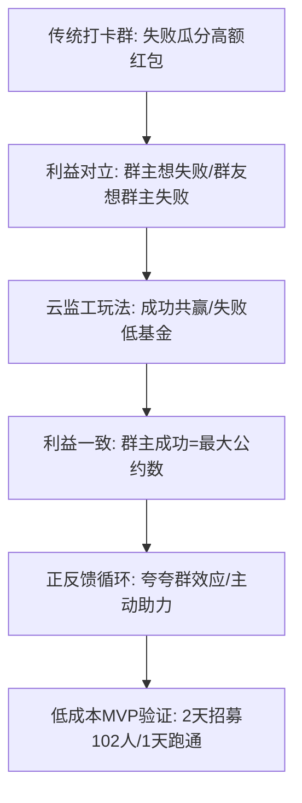
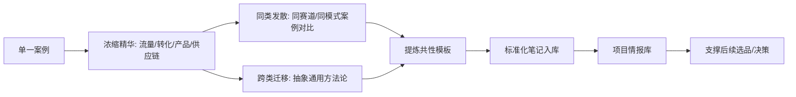
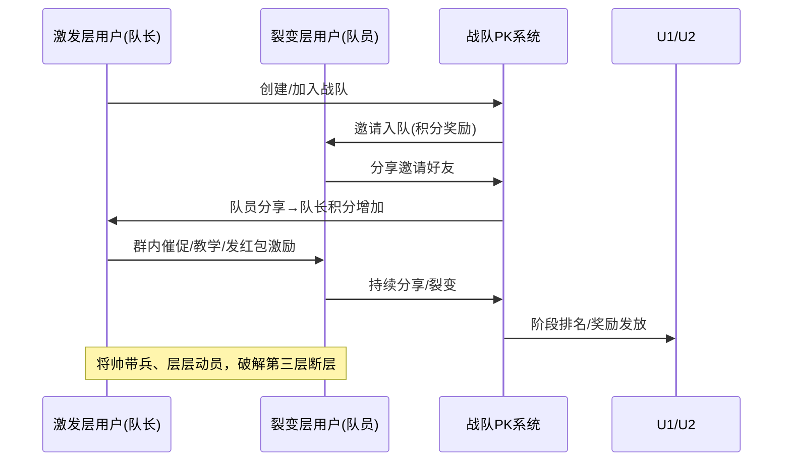
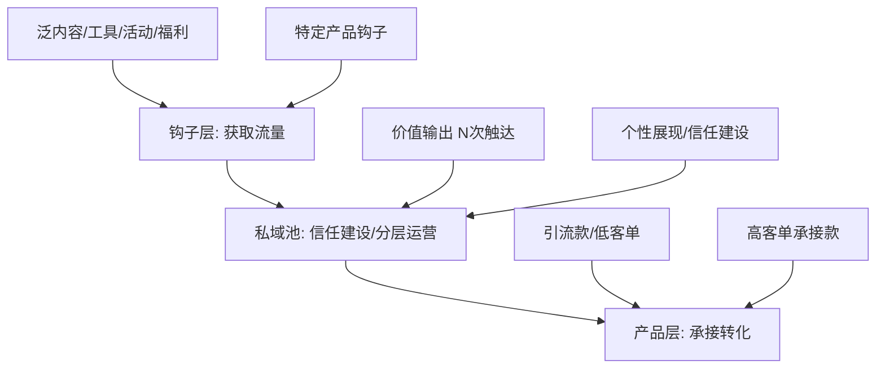

# 第 18 章 副业冷启动与私域增长体系

## 学习目标

- 理解云监工玩法的底层逻辑：利用外部监督与利益一致性规则设计，低成本快速验证MVP
- 掌握私域流量冷启动的三大路径：公域内容引流、社群群红、抱大腿借势营销
- 理解私域运营核心指标从“客户数”向“单客价/复购率/信任度”的认知跃迁
- 掌握裂变营销的两种基本模型（团队裂变/用户裂变）及战队PK叠加玩法破解断层机制
- 掌握“打广告=放大+筛选”的认知重构，及成交前“有间隔的重复次数”信任积累规律
- 掌握四步排查法诊断广告不出单原因，建立标准化复盘SOP
- 理解地毯式阅读法打破信息茧房、举一反三项目拆解法提炼可迁移方法论的操作要点
- 掌握痛点发现法、跑MVP再录课、陪跑验证法等低成本创业验证策略
- 理解差异化个人品牌标签（领域A最懂领域B）构建方法及群红策略的有限竞争优势
- 掌握知识营销/内容化引流、钩子理论、产品结构设计（高客单承接）等转化体系设计

## 18.1 生活类比

想象私域冷启动是一场**“在鱼塘钓鱼”而非“在养牛场钓鱼”**的精准狩猎：**精准用户画像** = 你要钓的**目标鱼种**（鲈鱼/草鱼），而非随缘积累的**牛羊长颈鹿**；**钩子理论** = **鱼饵**不一定是鱼钩本身（产品），蚯蚓/玉米（泛内容/免费工具/测评表）才是高效饵料；**公域内容引流** = 在**不同水域**（知乎/小红书/垂类网站）撒同一网（一鱼多吃），边际成本趋近零；**社群群红** = 在**私家鱼塘**（垂直社群）做**塘主认可的常客**，有限竞争、信任极高、易成交；**抱大腿** = 不是花钱买鱼，而是练就**绝世渔技**（核心能力），让渔业大佬主动邀你合伙开渔场。想象裂变放大是一场**“战队PK运动会”**：**传统裂变** = 只有**啦啦队（激发层）** 在喊口号，**运动员（裂变层）** 早早回宿舍了（第三层断层）；**战队PK** = 分组对抗、**队长（将）带队员（兵）**、**积分排名/阶段奖励/集体荣誉**，全员持续冲刺；**团队裂变** = **金字塔传销式**（树状/躺赚），**用户裂变** = **朋友圈接力赛**（网状/圈层），**叠加** = **军运会+全民健身**结合。想象打广告与成交是**“相亲”而非“推销”**：**打广告** = **发朋友圈官宣单身/晒生活照**（放大吸引力+筛选非诚勿扰）；**前置价值输出** = 相亲前**刷题练内功/整理衣橱/积攒谈资**（有间隔的重复次数建立信任）；**四步排查法** = 相亲失败后：**查是不是去错场子（用户不精准）**、**查自我介绍没讲清（文案）**、**查前几次约会没投入（铺垫）**、**悟缘分未到需继续修行（曲折）**。想象方法论内化是**“练就庖丁解牛刀”**：**地毯式阅读** = **不挑肥瘦全拆一遍牛**，打破挑食（信息茧房），摸清全牛纹理（认知全景图）；**举一反三拆解** = 解完**这头牛**，推导出**解猪/解羊/解鱼**的通用刀法（同类/跨类迁移）；**痛点发现** = 只有**屠夫/老饕**知**牛哪块最嫩/哪块有筋**（行业内幕痛点），外行只见牛肉不见门道；**跑MVP** = **先切一片尝尝（轻量化咨询/快闪群）**，好吃再宰整头牛（录大课/组团队)，不砸锅卖铁。

## 18.2 概念地图

副业冷启动与私域增长体系
├── 核心认知重构
│   ├── 私域本质：长远忠诚的客户关系（非好友数量） —— P006
│   ├── 打广告本质：放大与筛选（非骚扰） —— P014
│   ├── 成交公式：价值输出/信任建设(N次触达) + 广告(临门一脚) —— P015
│   └── 销售额三要素：客户数 × 客单价 × 购买频次(复购比拉新重要) —— P006
├── 冷启动三大路径 (0-1)
│   ├── 公域内容引流：一鱼多吃/多平台分发/SEO长尾 —— P012
│   ├── 社群群红策略：有限竞争/细分关键词/持续输出/快速反馈 —— P008
│   └── 抱大腿借势：创造可交换价值/练好本领/双向奔赴 —— P009
├── 放大杠杆：裂变营销 (1-N)
│   ├── 团队裂变：树状/躺赚逻辑/微商经销商模式 —— P010
│   ├── 用户裂变：网状/圈层效应/口碑+活动裂变 —— P010
│   └── 战队PK叠加玩法：破解第三层断层/将帅带兵/动销系统 —— P010
├── 个人品牌与信任建设
│   ├── 差异化身份标签：领域A最懂领域B/几何级增长/专家切入口 —— P007
│   ├── 知识营销/内容化：被动引流/信任前置/长尾资产/精准筛选 —— P017
│   ├── 有间隔的重复次数：非线性触达/可设计节奏/分层运营 —— P015
│   ├── 钩子理论：钩子≠产品/泛内容大基数/逻辑关联性/成本可控 —— P018
│   └── 产品结构设计：引流款+高客单承接款/拉高品牌力/不砍复购机会 —— P010
├── 低成本验证与方法论内化
│   ├── 云监工玩法：快闪群/外部监督/利益一致规则/低成本MVP验证 —— P001
│   ├── 利益一致性规则设计：成功共赢/低失败基金筛选/可持续/可复制 —— P002
│   ├── 地毯式阅读法：全覆盖/打破茧房/认知重构/产出倒逼输入 —— P013
│   ├── 举一反三项目拆解法：浓缩精华/同类发散/跨类迁移/素材库建设 —— P003
│   ├── 痛点发现法：行业内幕/3个核心痛点/盟友规模化/标准化交付潜力 —— P004
│   ├── 跑MVP后再录课：轻量化前置/现金流为王/内容资产复用/用户共创 —— P005
│   └── 陪跑验证法/低成本跑流程：微信点单起步/组队前先跑通 —— P005
├── 精细化运营与高客单转化
│   ├── 私域好友质量论：800铁粉>3万泛粉/信任可迁移/抗风险/28法则放大 —— P006
│   ├── 增长饭局：小规模/高频/纯利他/深度诊断/信任跃迁/客单价跃升 —— P011
│   └── 四步排查法：查用户(鱼塘)/查文案/查铺垫/悟曲折/归因外化/动作导向 —— P016
└── 风险边界与适用条件
    ├── 版权/合规/平台风控红线 —— P001, P012, P018
    ├── 非标服务/高客单/长周期适用性限制 —— P011, P015
    ├── 规模化受限于创始人精力/需SOP化 —— P006, P005
    └── 跨类迁移需二次适配/警惕生搬硬套 —— P003

## 18.3 云监工玩法 —— 让陌生人监督你的成长

### 为什么需要这个概念？

独自完成高难度任务（如密集阅读+写作）极易拖延、放弃，缺乏外部约束机制。传统付费打卡群规则常把群主和群友利益对立（失败瓜分红包），导致群主无正反馈、难以持续。普通人需要低成本、可快速测试、运营门槛低的项目验证方式（MVP）。

### 核心定义

群主发起短期挑战（如3天读50篇写5000字），招募“云监工”在群内监督进度。规则设计：挑战成功→监工获得心得+优惠+盲盒；挑战失败→监工瓜分低额失败基金（筛选掉纯奔红包者）。双方利益绑定：群主成功，监工获益更多；群主失败，监工小额兜底，形成利益一致的健康博弈。

> "希望我复盘的这个云监工快闪群玩法，能：帮助更多圈友高效地跑MVP；让群变得更好玩，云监工还可以成为社群角色、监督促进复盘文化等；让云监工们感知、陪伴到群主的成长；让云监工们加强对群主了解、记忆。"
>
> ——《ELHqdhiI5oSQAxxItLJctNAhnah.md》

> "在我花2天多时间，招募102位云监工并完成挑战后，这验证了我此前的想法：云监工玩法特别适合普通人，它简单好操作+可低成本快速进行测试，它的运营模式对群主的要求并没有陪伴群那么高。"
>
> ——《ELHqdhiI5oSQAxxItLJctNAhnah.md》

### 关键性质

- **低成本快速测试**：2天招募102人，1天即可跑通流程，验证想法极快
- **运营门槛低**：无需长期陪伴、无需复杂课程体系，适合个人单兵作战
- **正反馈循环**：监工的夸奖、陪伴、汇总形成“夸夸群”效应，强化群主执行力

### 典型例子

丽丽元旦3天挑战：招募102位云监工，地毯式阅读《生财有术项目精选》50篇，输出5000字心得，意外收获大量正向鼓励与社群连接。

### 边界条件

适合短周期、可量化、有明确交付物的挑战（阅读、写作、打卡），不适合长周期、模糊目标的项目。失败基金必须设低，否则吸引投机者破坏群氛围；奖励需含“独家内容/权益”而非纯现金。群主需有基础内容产出能力，否则无法产出监工想要的心得/复盘作为核心奖励。

### 方法演进图

## 18.4 利益一致性规则设计 —— 让群主与群友站在同一边

### 为什么需要这个概念？

绝大多数挑战群、打卡群采用“失败瓜分高额红包”规则，导致群主想失败（省事）、群友想群主失败（分钱），利益根本对立。纯“完成打卡全额退费”模式下，群主若变现能力弱或策略无效，便与参与者利益对立，群主无正反馈难以持续运营。只有双方利益一致，社群才能健康、可持续发展。

### 核心定义

> "以前我见过一些目标挑战群，规则一般只是挑战失败后瓜分1000元或XXXX元。这是不太健康的，这会把群主、群友的利益对立起来。所以我的规则中设置的是如果我挑战成功了，大家能获得更多。另外规则中挑战失败瓜分的金额设置得很低，这能筛选掉只是被红包吸引的人。"
>
> ——《ELHqdhiI5oSQAxxItLJctNAhnah.md》

> "如果新人运营百日XX活动，建议采取收费+收押金模式。如果只用完成打卡全额退费，当群主再次变现能力弱、群主没法通过活动赚到有正反馈的钱时、当群主的策略没法帮助大部分群友们完成打卡时，在一定程度相当于把群主、参与者的利益对立，这不是一种健康的状态，不利于可持续发展。万事万物皆可通过付费群变现。不论是付费10万还是付费1元的群，健康的、可持续发展模式是群能给用户带来价值。"
>
> ——《ELHqdhiI5oSQAxxItLJctNAhnah.md》

### 关键性质

- **筛选机制**：低失败基金天然过滤“羊毛党”，留下真想见证成长、获取干货的监工
- **正向激励**：群主成功是最大公约数，监工主动助力（催进度、算时间、汇总内容、情绪加油）
- **可复制性**：规则模板化后，可应用于读书群、减肥群、写作群、技能训练群等一切目标导向型社群

### 典型例子

丽丽云监工群：成功送5000字心得+7折购买权+盲盒，失败瓜分200元；结果群内氛围极佳，监工主动汇总内容、计算耗时、送祝福。百日写作群：收费+押金，完成退押金+发证书，未完成押金归群主（用于发奖品/运营），群主靠服务盈利，而非靠群友失败盈利。

### 边界条件

群主必须有真实交付能力（能产出心得、提供课程、兑现优惠），否则成功后无法兑现承诺，信任崩塌。适用于“目标明确、周期短、可验证”的挑战；长周期、模糊目标需拆解为阶段性小目标配套规则。群规模不宜过大（百人内最佳），否则群主无法精细化运营，监工感知度下降，仪式感消失。

## 18.5 举一反三项目拆解法 —— 从一个案例长出一片森林

### 为什么需要这个概念？

读大量项目案例容易“看过即忘”，缺乏结构化吸收与迁移应用的方法。新手往往只盯着项目本身能不能抄，忽略了底层逻辑在同类/跨类项目中的复用价值。需要一套标准化的阅读笔记模板，将碎片案例转化为可迁移的方法论资产。

### 核心定义

读完一个具体项目后，按三步走：①浓缩精华（快速获取有效信息、节省时间）②同类发散（联想同赛道其他项目，借鉴经验）③跨类迁移（抽象出通用方法论，应用到完全不同的领域）。同时练习“拆解思路”：流量从哪来？转化怎么做？产品是什么？供应链如何？复制关键点在哪？

> "举一反三是做项目要练习的基本功。看完教育人做水果团购后，我首先想到我在生财知识星球发过的这篇文章《才391个小红书粉丝，但引流私域432人成交308单的复盘》，两者在一些方面逻辑是一致的，之后这类项目都可以借鉴经验；我的另外一个想法是这种拆解项目的思路，也很值得练习。它一方面是浓缩的精华，能帮助我们快速获取有效信息、节省时间（真是绝绝子），另一方面又帮我们以这个项目为点发散到同类项目、跨类项目。"
>
> ——《ELHqdhiI5oSQAxxItLJctNAhnah.md》

> "蓝海选品思维不仅仅只能用于带货，也能用于生产更受欢迎的视频、音频、文章或图片。挖掘蓝海离不开对异常值的敏感度。蓝海选品思维不一定只有做电商才能用，我们成长的过程是看到用到—方法论化—复盘分享。"
>
> ——《ELHqdhiI5oSQAxxItLJctNAhnah.md》

### 关键性质

- **复利效应**：一个案例拆透，等于学会一类生意的底层逻辑，后续看新项目速度指数级提升
- **思维训练**：强迫自己从“现象层”穿透到“本质层”，练就商业嗅觉与结构化思考能力
- **素材库建设**：拆解产出的标准化笔记，可沉淀为个人/团队的“项目情报库”，支撑后续选品决策

### 典型例子

从“教育人做水果团购”案例，联想到“小红书391粉引流432人成交308单”案例，提炼出“私域高客单+精细化运营”同类逻辑。从“母婴团购800铁粉年入120万”提炼“铁粉精细化运营+复利”跨类方法论，可用于知识付费、实体店、SaaS等所有高复购业务。从“拼多多卖资料”提炼“自动发货+选品敏感度”；从“除甲醛”提炼“解决显性痛点+消除隐性认知偏差”。

### 边界条件

仅拆解不实操=假勤奋，必须结合自身资源/赛道进行“同类复制”或“跨类迁移”尝试。跨类迁移需警惕“生搬硬套”：不同平台规则、用户心智、供应链模式差异大，需二次适配。初学者建议先拆“已验证、有数据、可复盘”的成熟案例，避免拆解伪案例、吹牛案例养成错误直觉。

### 数据流图

## 18.6 痛点发现法 —— 把行业内幕变成商机清单

### 为什么需要这个概念？

外行看热闹，内行看门道：只有深度从业者才知道行业真实痛点、未被满足的需求、被忽视的细分需求。盲目跟风选品/选赛道极易陷入红海厮杀；从自身熟悉行业的痛点切入，天然具备认知壁垒和执行优势。痛点即需求，需求即产品，产品即流量入口，形成“痛点→产品→流量→变现”天然闭环。

### 核心定义

列出你所在垂直行业从业者的3个核心痛点（最痛苦、最频繁、最愿付费解决的）。针对每个痛点设计解决方案（产品/服务/工具/内容/社群），并寻找盟友（同行/上下游/技术伙伴）规模化交付。验证路径：先用最低成本（微信群、文档、人工服务）跑通MVP，再考虑开发系统、招团队、投广告。

> "某类人的痛点，就是创造价值的机会。你是业内人，你是很懂你行业痛点的人。你所在垂直行业从业者的3个痛点是什么？写下来，去想办法满足需求并且团结盟友规模化解决痛点后，赚钱是自然而然的事。"
>
> ——《ELHqdhiI5oSQAxxItLJctNAhnah.md》

> "除甲醛不仅仅是除甲醛，还要除掉客户心中误认为是甲醛的异味。"
>
> ——《ELHqdhiI5oSQAxxItLJctNAhnah.md》

> "如果大学生要做校园业务，在组团队前，先自己用最简单的方式跑流程，从最基础的微信点单、微信群接单开始，低成本低风险。这条经验来自一个多年前，在大学组队做过水果送货上门失败的学姐。"
>
> ——《ELHqdhiI5oSQAxxItLJctNAhnah.md》

### 关键性质

- **门槛即护城河**：外人不知痛点细节、不知解法可行性、不知渠道获客成本，难以轻易复制
- **复购率天然高**：解决真痛点的产品，用户粘性强、推荐意愿高、抗价格敏感
- **易结盟**：同行有同痛，易达成“联合采购/联合开发/联合推广”合作，降低单方风险

### 典型例子

除甲醛行业：痛点不只是“除甲醛”，更是“除掉客户心中误认为是甲醛的异味”→衍生出“除味+心理安抚”双重服务产品。校园水果配送：痛点是“宿舍没水果吃、外卖贵、水果店远”→微信群接单+统一采购+宿舍楼下分发，跑通MVP后再做小程序。知识付费从业者：痛点是“不会选题、不会写大纲、不会推广”→衍生出“选题库+SOP模板+分销联盟”工具箱产品。

### 边界条件

必须是你真正熟悉、长期浸润的行业（≥1年实操经验），否则挖出的“痛点”多为伪需求。痛点解决方案需具备“标准化交付潜力”，纯靠人工定制服务难以规模化，上限低。盟友选择需警惕：利益分配不明、执行力不均、核心资源掌握在单方手中，易导致合作破裂。

## 18.7 跑MVP后再录课 —— 知识付费的“先卖后造”生存法则

### 为什么需要这个概念？

知识付费红利期过，录课卖课极度内卷：制作成本高（几万-几十万）、周期长（1-3个月）、售前无验证、上线即生死。新人无粉丝、无案例、无渠道，直接录大课九成扑街，沉没成本极高。需要一种“低成本试错、快速正反馈、可累积资产”的新人生存策略。

### 核心定义

MVP形态：单次付费咨询（1对1诊断）、付费专栏（图文/音频连载）、快闪社群（如云监工群）、付费小册、线下工作坊。核心逻辑：先用轻量化产品跑通“获客→转化→交付→好评→裂变”完整闭环，积累种子用户、真实案例、现金流、内容素材。只有当：①有稳定粉丝增量 ②有可观流量合作渠道 ③有成熟交付SOP ④有高复购/高推荐 数据验证后，再投入录制系统性大课。

> "随着知识付费的发展，录课卖课越来越内卷。建议普通人在投入高成本录制课程前，先用轻量化的单次付费咨询、付费专栏、快闪社群等跑MVP，积累一定粉丝或者有可观流量合作渠道后，再去录课卖课。"
>
> ——《ELHqdhiI5oSQAxxItLJctNAhnah.md》

> "如果新人运营百日XX活动，建议采取收费+收押金模式。如果只用完成打卡全额退费，当群主再次变现能力弱……在一定程度相当于把群主、参与者的利益对立，这不是一种健康的状态，不利于可持续发展。"
>
> ——《ELHqdhiI5oSQAxxItLJctNAhnah.md》

### 关键性质

- **现金流为王**：轻量化产品周期短（天/周级）、回款快、资金压力小，维持新人生存
- **内容资产复用**：咨询记录→专栏文章→小册章节→大课模块，素材沉淀分层，零浪费
- **用户共创**：早期用户深度参与产品打磨，天然成为种子用户、传播者、甚至合伙人

### 典型例子

丽丽：先做付费咨询/快闪群/专栏→积累案例与粉丝→验证“云监工/项目拆解”需求→再考虑系统化课程。泳怡：先做母婴团购私域运营→沉淀“铁粉运营SOP”→再输出“私域运营陪跑/课程”收徒变现。

### 边界条件

适用于“标准化程度可控、交付依赖个人经验/方法论”的知识服务类项目；硬核技能培训（编程、设计、语言）仍需系统化课程体系。轻量化产品定价需覆盖边际成本+时间成本，切忌“免费/低价引流”陷入服务泥潭。必须建立“用户反馈收集-产品迭代”机制，否则轻量化产品易变成“一次性卖切片”，无法进化为核心产品。

## 18.8 私域好友质量论 —— 800个铁粉胜过3万个泛粉

### 为什么需要这个概念？

传统微商/私域教程过度强调“加人数量”、“裂变涨粉”，导致大量从业者陷入“动物园”陷阱：好友全是牛羊长颈鹿，没有一只目标鱼。公域流量越来越贵，私域存量运营成为核心；但私域若无信任、无粘性、无高频互动，只是“死粉仓库”，转化率趋近于零。需要重新定义私域核心指标：从“粉丝数”转向“单客价（LTV）”“复购率”“推荐系数”。

### 核心定义

私域本质：长远而忠诚的客户关系（彼此了解、互为朋友、甚至互为客户）。好友质量 > 好友数量：有信任度、有粘性的少量好友，成交效率远超大量泛泛之交。核心公式：销售额 = 客户数 × 客单价 × 购买频次；其中购买频次（复购）与客户数同等重要，且边际成本更低。

> "私域的本质，是长远而忠诚的客户关系！什么样的关系才能长远而忠诚？不是只有用户了解你，而是我们彼此了解！把用户当朋友，关系才能更紧密！相互彼此互为客户，更能长久"
>
> ——《VAA8dQLTZolMlJx1jxrcKaPrnzd.md》

> "计算销售额有条公式：销售额=客户数×客单价×购买频次。以往的我们，都太过关注客户数这个指标了，而大大忽略了客单价和购买频次，根据销售额公式可以看到，购买频次和客户数、客单价一样重要！企业营收也有28原则，20%的客户给你带来80%的利润，复购比拉新更重要！"
>
> ——《VAA8dQLTZolMlJx1jxrcKaPrnzd.md》

> "这也是我今年来最大的转变之一，有信任度、有粘性的好友，远胜过泛泛之交。两组数据：我公司4万好友转化20人，我个人3万好友转化80人（成交4倍）；朋友800好友月成交超20万，另一朋友3万好友月成交仅5万（好友数差40倍，成交额反超4倍）"
>
> ——《VAA8dQLTZolMlJx1jxrcKaPrnzd.md》

> "一年卖货120W需要运营多少位用户？泳怡的答案是800位。项目逻辑是先广撒网，从各种精准的宝妈流量池积累40位种子用户，在精细化运营前期用户获取信任后，筛选其中的铁粉进行转介绍、转卖，最终实现总购买次数16000+次。"
>
> ——《ELHqdhiI5oSQAxxItLJctNAhnah.md》

### 关键性质

- **28法则放大**：20%铁粉贡献80%利润，深耕铁粉ROI远超广撒网拉新
- **信任可迁移**：铁粉推荐带来的新用户，自带信任背书，转化率极高（转介绍/转卖）
- **抗风险**：平台封号、算法变动、广告成本飙升，唯有高粘性私域资产能穿越周期

### 典型例子

丽丽个人号：3万好友（垂直领域从业者）转化80人；公司号：4万好友（泛流量）仅转化20人，好友少1万但成交4倍。朋友A：800好友，月成交20万+；朋友B：3万好友，月成交仅5万。好友数差40倍，成交额反超4倍。泳怡母婴团购：800用户（含40种子用户），年销120万，总购买次数16000+，人均单客价1500元。

### 边界条件

前提是“精准引流钩子”设计得当：泛内容引流虽量大但不精准，特定产品作钩子虽精准但难爆，需动态平衡。精细化运营极度消耗人力（分层、打标、1v1沟通、定制服务），难以标准化SOP，规模化受限于创始人精力。适用于高客单价、高复购、强服务属性业务（咨询、高端电商、教育、医美等）；低客单价高频标品仍需走量。

## 18.9 个人品牌差异化身份 —— 普通人起盘的“特种兵”标签

### 为什么需要这个概念？

公域平台算法推荐机制下，无标签、无差异化的内容极难获得持续曝光；普通人无资源、无团队、无预算，硬碰硬拼内容质量必输。“网红”赛道是无限竞争（算法筛选、头部垄断、生命周期短），普通人胜率极低。需要一种低成本、高辨识度、可快速建立信任、自带流量属性的起盘方式。

### 核心定义

差异化身份 = “领域A里最懂领域B的人” 或 “领域B里最懂领域A的人”（交叉标签）。例：营销圈里最懂投资、投资圈里最懂品牌营销；技术圈里最懂销售、销售圈里最懂技术。核心作用：①自带流量属性（跨圈层传播）②快速建立信任（专家人设背书）③筛选精准客户（同频者自来）。

> "所以她就要强化她在品牌营销上的标签，这样一来，她就是营销圈里最懂投资的，是投资圈里最懂品牌营销的，这就是一种差异化的身份。这种差异化的身份可以帮助到她获得流量。而且这种获得流量的方式其实是几何倍数的速度。我认为，垂直行业的专家也将会是普通人，做个人品牌最好的切入口！也是我们普通人起盘最好的切入口！"
>
> ——《VAA8dQLTZolMlJx1jxrcKaPrnzd.md》

> "我在做增长女黑客之前，我的微信好友只有区区200多人，想要去找工作，恐怕还要去招聘平台投简历，但是当我做了增长女黑客这个个人标签之后，就有很多牛人大咖开始找到我，给我介绍各种项目、资源。"
>
> ——《VAA8dQLTZolMlJx1jxrcKaPrnzd.md》

### 关键性质

- **几何级增长**：差异化标签一旦建立，传播速度呈指数级（而非线性），因跨圈层触达
- **可复制性强**：比做抖音网红容易复制得多，核心是“找准交叉点+持续输出专业内容+展示真实案例”
- **普通人最佳切入点**：垂直行业专家身份天然具备专业度、案例库、痛点洞察，极易提炼差异化标签

### 典型例子

丽丽（作者）：从“微信好友200多、投简历找工作”→打造“增长女黑客”标签→大咖主动找上门介绍项目资源、快速建立信任。素材中的案例：品牌营销专家强化“懂投资”标签，成为“营销圈最懂投资、投资圈最懂品牌营销”的双料专家，获客成本骤降。

### 边界条件

必须有真才实学支撑：标签一旦立住，后续内容/服务/产品若支撑不住专业度，人设瞬间崩塌（反噬极快）。交叉领域需有真实关联性：生硬拼凑（如“会计圈最懂占星”）只会显得滑稽，无法建立专业信任。长期主义：个人品牌建立需3-6个月持续输出，前期沉默期长，需耐得住寂寞、抗得住诱惑。

## 18.10 群红策略 —— 在有限竞争的鱼塘里做大鱼

### 为什么需要这个概念？

公域平台（抖音/小红书/知乎/👸号）是“无限竞争”：算法黑箱、头部垄断流量、新人极难突围、规则随时变。社群是“有限竞争”：成员数固定（几十-几千）、关系链明确、信任基础强、转化路径短、规则由群主定。普通人无资源、无团队，去公域做“网红”胜率极低；去社群做“群红”胜率极高，且极易复制。

### 核心定义

群红：在垂直细分社群（行业群、兴趣群、学习群、同城群等）中，通过持续输出专业价值、展示真实人设、提供情绪价值，建立高信任度、高辨识度的个人影响力。核心动作：找准目标人群细分关键词（如“素描”“吉他”而非泛泛“绘画”“音乐”）→潜伏/发言/分享/助人/组织活动→成为群内公认的“懂行的人/靠谱的人/有资源的人”。最终转化：群友主动加微信、咨询业务、购买产品、介绍同行，形成“群内建立信任→私域深度转化”闭环。

> "我认为，普通人做个人IP最好的起盘方式，不是去做抖音、小红书、知乎、👸号等，而是扎扎实实地做好社群的群红。如果我们只是去做公域，说实话，我们面临的竞争是无限竞争……如果你没有好的创新……那么你就很容易被别人赶超，淹没在人海当中……而做好社群的群红不一样，社群的群红是有限竞争！这种模式，很好复制，比去做抖音，要容易复制多了。"
>
> ——《VAA8dQLTZolMlJx1jxrcKaPrnzd.md》

> "当细分到素描、吉他这一层时，你就会发现，再去寻找这样的社群，就容易多了！明确目标人群，是做销售、做推广的前提！"
>
> ——《VAA8dQLTZolMlJx1jxrcKaPrnzd.md》

### 关键性质

- **门槛极低**：无需专业设备、剪辑技能、运营团队，一部手机、一张嘴、一颗利他心即可开始
- **反馈极快**：群内发言即时可见、即时互动、即时建立印象、即时加好友，正反馈循环极短
- **复利极强**：群内积累的信任、案例、口碑，可直接带入私域、带入其他社群、带入公域内容，资产可迁移

### 典型例子

丽丽建议：普通人做个人IP最好起盘方式不是去公域做网红，而是扎扎实实做好社群的群红。目标人群细分实操：艺术→绘画→素描/油画；音乐→乐器→吉他/钢琴。细分到“素描、吉他”层级，寻找社群容易得多。

### 边界条件

社群质量参差不齐：需筛选“活跃度高、管理规范、目标人群密度高、允许适度软广/硬广”的优质社群，避免进“死群/广告群/割韭菜群”。需长期主义：群红不是发一条广告、讲一堂课就能立住的，需持续“泡”在群里（3-6个月），成为群文化一部分。规模天花板：单个社群上限几百人，需“多群并进+私域沉淀+公域溢出”打破单群天花板。

## 18.11 抱大腿借势营销 —— 用价值交换撬动贵人资源

### 为什么需要这个概念？

个人力量有限，单打独斗极慢；借助行业风口、头部大咖、权威平台的势能，可实现跨越式增长。但“大腿不缺钱”，靠金钱交换（付费进群、付费拜师、买推荐）极易被收割，且无长期绑定关系。需要一套“创造可交换价值→吸引大腿主动连接→建立长期互利共生”的价值交换逻辑。

### 核心定义

两个层面：①抱行业大腿（站对风口：如早期入局短视频/直播/AI/跨境电商/私域）②抱有影响力的人的大腿（找准贵人：行业头部KOL、平台负责人、头部商家、投资人）。交换货币：不是钱，而是“可交换的价值”= 专业技能/独家资源/优质内容/精准流量/执行力/情绪价值/信息差整理。核心心法：练好一身本领（核心能力）是普通人抱大腿的最好方式；只要你有价值，大腿自然会主动来结识你。

> "人生不要只靠自己傻傻奋斗，一定要有老师，一定要有贵人，否则没有任何机会成功。1、要抱行业的大腿 （站对风口） 2、要抱行业里有影响力的人的大腿（找准贵人）。抱大腿不能靠钱去换……靠什么去交换呢？你要去创造资源、创造价值！正所谓\"你不牛逼，认识在再多牛逼的人也与你无关\"，抱大腿一定要提供可交换的价值。对于普通人的我们来说，练好一身本领，就是最好的方式！只要你有价值，\"大腿\"也会自然主动来结识你的。"
>
> ——《VAA8dQLTZolMlJx1jxrcKaPrnzd.md》

### 关键性质

- **非对称回报**：付出少量高价值动作（如整理一份行业图谱、做一期深度复盘、推荐一个优质供应链），换取大腿巨大资源倾斜
- **筛选机制**：真正有价值的大腿，看重长期主义、靠谱执行、利他思维；投机取巧者只能抱到“伪大腿”
- **复利效应**：抱住一个大腿，等于接入其背后的资源网络（流量、供应链、资本、人才、信息），边际收益递增

### 典型例子

丽丽：打造“增长女黑客”个人品牌（创造价值）→吸引大咖主动介绍项目资源（大腿主动来）→获得流量与信任双重红利。素材引用：“人生不要只靠自己傻傻奋斗，一定要有老师，一定要有贵人，否则没有任何机会成功”。

### 边界条件

切忌“伸手党”心态：只想索取不创造价值、不反馈结果、不维护关系，最多蹭一次热度就被拉黑。需识别“真大腿 vs 假大腿”：真大腿乐于分享、长期主义、生态共建；假大腿收割学员、贩卖焦虑、割一茬换一茬。道德底线：不损害用户利益、不违规违法、不透支个人信用、不背刺合作伙伴，否则大厦倾塌极快。

## 18.12 裂变双模型与战队PK —— 破解“第三层断层”的放大术

### 为什么需要这个概念？

传统裂变活动普遍“第三层断层”：只有激发层用户愿意分享，裂变层用户无动力/无机制分享，裂变链条瞬间断裂。单一裂变模型（纯团队裂变或纯用户裂变）各有天花板：团队裂变依赖“躺赚”易滋生传销嫌疑；用户裂变依赖“圈层效应”难规模化。需要一种“叠加玩法”，让更多用户产生分享行动、且持续分享，实现指数级放大。

### 核心定义

**团队裂变**（树状/自上而下）：明确上下级推荐关系，核心诱饵是“躺赚逻辑”（早入局、高层级享被动收益），适合微商、经销商、社交电商。**用户裂变**（网状/自下而上）：用户间社交网络关系，核心驱动是“圈层效应”（口碑传播无利益诱惑 + 裂变活动有利益诱饵），适合品牌裂变、活动裂变。**战队PK**（叠加玩法/动销系统）：在用户裂变活动基础上，叠加一层团队裂变机制——分组PK、积分排名、阶段奖励、团队荣誉，激发“集体荣誉感+利益分配”双重动力。

> "第一种是团队裂变，这是一种自上而下的裂变模型……这个模型，是有明确清晰的上下级推荐关系的，常见的微商团队、经销商网络、社交电商等玩法，就是靠这种模型搭建起来的。这种模型吸引人们参与的核心关键点，就是诱饵足够大：躺赚逻辑！"
>
> ——《VAA8dQLTZolMlJx1jxrcKaPrnzd.md》

> "第二种是用户裂变，这是一种自下而上的裂变模型。用户与用户之间是社交网络的状态，ABCD之间有可能相互认识的，彼此关系是网状结构，不是树状结构。用户裂变讲究的就是圈层效应。"
>
> ——《VAA8dQLTZolMlJx1jxrcKaPrnzd.md》

> "我们会在用户裂变的营销活动玩法的基础上，还会叠加一层\"团队裂变\"的玩法，这种玩法我们称之为\"战队PK\"的玩法，也就是组织中的动销系统。因为大部分裂变营销活动策划者策划的活动之所以效果不好，往往最大的原因是在于，只有激发层的用户愿意分享，到了第三层裂变层，就断层了。因此就根本裂变不动！"
>
> ——《VAA8dQLTZolMlJx1jxrcKaPrnzd.md》

### 关键性质

- **破解断层**：战队队长（激发层）为了团队荣誉/奖励，会强力带动队员（裂变层）持续分享、裂变，形成“将帅带兵、层层动员”机制
- **可控性强**：团队人数、奖励规则、PK周期、积分权重均可精细化设计，风险可控、数据可追踪、复盘可迭代
- **适用性广**：线上课程裂变、线下活动引流、电商分销招商、APP拉新、社群扩张等一切需要“指数级触达”的场景

### 典型例子

跨境电商峰会：活动裂变+战队PK，3天裂变近6000用户报名线下活动，主办方助推累计1.8万报名，到场4000人，火爆至警察维持秩序、场外1万人听分享。现场1小时引流5000+私域用户，冲榜裂变+群裂变再吸引1000+新用户入池，验证“活动+战队PK+现场转化”组合拳威力。

### 边界条件

产品/活动本身必须有真实价值（干货/福利/体验/社交货币），纯靠机制裂变“无价值壳”极易被平台封杀、用户举报、口碑反噬。规则设计极其考验功力：奖励梯度、积分权重、防刷策略、数据监控、客服预案，任何环节漏洞都可能导致“羊毛党收割/正常用户流失/舆情危机”。团队裂变模式在微信生态边缘地带，需严格合规（无层级返佣、无虚假宣传、无强制分享、无诱导分享），建议主攻“用户裂变+战队PK”合规变体。

### 时序图

## 18.13 增长饭局 —— 用纯利他深度沟通撬动高客单合作

### 为什么需要这个概念？

线上沟通（文字/语音/视频）信息带宽窄、信任建立慢、易产生误解、难以达成高客单价深度合作。传统商务宴请往往功利性过强（酒桌文化、推销感重），引发防备心，反而破坏信任。需要一种“低成本、高信任、深链接、可复制”的线下关系建立方法论。

### 核心定义

增长饭局：小规模（10-15人/场）、高频（月1-2场）、纯利他心态（不推销、只帮忙解决流量难题）、深度沟通（了解业务全貌、痛点、资源、野望）的线下聚餐。核心动作：筛选高潜用户→邀请参与纯交流饭局→现场逐一深度诊断流量难题→提供可落地方案/资源连接→饭后建立私域长期联系→自然转化高客单合作。关键区别：不是“卖课/卖货/拉人头”的推销局，而是“解决问题/交换信息/建立信任”的价值局。

> "今年我来到广州，只做了4场增长饭局，深入沟通了接近50人，就已经创造出了30万的业绩！而且因为对用户的深入沟通和了解，我们还搭建出了更多合作方式，从以往客单价几千块，到了现在客单价10万。我的增长饭局，为何现场满意度那么高？就是因为我抱着纯利他的心态，给每一个来到现场的朋友，想办法解决他们的流量难题。更有不少朋友，因为看了我们增长饭局的流程，也引发了自己做饭局的想法。"
>
> ——《VAA8dQLTZolMlJx1jxrcKaPrnzd.md》

### 关键性质

- **信任跃迁**：3小时面对面深度交流 ≈ 3个月线上浅层互动，信任建立效率极高
- **客单价跃升**：丽丽案例中，从客单价几千→10万，源于深度沟通后搭建出更多合作方式（顾问/合伙/投资/资源置换）
- **病毒传播**：参会者体验极佳→自发传播/复制模式→带来更多高质量参会者→形成“品牌IP+流量池+合作网络”飞轮

### 典型例子

丽丽广州4场饭局，深度沟通近50人，创造30万业绩，客单价从几千提升至10万，参会者满意度极高，甚至引发他人复制举办饭局。现场核心动作：抱着纯利他心态，给每一个来到现场的朋友，想办法解决他们的流量难题。

### 边界条件

仅适合高客单价（≥1万）、长决策周期、强信任依赖、非标服务/顾问/合伙类业务；标品/低客单/高频业务ROI不划算。组织者需具备“全域流量诊断能力+跨行业资源整合能力+情商/主场控场能力”，否则饭局沦为“吃饭局/吐槽局/推销局”。频次不可过高：月1-2场为宜，过高则沦为社交应酬，精力分散，深度下降，稀缺性消失。

## 18.14 公域内容搬运杠杆 —— 一鱼多吃的流量套利

### 为什么需要这个概念？

原创内容生产成本高、产出慢、不确定性强；优质内容在自有阵地（👸号/视频号/抖音）曝光有限，边际收益递减。不同平台用户画像、算法逻辑、内容偏好差异大，同一内容在平台A平平无奇，在平台B可能爆火。需要建立“内容分发矩阵”，以极低边际成本实现流量最大化。

### 核心定义

核心动作：在自有主阵地发布原创内容后，同步/改造分发至：行业垂类网站（人人都是产品经理、36氪、虎嗅等）、知乎、小红书、头条、百家号、搜狐号、大鱼号等高权重平台。改造策略：标题改写（蹭热词/SEO）、首尾改写（植入平台专属引导）、正文微调（适配平台阅读习惯/违禁词）、加平台专属钩子（关键词回复/链接/二维码）。核心逻辑：内容生产一次，分发N次；平台欢迎优质内容（补全内容生态），无需付费推广即可获得精准流量。

> "我有些文章，发布到自己的👸号，只有一两千的阅读，但是发布到人人都是产品经理的网站上，却有几万的阅读，而我在那里发布内容，其实很简单，就是把我👸号的内容，复制过去，稍微修改一下即可。你还可以把内容换成多种形式去表达，从图文形式到音频、视频、图片不等……"
>
> ——《VAA8dQLTZolMlJx1jxrcKaPrnzd.md》

### 关键性质

- **杠杆率极高**：1篇内容→10+平台→累计阅读量常为主阵地10-50倍，边际成本趋近零
- **精准度高**：垂类平台用户本身就是目标人群（如PM网站全是产品经理/运营/创业者），转化率远超泛流量平台
- **SEO资产沉淀**：高权重平台内容易被搜索引擎收录，形成长尾搜索流量，持续产出线索（3-5年后仍有咨询）

### 典型例子

丽丽实测：同一篇文章，自有👸号1-2千阅读，发布到“人人都是产品经理”网站（复制+微改）获几万阅读，流量杠杆20-30倍。素材建议：你还可以把内容换成多种形式去表达，从图文形式到音频、视频、图片不等（一鱼多吃：文→音→视→图）。

### 边界条件

版权/首发协议：部分平台要求首发/独家，需阅读协议条款，避免违约封号；建议“主阵地首发24小时后再同步分发”。平台调性差异：知乎要深度/逻辑/数据；小红书要颜值/情绪/干货；抖音要节奏/冲突/钩子；一键分发工具易生硬，需人工微调。引流合规：各平台引流规则不同（👸号只能留👸号名、知乎可留联系方式/主页链接、小红书严禁硬广需私信/粉丝群转化），需逐平台研究。

## 18.15 地毯式阅读法 —— 打破信息茧房的暴力输入

### 为什么需要这个概念？

算法推荐+个人偏好形成“信息茧房”：只看爱看的、擅长的、认同的，认知边界无法拓展，盲区越来越大。碎片化阅读（刷标题、看摘要、收藏不看）制造“我懂了”假象，实则无深度理解、无体系构建、无迁移应用。系统性掌握一个新领域/专栏/知识库，需要强制性的“全覆盖”输入。

### 核心定义

定义：不挑主题、不挑作者、不挑长短、不跳过，按顺序/分类/时间线，一篇不漏地完整阅读完某个专栏/专题/书单/社群精华区的全部内容。执行要点：设定时间窗口（如3天/7天/30天）、设定产出物（如心得/笔记/思维导图/拆解文档）、引入外部监督（云监工/打卡群/公开承诺）。核心心态：把“阅读”当成“项目”来跑，有开始、有结束、有交付、有复盘，而非“消遣/充电”。

> "以前我看内容，更多地是挑自己喜欢的主题或人。这次采用地毯式的方法每一篇都看，很受益，又了解了一些新领域的思路、打破了一点点信息茧房。时间：过程中我留意了时间，一篇快的话看是10分钟左右，慢的话是1个多小时……实实在在在看+整理的时间，总共一共花了接近2天……花的时间，比想象中多很多，最开始我预估的是整个过程6小时左右。"
>
> ——《ELHqdhiI5oSQAxxItLJctNAhnah.md》

### 关键性质

- **认知重构**：强制接触陌生领域/反直觉观点/边缘案例，打破既有思维模型，建立更全景的认知地图
- **发现异常值**：蓝海机会、反常识洞察、跨界迁移灵感，往往藏在“不感兴趣/不理解/不认同”的内容里
- **方法论内化**：大量案例的高密度轰炸，倒逼大脑自动提炼共性模式，形成“举一反三”的肌肉记忆

### 典型例子

丽丽元旦挑战：3天地毯式读完《生财有术项目精选》50篇，输出5000字心得，收获：了解新领域思路、打破信息茧房、练就拆解基本功、产出可复用方法论。素材感悟：以前挑喜欢的主题/人看，这次每一篇都看，很受益，又了解了一些新领域的思路、打破了一点点信息茧房。

### 边界条件

仅适用于“高密度、高质量、有体系”的内容源（付费专栏、经典书单、顶级社群精华、权威课程）；对低质量/营销号/水文内容地毯式读是浪费生命。极度消耗精力/时间/意志力：50篇深度长文+写心得，实耗近2天（预估6小时），普通人需预留完整大块时间、调整状态、备足零食水。必须有“产出倒逼输入”：纯输入无输出，遗忘率超90%；只有“为写心得而读、为拆解而读、为决策而读”，知识才能转化为能力。

## 18.16 打广告的“放大与筛选”本质 —— 重塑推销心理

### 为什么需要这个概念？

绝大多数人“不敢打广告”，核心恐惧：被熟人嫌弃、被陌生人讨厌、显得低俗/急功近利/不专业。错误认知：把广告等同于“打扰”、“推销”、“丢人”，导致好产品藏在心里、好服务无人知、好机会溜走。需要从心理学层面重构“打广告”的认知框架，消除心理阻力，恢复商业本能。

### 核心定义

打广告的本质 = 放大 + 筛选。放大：放大喜欢你的人对你的理解/认可/喜爱；同时放大不喜欢你的人对你的反感/烦躁/厌恶。筛选：筛选出愿意靠近、了解、购买、成为客户的人；剔除无关、低质、消耗精力的人（屏蔽/删除/拉黑即完成筛选）。

> "打广告这动作，本质是一种「放大」和「筛选」。让喜欢你的人，更深入的理解你在做的事情，更明白你的能力和价值。喜欢你的人，更喜欢你；不喜欢你的人，更烦你。此为「放大」。喜欢你的人，觉得你的广告，是一个能更好的了解你的窗口，了解完之后，他们会靠近你，购买你的产品，成为你的客户。不喜欢你的人，觉得你打广告，是又想让他掏钱了，你又打扰他了，看完后更烦你，然后屏蔽你、删除你、拉黑你。此为筛选。"
>
> ——《HfJEd0huioyShvxowVfcOMQYnHb.md》

> "对于【无关人员】来说是【打扰】的东西，对于【你的客户】来说是一种【吸引】。如果你不打广告，不去【打扰】无关人员，那么同样的，你就没法【吸引】你的客户。为了照顾【无关人员】的观感，而舍弃掉了【真正的支持者】，这不是本末倒置吗？酒香也怕巷子深呀，你卖的是个好东西，何必藏着掖着呢？大方宣传，让好东西传播出去，为世界做贡献才对嘛。"
>
> ——《HfJEd0huioyShvxowVfcOMQYnHb.md》

### 关键性质

- **对偶性**：对无关人员是“打扰”，对目标客户正是“吸引”；为照顾无关人员感受而不打广告，等于主动舍弃真正支持者，本末倒置
- **好广告 vs 坏广告**：坏广告=自嗨自夸+制造焦虑+刷屏+无价值；好广告=有趣/适度激发梦想/克制/真实好评/提供价值
- **酒香也怕巷子深**：好东西应大方宣传，宣传本身就是为世界做贡献，让需要的人更容易找到你

### 典型例子

作者亲历：早期不敢发朋友圈广告，后认清本质后大方宣传，吸引精准客户，屏蔽无关人员，心态极其平和。案例对比：微商刷屏朋友圈（垃圾硬广）vs 专家分享案例复盘+方法论+工具包（优质软广），后者虽是广告却被收藏转发点赞。

### 边界条件

前提是“产品真有价值、服务真靠谱、初心真利他”：烂产品打广告=加速暴露+信任破产，广告放大的是“骗子”属性。需配合“前置价值输出+信任建设”：广告只是临门一脚，前面需有N篇干货、N次互动、N个案例、N天陪伴，否则广告裸奔=硬广。人际关系四象限管理：亲友/领导/合作方（顾及感受，分组可见/私聊同步）；泛泛之交无价值交换（可删/可屏蔽/可不理）。

## 18.17 有间隔的重复次数 —— 成交的隐形节奏法则

### 为什么需要这个概念？

许多从业者“打完广告不出单就自闭”，归因于自己能力不行/产品不行/文案不行，陷入自我否定恶性循环。忽视了人类决策的心理周期：信任建立、需求觉醒、犹豫消除、行动触发，都需要“时间间隔”+“重复触达”。需要量化“成交周期”，制定“长线触达计划”，用数据对抗焦虑。

### 核心定义

成交公式：成交 = 前置价值输出/个性展现/信任建设（N次触达，有间隔） + 广告（临门一脚）。节奏分层：有人第1天买（冲动型）；有人需3/5/10次触达（认知型）；有人需10/30/50/100天（信任型/犹豫型）。核心指标：不是“发没发广告”，而是“目标用户累计被高价值内容触达了多少次、间隔多久、信任度是否达标”。

> "打广告，是成交前的最后一步，而不是唯一的步骤！在打广告之前，还有：价值输出、个性展现、信任建立...我发现，打动别人，让人下单这事，除了强度之外，还有【有间隔的重复次数】。有些人会在认识你的第一天就买单。而有些人会在第10天、第30天、第50天、第100天...第N次看到你的干货，看到你的生活，了解你这人的性格、三观，第N次被你触动后，才会买单的。"
>
> ——《HfJEd0huioyShvxowVfcOMQYnHb.md》

> "以我为例，原本我以为，我已经有几篇很精彩的代表作了，一些新朋友加过来，看了我3篇大作，应该就能买单了。但实际上，我发现不完全是这样的。也有很多朋友，是看了我几篇大作后初步了解了我，但仍对我的产品无动于衷。后来又刷了我十几篇唠嗑短文后，才来找我下单的。"
>
> ——《HfJEd0huioyShvxowVfcOMQYnHb.md》

### 关键性质

- **非线性**：触达前N次可能零反馈，第N+1次突然爆发（临界点/临界量），中途放弃=前功尽弃
- **可设计**：通过“内容日历+朋友圈节奏+私信关怀+直播/活动/社群仪式”设计触达节奏，人为缩短成交周期
- **可度量**：用“客户旅程地图”记录每个成交客户的首次接触→第N次触达→成交的时间/次数/内容/渠道，复盘出最优节奏模板

### 典型例子

作者自述：以为3篇大作足够成交，实则新朋友看完仍不买，需再刷十几篇唠嗑短文才下单；归纳出“不同人需3/5/10次或10/30/50/100天被触动才买单”。从众慕强案例：销量10人→被嘲笑；50人→震惊；100人→承认有本事；300人+迭代版本+大咖背书→动摇付费；500人→嘴硬者坐不住；1000人→追不上后悔莫及。

### 边界条件

仅适用于“高信任、高客单、非标、决策周期长”业务（咨询、课程、高端服务、耐用消费品）；低客单冲动消费（奶茶/文具/优惠券）不适用。内容质量是前提：重复推送垃圾内容只会加速拉黑/屏蔽，每次触达必须提供新信息/新视角/新价值/新情绪。需配合“用户分层运营”：新用户重“价值建立信任”，意向用户重“案例消除顾虑”，成交用户重“服务促复购推荐”，不可一刀切群发。

## 18.18 四步排查法 —— 广告不出单时的冷静诊断单

### 为什么需要这个概念？

打广告不出单时，新手极易陷入“自我怀疑→情绪内耗→乱改文案/换产品/换赛道”恶性循环，浪费宝贵窗口期。缺乏标准化诊断框架，导致归因随意、优化无效、经验不可复用。需要一套“标准化、可执行、可迭代”的排查清单，将情绪问题转化为技术问题。

### 核心定义

**步骤1·查用户**：用户池是否精准？（鱼塘vs动物园）用户画像是否匹配？是否为目标决策人？**步骤2·查文案**：产品讲清楚了吗？价值点/场景/包含范围/适合人群/价格/服务期/交付方式/信任背书/好评素材 是否完整呈现？**步骤3·查铺垫**：广告前是否输出足够干货/生活分享/互动/活动建立信任？铺垫天数/频次/深度是否达标？**步骤4·悟曲折**：理解道路曲折是常态，持续努力、持续迭代、持续积累，销量增长+产品迭代+大咖背书终将拿下质疑者。

> "一、为什么你不敢打广告？ 我觉得这个原因有三。 1）你对所卖产品的价值不够认可 2）你对于「人际」的理解不到位 3）你对于「广告」的理解不到位。二、打广告之后没成交，感觉挫败怎么办？ 1）检查用户有没有问题 2）检查文案有没有问题 3）检查前期铺垫有没有问题 4）理解道路的曲折，持续努力。"
>
> ——《HfJEd0huioyShvxowVfcOMQYnHb.md》

> "你现在的精准人群，他们的类型是【鱼】，但你以前从各种场合积累下来的，都是些【牛】【羊】【长颈鹿】【犀牛】【狮子】... 2000好友里，就没有几只你要的【鱼】。钓不到鱼，那不是再正常不过了吗？"
>
> ——《HfJEd0huioyShvxowVfcOMQYnHb.md》

> "打广告的时候，得想想：你的产品讲清楚没有？你为什么要做这个产品，初心是什么？这东西的价值点在哪，用于哪些场景，解决哪些问题？产品服务包含什么，不包含什么？适合哪些人买，哪些人不适合买？价格多少？服务期多长？用哪些平台/工具/方式做交付？......东西讲清楚了，价值感传递的够不够？现在有多少人买你东西了？买了你东西的人，都有哪些进步？有什么实打实的收益？买了你东西的人，对你的产品服务是怎样评价的？有没有哪些圈内大咖帮你做信任背书，为你站台？......"
>
> ——《HfJEd0huioyShvxowVfcOMQYnHb.md》

### 关键性质

- **归因外化**：将“不出单”归因于“用户不精准/文案不全/铺垫不足/周期未到”而非“我不行/产品烂/命不好”
- **动作导向**：每步排查对应明确行动（换引流渠道/补全文案细节/加大前置输出/坚持执行），避免原地打转
- **复盘资产化**：每次排查记录形成“广告投放故障树”，沉淀为团队SOP，新人可直接套用

### 典型例子

养牛场钓鱼：2000好友全是牛羊长颈鹿（非精准鱼塘）→钓不到鱼正常，别怀疑钓鱼技术，先去找鱼塘（精准引流）。文案自查清单：产品初心/价值点/使用场景/包含范围/适合人群/价格/服务期/交付方式/信任背书/好评素材/大咖站台，逐项打勾。铺垫自查：打广告前输出了N篇价值文？发了N条生活朋友圈？参加了N次活动交流？建立了N次信任触点？

### 边界条件

排查顺序不可乱：先查用户（方向），再查文案（弹药），再查铺垫（蓄力），最后悟曲折（心法）；方向错了，后面全白费。第4步“悟曲折”不是躺平借口：必须在前3步执行到位、数据达标的前提下，才谈“时间未到”；执行不到位却怪曲折=甩锅。适用于“已有产品、已有流量入口、已有基础文案”的存量优化阶段；0-1冷启动阶段核心是“找鱼塘+造鱼饵”，而非排查。

## 18.19 知识营销与内容化引流 —— 把广告变成干货

### 为什么需要这个概念？

传统硬广（发产品图、发价格、发联系方式）在私域/公域均遭遇“免疫/屏蔽/厌恶”，转化率极低、信任成本极高。高客单价、长决策周期产品，用户需“先懂原理、再信专家、后买产品”，硬广无法承载信任建设过程。需要一种“内容即营销、营销即内容、用户感知是受益非被推销”的引流范式。

### 核心定义

知识营销：通过推广产品相关的知识（原理/方法/案例/避坑/趋势/工具/思维模型），吸引精准客户主动靠近、建立专家信任、咨询购买。内容化：把营销信息包装成“分享”、“干货”、“复盘”、“教程”、“避坑指南”、“思维导图”等用户爱消费的内容形态。核心差异：传统销售=主动出击（硬广/电销/地推）；知识营销=被动引流（内容种草/搜索截流/私域转化/口碑裂变）。

> "现在呢，比较流行的是什么？去推广你这个产品的知识，通过知识吸引到你的精准客户。传统销售是主动销售，就是发硬广……而知识营销是被动引流，他们会把自己的营销内容化，变成\"分享\"、变成\"硬核干货\""
>
> ——《VAA8dQLTZolMlJx1jxrcKaPrnzd.md》

### 关键性质

- **信任前置**：用户先消费内容获益→认可专业度→产生信任→咨询产品→成交，信任成本分摊到内容生产端，销售端极轻
- **长尾资产**：优质知识内容具有长尾搜索流量、社交裂变传播、私域沉淀复用价值，单次生产长期收益
- **筛选精准**：只看相关知识内容的人，本身就带有“需求标签/痛点标签/兴趣标签”，流量天然精准

### 典型例子

丽丽分享：现在比较流行推广产品知识，通过知识吸引精准客户，把营销内容化变成“分享”“硬核干货”，适合高客单价长决策产品。作者自身实践：输出“增长/私域/裂变/社群”干货文章→吸引同行/创业者/从业者→私域转化咨询/课程/陪跑/顾问服务。

### 边界条件

内容专业度门槛高：伪专业/水内容/搬运内容无法建立专家信任，反而损害品牌；需真实战经验+体系化方法论+持续产出能力。周期长：知识营销从发文→被搜到→被阅读→建立信任→咨询成交，周期常以周/月计，现金流压力大，需配合快款产品/咨询服务兜底。平台分发不确定性：算法推荐波动大，需“多平台同步+SEO长尾+私域沉淀”三管齐下，降低单平台依赖风险。

## 18.20 钩子理论 —— 引流不等于卖货，钩子只负责把鱼钓上岸

### 为什么需要这个概念？

许多从业者执着于“用产品本身作引流钩子”，导致：公域爆款难（产品内容不具备传播属性）、引流精准但量极少、私域无米下锅。不理解“钩子”与“产品”可分离：钩子负责“获取流量”，产品负责“承接转化”，两者目标受众可重叠、可分离。需要建立“钩子-池-产品”三段式模型，灵活组合钩子，最大化流量获取效率。

### 核心定义

钩子：任何能吸引目标人群关注、点击、进群、加微信的内容/工具/活动/福利/资源/人设/观点/争议/热点。好钩子标准：能引流到产品目标人群即可，不一定是产品本身；泛内容钩子（广谱）量大不精、特定产品钩子（窄谱）精准量小。核心抉择：宁可用泛内容钩子引流大量泛用户进私域（转化率低但基数大），也不用特定产品钩子引流极少精准用户（基数为0则一切为0）。

> "为了在私域卖货或做转化，引流的钩子不一定必须就是出售的产品，只要能引流到产品目标人群的钩子，就是好钩子。相比大众喜闻乐见的内容，特定产品作为钩子时，在公域爆的可能性更小。虽然用泛内容引流的用户没那么精准，但如果用户不进私域，那在私域带货成功的概率为0。"
>
> ——《ELHqdhiI5oSQAxxItLJctNAhnah.md》

> "除甲醛不仅仅是除甲醛，还要除掉客户心中误认为是甲醛的异味。"
>
> ——《ELHqdhiI5oSQAxxItLJctNAhnah.md》

### 关键性质

- **可组合性**：单一产品可配置多种钩子（免费资料包/测评工具/诊断表/体验课/社群/榜单/排行榜/避坑指南/模板/清单）轮番测试
- **可迁移性**：钩子可跨平台复用（👸号文→知乎回答→小红书笔记→抖音视频→视频号直播切片→社群分享文档）
- **可数据化**：每个钩子可追踪“曝光-点击-进群/加微-咨询-成交”全链路数据，按ROI淘汰/迭代/放大

### 典型例子

丽丽观点：为了在私域卖货，引流钩子不一定是产品本身，只要能引流到目标人群就是好钩子；特定产品作钩子在公域爆的可能性小，泛内容引流虽不精准但不进私域转化概率为0。素材案例：除甲醛公司用“除味”作钩子（解决客户感知痛点）而非“除甲醛”（专业名词）；母婴团购用“育儿干货/试用装”作钩子而非直接发产品链接。

### 边界条件

钩子与产品必须有“逻辑关联性”：钩子解决的问题/激发的兴趣，需能自然过渡到产品提供的解决方案，否则引流来也转化不了（如卖课程却用发福利钩子，引来全是羊毛党）。钩子成本可控：免费钩子边际成本趋近0（数字化产品）；实物钩子（试用装/小礼品）需算单次获客成本（CAC），确保LTV>CAC。平台风控红线：钩子设计不可违规（诱导分享/虚假承诺/违禁词/违规二维码/违规引导），否则账号封禁得不偿失。

### 架构分层图

## 18.21 多源对照

### 共识

1. **私域核心是信任关系而非好友数量**：P006、P001均强调私域本质是“长远忠诚的客户关系”，好友质量决定成交效率，800铁粉可胜过3万泛粉。
2. **打广告本质是放大与筛选**：P014明确界定广告=放大吸引力+筛选非目标用户，P006、P015配合“前置价值输出+N次触达”形成完整成交闭环。
3. **低成本MVP验证优于重资产投入**：P001云监工玩法、P004痛点发现法、P005跑MVP再录课、P005陪跑验证法，均主张先用最低成本跑通闭环。
4. **裂变核心是让更多用户持续分享**：P010指出传统裂变第三层断层，需通过战队PK叠加机制破解，使“将帅带兵、层层动员”。

### 分歧

1. **团队裂变的合规性边界**：P010详细描述团队裂变（树状/躺赚逻辑）为常见微商/经销商模式，但同时警示其在微信生态处于合规边缘地带，建议主攻“用户裂变+战队PK”合规变体；未给出明确的合规判定标准，仅提示风险。
2. **公域内容引流的“搬运”vs“原创”权重**：P012展示“复制过去稍微修改”即获数倍流量的案例（人人都是产品经理网站），强调“平台欢迎优质内容”；但P018钩子理论强调“钩子需有逻辑关联性”，P017知识营销要求“内容专业度门槛高”，二者在“内容二次加工深度”上存在张力：前者倾向低成本分发，后者倾向深度原创。
3. **“抱大腿”的价值交换形式**：P009主张“练好一身本领（核心能力）是最好的方式”，强调非金钱交换；但实操中“付费进圈/付费拜师”普遍存在，素材未对“付费抱大腿”的有效性与风险做量化对比，仅定性表述“易被收割”。

## 18.22 设计中的取舍

**为什么不用“全额退费”而是“收费+押金”模式运营打卡群？**

全额退费模式下，群主收入仅来自“群友失败”，群主利益与群友对立，导致群主无正反馈、难以持续服务。收费+押金模式将群主收入锚定在“提供优质服务”上，群友完成目标拿回押金，双方利益一致，形成可持续的正向循环。

**为什么宁可用“泛内容钩子引流大量泛用户”，也不用“特定产品钩子引流极少精准用户”？**

因为“用户不进私域，私域成交概率为0”是硬约束。泛内容钩子虽转化率低，但基数大、边际成本趋近零，进私域后仍有转化可能；特定产品钩子在公域极难爆发，基数接近零，导致整个漏斗源头断流。这是“流量漏斗源头非零”的数学必然性决定的。

**为什么“战队PK”要叠加在“用户裂变”基础上，而不是单独用“团队裂变”？**

团队裂变（树状/躺赚）易触碰微信“诱导分享/层级返佣”红线，合规风险高；用户裂变（网状/圈层）天然合规，但依赖自发分享动力不足。叠加战队PK后，利用“集体荣誉+队长带队+阶段奖励”在合规框架内注入强外部动力，实现“合规性与爆发力”的平衡。

**为什么“地毯式阅读”必须配合“产出倒逼输入”？**

纯输入遗忘率超90%（艾宾浩斯遗忘曲线）。只有设定交付物（心得/笔记/拆解文档）并引入外部监督（云监工/公开承诺），才能将“被动阅读”转化为“主动项目”，实现知识向能力的转化。这是认知心理学原理决定的必要条件。

**为什么“四步排查法”顺序固定为“查用户→查文案→查铺垫→悟曲折”？**

这是因果链的拓扑顺序：用户池精准度是“方向”（鱼塘vs动物园），方向错了后续全白费；文案完整度是“弹药”，弹药不足打不中；铺垫深度是“蓄力”，蓄力不够打不远；曲折理解是“心法”，前三步到位后才谈时间周期。打乱顺序即违背因果逻辑。

## 18.23 动手练习

### 练习1：设计你的第一期云监工挑战

假设你想在7天内完成《生财有术》某专栏20篇文章的精读并输出3000字复盘笔记：
1. 设计招募文案（正文+评论区规则），包含：挑战目标、成功奖励(含非现金权益)、失败基金金额与分配规则
2. 列出你将在哪些渠道发布招募贴（至少3个），并说明为何选择这些渠道
3. 预估你需要招募多少云监工？依据是什么？
4. 挑战结束后，你计划如何复盘并交付承诺的奖励？
回答问题：
- 如果挑战失败，你如何避免信任破产？
- 失败基金设多少最合适？为什么不能设太高？
- 如何判断一个云监工是“羊毛党”还是真心监督者？

### 练习2：私域冷启动路径设计与鱼塘诊断

针对你正在做或计划做的一个副业项目（如：知识付费咨询/实体店引流/电商带货/社群运营服务）：
1. 明确你的“目标鱼”画像：谁是决策人？TA在哪些公域平台活跃？搜什么关键词？混哪些社群？
2. 设计3个不同类型的“钩子”（泛内容类/工具资源类/活动体验类），说明每个钩子的制作成本、预估引流量、精准度
3. 选择“公域内容引流/社群群红/抱大腿”三条路径中的1-2条作为主攻方向，制定未来30天的具体行动清单
4. 审视你现有的微信好友/私域用户池：是“鱼塘”还是“动物园”？用数据说明（好友总数、目标人群占比、近3个月互动/成交数据）
回答问题：
- 如果发现是“动物园”，你会如何清洗或重建？
- 为何“特定产品作钩子在公域爆的可能性更小”但仍有人执着用产品作钩子？
- 你的项目适合“知识营销”还是“硬广直投”？判断依据是什么？

### 练习3：裂变活动方案设计与断层预演

为你的项目设计一场“活动裂变+战队PK”叠加玩法的裂变活动（如：免费公开课报名/低价体验营招募/新品众筹预售）：
1. 定义活动目标：预计裂变多少用户？周期几天？核心诱饵是什么？
2. 设计战队机制：如何分组(随机/自选/按地域)？队长如何产生(自荐/指定/竞选)？积分规则(分享/邀请/打卡/转化)？阶段奖励/最终大奖？
3. 预演断层风险：第3层用户为何可能不分享？设计至少3个“持续分享动力机制”(物质/荣誉/情感/工具/规则)
4. 制定风控预案：防刷单/防羊毛党/防平台封杀/防舆情/客服话术库
回答问题：
- 为何“团队裂变”在微信生态处于合规边缘？你的方案如何规避？
- “用户裂变”依赖圈层效应，如何判断你的种子用户具备足够圈层影响力？
- 战队PK的“队长”本质上是什么角色？如何激励队长持续带队？

### 练习4：打广告心理建设与成交节奏设计

针对你项目中一款客单价1000-5000元的核心产品：
1. 梳理你“不敢打广告/不敢发朋友圈”的3个具体心理恐惧，用“放大与筛选”理论逐一化解
2. 将你的微信好友按“四象限”分类，决定广告发布时的“分组可见”策略
3. 设计“前置价值输出”21天内容日历：每天发什么形式(文章/朋友圈/语音/视频/直播)？什么主题？针对哪个阶段用户(陌生/认知/意向/成交)？
4. 制定“有间隔的重复次数”触达节奏表：新好友第1/3/7/14/21/30天分别推送什么内容/互动？
回答问题：
- 为何“酒香也怕巷子深”是商业常识而非谦美德？
- 如何区分“好广告”与“垃圾广告”？给出5个具体判断标准
- 如果连续发21天价值内容仍无人咨询，用四步排查法定位问题在哪一步？

### 练习5：方法论内化实战——从一个案例长出方法论森林

1. 【地毯式阅读】：不挑不跳，通读该案例全文及其所有评论区高赞回复，记录耗时
2. 【浓缩精华】：用300字以内复述该项目的“流量来源、转化路径、产品结构、供应链、核心护城河”
3. 【同类发散】：列出5个同赛道/同模式项目，对比异同，提炼共性“成功模板”与“失败避坑点”
4. 【跨类迁移】：将该项目的核心逻辑(如：钩子设计/裂变机制/信任建设/产品分层)迁移到你的项目中，产出1份《迁移适配方案》
5. 【素材库入库】：按“项目名称/赛道/阶段/关键动作/关键数据/可迁移方法论/源链接”建立1条结构化记录
回答问题：
- 为何“仅拆解不实操=假勤奋”？你将在何时启动第一次迁移测试？
- 跨类迁移最大的风险是“生搬硬套”，你如何设计“二次适配”验证步骤？
- 如何判断一个案例是“优质标本”而非“幸存者偏见/营销包装”？

## 18.24 本章小结

这一章中我们系统构建了副业冷启动与私域增长的完整体系。首先我们从**云监工玩法**切入，展示了如何利用外部监督与利益一致性规则，在极低成本下快速验证MVP；其次通过**举一反三项目拆解法**、**痛点发现法**、**跑MVP再录课**等方法论，建立了低成本创业验证的标准化流程；接着我们重新定义了**私域本质**——从追求好友数量转向经营“长远忠诚的客户关系”，确立了**单客价、复购率、信任度**为核心指标；随后详解了冷启动三大路径：**公域内容引流**（一鱼多吃/SEO长尾）、**社群群红**（有限竞争/快速反馈）、**抱大腿借势**（价值交换/核心能力）；在放大层面，我们拆解了**团队裂变**、**用户裂变**两大基本模型，并给出**战队PK叠加玩法**破解“第三层断层”的实战方案；在信任建设与成交层面，我们重构了**打广告=放大+筛选**的认知，量化了**有间隔的重复次数**信任积累规律，并给出**四步排查法**标准化诊断工具；最后通过**知识营销/内容化引流**、**钩子理论**、**产品结构设计**、**增长饭局**等进阶策略，完成了从流量获取到高客单转化的全链路闭环。

本章我们一起学习了以下概念：

| 概念 | 解释 |
|------|------|
| 云监工玩法 | 快闪群+外部监督+利益一致规则，普通人低成本快速跑通MVP的社群验证模式 |
| 利益一致性规则设计 | 挑战成功大家多得利、失败仅瓜分低额基金，筛选投机者，绑定群主群友长期利益 |
| 举一反三项目拆解法 | 浓缩精华+同类发散+跨类迁移，将单一案例转化为可复用方法论资产的标准化阅读笔记流程 |
| 痛点发现法 | 深耕行业列出3个核心痛点，联合盟友规模化解决，天然具备认知壁垒与高复购特性 |
| 跑MVP后再录课 | 轻量化产品（咨询/专栏/快闪群）先跑通闭环积累现金流与案例，验证后再投入高成本录课 |
| 私域好友质量论 | 有信任粘性的少量好友成交效率远超大量泛泛之交，核心指标为单客价(LTV)与复购率 |
| 差异化个人品牌身份 | "领域A最懂领域B"交叉标签，几何级增长、自带流量信任、普通人起盘最佳切入点 |
| 群红策略 | 在有限竞争的垂直社群建立影响力，门槛低、反馈快、复利强、易复制，优于公域做网红 |
| 抱大腿借势营销 | 非金钱交换，靠创造可交换价值(核心能力/资源/内容)吸引贵人主动连接，实现跨越式增长 |
| 团队裂变模型 | 自上而下树状结构，明确上下级，核心诱饵躺赚逻辑，适合微商/经销商/社交电商 |
| 用户裂变模型 | 自下而上网状结构，社交关系链，核心驱动圈层效应，含口碑传播与利益诱饵活动裂变 |
| 战队PK叠加玩法 | 用户裂变基础上叠加团队PK机制(动销系统)，破解第三层断层，激发持续分享行动 |
| 打广告放大筛选论 | 广告本质=放大喜欢者理解+筛选购买者，照顾无关人员感受而不打广告=本末倒置 |
| 有间隔的重复次数 | 成交=前置价值输出N次触达(有间隔)+广告临门一脚，不同人需3/10/100次触动，非线性临界点 |
| 四步排查法 | 查用户精准度(鱼塘vs动物园)→查文案完整度→查前期铺垫深度→悟曲折持续努力，标准化归因诊断 |
| 知识营销/内容化引流 | 推广产品知识吸引精准客，被动引流、信任前置、长尾资产、精准筛选，适合高客单长决策 |
| 钩子理论 | 引流钩子≠产品本身，泛内容大基数优于特定产品小基数，需逻辑关联性与成本可控 |
| 产品结构设计 | 必须设置高客单价承接款作为站台，避免单SKU砍掉复购机会，大幅增利拉高品牌力 |
| 地毯式阅读法 | 一篇不漏全覆盖阅读，打破信息茧房、认知重构、发现异常值，产出倒逼输入 |
| 陪跑验证法 | 组队前先用最简单方式(微信点单/群接单)跑通全流程，低成本低风险验证可行性 |
| 增长饭局 | 小规模/纯利他/深度沟通线下聚餐，3小时≈3月线上信任，激活高客单合作与病毒传播 |

下一章中，我们将学习如何从具体的项目操盘中提炼可复制的方法论，并探讨认知升维与长期主义视角下的个人成长体系。

