# 第 37 章 商业认知的底层逻辑

## 学习目标

- 理解时代红利与个人能力的权重关系，破除"全靠自己"或"全怪自己"的认知误区
- 掌握"想做×能做×可做"好方向公式，能据此筛选个人副业或创业方向
- 能拆解流量价值公式（规模×相关性×信任度），识别高价值而非高规模的流量
- 理解财富积累四阶段的递进逻辑，判断自己所处阶段与下一跃迁方向
- 建立"刚需优先"的选品原则，用项目本性而非个人蛮力判断成败
- 区分内容价值金字塔三层级，能评估不同内容的变现天花板
- 掌握"公域引流私域变现"的转化链路与五句心法
- 能运用流量切片分析法和流速控制思维，制定可执行的流量运营干预动作
- 掌握MVP先卖后做的验证方法，以最小成本确认需求真伪
- 理解战略稳于执行论与利他等于利己的长期主义底层逻辑
- 识别劳动法合规风险，理解有效的劳动合同必须包含的附件要素
- 掌握辞退损失最小化原则，降低企业的劳动纠纷风险
- 理解没有壁垒的项目本质是付费买试错经验，并建立正确的项目评估心态
- 能运用资源盘点与项目拆解法评估新项目与自身资源的匹配度
- 理解"被想拥有的东西绑架"与价值创造视角的根本区别，建立长期主义的增长观
- 识别财务与会计的职能差异，建立用财务视角分析项目健康度的基本意识
- 理解进销存系统、动销率和售罄率的含义，能用于监控库存健康度并驱动运营决策
- 理解发票合规的重要性与常见风险，建立基本的税务合规意识
- 掌握毛利、净利、固定费用、盈亏平衡点的计算方法，能评估项目可持续性
- 理解核心要点与核心主张的区分，能独立评估商业观点与事实证据
- 掌握投资风险管理的基本概念，能识别高风险投机行为并控制容错率
- 能运用SWOT分析法、GROW模型等基础分析框架，进行结构化商业决策

## 37.1 生活类比

想象你是一位即将启航的船长，站在码头眺望大海。你的航程不仅取决于你划桨的力气，更取决于你所在的河流——**时代红利就是这条河流的流向与水速**。顺流而下时，九成航程靠水流推动，中等体力也能轻松前行；逆流而上时，哪怕你拥有奥运冠军的臂力，也难以寸进。此时，**个人能力就是划桨的技巧**——它决定了你在给定水流下能跑出多快的速度，但它无法改变水流的方向。聪明的船夫不会在逆流里拼命划桨，而是先登高望远，识别哪条支流水势最顺、风浪最小，再决定投入精力。这便是**好方向公式**的含义：你爱划的航道（想做）、你擅长驾驭的船型（能做）、你体力能支撑到底的距离（可做），三者交集处才是你的最优航道。

一旦选定航道驶入，你面对的便是**流量运营**这门必修课。把它想象成**经营一家临街餐厅**：门口路过的行人总数是**流量规模**——再多也没用，如果没人进门；路人中"想吃你这道菜"的比例是**交易相关性**——只有精准画像的食客才会停步；路人相信"你家菜干净好吃"的程度是**信任度**——没有信任，闻着香味也会绕道。公域平台如抖音、小红书，是热闹的大街，流量归平台所有；你的微信好友群、社群、公众号，是自家的会员食客名单，流量归你所有。聪明老板的生意逻辑只有一条：**在大街上精准发传单（公域引流），把目标食客请进店、加进群（私域沉淀），用一顿顿好饭菜赢得信任，让他们反复光顾（私域变现）**——不追求街上人山人海，只在乎进店的人是不是对的人，吃完后愿不愿再来。

雇佣关系则像**持枪上阵的士兵与他的弹匣**。**劳动合同是手中的枪**，看起来威风凛凛，但缺了**岗位考核表、公司规章制度、廉洁自律协议、员工保密协议**这四颗**子弹**（附件），遇到劳动纠纷时就是把空枪——枪再好、造型再酷，无弹药便无杀伤力。负责任的士兵不仅要配好枪，更要备足合适的子弹；聪明的经营者不仅要签合同，更要配齐附件，才能在争议发生时有效保护公司权益。而当不得不退弹（辞退员工）时，**引导签"个人原因"离职表、当天结清工资、留存考核证据**，便是安全退弹的标准动作，能将损失降至最低。

商业判断又似**在法庭上分辨证人证词**。**观点**是证人的主观印象——"我感觉他慌了"，因人而异、可被质疑；**事实**是有物证和数字支持的陈述——"监控显示他走了3次"，中性且可验证；**核心主张**是律师的结论性陈述——综合证据链给出判定框架。法官不能凭感觉断案，而要依据可核验的证据链形成判断；聪明的创业者也不能凭直觉决策，而要学会区分意见与事实、提炼可验证的结论，才能做出经得起推敲的商业判断。

项目管理则如**规划一次长途自驾游**。出发前，**SWOT分析**是检查车况（优势）、研判路况风险（劣势）、查阅天气预报与路况变化（机会）、预判堵车修路等意外（威胁）；**GROW模型**则是设定目的地（Goal）、确认当前在哪条路上（Reality）、规划备选路线（Options）、落实下一步加油、转向的具体动作（Will）。老司机出发前既会检查车况、也会规划路线、更会预留备选方案；聪明的项目负责人不会拍脑袋上路，而是先结构化评估内外部环境，再按目标-现状-方案-行动的路径稳步推进。

财务管理恰似**记录生活账本与规划家庭开支的区别**。**会计**是把每笔开销记清楚，知道钱花到哪去了——记录过去，重在合法合规；**财务**是根据账本规划下个月怎么花、要不要省——决策未来，重在算好盈亏。**进销存系统**是家里的储物柜，清楚知道米面粮油还剩多少、要不要补货——动销率、售罄率告诉你哪样吃得快、哪样囤积太多。**毛利**是摆摊卖煎饼的收入减去面粉钱，**净利**是再扣掉摊位费、水电费后剩下的钱——固定费用分摊才是生死线。**盈亏平衡点**是每天至少卖出多少个煎饼才能覆盖一天的固定开销，卖不过这个数就是亏本。精明的家庭主妇既会把账记清楚，又会盘算着怎么把钱花在刀刃上；聪明的创业者既要用会计思维守住合规底线，更要用财务思维算出项目的生死线。

最后，投资决策如**驾驶帆船穿越一片未知海域**。**赛道选择**是选择哪条航线——热门航线风浪大、冷门航线有暗礁，要结合自己的船只条件判断；**容错率**是船上备用的淡水和食物——不把所有补给押在一次航行上，给自己留有余地；**敬畏市场**是尊重海上的天气变化——不因一次风平浪静就轻视风暴，与海共舞而非试图征服海。有经验的水手既会选航线、更会备足补给、并且永远对大海保持敬畏；聪明的投资者既看重赛道选择、更控制风险敞口，绝不孤注一掷。

## 37.2 概念地图

第37章 商业认知的底层逻辑
├── 认知起点
│   ├── 时代红利 vs 个人能力 —— 九成靠趋势，一成靠自己
│   ├── 好方向公式 —— 想做 × 能做 × 可做（能做>想做>可做）
│   └── 刚需生意观 —— 项目的本性成就人，非刚需链条太长推不动
├── 流量与内容
│   ├── 流量价值公式 —— 规模 × 相关性 × 信任度（乘积关系）
│   ├── 公域引流私域变现 —— 平台的鱼捞到自己的池塘（五句心法）
│   ├── 流量切片分析法 —— 横向看来源/趋势、纵向看用户/价值
│   ├── 流量流速悖论 —— 不快不慢持续不断，核心是增加停留
│   └── 内容价值金字塔 —— 娱乐（难变现）/ 工具（引流）/ 方法（IP壁垒）
├── 路径与验证
│   ├── 财富积累四阶段 —— 卖劳动力→时间多次卖→买他人时间→钱生钱
│   └── MVP先卖后做 —— 卖想法而非做产品，20-30人预购即验证需求
├── 治理与心态
│   ├── 战略稳于执行论 —— 经营不善根源在治理层（三会一层），战略不朝令夕改
│   ├── 利他等于利己 —— 越分享越幸运，信息非零和博弈，越利他回报越大
│   ├── 被想拥有的东西绑架 —— 越追求增长反而距离增长越远的恶性循环
│   └── 价值创造视角 —— 从'我如何得到增长'到'如何值得被奖赏增长'的视角切换
├── 判断与决策
│   ├── 事实与观点 —— 观点可争论，事实需证据，决策要基于事实
│   ├── 核心要点与核心主张 —— 事实、方法、主张分别对应是什么、怎么做、为什么信
│   └── SWOT分析与GROW模型 —— 结构化决策与目标拆解工具
├── 项目与合规
│   ├── 合同是枪附件是子弹 —— 劳动合同必须含岗位考核表/规章制度/廉洁协议/保密协议
│   ├── 辞退损失最小化 —— 引导签个人原因离职表、当天结清工资、收集证据
│   ├── 没有壁垒的项目 —— 项目培训的本质是付费买别人的试错经验和时间
│   └── 资源匹配度评估 —— 盘点自身资源→拆解项目所需→评估匹配度（而非盲目All In）
└── 财务与风控
    ├── 财务与会计之辨 —— 会计记录过去、财务决策未来（合法合规记账是底线）
    ├── 进销存与动销率 —— 系统管理库存，动销率/售罄率驱动备货与涨价决策
    ├── 发票合规风险 —— 无发票、虚开发票、走账风险（被税务稽查追缴）
    ├── 财务健康三表 —— 利润表/资产负债表/现金流量表（利润率≠现金流）
    ├── 毛利与净利 —— 进货成本之外还要分摊固定费用（毛利≠净利）
    ├── 盈亏平衡点 —— 用'固定费用÷毛利率'算出月度保本销售额
    └── 投资的容错率 —— 选赛道不All in，小成本试错，敬畏市场

## 37.3 时代红利与个人能力 —— 九成靠趋势，一成靠自己

### 方法演进图

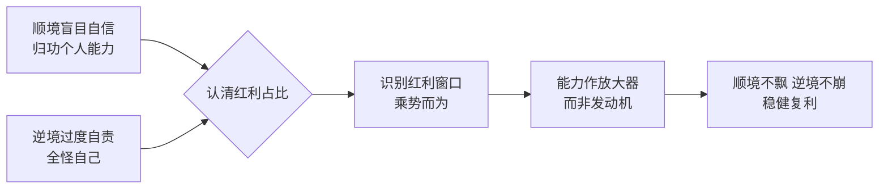

### 为什么需要这个概念？

新手常陷入两个极端：要么把赚钱全归功于自己能力强，要么因一次失败就全盘否定自己。如果不能正确理解收入来源中"趋势"与"能力"的占比，就容易在顺境时盲目自信、在逆境时过度自责。认清时代红利的存在，能帮助创业者把精力放在"识别并乘上红利窗口"，而不是在红海里死磕能力。

### 核心定义

> "可能所有夸张，我们所赚的每一百块钱，有九十块钱是时代红利，仅有十块钱是时代对我们个人能力的补偿，英雄只是时势的产物。"
> 
> ——《P001, 20230207_03.md》

这段话揭示了一个残酷但解脱的真相：**普通人赚取的绝大部分收入（约九成）来自时代红利**（平台兴起、政策变化、技术突破等外部趋势），**仅少部分（约一成）是对个人能力的补偿**。商业英雄是平台与市场红利的产物，而非纯粹个人奋斗的结果。

**这个定义在实战中的作用是：它把"努力"从神坛上请下来，把"选赛道"推上神坛。当你明白九成靠趋势时，你会不再盲目加班苦干，而是把80%的精力花在"扫描环境、识别红利、判断窗口期"上，剩下20%才用来在选定赛道里精进执行——这就是"先看水、再选道、后用力"的底层逻辑。**

### 关键性质

1. **时代红利具有窗口期**：信息传递越快，项目红利期越短，需要敏锐捕捉。
2. **个人能力是放大器**：没有红利，能力再强也难成事；有了红利，能力中等也能起飞。
3. **红利具有普适性**：同一波红利会成就一批人，而非只成就某一个人。

### 典型例子

- **公众号红利期**：早期入驻者哪怕文笔一般也能靠涨粉变现，后期入场者即便内容优质也难起量。
- **视频号直播+私域**：2023年处在红利期，"既有短期爆发力，又有长期基本盘"，是长短线结合的好赛道。

> "近年来，因为现在信息传递越来越快了，项目红利期是越来越短的。所以我就在思考，怎么样能长短线结合，又有短期的爆发力，又有长期的基本盘。目前看，视频号直播+私域是有这个属性的。"
> 
> ——《P001, 20230207_03.md》

### 边界条件

- 比例并非精确的90%/10%，而是一个强调"趋势主导"的定性判断。
- 并非所有收入都来自红利——在无红利的成熟赛道，个人能力占比会显著上升。
- 时代红利不可控，但识别红利窗口比单纯提升能力更紧迫，二者不可偏废。

---

## 37.4 好方向公式 —— 想做、能做、可做的交集

### 方法演进图

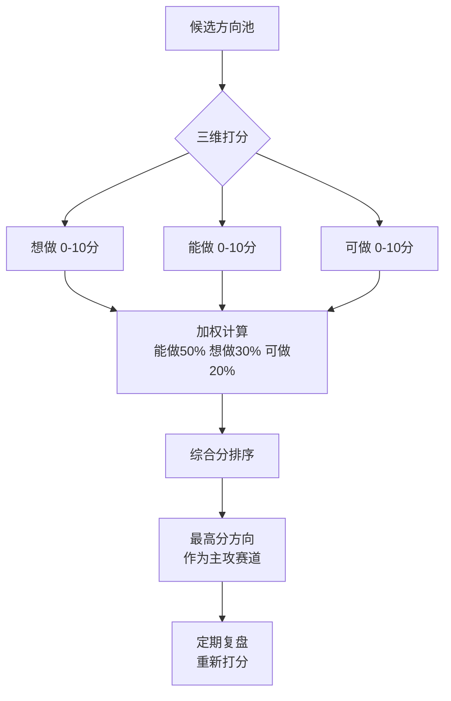

### 为什么需要这个概念？

新手选择副业或创业方向时，普遍凭感觉或追热门，结果要么做不久、要么做不动。需要一套可量化的筛选标准，帮助个人在众多方向中快速锁定"既热爱又擅长且成本可控"的赛道，避免"什么火做什么"的盲目跟风，降低试错成本。

### 核心定义

> "个人方向的定义很简单：好方向 = 想做 & 能做 & 可做的交集。想做：热爱（非讨厌）的；能做：专业能力所在的；可做：花时间能完成的。"
> 
> "关于好方向定义，权重还是：能做（硬技能） > 想做（心态）> 可做（体力）。"
> 
> ——《P001, 20230207_03.md》

**好方向 = 想做（热爱，非讨厌）× 能做（专业能力所在）× 可做（花时间能完成）三者的交集**。三者权重排序：**能做（硬技能）> 想做（心态）> 可做（体力）**。

**这个公式的实战作用是：它把模糊的"我喜欢这个方向"变成可量化的决策模型。当你在A/B/C三个方向纠结时，不必靠直觉拍脑袋，而是给每个维度打分、按权重加权，最高分者即为当下最优方向。它还能揭示短板——比如某方向"想做"9分但"能做"仅3分，加权后综合分极低，提示你现阶段不宜作为主业，可作为兴趣长线培养。**

### 关键性质

- 交集越重合，方向越优——三个维度缺一不可。
- 权重排序表明：能力不足的方向即便再热爱也不宜作为主业，但可作兴趣培养。
- 可做（体力）权重最低，因为时间投入可以通过效率和杠杆弥补。

### 典型例子

- 一个懂编程（能做）且热爱写作（想做）的人，做"技术博客+付费社群"（可做）就是好方向。
- 反之，一个完全不懂金融（不能做）的人，看到炒股赚钱（想做+可做）就入场，则不是好方向。

### 边界条件

- 公式适用于个人方向选择，不完全适用于团队或公司级战略决策。
- "能做"是硬门槛：能力可以通过学习补齐，但在选择当下方向时应以现有能力为基准，而非未来想象。
- 三者的交集会随时间和环境变化，需定期重新评估。

---

## 37.5 流量价值公式 —— 规模之外，更要看相关性与信任

### 方法演进图

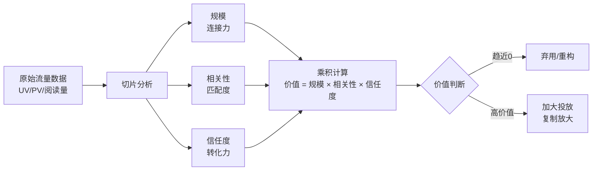

### 为什么需要这个概念？

新手常被"10万+阅读""百万播放"等流量规模数据迷惑，以为流量大就等于赚钱多。但实际转化效果往往惨淡，原因在于忽略了流量的质量维度。需要一套公式帮助拆解"流量到底值多少钱"，避免被表面数据误导。

### 核心定义

> "流量价值=流量规模×交易相关性×信任度"
> 
> "有时候我们面对一篇阅读量很高的文章、一篇赞藏很高的小红书笔记、一个很火的抖音视频，会感到困惑或焦虑。因为我们只看到了表层的流量规模，有些慌张，但流量规模只解决连接的问题，不解决交易的问题。比流量规模重要的是流量相关性…信任度怎么看？有的连接带来的价值有限，这和连接给UV带来的感受有关…不轻易连接，但连接必有价值。"
> 
> ——《P004, 20230207_06.md》

**流量价值 = 流量规模 × 交易相关性 × 信任度**，三者是**乘积关系**而非加和关系。流量规模只解决"连接"问题（让多少人看到），交易相关性解决"匹配"问题（看到的人是否可能买），信任度解决"转化"问题（看到且匹配的人是否愿意下单）。

**这个公式的实战作用是：它给了你一把"流量体检刀"。当你拿到一份数据报告时，不要只看总UV涨跌，要把数据切片——算出每个渠道的相关性得分、信任度得分，再相乘。哪个渠道乘积最高，预算就往哪砸；哪个渠道某维度为零，立刻止损。它把"流量大就好"的直觉谬误，纠正为"精准流量才值钱"的理性决策。**

### 关键性质

- **乘积关系意味着：任何一项趋近于零，整体价值就趋近于零。**
- 流量规模是最容易做大的维度，但相关性和信任度才是决定交易能否发生的核心。
- "不轻易连接，但连接必有价值"——与其追求泛流量，不如深耕高相关性、高信任度的精准流量。

### 典型例子

- 一篇10万阅读的娱乐八卦文（规模大、相关性低、信任度低），可能不如一篇3000阅读的"知乎好物测评"（规模小、相关性高、信任度高）带货效果好。
- 公众号大V推理财产品翻车（规模大、相关性中、信任度崩塌），一夜之间流量价值归零。

### 边界条件

- 该公式适用于评估"流量变现潜力"，不适用于评估"品牌曝光价值"——后者即使无直接转化也有长期认知价值。
- 信任度的建立需要时间，短期投放时信任度通常较低，需通过口碑或背书弥补。
- 相关性的判断依赖对用户画像的精准理解，若画像模糊则相关性难以评估。

---

## 37.6 财富积累四阶段 —— 从卖时间到钱生钱的阶梯

### 方法演进图

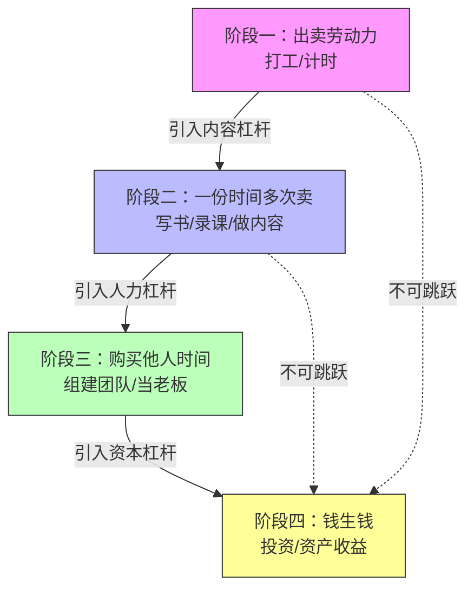

### 为什么需要这个概念？

很多人对赚钱的认知停留在"打工=赚钱"的单一模式，不知道财富积累有不同层级。如果不知道自己所处的阶段和下一阶段的方向，就容易陷入"越忙越穷"的循环。该概念帮助读者建立财富跃迁的路线图，理解"出卖劳动力"只是起点而非终点。

### 核心定义

> "财富积累分为四个阶段，第一：出卖劳动力；第二：一份时间多次卖；第三：购买他人时间；第四：钱生钱。"
> 
> "第一阶段，出卖劳动力…第二阶段是一份时间多次卖…第三个阶段是什么？购买他人时间…第四个阶段，就是去钱生钱了…你就是投资。"
> 
> ——《P004, 20230207_06.md》

**财富积累按赚钱方式分为四个递进阶段**：
1. **出卖劳动力**（打工/计时收入）
2. **一份时间多次卖**（写书/录课/做内容）
3. **购买他人时间**（当老板/组建团队）
4. **钱生钱**（投资/资产收益）

四个阶段必须依次跃迁，不可跳跃。

**这个模型的实战作用是：它给你一张"财富GPS定位图"。你只需问自己：我的钱主要从哪来？如果是工资/时薪，你在阶段一，下一步要想办法把技能/经验做成课程、模板、工具（内容杠杆）；如果已在卖课/卖模板，你在阶段二，下一步要招人把重复性工作外包（人力杠杆）；如果已有团队跑通，你在阶段三，下一步要把利润投入资产端（资本杠杆）。它把模糊的"我想赚大钱"，变成了清晰的"我当前在哪阶段、下一步引入什么杠杆"。**

### 关键性质

- **递进性**：没有第一阶段的经验和资本积累，难以顺利进入下一阶段。
- 每一阶段对应不同的收入天花板：打工收入有上限，钱生钱理论上无上限。
- 阶段跃迁的临界点在于"杠杆"的引入：内容杠杆（阶段二）、人力杠杆（阶段三）、资本杠杆（阶段四）。

### 典型例子

- 程序员上班（阶段一）→ 业余时间录技术课程卖（阶段二）→ 招助教和编辑帮做课程（阶段三）→ 用课程收入投资理财（阶段四）。
- 宝妈从做胎毛纪念品（阶段一）到发展副业培训（阶段二），再到组建团队放大（阶段三）。

### 边界条件

- "不可跳跃"是理想路径，现实中有人通过继承或风口直接进入后段，但缺乏前段基础往往难以持续。
- 阶段四（钱生钱）的前提是有足够的本金，否则只是小打小闹的理财而非财富积累阶段。
- 该模型侧重"赚钱方式"，不包含"省钱/资产配置"等财富管理维度。

---

## 37.7 刚需生意观 —— 项目的本性决定人的成败

### 方法演进图

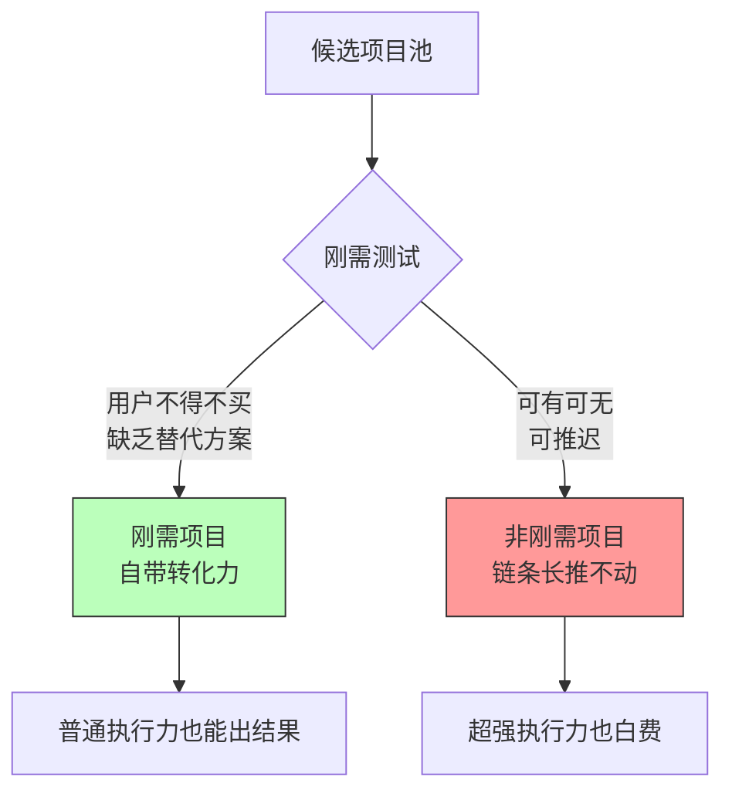

### 为什么需要这个概念？

很多创业者选项目时凭"感觉能做"或"别人做成了"，忽视了需求本身的刚需程度。非刚需项目往往链条长、推不动，投入大量精力却赚不到钱，最终打击信心。需要确立"刚需优先"的选品原则，让项目的本性（刚需程度）来成就人，而非人去硬推。

### 核心定义

> "我现在的理念就是非刚需的项目都不做了，我现在手上在循环的项目，也只有副业和减肥两个事情。"
> 
> "不够刚需的事情现在一律不敢做了…其中的原因就是不够刚需，链条太长了，你认为你推的动，结果就是挣不到钱…最终是项目的本性成就人，而不是人去推动一个不够刚需的项目。"
> 
> ——《P004, 20230207_06.md》

**刚需**指用户不得不买的、缺乏替代方案的需求（如吃饭、教育、医疗）；**非刚需**指可有可无、可推迟的需求（如奢侈品、兴趣课程）。"刚需生意观"主张：**只做刚需项目，不做非刚需项目**——因为非刚需链条太长，你认为你推得动，结果就是挣不到钱。

**这个观点的实战作用是：它把"项目筛选"从"我看好这个赛道"变成了"用户有多痛"。在立项会上，不再讨论"这个市场多大""竞品融了多少钱"，而是死磕一个问题："目标用户如果不买我们的产品，会有什么后果？"如果答案是"没后果、凑合过""有替代品"，直接Pass。它让你用项目的本性（刚需程度）做过滤器，避免用个人蛮力去推一块推不动的石头。**

### 关键性质

- 刚需项目自带转化力：用户主动找上门，降低获客成本。
- 非刚需项目依赖强营销：需要不断教育用户、制造需求，成本高且不可持续。
- "项目的本性成就人"——选对刚需项目，普通执行力也能出结果；选错非刚需项目，超强执行力也白费。

### 典型例子

- 副业（赚钱是刚需）和减肥（健康是刚需）两个方向持续有人付费，适合长期做。
- 抖音中老年带货：全国60岁以上人口2.64亿，健康类产品是刚需，月入稳定3万+。

### 边界条件

- 刚需是动态变化的：某个需求在特定时期是刚需，过段时间可能变为非刚需（如口罩）。
- 刚需不等于暴利：刚需市场往往竞争激烈、利润透明，需结合其他维度综合判断。
- 个人擅长的非刚需领域（如小众艺术）并非不能做，但需要接受"推不动"的现实并做好长线准备。

---

## 37.8 内容价值金字塔 —— 娱乐、工具、方法的变现阶梯

### 方法演进图

```mermaid
pyramid
    title 内容价值金字塔
    A[方法<br/>解决问题/打造IP<br/>变现天花板最高] --> B[工具<br/>整合资料/提效工具<br/>可引流/低客单价]
    B --> C[娱乐<br/>情绪价值/搞笑剧情<br/>数据好但难变现]
```

### 为什么需要这个概念？

做内容的人常困惑：为什么我的视频数据很好却不赚钱？原因在于内容本身的价值层级不同，变现能力天差地别。该金字塔帮助内容创作者认清"什么内容值钱"，从而有意识地往上走。

### 核心定义

> "①给娱乐：搞笑号、剧情号，他们的数据很好，用情绪价值交换了用户的注意力，但是很难变现。"
> 
> "②给工具：给工具满足更加实用性的需求…最常见的是给整合资料，帮用户节省时间…这就是当下很火的虚拟资料项目。"
> 
> "③给方法：通过给方法，解决问题，抢占专业认知，打造个人 IP。"
> 
> ——《P004, 20230207_06.md》

**内容价值由低到高分为三层**：
1. **给娱乐**（情绪价值，数据好但难变现）
2. **给工具**（实用性，可引流）
3. **给方法**（解决问题，打造个人IP壁垒最高）

核心逻辑是价值交换：用户用注意力/金钱交换内容提供的价值。

**这个金字塔的实战作用是：它给内容创作者一把"内容分级尺"。发每条内容前，问自己：这条是给娱乐、给工具、还是给方法？如果长期只产出娱乐层，别指望直接变现，得靠广告/打赏；如果想卖课/卖咨询，必须刻意产出方法层内容——哪怕数据不如娱乐层好看，但它能建立专业信任、筛选高意向用户。它让你用"变现目标"反推"内容策略"，而不是盲目追数据。**

### 关键性质

- 层级越高，变现能力越强，但对创作者的专业能力要求也越高。
- 娱乐内容容易爆但粉丝不买账；工具内容能引流但客单价低；方法内容最稀缺，能建立信任和IP。
- 三个层级并非互斥——好内容可以兼具娱乐性、工具性和方法论。

### 典型例子

- 搞笑短视频（娱乐）：百万播放难以直接变现，需靠广告或直播打赏。
- 小红书虚拟资料号（工具）：给整合资料帮用户省时间，单账号单月纯利润1万+。
- 付费课程/咨询（方法）：解决具体问题，客单价高、复购强，如私教3w/3个月。

### 边界条件

- 金字塔描述的是"内容本身的变现潜力"，不排除个别娱乐号通过带货等方式变现成功。
- 层级越高门槛越高：方法类内容需要真本事，否则会被用户识破。
- 该模型适用于内容型创业，不适用于纯电商或线下生意。

---

## 37.9 公域引流私域变现 —— 把平台的鱼捞到自己的池塘

### 方法演进图

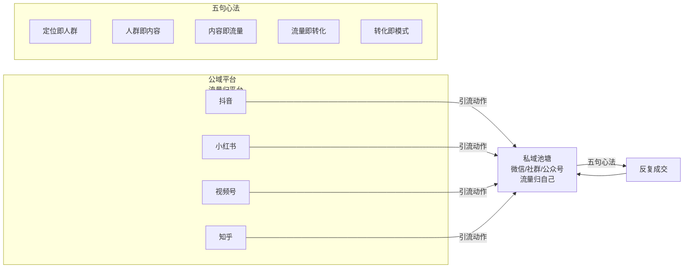

### 为什么需要这个概念？

很多人在抖音、小红书辛苦做内容，却始终没有沉淀自己的用户资产。公域流量属于平台，规则一变流量就归零；私域流量属于自己，可以反复触达。理解"公域→私域"的转化逻辑，是所有私域生意模式的底层前提。

### 核心定义

> "核心区别是：公域流量属于平台；私域流量属于自己。"
> 
> "我们的目标是把他们引流到微信上…所以我们整套商业模式的目的只有一个：把所有公域平台的流量导入微信私域。"
> 
> "整个项目的 5 句核心心法：1. 定位即人群、2. 人群即内容、3. 内容即流量、4. 流量即转化、5. 转化即模式。"
> 
> ——《P004, 20230207_06.md》

- **公域流量**：属于平台（抖音、小红书、视频号等）的流量，由算法分发，无法直接触达用户。
- **私域流量**：属于自己的流量（微信好友、社群、公众号粉丝），可免费、反复、一对一触达。
- **整套商业模式的目标**：把所有公域平台的流量导入微信私域，进行一对一反复成交。

**这个模型的实战作用是：它把"做流量"这个模糊动作，拆解成了"定位→人群→内容→流量→转化→模式"六个可执行的齿轮。每个齿轮卡住，整条链路就断。你可以拿这五句心法做自检：我的定位够不够精准（定位即人群）？内容是不是目标人群爱看的（人群即内容）？发了有没有流量（内容即流量）？流量有没有进私域（流量即转化）？转化后能不能复制规模化（转化即模式）？它把抽象的商业模式，变成了可逐项排查的检查清单。**

### 关键性质

- 私域的核心优势是"所有权"：平台不能剥夺你触达用户的权利。
- 私域的核心价值是"反复成交"：一次获客，多次变现。
- 转化路径的顺畅度取决于五个心法：定位即人群、人群即内容、内容即流量、流量即转化、转化即模式。

### 典型例子

- 抖音导流2万精准宝妈到私域，完成7000单胎毛纪念品变现，并结合副业培训等总计变现超100万。
- 视频号直播一小时加上200人私域：利用企业微信弹出引流和金句卡片，不跳出直播环境完成转化。

### 边界条件

- 平台对导流有严格限制（如抖音禁止留微信），需使用合规的跳转组件或引导话术。
- 私域需要持续运营：不加维护的微信好友和僵尸粉无异于死流量。
- 公域引流需要内容能力，没有内容基础的引流成本会很高。

---

## 37.10 流量切片分析法 —— 把数据切成片才能下刀

### 方法演进图

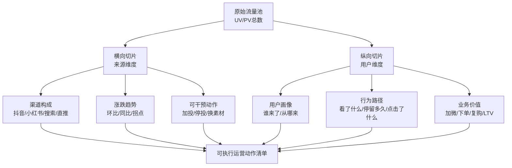

### 为什么需要这个概念？

面对后台的UV、PV、涨跌曲线，多数人只会看总数和趋势，不知如何下手优化。数据是混沌的，直接看"整体表现"无法定位问题和制定干预动作。需要一种拆解方法，让数据颗粒度细到能指导具体运营动作。

### 核心定义

> "横向你要看：这 200 个 UV 从哪里来？有哪些渠道？哪些涨了？哪些跌了？趋势如何？原因是什么？可干预的运营动作是什么？"
> 
> "纵向你要看：UV 的背后是用户，这个用户来到页面前经历了什么？有着怎样的需求？为什么要来？停留了多久？去向了哪里？离开的时候和刚进来有什么不同？能不能形成业务价值？"
> 
> "流量要切成片来看，才有可优化的空间，才能形成可执行的运营干预动作。"
> 
> ——《P004, 20230207_06.md》

将流量数据按**横向**（来源渠道、涨跌趋势、干预动作）和**纵向**（用户需求、行为路径、业务价值）切成片逐一分析。横向回答"流量从哪来、为什么变、我能做什么"；纵向回答"用户是谁、想要什么、值多少钱"。

**这个方法的实战作用是：它把"看数据"这件事，从"看完就忘"变成了"看完有动作"。每周复盘会上，不再汇报"本周UV涨了5%"，而是说"小红书渠道UV涨了30%，源于周三那篇笔记爆了（横向），来的用户60%是宝妈、停留均超3分钟、加微率25%（纵向），决定下周加大小红书投放、复制该选题风格、优化落地页引导语"。它强迫你从"结果指标"倒推"原因动作"，形成可执行的运营干预清单。**

### 关键性质

- 切片越细，可执行的优化动作越明确——从"涨了/跌了"到"哪个渠道涨了、为什么涨、如何放大"。
- 横向切片解决"来源与归因"，纵向切片解决"用户与价值"，二者缺一不可。
- 切片分析的核心产出是"可执行的运营干预动作"，而非分析报告本身。

### 典型例子

- 200个UV，横向切：10个来自抖音、150个来自小红书、40个来自搜索——发现小红书是主力，加大投放。
- 纵向切：这200人中60%是宝妈、需求是育儿资料、停留2分钟、30%加微信——发现转化链路的瓶颈在落地页而非流量。

### 边界条件

- 切片需要数据支撑：没有埋点/统计系统时只能靠经验估计，精度有限。
- 过度切片会导致"分析瘫痪"：应聚焦于影响业务的关键切片，而非穷尽所有维度。
- 该方法适用于数据驱动的运营场景，不适合缺乏数据的小白起步阶段。

---

## 37.11 流量流速悖论 —— 不快不慢才能细水长流

### 方法演进图

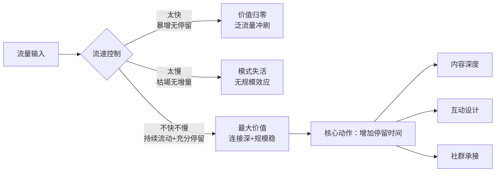

### 为什么需要这个概念？

流量运营中常出现两种极端：爆款来临时流量暴增但接不住，平淡期流量枯竭无人问津。多数人只关注流量"量"的大小，忽视了流量"流速"的节奏。理解流速悖论有助于建立"稳定持续"的流量心态，而非追求短期爆红。

### 核心定义

> "流量的速度太快、没有停留、规模再大也没有用，流量一直停留不动也不行，等于没有了规模。"
> 
> "流量的核心是流和量，就要流动也要停留、不快不慢、持续不断，这样的流量价值才是最大的。"
> 
> "增加用户的停留时间。"
> 
> ——《P004, 20230207_06.md》

**流量必须保持不快不慢、持续不断的流速才能产生最大价值**。
- 太快：用户没有停留，规模再大也无法形成连接和转化。
- 太慢：失去规模效应，无法支撑商业模式。

**这个悖论的实战作用是：它提醒你不要做"流量贪婪症"患者。爆款来了不要贪多、贪快，要想办法把流速"刹"住——延长直播时长、插入互动环节、引导进私域群、设置多轮承接内容，让用户多停留一会儿。平淡期不要躺平，要用固定节奏（如捡漏群的10点秒杀、11点催单、19点预告）维持基础流速。它把"追求爆款"的焦虑，转化为"设计流速节奏"的工程问题。**

### 关键性质

- 核心是"流动"和"停留"两个维度的平衡：既要持续有新流量进来，也要让已有流量停留足够久。
- 增加用户停留时间是破局关键：用内容深度、互动设计、社群承接来延长停留。
- 该悖论解释了为什么"爆红容易长红难"：爆红是流速过快，长红需要稳定持续的流速。

### 典型例子

- 视频号爆款视频第4天流量从峰值下降：三天后流量高峰期开始衰减，需要主动控制直播时长、引入外部合作延长变现窗口。
- 捡漏群运营中通过固定的发品节奏（10:00整点秒杀、11:00催单、19:00预告），维持群内流量的稳定流速。

### 边界条件

- 不同商业模式对流速的要求不同：做品牌需要慢流速沉淀信任，做爆款需要快流速冲量。
- 流速的控制能力依赖对平台算法的理解，平台规则变化会直接影响流速。
- 停留时间增加可能牺牲规模：深度内容往往不如浅娱乐内容传播快，需根据目标取舍。

---

## 37.12 MVP先卖后做 —— 卖想法比做产品更快验证需求

### 方法演进图

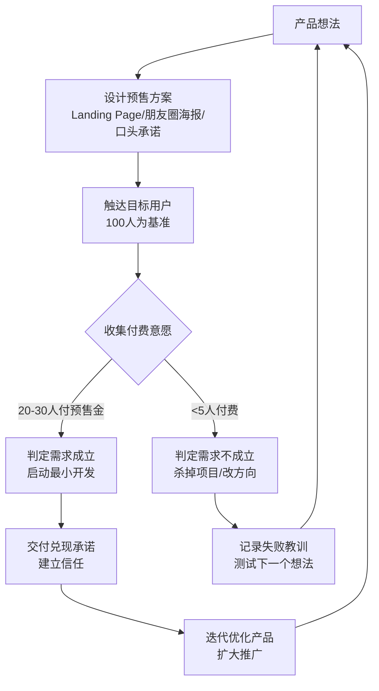

### 为什么需要这个概念？

传统创业思维是"先做产品再找客户"，但开发周期长、成本高，常常产品做出来发现没人要。需要一种轻量化的验证方式，在投入大量开发成本之前先确认需求是否真实存在。该概念是精益创业的核心，让"试错成本"大幅降低。

### 核心定义

> "比如最重要的是先卖产品的想法，而不是做产品。如果聊了 100 个人，只有几个人买，肯定有问题；如果 20-30 个人购买，交了预售金，那这个不确定因素就解决了。"
> 
> "这样我们就能够在短时间内测试几十个产品，最后得出一个正确选项，这是最好的验证方式。因为筛选大于培养，尝试次数多了就知道哪个是比较好的方案。"
> 
> ——《P004, 20230207_06.md》

**MVP（最小可行产品）验证的核心是"先卖产品的想法，而不是做产品"**。通过测试"有多少人愿意付费预购"来判断需求是否成立：聊了100人只有几个人买肯定有问题；20-30人购买并交了预售金则该不确定因素解决。

**这个方法的实战作用是：它把"验证需求"的成本从"开发周期+人力成本"压缩到了"一个预售海报+几句话术+几天聊天"。你不再需要把产品做完才知道没人要，而是在"想法"阶段就用真金白银投票。它让"筛选大于培养"成为可能——用同样的时间，你能测试20个想法，而不是把赌注押在1个做完的产品上。它是创业者对抗不确定性的最利武器。**

### 关键性质

- 验证对象是"最不确定的因素"，而非整个商业模式——一次只验证一个假设。
- 以"付费意愿"为唯一标准：口头说想要不算，掏钱才算。
- 尝试次数比单次完美更重要：用最短时间测试几十个产品，筛选大于培养。

### 典型例子

- 知识付费课程：先发朋友圈预售，收满50人再录课，避免录完没人买的尴尬。
- 软件工具：先做Landing Page放"立即购买"按钮，看点击率再决定是否开发——符合"卖空气"的验证逻辑。

### 边界条件

- 预售的前提是你能触达目标用户：没有流量入口时，此方法无法生效。
- 适合轻量级产品和服务，重资产项目（如开工厂）不适合先卖后做。
- 需警惕"预售即割韭菜"的伦理风险：收了钱必须履约，否则损害信任。

---

## 37.13 战略稳于执行论 —— 治理层的锅，别让执行层背

### 方法演进图

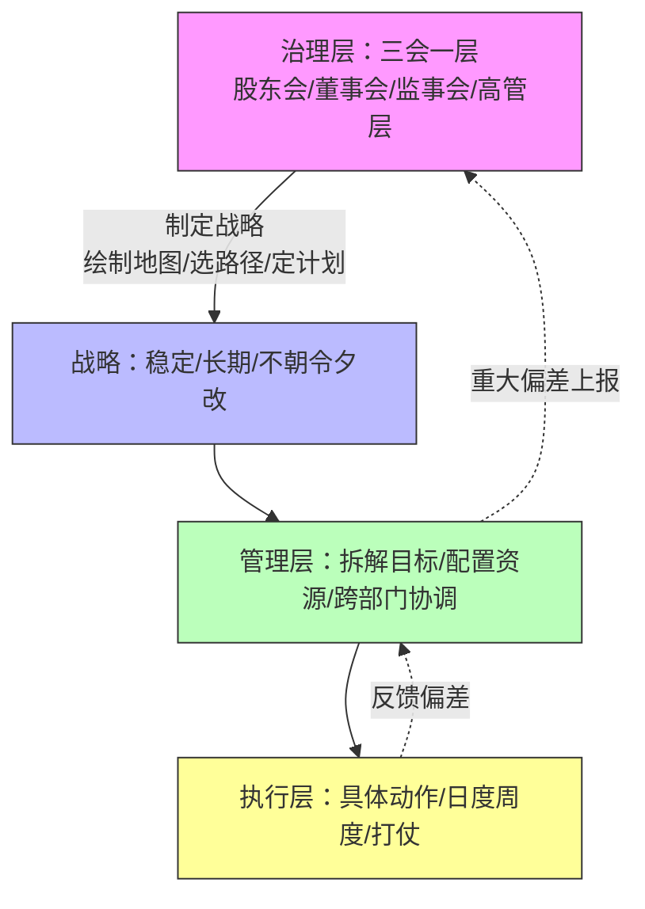

### 为什么需要这个概念？

公司经营不善时，老板习惯性归咎于员工执行力差，但根因往往在更高层。需要区分"治理"与"执行"的权责边界，避免错误归因导致问题反复发生。理解该概念有助于创业者建立"顶层设计优先"的意识，从源头避免执行混乱。

### 核心定义

> "三会一层：股东（大）会、董事会/执行董事、监事会、高管层；"
> 
> "所以，公司如果经营不善或者倒闭，更多的原因，不是下面的管理层、执行层，而是治理层'三会一层'。"
> 
> "战略，既不是一朝一夕的事，也不是朝令夕改的事。战略，是三会一层要做的事。"
> 
> ——《P004, 20230207_06.md》

- 公司顶层治理的四大机构（**三会一层**）：股东会（最高权力机构）、董事会（决策机构）、监事会（监管机构）、高管层（执行机构）。
- **战略是"三会一层"要做的事**：既不是一朝一夕的事，也不是朝令夕改的事。

**这个论断的实战作用是：它把"执行力不够"这个甩锅理由堵死。当业绩不达标时，先查战略层：方向是不是错了？是不是三个月换了两次赛道？路线图有没有画清？当下一步计划有没有落地？如果治理层没做好这三件事（绘制地图、选择路径、制定当下一步计划），再强的执行层也是在沙地上盖楼。它迫使创始人把精力先花在"想清楚、定稳、不变"上，才有资格要求下面"干漂亮、快跑、不偏"。**

### 关键性质

- 公司经营不善或倒闭，更多源于治理层而非管理层/执行层。
- 战略制定要"慎之又慎，不要朝令夕改"——方向频繁变动对执行层是灾难。
- 战略包含三个动作：绘制地图（方向）、选择路径（路线）、制定当下一步计划（落地）。

### 典型例子

- 股东会决定进军AI赛道（战略决策）→ 董事会制定三年路线图 → 高管层执行季度目标——若三个月后股东会又转向电商，执行层所有努力白费，问题根源在治理层而非执行力。
- 某团队做AI绘画小程序，因预算远超预期、无执照等治理层问题放弃，执行层再努力也白搭。

### 边界条件

- 该理论适用于有正式治理结构的公司；个体户/小团队没有三会一层，战略就是老板个人决策。
- 战略稳定不等于僵化：外部环境剧变时（如疫情），治理层应及时调整战略。
- 该概念侧重于"归因"，不提供具体战略制定的工具方法。

---

## 37.14 利他等于利己 —— 越分享越幸运的复利逻辑

### 方法演进图

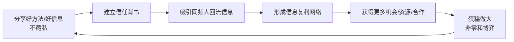

### 为什么需要这个概念？

很多人担心分享赚钱方法会"教会徒弟饿死师傅"，于是藏私、封闭，结果信息闭塞、成长缓慢。商业世界的信息并非零和博弈——蛋糕足够大，分享反而带来更大的回报。该概念是建立"分享型人格"和"开放型商业心态"的底层支撑。

### 核心定义

> "利他等于利己，越分享越幸运。"
> 
> "曾有朋友反问我，你就不怕你把赚钱的信息分享出去，别人抢了你的蛋糕？…事实证明，你越利他，你得到的回报会更大。现在最稀缺的就是信息…这市场这么大，蛋糕分的完吗？"
> 
> ——《P004, 20230207_06.md》

**利他等于利己**：乐于分享好信息、好方法且不藏私，不仅不会因竞争受损，反而会因分享获得更大回报和更多信息回流。"你越利他，你得到的回报会更大"——分享是建立信任、积累人脉、获取信息回流的复利投资。

**这个逻辑的实战作用是：它给了你一个"分享决策框架"。当你犹豫"这个方法能不能公开"时，问三个问题：①这是核心商业机密吗（供应链联系人、核心参数、未公开数据）？若是→不分享；②这能帮对方少走弯路吗？若能→分享；③分享后能不能吸引同频人回流更高阶信息？若能→必须分享。它把"怕被抄"的恐惧，转化为"筛选高质量连接"的策略。**

### 关键性质

- 信息是当前最稀缺的资源：分享信息不会让信息变少，反而会因交流产生新信息。
- 市场足够大（"蛋糕分得完吗？"），分享不会稀释你的机会，只会扩大你的影响力。
- 利他行为具有网络效应：帮助的人越多，愿意帮你的人越多。

### 典型例子

- 生财有术社群的核心文化：圈友乐于分享项目复盘、数据和方法，越分享的人获得的信息回馈越多，成长越快。
- 作者公开自己从亏损100万到盈利300万的复盘路径，不仅没被抄袭打垮，反而建立了个人IP和信任背书。

### 边界条件

- 利他分享以"不损害核心商业机密"为前提：可以分享方法框架，不必公开所有细节数据。
- 利他是手段而非目的：需要选择性地分享给对的人，盲目泄露给恶意竞争者仍会受损。
- 分享需要"有料"：没有真材实料的分享是消耗信任，而非积累信任。

---

## 37.15 劳动合同有效性 —— 合同是枪、附件是子弹

### 方法演进图

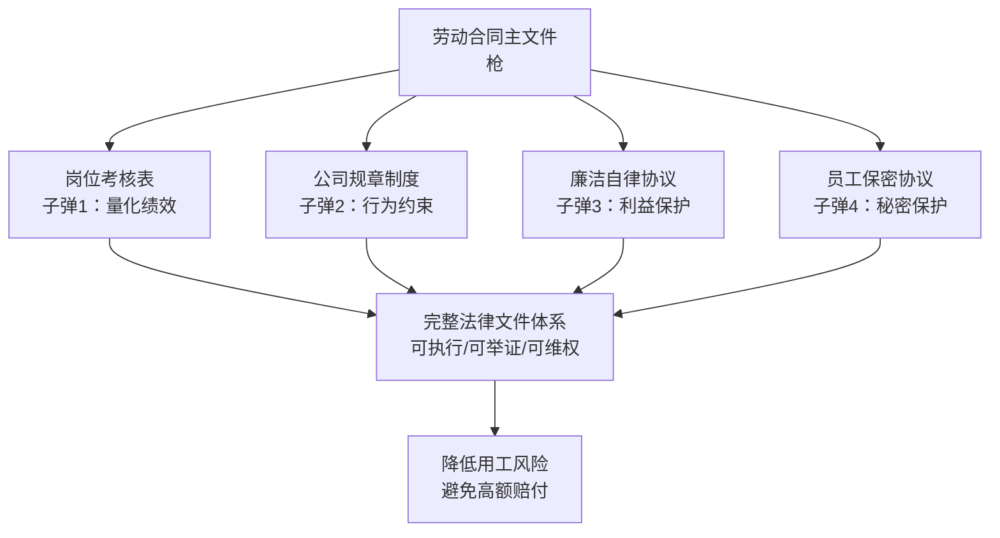

### 为什么需要这个概念？

很多初创公司以为签了劳动合同就等于建立了合规的雇佣关系，实则远远不够。一旦发生劳动纠纷，缺少附件的劳动合同形同虚设，公司往往面临高额赔付。理解"合同+附件"的完整体系，是降低用工风险的第一步。

### 核心定义

> "一份有效的劳动合同，不止只是劳动合同，而是一定是包含了岗位考核表、公司规章制度、廉洁自律协议、员工保密协议等附件。"
> 
> "劳动合同就等于是一把枪，而这些附件，就是子弹。你的枪再好，没有子弹也是无济于事。"
> 
> ——《P007, 20230207_08.md》

一份有效的劳动合同，不止是劳动合同本身，**必须包含岗位考核表、公司规章制度、廉洁自律协议、员工保密协议等附件**。"劳动合同就等于是一把枪，而这些附件，就是子弹。你的枪再好，没有子弹也是无济于事。"

**这个理论的实战作用是：它给HR和创始人一份"合同合规清单"。入职第一天，不仅签主合同，还要现场签齐四份附件、拍照留存、建立台账。当劳动仲裁发生时，你能在48小时内拿出完整的"枪+子弹"证据链——考核表证明不胜任、规章制度证明违纪、保密协议证明泄密、廉洁协议证明贪腐。它把"合同签了没"这个二元问题，升级为"附件齐不齐、证据全不全"的体系化检查。**

### 关键性质

- 附件决定了劳动合同的可执行性：没有考核表则无法量化评价员工表现，没有规章制度则无法约束员工行为。
- 廉洁自律协议与保密协议是保护公司商业秘密和财产的重要屏障。
- 合同与附件共同构成完整的聘用法律文件体系。

### 典型例子

- 品牌部张先生劳动纠纷赔付22500元：因为没有及时签合同和建立考核表，公司承担了高昂赔付。
- 运营部徐女士赔付4500元、短视频部李女士赔付2500元——三个案例共同印证了合同+附件的必要性。

> "劳动合同一定要及时去签，特别是遇到一些节假日时。员工一定要考核，同时一定要建立周考核表。"
> 
> ——《P007, 20230207_08.md》

### 边界条件

- 该概念适用于有正式雇佣关系的公司，不适用于个体户或劳务外包等非雇佣关系。
- 附件需要定期更新（如公司规章制度随业务调整），不能一劳永逸。
- 不同地区劳动法细节有差异，需结合当地法规完善合同体系。

---

## 37.16 辞退损失最小化 —— 优雅地降低裁员成本

### 方法演进图

```mermaid
flowchart TD
    A[辞退决策已定] --> B[安排高情商沟通者<br/>单独谈话]
    B --> C[引导签署离职表<br/>原因写"个人原因/其他"<br/>公司不盖章]
    C --> D[离职当天结清工资<br/>含加班/年假折现/奖金]
    D --> E[收集归档证据<br/>考核记录/违纪记录/沟通录音]
    E --> F[办理社保公积金停缴<br/>归还资产/交接账号]
    F --> G[损失最小化完成<br/>规避2N赔付/仲裁风险]
```

### 为什么需要这个概念？

无论员工主动离职还是被辞退，处理不当都可能导致劳动仲裁和公司损失。辞退流程不规范会带来高额赔偿金、声誉损失和团队士气下降。理解"损失最小化"的操作原则，能帮助管理者在合规前提下保护公司利益。

### 核心定义

> "我们只能尽量减少最少化，而不能完全避免，因为没有办法"
> 
> "无论员工公司主动离职还是被辞退，一定要引导他签署离职表。离职原因最好是写'个人原因'或者'其它'"
> 
> "工资建议在离职当天就给他结清，千万不要拖，非常重要。"
> 
> ——《P007, 20230207_08.md》

处理被辞退员工时，公司**只能尽量减少损失而无法完全避免**——"我们只能尽量减少最少化，而不能完全避免"。核心操作：**安排会表达的人去谈、引导签署离职表（原因写个人原因且公司不盖章）、离职当天结清工资、收集证据备不时之需**。

**这个原则的实战作用是：它把"辞退"从情绪化冲突，变成了标准化的SOP。每一步都有明确目的：找会说话的人→降低对抗；签"个人原因"→切断"公司违法解除"证据链；当天结清钱→堵住"拖欠工资"由头；留证据→备战仲裁。它让创始人在最难的时刻，依然有章可循、有据可依、有底可守。**

### 关键性质

- 离职原因写"个人原因"是保护公司的关键：避免被认定为公司违法解除劳动合同。
- 离职当天结清工资能减少员工因拖延产生的对抗情绪和仲裁风险。
- 收集证据（考核记录、违纪记录等）是为了应对可能出现的劳动仲裁。

### 典型例子

- 三个真实劳动纠纷案例（赔付22500元、4500元、2500元）——并非因辞退本身，而是因流程不规范导致的赔付。
- 员工的考核记录和周考核表是证明"不能胜任工作"的关键证据。

### 边界条件

- 该方法是在合法前提下减少损失，不意味着可以违法辞退员工（如违法解除仍需赔偿2N）。
- 对孕期、工伤等特殊员工有额外保护，不能简单套用。
- 引导员工签"个人原因"需要员工自愿，不能强迫或欺骗。

---

## 37.17 没有壁垒的项目 —— 付费买试错经验的本质

### 方法演进图

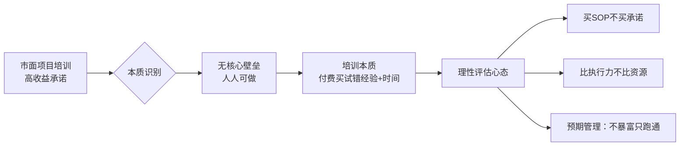

### 为什么需要这个概念？

普通人面对五花八门的"项目培训"，常常被"高收益"承诺所诱惑而盲目付费。如果不能认清项目培训的本质，就容易重复付费、重复试错。理解"没有壁垒"的现实，有助于建立理性的项目评估心态，减少被割韭菜的风险。

### 核心定义

> "目前我们普通人能接触到的互联网项目不是科研项目，本质上讲几乎是没有任何壁垒的。"
> 
> "所以市面上所有项目培训的本质就是付费买别人的试错经验和时间。"
> 
> ——《P001, 20230207_03.md》

**普通人能接触到的互联网项目（淘宝、抖音、美团等）基本是没有任何壁垒的，不是科研项目。"市面上所有项目培训的本质就是付费买别人的试错经验和时间。"**

**这个认知的实战作用是：它给你一副"防割韭菜眼镜"。看到任何"月入十万""躺赚""独家渠道"的培训广告，立刻翻译成："他们想卖我一套SOP和一些避坑经验，价值大概几千到几万，能不能回本全看我执行力。"它把你的决策从"这个项目能不能暴富"，切换到"这套SOP值不值这个价、我能不能执行下来"——这才是理性买家的视角。**

### 关键性质

- 项目培训的真实价值在于：用金钱换取别人的试错经验，节省自己的摸索时间。
- 没有核心壁垒意味着：你能做的事情别人也能做，竞争的本质是执行力和细节。
- 培训的溢价空间有限：付费应该买到"可操作的SOP"而非"暴富的承诺"。

### 典型例子

- 多数互联网项目培训（电商、短视频、私域等）提供的是流程和经验文档，而非独家资源或专利技术。
- 淘宝、抖音、美团等平台项目面向所有人开放，不存在"只有我知道"的信息绝对不对称。

### 边界条件

- 该理论适用于"普通人能接触到的互联网项目"，不适用于有核心技术门槛（如AI算法研发）或资质壁垒（如金融牌照）的领域。
- 没有壁垒不等于不能做——正是因为人人可做，执行力才成为决定性变量。
- 部分优质培训提供"陪跑""资源对接"等非标服务，其价值可能超出单纯的经验购买。

---

## 37.18 创业项目匹配度 —— 结合自身资源而非盲目All In

### 方法演进图

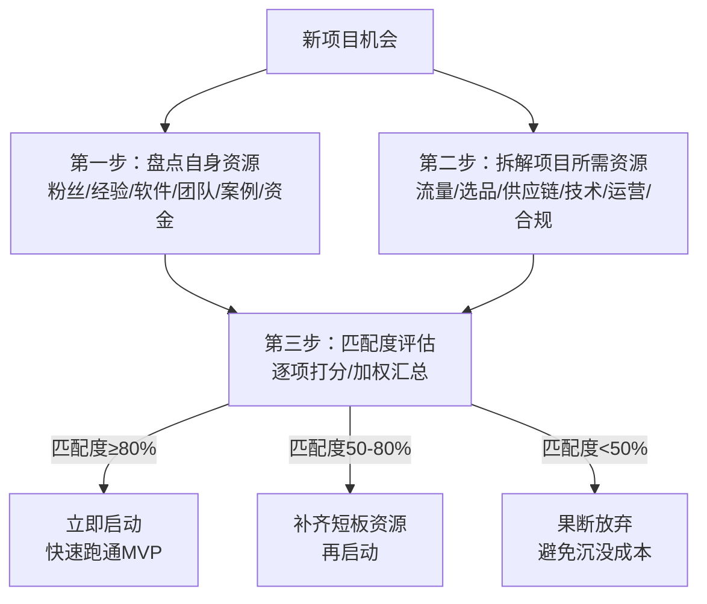

### 为什么需要这个概念？

很多人严重低估已有项目而过分高估新项目，看到"赚钱"的新项目就盲目投入。项目与自身资源不匹配时，再好的项目也难以做出成果。需要一套"资源盘点-项目拆解-匹配度评估"的理性决策方法。

### 核心定义

> "很多人都有一个误区，那就是严重低估已有项目，同时过分高估新的项目。"
> 
> "应该结合自身的资源，梳理新项目的资源和自己资源的匹配度，再决定重新做哪个项目。"
> 
> "第一步：盘点自己手里有哪些资源。第二步：拆解项目需要的资源。所以对我来说这个项目和我匹配程度就是 100%，因为：公众号经验、美团饿了么平台、导流方法，我都有。"
> 
> ——《P008, 20230207_09.md》

**赚钱应结合自身已有资源（粉丝、经验、软件、团队、案例等），而非盲目all in**。通过三步完成新项目评估：第一步盘点自身现有资源；第二步拆解潜在项目所需资源；第三步评估资源匹配度。

**这个方法的实战作用是：它把"这山望着那山高"的冲动，变成了结构化的"资源-需求匹配表"。拿到一个新项目，先别急着投钱，花半天列张表：项目需要A/B/C/D四项核心资源，我手里有A/C，缺B/D。B我能花两周自学补齐，D得找合伙人/外包。缺口可控→启动；缺口不可控→放弃。它让决策从"感觉好像行"变成"缺口清单明确、补齐路径可行"。**

### 关键性质

- 项目与资源的匹配度（而非项目本身好坏）决定成功概率。
- 资源匹配度100%意味着：项目所需的核心资源你都具备，可以立即启动。
- 匹配度评估能有效避免"这山望着那山高"的盲目切换。

### 典型例子

- 作者此前多项目累计亏损超100万，通过资源梳理后叠加外卖CPS与副业课程，3个月赚100万、总利润超300万。
- 外卖CPS与作者的资源匹配度为100%：公众号经验、美团饿了么平台、导流方法他都有。

### 边界条件

- 资源匹配度高是"快速启动"的充分条件，但不保证长期成功（还需执行力和持续迭代）。
- 资源匹配度会随时间变化：新获得的能力和资源可以提升匹配度。
- 该理论适用于个人或小团队，不适用于大企业多元化战略。

---

## 37.19 被想拥有的东西绑架 —— 增长瓶颈的恶性循环

### 方法演进图

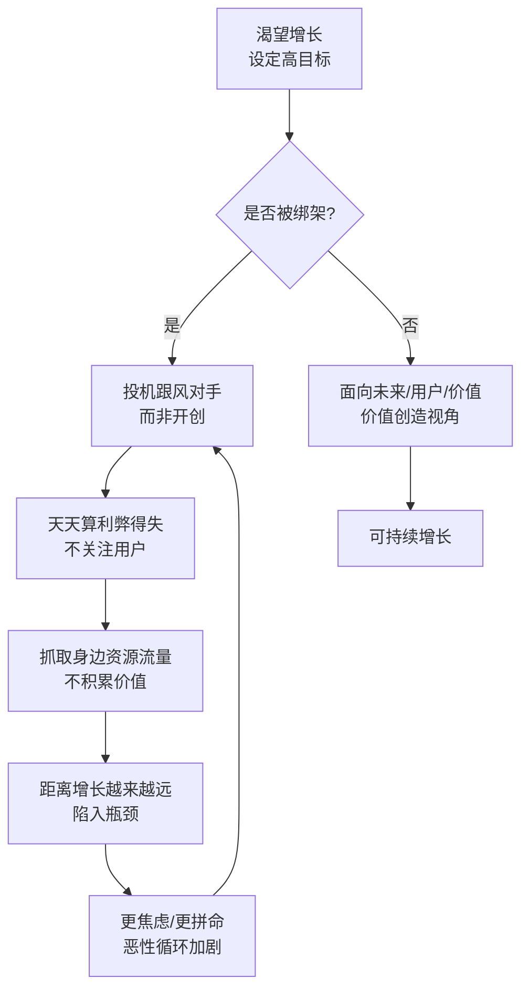

### 为什么需要这个概念？

企业或个人在追求增长时，常常陷入"越追越远"的困境却不自知。增长焦虑导致短视行为，而短视行为进一步摧毁增长的基础。理解被增长绑架的心理机制，是跳出恶性循环的第一步。

### 核心定义

> "进入增长瓶颈的一个典型现象，就是越想要增长，却距离想要的增长越远。"
> 
> "如果用一句话来形容这种现象，那就是我们被我们想拥有的东西绑架了。"
> 
> "当一个人被增长的预期绑架，就会失去这些习惯，他会变得投机一样地去跟随对手而非做开创性事情，会天天计算自己的利弊得失而非去关注用户，会抓取身边的资源、流量而非积累价值，这些都让他距离增长越来越远。"
> 
> ——《P006, 20230207_07.md》

当企业或个人**被增长的预期绑架**，会陷入**越追求增长反而距离增长越远的恶性循环**。表现：变得投机一样跟随对手而非做开创性事情、天天计算利弊得失而非关注用户、抓取周边资源而非积累价值。

**这个概念的实战作用是：它给你一面"增长体检镜"。当你发现自己/团队出现以下症状时——每天盯着竞品动向调策略、开会全在算ROI不谈用户痛点、为了冲KPI透支品牌透支团队，立刻拉响警报：我们被增长绑架了。它把模糊的"心态不对"，具象化为三个可观测的行为信号（投机、计算、抓取），让你能在恶性循环初期就自我叫停、强制切换视角。**

### 关键性质

- 越想要增长，却距离想要的增长越远——这是进入增长瓶颈的典型现象。
- 被增长绑架后，人会不断压榨自己、逼迫自己，活在焦虑和害怕失去中（FOMO心理）。
- 恶性循环的加剧：因焦虑而更加难以做热爱的事、更加难以专注，进一步失去优势。

### 典型例子

- 柯达认为自己成功源于坚持成像品质，但其最初成功实为抓住大众化趋势；用过去定义自己导致错失数码相机趋势。
- 企业成功后往往不再做当初导致成功的事情（面向未来开创、洞察用户、积累价值），一旦面对巨大增长预期便为追求增长而放弃价值创造，最终陷入瓶颈。

### 边界条件

- 该理论适用于已经历过成功的成熟企业或个人，不完全适用于从0到1的初创阶段。
- "被绑架"的判定需要自我觉察：偶尔的短期策略不等于系统性被绑架。
- 该概念侧重于诊断和预警，破解方法需要结合"价值创造视角"。

---

## 37.20 价值创造视角 —— 破解增长焦虑的唯一方法

### 方法演进图

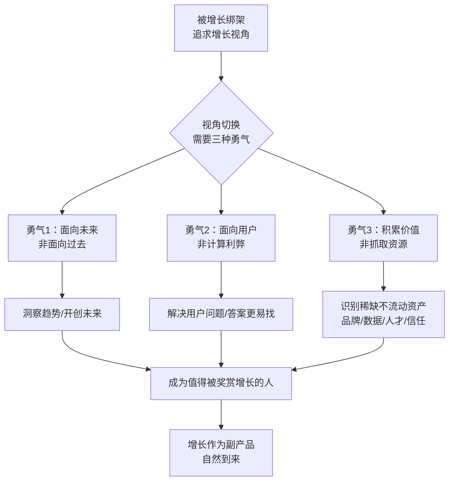

### 为什么需要这个概念？

知道"被增长绑架"的症结后，还需要一个可操作的破解方向。单纯"更努力地追求增长"无法解决问题，需要根本性的视角切换。价值创造视角为个人和企业提供了一条可持续的增长路径。

### 核心定义

> "我发现，破除增长焦虑唯一的方法，就是怎么从追求增长的视角，切换成价值创造的视角。"
> 
> "从一个'我如何得到增长'，变成'我如何成为一个值得被奖赏增长的人'。"
> 
> "真正要去摆脱这种视角，最难的不在于方法论，而是 3 种'勇气'：面向未来而非面向过去的勇气；面向用户而非计算利弊的勇气；积累价值而非抓取资源的勇气。"
> 
> ——《P006, 20230207_07.md》

**破解增长焦虑唯一的方法是实现视角的根本性切换：从"我如何得到增长"转变为"我如何成为一个值得被奖赏增长的人"**。核心是"转化看待问题的方式，而非解决问题本身，往往才是最关键的办法"。

**这个视角的实战作用是：它把"怎么增长"这个无解的数学题，变成了"怎么配得上增长"这个可做的工程题。每周复盘会上，不再问"下周怎么冲业绩"，而问"本周我们为用户解决了什么新问题""积累了什么稀缺资产（品牌/数据/信任/人才）""有没有打破什么旧惯例"。它把KPI导向的短视行为，强制重构为价值导向的长期建设——这是唯一能走出怪圈的路。**

### 关键性质

需要**三种勇气**：
1. **面向未来而非面向过去**：只有觉得未来的自己更大，才能真正洞察趋势并不断开创未来。
2. **面向用户而非计算利弊**：把视角切换为"我如果想去解决用户的问题，应该怎么做？"，答案会更容易找。
3. **积累价值而非抓取资源**：识别当前环境中最稀缺、最不流动的是什么（品牌、数据、人才、信任），以此为优化目标。

### 典型例子

- 茅台在八项规定后大量中高端白酒降价砸牌时，坚持认为品牌是最重要的资产，不用品牌和品质的牺牲去换销售额。
- 四爷最与众不同的策略——从一个争抢的视角，变成一个贡献的视角（争是不争，不争是争）。

### 边界条件

- 视角切换需要时间，短期增长压力未解除时容易反复被"拉回"旧模式。
- 从"价值创造"到"增长"存在时间差，需要耐心和定力。
- 该方法适用于有长期主义取向的创业者，急功近利者难以实践。

---

## 37.21 事实与观点 —— 用证据说话，而非凭感觉决策

### 方法演进图

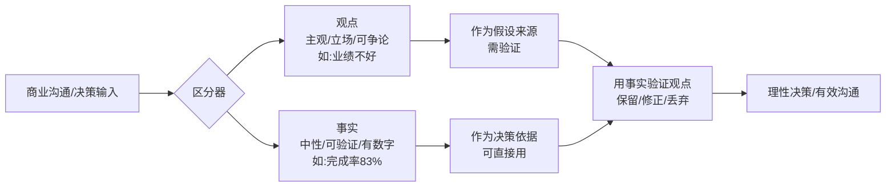

### 为什么需要这个概念？

商业总结与决策中，人们常把个人观点当作事实使用，导致错误判断。观点因人而异、基于立场，事实是中性的、可用数字和证据支撑。学会区分两者，是进行理性商业判断和有效沟通的基础。

### 核心定义

> "我们一定要知道自己和对方说出口的每一句话，到底哪一句是观点，哪一句是事实。我今年业绩做的不好，这句话是观点还是事实？----观点！"
> 
> "只有中性的，能够用数字和证据支撑的才是事实，例如：我今年完成了83%的年度业绩目标。"
> 
> "譬如10摄氏度的气温，对于一个常年生活在0摄氏度地方的人来说，会觉得'好温暖'；可对于一个常年生活在20摄氏度地方的人来说，会觉得'太冷了'。此时，假如双方进行辩论的话，就互相会觉得对方在胡说八道。"
> 
> ——《P002, 20230207_04.md》

- **观点**：因人而异、基于立场和层次差异的判断或感受，无法统一衡量。
- **事实**：中性的、能够用数字和证据支撑的客观陈述。
- **核心要点**与**核心主张**：要点回答"是什么、怎么做"，主张回答"为什么信"，是识别观点中可验证部分的关键。

**这个区分的实战作用是：它给会议室装上了"防胡扯过滤器"。当有人拍桌子说"我觉得这个方向不行"时，你不争辩，直接问："哪个数据说明不行？转化率？留存？还是获客成本？把数据说话。"当复盘报告写"团队执行力强"时，你要求改写为"团队连续3个月按时交付率100%、Bug回归率<5%"。它把主观争吵，强制转化为客观证据的比对——这是商业理性的基石。**

### 关键性质

- 事实无对错、观点可争论——"我今年业绩做得不好"是观点，"我今年完成了83%的年度业绩目标"才是事实。
- 同一事实可支撑不同观点：10摄氏度对南方人觉冷、对北方人觉暖。
- 核心主张常隐含价值观与逻辑推断，需辨析其证据链是否成立。

### 典型例子

- 线下活动到场1200人："很热闹"是观点，"1200人到场"是事实，是否成功取决于与2000人目标的比对。
- 商业复盘"这个项目赚钱"是观点，"这个项目Q3营收120万、毛利率30%"才是事实。

### 边界条件

- 事实也可能被错误引用：需溯源核查数据来源。
- 观点并非无价值：观点是假设的来源，但必须用事实去验证。
- 该概念是沟通与会话的基础，不提供具体的论证方法。

---

## 37.22 核心要点与核心主张 —— 是什么、怎么做、为什么信

### 方法演进图

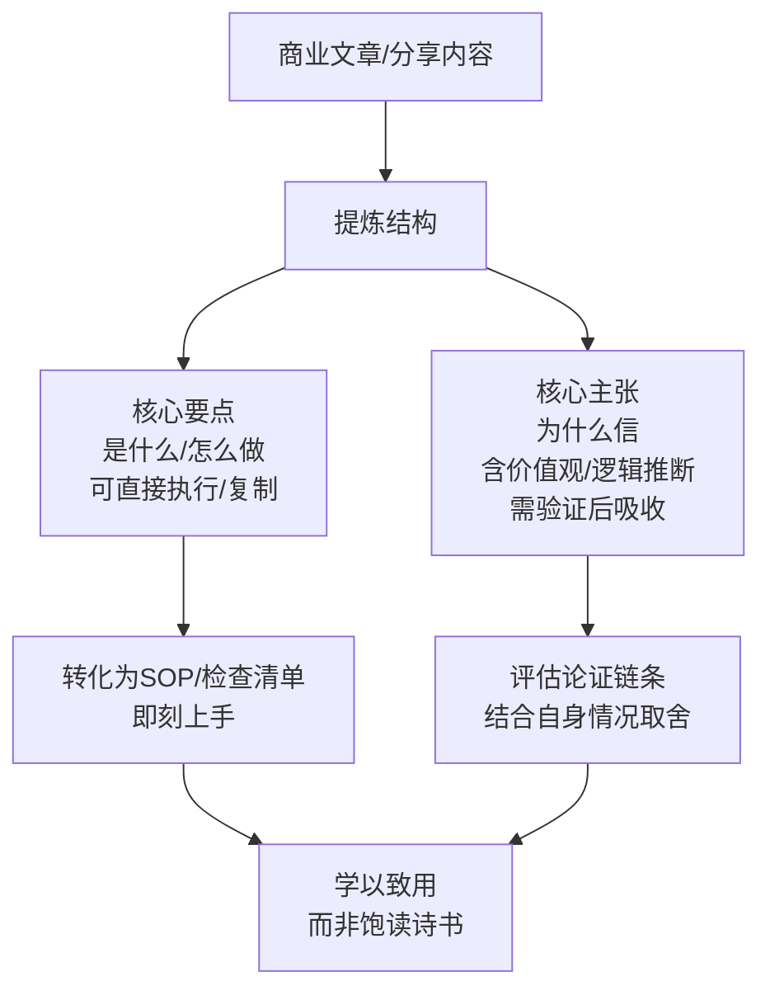

### 为什么需要这个概念？

阅读商业文章或听取分享时，需要快速抓住信息的核心结构。区分"关键要点"（是什么/怎么做）与"核心主张"（为什么信）能提升学习效率，避免把别人的价值观与逻辑推断当作可直接执行的步骤。

### 核心定义

> "一般看到好的文章我都会思考后做精华总结，争取做到看到这一两句话，就能想到整个文章的内容框架。毕竟学习不是为了饱读诗书，而是当你遇到这个问题的时候能快速拿出来用，能做到学以致用的内容才是好内容。"
> 
> "总结的目的是什么？我认为就是简单四个字：发现问题。（请注意，在这里'问题'并非是一个贬义词）"
> 
> "完不成目标有问题，为什么完不成？完成了目标有问题，为什么没办法超额完成？超额完成了目标也有问题，那是不是我们的目标设置得太低？为什么？"
> 
> ——《P002, 20230207_04.md》

- **核心要点**：对方法步骤、概念定义、事实描述的精炼总结。
- **核心主张**：包含价值观与逻辑推断的结论性陈述（如"成功是成功之母""利他等于利己"）。
- 区分方法：要点可转化为行动指令，主张需评估其论证是否成立。

**这个区分的实战作用是：它给你一套"阅读笔记标准化模板"。读完一篇复盘/分享，输出两栏：左栏"要点"——全是动词开头的操作步骤（如"先盘点资源、再拆解项目、后评估匹配度"），可直接做成清单执行；右栏"主张"——全是判断句（如"匹配度比项目好坏更重要"），标注"需验证/认同/存疑"。下次遇到同类问题，翻左栏拿SOP、翻右栏对照判断，实现真正的"学以致用"。**

### 关键性质

- 要点可以直接借鉴/复制，主张需结合自身情况验证。
- 同一篇文章可包含多个要点与一个核心主张（主张统领要点）。
- 主张常以论断句式出现（"XX是XX"），要点以祈使或流程句式出现（"先做A再B"）。

### 典型例子

- 要点：写长尾关键词并铺入文章是操作步骤；主张：搜索流量比推荐流量更有价值是价值判断。
- 要点：盘点资源→拆解项目→评估匹配度是三步流程；主张：匹配度比项目好坏更重要是评估标准。

### 边界条件

- 有些表述兼具要点与主张属性，需结合上下文判断侧重点。
- 该概念是信息处理工具，不替代批判性思维。
- 部分主张基于个人经验，缺乏统计支撑时要保持审慎。

---

## 37.23 SWOT分析与GROW模型 —— 结构化决策的基石

### 方法演进图

```mermaid
flowchart TD
    subgraph SWOT[SWOT分析：现状诊断]
        S[优势 Strengths<br/>内部能力/资源]
        W[劣势 Weaknesses<br/>内部短板/缺口]
        O[机会 Opportunities<br/>外部红利/趋势]
        T[威胁 Threats<br/>外部风险/竞争]
    end
    
    subgraph GROW[GROW模型：路径规划]
        G[Goal 目标<br/>量化/具体/有时限]
        R[Reality 现状<br/>数据/差距/痛点]
        O2[Options 方案<br/>多选/利弊/资源匹配]
        W2[Will 行动<br/>第一步/责任人/节点]
    end
    
    SWOT -->|输出:关键战略议题| GROW
    GROW -->|输出:可执行行动计划| H[落地执行]
```

### 为什么需要这个概念？

面对复杂的商业决策，凭直觉容易遗漏关键维度。需要结构化的分析框架来系统评估内外部环境、拆解目标路径。结构化思维能显著提升决策质量与方案可执行性。

### 核心定义

> "1、期望和现状的差距，就是问题。不管是期望大于现状，还是现状大于期望。"
> 
> "商业模式画布，是我用的众多商业工具里面，用得最多的一个，也是帮我赚钱赚最多的一个。"
> 
> "一、发现成功案例，做有心人；二、八十块跑通项目最小MVP；三、梳理流程团队入场；四、以史为鉴，从平台历史中找共性；五、项目复盘"
> 
> ——《P002, 20230207_04.md》与《P010, 20230207_11.md》

- **SWOT分析**：从内部优势、内部劣势、外部机会、外部威胁四个维度评估现状。
- **GROW模型**：按Goal（目标）、Reality（现状）、Options（方案）、Will（行动）四步完成从目标到落地的路径规划。

**这两个工具的实战组合作用是：SWOT负责"看清局面"，GROW负责"定好路径"。先做SWOT，把内外部因素摊开——优势是我有公众号运营经验，劣势是时间只有2小时/天，机会是视频号私域红利期，威胁是同赛道竞争加剧；再做GROW，目标定"季度末月入1万"，现状是"月入3千靠零散广告"，方案列"提客单价/上服务型产品/拓新平台"三条，最后选一条定未来30天第一步动作。它把"拍脑袋决策"变成了"结构化推演"。**

### 关键性质

- SWOT的"机会"指外部环境有利因素（蓝海市场、政策红利），"优势"指内部能力（技术、资源），二者不可混淆。
- GROW的核心是让目标可量化、现状有数据、方案有多选、行动有节点。
- 两种工具可组合使用：先用SWOT看清局面，再用GROW规划路径。

### 典型例子

- 美团电商冷启动：SWOT发现"新平台红利+自身选品经验"的机会组合，GROW拆解"80元跑通MVP→扩展到30家店"的节点路径。
- 个人副业决策：SWOT评估"写作技能（S）+时间有限（W）+私域红利（O）+竞争激烈（T）"，GROW规划"3个月月入1万"的目标-路径。

### 边界条件

- SWOT是静态分析，需定期更新；GROW依赖目标设定的合理性。
- 过度结构化会抑制直觉判断，应在关键节点结合实战反馈。
- 该工具适用于中期/长期决策，日常小决策无需套用。

---

## 37.24 财务与会计 —— 记录过去 vs 决策未来

### 方法演进图

```mermaid
flowchart LR
    A[原始经济业务] --> B[会计记账<br/>记录过去/合规底线]
    B --> C[财务三表<br/>利润表/资产负债表/现金流量表]
    C --> D[财务分析/决策<br/>决策未来/天花板]
    D --> E[预算/投资/定价/风控]
    E --> A
    
    style B fill:#f9f,stroke:#333
    style D fill:#bbf,stroke:#333
```

### 为什么需要这个概念？

很多创业者把"记账"和"算账"混为一谈，以为记好流水账就等于懂财务。但会计解决"记录过去"的合法合规问题，财务解决"决策未来"的盈亏测算问题。先有会计的底线，才有财务的天花板——没有清晰账目，一切财务决策都是拍脑袋。

### 核心定义

> "很多朋友写自己的亏钱经历，发现大家亏钱的路径其实都差不多：贸然入行、合伙生意、盲目 all in、最终遗憾离场。更有甚者循环往复，一直亏钱。"
> 
> "我总结了一套成功的方法（需要结合生财使用），帮助我扭转局面，3个月赚了100万，总利润超过300w"
> 
> ——《P001, 20230207_03.md》（改写）

- **会计**：记录企业经济活动，确保账目合法合规，核心是"过去"。
- **财务**：基于账目做预算、分析、决策，核心是"未来"。
- 创业初期至少要学会区分二者：先合法合规记账，再用数据做经营决策。

**这个区分的实战作用是：它帮你建立"双账本思维"。一套给税务局看（会计账——合规、准确、按准则）；一套给自己看（管理账/财务账——按项目/渠道/产品切分毛利、算LTV、测ROI、算现金流）。很多创业者只有一套账，要么不合规、要么算不清单品盈亏。区分二者，就是逼自己把"记账"做合规、把"算账"做精准，两手都要硬。**

### 关键性质

- 会计是地基：账目混乱、不合规，轻则无法融资、重则被税务稽查。
- 财务是方向盘：通过利润表、资产负债表、现金流量表看清项目健康度。
- **利润率≠现金流**：账面盈利但现金流断裂是创业公司最常见的死法。

### 典型例子

- 某团队做AI绘画小程序，因预算远超预期、无执照等治理层问题放弃——这是财务决策（而非会计记账）的失败。
- 很多副业项目只算"进账"不算"成本"（如时间成本、固定费用），导致误判盈利。

### 边界条件

- 个体户/小团队可以简单记账，但一旦涉及融资或规模化，必须建立规范的财务体系。
- 会计与财务的职能可以外包，但创始人必须理解基本概念以做出正确决策。
- 该概念是财务素养的起点，具体工具（三表、盈亏平衡）在后续单元展开。

---

## 37.25 进销存、动销率与售罄率 —— 库存健康度的体温计

### 方法演进图

```mermaid
flowchart TD
    A[进销存系统<br/>统一管理采购/库存/销售] --> B[动销率监控<br/>有销售SKU数/总SKU数]
    A --> C[售罄率监控<br/>销售数量/进货数量]
    B -->|动销率低<br/>大量滞销| D[决策：停采/清仓/改款]
    B -->|动销率高<br/>全员轮动| E[决策：扩品/加单]
    C -->|售罄率低<br/>积压严重| F[决策：促销/退货/换品]
    C -->|售罄率过高<br/>90%+| G[决策：紧急补货/涨价]
    D & E & F & G --> H[库存健康/资金周转/利润最大化]
```

### 为什么需要这个概念？

做电商/实体生意，最怕的是"货囤在仓库变库存"——钱变成了卖不动的货。没有系统管理进销存，就不知道哪个品卖得快、哪个品滞销，只能凭感觉补货。动销率和售罄率是衡量库存健康度的关键指标，能直接驱动备货与清货决策。

### 核心定义

> "我通过往年的台灯数据以及生活的经验，预测6月底之后会迎来台灯的小旺季。因为学生们都放暑假了，家长就有需求给孩子配置一个台灯，所以说需求会释放。"
> 
> "72个欧普台灯，共6480元购入；总成本102元每个；旺季时7月单日最高峰卖出9个台灯。"
> 
> ——《P010, 20230207_11.md》

- **进销存**：对采购（进）、销售（销）、库存（存）进行系统化记录与管理的流程。
- **动销率** = 周期内有销售的SKU数 ÷ 库存SKU总数，衡量"有多少款在动"。
- **售罄率** = 销售数量 ÷ 进货数量（或生产数量），衡量"进的货卖掉了多少"。

**这两个指标的实战作用是：它们把"凭感觉备货"变成了"凭数据备货"。每周一早会，拉出动销率报表：动销率<30%→清单前20滞销SKU启动清仓；售罄率>90%→清单前10爆款SKU紧急追单。再结合"需求共振"（如暑假前台灯需求释放），提前2周完成备货。它让库存从"资金黑洞"变成"可控水池"，直接保护现金流。**

### 关键性质

- 动销率低说明大量SKU滞销，占用资金与仓储成本。
- 售罄率低说明进货过多或选品失误，需要及时促销清货。
- 售罄率过高（如90%+）则可能说明备货不足，错失销售机会。

### 典型例子

- 闲鱼倒爷套利法中的飞利浦音响案例：购入5台全部卖出（售罄率100%），验证了选品正确。
- 72个欧普台灯，旺季单日最高卖出9个——通过数据预测季节性需求，备货决策有依据。

### 边界条件

- 不同行业对动销率/售罄率的"健康值"不同：快消品动销率要求高，耐用品可以低一些。
- 进销存系统对规模化经营是必需，但个体小卖家可以用Excel表格替代。
- 该概念侧重库存管理，与"选品""财务管理"衔接紧密。

---

## 37.26 发票合规与税务风险 —— 不能触碰的红线

### 方法演进图

```mermaid
flowchart TD
    A[业务发生真实交易] --> B{开票合规检查}
    B -->|无发票/不开票| C[逃税风险<br/>补税+罚款+滞纳金]
    B -->|虚开发票<br/>无真实交易| D[刑事风险<br/>虚开发票罪]
    B -->|公转私走账<br/>个人户收公款| E[账实不符<br/>税务稽查重点]
    B -->|真实交易/实票实报/对公账户| F[合规安全区<br/>可安心经营]
    C & D & E --> G[一票否决<br/>业务归零/甚至入刑]
    F --> H[持续经营/融资上市/品牌资产]
```

### 为什么需要这个概念？

很多副业/小微创业者对发票不重视：不开发票、乱开发票、用个人账户走账。一旦被税务稽查，轻则罚款，重则追缴补税+滞纳金，甚至涉及刑事责任。理解发票合规是创业的底线——业务可以慢，合规不能丢。

### 核心定义

> "最终我放弃了，原因如下：1.预算远远超出了预期... 2.没有个体和公司执照... 3.工期在 15-20 天左右，对于热点来说，这个时间怕是早就凉透了。4.最为关键的一点，虽然微信搜索指数 AI 绘画出现了异常值，但这次的流量 99%来自于公众号。"
> 
> "人物姓名，单位名称，电话号码等敏感信息和需要打马赛克，避免造成不必要的纠纷。"
> 
> ——《P007, 20230207_08.md》（改写）

- **发票**是购销商品、提供或接受服务的收付款凭证，是税务稽查的核心依据。
- **常见风险**：无发票（不开发票逃税）、虚开发票（无真实交易开票）、公转私走账（个人账户收公司款项）。
- **合规要求**：发票必须基于真实交易，金额、内容、时间与实际一致。

**这个红线的实战作用是：它把"税务合规"从"财务的事"变成了"老板的命"。每个新业务启动前，必须过"发票三关"：①有没有真实交易合同/订单/收货单？②能不能开具合规发票（专票/普票/电子票）？③钱能不能走对公账户全流程留痕？任一关过不去，业务不启动。它让创始人在赚快钱的诱惑面前，有一条绝对不能碰的底线。**

### 关键性质

- 发票合规是"一票否决项"：业务再赚钱，不合规就可能一夜归零。
- 金税四期后，税务系统自动比对进销项发票、资金流、合同，异常自动预警。
- 虚开发票不仅是税务问题，更可能触发刑事责任。

### 典型例子

- 某创业团队因无执照、无法开具发票，被迫放弃AI绘画小程序项目（治理层问题）。
- 大量电商卖家通过个人微信/支付宝收款不开发票，被税务系统识别后追缴数年税款。

### 边界条件

- 个体户与公司的税务要求不同，小规模纳税人与一般纳税人的开票权限不同。
- 部分行业（如跨境电商）有特殊的税务优惠与合规要求。
- 该概念是税务合规的底线，不涉及具体税务筹划技巧。

---

## 37.27 财务健康三表 —— 利润表、资产负债表、现金流量表

### 方法演进图

```mermaid
flowchart TD
    A[利润表<br/>看赚不赚钱<br/>收入-成本-费用=利润] --> D[三表勾稽<br/>综合诊断]
    B[资产负债表<br/>看稳不稳<br/>资产=负债+所有者权益] --> D
    C[现金流量表<br/>看有没有钱花<br/>经营/投资/筹资现金流] --> D
    D --> E[健康度判断<br/>利润率≠现金流<br/>资产≠可用现金]
    E --> F[决策：扩张/收缩/融资/分红]
```

### 为什么需要这个概念？

很多创业者只看"银行余额"判断生意好不好，但余额多≠赚钱，余额少≠亏钱。需要一套标准化的"体检报告"来判断项目的真实健康状况。三大报表是银行贷款、融资、合作的必备材料，也是自我诊断的工具。

### 核心定义

> "对比即将上市的蜜雪冰城和已经上市的奈雪的茶（21年19亿利润 VS 亏损1.5亿），大概能代表加盟模式和直营模式的现状...加盟品牌的利润能力要比直营品牌高非常非常多。"
> 
> "所以喜茶要开放加盟这件事，想想也没啥奇怪的，因为奶茶行业真的不适合做直营。"
> 
> ——《P010, 20230207_11.md》

- **利润表（损益表）**：反映一段时间内的收入、成本、费用与利润，回答"赚不赚钱"。
- **资产负债表**：反映某一时点的资产、负债与所有者权益，回答"稳不稳"。
- **现金流量表**：反映现金的流入与流出，回答"有没有钱花"。

**三表的实战组合作用是：单表看不全、三表看透心。利润表说赚了100万，现金流量表却显示经营性现金流-200万（应收账款堆积/库存积压），这就是"账面富贵、现金流穷"的典型死法；资产负债表显示短期借款占比过高、流动比率<1，就是偿债风险红灯。创始人要学会月度"三表会诊"：利润表看趋势、现金流表看生死、资产负债表看底气。**

### 关键性质

- **利润率≠现金流**：账面上盈利但应收账款多、库存积压，现金流可能断裂。
- **资产≠现金**：资产包含存货、设备、应收账款，不等于可支配现金。
- 三表相互勾稽，不能孤立看待。

### 典型例子

- 蜜雪冰城（加盟）21年19亿利润 VS 奈雪的茶（直营）亏损1.5亿——利润表直接反映商业模式的优劣。
- 许多电商卖家账面GMV很高，但扣除退货、广告费、仓储费后实际亏损——利润表才能看清真相。

### 边界条件

- 个体户/小团队可以不编制完整三表，但至少要会用利润表逻辑算清盈亏。
- 三表是"结果指标"，不能替代对业务过程的关注。
- 该概念是财务健康度评估的基础框架，与"毛利/净利""盈亏平衡点"衔接。

---

## 37.28 毛利与净利 —— 算不清固定费用，就不知道项目生死

### 方法演进图

```mermaid
flowchart LR
    A[收入] --> B[直接成本<br/>进货/材料/包装/佣金<br/>随销量变动]
    A --> C[毛利<br/>收入-直接成本]
    C --> D[固定费用<br/>房租/人工/水电/平台费/折旧<br/>不随销量变动]
    D --> E[净利<br/>毛利-固定费用]
    C --> F[毛利率=毛利/收入]
    E --> G[净利率=净利/收入]
    F & G --> H[盈亏平衡点=固定费用/毛利率]
```

### 为什么需要这个概念？

新手算账常犯一个错误：只算"收入-进货成本"，以为差价就是利润。但房租、人工、水电、设备折旧等固定费用没算进去，导致误判项目可持续性。毛利与净利的区分，是判断"项目是否真的赚钱"的分水岭。

### 核心定义

> "7个店铺营业额加起来 7858，平均到单店营业额就是 1122，正常毛利在 30%左右，单店一天的利润也就 3，400 左右。"
> 
> "多起一些店，再精细点做，平均一个店能做到月利润 1W 左右，做 10 个店就是 10W 了！"
> 
> ——《P010, 20230207_11.md》

- **毛利** = 收入 − 直接成本（进货成本、材料成本等变动成本）。
- **净利** = 毛利 − 固定费用（房租、人工、水电、平台费用等不随销量变化的成本）。
- **毛利率** = 毛利 ÷ 收入；**净利率** = 净利 ÷ 收入。

**这个区分的实战作用是：它逼你算清"单店模型"的真实盈利能力。很多创业者只算毛利率30%就觉得赚大了，结果房租2万、人工3万、水电平台费1万，月固定费用6万，毛利率30%意味着月销售额得20万才保本——单店日销6600元，根本达不到。算清净利，你才知道这个模型能不能跑通、能不能复制、要开多少店才能摊薄固定成本。它是"单店模型验证"的核心计算器。**

### 关键性质

- 毛利率高不代表净利率高：高毛利产品若固定费用摊得太多，净利可能为负。
- 固定费用的分摊是评估"可复制性"的前提：单店盈利模型健康，才能多店复制。
- 规模效应：销量越大，固定费用被摊薄，净利率随之提升。

### 典型例子

- 闲鱼倒爷套利：飞利浦音响购入1400元卖出2250元，毛利850元——但如果没有扣除时间成本、交通费、平台手续费，实际净利远低于毛利。
- 奶茶加盟：单杯毛利高，但加盟商需承担房租+人工+水电等固定费用，净利取决于销量能否覆盖。

### 边界条件

- 固定费用与变动成本的划分因业务不同而异：有些费用部分固定部分变动（如水电）。
- 个体户常把"自己的时间成本"忽略，导致净利虚高。
- 该概念是盈亏平衡点计算的前提。

---

## 37.29 盈亏平衡点 —— 生意的生死线

### 方法演进图

```mermaid
flowchart TD
    A[固定费用汇总<br/>房租/人工/水电/平台费/营销预算] --> B[毛利率测算<br/>单品/品类/加权平均]
    B --> C[盈亏平衡点计算<br/>月度保本销售额 = 固定费用 ÷ 毛利率]
    C --> D{实战应用}
    D -->|定价决策| E[价格不能低于<br/>变动成本+分摊固定费用]
    D -->|销量目标| F[每天至少出单数<br/>=月度保本额/30/客单价]
    D -->|成本控制| G[砍哪项固定费用<br/>最降平衡点]
    D -->|止损决策| H[连续3月未达线<br/>果断收缩/转型]
```

### 为什么需要这个概念？

很多创业者凭感觉判断"这生意能不能做"，却不清楚每月至少卖多少才不亏。盈亏平衡点是评估一切生意可行性的底线指标，低于此数即为亏损。算清盈亏平衡点，才能理性决策"是否入场""是否继续""如何定价"。

### 核心定义

> "打造一个好的产品，需要先解决单店模型的问题，等到单店模型跑通之后，再开始批量化复制，实现规模化增长。"
> 
> "我们提出了一个最新的标准：1）各种门店模型要测算到位；2）单店模型的财务模型要健康；3）要实现一定范围内的区域模型验证；4）该区域模型的复制性和财务模型要达标。"
> 
> ——《P010, 20230207_11.md》

**盈亏平衡点 = 固定费用 ÷ 毛利率**，即每月需达到的最低销售额。低于盈亏平衡点则亏损，高于则盈利。

**这个指标的实战作用是：它是"生意生死线"的量化红线。月度复盘会上，第一张PPT就放盈亏平衡点：固定费用8万、毛利率30%→月度保本销售额26.7万、日均8900元。实际日均只有5000元→缺口3900元/天。接下来只讨论三件事：怎么提毛利率（涨价/换供应链）、怎么降固定费用（减人/搬家/谈租金）、怎么增销量（新渠道/新品/促销）。没算这笔账，一切"冲业绩"都是盲人骑瞎马。**

### 关键性质

- 盈亏平衡点越低的生意，抗风险能力越强。
- 降低盈亏平衡点的途径：①降低固定费用 ②提高毛利率（提价/降成本） ③提高销量。
- 盈亏平衡点随业务阶段变化：初期固定费用高、销量低，平衡点压力大；规模化后固定费用被摊薄。

### 典型例子

- 洛阳市租金1000-2000元的住房，基础员工底薪3000元，每月成交2单即可覆盖人力成本——这就是单员工模型的盈亏平衡点。
- 视频号无货源店群：单店日营业额1122元、毛利30%，单店月利润约1W——通过多店矩阵摊薄固定成本。

### 边界条件

- 盈亏平衡点假设产品结构与价格稳定，现实中需定期重算。
- 该指标为"静态"分析，未考虑现金流时间差（应收/应付款）。
- 适用于单项目/单店评估，不适用于组合投资组合的整体风险判断。

---

## 37.30 投资的风险边界 —— 敬畏市场与保留容错率

### 方法演进图

```mermaid
flowchart TD
    A[资金规模评估] --> B{赛道选择}
    B -->|资金小| C[低风险/长周期/强确定性<br/>如内容变现/服务型]
    B -->|资金中| D[中风险/中周期/可验证<br/>如电商/私域/加盟]
    B -->|资金大| E[高风险/短周期/高杠杆<br/>如投资/并购/基建]
    C & D & E --> F[容错率设定<br/>单项目≤总资金10-20%<br/>预留3-6个月弹药]
    F --> G[小成本试错<br/>MVP验证/分批入场]
    G --> H[敬畏市场<br/>不因短赢轻视风暴<br/>与市场共舞]
    H --> I[长期生存/复利增长]
```

### 为什么需要这个概念？

许多创业者面对热门赛道时容易All in，忽视了风险控制。投资决策需要结合自身资金规模判断赛道适配性。认识风险的不可消除性，学会用小成本试错控制下行风险。

### 核心定义

> "有句老话，选择比努力更重要。在看赛道之前，在于你前期资金规模有多大，再决定要关注什么赛道。"
> 
> "从金融的角度来说，要给自己一定的容错率，如果在早期仅仅是ALL IN在一个方向，风险并不是特别好控制。"
> 
> "真正活下来能够完成远航的老鸟，都懂一句话：'敬畏它，并且与它共舞'。"
> 
> ——《P013, T1Jad4VhIoPc2hxKJxwcUFPOnTc.md》与《P002, 20230207_04.md》

- **赛道选择取决于前期资金规模**——资金规模决定可承受的风险层级。
- **容错率**：早期决策中为自己预留的试错空间，避免单一方向All in导致风险失控。
- **敬畏市场**：尊重市场的不可预测性，不因短期成功而轻视风险。

**这个认知的实战作用是：它给你一套"投资风控SOP"。看到新赛道火了，不问"能不能赚大钱"，先问三个问题：①我手里有多少弹药（闲置资金）？②这个赛道适合我这级别的弹药吗？③我留了多少容错率（单项目上限≤总资金10-20%，预留半年运营资金）？如果答案是"弹药少、赛道重、容错率零"，哪怕赛道再火、大佬都在冲，你也坚决不碰。它把"不敢赚大钱"的遗憾，换成"绝不输光本金"的从容。**

### 关键性质

- "选择比努力更重要"——选赛道是投资的第一步，选错赛道再努力也难成功。
- 容错率是风险管理的核心：用可承受的损失换取学习机会。
- 市场风险不可消除，但可以通过仓位管理、多方向试错来分散。

### 典型例子

- Web3赛道选择：传统金融从业者通过"扫描-入局-验证-链接"闭环，以初学者身份参与项目验证可行性。
- 熊市生存法则：不做杠杆合约、小成本试错、保护团队资金，选择资金充裕的基建公司。

### 边界条件

- 容错率不是保守主义：在充分验证后仍需果断重仓。
- 该概念侧重投资心态与风险管理，不提供具体投资策略。
- 高风险投机的判断需要结合个人风险承受能力。

---

## 37.31 多源对照

### 时代红利的多重论证

**共识**：多篇素材均指向"趋势主导、能力放大"的核心判断。

**分歧**：
- 《P001》强调"九成靠红利"的定量夸张表达，侧重心态建设；
- 《P004》结合具体赛道（视频号直播+私域）论证红利窗口的捕捉；
- 《P013》从金融视角将红利识别提升为"选择比努力更重要"的战略原则。

### 好方向公式的适用边界

**共识**：三维交集、权重排序的核心框架无异议。

**分歧**：
- 《P001》给出个人方向选择的标准版本；
- 《P011》将"能做"拆解为"你是该领域专家"与"能坚持下去"两个硬性条件，并增加"有真实需求"作为前置门槛，形成"高成功率产品Idea的三个条件"。

### 刚需生意观的实操差异

**共识**：刚需项目自带转化力、非刚需链条长推不动。

**分歧**：
- 《P004》以作者自身"只做副业和减肥"为例，强调个人执行层面的选择；
- 《P011》将"刚需"拆解为"真实需求存在"作为产品Idea评估的第一条件，并结合季节性"需求共振"给出选品时点判断法。

---

## 37.32 设计中的取舍

**为什么不用"全靠自己努力"的叙事？**
因为数据与现实都证明：在红利期，中等能力也能跑赢大盘；在红利退去期，顶级能力也难逆势突围。夸大个人能动性会导致顺境盲目自信、逆境过度自责，且错失"识别红利窗口"这个最高杠杆动作。

**为什么不用"追求流量规模最大化"作为运营目标？**
流量价值公式的乘积关系决定：相关性或信任度为零时，规模再大价值也是零。追求规模往往伴随内容泛化、信任度稀释，反而降低整体变现效率。"不轻易连接，但连接必有价值"是更优策略。

**为什么MVP要"先卖后做"而不是"先做后卖"？**
"先做后卖"把最大的不确定性（需求是否存在）推到投入沉没成本之后；"先卖后做"把不确定性前置，用最小成本（预售话术、Landing Page）在开发前完成验证。筛选大于培养，试错次数决定生存概率。

**为什么战略要"稳于执行"？**
执行层只能在既定方向上优化效率，无法修正方向性错误。治理层频繁变动战略，等于让执行层在沙地上盖楼。战略稳定是执行有效的前提，不是执行力的替代品。

**为什么利他不等于无底线分享？**
核心商业机密（如具体供应链联系人、核心参数配置、未公开的数据模型）不属于分享范围。利他分享的是"方法论框架""复盘逻辑""避坑指南"——这些能帮助他人成长，但不构成直接替代性竞争威胁。

---

## 37.33 动手练习

### 练习 1：用"好方向公式"评估三个候选方向

假设你目前的技能是：公众号写作（3年经验）、基础Python爬虫、社群运营（2个千人社群）、对AI绘画特别感兴趣但完全不懂技术。

现有三个候选方向：
A. AI绘画教学付费社群（需懂提示词工程和出图流程）
B. 公众号+知识付费（用写作能力做垂直领域内容，靠课程变现）
C. Python爬虫接单（给企业做数据采集外包）

**任务**：
1. 对每个方向分别评估"想做"（0-10分）、"能做"（0-10分）、"可做"（0-10分）三个维度
2. 按"能做>想做>可做"的权重排序，计算每个方向的加权综合分
3. 选出综合分最高的方向，并说明你的理由
4. 指出每个方向在哪个维度上最薄弱，以及如何补足

**思考题**：
- 如果AI绘画方向"想做"得9分、"能做"只有3分，你会在当前阶段把它作为主业吗？为什么？
- 好方向公式在什么情况下不适用？例如个人有充足资本时权重是否需要调整？

### 练习 2：拆解一个"高规模低价值"的流量案例

给定三个流量案例：
案例A：某娱乐公众号一篇"明星离婚内幕"文章阅读量10万+，评论区活跃，但文章无任何商品链接，涨粉2000但一个月内取关1000。
案例B：某护肤KOL在小红书发了一篇"300元以内平价防晒霜实测"笔记，阅读量仅3000，但评论区有200条求链接，私信引流到微信成交50单，客单价99元。
案例C：某知识博主在知乎回答"如何零基础学Python"，获赞5000，收藏2万，引流公众号500人，但一个月后付费课程仅卖出3份。

**任务**：
1. 用"流量价值 = 规模 × 相关性 × 信任度"公式，对三个案例的每个维度打分（0-10分）
2. 计算每个案例的流量价值总分
3. 排序三个案例的"实际变现潜力"，并解释为什么阅读量最高的案例A不一定变现最高
4. 针对案例C，提出两种提升信任度的具体方法（如内容策略、背书手段等）

**思考题**：
- 如果案例A的公众号主通过接品牌广告变现，这属于流量价值公式中的哪个维度起作用？
- 信任度的建立通常需要多长时间？在三个月内有无快速建立信任的替代手段？

### 练习 3：设计一次"MVP先卖后做"的验证实验

假设你想开发一个"帮新手妈妈做辅食规划"的付费产品，但不确定需求强度。

请设计一个MVP验证方案，要求：
1. 不开发任何产品（无App、无课程、无资料包），仅用"卖想法"的方式验证
2. 明确你的目标用户是谁、在哪里可以触达他们（如宝妈群、小红书、朋友圈）
3. 设计你的"预售话术"：如何向用户描述产品价值并引导付费（口头承诺即可，不需要真交付）
4. 设定验证标准：多少人愿意付预售金（如9.9元定金）就判定需求成立
5. 规划验证周期：多久内测试完，如果失败下一步做什么

**思考题**：
- MVP验证中"20-30人购买并交预售金"作为需求成立的标准，在不同客单价下是否应该调整？为什么？
- 如果验证通过，你下一步会先做产品还是继续扩大预售？依据是什么？

### 练习 4：识别你身处财富积累的哪个阶段并规划跃迁路径

对照财富积累四阶段模型：①出卖劳动力 ②一份时间多次卖 ③购买他人时间 ④钱生钱。

请结合自身情况完成：
1. 判断你当前处于哪个阶段，并给出至少两条判断依据（如收入来源、时间投入方式等）
2. 若要跃迁到下一阶段，描述你需要引入的"杠杆"是什么（如内容杠杆、人力杠杆、资本杠杆）
3. 找出制约你跃迁的1-2个最大瓶颈（如技能不足、本金不够、时间被占满等）
4. 制定一个90天的跃迁行动计划：具体做哪三件事，每件事的完成标准是什么

**思考题**：
- 是否存在跳过阶段直接进入"钱生钱"的情况？这种情况的可持续性如何？
- "一份时间多次卖"是否适用于所有职业？医生、律师等职业如何实现多次售卖？

### 练习 5：设计一份"有效劳动合同"的附件清单并模拟辞退流程

假设你是一家初创公司的负责人，需要为新入职的员工设计一份完整的劳动合同体系。

**任务一（合同体系设计）**：
1. 列出除劳动合同主文件外，你必须配套的附件清单（至少4项）
2. 针对"岗位考核表"这一附件，设计一个可量化的考核模板（含3-5个考核指标）
3. 说明每一项附件分别解决了什么风险（如劳动争议举证、保密义务等）

**任务二（辞退流程模拟）**：
1. 描述一个你作为负责人需要辞退员工的场景（设定具体理由）
2. 按照"损失最小化原则"列出你的处理步骤（至少4步）
3. 解释为什么"离职原因写个人原因"和"离职当天结清工资"是重要的操作

**思考题**：
- 如果员工拒绝在离职表上签字或拒绝写"个人原因"，你会如何应对？
- 劳动合同的时效性要求是什么？为什么节假日前后更容易出现未及时签合同的情况？

### 练习 6：用"资源盘点与项目拆解法"评估一个新项目

给定一个新项目：在小红书做"考研资料号"（整理各专业考研资料，通过引流私域售卖变现）。

你目前的资源情况：
- 粉丝：小红书账号3千粉（教育类目）
- 经验：2年考研辅导经验（曾带过50+学生）
- 软件：熟练使用Excel和Canva
- 团队：无

**任务**：
1. 第一步：盘点你自己现有资源（至少有4项）
2. 第二步：拆解"考研资料号"项目需要的核心资源
3. 第三步：评估资源匹配度，给出匹配百分比和理由
4. 如果匹配度不足，指出最薄弱的1-2项资源，并给出如何补齐的具体建议

**思考题**：
- 资源匹配度不足时，是应该放弃项目还是先补齐资源再启动？判断标准是什么？
- 如果该项目匹配度达到100%但你并不喜欢，你会怎么选择？为什么？

### 练习 7：识别"被想拥有的东西绑架"的增长怪圈并构建价值创造视角

分析以下三个案例，判断它们是否处于"增长瓶颈怪圈"，并提出破解建议。

案例A：某公众号博主为了追求粉丝量增长，开始频繁蹭热点、标题党，三个月后粉丝增长停滞，但内容质量明显下滑。
案例B：某电商卖家为了冲GMV，大幅压低价格做促销，一个月后发现利润趋近于零，但不敢涨价，担心销量下滑。
案例C：某知识博主看到同行做直播带货赚钱，于是放弃自己擅长的图文内容转做直播，三个月后直播收益远低于预期，而原有的粉丝也开始流失。

**任务**：
1. 分别判断三个案例是否被增长预期绑架，说明理由
2. 对每个案例，指出它"距离增长越来越远"的具体表现（如投机跟风、计算利弊、抓取资源）
3. 用"价值创造视角"为每个案例提出一条破解建议（如面向未来、面向用户、积累价值）

**思考题**：
- 如何判断一次增长策略调整是"价值创造"还是"被增长绑架"？标准是什么？
- 如果企业正处于增长怪圈中，短期内需要用数据向股东交代，如何在"价值创造"与"短期增长"之间取得平衡？

### 练习 8：计算一个副业的盈亏平衡点

假设你想在闲鱼上卖二手Kindle，固定费用包括：
- 每月网费分摊：50元
- 每月交通费：100元
- 每月时间成本（按兼职时薪折算）：500元
- 每月摊位/平台费用：50元

每台Kindle进货成本200元，售价350元。

**任务**：
1. 计算每台Kindle的毛利
2. 汇总每月的固定费用总额
3. 用"盈亏平衡点 = 固定费用 ÷ 毛利率"公式计算每月至少需要卖出多少台Kindle才能保本
4. 如果每月实际只能卖出5台，这个项目是否值得继续？给出你的判断依据

**思考题**：
- 如果Kindle的进货价上涨到250元，盈亏平衡点会发生什么变化？
- 除了"多卖出"，还有哪些方式可以降低盈亏平衡点？

### 练习 9：区分商业文章中的"事实、观点与核心主张"

以下是从一篇商业复盘文章中摘录的三句话：
句子A：'我们团队在2023年Q3的GMV达到120万元，环比增长35%，其中来自私域复购的贡献占比为42%。'
句子B：'这个项目的成功主要是因为团队执行力强，方向选对了。'
句子C：'我坚持认为，任何副业项目只要坚持做一年以上就一定能看到效果，因为"成功是成功之母"，持续的努力最终会带来回报。'

**任务**：
1. 判断句子A是"事实"还是"观点"，并说明判断依据
2. 判断句子B是"事实"还是"观点"，如果是观点，指出其中可能包含的立场偏差
3. 分析句子C中的"核心主张"是什么？它的支撑逻辑是什么？你认为这个主张是否成立？
4. 将句子B改写成一条"基于事实"的描述

**思考题**：
- 在实际商业决策中，为什么"区分事实与观点"比"找到正确答案"更重要？
- 商业复盘中常见的"归因偏差"有哪些？如何避免用观点代替事实？

### 练习 10：用SWOT分析和GROW模型规划一个季度目标

假设你计划在未来一个季度内，将你的副业月收入从3000元提升到1万元。
当前情况：你有公众号（5000粉）、小红书（2000粉），每月靠接零散广告赚3000元，每天能投入2小时。

**任务一（SWOT分析）**：
1. 列出你的优势（S）至少3项
2. 列出你的劣势（W）至少2项
3. 列出外部环境的机会（O）至少2项
4. 列出外部环境的威胁（T）至少2项

**任务二（GROW模型）**：
1. Goal：将目标拆解为更具体的量化指标（如粉丝量、广告单价、产品收入各占多少）
2. Reality：分析当前现状与目标之间的差距具体体现在哪些环节
3. Options：列出至少3条可行路径（如提高客单价、增加服务型产品、拓展新平台）
4. Will：选出1条路径，写下未来30天的第一个具体行动步骤

**思考题**：
- SWOT分析中"机会"和"优势"的区别是什么？如果两者混淆会带来什么问题？
- GROW模型的四个步骤中，哪一步最容易被人跳过？为什么这一步如此重要？

---

## 37.34 本章小结

这一章中我们系统学习了商业认知的底层逻辑。首先，我们认清了时代红利与个人能力的权重关系——九成收入靠趋势，一成靠自己，识别红利窗口比单纯苦练能力更紧迫；其次，我们掌握了好方向公式（想做×能做×可做），并理解能做的权重最高，为个人方向选择提供了量化筛选工具；接着，我们拆解了流量价值公式（规模×相关性×信任度），明白了乘积关系下任何维度趋零整体价值归零，从而不再被虚荣指标迷惑；然后，我们梳理了财富积累四阶段的递进逻辑（出卖劳动力→时间多次卖→买他人时间→钱生钱），明确了杠杆引入是跃迁的关键；随后，我们建立了刚需生意观与内容价值金字塔，用项目本性与内容层级判断变现天花板；之后，我们掌握了公域引流私域变现的转化链路与五句心法，以及流量切片分析法、流速控制等可执行的运营方法论；再后，我们学会了MVP先卖后做的低成本验证路径，并理解了战略稳于执行论、利他等于利己等长期主义底层逻辑；紧接着，我们识别了劳动法合规风险（合同是枪附件是子弹）、辞退损失最小化原则，以及没有壁垒项目的本质（付费买试错经验）与资源匹配度评估法；最后，我们区分了增长瓶颈怪圈与价值创造视角，掌握了事实与观点、核心要点与核心主张的辨析方法，熟悉了SWOT/GROW等决策工具，并建立了财务与会计、进销存动销率、发票合规、三大报表、毛利净利、盈亏平衡点、投资容错率等完整的财务风控知识体系。

本章我们一起学习了以下概念：

| 概念 | 解释 |
|------|------|
| 时代红利与个人能力 | 普通人约九成收入来自时代红利、仅一成是能力补偿，识别并乘上红利窗口比单纯苦练能力更紧迫 |
| 好方向公式 | 好方向 = 想做 × 能做 × 可做的交集，权重排序为能做（硬技能）> 想做（心态）> 可做（体力） |
| 流量价值公式 | 流量价值 = 规模 × 交易相关性 × 信任度，三者是乘积关系，任何一项趋零整体价值就趋零 |
| 财富积累四阶段 | 出卖劳动力→一份时间多次卖→购买他人时间→钱生钱，必须依次跃迁不可跳跃 |
| 刚需生意观 | 只做刚需项目，非刚需链条太长推不动，是项目的本性成就人而非人去硬推项目 |
| 内容价值金字塔 | 内容价值分娱乐（难变现）、工具（可引流）、方法（IP壁垒最高）三层，层越高变现力越强 |
| 公域引流私域变现 | 公域流量属于平台、私域属于自己，整套商业模式的核心是把公域流量导入微信私域做反复成交 |
| 流量切片分析法 | 把流量按横向（来源/趋势/干预）与纵向（用户/行为/价值）切成片分析，才能形成可执行的运营干预动作 |
| 流量流速悖论 | 流量必须不快不慢、持续不断才能产生最大价值，核心是增加用户停留时间并保持规模 |
| MVP先卖后做 | 先卖产品想法而非做产品，20-30人付费预购即验证需求成立，可在短时间测试几十个产品 |
| 战略稳于执行论 | 公司经营不善的根源多在治理层（三会一层）而非执行层，战略既非一朝一夕也非朝令夕改 |
| 利他等于利己 | 乐于分享好方法不会因竞争受损，反而因分享获得更大回报和信息回流，信息分享是复利投资 |
| 劳动合同有效性 | 一份有效的劳动合同必须包含岗位考核表、公司规章制度、廉洁自律协议、员工保密协议等附件，合同是枪、附件是子弹 |
| 辞退损失最小化 | 处理被辞退员工只能尽量减少损失而无法完全避免：引导签个人原因离职表、当天结清工资、收集证据 |
| 没有壁垒的项目 | 普通人能接触的互联网项目基本无绝对核心壁垒，项目培训的本质是让用户付费购买别人的试错经验和时间 |
| 创业项目匹配度 | 赚钱应结合自身已有资源而非盲目all in；新项目与自身资源的匹配度（而非项目好坏）决定成功概率 |
| 被想拥有的东西绑架 | 当企业或个人被增长的预期绑架，会陷入越追求增长反而距离增长越远的恶性循环 |
| 价值创造视角 | 破解增长焦虑的唯一方法是实现视角的根本性切换：从"我如何得到增长"转变为"我如何成为一个值得被奖赏增长的人" |
| 事实与观点 | 观点因人而异、基于立场可被争论，事实是中性的、能用数字和证据支撑，决策必须依据事实而非观点 |
| 核心要点与核心主张 | 核心要点回答"是什么、怎么做"，核心主张回答"为什么信"——包含价值观与逻辑推断，是提炼和评估观点的关键 |
| SWOT分析与GROW模型 | SWOT从优势、劣势、机会、威胁四个维度结构化评估内外部环境；GROW模型按目标、现状、方案、行动四步拆解落地路径 |
| 财务与会计的职能差异 | 会计解决"记录过去"的合法合规问题，财务解决"决策未来"的盈亏测算问题，先用会计思维守住底线，再用财务思维算出天花板 |
| 进销存与动销率 | 用进销存系统统一管理采购、库存、销售，动销率=周期内销售SKU数÷库存SKU数，售罄率=销售数量÷进货数量，二者共同驱动备货与清货决策 |
| 发票合规风险 | 无发票、虚开发票、公转私走账是常见税务风险，一旦被税务稽查轻则罚款重则追缴补税+滞纳金，是绝对不能触碰的红线 |
| 财务健康三表 | 利润表看赚不赚钱、资产负债表看稳不稳、现金流量表看有没有钱花；利润率再高，现金流断裂仍会倒闭 |
| 毛利与净利 | 毛利=收入−直接成本，净利=毛利−固定费用（房租/人工/水电），只算毛利不算固定费用会误判项目可持续性 |
| 盈亏平衡点 | 盈亏平衡点=固定费用÷毛利率，即每月需达到的最低销售额，低于此数即为亏损，是评估一切生意可行性的底线指标 |
| 投资的容错率 | 选择赛道依赖前期资金规模，但要给自己留足容错率，避免早期All in单一方向导致风险失控 |

下一章中，我们将学习如何将这些底层认知转化为具体的项目操盘框架，从选品、流量、转化到交付与放大，构建一套可复制的商业执行体系。


