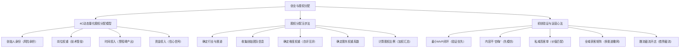
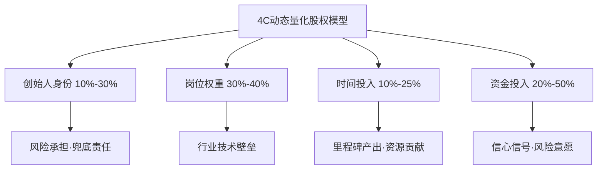
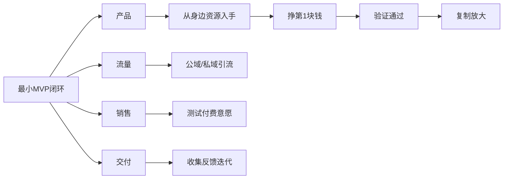
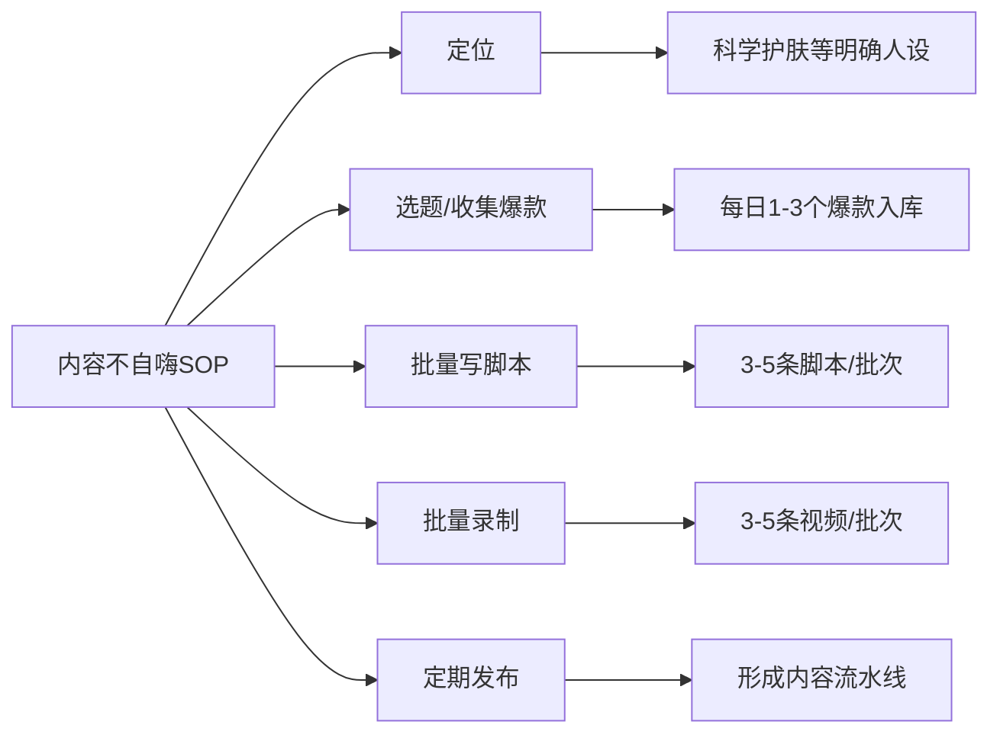
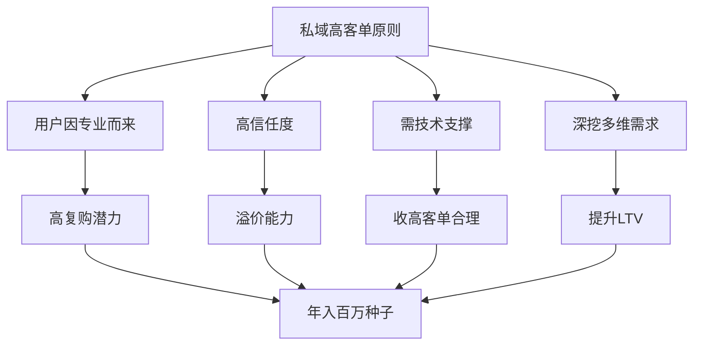
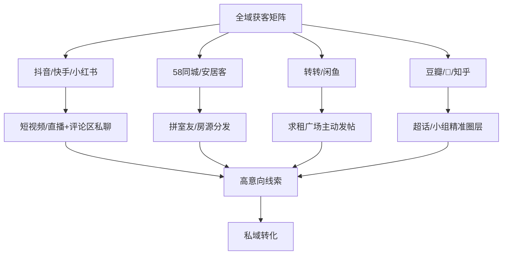
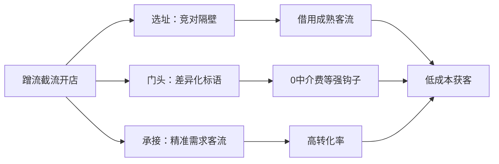

# 第 24 章 创业与股权分配 —— 从“拍脑袋”到“算着分”

## 学习目标

- 理解分配模型从“拍脑袋”到“定量计算”的转变逻辑
- 掌握 4C 动态量化股权模型的四个维度及其评估要点
- 掌握股权分配五步法的操作流程
- 理解“创始人身份=风险承担”“时间投入=里程碑产出”等核心观点的要义
- 能运用最小 MVP 思维验证初始商业模式
- 能应用“内容不自嗨、私域高客单”等原则优化获客与转化策略

## 24.1 生活类比

想象创办一家公司的那张“股权分配表”是一张按不同口味切分的披萨。创始人身份是深夜打烊后还愿意留下来锁门的人，谁兜底谁就拿到那把唯一的钥匙——控制权；岗位权重是厨师长的配方决定了披萨的味道，技术壁垒最高的岗位自然分到的那块厚一点；时间投入不是看谁在店里坐得久，而是看谁端出的菜正好赶上饭点——产出要匹配项目里程碑；资金投入是谁愿意掏出真金白银买下第一批面粉，谁就更有资格关心店里的招牌怎么挂——这是信心与风险意愿的信号。就像一份披萨需要按配料、工时、出资与担责来公平切分，合伙创业的股权也需要依据这四个维度来量化切割，才能让大家吃得心服口服。如果只是凭感觉“你一块、我一块”地切，总有人觉得自己的那块小了，等到店里生意越来越好，这块披萨就越切越别扭——这正是大多数合伙人最终拆伙的根源。

## 24.2 概念地图

## 24.3 4C动态量化股权分配模型 —— 把“分饼的刀”变成“称重的秤”

### 为什么需要这个概念？

多个合伙人创业时，分股权是极易引发矛盾的点：大家往往凭感觉、凭资历或凭关系分配，容易造成“出力最多的人拿得最少”的不公平感。大多数合作伙伴拆伙的原因，就是觉得自己最重要、出力最多，但分到的钱不是最多；根源在于前期做股权设计时，大家对各自重要程度的判断不一致。传统“拍脑袋”分股权在公司尚未盈利时看似和谐，但随着公司壮大，分歧会逐渐积累成隐患。

> “这个分歧在我们前期做股权设计的时候，大家可能不容易发现，但是在公司发展壮大的过程中，越到后面越会产生一些隐患。因为大家从一开始对自己的重要程度的判断就是不一致的，大多数合作伙伴拆伙，就是觉得自己最重要，出力最多，但是分到的钱又不是最多。”
>
> ——《4C动态量化股权分配模型》 P001

### 核心定义

**4C动态量化股权分配模型** 是一个用于初创团队量化股权分配的工具，将资本分为人力资本和货币资本，再细分为四个维度：创始人身份、岗位权重、时间投入、资金投入。每个维度带有可波动的建议权重范围，通过加权计算得出各股东应得的股权比例。四个维度的权重并非固定，需要创始团队通过自评和互评达成共识。

> “今天给大家提供一个工具，这个工具的名称叫 4C 动态量化股权分配模型。4C中的C，就是资本的意思，资本我们分为人力资本和货币资本。再细分成4个维度的话，就是创始人身份、岗位权重、时间投入、资金投入。这四个维度是这个工具里面已经给大家植入的一个参数，这个参数是在一定的范围内波动的。”
>
> ——《4C动态量化股权分配模型》 P001

以下是各个维度的参考权重区间：

| 维度 | 权重范围 | 核心含义 |
|------|----------|----------|
| 创始人身份 | 10%-30% | 风险承担与兜底责任 |
| 岗位权重 | 30%-40% | 行业技术壁垒所在 |
| 时间投入 | 10%-25% | 有效产出与资源贡献 |
| 资金投入 | 20%-50% | 信心与风险意愿信号 |

> “创始人身份的权重通常在10%-30%。岗位权重通常在30%-40%。时间投入的权重通常在10%-25%。资金投入的权重通常在20%-50%。需要和大家再解释下，这4个维度的比例并不是固定的，上文给到大家的比例，是成百上千个案例积累下来的一个经验，在实操过程中，最终还是要创始团队一起来做一个锚定，达成共识。”
>
> ——《4C动态量化股权分配模型》 P001

### 各维度深度解析

#### 创始人身份 —— 不是“头衔”而是“谁兜底”

**为什么需要这个概念？** 在多合伙人项目中，如果创始人身份不明确，就会出现“谁都说了算、谁都不负责”的混乱局面。公司对外只能有一个声音，创始人身份必须从开始就极度明确，否则后期容易产生控制权纠纷。明确创始人身份是 4C 模型的第一步，也是最重要的维度，直接关系到谁拥有最终决定权。

**核心定义**：创始人身份在 4C 模型中代表风险承担：谁承担最大风险、谁最后兜底，谁就最有控制整个企业的需要。权重通常在 10%-30%。

> “1.创始人身份它其实是最重要的，我认为谁承担最大的风险，谁就最有控制整个企业的需要。……谁来最后承担这个兜底的人，那么我会认为这个人他就是发起人和创始人。……创始人身份的权重通常在10%-30%。”
>
> ——《4C动态量化股权分配模型》 P003

**关键性质**：
- 创始人身份的本质不是荣耀而是责任：创始人需要对项目有与其他人完全不同的付出程度。
- 创始人身份必须从一开始极度明确，一家公司对外只能有一个声音。
- 创始人身份是 4C 模型中最重要的维度，也是股权分配的首要锚点。

**典型例子**：儿童体能训练项目中，小明作为发起人（前期出资 50 万），被认定为创始人，是项目遇到风险时无条件兜底的人。

**边界条件**：
- 创始人身份认定需要团队共同认可，若有多人同时声称自己是创始人，则需回到“谁愿意兜底”这一本质标准来判断。
- 创始人身份权重并非固定，需结合项目阶段和团队共识在 10%-30% 区间内调整。
- 创始人身份不等于“老板”或“最大股东”，控制权还需与股权、投票权等机制协同。
- [需要补充文献] 关于创始人身份与控制权分离的具体法律工具（如 AB 股、一致行动人协议）在不同司法管辖区的适用边界。

#### 岗位权重 —— 反映行业技术壁垒所在

**为什么需要这个概念？** 哪个岗位对项目重要性最高，那个岗位获得的权重就越大。比如在一家技术驱动型的科技公司，技术岗的权重必然高于行政岗。这个维度上的分歧最难在前期发现，但越到后期隐患越大。

**核心定义**：岗位权重反映行业技术壁垒所在，即哪个岗位对项目重要性最高，权重通常在 30%-40%。

> “2.岗位权重，就是这个行业技术壁垒在哪里，那个岗位是最重要的。……这个分歧在我们前期做股权设计的时候，大家可能不容易发现，但是在公司发展壮大的过程中，越到后面越会产生一些隐患。……岗位权重通常在30%-40%。”
>
> ——《4C动态量化股权分配模型》 P002

**关键性质**：
- 岗位权重由赛道属性决定：技术驱动型项目技术岗权重高，销售驱动型项目市场岗权重高。
- 岗位权重是四个维度中上限最高的（40%），体现核心竞争力所在岗位的稀缺性。
- 岗位权重评估需结合行业成熟度：早期技术壁垒高时技术岗权重大，后期运营壁垒显现时运营岗权重可能上升。

**典型例子**：儿童体能训练项目中，三位合伙人通过自评互评确定岗位权重为 7:2:1，反映技术/教学岗位（小明）在该赛道的核心地位。

**边界条件**：
- 岗位权重不等于职位高低，而是“该岗位对项目核心壁垒的贡献度”。
- 跨职能合伙人（如既做技术又做产品）的岗位权重分配需拆分到具体模块，避免双重计算。
- [需要补充文献] 不同细分赛道（如 SaaS、生物医药、消费品牌）的岗位权重基准值缺乏公开基准数据，建议结合行业头部公司早期股权结构反推。

#### 时间投入 —— 不是“全职兼职”而是“里程碑产出”

**为什么需要这个概念？** 如果只按“全职还是兼职”来分配时间投入权重，会忽略一个重要现实：约 60% 的项目的合伙人其实都全职参与。全职参与并不等于产出到位——一个人全职坐班但产出跟不上项目里程碑，与一个兼职但每阶段都超额交付的人，对项目的贡献截然不同。时间投入是 4C 模型中关键的区分维度，但也是最容易被简单化、被误判的一个维度。

**核心定义**：时间投入在 4C 模型中指合伙人投入项目的时间精力以及愿意引进的资源，不能简单以全职兼职区分，更要看其产出是否匹配上项目里程碑的进展。权重通常在 10%-25%。

> “3.时间的投入，最简单的划分就是全职还是兼职，投入精力的大小等。时间投入的权重通常在10%-25%。……但是大家有没有想过，就是其实有 60% 左右的项目，所有的合伙人除了纯财务投资人之外，其实都是全职参与的。只是说你全职参与的这个产出它是不是就能匹配的到这个项目的所有的进展，项目到达的里程碑是不是跟你全职参与有必然关系。所以我们前期在做股权设计的时候，就一定要讲清楚，这个时间投入，它对应的除了是我们投入的时间精力，还有我们愿意引进的资源，愿意为了这个项目付出多少，不单单只是一个全职兼职。”
>
> ——《4C动态量化股权分配模型》 P004

**关键性质**：
- 衡量时间投入不能只看“来了多少小时”，更要看“产出是否匹配项目里程碑”。
- 时间投入还包括愿意为项目引进的资源，不单只是时间精力。
- 约 60% 左右的项目，所有合伙人（除纯财务投资人外）其实都是全职参与。

**典型例子**：儿童体能训练项目中，三位合伙人通过自评互评确定时间投入权重为 6:3:1，反映出各自投入产出对项目里程碑的实际贡献差异。

**边界条件**：
- 时间投入权重需在前期股权设计时就讲清楚，避免后期因“我觉得我投入很多”产生纠纷。
- 该方法适用于需要团队共同投入的初创项目，对于纯财务投资人占多数的项目，时间投入维度的权重可能不适用。
- “时间投入”不应被误解为“工作时间”，而应理解为“有效产出+资源贡献”的综合衡量。

#### 资金投入 —— 用真金白银“下注”项目信心

**为什么需要这个概念？** 项目启动离不开资金，但资金投入不仅仅是“给钱”，更是合伙人展示信心和承担风险意愿的方式。愿意投入多少真金白银，可以直观反映合伙人对项目的看好程度，是判断长期投入诚意的重要信号。在 4C 模型中，资金投入是最容易量化的维度，也是决定项目能否启动的基础条件。

**核心定义**：资金投入在 4C 模型中指项目前期资金的投入，用于支撑项目启动和初期运营。权重通常在 20%-50%，是四个维度中权重区间最大的。可以通过时间投入和资金投入去判断合伙人对项目的信心和他愿意承担多大的风险。

> “4.资金的投入。这个比较好理解，所有的项目都会有一个前期资金的投入。……我们可以通过时间投入和资金投入去判断这个合伙人他对项目的信心和他愿意承担多大的风险。资金投入的权重通常在20%-50%。”
>
> ——《4C动态量化股权分配模型》 P005

**关键性质**：
- 资金投入是判断合伙人对项目信心和承担风险意愿的信号：愿意下重注的人通常对项目更笃定。
- 资金投入权重区间最大（20%-50%），因为它直接决定项目能否启动，且不同行业对资金的需求差异巨大。
- 资金投入与创始人身份、岗位权重、时间投入共同构成 4C 模型的完整评估体系。

**典型例子**：儿童体能训练项目中，小胡是拆迁户特别有经济实力，愿意投资 150 万，远超其他两位合伙人的出资，因此在资金投入维度上获得更高权重系数。

> “合伙人三：小胡，现在在国企上班，家里拆迁户特别有经济实力，他愿意投资 150 万。……小明作为发起人，前期是准备出资 50 万，但是小磊不太愿意出钱了，他就觉得市场为王，能搞定市场，他就不需要出钱了。”
>
> ——《4C动态量化股权分配模型》 P005

**边界条件**：
- 资金投入权重因行业而异：技术驱动型项目对资金需求相对低，资金驱动型项目（如重资产行业）资金权重更高。
- 资金投入高并不意味着股权一定高，还需与其他三个维度综合权衡。
- 纯财务投资人（只出钱不参与经营）的资金投入评估方式与全职合伙人应有所区分。

### 典型例子

三个朋友（小明、小磊、小胡）合伙做儿童体能训练项目，预期启动资金 200 万：
- **小明**：发起人，前期准备出资 50 万，之前加盟过一个幼儿游泳馆品牌，有相关行业经验
- **小磊**：负责市场，不太愿意出钱，认为“市场为王，能搞定市场就不需要出钱”
- **小胡**：在国企上班，家里拆迁户特别有经济实力，愿意投资 150 万

通过自评互评，团队确定岗位权重为 7:2:1、时间投入为 6:3:1，再结合各自的出资额加权计算，最终得出各股东股权比例。

### 边界条件

该模型特别适合刚起步的初创型项目，给非常明确的参考指引。但并非放之四海而皆准：按五步法计算出的股权比例只是最简单的环节，并非最终体现在工商商事主体上的最终结果。

> “在最后不得不提醒大家的是，这个股权比例分配是最最简单的一个环节，并不是说，按这个比例算出来的，就是最终体现在工商商事主体上的最后结果。在算完初步的股权分配后，我们还会有其他一系列的合同规范和调整，比如一致行动权，期权池，分红奖励，回购权，纯资金方投资的优先清算权，领售权，等等等等。”
>
> ——《4C动态量化股权分配模型》 P001

最终比例必须依靠创始团队协商达成共识，工具只是辅助决策，不能替代沟通。

## 24.4 股权分配五步法 —— 从“商量着分”到“算着分”

### 为什么需要这个概念？

有了 4C 模型提供四个维度的框架，还需要一套具体可执行的操作流程，否则模型只是空谈。创始团队需要一套标准化的步骤来收集信息、确定权重、计算比例，避免遗漏关键环节或凭感觉乱定。五步法将“定性的讨论”转化为“定量的计算”，让股权分配结果更透明、可解释、可追溯。

### 核心定义

**股权分配五步法** 是运用 4C 模型分配股权的具体操作流程，包含五个步骤：确定行业和赛道、收集创始团队信息、确定每个维度的权重比例、确定股东四个维度的权重系数、计算出各个股东的股权比例。其中第一步将行业划分为技术驱动型/资金驱动型、自主创业型/集团孵化型两个维度四个类型，不同赛道对资金和技术的权重需求不同。

> “在确认四个维度的权重比例后，我们会按照五步法来计算出各个股东的最终股权比例……第一个步骤：确定行业和赛道……第二个步骤：收集创始团队信息……第三个步骤：确定每个维度的权重比例……第四个步骤：确定股东四个维度的权重系数……第五个步骤：计算出各个股东的股权比例。”
>
> ——《4C动态量化股权分配模型》 P002

### 关键性质

**第一步：定赛道**  
技术驱动型对技术权重高，资金驱动型对资金权重高；自主创业型与集团孵化型在创始人身份权重上也有差异。

> “我们要先确定赛道，也就是你所处的行业，不同的赛道，对资金和技术的权重不一样。我们把行业分成2个维度四个类型，分别是技术驱动型/资金驱动型，以及自主创业型/集团孵化型……”
>
> ——《4C动态量化股权分配模型》 P002

**第二步：收集创始团队信息**  
包括谁是全职、谁负责哪个岗位、各自出资额度等。

> “我们要开始收集合伙人的信息，也就是创始人的信息和其他联合创始人的信息。以及这个项目里面谁是全职，谁负责哪个岗位，各自出资额度等。”
>
> ——《4C动态量化股权分配模型》 P002

**第三步：确定维度权重**  
依靠创始团队自评互评达成共识，股东们要先认可这 4 个维度的权重比例就在设定区间内波动微调。

> “这涉及到刚刚说的另一个工具，创始团队之间的自评和互评，从而达成一个共识，股东们要先认可这个赛道的这4个维度就是在这样的一个区间波动微调。”
>
> ——《4C动态量化股权分配模型》 P002

**第四步：确定股东权重系数**  
按 1 到 10 各自打分。

> “我们确定了每个维度的权重比例之后，就要确定股东四个维度的权重系数，按从 1 到 10 各自去打分……”
>
> ——《4C动态量化股权分配模型》 P002

**第五步：加权计算**  
将各维度权重与各股东系数相乘并汇总，得出最终股权比例。

### 典型例子

儿童体能训练项目中，三人在确定赛道的维度权重后，通过自评互评确定岗位权重 7:2:1、时间投入 6:3:1，再结合各自出资（小明 50 万、小胡 150 万），最终计算出各自股权比例。

> “大家通过自评和互评，最终得出来岗位权重是 7 ：2 ：1。……然后时间投入是 6 ：3 ：1。”
>
> ——《4C动态量化股权分配模型》 P002

### 关键推导

设有 n 个股东、4 个维度，第 j 个维度的权重为 $w_j$（$j=1,2,3,4$，对应创始人身份、岗位权重、时间投入、资金投入），第 i 个股东在第 j 个维度的权重系数为 $c_{ij}$（取值 1-10），则该股东的股权比例 $S_i$ 为：

$$
S_i = \frac{\sum_{j=1}^{4} w_j \times c_{ij}}{\sum_{k=1}^{n} \sum_{j=1}^{4} w_j \times c_{kj}} \times 100\%
$$

**推导说明**：分子是该股东在四个维度上的加权得分总和，分母是所有股东加权得分总和。分母归一化保证所有股东股权比例之和为 100%。公式体现了“维度权重×个人系数”的核心思想——维度权重由赛道特征决定，个人系数由自评互评决定。

以儿童体能训练项目为例演示具体运算。假设团队确定维度权重：创始人身份 20%、岗位权重 35%、时间投入 15%、资金投入 30%。三人在各维度的系数（源自自评互评的岗位权重 7:2:1、时间投入 6:3:1 及出资额折算）如下表：

| 股东 | 创始人身份 | 岗位权重 | 时间投入 | 资金投入 | 加权总分 |
|------|-----------|---------|---------|---------|---------|
| 小明 | 9 | 7 | 6 | 2 | 5.85 |
| 小磊 | 2 | 2 | 3 | 1 | 1.75 |
| 小胡 | 3 | 1 | 1 | 9 | 3.40 |

$$
S_{小明} = \frac{0.2\times9 + 0.35\times7 + 0.15\times6 + 0.3\times2}{0.2\times9 + 0.35\times7 + 0.15\times6 + 0.3\times2 + 0.2\times2 + 0.35\times2 + 0.15\times3 + 0.3\times1 + 0.2\times3 + 0.35\times1 + 0.15\times1 + 0.3\times9} \approx 53.3\%
$$

$$
S_{小磊} \approx 15.9\%, \quad S_{小胡} \approx 30.8\%
$$

计算显示小明因创始人身份与岗位权重双高得分领先，小胡因资金投入高分次之，小磊因各维度得分均较低排名第三。这也印证了“创始人身份+核心岗位”组合在早期股权中的决定性作用。

### 边界条件

五步法计算出的比例只是起点，还需配合合同规范和调整工具（如一致行动权、期权池、回购权等）。方法依赖创始团队自评互评的诚实与共识，若团队成员不愿坦诚沟通则难以有效执行。该方法适合初创阶段，公司发展壮大后需根据实际情况动态调整。

## 24.5 创始人身份 —— 不是“头衔”而是“谁兜底”

（本节内容已在 24.3 节“各维度深度解析”中完整展开，此处不再重复。参见 24.3.1 小节。）

## 24.6 时间投入 —— 不是“全职兼职”而是“里程碑产出”

（本节内容已在 24.3 节“各维度深度解析”中完整展开，此处不再重复。参见 24.3.3 小节。）

## 24.7 多源对照：创始人的本质与时间投入的理解

当我们把 4C 模型与素材中关于创业方法论的多个视角放在一起时，会发现不同来源对“创始人本质”和“努力程度”给出了高度互补的解读。

### 共识

**创始人身份的本质是风险承担，而非头衔荣耀**。4C 模型素材强调“谁承担最大的风险，谁就最有控制整个企业的需要”，这与《胖龟找房》案例中创始人从自身痛点出发、独自承担早期探索成本的动机高度一致——那些愿意为项目兜底的人，往往是从自己切身问题出发、对解决它有执念的人。

**时间投入应以产出为准而非以工时为准**。4C 模型素材明确指出“全职参与的这个产出它是不是就能匹配的到这个项目的所有的进展”，这与《TikTok 睡播》案例中“快速测试、快速看到结果”的 MVP 思维一脉相承——投入的价值最终由可验证的产出定义。

**私域价值源于专业信任而非流量规模**。《线上美业创业复盘》指出“私域用户因专业而来，具有天然的高信任度”，而《胖龟找房》通过“0 中介费”门头标语截流竞对客流，本质上也是利用信息透明化建立信任、转化高客单成交。二者殊途同归：信任是私域变现的基石。

### 分歧

**关于“创始人是否必然等于最大股东”存在不同侧重**。4C 模型建议通过多维度加权计算得出比例，创始人身份只是其中一个维度（权重 10%-30%）；而《胖龟找房》案例中创始人往往是项目的灵魂人物，实际控制权高度集中。这说明模型更强调“科学分配”，而实践更看重“控制权集中”。

**关于“全职投入”的价值判断**。4C 模型素材指出约 60% 项目的合伙人都全职参与，因此需要看里程碑产出；而《胖龟找房》早期创始人兼任产品、运营、招聘多重角色，其“全职”本身就是里程碑式产出的集中体现。二者并不矛盾——前者告诉我们“全职≠高产出”，后者提醒我们“创始人的全职往往等于关键里程碑的达成”。

**关于获客策略的核心抓手**。《线上美业》主张“内容不自嗨、先模仿爆款”，以公域内容引流为主；《胖龟找房》主张“全域获客矩阵+蹭流截流”，以线下选址借势+多平台主动出击为主。前者重“内容生产工业化”，后者重“渠道组合拳与空间博弈”，反映了纯线上与线上线下融合业务的获客逻辑差异。

## 24.8 最小 MVP 闭环 —— 用“独木舟”先过河再造“航母”

### 为什么需要这个概念？

很多副业/创业失败源于一开始就追求“完美产品”，投入大量时间金钱开发后才验证需求，结果发现无人买单。从自己身边资源入手、从挣 1 块钱开始，先以最小可行产品验证商业模型，远比一上来就造大船更稳健高效。

> “1.做生意从自己身边资源入手，从挣1块钱开始，选一个天花板比较高的，持续3——5年。2.跑通自己的生意环节，最小mvp（产品——流量—销售—交付）”
>
> ——《线上美业创业复盘》 P006

### 核心定义

**最小 MVP 闭环** 指用最小可行产品跑通生意核心环节：产品→流量→销售→交付，先验证商业模型成立，再复制放大。核心原则是从自己身边资源入手，从挣 1 块钱开始，选天花板较高、可持续 3-5 年的方向。

### 关键性质

- **验证优先**：用最小成本验证商业模型是否成立，而非追求完美。
- **闭环完整**：产品、流量、销售、交付四个环节缺一不可，缺少任何一环都无法形成有效循环。
- **可复制性**：跑通后可放大，哪怕只赚一元钱，只要能无限放大就是年赚百万的项目。
- **身边资源优先**：从自己已有的人脉、经验、资源出发，降低起步成本。

### 典型例子

夕子的线上美业创业：从自身皮肤病痛点出发，以 2 万元成本起步，通过知乎引流、小红书种草、微信私域成交，跑通“专业—流量—成交—深挖需求—复购”闭环，最终实现年利润过百万。

> “专业——流量——成交——深挖需求——复购，不断做好这个闭环。”
>
> ——《线上美业创业复盘》 P006

另一视角的印证：《TikTok 睡播》案例中作者强调“快速测试，快速看到结果，产品方法论 MVP 真是让各行各业都能大放异彩”，并在简陋直播间（无道具、软件未上线）即实现峰值在线过万，验证了“先跑通最小闭环，再迭代升级”的有效性。

> “5.3 测试。快速测试，快速看到结果，产品方法论MVP真是让各行各业都能大放异彩啊。……刚开始的直播间就这么简陋，然而并不耽误在线峰值飙到上万。”
>
> ——《TikTok娱乐直播项目实战帖》 P006

### 边界条件

- 该方法要求所选赛道天花板较高、可持续 3-5 年，否则投入产出比不划算。
- 最小 MVP 不等于“粗糙交付”，而是指用最少的资源投入完成真实商业验证。
- 跑通 MVP 后需要及时复制放大，否则容易错失窗口期。
- [需要补充文献] 不同赛道（如硬科技、重资产、强监管行业）的 MVP 验证周期与成本阈值缺乏系统性基准数据。

## 24.9 内容不“自嗨” —— 先临帖，再写字

### 为什么需要这个概念？

很多内容创作者闭门造车，写自己感兴趣的内容却无人问津，陷入“只有输出没有反馈”的自嗨困境。内容创作最有效的起点不是“原创”，而是先模仿爆款、再优化创新；“直接 1 比 1 模仿当下爆款视频去做原创”是保底策略。从模仿开始是因为爆款已经经过市场验证，模仿其结构和选题能大幅降低试错成本。

### 核心定义

**内容不“自嗨”** 指做内容不能只从自我表达出发，而要先做好定位，之后模仿，再优化。核心流程是：定位→选题（收集爆款）→撰写脚本→录制→定期发布，全程避免“自嗨”。

> “做内容有个很重要的点，一定不要自嗨。先从模仿开始。做好定位，之后模仿，再优化。”
>
> ——《线上美业创业复盘》 P007

### 关键性质

- **先定位**：明确内容方向和目标人群（如夕子定位为“科学护肤”）。
- **模仿优先**：每天收集 1-3 个爆款分析入库，从模仿开始而非闭门造车。
- **批量生产**：统一写 3-5 个脚本、统一录制 3-5 个视频、定期发布，形成内容流水线。
- **标题必须差异化**：多账号分发时每篇内容标题各不相同以提升收录和传播概率。

### 典型例子

夕子做小红书护肤内容，先定位“科学护肤”，每天收集爆款选题建立素材库，统一写脚本录视频定期发布；其中录制的实操刷酸视频走红，从千粉直接到万粉。

> “1.定位 （科学护肤）\n2.选题（每天收集1-3个爆款分析）现在有个素材库\n3.统一写3-5个脚本，统一录制⏺视频3-5个\n4.定期发布”
>
> ——《线上美业创业复盘》 P007

### 边界条件

- 模仿不等于抄袭：需在模仿爆款结构的基础上做原创表达，避免侵权和同质化。
- 适用于内容驱动的公域获客场景，若产品本身自带流量则不一定需要内容引流。
- 爆款模仿需要持续收集和分析，不能一劳永逸。

## 24.10 私域高客单 —— 端着“金饭碗”别去“讨饭”

### 为什么需要这个概念？

私域用户因专业价值而来，如果只做低价值的社群团购（吃喝拉撒），等于用专业身份做廉价交易，是对私域价值最大的浪费。私域用户需要花费时间和精力去交流，这种需要技术的事情就应该收高客单，否则投入产出严重失衡。私域的价值不在于好友数量而在于关系的信任度与粘性，高客单是私域信任价值的直接体现。

### 核心定义

**私域高客单** 指在私域运营中，针对因专业能力而来的用户，应服务高客单、技术型需求，而非做低价值的社群团购。核心心法：“端着金饭碗在讨饭”——拥有高价值私域用户却去做低客单生意，是对自身资源的极大浪费。

> “私域老师有句话点醒了我：‘端着金饭碗在讨饭。’当时我兼着一个社群团购业务，就是吃喝拉撒的这些，我私域的用户更多奔着我专业，看皮肤来的，我居然做这种事情，真的在讨饭。私域的用户需要花费时间和精力去交流，这种需要技术的事情，就应该收高客单。”
>
> ——《线上美业创业复盘》 P008

### 关键性质

- **私域用户因专业而来，具有天然的高信任度，适合承接高客单产品**。
- **需要专业技术支撑**：私域的一对一交流需花费时间和精力，因此必须收取与价值匹配的高客单。
- **深挖用户需求是关键**：不仅要解决单一问题，还要涵盖多维度需求（祛痘、美白、抗衰等），提升复购率。

### 典型例子

一个私域老师仅用 3000 粉变现 300 万，核心在于后端变现产品和高质量的私域信任关系；夕子从中领悟到要做高客单医美服务而非社群团购。

> “一个私域老师3000粉变现300万，这个跟她后端变现产品有很大的关系。跟私域老师语音沟通了一个半小时，我列举现状，指出目标，一起想突破点。核心点就是深挖用户需求……提高顾客信任度。”
>
> ——《线上美业创业复盘》 P008

### 边界条件

- 适用于以专业能力建立信任的私域场景；若用户因低价优惠进群，则不适合直接推高客单。
- 高客单需要后端产品体系支撑（如口服保养品、多功效护肤方案），否则无法持续。
- 需要投入大量一对一时间进行专业咨询，对个人精力要求较高。

## 24.11 全域获客矩阵 —— 多渠道“撒网捕鱼”

### 为什么需要这个概念？

单一渠道的客户获取不稳定且天花板有限，需要多渠道组合来增大客户触达概率。不同平台聚集不同特征的用户群体，多渠道覆盖可以提升获客的广度与效率。获客不应坐等上门，而应主动出击，在客户聚集的多个平台“撒网捕鱼”。

### 核心定义

**全域获客矩阵** 指在抖音、快手、小红书、58同城、转转等多个流量平台同时发布信息、发掘客户的方法。其核心是用多平台覆盖增大有效触达概率，但需针对不同平台定制内容与打法。

### 关键性质

- **多平台覆盖**：每个平台都有独立的用户池，多平台同时布点可最大化潜在客户触达。
- **主动发掘**：在平台评论区寻找求租/求购等意向用户并主动私聊破冰。
- **平台定制**：不同平台的用户画像与运营规则不同，需针对性调整内容形式。
- **精准圈层**：善用平台圈子/超话等垂直社区，精准触达细分需求人群。

### 典型例子

胖龟找房团队在抖音、快手、小红书、58、转转、豆瓣、🧣、知乎等多平台发掘租客：在抖音搜索“上海租房”找高热度视频评论区中的求租用户进行私聊；在转转闲鱼求租广场发帖；在🧣租房超话发帖回复。

> “打开抖音，搜索 上海租房，找热点回复量最高的几个，点开评论区，找回复 博主：这个多少钱，这个还在吗，徐汇区某某还有房子吗，等等一系列的有租房欲望的人，那就给人私聊，破冰建立联系取得租房需求。转转，咸鱼，这些APP比较有意思，在主菜单上直接就有租房的模块，点开租房，找到求租广场...豆瓣，🧣，知乎，这一类的APP，比如🧣，有各地的租房超话，#杭州租房超话#上海租房超话，进入讨论组内，进行发帖，回复...”
>
> ——《0中介费房产平台创业复盘》 P009

### 边界条件

- 适用于存在大量分散用户的多平台行业（如租房、二手交易），对高集中度行业效果递减。
- 多平台运营需要投入较多人力维护，需根据自身资源取舍平台优先级。
- 各平台规则差异大，需注意合规性，避免因过度营销被封禁。
- [需要补充文献] 各平台最新算法规则与违规红线的系统性对比表，以及不同业务类型的平台优先级决策模型。

## 24.12 蹭流截流开店 —— 借他人之势“以小博大”

### 为什么需要这个概念？

新店开业最缺的是客流，传统广告投放成本高、见效慢。利用竞争对手已有的客流是低成本获取精准客源的巧妙路径，尤其适合资源有限的新玩家。“0 中介费”等差异化定位可以成为截流的有力钩子。

### 核心定义

**蹭流截流开店** 是一种线下门店选址策略：将店开在传统中介店隔壁，利用对方门店的自然客流，通过“0 中介费”等门头标语截流用户。截流店只负责引流和转化，无需依赖自有自然流量。

> “传统的中介店会有大量的客户到店，我们只需要在隔壁开一家小店，很小的一家店，就会有源源不断的客流通过我们店铺门前。只用做好引流跟转化就行了。用互联网的专有名词，就是蹭，蹭其他中介的流量，然后通过我们的门头标语：买二手房，租房，\"0\"中介费。来吸引用户到店，以达到截流的目的。”
>
> ——《0中介费房产平台创业复盘》 P010

### 关键性质

- **选址即流量**：把店开在竞争对手旁，直接借用其长期积累的客流量。
- **门头即广告**：醒目的差异化标语（如“0 中介费”）是吸引用户进店的临门一脚。
- **精准承接**：到店的用户本身已有明确需求，转化率高于泛流量。
- **杠杆效应**：用小店租金撬动对手的客流资源，实现低成本获客。

### 典型例子

胖龟找房在洛阳市涧西区销售冠军中介店的隔壁开了一家“0 中介费”门店，成功截流大量顾客，导致该对标门店销售额接连下降，店员甚至不敢带客到店洽谈。

> “一个典型的案例，我们这边有个涧西区，涧西区有个中介门店，该门店是整个洛阳市区里的标杆店跟销售冠军门店。我们在这个店的隔壁开了一家店，门头就是\"0 中介费\"。自从开了店以后，截流隔壁门店好多顾客，导致这家门店销售额接连下降，店员也不敢带顾客去店里面谈了。”
>
> ——《0中介费房产平台创业复盘》 P010

### 边界条件

- 适用于同业态竞争对手密集且有稳定自然客流的线下场景。
- 必须以真实的产品/服务差异化为前提，否则“截流”无法持续。
- 需注意与竞争对手的法律合规边界，避免不正当竞争风险。

## 24.13 设计中的取舍

**为什么股权分配不能简单地按出资比例来？**  
如果只按出资比例分股权，会出现一个致命问题：资金驱动型的项目可能没问题，但绝大多数创业项目是人力资本驱动的——一个全职的技术合伙人贡献的不只是钱，更是时间、技能和风险承担。如果小胡出资 150 万就占 75% 股权，那小明全职做产品、承担日常运营风险的贡献就被完全忽略了。这会导致“出力最多的人拿得最少”，最终走向拆伙。4C 模型的取舍是：用四个维度综合衡量，牺牲了“出资即话语权”的简单直观，换取了更持久、更公平的合作关系。

**为什么时间投入不能只看“全职兼职”？**  
如果只看全职兼职，那所有全职合伙人拿到的权重都一样，实际上全职的人产出差异巨大——有的人全职坐班但业务推进缓慢，有的人兼职但每个里程碑都超额交付。素材指出约 60% 项目的合伙人都全职参与，因此简单的全职兼职区分没有任何区分度。但“里程碑产出”的衡量标准也更主观、更难定义。这里的取舍是：牺牲了“硬性指标”的清晰性，换取了“实际贡献”的准确性。这也是为什么需要创始团队通过自评互评来达成共识，而不是由一个外部标准来强加。

**为什么岗位权重不固定而是随赛道变化？**  
技术驱动型项目早期技术壁垒最高，技术岗权重应达 40% 上限；但随着产品成熟、进入推广期，市场/运营岗的壁垒显现，权重需动态调整。取舍在于：固定权重虽简单但会错配核心竞争力；动态调整虽复杂但能持续对齐业务阶段。4C 模型通过“自评互评”机制将调整权交还团队，而非预设僵化标准。

**MVP 验证节奏：快还是稳？**  
《线上美业》从挣 1 块钱开始、2 万成本跑通闭环；《TikTok 睡播》简陋直播间即破万在线。两者都选择“极速验证”，牺牲了产品完美度与品牌形象，换取了最快的真实市场反馈。取舍核心：在不确定性极高的早期，“活下来并拿到真金白银”比“好看但没人买”重要得多。但对于强监管、高安全性要求的赛道（如医疗器械、金融基建），MVP 必须包含合规底线，验证节奏需相应放缓。

**内容模仿与原创的平衡：**  
“先模仿再优化”降低了试错成本，但长期依赖模仿会陷入同质化红海。取舍策略：前 3 个月 80% 模仿 + 20% 微创新（如人设、案例本地化）；3-6 个月 50% 模仿 + 50% 结构化创新（打磨差异化 SOP）；6 个月后建立自有内容飞轮，模仿比例降至 20% 仅作对标。关键指标：单条内容成本、完播率、私域转化率、客单价。

**私域高客单与获客广度的取舍：**  
高客单要求深度服务，必然限制服务人数上限；全域获客矩阵追求广度，可能稀释单客服务质量。取舍路径：用全域获客矩阵做“宽口径筛选”，用内容/私域 SOP 做“窄口径深耕”——公域内容只负责吸引精准意向用户进入私域，私域再用高客单产品做深度变现。漏斗顶端要宽（多平台撒网），中间要筛（专业内容过滤），底端要深（一对一高客单服务）。

## 24.14 动手练习

### 1. 动手实操：用 5 步法给一个初创项目分股权

假设你、小凡和小韩共同创立一家“AI 健身课程”公司，预期启动资金 100 万元：你是发起人并出资 30 万（全职做产品）；小凡出资 60 万（兼职做渠道）；小韩出资 10 万（全职做运营，并引入其教练资源）。

请按“股权分配五步法”操作：
1. 确定你们所处的赛道类型（技术驱动型/资金驱动型、自主创业型/集团孵化型）
2. 结合赛道特点，在建议区间内设定四个维度的权重
3. 通过“自评互评”方式确定三人在四个维度上的权重系数（1-10）
4. 进行加权计算得出初步股权比例

**回答问题**：
- 小韩全职且带来资源，他的“时间投入”维度的权重系数是否应该高于兼职的小凡？为什么？
- 如果小凡要求按出资比例（60%）占股，和 4C 模型的结果相比谁更合理？为什么？
- 在什么情况下，你们计算的股权比例需要启动“一致行动权”或“期权池”来调整？

### 2. 案例救火：找出四位合伙人的分配分歧点

阅读以下情境：四位合伙人共同创立一家餐饮连锁品牌。A 提出品牌概念并负责供应链（全职），B 出资 200 万占最大资金份额（全职），C 负责门店运营（全职），D 只在周末帮忙做营销策划（兼职）。品牌创立半年后，A 认为自己是创始人应拿最大股份，B 认为自己出了最多钱应拿最多回报，C 认为自己每天在门店投入时间最长，D 认为自己虽然兼职但营销策略决定了品牌成败。

请运用“创始人身份”和“时间投入”两个概念诊断：
1. 按 4C 模型的“创始人身份”定义，谁最有资格被认定为创始人？为什么？
2. 分析题干中“全职兼职”的简单区分在“时间投入”维度上存在什么误区？
3. 如何用“里程碑产出”来衡量 C 和 D 的时间投入价值？
4. 为解决他们的分歧，你会提议按照什么流程重新谈判？关键步骤是什么？

### 3. “最小 MVP”策划案：验证你的副业想法

假设你想利用业余时间做一个“职场 PPT 模板定制”副业，目标是月入 5000 元。

请设计一个最小可行的 MVP 闭环方案：
1. 明确你的最小可交付产品（必须能在 3 天内完成）
2. 设计获取第一批种子用户的渠道（至少 2 个公域/私域渠道）
3. 制定一个简单的销售话术或页面来测试付费意愿
4. 设定交付方式和客户反馈收集机制

**回答问题**：
- 你的 MVP 中“产品—流量—销售—交付”哪一环最容易断裂？如何补上？
- 如果测试过程中发现只有 5% 的咨询者愿意付费，你会选择继续还是止损？判断依据是什么？
- 结合“内容不自嗨”与“私域高客单”原则，你会如何设计你的获客内容与定价策略？

## 24.15 本章小结

这一章中我们学习了从“拍脑袋分股权”到“定量计算分股权”的完整方法。首先我们理解了为什么多数合伙人最终会拆伙——根源在于前期对各自重要程度的判断不一致；其次我们掌握了 4C 动态量化股权分配模型，它通过创始人身份、岗位权重、时间投入、资金投入四个维度加权计算股权比例；接着我们学习了股权分配五步法的具体操作流程，从确定赛道、收集信息到加权计算；然后我们深入理解了创始人身份的本质是风险承担、时间投入应以里程碑产出为准等核心观点；最后我们学习了初创验证与运营心法，包括最小 MVP 闭环、内容不自嗨、私域高客单、全域获客矩阵、蹭流截流开店等原则。

本章我们一起学习了以下概念：

| 概念 | 解释 |
|------|------|
| 4C动态量化股权分配模型 | 将资本拆分四维度（创始人/岗位/时间/资金）加权计算的股权分配工具 |
| 创始人身份 | 本质是风险承担与兜底责任，而非头衔，权重10%-30% |
| 岗位权重 | 反映行业技术壁垒所在，权重30%-40% |
| 时间投入 | 关键看产出是否匹配项目里程碑，而非单纯全职兼职，权重10%-25% |
| 资金投入 | 既是启动基础，也是合伙人对项目信心与风险意愿的信号，权重20%-50% |
| 股权分配五步法 | 定赛道→收信息→定维度权重→定股东系数→加权计算的具体操作流程 |
| 最小MVP闭环 | 用最小可行产品跑通“产品-流量-销售-交付”闭环，验证后再复制放大 |
| 内容不“自嗨” | 先模仿爆款再优化创新，避免闭门造成内容无人问津 |
| 私域高客单 | 因专业而来的私域用户应服务高客单需求，而非做低价值交易 |
| 蹭流截流 | 在传统中介旁开0中介费门店，利用自然客流与门头标语实现精准截流 |
| 全域获客矩阵 | 通过抖音、快手、小红书、58、转转等多平台矩阵式发掘客户 |

下一章中，我们将进入“商业模式设计”的进阶部分——从“拍脑袋”到“跑得通”的盈利模式设计。我们将学习最小 MVP 验证方法、付费方的精准定位、以及如何通过 4C 模型为创始团队建立股权分配的公平秤。这些工具将帮助你不仅“会分钱”，更“会赚钱”。

