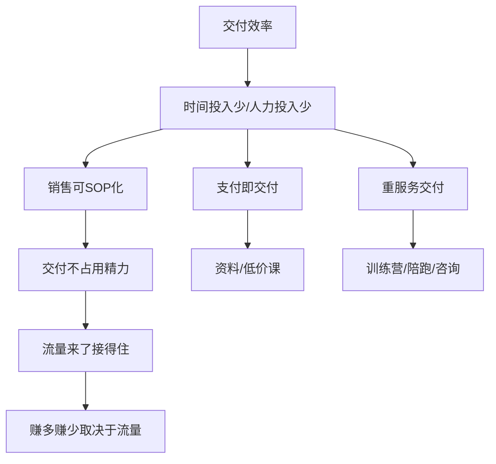
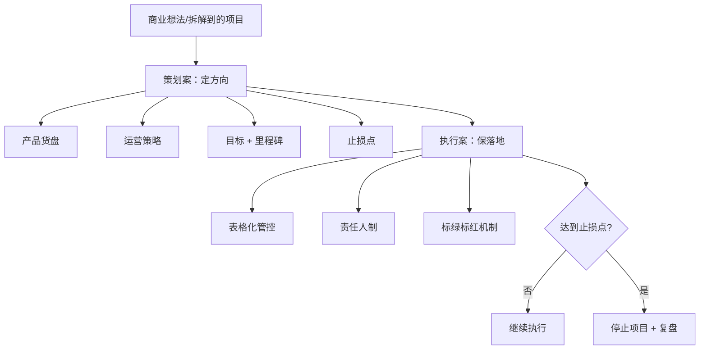
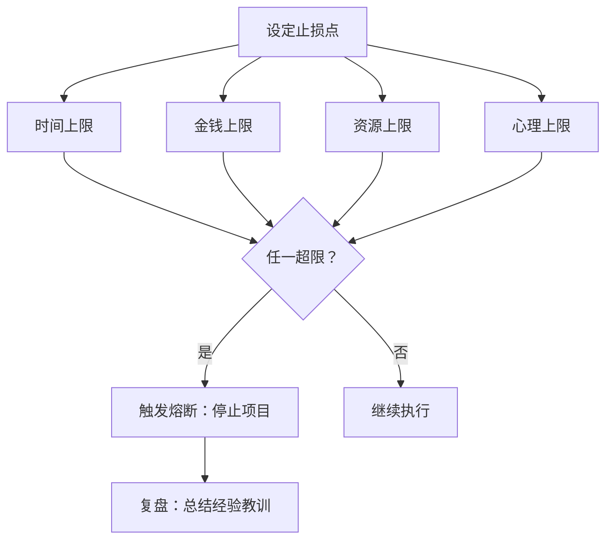
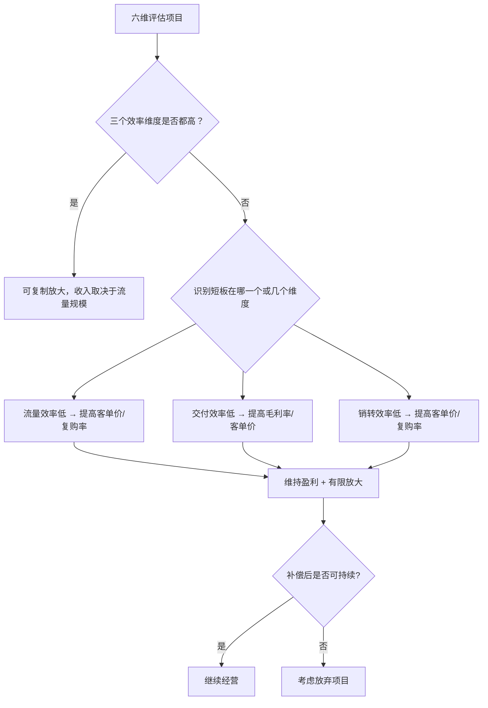
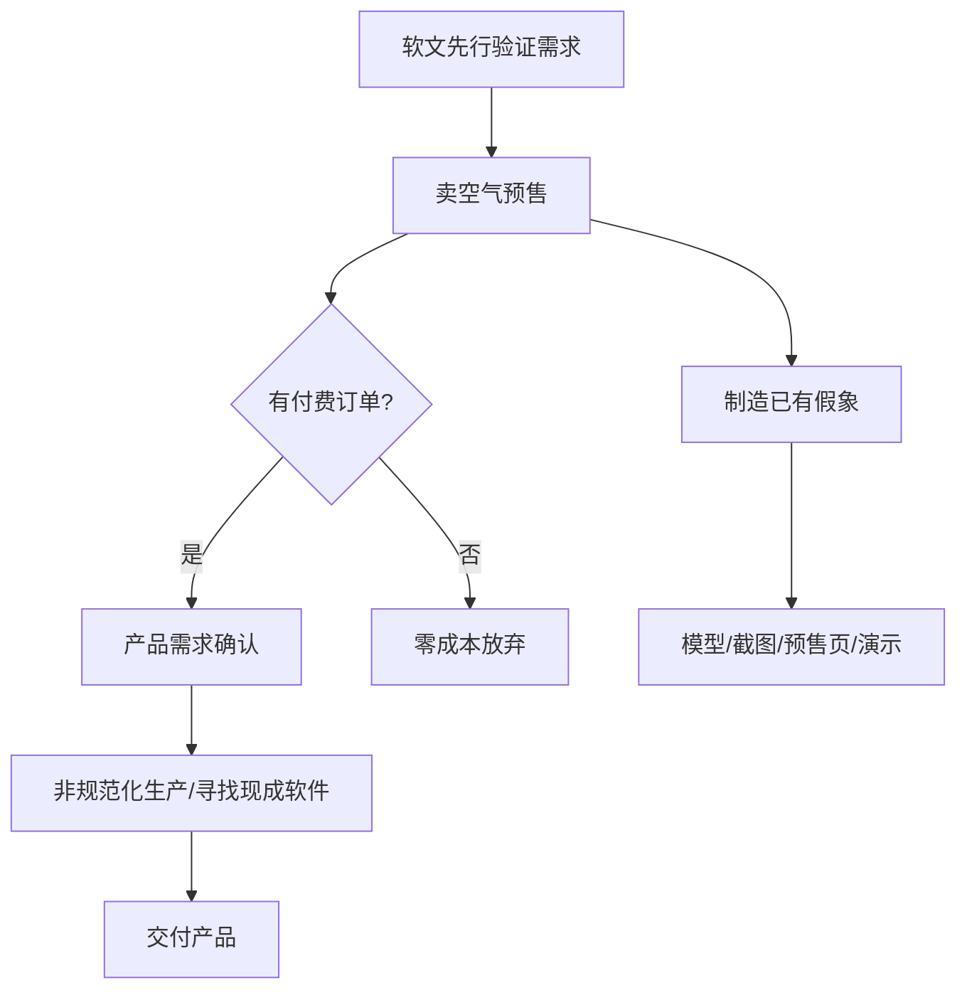
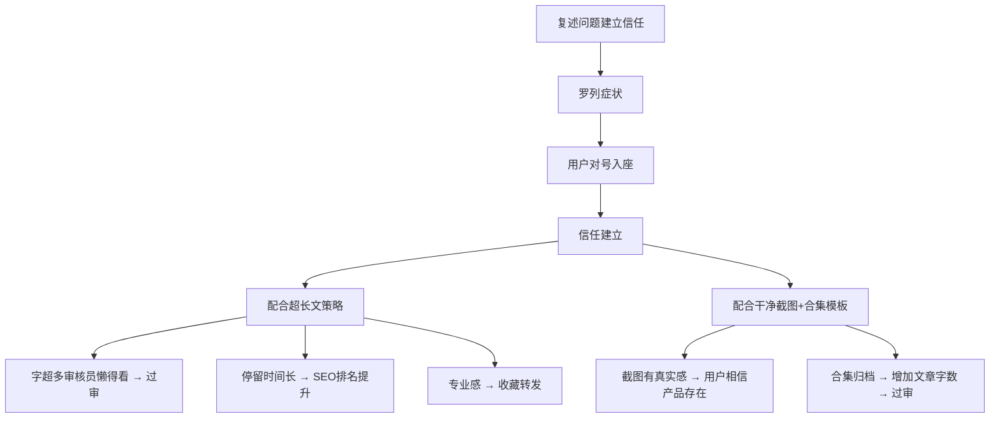
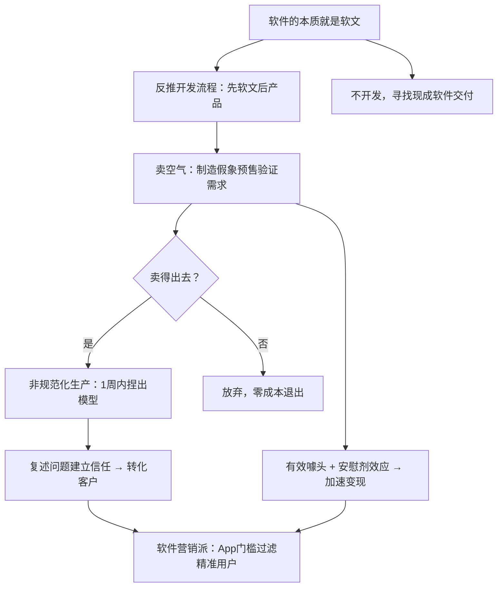

# 第 5 章 交付与项目管理 —— 把“买卖”做成“生意”的脚手架

## 学习目标

- 理解交付效率的定义及'支付即交付'的最高形态
- 掌握用策划案+执行案管理副业项目的双轮驱动框架
- 学会在项目启动前设定涵盖时间、金钱、资源三维度的止损点
- 掌握用客单价、毛利率等财务维度的强势来对冲效率维度短板的方法
- 理解'卖空气'式产品验证法与软文先行的反直觉开发思维
- 掌握用App门槛过滤精准用户、软件营销派碾压软营销派的流量转化技巧
- 学会通过复述问题、超长文等软文技巧建立信任并过审
- 理解'有效噱头、无效产品'的安慰剂效应及其商业边界
- 掌握将软件视为软文、反推开发流程的轻资产产品化思路

## 5.1 生活类比

想象项目管理是装修一套房子。策划案是设计图纸，你需要在动工之前就确定好有几个房间（产品货盘）、整体是什么风格（运营策略）、预算上限是多少（止损点）、以及何时完工（里程碑）。没有图纸就开工，工人只能凭感觉砌墙，最后大概率装成一堆四不像。执行案则是施工排期表，它具体到哪一天哪个工人（责任人）在哪面墙（事项）上做什么，做完一项打一个勾（标绿），延期就标红，让你一目了然哪些环节卡住了进度。止损点相当于装修合同里的停工条款，一旦超出预算或发现结构问题（项目不成立），立即叫停，避免越陷越深——最怕的是已经砸了几十万进去，明知是个坑还硬着头皮继续填。交付效率则像是不同装修方式的耗时差异：直接买成品家具（资料型产品）当天进场即完成交付，而全屋定制（训练营类服务）则需要数月反复沟通打磨。

再看产品开发，想象你正在经营一家“卖空气”的网红店。卖空气就是在店铺还没装修好之前，先挂出效果图（模型/截图）并开启预售，用订单验证需求，卖不出去就不继续装修。软件的本质就是软文，这意味着店铺的招牌和菜单就是你的推广软文，你要先想好怎么吆喝，再决定做什么菜，甚至可以直接找现成的半成品（类似软件）。复述问题建立信任则是店员先把你身体的不舒服全说出来，让你觉得“这次找对人了”，哪怕他还没给你开药。App的门槛则像网红店开在写字楼高层（需要预约、上楼），拦住只看不买的游客，上来的都是有强烈购买意愿的顾客。

就像装修不能光有图纸不施工，也不能埋头干不看图纸，副业项目需要策划案定方向、执行案保落地，并靠止损点防止烂尾；而产品开发则像开网红店，用好“卖空气”的预售、“软文”的吆喝和“App门槛”的筛选，才能低成本验证、精准触达并高效转化。

## 5.2 概念地图

```
交付与项目管理的效率与杠杆
├── 交付效率（以时间为指标）
│   ├── 支付即交付 —— 资料/低价课 —— NxhWdJj3UoPKvmxaBqkcz8wlntf
│   ├── 重服务交付 —— 训练营/陪跑 —— NxhWdJj3UoPKvmxaBqkcz8wlntf
│   └── 补偿策略 —— 财务维度对冲效率短板 —— NxhWdJj3UoPKvmxaBqkcz8wlntf
├── 项目管理双案法
│   ├── 策划案（定方向）—— 产品货盘/目标/止损点 —— I9OAdzzs2oBliNxsmPjcHnBUnzf
│   └── 执行案（保落地）—— 表格化/标绿标红/责任人 —— I9OAdzzs2oBliNxsmPjcHnBUnzf
└── 止损点（最大投入界限）
    ├── 时间止损：最多做几个月 —— I9OAdzzs2oBliNxsmPjcHnBUnzf
    ├── 金钱止损：最多投多少钱 —— I9OAdzzs2oBliNxsmPjcHnBUnzf
    └── 资源止损：最多消耗多少人脉精力 —— I9OAdzzs2oBliNxsmPjcHnBUnzf
反直觉产品孵化：卖空气与软文先行
├── 软件的本质就是软文
│   ├── 反推开发流程：先写软文、后做产品 —— DNGrdODFBowfk2xwkNCc5GGSnRd
│   └── 寻找现成软件交付 —— DNGrdODFBowfk2xwkNCc5GGSnRd
├── 卖空气（预售验证）
│   ├── 制造'已有'假象 —— 模型/截图/预售页 —— DNGrdODFBowfk2xwkNCc5GGSnRd
│   └── 先收钱、测试需求 —— 卖不出去就不做 —— DNGrdODFBowfk2xwkNCc5GGSnRd
├── 复述问题建立信任
│   ├── 罗列症状让用户认为'找对了' —— 看病问诊类比 —— DNGrdODFBowfk2xwkNCc5GGSnRd
│   ├── 超长文制造专业感并提升SEO —— DNGrdODFBowfk2xwkNCc5GGSnRd
│   └── 干净截图+合集模板过审 —— DNGrdODFBowfk2xwkNCc5GGSnRd
└── 有效噱头、无效产品
    ├── 安慰剂效应 —— 名字决定认知/糖豆救命 —— DNGrdODFBowfk2xwkNCc5GGSnRd
    └── 连花清瘟案例 —— 好名字改变固有事实 —— DNGrdODFBowfk2xwkNCc5GGSnRd
流量收割：精准过滤与软件营销派
├── App是不便的筛子
│   ├── 下载门槛过滤'看客' —— DNGrdODFBowfk2xwkNCc5GGSnRd
│   └── 用户相信App'真的具有该功能' —— DNGrdODFBowfk2xwkNCc5GGSnRd
├── 软件营销派 vs 软营销派
│   ├── 逼真App界面碾压纯文本攻略 —— DNGrdODFBowfk2xwkNCc5GGSnRd
│   ├── 广告隐藏更深 —— DNGrdODFBowfk2xwkNCc5GGSnRd
│   └── 强制分享裂变机制 —— DNGrdODFBowfk2xwkNCc5GGSnRd
└── 非规范化生产（野路子）
    ├── 中文编程工具降低门槛 —— DNGrdODFBowfk2xwkNCc5GGSnRd
    ├── 1周内捏出可演示模型 —— DNGrdODFBowfk2xwkNCc5GGSnRd
    └── 个人开发者研发不超1周 —— DNGrdODFBowfk2xwkNCc5GGSnRd
```

## 5.3 交付效率 —— 让“成交”成为服务的终点

> “我们以「时间」为指标。『花的时间少（人力少），即为交付效率高』比如说，资料，低价课，付款那一刻，交付已经做完。比如说，训练营，陪跑咨询，需要花时间精力，去设计方案，流程，回答问题。”
>
> ——《六维框架：用六个点拆解并评估任何项目》（`docs/202301-02/NxhWdJj3UoPKvmxaBqkcz8wlntf.md`）

做副业不仅要把东西卖出去，还要把承诺的东西交到客户手上。很多新手只盯着“怎么卖”，却忽略了“卖了之后怎么办”。如果交付环节需要大量人工参与，你的收入就会被锁死在个人精力上——你今天不干活，今天就没有收入；你同时接三个客户，就会手忙脚乱。

**交付效率**定义（来源：《六维框架：用六个点拆解并评估任何项目》）

$$
\text{交付效率} = \frac{\text{交付成果}}{\text{时间投入} + \text{人力投入}}
$$

这个公式为什么可以这样定义？因为我们衡量一个交付环节的优劣，核心看两件事：客户拿到的东西是否完整（分子），以及你为此花了多少代价（分母）。分子越大越好，分母越小越好。当分母趋近于零时，意味着你不花任何时间和人力就能完成交付——这就是“支付即交付”的最高形态。

这个公式展示了交付效率的本质：它是一个“产出与消耗”的比值。交付效率是所有副业项目中最容易被忽略、却最能决定“能不能规模化”的维度。我们看一张对比表，感受不同项目的交付效率差异。以下是三种典型项目的交付效率对比：

| 项目类型 | 交付方式 | 时间投入 | 交付效率 |
|---------|---------|---------|---------|
| 教育资料 | 付款后发网盘链接 | 近乎为零 | 极高（支付即交付） |
| 低价课程 | 付款后开通观看权限 | 录制一次、重复售卖 | 高 |
| 训练营/陪跑 | 监督打卡、答疑、定制方案 | 数周至数月持续投入 | 低 |

交付效率高，意味着销售可以 SOP 化，不需要极强的专业性，也意味着交付不需要太多时间精力，同时意味着流量来了，能接得住 [`NxhWdJj3UoPKvmxaBqkcz8wlntf, p.3-4`]。

> 交付效率高**推论**（来源：《六维框架：用六个点拆解并评估任何项目》）

```
交付效率高 ⇒ 销售可SOP化（不需强专业）
           ⇒ 交付不需太多时间精力
           ⇒ 流量来了能接得住
           ⇒ 赚多赚少取决于流量多少
```

这段推论链展示了交付效率的“杠杆效应”：它不只影响交付环节本身，还通过释放你的时间精力，间接放大了流量和转化两个环节的处理能力。如果一个项目交付效率过低（比如每个客户都要你亲自陪跑30天），那么即使前端流量再多，你也会被交付任务淹没——这就是为什么很多知识博主“卖课容易、做训练营累死”。



交付效率低并不等于项目不能做，可以通过提高客单价来补偿。如果交付效率与流量、销转效率都高，则赚多赚少只取决于流量规模。交付效率衡量的是“常规交付”的耗时，不包含售前咨询和售后维护的额外时间 [`NxhWdJj3UoPKvmxaBqkcz8wlntf, p.4-5`]。

## 5.4 项目管理双案法 —— 左手定方向，右手保落地

> “策划案就是一个想法、规划、目标制定；执行案就是人员分工、分解执行、过程监控、结果复盘。策划案，包括你产品货盘是什么……执行案是什么呢？某一年某一月的核心工作事项。第一个模块是什么？这个模块里的二级事项有哪些？具体内容是什么？负责人是什么？协助人是谁？完成日期是什么？完成的时候要把它标绿，然后未完成或者延期的要把它标红。”
>
> ——《从拆解爆款到复制副业：我的实战复盘》（`docs/202301-02/I9OAdzzs2oBliNxsmPjcHnBUnzf.md`）

很多副业想法在脑子里很美好，一落地就乱成一团。单靠热情和灵感做事，无法保证团队成员各司其职、按时交付。项目管理的核心不是“管人”，而是把模糊的想法变成清晰的、可执行的、可追踪的表格。

**项目管理双案法**定义（来源：《从拆解爆款到复制副业：我的实战复盘》）

$$
\text{项目管理} = \underbrace{\text{策划案}}_{\text{做什么、为什么做}} + \underbrace{\text{执行案}}_{\text{谁来做、怎么做}}
$$

这个公式展示了一个朴素的道理：任何项目要落地，都必须同时回答两组问题——第一组是方向性的（做什么、为什么做），第二组是操作性的（谁来做、怎么做）。策划案负责第一组，执行案负责第二组，两者缺一不可。没有策划案，执行就是瞎忙；没有执行案，策划就是空想。

策划案的具体内容可以用下面的表格拆解。以下是策划案应包含的六大要素：

| 要素 | 含义 | 示例 |
|------|------|------|
| 产品货盘 | 定价与规格设计 | 100ml引流品、500ml盈利品、1000ml高利润套餐 |
| 运营策略 | 如何获取流量与转化 | 小红书笔记引流＋私域朋友圈转化 |
| 目标 | 可衡量的结果 | 3个月积累1000个私域客户 |
| 里程碑 | 关键节点的关键目标 | 首月完成200人 |
| 止损点 | 最大可承受损失 | 投入不超过2万元 |
| 放大点 | 如何复制放大 | 跑通后招募3人团队复制 |

执行案则将上述方向落地为“谁在什么时间做什么事”的表格化管控。以下是执行案的一个示意模板：

| 时间 | 事项 | 责任人 | 协助人 | 完成日期 | 状态 |
|------|------|-------|-------|---------|------|
| 第1周 | 小红书笔记发布（每天3篇） | A | B | 3/7 | 进行中 |
| 第1周 | 微信朋友圈运营（每天5条） | B | A | 3/7 | 标绿 |
| 第2周 | 首次直播测试 | C | A/B | 3/14 | 标红 |
| 第3周 | 意向客户私聊转化 | B | — | 3/21 | 未开始 |

一定要有目标，没有目标的话你自己是懵的。里程碑是项目过程中的关键性目标，用来判断阶段是否达标。执行案的“标绿标红”机制驱动团队自查，让进度一目了然，谁掉链子立刻暴露 [`I9OAdzzs2oBliNxsmPjcHnBUnzf, p.15-16`]。

执行案的本质是“过程管理”而非“结果管理”——你无法直接控制结果，但你可以控制每天的行为。通过把大目标拆解为每天的具体动作，让每个人都清楚自己今天要干什么，这就是执行案的价值所在。

双案法适用于有一定规模、需要多人协作的项目；个人单干小项目可简化执行案。策划案并非一成不变，需根据执行过程中的反馈动态调整。双案法提供的是管理框架，不替代具体的业务判断与战术选择 [`I9OAdzzs2oBliNxsmPjcHnBUnzf, p.16-17`]。



## 5.5 止损点 —— 给项目装上一台“熔断器”

> “止损点什么意思呢？就是你做这个事情不用继续了，你做这个事情的最大限度，你能够承担多大的损失。这个止损点包括你的时间成本、还有你的金钱投入、资源投入。”
>
> ——《从拆解爆款到复制副业：我的实战复盘》（`docs/202301-02/I9OAdzzs2oBliNxsmPjcHnBUnzf.md`）

做副业最容易犯的错误，不是选错项目，而是选错之后舍不得退出。你已经投入了三个月、两万块钱、几十条人脉，这时候放弃就意味着“之前的投入全部白费”——于是你选择继续硬撑，结果越陷越深。

**止损点**定义（来源：《从拆解爆款到复制副业：我的实战复盘》）

$$
\text{止损点} = \max(\text{时间成本上限}, \text{金钱投入上限}, \text{资源投入上限})
$$

这个公式的含义是：把三个维度的损失上限分别设定好，只要任何一个维度触碰红线，整个项目就应当触发“熔断”。止损点必须事先设定，而不是中途凭感觉决定——因为一旦投入进去，人的判断就会被沉没成本扭曲。行为金融学中的“损失规避”理论指出，人们对损失的痛苦感受大约是同等收益快乐的两倍，这导致我们在面对“已经亏了”的事实时，倾向于继续投入以期翻本——这正是止损点要对抗的心理机制 [需要补充文献：行为经济学中沉没成本谬误与损失规避的相关研究，可参考Kahneman & Tversky（1979）的前景理论]。

三个维度的止损点各有侧重，我们用一个案例来理解。以下是大闸蟹电商案例的止损点分析：

| 维度 | 止损上限 | 实际投入 | 是否触发 |
|------|---------|---------|---------|
| 时间 | 最多3个月 | 4个月 | 已超过 |
| 金钱 | 最多5万元 | 约10万元 | 已超过 |
| 资源 | 最多动用50个人脉 | 100+ | 已超过 |
| 心理 | 做自己不喜欢的项目 | 极度疲惫 | 已触发 |

作者在阳澄湖大闸蟹项目里赚了20来万，却立下“这辈子不会再碰电商”的结论。他并非因为亏钱而退出，而是发现这个项目与自己“不喜欢电商卖货”的偏好完全冲突，即便有利润也不可持续 [`I9OAdzzs2oBliNxsmPjcHnBUnzf, p.20-21`]。



止损的决策逻辑是“控制损失”，与个人喜好、面子无关。止损点不只是为了防亏钱，更是为了把精力从“注定做不大的项目”中释放出来，投入到更有可能成功的项目上。止损点是策划案的标准组成部分，确保每个项目都有退出机制 [`I9OAdzzs2oBliNxsmPjcHnBUnzf, p.17`]。

止损点不意味着遇到短期困难就立刻放弃，应与项目的生命周期和自然波动相区分。设定止损点时需结合项目实际情况，标准过于宽松则失去保护意义，过于严格则可能错杀良机。止损之后的价值在于总结经验，而非纯粹的“认输” [`I9OAdzzs2oBliNxsmPjcHnBUnzf, p.17-18`]。

## 5.6 客单价与毛利率的补偿策略 —— 三条短腿，两块长板来凑

> “如果流量效率，销转效率，交付效率，这三块有一块低的话，就很难复制放大，那就得在客单价，毛利率，复购率这三块下功夫，比如通过提高客单价来增加收入。”
>
> ——《六维框架：用六个点拆解并评估任何项目》（`docs/202301-02/NxhWdJj3UoPKvmxaBqkcz8wlntf.md`）

不是所有项目都能做到流量、销转、交付三个效率维度都优秀。现实中大多数副业项目都有一项或多项短板——内容难以批量产出、交付需要大量人工、转化依赖高专业度。面对这些短板，直接放弃太可惜，硬撑又做不大，这时就需要用财务维度来“找补”。

**补偿策略**定义（来源：《六维框架：用六个点拆解并评估任何项目》）

$$
\text{收入} = \text{流量规模} \times \text{转化率} \times \text{客单价} \times \text{毛利率} \times (1 + \text{复购率})
$$

这个公式把收入拆解为五个因子的乘积，帮助我们看清收入从哪来：前两个因子（流量规模、转化率）由“效率维度”决定，回答的是“能触达多少人、能转化多少人”；后三个因子（客单价、毛利率、复购率）由“财务维度”决定，回答的是“每单赚多少、留下多少、能否重复赚”。当效率维度偏低时，通过抬升财务维度同样可以维持收入规模——因为这是一个乘积关系，一条腿短了，其他腿可以补上。

我们用两个真实案例来演示这条策略的运作方式。以下是两个项目的六维对比：

| 六维指标 | 教育资料1.0 | 教育资料2.0 | 项目拆解IP |
|---------|------------|------------|-----------|
| 流量效率 | 高 | 高 | 低（难以批量产出） |
| 销转效率 | 高 | 高 | 高（SOP化） |
| 交付效率 | 高 | 低~中 | 低（需要专业知识） |
| 客单价 | 十几块 | 几千到十几万 | 几千到六位数 |
| 毛利率 | 50~100% | 10% | 70%+ |
| 复购率 | 低 | 低 | 低~高 |
| 月收益 | 1000~2W | 2W~100W | 10W~200W |

教育资料从1.0升级到2.0，本质上就是在流量效率、销转效率不变的前提下，通过引入高客单价合作（对接训练营、私教），把客单价从“十几块”拉高到“几千到十几万”，月收益天花板从2万跃升至100万 [`NxhWdJj3UoPKvmxaBqkcz8wlntf, p.5-6`]。项目拆解IP则是另一种典型：流量效率低（拆解需要时间与信息源）、交付效率低（社群和陪跑都需要持续投入专业知识），但销转效率高（网销SOP化）、客单价高（几千到六位数）、毛利率高（70%以上），共同弥补了效率短板 [`NxhWdJj3UoPKvmxaBqkcz8wlntf, p.5-6`]。

补偿策略的核心心法是：效率决定规模天花板，财务决定利润厚度。当效率有短板时，你赚的是“每一单更厚的利润”而不是“更多的单”。

同时在设计上需要做一个关键的取舍：补偿策略终究有上限。客单价不可能无限提高（用户有承受上限）、毛利率受行业竞争约束、复购率依赖产品本身的价值。当效率短板过于严重时，再高的客单价也撑不起收入——比如你的交付效率极低导致每个月只能服务3个客户，即使客单价拉到5万，月收入也不过15万，且你的时间被完全锁死，没有任何杠杆可言。这时候就需要冷静判断：是继续“找补”，还是干脆放弃这个项目另起炉灶？一个实用的判断标准是：如果补偿策略需要你投入远超正常水平的精力才能维持收入，且没有向“效率提升”方向演进的路径，那么放弃可能是更理性的选择。

补偿策略有上限——客单价不可能无限提高，毛利率受行业竞争约束；高客单价通常意味着销售周期更长、信任门槛更高。效率维度过低的项目即使靠财务补偿维持盈利，也难以通过矩阵化大幅放大，天花板依然有限 [`NxhWdJj3UoPKvmxaBqkcz8wlntf, p.5-6`]。



## 5.7 软件的本质就是软文 —— 用“软文先行”反推产品开发

上一节我们探讨了如何用财务维度补偿效率短板。但还有一类项目，它的“短板”不是效率，而是产品本身——你不知道该做什么软件、做了也没人用。面对这种情况，个人开发者的出路是什么？这一节，我们将视线从“怎么卖得动”转向“做什么才有人要”。

个人开发者最常犯的错误，是陷入“先开发、再推广”的思维定势。你花三个月写代码、做界面、调试，终于上线了，却发现根本没人用——因为你从未验证过“是否真的有人需要这个软件”。

**软件的本质就是软文**定义（来源：《个人开发的崛起之路：卖空气、软文与套话的生意逻辑》，`docs/202301-02/DNGrdODFBowfk2xwkNCc5GGSnRd.md`）

$$
\text{开发流程} = \begin{cases}
\text{传统路径：开发} \rightarrow \text{推广} \rightarrow \text{软文} \\
\text{反推路径：软文} \rightarrow \text{验证需求} \rightarrow \text{开发（可选）}
\end{cases}
$$

这个公式展示了一个简单的逻辑逆转：既然任何软件最终都要靠软文来推广，那为什么不直接从软文开始？传统路径把开发放在最前面，意味着你在验证需求之前就先投入了全部成本；反推路径把软文放在最前面，意味着你只需要花几个小时写一篇文章，就能知道用户是否真的有这个需求。

下面的对比表总结了传统路径和反推路径的本质差异。以下是两种开发路径的对比：

| 对比维度 | 传统路径（先开发） | 反推路径（软文先行） |
|---------|------------------|-------------------|
| 起点 | 我能做什么 | 用户为什么需要 |
| 验证时机 | 开发完成后 | 开发之前 |
| 沉没成本 | 高（数月开发投入） | 极低（一篇软文） |
| 失败代价 | 血本无归 | 可忽略 |
| 迭代速度 | 慢 | 快 |

这个反推思路还引出一个更极端的操作：甚至可以不开发软件，而是寻找现成的、类似的软件交给客户使用，你赚取信息差和服务费。个人开发者的主要精力不应该是开发，而应该站在用户角度上去调研做什么，之后用一个非常简单的方式把它捏出来 [`DNGrdODFBowfk2xwkNCc5GGSnRd, p.2-3`]。

软文先行的核心原则是：想一些根本不现实或多数人下载不到的软件，但他们觉得应该有这种软件——只需要想到名字即可，然后写一篇介绍它的软文，看用户反应 [`DNGrdODFBowfk2xwkNCc5GGSnRd, p.4-5`]。

软文先行只适用于解决明确“痛点”的工具型产品，对需要复杂交互逻辑的To B产品需谨慎。如果软文过于夸大而产品长期无法兑现，会透支用户信任。该方法与“卖空气”预售结合使用效果更佳 [`DNGrdODFBowfk2xwkNCc5GGSnRd, p.5-6`]。

## 5.8 “卖空气”预售 —— 用“空头支票”验证真实需求

上一节介绍了“软文先行”的反推逻辑，但写软文只是第一步——你怎么才能知道用户是真的需要，还是仅仅觉得“有点意思”？答案是：让他付钱。“卖空气”预售正是把“软文验证”升级为“真金白银验证”的关键一步。

传统产品开发的逻辑是：先做产品，再找用户。这个逻辑的问题在于，如果需求判断失误，你的开发成本就打了水漂。个人开发者资源有限，经不起长时间的开发投入，因此需要一种低成本、快速验证市场需求的方法——“卖空气”。

**卖空气**定义（来源：《个人开发的崛起之路：卖空气、软文与套话的生意逻辑》）

$$
\text{卖空气} = \text{制造“已有”假象} + \text{先收钱} + \text{验证需求}
$$

这个公式的三步如何操作？“制造‘已有’假象”就是做出一个看起来“产品已经存在”的东西：预售页、效果图、模型录屏、演示视频——关键不是它真的能用，而是用户看到后会相信“这个产品是存在的”。“先收钱”则是开启预售或收取定金，让用户用人民币投票。“验证需求”则看结果：订单多就继续开发，无人问津就放弃。三步合起来，本质是用极小成本买一份“需求真实性的情报”。

一个经典的“卖空气”案例是“羊了个羊”截图吸粉事件。以下是该案例的时间线拆解：

| 时间 | 动作 | 结果 |
|------|------|------|
| 游戏刚火（第1天） | P一张999999分数截图 | 引起关注 |
| 当天 | 以“已开挂”口吻发文 | 开始吸粉 |
| 第5天 | 游戏大火 | 粉丝积累完成 |
| 第5天后 | 套话找真正能刷分软件 | 直接变现 |

这个案例展示了一个完整的“卖空气”闭环：在游戏热度刚起时，通过一张假截图和“已解决问题”的口吻吸引关注，积累粉丝；当热度达到顶峰时，再通过套话找到真实解决方案，把粉丝变现为收入 [`DNGrdODFBowfk2xwkNCc5GGSnRd, p.8-9`]。

“卖空气”不等于诈骗。它的核心是“先验证需求，再投入开发”，以最小成本测试市场反应。对预售用户需提供明确的“交付时间表”，或设置退款机制，避免信任崩塌。如果产品长期无法兑现，“卖空气”就会滑向欺诈——这条红线需要每个实践者自己守住。卖空气适合验证“确定性需求”，对需要用户教育的新品类效果有限 [`DNGrdODFBowfk2xwkNCc5GGSnRd, p.5-6`]。



## 5.9 复述问题建立信任 —— 用“问诊式开场”让客户觉得“你懂我”

前面两节讲的“软文先行”和“卖空气预售”都依赖一个前提：用户得先相信你。一个陌生的开发者说自己能解决你的问题，你凭什么信？这一节就来拆解建立信任的核心技巧——复述问题。

> “举例：就拿看病举例子，医生会问你：‘有没有这个症状？有没有那个症状？’结果你发现：‘都是我现在的症状’，所以你认为这个医生懂你的病，这次找对了！”
>
> ——《个人开发的崛起之路：卖空气、软文与套话的生意逻辑》（`docs/202301-02/DNGrdODFBowfk2xwkNCc5GGSnRd.md`）

用户面对陌生产品或服务时，天然有戒备心。你说“我能解决你的问题”，用户只会想“你怎么证明？”。但如果你先精准复述用户的“症状”，用户就会在内心产生“这次找对了人”的直觉反应。

**复述问题建立信任**定义（来源：《个人开发的崛起之路：卖空气、软文与套话的生意逻辑》）

$$
\text{信任} = \text{罗列症状（让用户对号入座）} + \text{“这次找对了”的直觉反应}
$$

这个公式揭示了一个微妙的心理机制：医生通过问“有没有这个症状？有没有那个症状？”，让你发现“都是我现在的情况”，于是你相信这个医生懂你的病——哪怕他还没给你开药。同理，软文的核心就是让用户看到你这篇文章时，内心在想“这次找对了！”

复述问题作为一种内容策略，有三个关键层次。以下是复述问题建立信任的三个层次：

| 层次 | 做法 | 效果 |
|------|------|------|
| 症状罗列 | 列出用户常见痛点（没流量、没转化、交付难） | 用户对号入座 |
| 问题升级 | 指出痛点的深层原因 | 用户感到“被理解” |
| 方案引出 | 顺势引出你的产品/服务 | 用户觉得“这就是我需要的” |



写软文的核心是让用户觉得“这次找对了”——不管他真找对了还是假找对了 [`DNGrdODFBowfk2xwkNCc5GGSnRd, p.5-6`]。复述问题之后需快速给出解决方案的“钩子”，否则会让用户焦虑而流失。该技巧对“解决痛点型”产品效果好，对“创造愉悦型”产品效果有限。

在软文实践中，常配合两种过审技巧使用。第一是超长文策略——超长文、字超多，审核员懒得看，同时用户停留时间越长，搜索引擎越觉得文章专业，进而提升搜索排名 [`DNGrdODFBowfk2xwkNCc5GGSnRd, p.10-11`]。第二是“干净截图+合集模板”策略——干净截图让文章看起来有真实产品支撑，合集、大全、汇总类模板则能自然增加文章字数、制造整理归档的专业感，双管齐下提高过审率 [`DNGrdODFBowfk2xwkNCc5GGSnRd, p.10-11`]。

## 5.10 有效噱头与App门槛 —— 精准过滤用户与“安慰剂效应”

复述问题解决了“让用户相信你”的问题，但还差最后一环：如何让用户相信你的产品“真的有用”？以及如何在大量泛流量中精准捞出那些愿意付费的人？这一节我们来直面一个在“政治正确”的教科书里很少被承认的事实：产品不完美、甚至不解决真正需求，照样能赚到钱。理解这个真相，不是为了教你去做骗子，而是为了让你明白“用户感知”与“真实功能”之间的偏差——这个偏差既是商业机会，也是道德红线。

> “但还有一个观点没说，那就是：‘不解决需求’，‘也不是好的产品’，并不会影响赚钱的速度！医学上有一种安慰剂效应……一个糖豆卖的特别贵，就说这是救命药，你吃了也真管用，患者的康复率30%以上！连花之所以大卖，就是名字取得好，事实证明起个好名字，真的可以改变固有事实！”
>
> ——《个人开发的崛起之路：卖空气、软文与套话的生意逻辑》（`docs/202301-02/DNGrdODFBowfk2xwkNCc5GGSnRd.md`）

**有效噱头、无效产品**定义（来源：《个人开发的崛起之路：卖空气、软文与套话的生意逻辑》）

$$
\text{用户决策} = f(\text{感知价值}, \text{信任}, \text{心理暗示}) \gg \text{真实功能}
$$

这个公式展示了一个残酷的真相：用户的购买决策主要由“感知价值”和“心理暗示”驱动，真实功能只是其中一个因子。一个糖豆若被包装成“救命药”，患者吃了之后真的会感觉好转，康复率达到30%以上——这就是安慰剂效应的力量 [`DNGrdODFBowfk2xwkNCc5GGSnRd, p.7-8`]。安慰剂效应在医学上已被大量双盲实验证实：即使患者服用的是无药理活性的糖丸，只要他们相信“这是有效的药”，身体也会产生真实的生理反应 [需要补充文献：安慰剂效应的心理学与神经科学机制研究，可参考Benedetti等（2005）关于安慰剂与预期效应的综述]。理解这一点对于做产品有一个重要启示：用户购买的不只是功能，更是“问题被解决的希望”——这本身就是一种真实价值。

“连花清瘟”案例更是极致地展示了好名字的力量。连花之所以大卖，很大程度上是因为名字起得好——“连花”二字天然带有“清瘟”的联想，让人一听就觉得“这个药能治这个病”。起个好名字，真的可以改变固有事实 [`DNGrdODFBowfk2xwkNCc5GGSnRd, p.7-8`]。

然而，我们必须在这里划出一条清晰的道德红线。以下是“有效噱头”在不同场景下的法律与道德风险分级：

| 场景 | 风险级别 | 说明 |
|------|---------|------|
| 轻度夸大宣传（功能略优于实际） | 低 | 可能涉及虚假宣传，被平台处罚 |
| 有效噱头但产品完全无实际功能 | 中~高 | 可能构成消费欺诈 |
| 涉及人身财产安全（如医疗、金融） | 极高 | 可能触犯刑法 |
| 完全凭空捏造、无底线收割 | 极高 | 必然违法且会被连根拔起 |

“有效噱头、无效产品”这条法则的适用边界在于：它依赖用户的“预期与现实差距”来赚钱，但这个差距不能跨越法律的红线。一旦涉及人身财产安全或明显欺诈，就不是“商业手段”而是“犯罪行为” [需要补充文献：广告法与消费欺诈的法律界定，可参考各国消费者权益保护法及广告法中关于虚假宣传的处罚条款]。我国《广告法》第四条规定广告不得含有虚假或者引人误解的内容，不得欺骗、误导消费者；《消费者权益保护法》第五十五条对欺诈行为规定了“退一赔三”的惩罚性赔偿。

理解了“噱头”的威力，我们再来看一个与之配合的流量过滤工具——App门槛。

**App门槛作为精准过滤器**定义（来源：《个人开发的崛起之路：卖空气、软文与套话的生意逻辑》）

$$
\text{精准用户} = \frac{\text{愿意下载并安装App的用户}}{\text{看到广告的全部用户}}
$$

这个公式展示了App下载机制的筛选作用：相比网页或小程序，App需要用户主动下载安装，操作成本更高，因此只有需求足够强烈的用户才会完成这个动作。那些“看看而已”的看客，绝大多数在看到“需要下载App”时就会放弃。

正是因为这个门槛，用户反而会相信“该App真的具有该功能”——因为在他们的认知里，如果这个软件没有用，为什么要专门为它下载一个App？ [`DNGrdODFBowfk2xwkNCc5GGSnRd, p.9-10`]

App门槛策略依赖用户的好奇心与需求强度，对需求不明确的用户群效果差。长期靠噱头无实质兑现，会被平台与用户抛弃，需守住底线 [`DNGrdODFBowfk2xwkNCc5GGSnRd, p.9-10`]。

### 5.10.1 软件营销派 vs 软营销派

> “但是呢，如果这种方向的文章上产生了一个软件派，就可以直接碾压他们了，因为软件看起来更逼真了……虽然仍然不解决任何问题！弄一个APP告诉你，你下载这个APP，填上名字，就可以申请解封！”
>
> ——《个人开发的崛起之路：卖空气、软文与套话的生意逻辑》

理解了App门槛的筛选价值之后，一个更锋利的流量武器浮出水面——软件营销派。传统的“软营销派”用纯文本攻略引流，而“软件营销派”用逼真的App界面营销。下面我们用同一个需求来对比两种打法，看看为什么软件营销派的效果碾压软营销派。

**软件营销派**定义（来源：《个人开发的崛起之路：卖空气、软文与套话的生意逻辑》）

$$
\text{转化率}_{\text{软件营销派}} \gg \text{转化率}_{\text{软营销派}}
$$

这个不等式展示了“看起来更专业”的碾压效应：当用户看到一个逼真的App界面时，他会本能地觉得“这个问题要用软件来解决”——而你恰好提供了这个“软件”，于是从“解决不了问题的人”变成了“提供解决方案的人”，尽管这个App可能同样不解决任何问题。

以下是“淘宝卖家一键申诉违规”的两种营销方案对比：

| 对比维度 | 软营销派（纯文本攻略） | 软件营销派（App界面营销） |
|---------|---------------------|------------------------|
| 呈现形式 | 文字教程 | 逼真的App界面截图＋使用说明 |
| 用户感知 | “这人写了个攻略” | “这个App真的有用” |
| 广告隐蔽性 | 明显（广告藏在文末） | 隐蔽（广告就是App本身） |
| 转化率 | 低 | 高（碾压） |
| 裂变潜力 | 弱 | 强（可强制分享） |

软件营销派不仅“看起来更专业”，广告也藏得更深。更狠的是，它可以设置“强制分享”机制——用户必须把App分享给别人之后才能使用，这比软文营销的传播效率高得多 [`DNGrdODFBowfk2xwkNCc5GGSnRd, p.11-12`]。

不过，软营销派也并非一无是处：它的制作门槛极低（会写文章就行）、维护成本低、适合在纯文字平台（如知乎、👸号）操作，也能建立“作者个人”的专业形象。选择哪种打法，取决于你的内容平台和用户群体的阅读习惯。这套打法的本质是“用魔法打败魔法”：用户的问题源于某个软件带来的麻烦，他就会本能地认为“我要用另一个软件来解决它”。你不需要真的做一个能解决问题的软件——你只需要让用户以为“这就是那个软件”。但正如前面所强调的，这种打法的后续需要在“有效噱头”和“真实交付”之间找到平衡，否则用户在下载App后发现功能不符，不仅会退款，还会在评论区留下差评，摧毁后续转化。

### 5.10.2 非规范化生产（野路子）

无论是“卖空气”还是“有效噱头”，最终都需要一个东西来承接：一个能拿得出手的产品模型。但对于个人开发者而言，你没有团队、没有预算、没有充足的时间，等不起也耗不起正规的开发流程。这时，“野路子”生产方式就派上了用场。

> “个人开发者需要的是‘非规范化生产’俗称野路子。非规范化生产的核心是：‘降低成本’‘提升效率’。”
>
> ——《个人开发的崛起之路：卖空气、软文与套话的生意逻辑》

**非规范化生产**定义（来源：《个人开发的崛起之路：卖空气、软文与套话的生意逻辑》）

$$
\text{生产周期} \leq 1 \text{周}, \quad \text{工具} = \text{中文编程/低门槛工具}, \quad \text{核心} = \{\text{降低成本}, \text{提升效率}\}
$$

为什么生产周期被严格限制在1周以内？因为个人开发者资源极其有限，拖得越久，沉没成本越高。超过一周的软件产品，说明它的复杂度已经超出了个人开发者能够承受的范围——要么需求不够聚焦，要么你试图解决的问题太大。一周的时间限制，本质上是一道“过滤器”，逼着你只做小而简单的软件，站在用户角度上根据真实需求打造产品 [`DNGrdODFBowfk2xwkNCc5GGSnRd, p.12-13`]。使用中文编程工具，不会英语也能快速入门，最大化降低开发成本 [`DNGrdODFBowfk2xwkNCc5GGSnRd, p.4-5`]。

“野路子”的核心逻辑是：这个模型不需要完美，只需要“够用”——能展示基本功能、能让用户产生“这个App确实存在”的认知。至于代码质量、架构设计、扩展性，都不是这个阶段需要考虑的事。个人开发者的核心任务是“让人看到”，而不是“让人用上”。

下面这张图展示了从“卖空气”到“非规范化生产”的完整方法论演进：



## 5.11 设计中的取舍

这一章我们介绍了大量反直觉、甚至略带“灰色”的商业打法。在动手实践之前，请务必理解这些方法背后的取舍逻辑——没有一种策略是无代价的。

**为什么不做完整产品而要先“卖空气”？**

完整产品开发的沉没成本太高。你花三个月做出来的东西，如果没人要，前期投入全部归零。而“卖空气”只需一篇软文、几张截图、一个预售页，就能以极低的成本验证需求是否真实存在。它的本质是用极小的成本去买“需求真实性的情报”。

**“卖空气”和诈骗的边界在哪里？**

边界在于你是否最终兑现了交付。如果你在预售收钱后确实开发出了产品并完成交付（哪怕是简单的MVP），那这就是合法的“预售模式”；如果你收了钱却长期不交付、不退款，那就构成了消费欺诈。商业手段和犯罪行为的差距，往往只有“是否真实履约”这一线之隔。

**为什么软件营销派比软营销派效果更好？**

因为用户的感知路径不同。看到一篇文字教程，用户觉得“这人写了篇文章”；看到逼真的App界面和操作示范，用户觉得“这个App能解决我的问题”——前者是对内容的判断，后者是对产品的判断。人对“专业工具”的信任度天然高于对“文字”的信任度。

不过需要客观看待：软营销派也有自己的使用场景。当你的目标用户是习惯阅读深度内容的群体（如知乎用户、行业从业者），或者你的产品本身无法用“界面截图”来展示（如咨询服务、内容订阅）时，一篇条理清晰、深度足够的文字攻略仍然有效。软件营销派的碾压效应集中体现在“工具型需求”上——用户要的是“解决一个具体问题”的工具，而非知识或见解。

**App门槛是好事还是坏事？**

双刃剑。坏处是它拦截了大量“看客”，导致曝光量低、下载率低；好处是它精准筛选出“有强烈需求的用户”，这些人一旦下载App，就自动默认“这个App有该功能”，转化质量远超泛流量。关键是看你需要“大批量低质量流量”还是“小批量高质量用户”。

**补偿策略有天花板吗？**

有。客单价不可能无限提高（用户有承受上限）、毛利率受行业竞争约束、复购率依赖产品本身的价值。当效率短板过于严重时，再高的客单价也撑不起收入——项目拆解IP能做是因为客单价高达六位数，但如果你卖的是几千块的课程，流量效率低、交付效率低就会让你寸步难行。

**“有效噱头、无效产品”能长期做吗？**

不能。它依赖用户的“预期与现实差距”来赚钱，但用户一旦发现被“忽悠”，就会离开，平台的规则也会越来越严。本质上，这套打法是“窗口期套利”——在某个平台规则不完善、用户警惕性较低的时间窗口内快速收割。长期主义者应当把它当作“冷启动的杠杆”，而不是“长期的商业模式”。

## 5.12 动手练习

1. 评估你正在做的副业项目的交付效率
   - 选取你正在做或计划做的一个副业项目，回答以下问题：描述该项目的完整交付流程（从客户付款到客户拿到成果）、估算每一次交付需要投入的时间与人力成本、判断该项目属于‘支付即交付’型还是‘重服务’型、如果交付效率偏低，你能设计出哪些手段将其向‘支付即交付’方向优化？深入思考：能否将交付内容标准化为模板或自动化工具？能否把交付环节外包给兼职或第三方？SOP化后，交付效率的提升是否会带来客户体验的下降？

2. 为大闸蟹电商案例补写策划案
   - 参考素材中作者做阳澄湖大闸蟹电商的案例（4个月赚20万但身心俱疲选择退出）：为该案例补写一份策划案，包含：产品货盘（引流品/盈利品/高利润套餐）、运营策略、目标、里程碑；为该案例设定合理的止损点（时间成本、金钱投入、资源投入三个维度）；请回答：作者最终的退出行为，是‘止损’还是‘错失良机’？判断依据是什么？如果作者在项目启动前就写好了策划案与止损点，你认为他还会硬撑4个月吗？为什么？

3. 用补偿策略改造一个‘低交付效率’项目
   - 假设你目前有一个‘学习陪伴营’项目（交付效率低，需要每天监督学员打卡答疑）：用六维框架（流量/销转/交付效率+客单价/毛利率/复购率）逐项评估该项目；分析：该项目在哪一个维度存在短板？哪一个维度最具优势？设计三种通过调整财务维度来补偿效率短板的具体方案；对三种方案进行对比：你认为哪一种效果最好？为什么？延伸思考：补偿策略是否有天花板？什么时候该考虑放弃项目而非找补？高客单价补偿低交付效率，对销售能力提出了什么新要求？

4. 设计你自己的止损点决策树
   - 结合本章止损点的定义，为你未来的副业项目建立一套可执行的止损决策机制：列出你会考虑止损的三种具体情境（例如：持续亏损、身心俱疲、方向被证伪）；为每种情境设定可量化的触发指标（例如：连续3个月净利润为负、每周投入超过10小时且零回报）；设计一套‘止损后复盘清单’：止损后必须回答哪几个问题，才能让这次止损变得有价值？反思：为什么很多人即使设定了止损点，真正要执行时依然做不到？心理障碍是什么？

5. 为一个‘Idea’设计‘卖空气’验证方案
   - 假设你有一个软件产品的创意（例如：帮助小红书博主一键生成爆款封面的工具）：用‘软件的本质就是软文’的思路，先为它写一篇推广软文（300-500字），文风请运用‘复述问题建立信任’的技巧；设计一个‘卖空气’的预售页：需要展示哪些‘已有’的假象（模型/截图/演示）？如何利用App的‘门槛’特性来过滤非精准用户？如果这个工具实际上并不存在，需要借助‘套话做局’寻找现成解决方案卖给付费客户，你会如何设计流程？深入思考：这套‘卖空气’玩法与传统的先开发后售卖相比，最大的优势与风险分别是什么？在什么情况下，‘有效噱头、无效产品’会从商业手段滑向法律与道德的红线？

6. 对比‘软件营销派’与‘软营销派’的转化效率
   - 以‘帮助淘宝卖家一键申诉违规’为同一个需求主题：用纯文本攻略写一篇‘软营销派’的引流内容（500字左右）；用‘软件营销派’思路，设计一个App界面截图（可用文字描述），并说明它的营销话术；分析：为什么‘软件看起来更专业’能产生碾压效应？其背后的用户心理是什么？讨论：这套‘软件营销派’打法在B2B（企业客户）场景下是否依然有效？为什么？延伸思考：随着用户对‘假装有App’的警惕性提高，这种打法是否会失效？有什么升级替代方案？如何平衡‘卖空气’的预售策略与用户信任的长期维护？

## 5.13 本章小结

这一章中我们建立了一套从“买卖”到“生意”的管理脚手架。首先，我们从六维框架中聚焦“交付效率”这一最容易拖垮副业项目却最容易被忽视的维度，理解了“支付即交付”是效率的极限形态。其次，我们学习了项目管理双案法——用策划案定方向（产品货盘、目标、里程碑、止损点），用执行案保落地（表格化、责任人、标绿标红），并重点讲解了止损点这道“熔断器”的设定方法。接着，我们引入了客单价与毛利率两大补偿策略，展示了当效率维度有短板时如何靠财务维度的强势来找补收入，用教育资料1.0/2.0和项目拆解IP两个案例做了实证。然后，我们把视角切换到产品端，学习了一套反直觉的孵化方法论——“软件的本质就是软文”，由此推演出“卖空气”预售验证、复述问题建立信任、非规范化生产（野路子）三大配套打法。最后，我们直面“有效噱头、无效产品”这一灰色地带，理解了安慰剂效应和好名字的威力，学习了软件营销派如何碾压软营销派、App门槛如何精准过滤用户，同时也划清了合法商业手段与欺诈之间的道德边界。

本章我们一起学习了以下概念：

| 概念 | 解释 |
|------|------|
| 交付效率 | 以时间为指标衡量交付环节的消耗，'支付即交付'是最高效形态 |
| 三效率 | 流量效率、销转效率、交付效率共同决定项目能否被复制放大 |
| 策划案 | 解决'做什么、为什么做'的方向问题，涵盖产品货盘、目标、里程碑与止损点 |
| 执行案 | 解决'谁来做、怎么做'的落地问题，用表格化、标绿标红管控进度 |
| 止损点 | 项目启动前预设的时间、金钱、资源三维投入上限，避免沉没成本绑架 |
| 补偿策略 | 当效率维度偏低时，通过提高客单价、毛利率、复购率来维持整体收入 |
| 软件的本质就是软文 | 软件的最终展现形式是软文，因此可以反推流程：先写软文、后做产品，甚至不开发而寻找现成软件 |
| 卖空气（预售验证） | 在产品不存在时用模型、截图、预售页制造'已有'的假象，先收钱测试需求，卖不出去就不做 |
| 复述问题建立信任 | 通过罗列用户遇到的症状或问题，让用户认为'这次找对了'，从而建立信任基础 |
| 非规范化生产（野路子） | 放弃正规流程，用中文编程等低门槛工具在最短时间内捏出可演示的模型，核心是降低成本、提升效率 |
| 有效噱头、无效产品 | 只要噱头有效、名字起得好，即使产品不真正解决需求也不影响赚钱速度，借助安慰剂效应改变认知 |
| App门槛作为精准过滤器 | App的下载门槛虽高，却过滤掉'看客'，留下有强烈需求的精准用户，并让用户相信App'真的具有该功能' |
| 软件营销派 vs 软营销派 | 用逼真的App界面营销（软件营销派）碾压纯文本攻略（软营销派），因为看起来更专业、广告埋得更深 |

下一章中，我们将学习“放大与变现”——从“能赚钱的个体”跃迁为“能放大的体系”。你将掌握三大杠杆：人力杠杆（兼职SOP）、技术杠杆（批量搬运/爬虫）、资源杠杆，并了解全球化作为长期出路的可能性。我们还会回答一个终极问题：为什么同一项目有人月入1千，有人月入100万？

