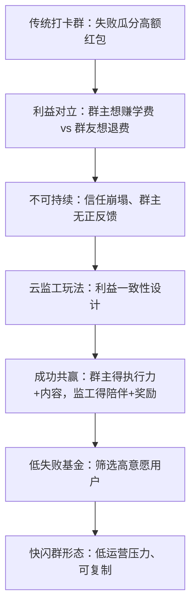
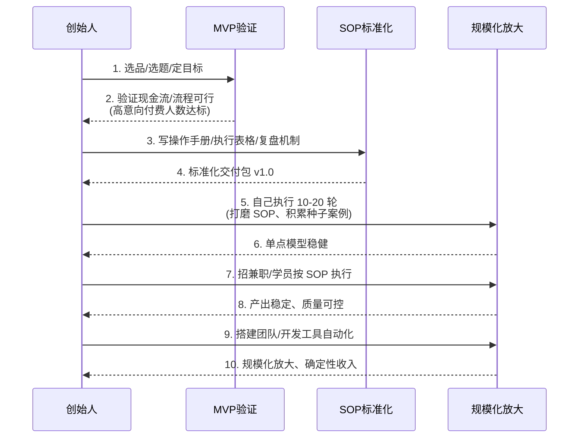

# 第 19 章 从“低水平勤奋”到“系统化精进”的个人成长方法论

## 学习目标

- 理解“云监工”玩法的核心逻辑：利用利益一致性设计打造可持续的社群监督机制
- 掌握“举一反三”项目拆解法，具备从单一案例提炼方法论并迁移至同类/跨类场景的能力
- 掌握“地毯式阅读法”打破信息茧房，建立异常值敏感度与结构化认知体系
- 理解“心金文案”双重属性（吸金+入心），掌握写作前三重思考（目的/受众/平台）框架
- 掌握富兰克林复写法、共鸣感三维构建法、输入带动输出三级阶梯等核心写作训练方法
- 掌握“三个为什么”、“A4纸头脑风暴”、“多角度思维”三大思维训练工具，提升深度思考力
- 理解MVP轻量化验证范式：先卖想法/跑流程验证支付意愿，再投入高成本开发产品
- 理解钩子引流理论：用泛内容钓精准鱼，私域承接转化概率从0变>0
- 掌握利益一致性社群规则设计原则：避免群主与群友利益对立，构建健康可持续的付费社群模型
- 建立“坚持+SOP化”放大思维：跑通MVP→标准化文档→重复放大，用确定性对抗不确定性

## 19.1 生活类比

想象个人成长是一场**“健身房训练”**：**云监工玩法** = **雇私教+找健身搭子**：你不想练时有人盯着、有人陪着，成功了大家一起庆祝（蛋白粉/盲盒），失败了只损失点零花钱（低失败基金），利益绑定让坚持变容易。**举一反三拆解法** = **学会“标准动作”后举一反三**：教练教你深蹲（吸收精华），你举一反三推导出箭步蹲、保加利亚分腿蹲（同类发散），甚至把发力链迁移到推、拉、核心训练（跨类迁移），一通百通。**地毯式阅读法** = **不挑食吃“营养套餐”**：算法推荐像“只吃爱吃的炸鸡薯条”（信息茧房），地毯式阅读是强制自己把蛋白质、维生素、粗粮（陌生领域/反直觉观点）一口不剩吃进去，重构身体机能（认知图谱）。**心金文案** = **“既好喝又健康”的代餐奶昔**：传统硬广是“难以下咽的苦药”，自嗨文艺是“只有颜值无营养的网红饮料”，心金文案是“口感丝滑(入心)又蛋白质爆表(吸金)”，让用户喝完想复购、想分享。**富兰克林复写法** = **“跟着大师描红”练书法**：先看碑帖（看优秀文案），合上帖子凭记忆临摹（关闭重写），对比笔画结构差异（找薄弱点），请名家点评（外部反馈），最终内化为自己的字体（文风）。**输入带动输出三级阶梯** = **“练体能→练技术→打比赛”**：故事类练基础体能（语感/表达），评论类练战术理解（逻辑/结构），商业类练实战套路（观点/变现），跳级上场必受伤。**MVP轻量化验证** = **“先卖健身卡再买跑步机”**：别先花大钱装修健身房（造产品），先在朋友圈卖“10节私教课”看有没有人买单（验证支付意愿），20人付定金再去租场地买器材，无人买单立马止损换项目。**坚持+SOP化放大** = **“把标准动作做100遍，再教会100人做”**：先把深蹲练标准（跑通MVP），写成教案拍成视频（SOP文档化），自己带课→培训助教带课→开发APP自动派课（放大路径），量变引发质变，打造连锁健身品牌。

## 19.2 概念地图

第19章：从“低水平勤奋”到“系统化精进”的个人成长方法论
├── 社群运营与MVP验证体系
│   ├── 云监工玩法 —— ELHqdhiI5oSQAxxItLJctNAhnah.md
│   │   ├── 核心定义：群主发起挑战，招募云监工在线监督进度
│   │   ├── 关键性质：利益一致性（成功共赢）、低门槛可复制、双重价值
│   │   ├── 典型例子：3天阅读50篇+输出5000字，招募102人，意外催生“夸夸群”
│   │   └── 边界条件：仅适用目标明确/可量化/周期短的MVP场景，群主需有硬实力兑现奖励
│   ├── 利益一致性设计 —— ELHqdhiI5oSQAxxItLJctNAhnah.md
│   │   ├── 核心原则：群主成功→群友获益更多（正向和解）
│   │   ├── 反面教材：失败瓜分高额红包、纯打卡全额退费
│   │   ├── 设计三要素：筛选机制（低失败基金）、奖励结构、退出机制
│   │   └── 典型例子：云监工群、百日写作群（收费+押金）、万事万物皆可付费群
│   └── MVP轻量化验证 —— ELHqdhiI5oSQAxxItLJctNAhnah.md
│       ├── 核心定义：先卖想法/跑流程验证支付意愿，再造产品/招团队
│       ├── 关键性质：先卖后做（验证现金流）、可并行测试、止损红线
│       ├── 典型例子：校园水果送货微信群接单、外卖CPS+副业课程3月赚100万、AI绘画小程序理性止损
│       └── 边界条件：不适用重研发/强合规项目，需后续三级跳（单店→区域→标准化）
├── 认知升级与方法论内化体系
│   ├── 举一反三拆解法 —— ELHqdhiI5oSQAxxItLJctNAhnah.md
│   │   ├── 核心定义：吸收精华→同类发散（横向）→跨类迁移（纵向），把案例变“方法论模具”
│   │   ├── 关键性质：高实效性、同类复制、跨类迁移
│   │   ├── 典型例子：水果团购→小红书引流、母婴团购→铁粉精细化、拼多多卖资料→数字产品SOP
│   │   └── 边界条件：仅拆解不实操=智力自嗨，跨类迁移需保留核心变量调整外围参数
│   ├── 地毯式阅读法 —— ELHqdhiI5oSQAxxItLJctNAhnah.md
│   │   ├── 核心定义：拒绝挑喜欢看，指定专栏/书单一篇不漏通读，读完即记录/拆解/举一反三
│   │   ├── 关键性质：打破信息茧房、建立异常值敏感度、训练结构化阅读力
│   │   ├── 典型例子：通读《生财有术项目精选》50篇，发现“除甲醛=除异味”跨行业洞察
│   │   └── 边界条件：耗时高、源材料需高质量、需配合输出倒逼深度加工
│   └── 钩子引流理论 —— ELHqdhiI5oSQAxxItLJctNAhnah.md
│       ├── 核心定义：引流钩子≠变现产品，用泛内容吸引目标人群入私域再筛选转化
│       ├── 关键性质：概率思维（大分母出大分子）、信任前置、组合拳（钩子负责量+私域负责质）
│       ├── 典型例子：母婴团购用育儿干货引流、作者用云监工挑战吸引成长型用户、除甲醛用“除异味”钩子
│       └── 边界条件：私域承接能力不足先建后域，钩子需合规且人群画像有交集
├── 文案与思维训练体系
│   ├── 心金文案 —— JPRAdLgGFowUE7xargGc8YNjnzh.md
│   │   ├── 核心定义：文案≠文章，兼具吸金(商业变现)+入心(情感共鸣)双重属性，本质是思维显化
│   │   ├── 关键性质：一条文案一个主旨、统一风格形成记忆点、拒绝硬性模仿/套模板
│   │   ├── 典型例子：作者年输出百万字、小红书吸粉变现7位数、富兰克林复写法/共鸣感三维构建
│   │   └── 边界条件：前置三重思考(目的/受众/平台)、思维深度是上限、平台合规红线
│   ├── 写作前三重思考 —— JPRAdLgGFowUE7xargGc8YNjnzh.md
│   │   ├── 宏观目的：整体文案方向实现什么
│   │   ├── 微观目的：单条文案达成什么目标
│   │   ├── 目标受众：理解用户特征与需求
│   │   └── 发布平台：根据平台特性调整风格实现多平台分发放大
│   ├── 富兰克林复写法 —— JPRAdLgGFowUE7xargGc8YNjnzh.md
│   │   ├── 核心流程：看优秀文案→关闭→自己话重写→对比薄弱点→请他人点评→内化
│   │   └── 核心价值：精准定位表达薄弱点，通过外部反馈闭环提升
│   ├── 共鸣感三维构建法 —— JPRAdLgGFowUE7xargGc8YNjnzh.md
│   │   ├── 经历共鸣：同场景代入
│   │   ├── 感受共鸣：同情绪唤起
│   │   └── 价值观共鸣：同信仰连接
│   ├── 输入带动输出三级阶梯 —— JPRAdLgGFowUE7xargGc8YNjnzh.md
│   │   ├── 核心公式：高质量输入→深度内化→高频输出
│   │   ├── 三级输入：故事类(练表达/语感)→评论类(练逻辑/结构)→商业类(练观点/套路)
│   │   ├── 两大支撑：分类素材库(存)、100问练习法(练/用)
│   │   └── 关键性质：阶梯性(不可跳级)、内化必经(用自己话重写)、复利性(资产积累)
│   └── 思维训练三件套 —— JPRAdLgGFowUE7xargGc8YNjnzh.md
│       ├── 三个为什么追问法：连问三个为什么挖掘深层动机与因果链条
│       ├── A4纸零秒思考法：横放A4纸，1分钟/张，4-6行，日写10张，强制外化思考
│       └── 多角度思维法：主动切换用户/对手/时间/系统视角，打破角度固化
└── 放大与复利体系
    ├── 坚持+SOP化放大论 —— ELHqdhiI5oSQAxxItLJctNAhnah.md
    │   ├── 核心定义：跑通MVP→SOP标准化(操作手册/执行表格/复盘机制)→坚持重复执行(自己做→兼职/学员做→团队/工具自动化)
    │   ├── 关键性质：确定性>爆发力、体系化门槛(从咸鱼无货源到供应商体系)、时间复利(做100次引发质变)
    │   ├── 典型例子：565天日更写作三大变现闭环、闲鱼套利矩阵号批量、视频号店群7店日销7858元矩阵SOP
    │   └── 边界条件：SOP前提是已跑通MVP、坚持≠死磕(设止损点/复盘节点)、规模化需同步升级组织/激励/风控

## 19.3 云监工玩法 —— 用“陪伴+监督”把个人成长变成社群生意

### 19.3.1 为什么需要这个概念？

普通人独自跑 MVP 容易拖延、放弃，缺乏外部约束与正反馈。传统打卡群规则（失败瓜分红包）把群主与群友利益对立，不可持续。我们需要一种低成本、可快速测试、双方利益一致的社群运营模式。

### 19.3.2 核心定义与关键性质

> "希望我复盘的这个云监工快闪群玩法，能：帮助更多圈友高效地跑MVP；让群变得更好玩，云监工还可以成为社群角色、监督促进复盘文化等；让云监工们感知、陪伴到群主的成长；让云监工们加强对群主了解、记忆。"
> 
> ——《docs/202301-02/ELHqdhiI5oSQAxxItLJctNAhnah.md》

**云监工玩法** 是一种低成本社群玩法：群主发起挑战目标，招募“云监工”在线上监督自己的目标进度，以此获得陪伴、监督和正反馈，同时让监工感知群主成长、增强对群主的了解与记忆，适合普通人快速测试和高效跑通 MVP。

> "在我花2天多时间，招募102位云监工并完成挑战后，这验证了我此前的想法：云监工玩法特别适合普通人，它简单好操作+可低成本快速进行测试，它的运营模式对群主的要求并没有陪伴群那么高。"
> 
> ——《docs/202301-02/ELHqdhiI5oSQAxxItLJctNAhnah.md》

这个案例展示了该玩法的三大关键性质：
- **利益一致性**：群主成功 = 群友获益，打破“群主赚钱 vs 群友省钱”的零和博弈
- **低门槛可复制**：无需专业运营技能，普通人可 1 天内搭建、2 天跑通
- **双重价值**：群主获执行力+内容产出；监工获成长陪伴+信任连接+物质奖励

### 19.3.3 规则设计：利益一致性是核心

> "以前我见过一些目标挑战群，规则一般只是挑战失败后瓜分1000元或XXXX元。这是不太健康的，这会把群主、群友的利益对立起来。所以我的规则中设置的是如果我挑战成功了，大家能获得更多。另外规则中挑战失败瓜分的金额设置得很低，这能筛选掉只是被红包吸引的人。"
> 
> ——《docs/202301-02/ELHqdhiI5oSQAxxItLJctNAhnah.md》

**规则设计三要素**：
1. **筛选机制（低失败基金）**：挑战失败仅瓜分 200 元失败基金，自动过滤“纯投机/薅羊毛”用户
2. **奖励结构（正向和解）**：挑战成功送“5000 字学习心得 + 7 折购买权 + 随机抽 10 人送新年盲盒”
3. **退出机制（体面止损）**：快闪群形式（短周期、低运营压力），避免长期陪伴群的高管理成本

### 19.3.4 典型案例复盘

**作者挑战**：3 天阅读《生财有术项目精选》50 篇 + 输出 5000 字心得
- **招募结果**：2 天多招募 102 名云监工
- **实际耗时**：接近 2 天（预估 6 小时，实际远超预期）
- **意外收获**：群内自发形成“夸夸群”氛围，监工主动计算进度、汇总内容、给予高频正向反馈

> "这哪里是云监工群？简直是夸夸群~~比如，有云监工很认真地在算我花的时间：果然顺利完成了! 3天50篇，一篇10分钟的话，平均下来一天也要花将近3小时了，还有5000字的内容要写。2023开了个好头，向你学习。"
> 
> ——《docs/202301-02/ELHqdhiI5oSQAxxItLJctNAhnah.md》

### 19.3.5 边界条件与避坑指南

| 边界条件 | 说明 |
|----------|------|
| **适用场景** | 仅适用于目标明确、可量化、周期短（如 3-7 天）的 MVP 验证场景 |
| **群主硬实力** | 群主需具备基础内容产出能力，否则无法兑现“成功奖励”导致信用破产 |
| **基金设置** | 失败基金设过高会吸引投机者破坏氛围，需极低金额筛选高意愿共振者 |
| **法律合规** | 押金/奖金设计需规避“非法集资/赌博/变相传销”法律红线 |

### 19.3.6 方法演进图：从打卡群到云监工

## 19.4 举一反三拆解法 —— 从“一个案例”长出“百个玩法”

### 19.4.1 为什么需要这个概念？

碎片化学习只看热闹，无法形成可迁移的方法论。单个项目案例隐含的底层逻辑被表象掩盖，需主动提炼。新手缺乏“拆解思维”，看到成功案例只会盲目跟风或完全放弃。

### 19.4.2 核心定义与三步走流程

> "举一反三是做项目要练习的基本功。看完教育人做水果团购后，我首先想到我在生财知识星球发过的这篇文章《才391个小红书粉丝，但引流私域432人成交308单的复盘》，两者在一些方面逻辑是一致的，之后这类项目都可以借鉴经验；我的另外一个想法是这种拆解项目的思路，也很值得练习。"
> 
> ——《docs/202301-02/ELHqdhiI5oSQAxxItLJctNAhnah.md》

**举一反三拆解法** 是一种阅读项目案例的方法：看完一个具体项目后，按三步走——**吸收精华（浓缩） → 同类发散（横向迁移） → 跨类迁移（纵向抽象）**，把案例变成“方法论模具”，倒扣在新场景上。

> "它一方面是浓缩的精华，能帮助我们快速获取有效信息、节省时间（真是绝绝子），另一方面又帮我们以这个项目为点发散到同类项目、跨类项目。"
> 
> ——《docs/202301-02/ELHqdhiI5oSQAxxItLJctNAhnah.md》

### 19.4.3 关键性质

| 性质 | 说明 | 典型映射 |
|------|------|----------|
| **高实效性** | 直接拿来解决当下同类问题 | 水果团购 → 小红书引流（私域引流+社群转化逻辑一致） |
| **同类复制** | 同赛道不同产品的打法复用 | 母婴团购 → “铁粉精细化运营+转介绍复利”模型 |
| **跨类迁移** | 底层逻辑迁移到完全不同业务 | 拼多多卖资料 → “自动发货+选品敏感度”通用数字产品 SOP |

### 19.4.4 实战案例：从水果团购到跨领域迁移

**原始案例**：教育人做水果团购（私域引流 + 社群转化）
1. **同类发散**：联想到《才 391 个小红书粉丝，但引流私域 432 人成交 308 单》——逻辑一致，验证“私域引流 + 社群转化”可复用
2. **跨类迁移（蓝海选品思维）**：作者发现“蓝海选品思维不仅仅只能用于带货，也能用于生产更受欢迎的视频、音频、文章或图片。挖掘蓝海离不开对异常值的敏感度。” —— 将电商选品逻辑迁移到内容生产
3. **跨类迁移（痛点重构）**：从“除甲醛”案例提炼出“除甲醛不仅仅是除甲醛，还要除掉客户心中误认为是甲醛的异味” —— 将“表层痛点 → 深层认知痛点”的重构逻辑迁移到各行业

### 19.4.5 边界条件

- **仅拆解不实操 = 智力自嗨**：必须结合自身资源落地验证
- **警惕“生搬硬套”**：跨类迁移需保留核心变量（如异常值敏感度），调整外围参数
- **案例来源质量决定上限**：优选已验证盈利、数据透明的真实案例

## 19.5 地毯式阅读法 —— 打破信息茧房的“强制全餐”

### 19.5.1 为什么需要这个概念？

算法推荐强化“只看爱看”，导致认知边界固化、错过跨界机会。主动挑选阅读等于“用旧地图找新大陆”，无法发现未知盲区。我们需要一种强制性、系统性的输入方式重构知识图谱。

### 19.5.2 核心定义

> "以前我看内容，更多地是挑自己喜欢的主题或人。这次采用地毯式的方法每一篇都看，很受益，又了解了一些新领域的思路、打破了一点点信息茧房。"
> 
> ——《docs/202301-02/ELHqdhiI5oSQAxxItLJctNAhnah.md》

**地毯式阅读法** = 拒绝“挑喜欢的主题或人”，对指定专栏/书单/合集做“一篇不漏”的通读；读完即记录、即拆解、即举一反三，形成输入-处理-输出闭环。

### 19.5.3 关键性质

| 性质 | 机制 | 价值 |
|------|------|------|
| **打破信息茧房** | 强制接触陌生领域、反直觉观点、非舒适区知识 | 避免算法投喂的单一营养，重构认知边界 |
| **建立异常值敏感度** | 只有看全量才能识别出数据分布尾部的蓝海信号 | 发现“除甲醛=除异味”这类跨行业洞察 |
| **训练结构化阅读力** | 从碎片摄入转向体系构建 | 形成可迁移的方法论库，而非散点知识 |

### 19.5.4 典型案例：通读《生财有术项目精选》50 篇

- **耗时**：近 2 天（50 篇，每篇 10 分钟到 1 小时不等）
- **核心收获**：发现“除甲醛不仅是除甲醛，还要除掉客户心中误认为是甲醛的异味”等跨行业洞察
- **思维迁移**：打破了“只做电商才用蓝海选品”的认知局限，将其迁移到内容生产、视频制作等全品类

> "蓝海选品思维不仅仅只能用于带货，也能用于生产更受欢迎的视频、音频、文章或图片。挖掘蓝海离不开对异常值的敏感度。"
> 
> ——《docs/202301-02/ELHqdhiI5oSQAxxItLJctNAhnah.md》

### 19.5.5 边界条件与执行建议

| 约束 | 应对策略 |
|------|----------|
| **耗时极高** | 非全职者拆解为“每日固定时段（如早 6-7 点）+ 周末补课” |
| **源材料质量** | 必须是高密度、高质量的精选集（如生财精选、得到商业经典），垃圾堆里地毯式阅读只是浪费生命 |
| **必须配合输出** | 读完即记录“核心观点 + 关键数据 + 可迁移方法论”三条，倒逼深度加工，否则沦为“看完即忘” |

## 19.6 钩子引流理论 —— 用“泛内容”钓“精准鱼”

### 19.6.1 为什么需要这个概念？

直接用产品做引流钩子：公域爆发概率低、受众窄、平台限流重。不引流私域 = 转化概率为 0，哪怕引流来的泛流量不精准，也比 0 强。需要解耦“引流钩子”与“变现产品”，用低门槛内容撬动高客单转化。

### 19.6.2 核心定义

> "为了在私域卖货或做转化，引流的钩子不一定必须就是出售的产品，只要能引流到产品目标人群的钩子，就是好钩子。相比大众喜闻乐见的内容，特定产品作为钩子时，在公域爆的可能性更小。虽然用泛内容引流的用户没那么精准，但如果用户不进私域，那在私域带货成功的概率为0。"
> 
> ——《docs/202301-02/ELHqdhiI5oSQAxxItLJctNAhnah.md》

**钩子引流理论** 核心三点：
1. **引流钩子 ≠ 变现产品**：钩子只需吸引“目标人群”，不需直接相关
2. **泛内容引流**：大众喜闻乐见的内容（八卦/段子/通识/热点）获取广泛关注
3. **私域筛选**：通过私域内容/互动/标签体系，从泛流量中筛选出精准意向客户

### 19.6.3 关键性质：概率思维 + 信任前置 + 组合拳

$$
\text{转化概率} = \frac{\text{私域精准用户数}}{\text{公域泛流量总数}} \times \text{私域转化率}
$$

- **概率思维**：公域流量池大、泛内容易爆 → 进入私域分母大 → 精准分子数绝对值可观
- **信任前置**：私域通过“专业内容/人设/案例”建立信任，再推高客单产品
- **组合拳**：钩子负责“量”，私域负责“质”，两端分工明确、独立优化

### 19.6.4 典型案例对照表

| 场景 | 变现产品 | 引流钩子（泛内容） | 筛选逻辑 |
|------|----------|-------------------|----------|
| **母婴团购** | 高客单母婴品/转介绍 | 育儿干货/避坑指南 | 私域标签分层 → 推品/转介绍 |
| **作者自身** | 付费咨询/社群/课程 | 云监工挑战/读书心得 | 吸引成长型用户 → 转化付费产品 |
| **除甲醛服务** | 除甲醛上门服务 | 除异味/新房入住避坑 | 捕捉“新房入住”大流量池 → 筛选真需求 |

> "钩子理论不仅仅是引流，更是筛选。钩子决定了你吸引来什么样的人，私域决定了你能留下什么样的人。"
> 
> ——《docs/202301-02/ELHqdhiI5oSQAxxItLJctNAhnah.md》

### 19.6.5 数据流图：钩子 → 私域 → 筛选 → 转化

### 19.6.6 边界条件

- **私域承接能力不足**（无 SOP/无人设/无信任背书）时，引流再多也转化不了，**先建后域再引流**
- **泛内容不能违规/擦边/低俗**，否则账号被封、标签污染、信任破产，得不偿失
- **钩子与产品人群画像需有“交集”**，完全不相关（如用游戏内容卖保险）筛选成本过高

## 19.7 利益一致性设计 —— 让群主与群友“站在同一边”的社群规则工程

### 19.7.1 为什么需要这个概念？

绝大多数付费社群/挑战群/打卡群因“群主赚学费 vs 群友求退费”利益对立而夭折。群主变现能力弱、策略无效时，利益对立机制会加速社群信任崩塌。只有利益一致，社群才能健康、可持续、产生复利。

### 19.7.2 核心原则与反面教材

> "以前我见过一些目标挑战群，规则一般只是挑战失败后瓜分1000元或XXXX元。这是不太健康的，这会把群主、群友的利益对立起来。所以我的规则中设置的是如果我挑战成功了，大家能获得更多。另外规则中挑战失败瓜分的金额设置得很低，这能筛选掉只是被红包吸引的人。"
> 
> ——《docs/202301-02/ELHqdhiI5oSQAxxItLJctNAhnah.md》

**核心原则**：群主成功 → 群友获得更多价值（正向和解）

**反面教材（利益对立机制）**：
- 挑战失败瓜分高额红包（群主失败获利，群友盼群主失败）
- 纯打卡全额退费（群主无变现 → 群友退费，群主亏本服务）
- 群主不盈利仍承担高成本服务（不可持续）

> "如果新人运营百日XX活动，建议采取收费+收押金模式。如果只用完成打卡全额退费，当群主再次变现能力弱、群主没法通过活动赚到有正反馈的钱时、当群主的策略没法帮助大部分群友们完成打卡时，在一定程度相当于把群主、参与者的利益对立，这不是一种健康的状态，不利于可持续发展。"
> 
> ——《docs/202301-02/ELHqdhiI5oSQAxxItLJctNAhnah.md`

> "万事万物皆可通过付费群变现。不论是付费10万还是付费1元的群，健康的、可持续发展模式是群能给用户带来价值。"
> 
> ——《docs/202301-02/ELHqdhiI5oSQAxxItLJctNAhnah.md》

### 19.7.3 设计三要素

| 要素 | 设计要点 | 云监工群实例 |
|------|----------|--------------|
| **筛选机制** | 低门槛/低失败基金，自动过滤投机者 | 挑战失败仅瓜分 200 元 |
| **奖励结构** | 群主成功 = 群友获利（心得/折扣/盲盒/押金返还） | 成功送心得 + 7 折权益 + 盲盒 |
| **退出机制** | 体面止损不撕逼，快闪群/押金制 | 3 天快闪群，周期短压力小 |

### 19.7.4 典型模式对照

| 模式 | 利益结构 | 可持续性 | 适用场景 |
|------|----------|----------|----------|
| **云监工群** | 成功共赢/失败微损 | 高 | 目标明确、周期短、MVP 验证 |
| **百日写作群** | 收费+押金，成功退押金+奖励 | 高 | 长周期习惯养成、技能训练 |
| **纯打卡退费群** | 群主垫资、全额退费 | 低 | 群主变现强、品牌背书足时 |
| **万事万物付费群** | 群给价值 → 用户付费 | 极高 | 任何可量化价值交付场景 |

## 19.8 MVP 轻量化验证 —— 先“卖想法/跑流程”，再“造产品/招团队”

### 19.8.1 为什么需要这个概念？

传统创业“先造产品后找客户”风险极高，沉没成本大、试错周期长。知识付费/实体业务/本地服务均面临“高投入前置、需求未验证”死局。需要一套“最小成本、最短周期、可量化验证”的通用起步范式。

### 19.8.2 核心定义与验证指标

> "随着知识付费的发展，录课卖课越来越内卷。建议普通人在投入高成本录制课程前，先用轻量化的单次付费咨询、付费专栏、快闪社群等跑MVP，积累一定粉丝或者有可观流量合作渠道后，再去录课卖课。"
> 
> ——《docs/202301-02/ELHqdhiI5oSQAxxItLJctNAhnah.md》

**MVP 轻量化验证** 核心范式：
- **知识付费**：先做单次付费咨询/付费专栏/快闪群（MVP）→ 积累粉丝/验证流量渠道 → 再录课卖课
- **实体/本地服务**：先自己用微信点单/群接单跑通全流程（MVP）→ 验证单店模型 → 再招团队/开分店/做加盟

> "验证产品应优先卖想法而非做产品，通过高意向付费人数判断需求是否成立：聊了100人只有几个人买肯定有问题，20-30人购买并交预售金则该不确定因素解决，可短时间测试几十个产品。"
> 
> ——《docs/202301-02/ELHqdhiI5oSQAxxItLJctNAhnah.md》

**核心指标**：高意向付费人数（聊 100 人，20-30 人付预售金 = 需求验证通过）

### 19.8.3 关键性质

| 性质 | 机制 | 价值 |
|------|------|------|
| **先卖后做** | 验证“支付意愿”而非“点赞意愿”，现金流是唯一硬指标 | 避免造没人买的产品，现金流为王 |
| **可并行测试** | 低成本允许同时测试几十个产品方向 | 用市场投票代替拍脑袋决策 |
| **止损红线** | 设定最大投入上限（时间/金钱/精力），跑不通果断切换 | 不陷入沉没成本陷阱 |

### 19.8.4 典型案例对照

| 案例 | MVP 形态 | 验证结果 | 后续动作 |
|------|----------|----------|----------|
| **校园水果送货** | 微信群接单跑通“点单-采购-配送-收款” | 单店模型跑通 | 再考虑组团队/开小程序 |
| **作者亏损复盘** | 先跑通外卖 CPS 单链路 MVP | 3 个月赚 100 万 | 叠加副业课程放大 |
| **AI 绘画小程序** | 预算超预期/资质缺失/工期过长 | **理性止损放弃** | 避免盲目投入沉没成本 |

> "因预算远超预期、无个体和公司执照、工期15-20天对热点太长、流量99%来自👸号等原因放弃AI绘画小程序开发——理性评估门槛后选择止损而非盲目投入。"
> 
> ——《docs/202301-02/ELHqdhiI5oSQAxxItLJctNAhnah.md》

### 19.8.5 边界条件

| 约束 | 说明 |
|------|------|
| **不适用场景** | 重研发、长周期、强合规的硬科技/医疗/金融牌照类项目 |
| **三级跳要求** | MVP 验证通过 ≠ 规模化成功，仍需“单店模型健康 → 区域模型验证 → 标准化复制” |
| **预售风险** | 预售/众筹模式需警惕“交付兑现风险”，无法交付导致信用破产比项目失败更严重 |

## 19.9 心金文案 —— 让文字既“吸金”又“入心”的双重炼金术

### 19.9.1 为什么需要这个概念？

传统文案要么“土味硬广”引起反感，要么“文艺自嗨”无法变现。私域运营者常陷入“发了无数朋友圈，咨询寥寥无几”的自嗨陷阱。我们需要一种统一标准：商业转化率（吸金）与情感共鸣度（入心）双达标。

### 19.9.2 核心定义

> "2022年，我给我的文案风格，终于敲定了一个名字，叫做「心金文案」，寓意是既能吸金、又能深入人心的文案。"
> 
> ——《docs/202301-02/JPRAdLgGFowUE7xargGc8YNjnzh.md》

> "文案不同于文章，文案本身就带有一层商业变现属性，所以能够吸金才是关键，而文案又需要蕴藏感情、给人能带来触动，所以深入人心的写法，也是必要。"
> 
> ——《docs/202301-02/JPRAdLgGFowUE7xargGc8YNjnzh.md》

> "我曾经说过，文案是思维的显化。写作的过程其实就是把你的思考你的价值观传递出来，那么我们只要去写文案，一定其中就会包含着我们态度的表达，你的每一次起心动念，都会影响着你文字的风格与走向。"
> 
> ——《docs/202301-02/JPRAdLgGFowUE7xargGc8YNjnzh.md》

**心金文案** = 文案 ≠ 文章，兼具 **吸金**（商业闭环能力）+ **入心**（情感触动/价值观共鸣）双重属性，本质是 **思维的显化**。

### 19.9.3 核心准则

| 准则 | 含义 | 违反之果 |
|------|------|----------|
| **一条文案一个主旨** | 多主旨导致焦点模糊，单一主旨穿透决策防线 | 读者眼花缭乱，无法抓住重点，转化率归零 |
| **统一风格形成记忆点** | 风格频繁切换 = 无人格面具；坚持风格 = 个人 IP 标签 | 无法形成差异化记忆，用户无法识别“你是谁” |
| **拒绝硬性模仿/套模板** | 模仿框架不思考吸引点逻辑，会束缚创造力天花板 | 只能在别人框架里改写，永远无法超越，无文风、无复利 |

> "先明确一条文案的表达主旨，然后围绕着这一个主旨来写。一条文案，一个主旨就足够了。太多了，就会让人眼花缭乱，反而无法抓住重点。"
> 
> ——《docs/202301-02/JPRAdLgGFowUE7xargGc8YNjnzh.md》

> "如果你的文案能够让别人在阅读的时候，感叹出来这一定是谁写的文案，那其实就证明你成功了，你已经形成了自己的风格。"
> 
> ——《docs/202301-02/JPRAdLgGFowUE7xargGc8YNjnzh.md》

> "这种就是根本没掌握文案写法，自以为很聪明，但实际上束缚了自己的文案力和创造力，她只会在我的文案框架里去改写，却从未思考我文案中的吸引点和逻辑性。所以大家写作记住，千万不要硬性模仿，更不要去套什么所谓的模版，那只会局限你的思维。"
> 
> ——《docs/202301-02/JPRAdLgGFowUE7xargGc8YNjnzh.md`

### 19.9.4 写作前三重思考（防自嗨、防跑题框架）

| 维度 | 核心问题 | 作用 |
|------|----------|------|
| **宏观目的** | 整体文案方向是为了实现什么？（如：建立专业 IP、引流私域、直接成交） | 决定内容策略的大方向 |
| **微观目的** | 单条文案要达成什么目标？（如：获赞、引评论、加微信、下单） | 决定单条文案的 CTA 设计 |
| **目标受众** | 谁在看？特征是什么？痛点/爽点/恐惧点是什么？ | 决定语言风格、案例选材、痛点击中点 |
| **发布平台** | 微信/小红书/👸号/抖音……特性差异？如何适配？ | 同一核心内容多平台分发放大，风格微调而非重写 |

> "我们在写文案之前，需要思考两层目的。一层是宏观的，你整体文案的方向是为了实现什么？……一层是微观的，具体到每一个单条文案要达到什么目的？"
> 
> ——《docs/202301-02/JPRAdLgGFowUE7xargGc8YNjnzh.md`

> "你要先去理解用户，然后才能写好文案甚至于做好营销。"
> 
> ——《docs/202301-02/JPRAdLgGFowUE7xargGc8YNjnzh.md`

> "同一条文案，适当根据平台特性去修改，就可以实现多平台分发，真正让一条文案实现成倍放大影响力的效果。"
> 
> ——《docs/202301-02/JPRAdLgGFowUE7xargGc8YNjnzh.md`

### 19.9.5 富兰克林复写法 —— “跟着大师描红”练文风

> "什么叫做复写？就是你先看一遍文案，然后把它关闭，尝试用自己的话去再次写出来，然后你会发现，每一次你写出来的内容都不一样，然后你去跟原文案对比，去发现自己表达不清晰的地方在哪里，那就是你写作的薄弱点。"
> 
> ——《docs/202301-02/JPRAdLgGFowUE7xargGc8YNjnzh.md`

> "然后当大家写出来一个文案的时候，不要孤芳自赏，可以去找一些朋友或者专业人士帮助你点评你的文案，提出建议。"
> 
> ——《docs/202301-02/JPRAdLgGFowUE7xargGc8YNjnzh.md`

**核心流程（6 步闭环）**：
1. **看**：精读一篇优秀文案（同领域爆款）
2. **关**：关闭原文，不参考任何词句
3. **写**：用自己的话重写一遍（复述核心逻辑+情感弧线）
4. **比**：逐句对比原文，标记“表达不清/逻辑断层/词汇贫乏”等薄弱点
5. **评**：请他人（同行/导师/目标用户）点评，获取外部视角反馈
6. **内化**：针对性练习薄弱环节，形成自己的表达习惯

**核心价值**：精准定位表达薄弱点，通过外部反馈闭环提升，而非盲目练习。

### 19.9.6 共鸣感三维构建法 —— “构建相似”唤起情感穿透

> "这种共鸣，是需要通过「构建相似」来进行的。可以在文案中代入生活场景感受，贴近现实，你所感受到的喜怒哀乐，用户也能同样感受到。分享给大家3个方向：经历的共鸣，感受的共鸣，价值观的共鸣。"
> 
> ——《docs/202301-02/JPRAdLgGFowUE7xargGc8YNjnzh.md`

| 维度 | 核心动作 | 文案示例片段 |
|------|----------|--------------|
| **经历共鸣** | 同场景代入：“你是否也经历过……” | “凌晨两点，盯着屏幕改第 7 版方案，客户却说‘就差一点感觉’” |
| **感受共鸣** | 同情绪唤起：命名那种具体情绪 | “那种‘明明很努力却不被看见’的委屈，像根刺扎在喉咙里” |
| **价值观共鸣** | 同信仰连接：宣示共同坚守的信念 | “但我依然相信：专业主义终会被市场溢价，慢就是快” |

> "世间万物其实都遵循着吸引力法则，低能量会被高能量吸引，那你就必须要先把自己的势能打造起来，勇敢的在文案里去表达你的心声，才会引发别人的共鸣。"
> 
> ——《docs/202301-02/JPRAdLgGFowUE7xargGc8YNjnzh.md`

### 19.9.7 输入带动输出三级阶梯 —— 从“读”到“写”的认知加工流水线

> "千万不要自己闷头苦想，因为你的认知基础薄弱，你想半天想出来的很可能归因逻辑就是错的。思维是一定要通过不断输入才能得到提升的，踩着巨人的肩膀，你会看到更广阔的天空。输入完了之后，还要思考。因为从明白到掌握，有一个「内化」的过程。"
> 
> ——《docs/202301-02/JPRAdLgGFowUE7xargGc8YNjnzh.md`

**核心公式**：高质量输入 → 深度内化（思考） → 高频输出（写作/复盘）

**三级输入内容分层（阶梯性，不可跳级）**：
1. **故事类**（练表达/语感）：小说、传记、散文 → 学“把事说明白、把情绪写细腻”
2. **评论类**（练逻辑/结构）：书评、影评、深度长文 → 学“论证结构、因果链条、反驳预判”
3. **商业类**（练观点/套路）：案例复盘、商业分析、增长拆解 → 学“变现逻辑、话术框架、策略模型”

**两大支撑工具**：
- **分类素材库（存）**：闪光文件夹（随时记录灵感）、文案素材库（分门别类整理高价值精华）
- **100 问练习法（练/用）**：整理行业 Top 100 高频问，能答的答、不会的查资料再用自己话写，写完即建立专业护城河 + 输出能力质变

> "建议大家看三类，可以先从【故事类】的内容看起，然后去看一些【评论类】的内容，最后再去看一些【商业类】的内容。看故事类的内容是看表达方式，是看语句的通畅，连贯的表达，是把一件事情说明白的能力。接着看【评论类】的内容，比如书评，影评等等，这类是去看逻辑的。最后再看【商业类】的内容，这类内容是看观点和文案套路。"
> 
> ——《docs/202301-02/JPRAdLgGFowUE7xargGc8YNjnzh.md`

> "去把你行业里最常见的100个问题整理出来，能自己回答的自己尝试回答，不能自己回答的去各种书籍、行业大神那里求教获得答案，理解之后再用自己的话写出来。一定是用自己的话写出来，不是去照搬或者模仿别人的语言，那样你还是没有思考、没有自己文风的。"
> 
> ——《docs/202301-02/JPRAdLgGFowUE7xargGc8YNjnzh.md`

**关键性质**：
- **阶梯性**：跳级会导致“懂了道理但过不好这一生”，故事类打底、评论类立柱、商业类盖顶
- **内化必经**：从“明白”到“掌握”有一个必须的内化过程，靠“用自己话重写”完成
- **复利性**：建立专属素材库 = 资产积累；100 问写完 = 专业认知体系成型 + 输出能力质变

## 19.10 思维训练三件套 —— 练就“深度思考肌”

### 19.10.1 为什么需要这个概念？

表层思考只能产出平庸文案，深度思考是“心金文案”的源头活水。大脑倾向于走捷径（系统 1 快思考），需强制引入结构化工具激活系统 2 慢思考。思维局限源于“角度固化”，必须主动训练视角切换能力。

### 19.10.2 三个为什么追问法 —— 挖掘深层动机与因果链条

> "第一种，遇到任何事情多问自己三个'为什么'？为什么是这样？为什么会发生这件事情？为什么我要去做这件事情？这个其实就是挖掘内心深处的想法，也是倒逼自己思考，做出独立的判断。"
> 
> ——《docs/202301-02/JPRAdLgGFowUE7xargGc8YNjnzh.md`

**操作规范**：
- 遇事连问 3 个“为什么”，每一层必须基于前一层回答
- 问到“可执行的行动层面”停止，别问到哲学/形而上学层面
- 典型链条：为什么亏钱？→ 为什么选品错？→ 为什么没验证需求？→ **根因：无 MVP 验证 SOP**

### 19.10.3 A4 纸零秒思考法 —— 强制外化思考

> "将一张 A4 纸横放在面前，每张纸写一个主题，1 页写 4～6 行，每行 20～30 字，写每张纸所用的时间要控制在 1 分钟以内。每天去写十张纸，也就是花十分钟的时间。这个方法虽然简单，但如果长期训练可以轻松提高深度思考的能力。"
> 
> ——《docs/202301-02/JPRAdLgGFowUE7xargGc8YNjnzh.md`

**硬性约束**：
- 横放 A4 纸，1 分钟/张，4-6 行，20-30 字/行
- 日写 10 张（仅 10 分钟），宁可字迹潦草不可超时
- **强制外化**：未写出的思考都是“意淫”，写出来才能被审视修正

**实战示例**：
- 主题：“如何写好爆款标题” → 1 分钟写出 6 个切入点 → 筛选优化成大纲
- 主题：“AI 绘本小程序的核心风险点” → 1 分钟写满 → 发现盲区风险

### 19.10.4 多角度思维法 —— 打破角度固化

> "第三种，学会多角度思维。其实很多时候我们的困顿是源于局限的。只要改变角度，一切都会随之而变。太专注于事物本身，我们只会局限在事物的某一方面……阻碍我们的不是往往事物，而是我们看事物的角度。"
> 
> ——《docs/202301-02/JPRAdLgGFowUE7xargGc8YNjnzh.md`

**四大标准视角切换表**：

| 视角 | 核心提问 | 典型输出 |
|------|----------|----------|
| **用户视角** | 他最怕什么？最爽什么？凭什么信我？ | 痛点/爽点/信任锚点 |
| **对手视角** | 他为什么降价？意图是清库存还是引流？ | 竞品策略反推、防御动作 |
| **时间维度** | 1 年后回看，这决策会后悔吗？ | 长期主义过滤短期噪音 |
| **系统视角** | 平台算法/规则/生态会如何演变？ | 顺势而为、规避红线 |

**实战示例（面对竞品降价）**：
- 用户视角：性价比提升 → 购买意愿上升
- 竞品视角：清库存/引流/卡位 → 非长期价格战
- 平台视角：GMV 考核 → 短期扶持、长期压佣
- 长期视角：品牌资产稀释 → 坚守价格体系、增值服务

**收敛原则**：警惕“分析瘫痪”，最终要收敛到“当下最优决策”而非“完美方案”。

## 19.11 多源对照：社群运营的不同流派共识与分歧

本章涉及的社群运营方法论，主要源自《ELHqdhiI5oSQAxxItLJctNAhnah.md》一份素材，但其中引用了多个实战案例（云监工群、百日写作群、母婴团购群、水果团购群等）。以下是从这些案例中提炼的共识与分歧：

### 共识

1. **利益一致性是社群生存的底层逻辑**：无论云监工群、百日写作群、母婴团购群，核心都是群主与群友利益绑定，避免零和博弈。
2. **私域转化必须前置信任建设**：母婴团购“先广撒网积累种子用户，精细化运营获取信任后筛选铁粉”，作者自身“云监工挑战建立信任后转化付费产品”，逻辑一致。
3. **MVP 验证优先于规模化**：水果团购“先微信群跑通流程再组团队”、知识付费“先跑 MVP 再录课”、外卖 CPS“先跑通单链路再放大”，均遵循“小步快跑、现金流验证”。

### 分歧

| 维度 | **云监工/快闪群派** | **百日长周期陪伴群派** | **母婴/高客单精细化运营派** |
|------|---------------------|------------------------|-----------------------------|
| **周期** | 短（3-7 天） | 长（100 天+） | 持续运营（年单位） |
| **变现时点** | 挑战结束即兑现 | 周期中/末通过押金/服务费 | 全周期持续转化（复购/转介绍） |
| **群主角色** | 被监督者/内容产出者 | 服务者/教练/运营者 | 选品官/信任代言人/社群领袖 |
| **盈利模型** | 群主通过挑战产出内容/产品变现 | 群主靠服务差价/押金模型盈利 | 群主靠商品毛利+复购/转介绍盈利 |
| **风险点** | 群主信用破产（兑现不了奖励） | 群主变现能力弱导致利益对立 | 供应链失控/服务标准化难 |

**核心分歧点**：群主是否需要在群内直接变现。
- 云监工群：群主**不在群内直接收费**，靠挑战产出的内容/产品在群外变现
- 百日写作群：建议**收费+押金**，群主靠服务赚差价
- 母婴团购群：**群内直接卖货**，群主是选品官和销售主体

## 19.12 设计中的取舍

### 为什么不用“全额退费打卡群”模式？

**全额退费模式**看似用户门槛低、吸引力强，实则将群主置于“单向付出”境地：群主垫资运营、承担服务成本，仅当群友全员打卡成功时才回本。一旦群主变现能力弱、策略无效、群友完成率低，群主面临巨额亏损，必然导致服务质量下降、甚至跑路，群友利益受损。**利益天然对立，不可持续。**

**云监工/收费+押金模式**则将风险对称化：群友承担极低失败成本（200 元分摊/押金），群主承担“兑现奖励/服务交付”压力。群主成功 → 群友获利，双向奔赴，形成正向飞轮。

### “泛内容引流” vs “精准内容引流”怎么选？

| 维度 | 泛内容引流（钩子理论） | 精准内容引流（直接卖货内容） |
|------|------------------------|------------------------------|
| **公域爆发率** | 高（大众喜闻乐见） | 低（垂直、硬广、平台限流） |
| **进私域精准度** | 低（需二次筛选） | 高（自带筛选） |
| **私域承接要求** | 高（需强 SOP/人设/信任体系） | 相对较低（用户已带购买意向） |
| **适用阶段** | **冷启动期/无私域积累期** | **有成熟私域转化体系后** |

**决策规则**：私域承接能力弱时，**先建后域（SOP/人设/案例/信任背书），再用泛内容引流**；私域体系成熟后，可逐步提高精准内容占比，降低筛选成本。

### MVP 验证中“预售” vs “免费测试”怎么选？

- **预售（收预售金/定金）**：验证**支付意愿**，现金流硬指标，适合高客单、强交付承诺场景（课程、实体服务、定制产品）
- **免费测试（免费体验/内测名额）**：验证**使用意愿/产品可用性**，适合低客单、高频次、依赖用户行为数据的场景（SaaS、APP、社群工具）

**核心原则**：**验证的是“支付意愿”而非“点赞意愿”**，现金流是唯一硬指标。免费用户的反馈往往失真（成本为零，建议廉价），付费用户的反馈才具有决策参考价值。

## 19.13 坚持+SOP化放大论 —— 把“跑通的小事”做 100 遍，拿确定性结果

### 19.13.1 为什么需要这个概念？

成功不是靠“找到一个大机会”，而是靠“把一个小确定性重复放大”。多数人陷入“战术勤奋、战略懒惰”：天天忙碌但不建立可复用系统。过时渠道/内容坚持做也能出结果，核心是“执行力复利”而非“风口红利”。

### 19.13.2 核心定义与两阶段模型

> "相信坚持的力量，在跑通MVP后SOP化，把一件小事做100次、把1个主题写100篇文章并分享。哪怕是被绝大部分人认为已经过时了的渠道、内容，也能拿到结果。"
> 
> ——《docs/202301-02/ELHqdhiI5oSQAxxItLJctNAhnah.md》

**两阶段模型**：
1. **阶段 1（0→1）**：跑通 MVP（验证现金流、流程可行）
2. **阶段 2（1→N）**：SOP 标准化 → 坚持重复执行放大

**SOP 三层架构**：
- **操作手册（怎么做）**：标准化动作分解、关键节点、话术/模板/参数
- **执行表格（何时做/谁做/做到什么标准）**：排期、责任人、验收标准、数据埋点
- **复盘机制（数据反馈/迭代优化）**：周/月复盘会、指标看板、异常预警、版本迭代

**放大路径**：自己做 → 找兼职/学员按 SOP 做 → 搭建团队/开发工具自动化做

### 19.13.3 关键性质

| 性质 | 机制 | 典型验证 |
|------|------|----------|
| **确定性 > 爆发力** | 月入 3000 的项目复制 30 遍 = 月入 9 万，比博单场百万爆款更稳健 | 闲鱼套利：标品低买高卖 SOP 化 → 矩阵号批量 → 单品利润微薄但规模放大后月入可观 |
| **体系化门槛** | 从“咸鱼无货源”到“供应商体系（代发+培训）”，SOP 化是跨越临界点的关键 | 视频号店群：7 个店日销 7858 元，单店月利润 1 万，10 个店 = 10 万，靠矩阵 SOP 对抗不确定性 |
| **时间复利** | 把一件小事做 100 次、一个主题写 100 篇，量变引发质变（信任/品牌/SEO/算法权重） | 作者 565 天日更写作：完成课程/付费社群/咨询三个变现闭环，微信好友增 6 倍 |

> "大部分项目普通后要进一步发展就要体系化、SOP化。比如从在咸鱼做无货源，到成为供应商打造体系，提供代发、培训业务，拿到更大的结果。"
> 
> ——《docs/202301-02/ELHqdhiI5oSQAxxItLJctNAhnah.md`

> "通过565天日更写作，完成了课程、付费社群、个人咨询三个变现闭环，微信好友数增加6倍——个人样本验证了写作复利系统的有效性。"
> 
> ——《docs/202301-02/ELHqdhiI5oSQAxxItLJctNAhnah.md`

> "视频号后端能挣钱的根本原因是后端商品的缺乏。关键操作：开旗舰店（买商标授权）或普通店刷入池、进入优选联盟、选品上架、拍单发货；一定要做店群，用矩阵思维对抗不确定性，最少做5个以上店铺。"
> 
> ——《docs/202301-02/ELHqdhiI5oSQAxxItLJctNAhnah.md`

### 19.13.4 边界条件与避坑指南

| 约束 | 说明 | 应对策略 |
|------|------|----------|
| **SOP 前提** | 未验证的流程标准化 = 规模化制造垃圾 | **必须先跑通 MVP**，有稳定现金流数据再写 SOP |
| **坚持 ≠ 死磕** | 数据持续为负时果断迭代或放弃 | 设“止损点/复盘节点”（如连续 3 周核心指标下滑 → 强制复盘/切换） |
| **组织升级同步** | 规模化带来管理复杂度指数级上升 | 同步升级组织架构/激励机制/风控体系（从独狼 → 小团队 → 公司制） |

### 19.13.5 时序图：MVP → SOP → 放大

## 19.14 动手练习

### 练习 1：设计你的第一个“云监工”挑战
**场景**：你想在 7 天内完成一个“从 0 到 1 制作短视频账号冷启动”的 MVP 验证（含选品、拍摄、剪辑、发布、数据复盘）。
**任务**：
1. 设定挑战目标（可量化、可验证、周期短）
2. 设计招募文案结构（正文+评论区规则）
3. 制定“挑战成功”与“挑战失败”的奖惩规则，要求：利益一致性、失败基金极低、奖励包含虚拟/实物/情感价值
4. 列出你需要具备的“兑现承诺硬实力”清单
**思考题**：
- 如果挑战失败，你如何体面止损且不破坏信任？
- 如何利用“云监工”产出的内容（如监督记录、鼓励语录）做二次传播？

### 练习 2：实战“举一反三”项目拆解
**素材**：某知识付费博主“小红书引流→私域社群→高客单课程”年入 50 万案例。
**任务**：
1. 【吸收精华】：用 3 句话浓缩其核心商业逻辑链路
2. 【同类发散】：列举 3 个同赛道（知识付费/内容电商）可复用的关键动作（如选题、钩子、转化话术）
3. 【跨类迁移】：将其核心逻辑迁移至“实体店本地生活”与“跨境电商独立站”两个完全不同场景，分别写出核心打法映射表
**思考题**：
- 跨类迁移时，哪些核心变量（如“异常值敏感度”、“信任前置”）必须保留？哪些外围参数需调整？
- 如何验证迁移后的打法是否有效？设计最小验证动作。

### 练习 3：7 天“地毯式阅读”微实验
**规则**：选定一个你完全不熟悉但高质量的👸号专栏/专题/书单（如“生财有术项目精选”、“得到·每天听本书·商业经典”等），连续 7 天，每天阅读 3 篇，一篇不漏。
**执行要求**：
1. 读完即记录：每篇提炼“核心观点+关键数据+可迁移方法论”三条
2. 每日举一反三：针对当天最触动的一篇，做一次“同类发散/跨类迁移”书面记录
3. 第 7 天输出：一份“陌生领域认知地图”思维导图/大纲，包含至少 10 个可迁移方法论节点
**思考题**：
- 对比前 7 天“随性刷文”与这 7 天“地毯式阅读”，你的异常值敏感度有何变化？
- 哪篇看似无关的文章给你带来了最大的跨界启发？为什么？

### 练习 4：心金文案“三重思考+复写”特训
**选题**：为你的一个付费产品/服务写一条朋友圈推广文案。
**步骤**：
1. 【三重思考】书面填写：宏观目的/微观目的、目标受众画像(3 个标签)、发布平台特性适配调整点
2. 【基准版】：按常规习惯写一版文案（记录耗时）
3. 【复写版】：找一条同领域爆款文案（点赞/转发高），执行富兰克林复写法全流程（看-关-写-比-评），产出复写版文案
4. 【迭代版】：结合复写版优点、三重思考框架、共鸣感三维（经历/感受/价值观）重写最终版
**思考题**：
- 对比基准版与最终版，哪个环节提升最大？（钩子/痛点/信任/行动号召/共鸣）
- 你的“统一文案风格”关键词是什么？（如：犀利温柔/数据实战/故事治愈）如何在最终版中体现？

### 练习 5：思维训练三件套“组合拳”实战
**课题**：你正在犹豫是否要投入 3 万元开发一个“AI 生成儿童绘本”的小程序。
**任务**：
1. 【三个为什么】：书面连续追问 3 层“为什么要做这个？”挖掘深层动机与根因
2. 【A4 纸零秒思考】：横放 A4 纸，主题“AI 绘本小程序的核心风险点”，1 分钟写满，拍照留存
3. 【多角度思维】：分别站在“目标用户妈妈”、“竞品绘本出版商”、“微信平台审核”、“1 年后的自己”四个视角，各写 3 条核心判断
4. 【决策收敛】：综合以上输出，给出“做/不做/改怎么做”的当下最优决策及理由
**思考题**：
- 哪个工具让你发现了原本盲区的风险/机会？
- A4 纸“1 分钟”限制对你的思考质量有何影响？（完美主义 vs 行动力）

### 练习 6：为你的项目设计“钩子引流+私域转化”组合拳
**假设项目**：你在做“高客单价（2999 元）职场人士面试辅导服务”。
**任务**：
1. 设计 3 个“泛内容钩子”（非直接卖课内容），要求：大众喜闻乐见、能吸引职场人群、符合平台规则
2. 设计私域承接路径：进群/加微信后的前 3 条自动回复/人工动作，建立“专业信任”
3. 设计筛选机制：从泛流量中识别“高意向面试者”的 3 个行为标签/提问话术
4. 画出“钩子→私域→筛选→转化”全链路漏斗图，标注各环节预估转化率
**思考题**：
- 如果私域承接能力弱（无 SOP/无案例），你会先建域还是先引流？为什么？
- 钩子内容与变现产品人群画像“交集”在哪里？如何量化验证？

## 19.15 本章小结

这一章中我们学习了一套从“低水平勤奋”进阶为“系统化精进”的个人成长方法论。首先我们拆解了**云监工玩法**，理解如何用利益一致性设计打造低成本、高执行力的社群监督机制；其次掌握了**举一反三拆解法**，学会从单一案例中吸收精华、同类发散、跨类迁移，把案例变成可复用的“方法论模具”；接着通过**地毯式阅读法**打破信息茧房，建立异常值敏感度与结构化认知体系；然后深入**钩子引流理论**，理解用泛内容钓精准鱼、私域筛选转化的概率思维；随后系统构建了**心金文案**体系，从写作前三重思考、富兰克林复写法、共鸣感三维构建，到输入带动输出三级阶梯，形成文案力提升的完整闭环；并配套了**思维训练三件套**（三个为什么、A4 纸头脑风暴、多角度思维）练就深度思考肌；紧接着掌握了**利益一致性社群设计**与**MVP 轻量化验证**两大商业落地基建，避开利益对立陷阱与沉没成本陷阱；最后确立了**坚持+SOP化放大论**，用确定性对抗不确定性，把跑通的小事做 100 遍，拿复利结果。

本章我们一起学习了以下概念：

| 概念 | 解释 |
|------|------|
| 云监工玩法 | 群主发起挑战招募监工在线监督，利益一致性设计（成功共赢/低失败基金），适合普通人低成本快速跑通MVP |
| 利益一致性设计 | 社群规则核心原则：群主成功=群友获益更多，避免失败瓜分高额红包等利益对立机制，筛选高意愿用户，实现可持续 |
| MVP轻量化验证 | 先卖想法/跑流程验证支付意愿（现金流硬指标），再投入高成本开发；可并行测试、设止损红线，规避沉没成本 |
| 举一反三拆解法 | 案例阅读三步走：吸收精华→同类横向发散→跨类纵向抽象，把案例变“方法论模具”倒扣新场景，拒绝智力自嗨 |
| 地毯式阅读法 | 拒绝算法喂养，指定源一篇不漏通读，打破信息茧房，建立异常值敏感度与结构化认知，需配合输出倒逼内化 |
| 钩子引流理论 | 引流钩子≠变现产品；用泛内容钓目标人群入私域（概率思维：大分母出大分子），私域再以专业信任筛选转化 |
| 心金文案 | 文案=思维显化，双重属性：吸金(商业变现)+入心(情感共鸣)；核心准则：一条文案一个主旨、统一风格、拒绝硬性模仿 |
| 写作前三重思考 | 宏观目的(方向)、微观目的(单条目标)、目标受众(画像/需求)、发布平台(特性适配/多平台分发)，防自嗨、防跑题 |
| 富兰克林复写法 | 看→关→写→比→评→内化，通过“用自己话重写”对比原文精准定位薄弱点，引入外部反馈闭环提升表达力 |
| 共鸣感三维构建 | 经历共鸣(同场景)+感受共鸣(同情绪)+价值观共鸣(同信仰)，通过构建相似性唤起用户记忆情境，实现情感穿透 |
| 输入带动输出三级阶梯 | 故事类(练表达/语感)→评论类(练逻辑/结构)→商业类(练观点/套路)；支撑工具：分类素材库+100问练习法 |
| 思维训练三件套 | 三个为什么(挖深层因果)+A4纸头脑风暴(1分钟/张强制外化)+多角度思维(切换用户/对手/时间/系统视角)，练就深度思考肌 |
| 坚持+SOP化放大论 | 跑通MVP→SOP三层(操作手册/执行表格/复盘机制)→放大路径(自己做→兼职做→团队/工具自动化)；确定性>爆发力，时间复利做100遍引发质变 |

下一章中，我们将学习如何将这些个人成长方法论进一步内化为自建的理论体系，探讨 IP 领域独创理论的生成方法、内容体系架构，以及赛道选择与风险控制的金融视角，助你从“借用经验”走向“独创理论”。

