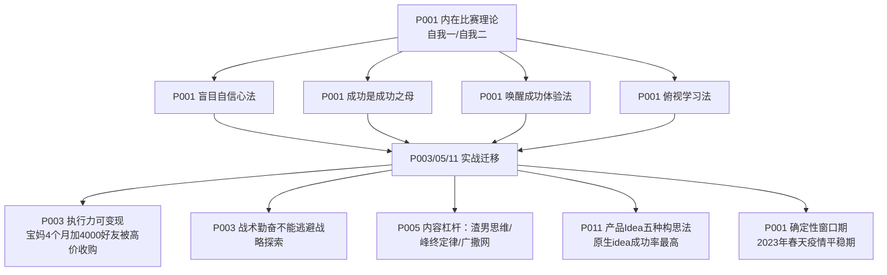

# 第 43 章 创业心态与内在比赛 —— 从“输了内在”到“赢了自己”
作者：龙哥

## 学习目标

- 理解内在比赛理论：自我一（理智/担忧）与自我二（潜意识/动力）的关系
- 掌握盲目自信作为打赢内在比赛的核心心法
- 学会通过唤醒成功体验来喂养潜意识（自我二）
- 掌握俯视学习法：战略上藐视对手，战术上重视细节
- 理解内在比赛输赢决定外在比赛成败的底层逻辑
- 识别老虎伍兹、李宗伟等案例中潜意识信念崩塌导致外在失败的规律

## 43.1 生活类比

想象网球场上的两个自我：
- **自我一** = 嘴碎的教练：站在场边不断喊指令、担心失误、评判动作、设定限制（“你打不过他”、“别冒险”）
- **自我二** = 拥有肌肉记忆的球员：不说话，但真正挥拍、跑动、击球，掌握所有技能与直觉
- **内在比赛** = 教练（自我一）是否相信球员（自我二）能赢：
  - 如果教练不断嘲讽、打压 → 球员紧张、动作变形 → 外在比赛必输
  - 如果教练盲目自信地喊：“你就是国王，这球必赢！” → 球员放松、发挥最佳 → 外在比赛大概率赢
- **唤醒成功体验** = 训练时先练最擅长的发球，连续 ACE 3 个 → 教练闭嘴、球员信心满满 → 后续高难度训练全搞定
- **俯视学习** = 请教费德勒时：内心想“我比你强，我是来取经的”（战略藐视），笔记本记满细节动作（战术重视）
- **确定性窗口** = 疫情平稳期像春天的播种季：错过这 3-6 个月窗口期，等于放弃了一年的收成

## 43.2 概念地图

创业心态与内在比赛体系
├── 核心理论框架
│   ├── 内在比赛/外在比赛（自我一 vs 自我二） —— P001 P003 P005
│   ├── 盲目自信/舍我其谁心态 —— P001 P005
│   ├── 成功是成功之母（反常识主张） —— P001 P005
│   ├── 唤醒成功体验法 —— P001 P003 P005
│   ├── 俯视学习法（战略藐视/战术重视） —— P001 P005
│   └── 潜意识认可目标即胜利前提 —— P001 P003 P005
├── 经典案例佐证
│   ├── 老虎伍兹：性丑闻后失去完美人设，潜意识崩塌跌出前100 —— P001
│   ├── 李宗伟vs林丹：技术不分伯仲，37战25败源于内在比赛落败 —— P001
│   ├── 优秀推销员：先卖易销产品制造成功体验，带动全天状态 —— P001 P003
│   ├── 生财有术大佬：身心合一源于打赢内在比赛 —— P001
│   ├── 确定性窗口期：2023年春天疫情平稳期为创业窗口 —— P001
│   ├── 旅游/健康/餐饮三行业切入点 —— P001
│   └── 疫情数据类比推演香港经验 —— P001
└── 边界与迁移
    ├── 非阿Q精神：需基于真实能力与微小胜利，空洞暗示会被现实粉碎 —— P001
    ├── 不能替代战略与执行：心态好但模式错、方向错、不干活仍归零 —— P001 P003
    └── 需持续维护：建立成功体验库、定期复盘、持续喂养自我二 —— P001 P003

## 43.3 内在比赛理论 —— 赢在潜意识认可目标的那一刻

### 为什么需要这个概念？

你有没有过这种体验：技术行、资源有、机会来，却在关键时刻掉链子、自我设限、恐惧成功、拖延放弃？无数创业者都在外在比赛（市场、竞品、融资、运营）上使劲，却忽略了决定成败的内在比赛。**外在比赛赢不赢，取决于内在比赛（潜意识是否真正认可目标）**。我们需要一套“心法”，在潜意识层面装配“必胜信念”，而非靠意志力硬扛。

> "人，有两个自我，分别是自我一、自我二。自我一，对应着理性，是一般意义上的自我。自我二，对应着感性，或者说对应着潜意识。"
> "任何一个比赛，实际上是同时进行的两场比赛，内在比赛和外在比赛。内在比赛，也就是英文书名里的'Inner Game'，这是最容易被人忽视的。"
> "人们往往容易忽略的是，如果自我二（也就是潜意识），并不认可这个目标的时候，会输掉内在比赛。一旦输掉内部比赛，外在比赛也会输。"
> ——《龙哥赚钱周报 20230207_01》[P001, p.1-2]

这段原文直接点出了本书心法的基石：**人格分裂为“理性评判者”（自我一）与“潜意识执行者”（自我二），成败取决于后者是否认可目标**。

### 核心定义：自我一、自我二与内在比赛

**自我一（理性/一般自我）**：爱分析、爱担忧、爱评判、爱设限、声音大、爱抢麦克风。它是你脑海里那个不断碎碎念的声音：“这太难了”、“你没资源”、“大概率会失败”、“别人都做不成”。

**自我二（潜意识/感性自我）**：掌握技能、直觉、肌肉记忆、真实动力、不说话但决定行动。它是真正挥拍、跑动、击球的那个球员。

**内在比赛**：自我二是否真心认可目标？若不认可 → 潜意识拖后腿 → 外在比赛必输。

> "他不是输给了林丹，他是输给了自己。"
> "如果他的潜意识不相信自己能够打赢林丹，他就输了这场内部比赛，从而也会输掉外部比赛。"
> "作为一等一的赚钱高手，他们早就身心合一了。大家看到他们言语里的不羁，是源自于他们打赢了自己内在比赛。"
> ——《龙哥赚钱周报 20230207_01》[P001, p.2-3]

这个公式展示了核心因果链：**潜意识不认可目标 → 输掉内在比赛 → 必然输掉外在比赛**。李宗伟不是输给林丹的技术，是输给了自己不相信能赢的潜意识。

### 关键性质：三大心法支柱

#### 1. 盲目自信是理性选择：在潜意识植入“我就是国王”

创业者需要的不是理性的自我怀疑，而是近乎盲目的自信与乐观——“在我的领域我就是国王”的潜意识信念，是打赢内在比赛、获得外在成功的前提。

> "一言以蔽之：你需要盲目的自信。因为盲目的自信和乐观，是创业者的理性选择。"
> "这样'舍我其谁''在我的领域，我就是国王'的心态，才是创业者真正需要的心态！"
> "创业途中充满了艰难险阻，而盲目的自信和乐观，是创业者的理性选择。常言道，永远不要低估一个高估自己的人。"
> ——《龙哥赚钱周报 20230207_01》[P001, p.1]

这个主张看似反直觉，实则是**对抗自我一“理性怀疑”的唯一解药**。自我一擅长罗列风险、放大困难，若无“盲目自信”作为对冲，自我二就会在潜意识里接受“打不赢”的设定。

#### 2. 成功是成功之母：刻意堆叠“赢家身份”

与其相信“失败是成功之母”，不如相信“成功才是成功之母”。过去的成功体验会在潜意识中累积自信，推动后续更大成功。

> "失败不是成功之母，成功才是成功之母。"
> "我一个成功体验，推动一个又一个的成功体验。成功，才是成功之母。"
> "你也一定有成功体验，在做新的事情之前，好好回顾回顾，从潜意识里唤醒它，它会帮助你走得更远。"
> ——《龙哥赚钱周报 20230207_01》[P001, p.3]

这个公式揭示了**自信的复利机制**：每一个微小的成功体验都是向自我二发送的“我行”的信号，信号累积到临界点，潜意识就默认“我是赢家”。

#### 3. 唤醒成功体验法：先制造“早早赢一把”

当内心怂、不自信时，回顾并唤醒过往成功体验建立潜意识自信。优秀推销员早起先卖易销产品、找好客户，制造“早早赢一把”，带动全天状态。

> "当自己内心很怂、不自信的时候，你需要回顾下自己成功的经历，唤醒自己的成功体验。"
> "比如，一些优秀的推销员，在开展一天的工作时，会先去找一些优质的客户，或者推销一些容易卖的产品，通过这种方式去制造成功体验。这份体验，会帮助他更好地开展一天的工作。"
> ——《龙哥赚钱周报 20230207_01》[P001, p.3]

这段伪代码展示了**“热身-上场”范式**：

```
1. 识别当前任务的“易赢子任务”（如：推销最容易成单的产品、联系最熟的客户）
2. 优先完成该子任务，获得真实的正反馈（成交、夸奖、数据达标）
3. 有意识地将该反馈标记为“成功体验”，对自我二暗示：“看，我行”
4. 带着此势头，切入核心难任务
```

#### 4. 俯视学习法：战略上藐视，战术上重视

对外学习的方法论：在潜意识层面保持国王般的俯视姿态（战略上藐视），在具体请教与落实时保持学生的认真态度（战术上重视）。跪着学习的人打不赢内在比赛。

> "我的答案是：别跪着学！要俯视！你就是国王，把生财有术的帖子，当成奏折来看。"
> "毛主席说，战略上藐视敌人，战术上重视敌人。跪着学生财有术的人，打不赢内在比赛。"
> "但是在战略上，来自于你的潜意识，你内心相信的应该是'老头儿，刚才你的奏折有一些亮点，朕心甚悦。可是，朕才是这个领域的国王。'"
> ——《龙哥赚钱周报 20230207_01》[P001, p.2]

这个方法解决了**“向强者学习”却“不丧失自信”**的悖论：战略上“我比你强/我是来取经的”，战术上“细节全记、照单全收、马上落地”。

### 典型例子：体育巨星的潜意识崩塌与重建

#### 老虎伍兹：性丑闻后失去“完美人设”，潜意识崩塌跌出前 100

> "在性丑闻离婚之后的两个月，他就丢掉了世界第一的头衔，在往后几年，甚至跌出过世界排名前 100，还闹过退役、无限期休赛。"
> "曾经，他光芒四射，是个完美的人。闹了性丑闻以后，他的潜意识和他的对手的潜意识，都不再认为他是一个完美、不可战胜的人。因为性丑闻，老虎伍兹输掉了自己的内在比赛。"
> ——《龙哥赚钱周报 20230207_01》[P001, p.3]

技术没变、身体没变、规则没变，**变的是“完美/不可战胜”这个潜意识锚点被打破**。一旦自我二不再相信“我是国王”，外在比赛瞬间崩盘。

#### 李宗伟 vs 林丹：技术不分伯仲，37 战 25 败源于内在比赛落败

> "在两人的职业生涯中，总共交手 37 次，李宗伟输了 25 次，其中两次是奥运会决赛。"
> "李宗伟的技术比林丹差吗？可真不见得，大部分职业羽毛球运动员和教练认为，他俩的技术不分伯仲。甚至还有一些人认为，李宗伟的技术比林丹更加全面。"
> "其实他不是输给了林丹，他是输给了自己。"
> ——《龙哥赚钱周报 20230207_01》[P001, p.2]

**技术层面的平分秋色，在潜意识层面却是单方面碾压**。林丹的“超级丹”人设，让双方潜意识都默认“关键球林丹赢”，这就是内在比赛的威力。

#### 优秀推销员：先卖易销产品制造成功体验，带动全天状态

> "比如，一些优秀的推销员，在开展一天的工作时，会先去找一些优质的客户，或者推销一些容易卖的产品，通过这种方式去制造成功体验。这份体验，会帮助他更好地开展一天的工作。"
> ——《龙哥赚钱周报 20230207_01》[P001, p.3]

这是**“唤醒成功体验法”在销售场景的标准化 SOP**：把“制造成功体验”显性化为每日必做动作。

### 边界条件：三个必须警惕的红线

| 红线 | 说明 | 来源 |
|------|------|------|
| **非“阿 Q 精神”** | 必须基于真实能力、真实复盘、真实微小胜利。空洞自我暗示会被现实粉碎。 | P001 |
| **不能替代战略与执行** | 心态再好、模式不对、方向错、不干活，依然归零。内在比赛是必要条件，非充分条件。 | P001, P003 |
| **需持续维护** | 一次成功体验会褪色，需建立“成功体验库”、定期复盘、持续喂养自我二。 | P001, P003 |

> "做什么事，不能基于美好的愿望，而是要基于能力和资源。"
> "竭尽全力是最轻松的工作方式。"
> "进化论是地球上唯一可靠的成功学。"
> ——《龙哥赚钱周报 20230207_05/03/11》[P005, P003, P011]

这些边界条件提醒我们：**心法是放大器，不是变戏法**。没有真实能力与执行的“盲目自信”是妄想；没有战略方向的“成功体验”是盲动。

### 方法演进图：从心法到实战的迁移路径



这个图展示了：**核心心法（P001）如何向下兼容多个实战模块（P003/P005/P011）**，形成“心法统领方法、方法验证心法”的闭环。

### 多源对照：不同素材对“内在比赛/心法”的支撑与延展

#### 共识

所有核心素材（P001、P003、P005、P011）在以下点上达成一致：
1. **心态先于方法**：执行力、认知、战略选择的底层是潜意识对目标的认可度。
2. **小胜累积大胜**：通过微小的正反馈（成功体验）喂养自我二，是通用的启动范式。
3. **拒绝“跪着学”/“愿望驱动”**：必须基于能力与资源，以“国王/俯视”姿态获取外部知识。

#### 分歧/侧重差异

| 素材 | 侧重点 | 独特贡献 |
|------|--------|----------|
| **P001** | 系统建立“内在比赛”理论框架，给出盲目自信、唤醒成功体验、俯视学习三大心法，并用体育案例佐证 | **理论源头**，提供完整心智模型 |
| **P003** | 强调“执行力是值钱的、可变现的”，批判“战术勤奋逃避战略探索”，提出“战略发挥优势法” | **落地校验**：心法必须转化为可变现的执行力，且需警惕伪勤奋 |
| **P005** | 提出“渣男思维做内容”（撩完就跑/广撒网）、“峰终定律”、“以结果倒推逆向思考” | **内容场景迁移**：将内在比赛心法转化为内容创作的具体战术 |
| **P011** | 提出“原生idea”、“好名字公式”、“高成功率idea三条件”、“行动三要素（脑/心/手）” | **创业决策迁移**：将“自我二认可目标”细化为“心（愿力）”维度，给出选品/命名/行动的判据 |

---

## 43.4 确定性窗口期 —— 用数据推演抓住“春天”的播种季

> "最近 3~6 个月，是比较确定的疫情平稳期，之后才会迎来第二波疫情的峰值。"
> "香港跟大陆一样，也是第一次大规模疫情感染，就把八九成的居民给感染了。之后香港就进入了 2~3 个月的平静期，平静期之后就进入第二波疫情感染。"
> "所以我们会有一个共识，至少 2023 年的春天，会是一个比较确定的稳定期。"
> ——《龙哥赚钱周报 20230207_01》[P001, p.3-4]

这是将**内在比赛的“盲目自信”外化为“确定性判断”**的经典案例：作者用香港疫情数据作为类比锚点，推演出大陆 2023 年春天的“确定性窗口期”，并据此给出三大行业切入点。

### 推演逻辑链

```
1. 锚点事实：香港首轮感染 8-9 成居民 → 2-3 个月平静期 → 第二波感染（5-6 个月，感染率首波 50%）
2. 类比假设：大陆疫情传播动力学与香港同构
3. 推论：大陆首轮感染后，2023 年春天（3-6 月）为平静期 = 确定性窗口
4. 行动指令："反正我相信春天来了，先干个春天再说。"
```

### 三大行业切入点（普通人可做）

| 行业 | 切入玩法 | 数据佐证 |
|------|----------|----------|
| **旅游** | 做产品分销与套利：机票、酒店、景点分销 | 春节国内旅游 3 亿人次，恢复至 2019 年 88.6%；出境机票订单 +258%、入境预定 +632%、国际酒店 +177% [P001] |
| **健康** | 保健养生带货：维生素、养生茶、推拿课程、养生书单 | 多个保健品品牌抖音销量过亿；诺特兰德维生素片连续两月抖音直播单品销量第一 [P001] |
| **餐饮** | 紧扣春季爆发需求：堂食复苏、外卖新品、餐饮加盟 | 隐含在“春天是窗口期”共识中，需结合本地实况细分 [P001] |

> "如果你本身不是干旅游行业的，但是又想分一杯羹，怎么办？最简单的就是做分销，可以做机票、酒店、旅游景点等等之类的分销。"
> "而健康行业，普通人最适合的切口，是保健养生带货。"
> ——《龙哥赚钱周报 20230207_01》[P001, p.4]

**这个判断的实战价值在于**：它把模糊的“抓风口”变成了**有时间窗、有行业向、有动作指引**的“确定性任务”，极大降低了自我一的“担忧/犹豫”，让自我二可以安心执行。

---

## 43.5 设计中的取舍

### 为什么不用“理性分析风险”而是“盲目自信”？

**理性分析风险是自我一的主场**。当你列出 100 个会失败的理由，自我二接收到的全是“我不行”的信号。创业初期**信息不全、不确定性极高**，理性分析往往导致“分析瘫痪”。盲目自信不是不看风险，而是**在潜意识层面预设“必胜”，再用战术层面的“俯视学习/微小验证”去处理风险**。

### 为什么“成功是成功之母”比“失败是成功之母”更管用？

失败体验会强化“我不行”的神经回路；成功体验（哪怕极小）会强化“我行”的回路。**大脑倾向于重复被奖励的行为**。刻意设计“易赢场景”制造多巴胺奖励，比事后复盘失败原因高效得多。

### “俯视学习”会不会变成傲慢？

**战略藐视≠战术傲慢**。俯视学习的核心是：**内心笃定“我是来取经的国王”，手上却比谁都勤奋记笔记、跑流程、复盘细节**。真正的傲慢是“战略也自大、战术也敷衍”；真正的自卑是“战略跪着、战术也不执行”。俯视学习是两者的唯一解法。

---

## 43.6 动手练习

### 练习 1：建立你的“成功体验库”并设计“俯视学习”行动卡

1. 回顾过去 3 年，列出 10 个（哪怕极小的）真实成功体验：如“单日增粉 100”、“卖出第一单”、“写出 10w+ 文章”、“搞定一个难搞的客户”、“坚持跑步 30 天”
2. 对每个体验，写下：当时的关键动作、获得的正反馈、让你感到“我行”的具体瞬间
3. 制作“俯视学习”行动卡（下次向大佬请教/买课/进群时使用）：
   - 战略上藐视：我在 [领域] 已经跑通 [结果]，比你强/不输你，我是来取经不是来朝拜
   - 战术上重视：我要问的 3 个具体问题、要抄的 2 个 SOP、要避开的 1 个坑、我要在 [时间] 前落地并反馈
4. 设定“唤醒仪式”：每天开始工作前/关键动作前，花 1 分钟阅读成功体验库 + 默念“我就是这领域的国王”，记录 21 天状态变化

### 练习 2：复盘一次“输掉内在比赛”的经历

回想一个你曾满怀准备却最终失败/放弃的项目/目标（考证、创业、减肥、追人等）

1. 描述当时自我一（理智音）在说什么：如“这太难了”、“你没资源”、“大概率会失败”、“别人都做不成”
2. 描述当时自我二（潜意识）的真实感受：是真的相信“我行”还是隐隐觉得“我不行”？
3. 分析：是什么关键时刻/事件让自我二停止认可目标？（一次挫折、一句嘲讽、一个对比、一次完美主义崩塌）
4. 重写剧本：如果当时用“盲目自信”替代理性怀疑、用“俯视学习”替代跪着求教、用“成功体验唤醒”替代自我否定，结果会如何不同？

### 练习 3：为你的当前核心目标设计“内在比赛获胜”周计划

选定一个你正在推进但进展缓慢/内心抗拒的核心目标（如：月入 5 万、瘦 10 斤、搞定 100 个种子用户）

1. 设定每日“盲目自信”锚点：晨起 30 秒对着镜子说“我就是 [领域] 的国王，这个目标必达”
2. 设计“微小成功体验”制造机制：将目标拆解为每天必完成的 1 个极小动作（发 1 条内容、加 1 个微信、跑 1 公里），完成即打勾、大脑释放多巴胺
3. 安排一次“俯视学习”行动：找 1 个该领域比你强的人，带着“战略藐视+战术重视”的行动卡去请教/复盘
4. 记录 7 天内：自我一的嘈杂声音是否减弱？自我二的行动力是否增强？目标推进是否加速？

---

## 43.7 本章小结

这一章中我们学习了创业心态的底层心法——**内在比赛理论**。首先，我们拆解了“自我一（理性/担忧）”与“自我二（潜意识/执行）”的双人格结构，理解了**潜意识是否认可目标，决定了内在比赛的输赢，进而决定外在比赛的成败**。其次，我们掌握了三大核心心法：**盲目自信**（在潜意识植入“我是国王”）、**成功是成功之母**（刻意堆叠微小胜利）、**唤醒成功体验法**（先制造“早早赢一把”再上场）。接着，我们学习了**俯视学习法**（战略藐视、战术重视），解决了向强者学习却不丧失自信的悖论。然后，通过老虎伍兹、李宗伟等经典案例，我们看到了**潜意识信念崩塌如何瞬间摧毁外在表现**。最后，我们看到了作者如何将内在比赛的“确定性信念”外化为**疫情平稳期的“确定性窗口期”判断**，并给出旅游/健康/餐饮三大行业的具体切入动作。

本章我们一起学习了以下概念：

| 概念 | 解释 |
|------|------|
| 内在比赛理论 | 人有两个自我：自我一（理智/担忧/评判）和自我二（潜意识/直觉/肌肉记忆）。任何比赛同时进行内在和外在两场，若自我二不认可目标，必输内在比赛，进而输外在比赛。 |
| 盲目自信/舍我其谁心态 | 创业者需要的不是理性的自我怀疑，而是近乎盲目的自信——"在我的领域我就是国王"的潜意识信念，是打赢内在比赛、获得外在成功的前提。 |
| 成功是成功之母 | 与其相信"失败是成功之母"，不如相信"成功才是成功之母"。过去的成功体验会在潜意识中累积自信，推动后续更大成功。 |
| 唤醒成功体验法 | 当内心怂、不自信时，回顾并唤醒过往成功体验建立潜意识自信。优秀推销员早起先卖易销产品制造"早早赢一把"，带动全天状态。 |
| 俯视学习法 | 对外学习的方法论：战略上藐视对手（潜意识相信"我比你强/我是国王"），战术上重视细节（像学生一样虚心请教、执行落地）。跪着学习的人打不赢内在比赛。 |
| 老虎伍兹案例 | 性丑闻离婚后两个月丢世界第一、几年跌出前100。核心非技术下降，而是潜意识和对手潜意识都不再认为他是完美、不可战胜的人——输掉了内在比赛。 |
| 李宗伟vs林丹案例 | 职业生涯交手37次，李宗伟输25次含两次奥运决赛。技术不分伯仲，根源是潜意识层面内在比赛落败，而非技术不足。 |
| 确定性窗口期 | 参照香港疫情数据，大陆首轮感染后有2-3个月平稳期，2023年春天是确定的稳定窗口，普通人应"先干个春天再说"抓住旅游/健康/餐饮三大行业机会。 |

下一章中，我们将学习**“认知升维与长期主义”**，从具体项目操作提升到长期主义的人生复利系统，通过“利他即利己”“战略发挥优势”“不流动稀缺资源优先”等认知框架，帮助你建立可持续的个人成长与财富积累哲学。

