# 第 38 章 私域流量运营体系 —— 从“流量获取”到“全生命周期价值”

## 学习目标

- 理解私域单客价与客单价的区别，掌握单客价=客单价×购买频次×生命周期的核心公式
- 掌握实时真实ROI模型的构建与应用，能将私域年产值纳入投产比核算指导投流决策
- 理解捡漏群模型的核心三要素（极致性价比、演员氛围、精细化运营节奏）及其矩阵化放大逻辑
- 掌握流量切片分析法的横向（来源/趋势/动作）与纵向（需求/路径/价值）双维拆解技术
- 理解流量流速悖论与交易目的论，能根据业务阶段调控流速、识别无效曝光
- 掌握流量合并术的核心逻辑：设计让流量主赚更多钱的方案，实现流量为我所用
- 掌握五位一体成交飞轮（破冰-诊断-方案-信任-成交）的标准化话术与执行节奏
- 掌握抖音爆单承接法的三板斧（同内容上传建合集、流量/带货视频双路、直播双频共振）
- 理解视频号无货源店群的矩阵思维（最少5店）、轻资产链路与选品入池操作规范
- 掌握MVP先卖后做的验证标准（聊100人、20-30人预售）、资源匹配度评估三步法
- 理解商业拆解复制法的核心判断点（货源非独家、场景验证有需求、门槛可跨）与低成本启动路径
- 了解热点套利技术栈的预置组件（域名/👸号/API/镜像站/SEO模板）与分钟级部署流程
- 理解内容价值金字塔（娱乐<工具<方法）的跃迁路径与对应变现模式差异
- 掌握OKR制定要点：战略坚定、KR推动O、O可衡量、MVP验证、高频同步、问题暴露

## 38.1 生活类比

想象私域运营是一场精心设计的“会员制餐厅经营”：私域单客价，就是一位食客终身在你餐厅的总消费，而非单次账单的客单价；实时真实ROI，是老板把“食客带亲友再来”的未来账算进今天的投产比，敢加广告预算、敢投流；捡漏群，是每天限量“亏本引流爆款菜”，配上30个“托”排队抢单，带动全场氛围，靠酒水、加菜（佣金）赚钱；流量切片分析，是每天切分账单：这桌客从哪来（横向）？吃了什么、为何走、下次来吗（纵向）？得出明天调菜单、换位置的动作；流量流速悖论，是客流太快（站着吃走人）没连接，太慢（空台）没规模，要“翻台率适中、食客细嚼慢咽、持续排队”；流量合并术，是不自己发传单，而是给隔壁KOL“带菜赚佣金”，他的老食客就成了你的客；五位一体成交飞轮，是资深领班服务流程：寒暄破冰→询口味放大馋瘾（诊断）→推招牌套餐（方案）→讲食材溯源建信任→落单开台（成交）；抖音爆单承接，是某菜突然上热搜：立马推“姐妹款”、建“爆款合集”、开厨房直播间“双频共振”接住流量；视频号无货源店群，是开10家“中央厨房外卖店”，无库存、无骑手，用矩阵对抗单店波动，靠量博爆单；MVP先卖后做，是菜单上写“新菜预售”，收20份定金才进食材，不卖不买，规避浪费；商业拆解复制法，是去隔壁火锅店当食客，拆解其选品/服务/引流/裂变全链路，判断“我能不能搞到同款牛肉/跑通流程”再开店；热点套利技术栈，是厨房预备好“半成品预制包”（API/镜像站/域名），风口一来（如网红食材），10分钟出菜上架抢首发流量；内容价值金字塔，是从“卖好看的盘子”（娱乐）→“卖好用的刀叉”（工具）→“教开餐厅的SOP”（方法），客单价、护城河层层跃迁；OKR制定与执行，是餐厅年战略：定“做城里最火川菜馆”（战略坚定）→拆“月营收/翻台/复购”（KR推O）→先试“招牌菜MVP”→周例会复盘、敢报食材坏了（暴露问题）。

## 38.2 概念地图

私域流量运营体系
├── 核心指标体系
│   ├── 私域单客价          —— P001：全生命周期价值，公式=客单价×频次×周期
│   ├── 实时真实ROI         —— P002：含私域年产值的综合投产比，决策导向模型
│   └── 捡漏群模型          —— P003：极致性价比+演员氛围+精细运营，矩阵化放大
├── 流量运营方法论
│   ├── 流量切片分析法      —— P004：横向(来源/趋势/动作)+纵向(需求/路径/价值)
│   ├── 流量流速悖论        —— P005：不快不慢/持续不断，核心增停留时间
│   ├── 交易目的论          —— P005：无互动曝光负价值，一切运营以交易为目的
│   └── 流量合并术          —— P006：让流量主赚更多钱，整合存量流量为我所用
├── 成交与承接体系
│   ├── 五位一体成交飞轮    —— P007：破冰-诊断-方案-信任-成交，解决买三个为什么
│   ├── 抖音爆单承接法      —— P008：同内容建合集+双路视频+直播双频共振
│   └── 视频号无货源店群    —— P009：矩阵思维(≥5店)+轻资产链路+入优选联盟
├── 项目验证与决策框架
│   ├── MVP先卖后做         —— P010：预售验证需求，聊100人/20-30人预售为合格线
│   ├── 资源匹配度评估      —— P011：盘点自有→拆解所需→评匹配度，匹配度定成败
│   ├── 商业拆解复制法      —— P012：套话拆全链路，判货源/场景/门槛，低成本启动
│   └── 热点套利技术栈      —— P013：预置基建(域名/API/镜像/SEO)，分钟级响应风口
└── 认知升级与组织进化
    ├── 内容价值金字塔        —— P014：娱乐<工具<方法，价值/变现/护城河递增
    └── OKR制定与执行        —— P015：战略坚定/KR推O/O可量/MVP验/高频同/暴露问题

## 38.3 私域单客价 —— 从单次交易转向全生命周期价值

### 为什么需要这个概念？

传统电商只关注单次客单价（AOV），忽视用户长期价值。公域流量成本越来越高，获客即亏损，必须靠复购回本。私域流量属于自己，可反复触达、低成本运营，天然适合做长期价值。正如素材所言：“电商有个'客单价'的概念，而在私域流量运营的思维下，真正值得关注的不是'客单价'，而是'单客价'，就是一个消费者总共贡献了多少销售额。”[P001, p.15]

### 核心定义

> **私域单客价定义**（来源：《龙哥赚钱周报 20230207_03》）

$$
\text{单客价} = \text{客单价} \times \text{购买频次} \times \text{生命周期（年）}
$$

**作用解释**：该公式将用户价值从单次交易的维度拓展到全生命周期维度，揭示了单次交易金额、年购买频次、用户留存年限三个维度的乘积关系。它是私域运营从“流量思维”转向“用户资产思维”的核心量化抓手，指导运营者将资源从单纯追求首单转向提升复购频次与延长留存周期。

### 关键性质

- **复利属性**：用户留存越久、买得越频繁，边际获客成本趋近于零。
- **反直觉**：前端甚至可以亏损获客（如9.9元引流品），后端靠高单客价回本盈利。
- **可量化**：通过“实时真实ROI”模型，将私域年产值纳入投产比核算。

### 典型例子

视频号直播卖150元客单价产品，进粉率60%，月产值15元，年产值60元，私域ROI从2.5提升至3.5甚至4.5。捡漏群：单群成本7000元，3个月回本，生命周期2年，单群纯利2.1万，投资回报率3-4倍。[P001, p.15-16]

### 边界条件

仅适用于高复购、高信任、可长期服务的品类（如消耗品、教育、会员制）。需要成熟的私域运营体系（SOP、社群、人设、售后）支撑，否则用户流失快。非刚需、低频品类（如耐用家电、装修）单客价天花板极低，强行做私域反而增加成本。[P001, p.16]

### 方法演进图

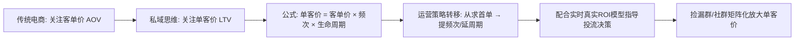

## 38.4 实时真实ROI —— 让隐形资产显性化参与决策

### 为什么需要这个概念？

传统ROI只算广告直接带来的单次转化，忽略私域沉淀的长期价值。导致老板不敢加预算、不敢投流，误判项目真实盈利能力。需要一个把“看不见的未来钱”算进“现在账本里”的方法。

### 核心定义

> **实时真实ROI计算模型**（来源：《龙哥赚钱周报 20230207_03》）

$$
\begin{aligned}
\text{实时真实ROI} &= \frac{\text{直播间毛利} + \text{私域预估年产值}}{\text{广告投入}} \\
\text{私域预估年产值} &= \text{直播间成交客数} \times \text{进粉率} \times \text{单客月产值} \times 12 \times \text{衰减系数}
\end{aligned}
$$

**作用解释**：该模型将私域流量的未来现金流折现到当期，通过“进粉率×月产值×12月×衰减系数”估算私域年产值，纳入ROI分子。它解决了传统ROI只看首单回本、导致优质长线项目被误判为不合格的决策偏差，使老板敢于加大投流预算、招聘团队、规模化复制。

### 关键性质

- **决策导向**：算完真实ROI，敢投流、敢加预算、敢招人。
- **动态模型**：随运营优化（提升月产值、延长生命周期），ROI会持续跃升。
- **反脆弱**：广告投放波动时，私域存量业务兜底现金流。

### 典型例子

客单价150、毛利率 $q$、投放40万、营业额100万：纯直播ROI 2.5，加私域后3.5，月产值翻倍则达4.5。作者据此判断：月产值若能从15元提升到30元，业务模型彻底跑通，可规模化复制。[P001, p.15]

### 边界条件

依赖进粉率、月产值、衰减率的准确估算，数据不实则模型失效。仅适用于“公域引流+私域变现”双轨模式，纯公域或纯私域不适用。前3个月80%衰减系数为经验值，不同行业/品类需实测校准。[P001, p.15] 注：该衰减系数为作者实操经验总结，暂缺乏行业通用学术文献支撑，实际应用中需结合本业务数据实测校准。

### 方法演进图

```mermaid
graph TD
A[传统ROI = 直播间直接产出 / 广告投入] --> B[痛点: 忽略私域长期价值, 不敢加预算]
B --> C[实时真实ROI模型]
C --> D[私域预估年产值 = 成交客数 × 进粉率 × 月产值 × 12 × 衰减系数]
D --> E[综合ROI = (直播毛利 + 私域年产值) / 广告投入]
E --> F[决策: ROI>3 则敢投流/扩团队/复制模型]
F --> G[动态优化: 提升月产值/延长周期 → ROI持续跃升]
```

## 38.5 捡漏群模型 —— 用“演员+极致性价比”撬动社群裂变

### 为什么需要这个概念？

普通社群活跃度低、转化差、用户沉默，靠运营苦吆喝不可持续。需要一种“自带氛围、自动成交、可规模化复制”的社群标准化模型。核心矛盾：如何让陌生人在群里抢着下单、甚至主动传播？

### 核心定义

> **捡漏群模型定义**（来源：《龙哥赚钱周报 20230207_03》）

捡漏群：以原价1-3折超高性价比商品为饵，通过企业微信建群，配置30-50个“演员”（托）营造抢购氛围，靠淘客佣金变现。

核心三要素：
1. **极致性价比（选品）**：原价1-3折，标品、有社交货币
2. **演员氛围（信任/从众）**：30-50个演员，模仿真实用户抢购、晒单
3. **精细化运营节奏（排品/文案/催单）**：10:00大主品、11:00首催、19:00预告，精推文案100+条/天

**作用解释**：该模型通过“极致性价比”降低决策门槛，用“演员氛围”制造从众心理与稀缺感，配合“精细化运营节奏”引导用户完成购买闭环。它将社群运营从“靠运营人员苦吆喝”标准化为“选品+演员+排品+文案+催单”的可复制SOP，实现了单群低成本、高产出、可矩阵化放大的商业闭环。

### 关键性质

- **杠杆放大**：单群成本3500-10000元，3个月回本，生命周期2年，单群纯利2万+，ROI 3-4倍。
- **矩阵化**：100群日利3000，1000群日利3万，月利90万，边际成本极低。
- **演员是灵魂**：有演员vs无演员，产出相差1倍以上；演员氛围差则生命周期断崖式缩短。素材明确指出：“演员是捡漏群的灵魂，有演员和没演员的情况，社群产出起码相差一半以上。”[P001, p.17] 注：演员数量“30-50人”、回本周期“3个月”、生命周期“2年”均为作者团队实操经验值，缺乏大规模实证研究支撑，不同品类/平台环境下阈值可能差异巨大。

### 典型例子

新起盘<1000群，月佣100万+；头部团队万群量级，月佣数千万。书里有品：0预算冷启动，首月10万分销员，2年80万+分销员、1.5亿销售额。[P001, p.17]

### 边界条件

依赖稳定企微主体（抗封号）、靠谱供应链（发货/售后）、精细化运营团队（排品/演员管理）。选品必须是标品、有社交货币、高性价比，非标品/高客单品不适用。平台风控收紧时（如微信打击诱导分享、托行为），模型面临失效风险。[P001, p.17]

### 方法演进图

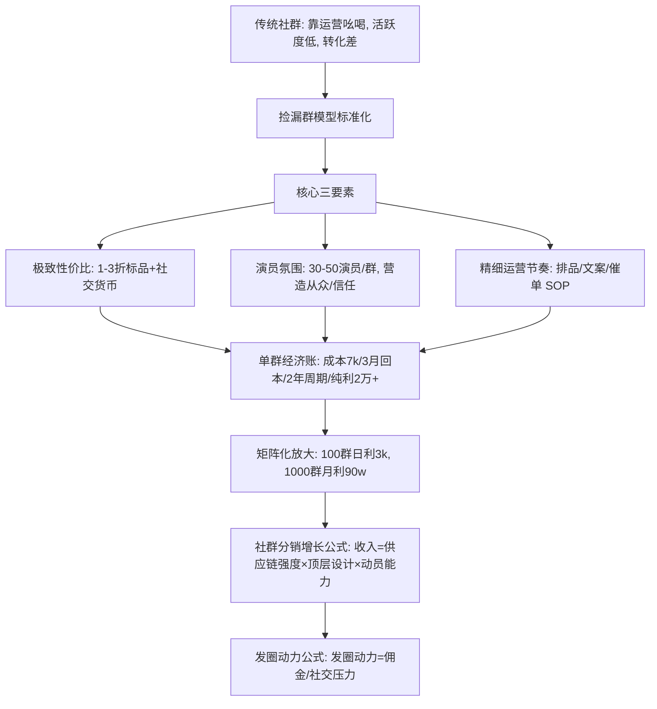

## 38.6 流量切片分析法 —— 把流量数据切成“可执行的片”

### 为什么需要这个概念？

老板只看UV/PV总数，不知道哪里来、哪里去、为什么涨跌，无法决策。流量不切片，就没有优化空间，运营动作全靠拍脑袋。需要一套标准化的“显微镜”，把流量看透、看细。

### 核心定义

> **流量切片分析法**（来源：《龙哥赚钱周报 20230207_06》）

**横向切片**：按来源渠道、涨跌趋势、可干预运营动作拆解（如：这200 UV从哪来？哪个渠道涨了？要做什么动作？）
**纵向切片**：按用户需求、行为路径、业务价值拆解（用户经历什么？有什么需求？停留多久？去哪了？能不能变现？）

**作用解释**：该方法将宏观流量数据拆解为微观可执行动作。横向切片解决“流量从哪来、趋势如何、该干预什么”的归因问题；纵向切片解决“用户是谁、需求什么、路径如何、价值多少”的画像问题。双维结合，形成“数据→假设→动作→验证”的运营闭环，是实现精细化流量运营的前提。

### 关键性质

- **可执行性**：切片的终点是“可干预的运营动作”，不是报表。
- **全链路**：覆盖获客→停留→转化→离开全生命周期。
- **迭代性**：每日/每周切片，形成“数据→假设→动作→验证”闭环。

### 典型例子

作者用此法实现C端业务单日1000有效咨询。抖音带货案例：发现第四条视频从300播放涨到6万+，立马开直播承接，日入1.8万。[P002, p.8]

### 边界条件

需要埋点完善、数据打通（公域+私域+转化），数据孤岛无法切片。仅适用于有一定流量规模（如日均百级UV）的业务，太小样本无统计意义。切片分析依赖运营经验判断“原因”与“动作”，新手易误读数据。[P002, p.8]

### 方法演进图

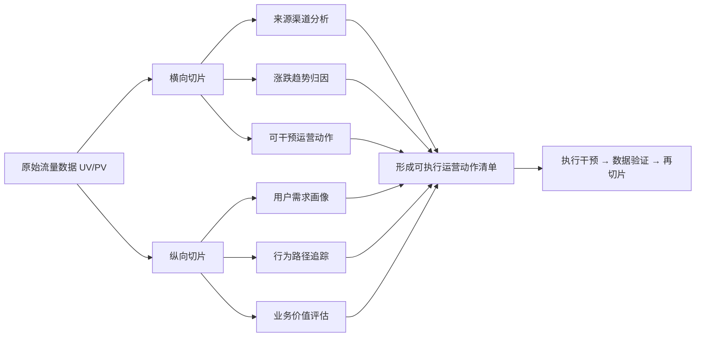

## 38.7 流量流速悖论 —— 不快不慢，持续不断，价值最大

### 为什么需要这个概念？

追求爆款、大流量往往导致“来快去也快”，用户无停留、无连接、无转化。流量太慢则规模不够、业务跑不起来。需要一个“流速调节阀”，平衡规模与停留。

### 核心定义

> **流量流速悖论**（来源：《龙哥赚钱周报 20230207_06》）

流量价值核心 = 流（动） + 量（规模），要流动也要停留、不快不慢、持续不断。
核心指标：用户停留时间、互动率、转化率，而非单纯UV/PV。

**作用解释**：该定理揭示了流量质量的本质——速度与停留的辩证关系。流速过快（如爆款视频带来的泛流量）用户无停留无连接，流速过慢（如内容更新停滞）则规模枯竭。核心指标从UV/PV转向“停留时间、互动率、转化率”，指导运营者主动调控流速（如控制直播时长、投放节奏、内容节奏），实现流量价值最大化。

### 关键性质

- **反直觉**：主动控制流速（如限制直播时长、控制投放节奏），反而能提升总产出。
- **平台算法偏好**：有停留、有互动、有转化的流速，平台会持续推流。
- **交易目的论**：无互动的曝光是负价值，平台不给流量。

### 典型例子

视频号直播：控制单场15分钟，避免系统断播，延长账号寿命。抖音盲盒项目：热度衰减期主动缩减直播时长、引入外部合作，延长变现窗口。[P003, p.10]

### 边界条件

新号冷启动期需“快”（抓住流量扶持期），成熟期需“慢”（精细运营）。不同平台流速偏好不同：抖音偏快、视频号偏慢、私域最慢。注：平台流速偏好差异（抖音偏快/视频号偏慢/私域最慢）为作者基于实操经验的判断，缺乏跨平台大样本数据实证支撑，实际操作中需结合具体账号数据验证。无法通过数据实时监控流速（如无埋点、无后台），无法调控。[P003, p.10]

### 方法演进图

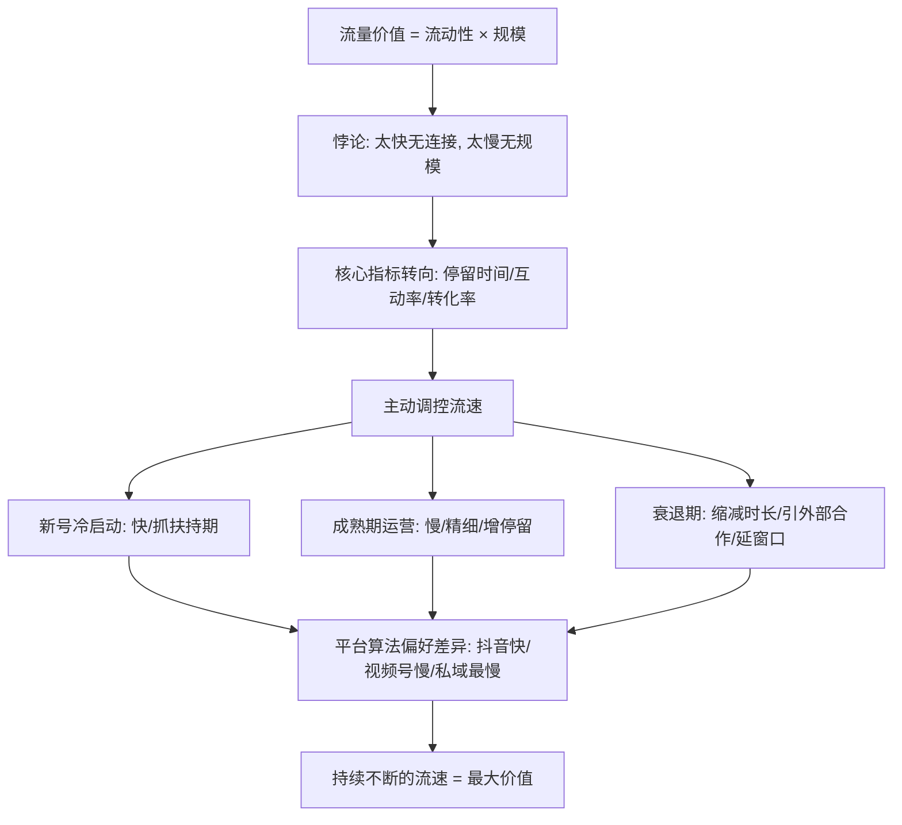

## 38.8 交易目的论 —— 曝光≠价值

### 核心定义

> **交易目的论**（来源：《龙哥赚钱周报 20230207_06》）

从交易目的看，单纯的页面曝光（UV/PV）没有价值，无互动的曝光反而负价值，一切运营应以交易为最终目的。

**作用解释**：该定理直接否定了“流量即正义”的迷思。它将运营的北极星从“曝光量”校准到“交易额”，指出无互动的曝光不仅不产生价值，反而消耗算法权重（平台判定内容质量低而限流）。这要求运营者在切片分析中主动识别并砍掉“无互动曝光”的页面/内容，将资源集中到高相关性、高信任度、高转化率的流量池上。

### 关键性质

- **价值锚定**：以交易为唯一北极星，所有运营动作倒推。
- **负价值识别**：无互动曝光消耗算法权重，需主动砍掉。
- **平台共识**：平台分发逻辑本质是寻找“能成交的流量”。

## 38.9 流量合并术 —— 借别人的流量为我所用

### 为什么需要这个概念？

自己建团队获流量太慢、太贵、天花板低。世上不缺流量，缺的是“把流量价值最大化”的方法。谁能让流量主赚更多钱，谁就拥有了流量主的流量。

### 核心定义

> **流量合并方法论**（来源：《龙哥赚钱周报 20230207_06》）

流量按所有权分两类：自建流量、合并流量（整合别人的流量）。
核心策略：设计让KOL/流量主“卖我的货、赚更多钱”的方案，从而调动其积累多年的存量流量为我服务。

**作用解释**：该方法展示了杠杆思维的极致——不自建渠道，而通过利益绑定整合存量渠道。其核心在于设计“让流量主赚更多钱”的合作方案（佣金结构、独家供货、售后兜底），将流量主多年积累的私域流量、公域粉丝转化为己用。这比自建流量团队的边际成本更低、见效更快、上限更高。

### 关键性质

- **杠杆思维**：用利益绑定替代自建，边际成本极低。
- **双赢结构**：流量主获新收入源、我获精准流量、用户获好产品。
- **可复制**：一套标准化合作方案（佣金、物料、售后），可批量复制到同类KOL。

### 典型例子

假设KOL积累4-5年流量，若我让他卖货月赚20万，他的流量即为我服务。视频号无货源店群：后端商品缺乏，达人缺货源，我供货源+佣金，达人带流量，双赢。[P002, p.10]

### 边界条件

必须有极强供应链/产品力/履约能力支撑，否则坑了流量主、砸了信誉、断了路。仅适用于“产品标准化、佣金结算清晰、售后兜底”的品类。流量主若有自有品牌/独家供应链，合并意愿极低。[P002, p.10]

### 方法演进图

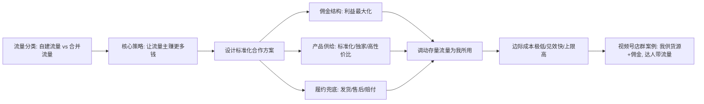

## 38.10 五位一体成交飞轮 —— 私域一对一成交的标准化动作

### 为什么需要这个概念？

私域成交靠聊天、靠感觉、靠人品，不可复制、不可规模、靠谱人难招。客户犹豫不决只因三个问题：为什么必须买？为什么跟你买？为什么现在买？需要一套标准化、可培训、可考核的成交SOP。

### 核心定义

> **五位一体成交飞轮**（来源：《龙哥赚钱周报 20230207_06》）

五步法：
1. **破冰**——好感建立
2. **诊断**——放大需求
3. **方案**——成交铺垫
4. **信任**——突破抗拒
5. **成交**——引导下单

核心心理学原理：损失厌恶（害怕错过/损失）驱动决策。

**作用解释**：该模型将私域一对一成交过程标准化为五个可执行、可考核的步骤，分别对应解决客户的三个核心疑问：破冰/诊断解决“为什么必须买”（放大痛点）、方案/信任解决“为什么跟你买”（建立权威与安全感）、成交解决“为什么现在买”（损失厌恶/稀缺性）。它将“靠天赋的销售”转化为“靠SOP的新人”，实现了成交能力的规模化复制。

### 关键性质

- **标准化**：新人按SOP练话术、练流程，1周上岗，解决“靠谱销售难招”痛点。
- **可量化**：每步有话术、有指标（如破冰回复率、诊断完成率、成交转化率）。
- **复用性**：话术库、案例库、异议处理库沉淀后，全团队复用，边际成本为零。

### 典型例子

抖音引流卖教辅资料：两个月加好友3000、成交1000+、转化率30%、三人获利4.5万。高净值客户销售：先反问/布置功课引起好奇，再上升痛点建立权威，最后聊小孩/传承形成依赖。[P003, p.11]

### 边界条件

仅适用于高客单、高决策成本、需信任背书的产品（课程、咨询、高客单实物）。低客单、冲动消费、标品类（如9.9元资料、捡漏群商品）无需如此重流程。依赖人设/专业度支撑，无专业度的“破冰-诊断”是骚扰。[P003, p.11]

### 方法演进图

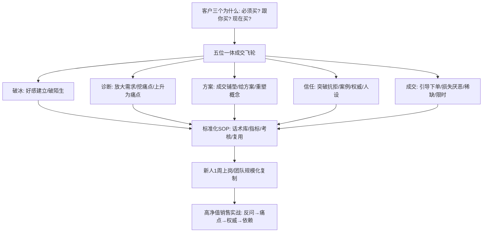

## 38.11 抖音爆单承接法 —— 爆款来临时的“接住、放大、延长”

### 为什么需要这个概念？

爆款视频来得快去得快，大多数人只会看数据、不会接流量、不会放大、不会延长。爆款视频生命周期短（3-4天衰减），不接住等于白白流失百万级曝光。需要一套标准化的“爆款应急预案”。

### 核心定义

> **抖音爆单承接法**（来源：《龙哥赚钱周报 20230207_06》）

三板斧：
1. 视频爆了立马上传同内容视频+建合集→带爆新视频
2. 流量视频与带货视频双路并进
3. 视频一爆立马开直播，双频共振

**作用解释**：该方法利用抖音算法的“相似推荐”与“合集权重”机制，在爆款视频流量高峰期（通常3-4天）内，通过“同内容上传+建合集”承接旧流量带爆新视频，通过“流量视频+带货视频双路”分离引流与转化功能，通过“视频爆即开直播”实现视频流与直播流的双频共振。它将不可控的“单条爆款运气”转化为可标准化、可复制的“爆款承接SOP”，最大化捕获爆款红利。

### 关键性质

- **时效性**：爆款当天甚至当小时内必须完成动作，隔天效果大打折扣。
- **概率游戏**：单条视频爆款概率低，但矩阵化发布+标准化承接，可稳定捕获爆款红利。
- **低成本**：无需额外投流，纯靠内容组织和运营动作。

### 典型例子

A账号：视频爆了上传同内容+建合集，日入1.8万；B账号：连续直播3-4天，最高日佣3万。视频号带货案例：7天4号10万粉、5万+利润，第4天流量下降时主动缩减直播时长、引入外部基地合作。[P003, p.11]

### 边界条件

必须有备选素材库、直播间搭建、客服/发货/售后链路已跑通，否则承接不住反而投诉。仅适用于“内容带货/直播带货”模式，纯品牌曝光/引流模式不适用。平台风控收紧（如判录播、限流、封号）时，直播承接动作风险极高。[P003, p.11]

### 方法演进图

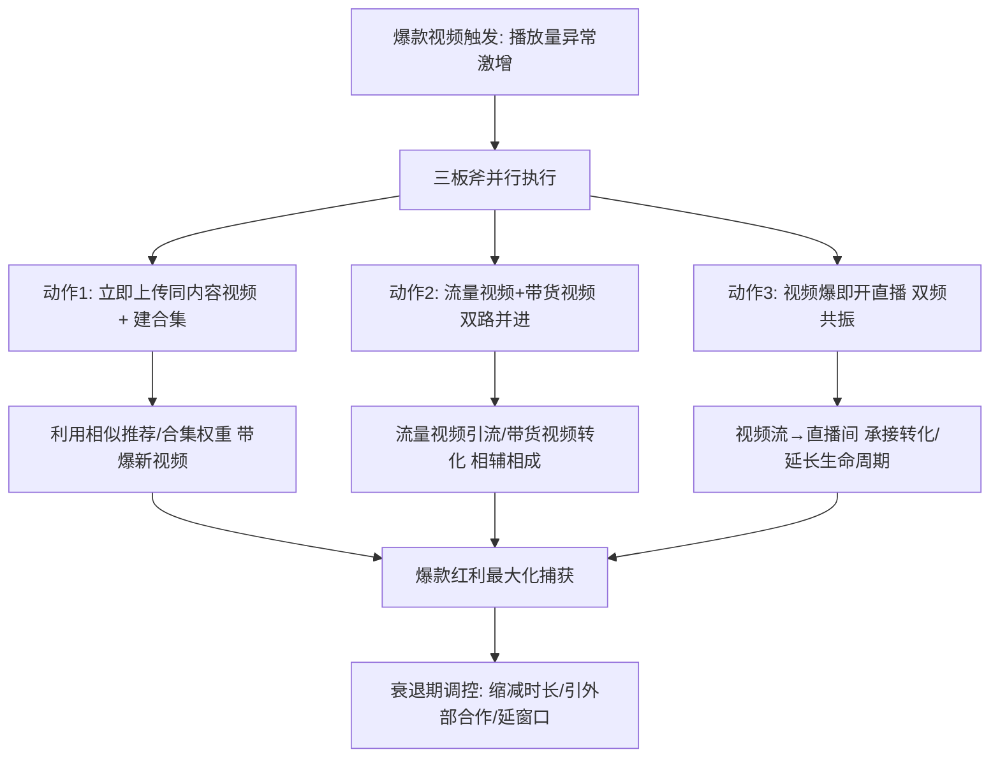

## 38.12 视频号无货源店群 —— 矩阵思维对抗不确定性

### 为什么需要这个概念？

单店运营极不稳定：选品、流量、转化全靠运气，一封号、一限流全军覆没。视频号后端商品库稀缺，平台缺货、达人缺货源，是供需错位的巨大红利窗口。需要一种“低成本试错、高存活率、可规模化”的店群模型。

### 核心定义

> **视频号无货源店群操作法**（来源：《龙哥赚钱周报 20230207_08》）

核心链路：
1. 开旗舰店(买商标授权)或普通店刷入池
2. 入优选联盟
3. 采集拼多多链接选品上架
4. 达人带货/自然流出单
5. 拼多多拍单发货赚差价

矩阵思维：最少5个以上店铺，数量越多越稳定，用概率对抗不确定性。

**作用解释**：该模型利用视频号电商早期“后端商品库稀缺、达人缺货源、平台扶持达人带货”的供需错位红利，通过“轻资产链路（无库存/无发货/无售后）”与“矩阵思维（≥5店对抗单店波动）”，将单店不确定的博弈转化为确定的概率游戏。核心是选品入池操作规范（商标授权、采集工具、铺货节奏）与达人对接机制。

### 关键性质

- **轻资产**：无库存、无发货、无售后（由供应商承担），核心是选品与店铺管理。
- **数据验证**：7店日销7858元，单店均1122元，毛利30%，单店日利300-400元，精细运营单店月利1万，10店月入10万+。
- **爆款杠杆**：每月均有达人爆单带来额外利润（几万/次），靠量捕捉低概率高收益事件。

### 典型例子

作者团队7店实测数据，单店月利稳定1万级。美团电商冷启动：8月末发现机会，2个月跑通30家店，单店月利6k-12k。[P003, p.12]

### 边界条件

依赖平台规则红利期（视频号电商早期），存量期平台严查合规/原创/时效，模型易失效。商标授权、类目资质、入池门槛、保证金随平台政策变动，合规成本上升。供应链不可控（拼多多发货慢、质量差、退货率高）直接吞噬利润。[P003, p.12]

### 方法演进图

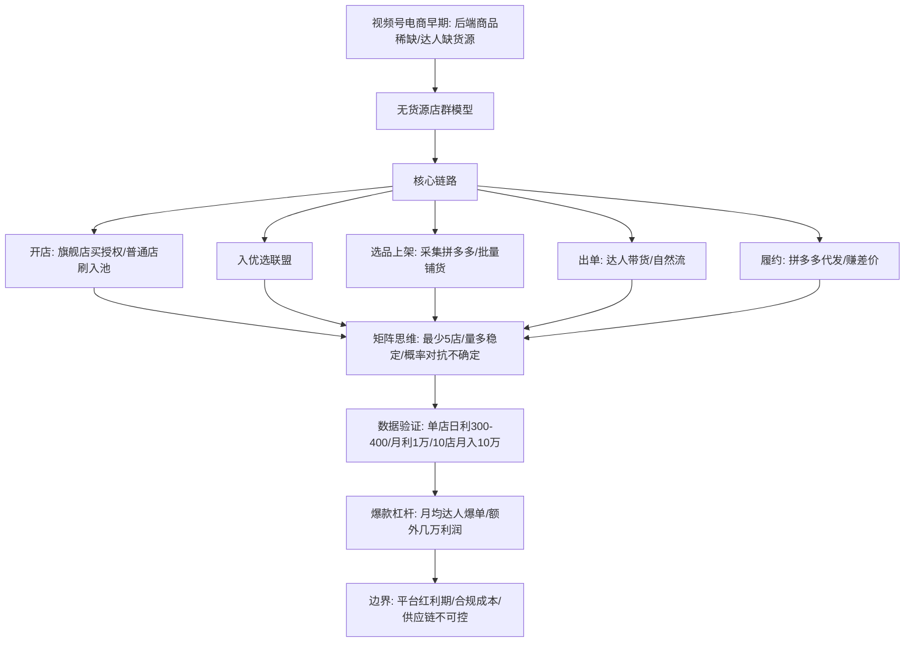

## 38.13 MVP先卖后做 —— 用预售验证需求，规避“造没人要的产品”

### 为什么需要这个概念？

传统创业：花月时间做产品 → 上线无人问津 → 沉没成本巨大。90%项目死在“做了没人要”，而非“做不好”。需要一种“零成本、高确定性、可批量测试”的验证范式。

### 核心定义

> **MVP验证核心逻辑**（来源：《龙哥赚钱周报 20230207_06》）

MVP验证核心：先卖想法/预售/收定金，不做产品。
判断标准：聊100人只有几个买=有问题；20-30人买单交预售金=需求验证通过。
可在短时间内测试几十个产品，筛选大于培养。

**作用解释**：该方法将产品开发前置为“销售验证”，用市场付费意愿替代主观判断。核心判断标准“聊100人、20-30人预售”设定了清晰的验证合格线，将“筛选大于培养”落地为可执行的测试动作。它反直觉地指出：不解决问题、不是好产品，也能赚钱（卖空气、做局套话），关键是完成第一单验证。

### 关键性质

- **反直觉**：不解决问题、不是好产品，也能赚钱（卖空气、做局套话）。
- **速度优先**：完成第一单即验证通过，完美主义是最大敌人。
- **资源匹配**：验证通过后，再匹配资源（找供应链、招人、做交付），不匹配不启动。

### 典型例子

外卖CPS：第一天盈利100+，2月10万/月，3月突破20万/月，总盈利200万+。副业课程：3个月盈利100万+。AI绘画小程序：因预算超预期、无执照、工期长、流量风险，理性止损放弃。[P003, p.12]

### 边界条件

仅适用于“可预售、可分期交付、用户容忍度高”的虚拟/服务/定制类产品。标品/刚需/强监管类（医疗、食品、硬件）预售风险极高，甚至违法。需要极强的“卖想法”文案/话术/信任背书能力，否则连预售都卖不出去。[P003, p.12]

### 方法演进图

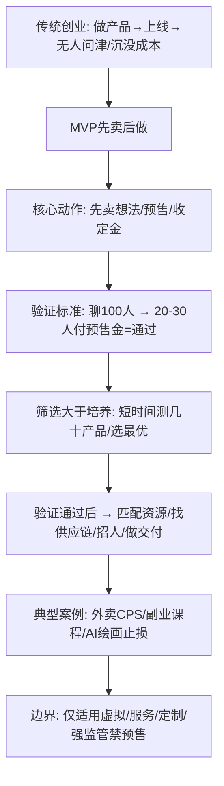

## 38.14 资源匹配度评估 —— 不做“好项目”，只做“适合我的项目”

### 为什么需要这个概念？

创业者常犯错：严重低估已有资源，过分高估新项目，盲目All In陌生赛道。项目成败取决于“项目需求资源”与“自有资源”的匹配度，而非项目本身好坏。需要一套结构化的“资源盘点→项目拆解→匹配决策”工具。

### 核心定义

> **资源匹配度评估三步法**（来源：《龙哥赚钱周报 20230207_09》）

三步法：
1. **盘点自有资源**（粉丝、经验、软件、团队、案例、渠道、资金等）
2. **拆解目标项目所需关键资源**
3. **评估匹配度**，匹配度高（如100%）即启动，低则放弃或补齐

核心判据：我是否已具备该项目最关键的1-2个核心资源？（如流量渠道、供应链、转化话术）

**作用解释**：该三步法将模糊的“项目好坏”判断转化为具体的“资源匹配度”计算。第一步盘点显性可迁移资源（粉丝、经验、软件、团队、案例、渠道、资金），第二步拆解目标项目的关键资源需求，第三步打分匹配度。作者案例中“👸号经验+流量+人+项目=匹配外卖CPS/副业课程（100%）”直接印证了匹配度决定成败：匹配度高则3月赚100万，错配则累计亏损100万+。

### 关键性质

- **避坑神器**：帮你过滤掉“看起来很美、做起来要命”的伪好项目。
- **复利思维**：在已有资产上叠加新业务，边际成本低、成功率高、抗风险强。
- **动态更新**：资源随项目积累变化，定期复盘重新匹配。

### 典型例子

作者：👸号经验+流量+人+项目 = 匹配外卖CPS/副业课程（匹配度100%），3月赚100万、总利润300万。反例：此前多项目累计亏损100万+，皆因资源错配（如做不懂的重运营项目、无供应链做电商）。[P004, p.13]

### 边界条件

核心资源必须是“显性、可迁移、可复用”的（如渠道、品牌、SOP），隐性经验/人脉难量化。新赛道/新模式若无任何资源匹配，建议“打工/合伙/小额试错”积累资源后再启动。避免陷入“只有锤子，满世界找钉子”的资源锚定偏见。[P004, p.13]

### 方法演进图

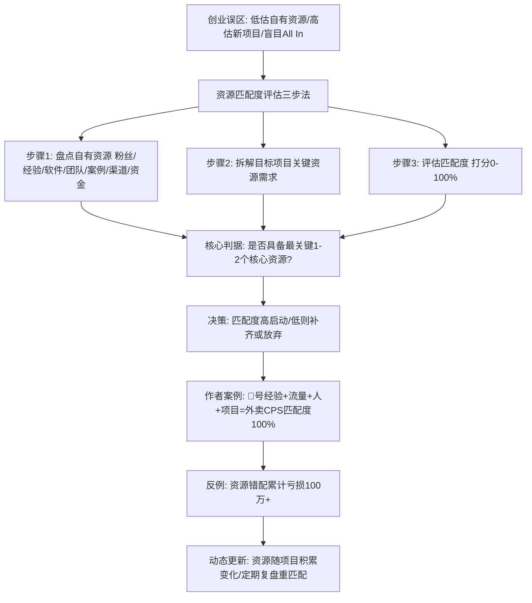

## 38.15 商业拆解复制法 —— 把“赚钱的别人”拆成“可复制的SOP”

### 为什么需要这个概念？

同行是最好的老师，抄同行是最快捷径，能避开90%弯路。但凡是“抄表面”（抄文案、抄图、抄品），不抄底层链路（流量从哪来、怎么转化、怎么交付、怎么裂变），必死无疑。需要一套标准化的“商业X光机”，透视同行全链路。

### 核心定义

> **商业拆解复制法**（来源：《龙哥赚钱周报 20230207_08》）

核心动作：
1. 刷短视频/搜关键词找同行
2. 以客户身份套话/下单/进群
3. 拆解：前端内容/渠道、中端引流/私域、后端产品/转化/交付/裂变
4. 判断可复制性（货源非独家、场景验证有需求、门槛可跨）
5. 低成本复制启动

关键判断点：货源是不是他的？场景需求是不是真的？我能不能搞到货？我能不能跑通流量？

**作用解释**：该方法提供了一套从“发现同行”到“低成本复制启动”的标准化流程。核心在于“以客户身份套话”获取真实链路数据，而非仅观察表面。四个判断点（货源非独家、场景验证有需求、门槛可跨、确定性优先）构成了可复制性的硬性筛选标准，避免了“抄了表面、死在底层”的陷阱。

### 关键性质

- **确定性优先**：不需要偶然性，要确定性；设计两条腿走路（如公域+私域、达人+矩阵）。
- **快速验证**：拆解后立即用MVP验证，跑通再放大。
- **迭代进化**：抄同行起步，微创新（材质/包装/服务/组合）建立护城河。

### 典型例子

儿童游乐项目：拆解爆款视频，判断货源非独家+场景验证有需求，3月招40+加盟商赚40万。设计Logo/艺术签名：免费素材全网有、爆款概率大、验证可复制变现。闲鱼套利：拆解“低买高卖”底层逻辑，验证飞利浦音响、360U盘、欧普台灯三个案例均盈利。[P003, p.13]

### 边界条件

仅适用于“非强专利、非强品牌、非强供应链、流程可标准化”的轻资产项目。核心风险：平台规则变动、供应链断供、同行反制、法律合规（侵权/虚假宣传）。拆解能力依赖商业直觉与经验，新手易“看不透本质、抄不全链路”。[P003, p.13]

### 方法演进图

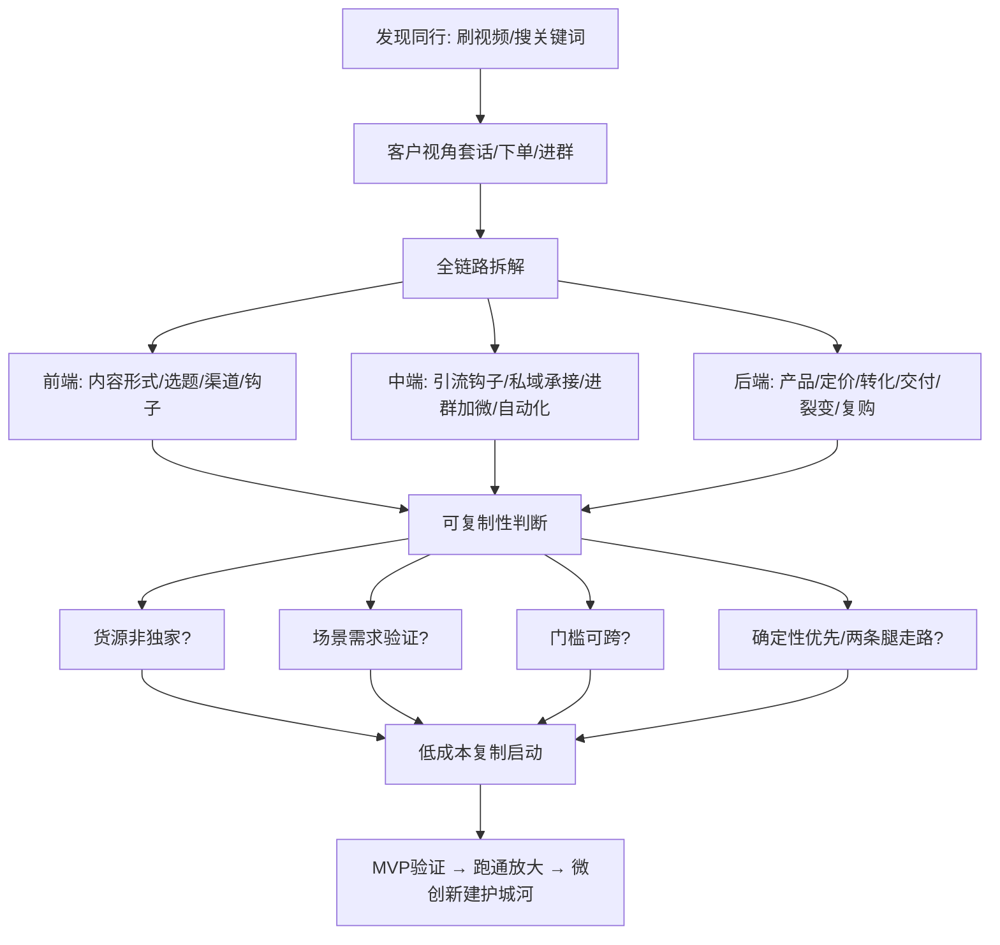

## 38.16 热点套利技术栈 —— 用“技术基建”抢跑风口红利期

### 为什么需要这个概念？

风口来得快、去得快（如ChatGPT、AI绘画、行程码下线），手动操作根本来不及。谁先部署、谁先收录、谁先上架，谁就拿走80%以上的搜索流量和首批红利。需要把“技术能力”预先沉淀为“可复用的基建”，风口来了“插上电”即用。

### 核心定义

> **热点套利技术栈**（来源：《龙哥赚钱周报 20230207_06》）

核心组件：
- 域名/👸号/小程序注册自动化
- API接入封装（OpenAI/Stable Diffusion/各类SaaS）
- 镜像站/套壳部署脚本
- SEO关键词布局模板
- 数据监控与报警

核心流程：监测热点关键词 → 触发自动化部署流程 → 10-30分钟上线可用版本 → 接入变现模块（广告/CPS/充值）

**作用解释**：该技术栈将“技术开发能力”预先沉淀为“可复用的基础设施组件”，实现了从风口监测到上线变现的分钟级响应。核心在于“预置”（域名池、👸号矩阵、API封装、镜像站脚本、SEO模板）与“自动化流程”（监测触发→部署→上线→变现）。ChatGPT案例中“十几分钟注册👸号+接入API+镜像站套娃小程序”即为该技术栈威力的实证。

### 关键性质

- **时间压缩**：将“从0到上线”从周/天压缩到分钟/小时级。
- **复用性**：一套技术栈可支撑N个风口项目（如同一套核心跑过ChatGPT、Midjourney、Sora等N波）。
- **护城河**：非技术竞争对手无法复制“速度”与“规模”，技术门槛形成壁垒。

### 典型例子

ChatGPT热度起：作者十几分钟注册👸号、写代码接入API、做镜像站套娃小程序，成全网首个集成者，消耗50万+请求。AI绘画小程序：虽因合规/成本放弃，但技术栈复用性已验证。[P002, p.13]

### 边界条件

需要具备基础开发能力（或极低代码工具熟练度），纯小白无法搭建技术栈。平台封杀风险极高（微信封小程序、👸号封号、API封禁），需准备多套备用方案。风口红利期短，变现窗口可能仅几天，技术栈若未提前建好，风口来时也来不及。[P002, p.13]

### 方法演进图

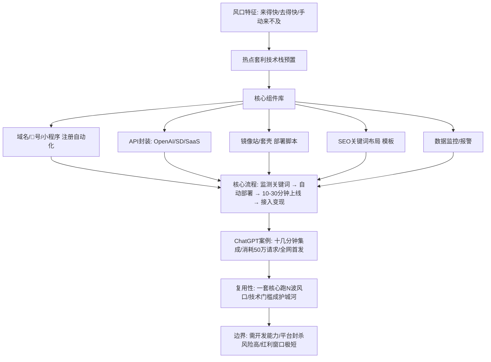

## 38.17 内容价值金字塔 —— 从“娱乐流量”爬向“方法论IP”的价值跃迁

### 为什么需要这个概念？

多数创作者困在“娱乐层”（涨粉快、变现难、无护城河），不知如何向上跃迁。平台算法偏好娱乐，商业逻辑偏好方法，两者张力下需要清晰的升级路径。需要一个显性化的“价值阶梯”，指导内容策略与商业模式选择。

### 核心定义

> **内容价值金字塔**（来源：《龙哥赚钱周报 20230207_06》）

- **L1给娱乐**：情绪价值（搞笑/剧情/颜值），注意力易得、信任难建、变现极难（靠广告/打赏）
- **L2给工具**：实用价值（资料/模板/工具/清单），解决具体问题、引流精准、可做虚拟产品/淘客/CPS
- **L3给方法**：认知价值（框架/模型/方法论/SOP），建立专业权威、打造个人IP、高客单/高复购/高溢价

**作用解释**：该金字塔揭示了内容价值的层级跃迁路径。L1娱乐层靠情绪价值换注意力，但信任难建、变现极难；L2工具层靠实用价值解决具体问题，引流精准、可做虚拟产品/淘客/CPS；L3方法层靠认知价值（框架/模型/方法论/SOP）建立专业权威，打造个人IP，实现高客单、高复购、高溢价。成熟IP通常“方法论为核、工具为手、娱乐为饵”三层同构。注：该分层理论源于作者对小红书等平台内容生态的实操观察总结，暂未见系统性学术文献定义L1/L2/L3边界，实际操作中层级间常有重叠与渗透。

### 关键性质

- **价值递增**：娱乐<工具<方法，对应变现难度递减、客单价递增、护城河递增。
- **可叠加**：成熟IP通常“方法论为核、工具为手、娱乐为饵”，三层同构。
- **门槛递增**：娱乐拼创意/颜值、工具拼整理/分发、方法拼认知/实战/提炼。

### 典型例子

小红书资料号：L2工具层，发资料引流卖99-199元资料/社群，单账号月利1万+。刘梦园IP：L3方法层，年费会员/私教/私董会/合伙人/顾问，构建千万营收阶梯。作者日更写作：从L1/L2起步，沉淀L3方法论，完成课程/社群/咨询三重变现，好友增6倍。[P002, p.14]

### 边界条件

新手建议从L2工具层切入（门槛低、正反馈快），积累种子用户与案例后再向L3跃迁。纯L1娱乐号若无转型路径，账号即资产、人走茶凉，无可复用资产。L3方法论要求创作者有真实战绩、可复用框架、持续迭代能力，否则是“割韭菜”。[P002, p.14]

### 方法演进图

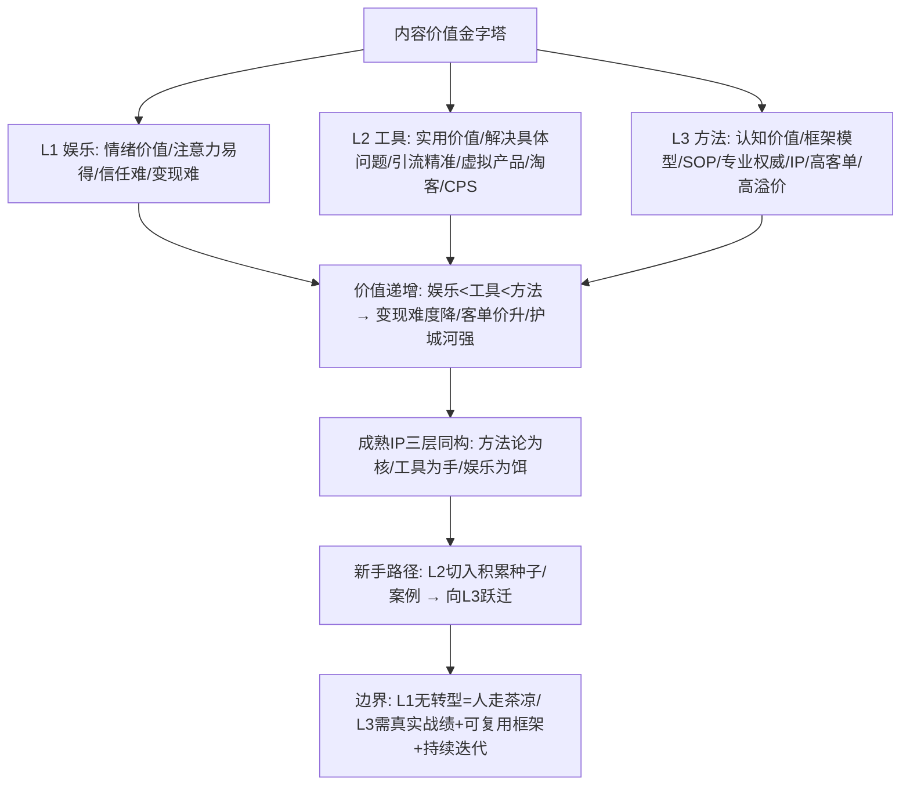

## 38.18 OKR制定与执行要点 —— 战略坚定、KR推动O、MVP验证、高频同步

### 为什么需要这个概念？

多数团队OKR流于形式：O空泛、KPI化、不推动战略、执行靠吼、复盘靠找借口。需要一套“可落地、可考核、可迭代、能出结果”的OKR操作规范。核心痛点：战略摇摆、执行变形、不确定因素不验证、问题藏着不报。

### 核心定义

> **OKR制定与执行要点**（来源：《龙哥赚钱周报 20230207_06》）

- **战略坚定**：战略不是一朝一夕、不是朝令夕改，是三会一层定下来的“地图与路径”
- **KR必须直接推动O**：KR负责人盯着O，不是盯着KR完成任务
- **O要有可衡量标准**：定性目标量化拆解，无数据不OKR
- **MVP验证最不确定因素**：先跑通最核心假设，再铺开执行
- **高频同步+问题暴露**：周会/日会强制同步，鼓励暴露问题、奖励解决问题

**作用解释**：该方法论将战略执行标准化为五个可操作原则。战略坚定源于“三会一层”治理层决策，避免朝令夕改；KR直接推动O确保执行不偏离战略；O可衡量将定性转定量；MVP验证用最小成本测试最大不确定性；高频同步+问题暴露构建“说真话、不杀信使、奖励暴露问题”的文化。作者团队用该法管理多条业务线，实现从亏损到月利百万的跃迁。

### 关键性质

- **效率杠杆**：过程管理量化+时间节点明确，团队效率至少提升50%。
- **战略对齐**：从股东会→董事会→高管层→执行层，上下贯通、左右协同。
- **容错机制**：MVP验证允许低成本试错，避免大投入后发现方向错误。

### 典型例子

作者团队：用OKR管理外卖CPS/副业课程/视频号店群等多条业务线，实现从亏损到月利百万的跃迁。股权顶层设计四要素法：控制权/进入/分配/退出机制，配合OKR落地治理。[P002, p.15]

### 边界条件

适用于“有一定规模（5人+）、多业务线、需协同”的团队，微团队/单人项目用精简版即可。创始人必须懂业务、懂战略、敢担责，甩手掌柜搞OKR必死。文化前提：鼓励真话、不杀信使、奖励暴露问题，否则OKR变汇报秀。[P002, p.15]

### 方法演进图

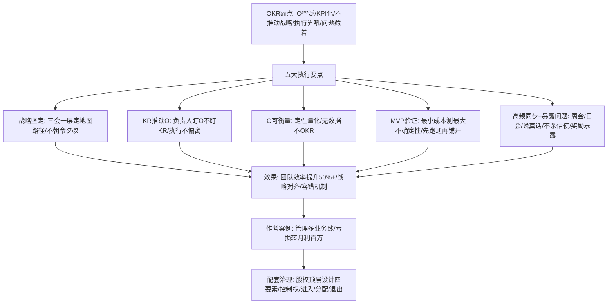

## 38.19 多源对照

本章核心概念由四份核心素材共同支撑，形成互补视角：

### 共识

- **私域核心地位**：四份素材均确认“公域引流、私域变现”是核心商业模式，私域流量属于自己，可反复触达、低成本运营。[P001, p.14; P002, p.7; P003, p.10; P004, p.12]
- **数据驱动决策**：均强调用量化模型（ROI、单客价、流速）指导运营，反对拍脑袋决策。
- **标准化复制**：均主张将成功经验沉淀为SOP/模型（五位一体成交、捡漏群、店群矩阵），实现规模化复制。
- **资源匹配优先**：均认为成功取决于“自有资源与项目需求的匹配度”而非项目本身好坏。

### 分歧

以下表格展示了不同素材在核心概念上的侧重差异：

| 概念 | P001 (20230207_03) | P002 (20230207_06) | P003 (20230207_08) | P004 (20230207_09) |
|------|-------------------|-------------------|-------------------|-------------------|
| **ROI核算重点** | 直播+私域综合ROI，强调月产值与衰减系数 | 流量价值公式（规模×相关性×信任度），强调流速控制 | 无直接ROI模型，侧重具体项目数据验证 | 隐含在项目复盘中，强调资源匹配后的ROI跃升 |
| **捡漏群定位** | 核心变现模型，详述演员/排品/文案/催单全套SOP | 作为社群分销一种形式，强调供应链强度×顶层设计×动员能力 | 侧重社群分销冷启动（选品为王、触达核心节点裂变） | 未直接涉及 |
| **MVP验证** | 隐含在“先卖后做”实践中 | 明确提出“MVP先卖后做”判断标准（聊100人/20-30人预售） | 结合资源匹配度，强调“筛选大于培养” | 作为资源匹配后的验证手段 |
| **内容策略** | 未系统阐述 | 提出内容价值金字塔（娱乐<工具<方法） | 侧重渣男思维（撩完就跑/广撒网）与SEO精准流量 | 强调写作即社交/身份证、内容复利杠杆 |

## 38.20 设计中的取舍

**问：为什么不直接做品牌/自建供应链？**

答：自建供应链需要重资产、长周期、强运营能力，抗风险弱。素材实证：视频号无货源店群“无库存、无发货、无售后”，单店月利1万，10店月入10万+，边际成本极低；而自建品牌需承担库存、物流、售后全链路风险。这是放弃品牌溢价与完全掌控，换取极速试错、低成本验证、矩阵化对抗不确定性的取舍。

**问：为什么不用“广撒网”式投流，而要算“实时真实ROI”？**

答：盲目投流忽略私域长期价值，导致ROI虚低、不敢加预算。实时真实ROI模型将私域年产值纳入分子，使ROI从2.5跃升至3.5-4.5，直接改变投放决策。这是增加核算复杂度（需追踪进粉率、月产值、衰减），换取决策准确性与放大勇气的取舍。

**问：为什么捡漏群必须要“演员”？**

答：无演员群“死气沉沉”，产出相差1倍以上，生命周期断崖式缩短。演员营造“从众/稀缺/信任”三重心理，将转化率从个位数提升至可商业化水平。这是增加人力/管理成本（30-50演员/群），且面临平台打击“托”行为的合规风险，换取社群自发裂变与高客单产出的取舍。

**问：为什么视频号店群“最少5店”？**

答：单店波动极大（选品/流量/转化全靠运气），矩阵用概率对抗不确定性。素材数据：7店日销7858元，单店均1122元，但“多起一些店，再精细点做，平均一个店能做到月利润1W左右，做10个店就是10W了”。这是增加店铺管理/保证金/合规成本，换取收益稳定性与爆款捕获概率的取舍。

## 38.21 动手练习

### 练习 1：实战演算：私域单客价与实时真实ROI模型搭建

假设你运营一个视频号直播间，销售客单价199元、毛利率35%的护肤品：
1. 设定合理的私域进粉率、月产值、衰减系数，计算单客价（年）
2. 若广告投入50万，直播间营业额120万，计算纯直播ROI与含私域产值的实时真实ROI
3. 敏感性分析：月产值从15元提升至30元、进粉率从60%提至70%，ROI分别如何变化？
4. 思考：若该品类复购周期极长（如耐用品），该模型还适用吗？边界在哪里？

### 练习 2：拆解实操：设计一个“捡漏群”冷启动方案

你计划在美妆赛道启动捡漏群，请完成：
1. 选品：列出3个符合“标品、高性价比、有社交货币”的具体SKU及获取渠道
2. 演员体系：设计30个演员的人设分工（如：手速党、晒单党、催单党、疑似店主）、话术示例、考核指标
3. 运营节奏：制定单日发品时间表（含大主品、小品、预告、催单节点）与精推文案结构
4. 经济账测算：单群成本8000元，预计回本周期、月纯利、2年生命周期总收益、100群矩阵月利
5. 风控：微信打击“托/诱导分享”时，如何调整演员行为与群玩法维持转化？

### 练习 3：流量诊断练习：对某👸号/视频号账号做一次切片分析

选取一个你熟悉的有流量数据的账号（或模拟数据），完成：
1. 横向切片：列出过去7日Top5流量来源渠道、各渠道涨跌趋势、疑似原因、拟定3个干预动作
2. 纵向切片：绘制用户从进页面到离开的行为路径图，标注关键停留节点、流失节点、转化节点
3. 结合交易目的论：识别出“无互动曝光”的页面/内容，提出砍掉/改造建议
4. 流速判断：该账号当前流速偏快/偏慢/适中？依据是什么？建议调控手段？

### 练习 4：MVP验证设计：为一个“虚拟资料/课程类”项目设计预售测试

假设你想做一个“考公上岸笔记+陪伴群”项目，请设计：
1. 预售落地页/文案核心结构（痛点、方案、交付承诺、价格锚点、稀缺性）
2. 测试样本：在哪里找100个精准种子用户？用什么话术邀约？
3. 判定标准：多少人付预售金（如99元）算通过？为何设这个数？
4. 资源匹配度自测：列出该项目所需Top5关键资源，打分你的现有资源匹配度（0-100%），决策启动/补齐/放弃

### 练习 5：商业拆解复刻：对标一个同行账号/项目输出可执行SOP

在抖音/小红书/视频号找一个你想复制的同行（如：某知识付费/带货/引流账号），完成：
1. 前端拆解：内容形式/选题/发布频次/标题公式/封面风格/钩子设计
2. 中端拆解：引流钩子/私域承接话术/进群/加微路径/自动化工具
3. 后端拆解：产品结构/定价/转化流程/交付SOP/裂变机制/复购设计
4. 可复制性判断：货源是否独家？场景需求是否验证？核心门槛（技术/资质/供应链/团队）我能否跨过？
5. 微创新点：在材质/包装/服务/组合/人设上能做什么差异化？输出启动清单

### 练习 6：内容跃迁规划：将你的内容从L1/L2向L3方法论进阶

梳理你近期发布的10篇内容（或规划的10个选题），完成：
1. 分层标注：每篇归属L1娱乐/L2工具/L3方法？当前分布比例？
2. 选定1个L2工具类内容（如某份资料/清单/模板），拆解其背后的“通用方法/底层逻辑/执行框架”
3. 重写为L3方法论内容：提炼模型名称、核心步骤、适用边界、避坑指南、配套工具/模板
4. 变现匹配：L3内容对应什么高客单产品（咨询/课程/社群/顾问）？设计引流-转化路径
5. 评估：你具备支撑L3的真实战绩/可复用框架/持续迭代能力吗？缺口在哪？

## 38.22 本章小结

这一章中我们系统学习了私域流量运营的完整体系。首先从核心指标入手，理解了私域单客价与实时真实ROI两个颠覆传统电商思维的核心模型，将关注点从单次交易转向全生命周期价值；其次掌握了捡漏群这一极具杠杆效应的社群标准化模型，理解了演员氛围、极致性价比与精细化运营的三位一体；接着深入流量运营方法论，掌握了流量切片分析法的双维拆解技术、流量流速悖论的调控智慧、交易目的论的价值锚定、流量合并术的杠杆思维；随后学习了成交与承接体系，包括五位一体成交飞轮的标准化SOP、抖音爆单承接法的三板斧、视频号无货源店群的矩阵思维；然后建立了项目验证与决策框架，掌握MVP先卖后做的预售验证标准、资源匹配度评估三步法、商业拆解复制法的全链路透视、热点套利技术栈的分钟级响应能力；最后完成了认知升级，理解了内容价值金字塔的跃迁路径与OKR制定执行的五大要点。

以下表格汇总了本章核心概念速查卡：

| 概念 | 解释 |
|------|------|
| 私域单客价 | 单个用户全生命周期贡献总销售额，公式=客单价×购买频次×生命周期，核心从单次交易转向长期复利 |
| 实时真实ROI | 将私域预估年产值(进粉率×月产值×12月×衰减)纳入分子，使ROI从2.5跃升至3.5-4.5，指导敢投流、敢扩张 |
| 捡漏群模型 | 1-3折极致性价比+30-50演员氛围+精细排品催单，单群成本7千/3月回本/2年周期/纯利2万+，矩阵化万群月佣千万级 |
| 流量切片分析法 | 横向切来源/趋势/动作，纵向切需求/路径/价值，把UV/PV切成可执行运营动作的显微镜 |
| 流量流速悖论 | 流量要流动也要停留、不快不慢、持续不断；太快无连接、太慢无规模，核心指标是停留时间与互动率 |
| 交易目的论 | 单纯曝光(UV/PV)无价值，无互动曝光反为负价值，一切运营动作以交易为最终目的 |
| 流量合并术 | 流量分自建与合并；谁能让流量主赚更多钱，谁就拥有其流量；用利益绑定替代自建，边际成本极低 |
| 五位一体成交飞轮 | 破冰(好感)-诊断(放大需求)-方案(铺垫)-信任(突破抗拒)-成交(引导)，标准化解决买三个为什么，新人周上岗 |
| 抖音爆单承接法 | 视频爆→传同内容+建合集带新视频；流量视频+带货视频双路；视频爆→即开直播双频共振；时效性强、低成本 |
| 视频号无货源店群 | 旗舰店/普通店入优选联盟→采集拼多多铺货→达人带货/自然流出单→拼多多代发；矩阵≥5店对抗不确定性，单店月利1万+ |
| MVP先卖后做 | 先卖想法/预售收定金，聊100人仅几个买=有问题，20-30人付预售金=验证通过；短时间测几十产品，筛选>培养 |
| 资源匹配度评估 | 盘点自有资源→拆解项目需求→评匹配度；成功取决于匹配度而非项目好坏；作者资源匹配外卖CPS/副业课程3月赚100万 |
| 商业拆解复制法 | 刷视频找同行→客户视角套话→拆前端/中端/后端全链路→判货源非独家/场景验证/门槛可跨→低成本复制启动 |
| 热点套利技术栈 | 预置域名/👸号/小程序/API封装/镜像站/SEO模板/监控报警；风口来10-30分钟上线；ChatGPT案例十几分钟集成消耗50万请求 |
| 内容价值金字塔 | L1娱乐(情绪/难变现)<L2工具(资料/引流/虚拟产品)<L3方法(框架/认知/IP/高客单/高溢价)，建议新手从L2切入向L3跃迁 |
| OKR制定与执行 | 战略坚定不朝令夕改；KR必须直接推动O且O可衡量；MVP验证最不确定因素；高频同步+鼓励暴露问题；团队效率提升50%+ |

下一章中，我们将学习创业心态与内在比赛的心理学机制，理解如何通过“盲目自信”、“成功是成功之母”、“唤醒成功体验”等心法打赢内在比赛，从而在外在商业战场上取得持久胜利。

