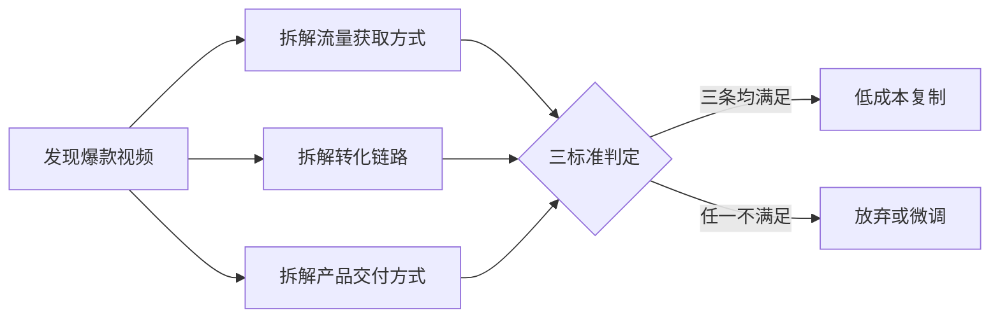
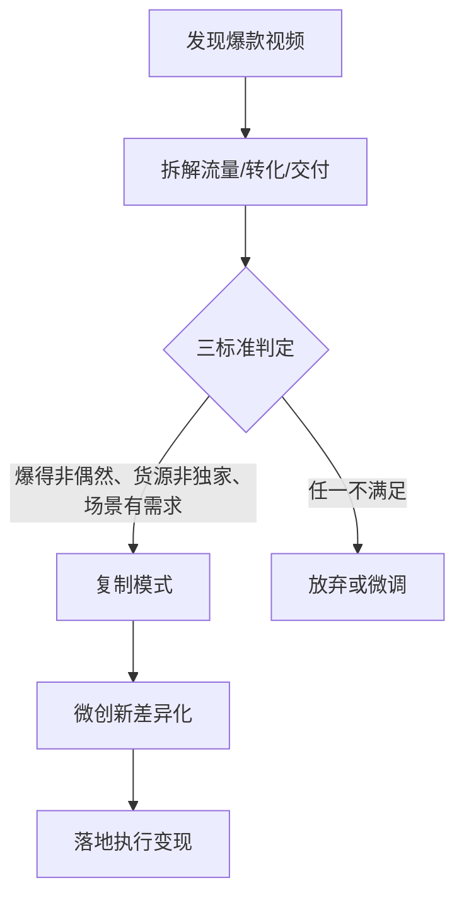
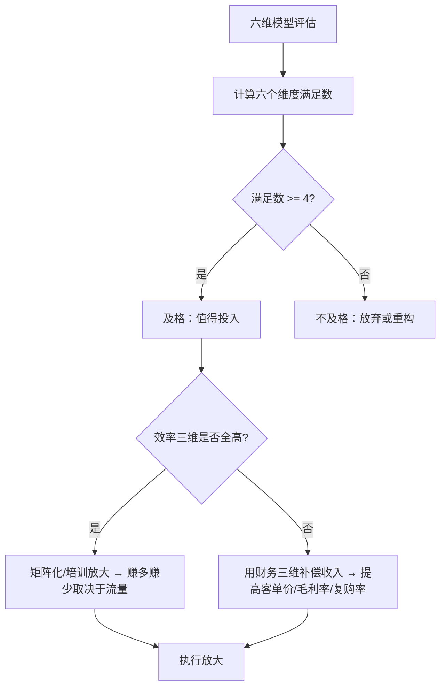

# 第 1 章 副业变现的底层逻辑 —— 从“看到”到“复制变现”
作者：龙哥

## 1.1 学习目标

- 理解为什么多数副业失败源于“从零发明”而非“复制已验证模式”
- 掌握商业项目拆解的核心逻辑：从爆款中找到流量、转化、交付三大链路
- 学会判断项目可复制性的三大标准，避免掉入“伪机会”陷阱
- 能运用“后发制人”思维，在降低试错成本的同时找到自己的微创新切入点
- 建立“卖空气/软文先行”的逆向产品思维：先验证需求，再投入开发
- 掌握六维项目评估模型，能对任意项目进行可复制性与收入天花板的量化拆解

## 1.2 生活类比：厨师拆解招牌菜

想象商业项目拆解是一个**厨师拆解招牌菜**的过程。你走进一家生意火爆的餐厅，看到门口排队到街角，你心里想的不是“我要发明一道全新的菜”，而是“这道招牌菜到底是怎么做出来的”。

爆款视频就是那道排队到街角的招牌菜，它用诱人的摆盘和香气吸引食客驻足——这就是流量获取；顾客从进门到点菜的引导动线、菜单设计和服务员推荐——这就是转化链路；后厨真正端上桌的那道实打实的菜——这就是产品交付。而决定你能否把这道菜搬回自己店里卖的，是它的可复制性：它用的是常见食材还是独家秘方？靠的是真功夫还是运气？最后，你还得用一把统一的尺子量一量：这道菜值不值得上你的菜单？做起来快不快（效率）、定价高不高（财务）？

就像厨师不靠灵感发明新菜，而是拆解爆款菜品的可复制配方；副业成功不是从零创造，而是把赚钱的商业模式拆成能复制、能微调的零件，再用统一的尺子量一量它能走多远。

## 1.3 概念地图

本章涵盖的核心概念及其关系如下：

```
商业项目拆解
├── 为什么要拆解
│   ├── 多数副业失败：从零发明而非复制已验证模式 —— P001, P002
│   ├── 单案例难复制：需先理解内在链路 —— P001
│   └── 后发制人：等别人验证月余再入场降低试错成本 —— P001
├── 拆什么
│   ├── 流量获取方式：固定内容分享 / 投放 —— P002
│   ├── 转化链路：直播间 / 私域社群 / 朋友圈+私聊 —— P002
│   └── 产品交付方式：有形 / 无形、客单价、同行做多久 —— P002
├── 可复制性判定三标准
│   ├── 爆得非偶然 —— P001
│   ├── 货源非独家（可另寻渠道） —— P001
│   └── 消费场景验证有需求 —— P001
└── 拆解后的评估与行动
    ├── 六维模型评估：流量/销转/交付效率 + 客单价/毛利率/复购率 —— P003
    ├── 六维及格线：满足四个点及格，效率不足时靠财务补齐 —— P003
    ├── 三效率决定可复制性：三都高则赚多赚少取决于流量 ── P003
    ├── 结合自身擅长点微创新，避免照搬水土不服 —— P001, P002
    └── 案例验证：儿童游乐（3月40W）、文川手写logo（599差价）、知识付费（500W天花板） —— P002, P003
```

## 1.4 商业项目拆解 —— 把“赚钱的别人”拆成“可复制的零件”

### 为什么需要这个概念？

大多数人做副业失败，不是因为不够努力，而是因为从一开始就走错了路。他们试图“从零发明”一个全新项目，却不知道这恰恰是最难、风险最高的路径。让我们先看素材中秦汉唐的复盘：

> “拆下来之后，我就发现很多时候有些项目是完全可以复制的，是不需要投入几十万也可以复制的。复制了之后，用跟他一样的内容生产方式、转化链路，你也能拿到一定的结果。”
>
> —— 来源：《商业项目拆解方法论与实战复盘》（素材ID：docs/202301-02/I9OAdzzs2oBliNxsmPjcHnBUnzf.md）

这段话揭示了一个反直觉的真相：[需要补充文献]**成功的副业不是从零发明，而是发现、拆解并复制已验证的商业模式。** 单个成功案例看似光鲜，其实难以直接照搬——你必须先理解它内部的流量、转化、交付链路，才能判断哪些可以复制、哪些需要微调。正如秦汉唐在同篇素材中所说：“通过刷抖音或者刷小红书的过程发现商业案例，再拆解复制这样的案例去形成一个商业模式，去发展自己的副业。”

### 核心定义

> **商业项目拆解** 定义（来源：《商业项目拆解方法论与实战复盘》，素材ID：docs/202301-02/I9OAdzzs2oBliNxsmPjcHnBUnzf.md）[P001]

$$
\text{商业项目拆解} = \text{拆出流量获取方式} + \text{拆出转化链路} + \text{拆出产品交付方式}
$$

让我们逐项解读这个公式：

- **流量获取方式**：指项目通过什么固定内容形式（如口播、图文、情景剧）或投放手段获取用户注意。它是整个链路的起点——没有流量，转化和交付都无从谈起。
- **转化链路**：指从用户看到内容到达成付费的完整路径——是在直播间直接成交，还是引流到私域社群、通过朋友圈+私聊逐步转化？转化周期多长？
- **产品交付方式**：指用户付费后获得什么——是有形产品（货物）还是无形服务（课程、咨询、加盟）？客单价如何？同行已经做了多久（验证持续性）？

这个公式展示了商业项目拆解的本质：它不是模仿表面形式，而是把“赚钱的别人”拆成三个可识别的组件——流量从哪里来、怎么转化为付费、交付什么产品。当这三个组件都被清晰识别后，复制才有依据。

你可能会问：拆解到底看什么？素材给出了明确的三个维度：

| 拆解维度 | 具体问题 | 案例参考 |
|---------|---------|---------|
| 流量获取 | 通过什么固定内容形式引流？还是投放？ | 艺术签名账号持续发内容引来大量咨询 |
| 转化链路 | 直播间直接卖、私域社群、还是朋友圈+私聊？转化周期多久？ | 文川手写logo评论区客资转化 |
| 产品交付 | 有形还是无形？客单价多少？同行做了多久？ | 儿童游乐加盟（2万/个） |

### 关键性质

> **可复制性判定三标准**（来源：《商业项目拆解方法论与实战复盘》，素材ID：docs/202301-02/I9OAdzzs2oBliNxsmPjcHnBUnzf.md）[P001]

```text
可复制性判定三标准：
1. 爆得非偶然 —— 视频爆红靠的是持续的内容生产而非运气
2. 货源非独家 —— 可以通过别的渠道找到相同或类似的货源
3. 消费场景验证有需求 —— 该产品的消费场景被证明是真实存在的
```

这段伪代码展示了判断一个项目能否复制的核心标准。“首先，这个视频爆得偶然；其次，他货源不是他自己的，也就是说我可以通过别的方式找到他的货源；最后，这个消费场景经过验证是证明是有需求的，而且需求量还不小。”——只有三条同时满足，项目才具备低成本复制的可能。如果货源是项目方独家、爆红纯属偶然、或消费场景未经验证，那么这个项目就不可复制。

这一小节拆解的方法演进，可以用下图来概括：



### 典型例子：从拆解到变现的完整路径

让我们看两个具体的拆解案例，它们展示了从“看到”到“复制变现”的完整过程。

**案例一：儿童游乐项目（3个月变现40万）**

秦汉唐在刷抖音时注意到一条儿童游乐（挖掘机模拟工地）的爆款视频，数据表现惊人：8.4万赞、1.1万转发、3000多条评论，估计播放量破千万。他据此判断该项目可复制，于是组建3人团队、定制2万加盟费、双渠道引流，最终在三个月内成交40多个加盟商，实现收入约80万。（来源：《商业项目拆解方法论与实战复盘》，素材ID：docs/202301-02/I9OAdzzs2oBliNxsmPjcHnBUnzf.md）[P001]

**案例二：文川手写logo（599差价获利）**

秦汉唐拆解“文川手写”账号时发现：这是一个帮人设计logo的账号，评论区有大量客资留言“怎么找你设计logo”。他判断创意生产方式固定可复制、流量端靠稳定内容供给，于是转化交付端外包给大学生设计师，中间赚差价——收客户599元设计费、付大学生200-250元。（来源：《商业项目拆解方法论与实战复盘》，素材ID：docs/202301-02/I9OAdzzs2oBliNxsmPjcHnBUnzf.md）[P001]



### 多源对照：拆解的三层共识

> 当同一概念有多篇素材支撑时，我们需要对照不同作者的视角，找出共识与分歧。

**共识**：

- **后发制人原则**：秦汉唐在《商业项目拆解方法论与实战复盘》（素材ID：docs/202301-02/I9OAdzzs2oBliNxsmPjcHnBUnzf.md）中强调“我一定是看别人已经做成了，已经做了好几个月了，我才会选择做这个项目做这个赛道”，这个观点在《个人开发者“卖空气”式产品开发与盈利思维》（素材ID：docs/202301-02/DNGrdODFBowfk2xwkNCc5GGSnRd.md）中得到呼应——资本开发者同样主张先验证需求再投入开发，而非盲目all in。
- **拆解底层链路而非表面**：两篇素材都强调拆的是流量、转化、交付的链路，而非单纯的外在形式。个人开发者的“复述问题建立信任”和运营者的“拆转化链路”本质上是同一个逻辑：理解用户从看到内容到付费的完整心理路径。

**分歧**：

- 《商业项目拆解方法论与实战复盘》（素材ID：docs/202301-02/I9OAdzzs2oBliNxsmPjcHnBUnzf.md）认为拆解的主体是“爆款内容”，通过刷抖音/小红书发现商业案例；而《个人开发者“卖空气”式产品开发与盈利思维》（素材ID：docs/202301-02/DNGrdODFBowfk2xwkNCc5GGSnRd.md）则主张从“用户搜索行为”出发，通过下拉词发现需求。前者的切口是“别人的成功”（后发制人），后者的切口是“用户的痛点”（需求先行）。
- 《商业项目拆解方法论与实战复盘》强调复制后要“结合自身擅长点微创新”，而《个人开发者“卖空气”式产品开发与盈利思维》则认为“不解决需求、不是好产品，也不会影响赚钱速度”——前者倾向于价值创造，后者更侧重商业效率。

### 边界条件：拆解不是万能药

拆解方法论有其明确的适用边界。正如秦汉唐所述（来源：《商业项目拆解方法论与实战复盘》，素材ID：docs/202301-02/I9OAdzzs2oBliNxsmPjcHnBUnzf.md）[P001]，拆解后仍需结合自身擅长点做微创新，完全照搬可能水土不服。“赛道就是你的业务基本盘，卖货卖课卖自己”，每个赛道的底层逻辑不同，需要仔细甄别。如果货源为项目方独家、爆红纯属偶然、或消费场景未经验证，则不可复制。此外，拆解需要投入时间和精力，单纯模仿而不理解底层链路，往往只会得到表面的“形似”而非“神似”。

## 1.5 六维评估模型 —— 给项目算一笔“复制账”

### 为什么需要这个概念？

拆解出项目链路后，下一个问题是：这个项目值不值得做？能不能做大？只看表面的赚钱数字容易误判——有些项目月入过万但天花板极低，有些项目起量慢但天花板高得惊人。这就需要一把“统一的尺子”。

> “任何项目都可以拆解成：「流量效率，销转效率，交付效率，客单价，毛利率，复购率」，这六个点。”
>
> —— 来源：《六维项目拆解底层逻辑》（素材ID：docs/202301-02/NxhWdJj3UoPKvmxaBqkcz8wlntf.md）

这段话给出了一个惊人的断言：**任何项目**，无论看似多么复杂，都可以用六个维度来拆解。这个模型的力量在于它的普适性——它不受行业、产品形态的限制，为评估所有副业项目提供了统一框架。

### 核心定义

> **六维评估模型** 定义（来源：《六维项目拆解底层逻辑》，素材ID：docs/202301-02/NxhWdJj3UoPKvmxaBqkcz8wlntf.md）[P003]

$$
\text{六维评估} = \underbrace{(\text{流量效率}, \text{销转效率}, \text{交付效率})}_{\text{效率维度：决定可复制性}} + \underbrace{(\text{客单价}, \text{毛利率}, \text{复购率})}_{\text{财务维度：决定收入天花板}}
$$

这个公式展示了六维模型的分组逻辑，我们逐项解释：

- **效率维度**（等号右侧第一个括号）：包含三个子项——
  - **流量效率**：以“时间、素材、流量”为指标。“花的时间少，素材难度低，获得流量大，即为流量效率高”。例如花五分钟写条朋友圈同时发三个号有1000人看到，流量效率就很高。
  - **销转效率**：以“专业度”为指标。“专业度要求低（能SOP），能一对多，即为销转效率高，本质也是时间，销售的时间利用率”。网销可按SOP执行，不需要高专业度。
  - **交付效率**：以“时间”为指标。“花的时间少（人力少），即为交付效率高”。比如资料类产品，付款那一刻交付已经完成，效率最高。
  
  这三个子项共同决定项目能否被复制放大。

- **财务维度**（等号右侧第二个括号）：包含三个子项——
  - **客单价**：客户单次购买支付的金额。越高越好，但需结合市场接受度。
  - **毛利率**：收入扣除直接成本后的利润率。100%代表零成本。
  - **复购率**：客户重复购买的频率。越高代表用户生命周期越长。

我们来看每个维度的具体定义和指标。下表汇总了六个维度的核心要点、判断标准及数据来源：

| 维度 | 指标 | 高/低判断标准 | 来源 |
|------|------|--------------|------|
| 流量效率 | 时间、素材、流量 | 花时间少、素材难度低、获得流量大 = 高 | 《六维项目拆解底层逻辑》（素材ID：docs/202301-02/NxhWdJj3UoPKvmxaBqkcz8wlntf.md）[P003] |
| 销转效率 | 专业度 | 专业度要求低（能SOP）、能一对多 = 高 | 同上 |
| 交付效率 | 时间、人力 | 花时间少（人力少）= 高；支付即完成交付 = 最高 | 同上 |
| 客单价 | 金额 | 越高越好，但需结合市场接受度 | 同上 |
| 毛利率 | 百分比 | 越高越好，100%代表零成本 | 同上 |
| 复购率 | 频率 | 越高越好，代表用户生命周期更长 | 同上 |

### 关键性质

> **三效率决定可复制性定理**（来源：《六维项目拆解底层逻辑》，素材ID：docs/202301-02/NxhWdJj3UoPKvmxaBqkcz8wlntf.md）[P003]

```text
如果流量效率、销转效率、交付效率 三个都高：
    → 赚多赚少，取决于流量的多少
    → 可以通过矩阵、培训等方式放大

如果三个效率中有一块低：
    → 就很难复制放大
    → 那就得在客单价、毛利率、复购率这三块下功夫
    → 比如通过提高客单价来增加收入
```

这个定理揭示了项目的本质分界线：**效率维度决定项目能否被复制放大，财务维度决定在效率受限时如何补足收入**。当三个效率都高时，项目就像一个“印钞机”——只要流量进来，就能自动完成转化和交付；当任一效率偏低时，项目就像一台“手工机床”——难以规模化，但可以通过高客单价、高毛利等财务手段来维持盈利。

> **六维满足度及格线定理**（来源：《六维项目拆解底层逻辑》，素材ID：docs/202301-02/NxhWdJj3UoPKvmxaBqkcz8wlntf.md）[P003]

$$
\text{及格标准} = \text{六个点满足} \geq 4 \text{个}
$$

这个公式给出了一个清晰的操作指引：“六个点，满足的越多越好，满足四个点，及格”。为什么要定在“四个点”这条线？我们可以这样推导：六个维度中，效率三维和财务三维各自构成一个互补的系统。如果一个项目在效率维度上三维全优，那么在财务维度上只需要再满足一个维度（总共四个），就足以通过“复制放大”或“高单价补偿”至少一条路径实现盈利；反之，如果效率维度只有两维优秀甚至更少，则必须在财务维度上满足至少两个（总共四个），通过客单价、毛利率或复购率来补足收入。因此，“四个点”恰好是两个子系统之间的最低互补阈值——它保证无论短板在效率侧还是财务侧，都至少有一个维度可以从另一侧“拉一把”，让项目不至于因单一短板而彻底失去盈利可能性。这条及格线大大降低了决策门槛，让你能快速筛选出值得投入的项目。

### 典型例子：用六维模型透视四个项目

让我们用六维模型逐一给真实项目打分，感受它的威力。

| 项目 | 流量效率 | 销转效率 | 交付效率 | 客单价 | 毛利率 | 复购率 | 月收益 |
|------|---------|---------|---------|--------|--------|--------|--------|
| 小说推文 | 高（素材大量、框架固定） | 高（暗号搜索充值会员） | 高（无需交付） | 低（十几二十块） | 高（50%+） | 低（无复购） | 1000~2W |
| 教育资料1.0 | 高 | 高 | 高 | 低（十几块~小几十块） | 高（50~100%） | 低 | 1000~2W |
| 教育资料2.0 | 高 | 高 | 高 | 低~高（数千至十几万） | 低（10%） | 低 | 2W~100W |
| 知识付费 | 高（口播门槛低） | 高（直播间挂小黄车） | 高（卖掉即交付） | 高（小几千） | 高（100%） | 低 | 10W~500W |

上表可以直观看出，**为什么知识付费的天花板最高？** 因为它六个维度中五个都高——最高的是毛利率100%和客单价小几千。而小说推文虽然三效率全高，但客单价低、无复购，所以天花板低至2W。这印证了六维模型的解释力：收入天花板由效率维度和财务维度的组合共同决定。（数据来源：《六维项目拆解底层逻辑》，素材ID：docs/202301-02/NxhWdJj3UoPKvmxaBqkcz8wlntf.md）[P003]

**特别案例：项目拆解商业IP（效率不足时用财务补）**

以秦汉唐自己的项目拆解商业IP为例：流量效率低（项目拆解需要时间及好的信息源，难以批量产出）、销转效率高（网销SOP化）、交付效率低（社群/陪跑需要时间及专业知识）、客单价高（数千至六位数）、毛利率高（70%以上）、复购率低。其高收益正是通过**高客单价和高毛利率**来补偿低流量效率和低交付效率的。（来源：《六维项目拆解底层逻辑》，素材ID：docs/202301-02/NxhWdJj3UoPKvmxaBqkcz8wlntf.md）[P003]

这一小节的方法演进，可以用下图来概括：



### 边界条件

六维模型是评估框架而非自动决策工具，仍需结合自身资源禀赋判断。六维中某一维的“高/低”是相对判断，需结合同行与自身条件校准。例如，客单价“高”的标准在知识付费领域（小几千）和在教育资料2.0领域（数千至十几万）含义完全不同。此外，该模型主要从商业效率角度评估，未覆盖兴趣、价值观等个人因素——就像秦汉唐在大闸蟹项目中“虽然4个月赚20万”但因不喜欢电商而坚决退出（来源：《商业项目拆解方法论与实战复盘》，素材ID：docs/202301-02/I9OAdzzs2oBliNxsmPjcHnBUnzf.md）[P001]，这个模型无法预测这类“事与愿违”。

## 1.6 设计中的取舍

### 取舍一：为什么不做“从零发明”而是“后发制人”？

从零发明的诱惑在于“原创性”带来的成就感，但它有三个致命缺陷：一是你不知道市场是否需要这个产品；二是你需要在黑暗中摸索很久才能找到正确的方向；三是即使做出来了，市场教育成本极高。而后发制人（等别人验证可行后再复制）则完全不同：别人已经用真金白银验证了市场需求，你只需要复制其成熟的模式并做微调即可。成本降低了，风险降低了，确定性提高了。代价是你可能失去“第一个吃螃蟹”的超额利润——但在副业场景中，稳定性和确定性远比超额利润重要。（来源：《商业项目拆解方法论与实战复盘》，素材ID：docs/202301-02/I9OAdzzs2oBliNxsmPjcHnBUnzf.md）[P001]；《个人开发者“卖空气”式产品开发与盈利思维》，素材ID：docs/202301-02/DNGrdODFBowfk2xwkNCc5GGSnRd.md）[P002]

### 取舍二：为什么用“效率+财务”双维度评估而不是单看利润？

单看利润数字有一个陷阱：你看到了一个项目月入10万，但不知道它背后投入了多少时间、人力、资源。当你亲自下场时，可能发现同样的10万元需要你每天工作16小时、耗费全部精力。六维模型通过效率维度（流量/销转/交付）和财务维度（客单价/毛利率/复购率）的分离，让你同时看到“这个项目能不能复制”和“这个项目值多少钱”。这正是“六个点满足越多越好”背后的逻辑：我们需要的是**立体评估**而非单一盈利数字。（来源：《六维项目拆解底层逻辑》，素材ID：docs/202301-02/NxhWdJj3UoPKvmxaBqkcz8wlntf.md）[P003]

### 取舍三：为什么拆解后还要微创新？

完全照搬别人模式看似省事，但实际上“水土不服”的风险很高。每个创业者有不同的资源、能力和性格特质——擅长内容制作的人、擅长销售的人、擅长技术开发的人，适合的微调方向各不相同。正如秦汉唐所说：“定策略。你自己定你的产品，你的流量，你的转化，这三个端口怎么做？是复制全部还是通过你的擅长点进行微创新。”（来源：《商业项目拆解方法论与实战复盘》，素材ID：docs/202301-02/I9OAdzzs2oBliNxsmPjcHnBUnzf.md）[P001] 同时，个人开发者视角也强调要“站在用户角度上去调研做什么，之后用一个非常简单的方式把这个东西捏出来”——这意味着即便是复制，也要结合自身的工具能力和用户理解做适配。（来源：《个人开发者“卖空气”式产品开发与盈利思维》，素材ID：docs/202301-02/DNGrdODFBowfk2xwkNCc5GGSnRd.md）[P002]

## 1.7 动手练习

### 练习 1：拆解一个你刷到的爆款视频

- 打开抖音或小红书，找到一条你认为“能赚钱”的爆款商业视频（点赞>5W），回答以下问题：
- 流量获取：这个账号通过什么固定内容形式引流？（口播、情景剧、图文笔记？）
- 转化链路：视频如何引导用户成交？（挂车、私信引导、评论区暗号？）
- 产品交付：它卖的是有形产品还是无形服务？客单价大概多少？
- 可复制性：用“爆得非偶然、货源非独家、场景有需求”三标准判断能否复制？
- 微创新：如果你来做，你擅长的哪些点可以做差异化调整？
- 提示：不要只看表面形式，要拆到“链路”层面，即对方连续做了几个月且稳定赚钱的动作。

### 练习 2：六维模型实战：给三个项目打分并判断天花板

- 用六维模型（流量效率、销转效率、交付效率、客单价、毛利率、复购率）评估以下三个项目，每个维度按高/中/低打分：
- 小说推文（书单号）——内容素材固定、挂链接佣金变现、无需交付
- 线上PPT定制——需要接单沟通、按页收费、需人工交付
- 知识付费训练营——直播间口播卖课、高客单价、课程录制后一次交付
- 回答问题：
  - 哪个项目的效率三维（流量/销转/交付）组合最适合矩阵化放大？
  - 哪个项目需要靠财务三维（客单价/毛利率/复购率）来补偿效率不足？
  - 参考“六个点满足四个点及格”的标准，哪个项目最接近及格线？
  - 如果你只有内容制作能力、没有销售团队，你会优先选哪个？为什么？

### 练习 3：逆向策划：设计一个“卖空气”验证方案

- 假设你想做一个“AI周报自动生成工具”，但目前没有开发能力，只有一篇很能打动目标用户的推广文案。
- 请设计一个“软文先行+卖空气”的验证方案：
  - 你的目标用户是谁？他们的核心痛点是什么？（写清楚用户画像）
  - 写一段500字左右的“已解决口吻”的软文大纲，包括：
    - 开头如何复述用户的问题/症状以建立信任
    - 中间如何展示“工具已存在”的截图或界面
    - 结尾如何引导用户付费或留资（预售）
  - 你计划如何判断验证成功？（例如：多少人付费/留资算通过）
  - 如果验证失败，你的止损点设在哪里？
- 提示：参考“复述问题建立信任”和“有效噱头，无效产品”的案例，但思考其伦理边界。

### 练习 4：案例诊断：这个项目为什么不可复制？

- 阅读以下项目描述，用可复制性三标准判断其是否适合普通人复制：
  - “某网红自制独家配方的手工酱料，通过直播带货月销10万瓶，配方严格保密，限量发售，每次开播瞬间售罄。”
- 回答问题：
  - 这个项目“爆得偶然”吗？为什么？
  - “货源非独家”这一条是否满足？为什么？
  - “消费场景验证有需求”——虽然需求已验证，但普通人能否切入？
  - 综合判断：这是“可复制的副业”还是“不可复制的生意”？给出至少两条理由。
  - 如果一定要做相关方向，你会选择哪个环节切入（原料供应、包装设计、直播代运营）？为什么？

## 1.8 本章小结

这一章中我们学习了副业变现的底层逻辑，核心是从“看到”到“复制变现”的完整思维框架。首先，我们理解了为什么多数副业失败源于“从零发明”而非“复制已验证模式”——成功者不是更聪明，而是学会了“后发制人”，等别人验证可行后再入场。其次，我们掌握了商业项目拆解的核心逻辑：把赚钱的别人拆成流量获取、转化链路、产品交付三个底层组件，并用“爆得非偶然、货源非独家、场景有需求”三大标准判断可复制性。接着，我们引入了六维评估模型，用流量/销转/交付三效率判断可复制性、用客单价/毛利率/复购率三财务维度判断收入天花板，并以小说推文、教育资料1.0/2.0、知识付费等案例演示了该模型的实际应用。最后，我们认识到“后发制人”和“微创新”的结合是副业成功的要素——复制的是成熟的商业模式，微调的是自身的差异化优势。

本章我们一起学习了以下概念：

| 概念 | 解释 |
|------|------|
| 商业项目拆解 | 从爆款中发现可复制的副业项目，拆出流量、转化、交付三大底层链路的过程 |
| 私域前端流量 | 私域只是渠道，真正决定成败的是前端是否有稳定流量进来——先解决流量，再谈转化 |
| 后发制人 | 不追求原创、不做赌注式all in，等别人验证项目可赚后复制或二次创作，降低试错成本 |
| 可复制性三标准 | 爆红不靠偶然、货源非独家、消费场景验证有需求——三条满足才可低成本复制 |
| 信息差搬运论 | 渠道间存在信息差，把A平台做烂的内容优化后搬到B平台，可能瞬间爆火 |
| 软文先行/卖空气 | 先写软文、卖预售验证需求，再决定是否开发——软件的本质就是软文 |
| 喂养算法与情报挖掘 | 通过主动点赞/收藏/停留引导平台推荐商业情报，建立持续稳定的项目信息源 |
| 六维项目评估模型 | 用流量/销转/交付三效率判断可复制性，用客单价/毛利率/复购率判断收入天花板 |
| 六维满足度及格线 | 六个维度满足的越多越好，满足四个点为及格线；效率维度偏低时需用财务维度补足收入 |
| 三效率决定可复制性 | 流量/销转/交付三个效率都高则项目可矩阵化放大、赚多赚少取决于流量多少；任一偏低则难以复制 |
| 红海赛道不红 | 任何红海赛道都不缺年赚几十万的人，找到已验证项目做微调即可进场 |

下一章中，我们将学习如何像猎人一样持续、低成本地发现可复制的副业机会。你将学会“喂养算法”获取商业情报、建立自己的项目库，并用八步筛选法和六维框架筛选出真正值得投入的项目——把本章建立的“复制变现”思维，转化为可日常执行的系统化操作。

