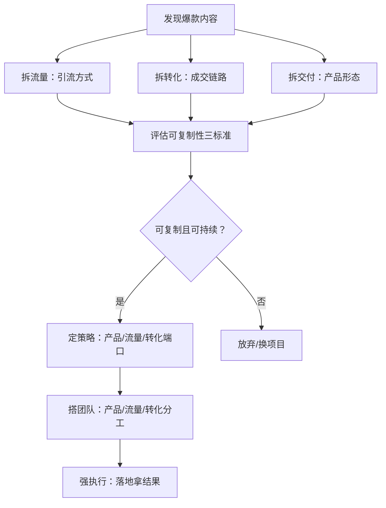
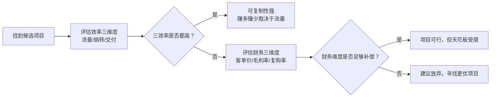
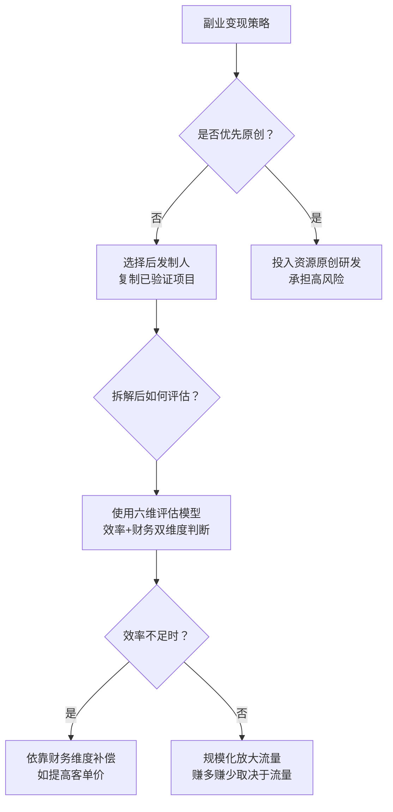

**

# 第 4 章 副业变现的底层逻辑：从“看到”到“复制变现”

## 学习目标

- 理解信息差思维的核心逻辑：从“自己发明”到“发现并复制已验证的商业模式”
- 掌握商业项目拆解的八步法，能将一个“赚钱的别人”拆解为流量、转化、交付三大可复制的模块
- 熟练运用六维评估模型（流量效率、销转效率、交付效率、客单价、毛利率、复购率）为项目“称重”，判断其可复制性与收入天花板
- 能通过案例对比，直观理解“客单价跃升”如何改变项目的量级与商业天花板
- 能根据自己的资源禀赋，将六维模型应用于评估自身的副业构想，并识别其短板与补偿策略

## 4.1 生活类比

想象你是一个美食城的档口老板，想开一家新店。大多数人的第一反应是走进厨房，关起门来研发一道从未有人吃过的“暗黑料理”。这种“产品思维”看似充满雄心，实则风险极高——你需要投入大量成本反复试错，却完全不知道最终有没有人愿意买单。如果你是这样思考副业的，那么你很可能会在耗尽资金和热情后被市场无情淘汰。

然而，聪明的档口老板从不这样“自嗨”。他会在做出任何投资决策之前，先走出自己的厨房，在美食城里转一圈，仔细观察哪家档口排队长、回头客多、网上的评价好。这些档口的招牌菜已经经过了市场的残酷检验，证明了顾客会为它们买单。他接下来要做的，不是自己发明一道菜，而是去复制那道已经被验证过的招牌菜，或者把A城火爆的小吃搬到还没有人卖的B城。这就是我们本章要讲的“信息差思维”——通过发现并复制已被验证的商业模式，而不是闭门造车。

更进一步，这位聪明的老板不会只满足于“照抄”，他还会去拆解那家火爆档口的经营逻辑：他的客流是从商场的主入口、外卖平台还是抖音短视频来的（**流量**）？他用什么菜单设计、促销话术或试吃活动让顾客最终下单（**转化**）？他的后厨是如何备菜、如何设计出餐流程，才使得上菜速度如此之快（**交付**）？最后，他会给这家档口“算一笔账”：出餐快不快（**交付效率**）、员工是否需要极高的厨艺（**销转效率**）、排队流量大不大（**流量效率**），以及每份卖多少钱（**客单价**）、赚多少（**毛利率**）、顾客会不会因为好吃而常来（**复购率**）。这里需要澄清的是，前一个“拆解经营逻辑”的动作，属于我们的“商业项目拆解”；而后一个“算一笔账”的动作，则对应我们即将学习的“六维评估模型”——两者是有先后顺序的两个步骤。当他把这张“账”算清后，就能精准判断这个项目是否可复制、天花板在哪、自己是否接得住。

这整个过程，就是“从看到到复制变现”的商业狩猎。就像聪明的档口老板“后发制人”——先复制别人验证过的爆款，再根据B城人的口味微调出自己的特色，而不是冒险发明无人问津的新菜。这正是本章要探讨的副业变现的底层逻辑。

为了让这套逻辑更清晰，我们先用一张树状图来勾勒本章的概念结构，它同时也是你学习本章的地图。

## 4.2 概念地图

```
副业变现的底层逻辑：从“看到”到“复制变现”
├── 认知起点
│   ├── 副业失败的根源
│   │   ├── 从零发明的产品思维（高成本、高风险） —— P001
│   │   └── 忽视已验证的商业模式
│   └── 信息差思维
│       ├── 发现并复制已验证项目 —— P001
│       ├── 后发制人原则（不盲目原创） —— P001, P002
│       └── 信息差客观存在（平台/人群不对称） —— P001
├── 核心方法：商业项目拆解
│   ├── 拆解对象
│   │   └── 爆款内容、已验证的盈利项目 —— P001
│   ├── 三大核心模块
│   │   ├── 流量获取
│   │   ├── 转化链路
│   │   └── 产品交付
│   ├── 拆解八步法 —— P001
│   │   ├── 找项目 → 拆流量 → 拆转化 → 拆交付
│   │   ├── 评估可复制/可持续 → 定策略 → 搭团队 → 强执行
│   └── 可复制性判定三标准
│       ├── 非偶然爆发
│       ├── 货源可寻
│       └── 消费场景验证有需求 —— P001
└── 评估框架：六维模型 —— P002
    ├── 效率维度（决定可复制性）
    │   ├── 流量效率（时间/素材/流量）
    │   ├── 销转效率（专业度/SOP/时间利用率）
    │   └── 交付效率（时间/人力）
    ├── 财务维度（决定收入天花板）
    │   ├── 客单价
    │   ├── 毛利率
    │   └── 复购率
    ├── 核心判定法则
    │   ├── 三效率高 → 可复制，赚多赚少取决于流量
    │   ├── 任一低 → 难以复制，需财务维度补偿
    │   └── 六个点满足越多越好，满足四个点及格 —— P002
    └── 应用：案例对比（称重）
        ├── 小说推文（三效率高，低客单价，天花板低） —— P002
        ├── 教育资料1.0/2.0（客单价跃升，天花板提升） —— P002
        ├── 减肥食谱（高流量规模驱动，高复购） —— P002
        ├── 项目拆解IP（低流量效率，高客单价补偿） —— P002
        └── 知识付费（高客单价+高毛利+高效率，天花板高） —— P002
```

## 4.3 副业失败的本质与信息差思维——从“自己造”到“抄作业”

几乎所有副业新手的第一个动作，都是打开脑海里的“发明家模式”：我要做一个独一无二的产品，我要解决一个别人没解决的问题。这种“产品思维”听起来颇具英雄气概，却隐藏着一个致命的陷阱——从零开始研发不仅投入巨大、周期漫长，而且失败率极高，绝大多数个人创业者根本不具备这样的资源和能力。与此同时，一个被忽视的事实是：大量已被验证的商业模式，就像美食城里的爆款档口一样，明晃晃地摆在你眼前。你之所以视而不见，是因为你被“原创”的执念遮蔽了双眼。而商业世界里，真正的机会恰恰在于发现并复制那些已经被市场验证过的“确定性”，而非去赌一个未知的“可能性”。

> “任何一个红海的赛道都不缺一个一年赚几十万的人，都不缺你一个一年赚几十万的人。”
> ——《I9OAdzzs2oBliNxsmPjcHnBUnzf.md》（素材 ID：P001，origin）

换句话说，即便是在竞争激烈的红海赛道，也从不缺一个年赚几十万的人，关键在于你是否能找到已被验证的“作业”并把它抄好。

> 信息差思维**定义**（素材 ID：P001，origin）
> “信息差思维”是一种区别于“产品思维”的副业认知模式。它主张成功副业的起点不是“从零发明一个好产品”，而是“发现并拆解一个被验证过的赚钱项目，然后复制或二次创作”。其核心逻辑是**后发制人**。（本章整理）
> ——来源：《I9OAdzzs2oBliNxsmPjcHnBUnzf.md》

这一思维模式的高级之处在于，它把副业的试错成本从“自己承担”转移给了“先行者”。当别人已经用真金白银验证了项目的可行性，你只需要做匹配性的微调，就能吃到同样的红利。这背后是 **“后发制人”原则**的支撑，该原则明确指出，做项目不追求原创，也不做赌博式的 All in，而是等待时机成熟再下场收割（素材 ID：P001，origin）。

> “有一个词叫做后发制人。就是你去做别人做过的事情，将其进行复制或者二次创作。”
> ——《I9OAdzzs2oBliNxsmPjcHnBUnzf.md》（素材 ID：P001，origin）

在“后发制人”原则的基础上，素材还提出了 **“信息差搬运论”** 。这一理论解释了为何“抄作业”如此可行：因为不同平台、不同人群之间存在天然的信息不对称，这为搬运和复制提供了广阔的空间（素材 ID：P001，origin）。

> “渠道其实是有信息差的，我们做过很多项目，其实吃的就是信息差，有些项目在抖音上做得很烂的，但是如果你搬到小红书上面，瞬间就爆了。”
> ——《I9OAdzzs2oBliNxsmPjcHnBUnzf.md》（素材 ID：P001，origin）

需要注意的是，“抄作业”不等于盲目 copy，它要求你拆解出项目的底层链路（流量来源、转化方式、交付形式），而非只模仿表面。同时，复制的前提是“已验证”——项目需有人做了好几个月并稳定盈利，纯偶然爆火的项目不具备复制基础。为了帮你建立直观感受，我们来看一张案例拆解表。**表 4-1 汇总了四个经过验证的复制案例及其变现结果。**这张表所展现的共同点并非“才华横溢的发明”，而是“精明的模仿与组合”——它们都是把别人已验证的商业模式“搬到”了更合适的位置，或者把已有的流量资源进行了二次变现。这正是信息差思维的力量。

**表 4-1 信息差思维下的四个典型复制案例**

| 案例 | 拆解要点 | 变现结果 |
|------|----------|----------|
| 儿童游乐项目 | 8.4w 赞、1.1w 转发、3000 条评论验证需求（素材 ID：P001） | 3 人团队、2 万加盟费，3 个月变现 40 万（素材 ID：P001） |
| 文川手写 logo | 评论区大量客资（“怎么找你设计 logo”）（素材 ID：P001） | 收 599 元设计费，付大学生 200-250 元，赚差价（素材 ID：P001） |
| 艺术签名账号 | 持续内容引发咨询，9.9 元/个（素材 ID：P001） | 日成交几十个客户（素材 ID：P001） |
| 抓娃娃卖娃娃+收徒 | 闲鱼卖娃娃 + 私域收徒 599 元/人（素材 ID：P001） | 年入约 100 万（素材 ID：P001） |

为了更直观地理解这种思维转变，我们可以将“产品思维”到“复制变现”的认知升级过程绘制成一张演进图。它清晰地展示了本章所倡导的思维路径：从闭门造车的“产品思维”出发，经历“信息差思维”的转变，最终通过“拆解”和“评估”完成“复制变现”的闭环。


## 4.4 商业项目拆解——把“赚钱的别人”拆成“可复制的零件”

看到别人赚钱很容易，但要“看透”别人为什么赚钱，却是一件需要方法论的事。很多人模仿了一个成功账号的视频、话术，结果发出去石沉大海——因为他们只模仿了“表皮”，没有触及到底层链路。商业项目拆解，就是这样一套把“赚钱的别人”拆成“可复制的零件”的系统化方法论。它通过系统化拆解爆款内容的流量获取、转化链路和产品交付方式，发现可复制的副业项目。

> 商业项目拆解**定义**（素材 ID：P001，origin）
> **商业项目拆解**是一种系统化的方法论，它将爆款内容或商业案例拆解为**流量获取、转化链路和产品交付**三个核心模块，并评估其可复制性与可持续性，据此复制出类似的副业项目。
> ——来源：《I9OAdzzs2oBliNxsmPjcHnBUnzf.md》

为了实现这一目标，素材原创者总结出了一套名为“商业拆解八步法”的核心工具（素材 ID：P001，origin）。以下为原创步骤，部分直接引用素材 P001（见上）。这个工具将看似模糊的“模仿”过程，转化为八个可执行的、逻辑严谨的步骤，打破了“看到别人赚钱→自己也去做”的模糊直觉。

> 商业拆解八步法（来源：《I9OAdzzs2oBliNxsmPjcHnBUnzf.md》，素材 ID：P001，origin）

**第一步：找项目。**这一阶段的核心任务是建立项目库（此点原文仅提及“建立项目库”[此为对原步骤的扩展说明，原文仅提及建立项目库]），通过喂养算法、搜索、数据监测等方式，系统性地收集潜在的商业案例。这个动作的关键在于“喂养算法”，即通过主动点赞、收藏、停留等行为，引导平台算法持续为你推送商业类内容，建立起自己的情报来源。

**第二步：拆流量。**拆解目标项目的引流方式，判断它是通过固定的内容分享方式引流，还是通过投放获客，以及市面上是否有其他可复用的引流渠道。你要搞清楚它的流量是来自公域的短视频，还是私域的社群裂变。

**第三步：拆转化。**拆解其流量转化为收入的具体链路，判断它是直接在直播间里卖货，还是将流量引流到私域后通过社群转化，亦或是通过朋友圈+私聊的深度运营。同时要关注其转化周期是多久，是冲动消费还是长期跟进。

**第四步：拆产品交付。**分析产品的具体形态，判断它是有形的货物还是无形的服务/课程，客单价处于什么水平，以及是否有同行已经稳定运营了半年以上。同行坚持的时间越长，越说明这个模式是可持续盈利的。

**第五步：评估可复制性和可持续性。**这是整个流程中的关键决策点。你需要判断复制该项目所需的资金和时间投入是否在自身可承受范围内。例如，如果一个项目需要投入五万、十万的启动资金，短期内就很难复制；同时，如果该赛道的同行没有坚持超过三个月，则说明项目缺乏可持续性——因为他没赚到钱才会放弃，如果他坚持了三个月以上，才说明他挣到钱了。

**第六步：定策略。**在确认项目可复制后，你需要根据自身情况制定具体的执行策略，明确产品、流量、转化三个端口分别要怎么做。是选择复制全部流程，还是结合自己的擅长点进行微创新。

**第七步：搭团队。**将具体任务进行拆解分工，判断完成项目需要产品端、流量端、转化端等环节，一个人是否能搞定，还是需要两三个人协作。你需要评估是否可以通过低成本兼职建立人力杠杆。

**第八步：强执行。**这是整个八步法的灵魂所在。如果没有强大的执行力去落地前面所有的分析和计划，那么前面的一切都是“自嗨”，毫无价值。

在完成了八步法的前四步后，你需要面临一个关键的评估环节：这个项目到底能不能复制？为此，素材作者提出了严苛的**可复制性判定三标准**（素材 ID：P001，origin）。这三条标准是评估项目的试金石，缺一不可，它帮助我们筛选出那些真正具备低成本复制价值的项目。

> 可复制性判定三标准（来源：《I9OAdzzs2oBliNxsmPjcHnBUnzf.md》，素材 ID：P001，origin）

第一，**非偶然爆发**。你需要判断这个视频或项目的爆火是否有其内在的流量逻辑，是可以被复制和再现的，而不是撞大运式的偶然。偶然的爆火不具备可复制性。第二，**货源可寻**。你需要确认项目的货源或供给不是独家垄断的，也就是说你可以通过其他渠道找到同样的货源。如果货源是独家的，你就无法获得同等条件，自然也就无法复制。第三，**消费场景验证有需求**。你需要判断该项目的消费场景是否被真实的市场需求所验证，且需求量不小。如果需求未被验证，你就是在赌一个不确定的市场。

> “首先，这个视频爆得偶然；其次，他货源不是他自己的，也就是说我可以通过别的方式找到他的货源；最后，这个消费场景经过验证是证明是有需求的，而且需求量还不小。”
> ——《I9OAdzzs2oBliNxsmPjcHnBUnzf.md》（素材 ID：P001，origin）

三条标准缺一不可。偶然爆火说明没有稳定的流量逻辑可复制；货源独家说明你拿不到同样的供给；需求未验证则说明你是在赌一个未证实的市场。只有当三条全部满足时，项目才具备低成本复制的条件。为了更直观地展示这套方法的运作逻辑，下图用数据流图呈现了从发现到落地的完整拆解过程。它展示了拆解过程如何从“发现爆款内容”出发，并行拆解流量、转化、交付三个模块，最终汇聚到“评估可复制性”这一关键闸口。



当然，在实际应用中还需要注意拆解的边界条件。首先，拆解的对象必须是已验证的、可持续盈利的项目，而不是偶然爆火的项目。其次，拆解出的模块需要结合自身优势进行“微创新”，而非生搬硬套。再次，评估可复制性时需考虑自身资金和时间限制——比如投入五万十万的项目，短期内就无法复制。最后，拆解的最终目的是“强执行”，缺少这一步，前面所有分析都是自嗨。

## 4.5 六维评估模型——给项目算一笔“复制账”

商业项目拆解解决了“如何复制”的问题，但面对五花八门的副业机会，我们还需要一把衡量“值不值得复制”的尺子。否则，仅凭直觉和感觉做判断，极易被表面的“赚钱故事”迷惑。你需要一把统一的“量尺”，把笼统的“这项目行不行”拆解为可量化、可比较的具体指标。这把尺子就是六维评估模型。

> 六维评估模型**定义**（素材 ID：P002，origin）
> **六维评估模型**将任何商业/副业项目拆解为六个可量化指标，并据此评估项目的可复制性和收入天花板。这六个维度分为两组：**效率维度**（决定可复制性）和**财务维度**（决定收入天花板）。
> ——来源：《NxhWdJj3UoPKvmxaBqkcz8wlntf.md》

这套评估模型与商业项目拆解法一脉相承，它将拆解出来的三大模块进一步量化。如果说“拆解八步法”是教你如何把项目“拆开”来看，那么“六维评估模型”就是为你提供一把“称重”的秤，让你能客观判断拆开后的零件是否值得组装。为了更精确地运用这把尺子，我们需要分别定义这六个维度。

> 效率维度**定义**（来源：《NxhWdJj3UoPKvmxaBqkcz8wlntf.md》，素材 ID：P002，origin）

**流量效率**衡量的是一个项目获取流量环节的投入产出比。具体以“时间、素材、流量”为指标：你花的时间越少、使用的素材难度越低、获得的流量越大，那么流量效率就越高。例如，你花五分钟发一条朋友圈，同时发了三个号，有一千个好友看到；而你花半小时拍一条口播视频，分两个机位发到两个号上，有五千个播放量。两者的流量效率是不同的，前者明显优于后者。

**销转效率**衡量的是从流量到成交的转化环节对时间和专业度的依赖程度。具体以“专业度”为指标：专业度要求越低（能够标准作业程序化，即SOP化），能一对多进行销售，那么销转效率就越高。其本质也是时间，即销售的时间利用率。基本上网销不需要高专业度，按SOP执行就好；而线下销售（面销、会销等）才需要极高的专业度。

**交付效率**衡量的是项目交付环节对时间与人力的消耗程度。具体以“时间”为指标：花的时间越少、人力越少，交付效率就越高。例如，资料、低价课这类产品，在你付款的那一刻，交付就已经完成了；而训练营、陪跑咨询这类产品，则需要你花时间精力去设计方案、流程并回答问题。

> 财务维度**定义**（来源：《NxhWdJj3UoPKvmxaBqkcz8wlntf.md》，素材 ID：P002，origin）

**客单价**衡量的是单次交易的平均金额，它直接决定了收入的天花板。在其他条件不变的情况下，客单价越高，项目能达到的收入上限就越高。

**毛利率**衡量的是收入中毛利所占的比例，它决定了单位收入的利润水平。毛利率越高，意味着每一块钱的收入中，能留下的利润越多，可用于投放获客的空间也越大。

**复购率**衡量的是用户重复购买的比例，它决定了用户的生命周期价值。复购率越高，意味着同一个用户可以被反复转化，其带来的总价值就越高。

> “流量效率高，意味着内容极其好复制，可以通过矩阵，培训等方式，把这一块单独拎出去，进行放大。”
> ——《NxhWdJj3UoPKvmxaBqkcz8wlntf.md》（素材 ID：P002，origin）

这个公式揭示了效率维度的核心意义：它决定了项目能否被复制放大。当一个项目的流量、销转、交付三效率都高时，意味着内容好复制、销售可SOP化、交付不占时间——那么“赚多赚少，取决于流量的多少”。相反，如果三个效率中有一个偏低，项目就很难被复制放大，这时就需要靠财务维度来补足。

> 三效率决定可复制性定理（本章在原文基础上提炼的表述，素材 ID：P002，origin）
> 流量效率、销转效率、交付效率三个效率维度共同决定项目能否被复制放大。其内在逻辑如下：第一，流量效率高，意味着内容极其好复制，可以通过矩阵、培训等方式，把流量获取这一块单独拎出去进行放大。第二，销转效率高，意味着销售可以SOP化，不需要极强的专业性，降低了执行门槛。第三，交付效率高，意味着交付不需要消耗太多时间和精力，同时意味着流量来了，你能接得住。当三者同时满足时，就意味着**赚多赚少，取决于流量的多少**，项目具备了极强的可复制性和增长潜力。然而，如果流量效率、销转效率、交付效率这三块中有一块偏低，那么项目就很难被复制放大。

为了将上述定理形式化，我们可以推导出一个关于“收入天花板”的量化表达式。一个项目的收入天花板主要由流量规模、转化能力、客单价和毛利结构共同决定，其核心关系可表示为：

**收入天花板 ≈ 流量 × 转化率 × 客单价 × 毛利率**

这个式子揭示了为什么“赚多赚少取决于流量”：当转化率、客单价和毛利率相对稳定时，决定收入上限的唯一可放大变量就是流量。这也解释了为何“三效率高”的项目（如小说推文）虽然天花板受限，却依然可以通过矩阵化运营放大流量来提升收入。因此，**提升收入的关键路径在于放大流量、提升转化率、提高客单价或优化毛利结构**——其中，放大流量是最具杠杆效应的选择。这个公式的价值在于，它将判断项目潜力的标准从模糊的感觉，转化为了可量化、可比较的精确分析。

> 六维满足度及格线定理（本章在原文基础上提炼的表述，素材 ID：P002，origin）
> 六个点满足得越多越好，满足四个点为及格线。这一定理为快速评估和筛选项目提供了便捷的决策参考。其背后的逻辑是：效率维度的不足可以通过财务维度来补偿，但补偿能力是有限的，因此当我们评估一个项目时，不能期待它在所有维度上都表现优异。这条及格线的经验性合理性在于，它平衡了“理想”与“现实”——很少有项目能六维全优，而四个点的满足通常意味着该项目至少在效率或财务某一方面具备显著优势，值得进一步尝试。

> “如果流量效率，销转效率，交付效率，这三块有一块低的话，就很难复制放大，那就得在客单价，毛利率，复购率这三块下功夫，比如通过提高客单价来增加收入。”
> ——《NxhWdJj3UoPKvmxaBqkcz8wlntf.md》（素材 ID：P002，origin）

这段论述展示了六维模型的运作逻辑：效率维度决定“能不能复制”，财务维度决定“靠什么赚钱”。当效率不足时，你仍然可以通过提高客单价、毛利率、复购率来维持收入——但要清醒地认识到，财务补偿机制是有上限的：当三个效率维度都极低时，仅靠提高客单价难以维系长期收入。

下表总结了六个维度的具体评估指标与高表现特征。

**表 4-2 六维评估模型指标明细表**

| 维度 | 类型 | 评估指标 | 高表现特征 |
|------|------|----------|------------|
| 流量效率 | 效率 | 时间、素材、流量 | 花的时间少、素材难度低、获得流量大 |
| 销转效率 | 效率 | 专业度 | 专业度要求低（能SOP）、能一对多 |
| 交付效率 | 效率 | 时间 | 花的时间少（人力少）、支付即完成交付 |
| 客单价 | 财务 | 单次交易金额 | 越高则收入天花板越高 |
| 毛利率 | 财务 | 收入中毛利占比 | 越高则单位收入利润越大 |
| 复购率 | 财务 | 用户重复购买比例 | 越高则用户生命周期价值越大 |

为了更好地应用六维模型，我们可以将其视为一个从“找到项目”到“落地决策”的评估流程。下图总结了这一思考路径，它帮助你在面对一个具体项目时，能够有条不紊地进行定性和定量分析，最终做出理性的决策。



用这张表去“称量”你手中的项目，可以快速定位它的优势与短板——这正是六维模型的价值所在。

## 4.6 案例对比与框架实操——用六维模型给项目“称重”

有了六维这把尺子，我们来看看它如何在实际项目中发挥作用。本节用五个真实项目做横向对比，让你直观感受六维模型如何区分项目的量级与天花板。我们不仅会看到单个项目的六维画像，更会通过对比揭示出“客单价跃升”、“补偿机制”等关键规律。以下案例中的月收益数据均为原作者的经验估算，横向比较时应关注结构与量级差异，而非绝对数值（素材 ID：P002，origin）。

> “你自己现在的项目或者将来想做的项目，都可以参考这六块去拆解。”
> ——《NxhWdJj3UoPKvmxaBqkcz8wlntf.md》（素材 ID：P002，origin）

**案例一：小说推文——三效率高但天花板低。**小说推文项目是一个典型的“三效率皆高但客单价低”的案例。它的流量效率高，因为内容素材获取简单且数量庞大，固定的模板框架自带流量；销转效率高，用户只需搜索对应的暗号充值会员，你就能获得佣金；交付效率高，因为无需交付实体或虚拟产品。然而，它的客单价仅为十几二十块，导致复购率几乎为零——低复购意味着用户生命周期短，难以通过重复购买提升收入总量，这共同锁死了它的收入天花板。因此，虽然月收益稳定在1000~2W，但收入天花板被牢牢锁死（素材 ID：P002，origin）。

> “小说推文项目：月收益1000~2W。流量效率高：内容素材获取简单，且素材大量，框架固定自带流量。销转效率高：搜索对应的暗号，充值会员就有佣金。交付效率高：无需交付。客单价低：十几二十块。毛利率高：50%以上。复购率低：没有复购。”
> ——《NxhWdJj3UoPKvmxaBqkcz8wlntf.md》（素材 ID：P002，origin）

这个案例告诉我们：即便三个效率维度都满分，低客单价仍然会牢牢锁住收入天花板。它验证了“三效率高则赚多赚少取决于流量”的定理——但这里的“赚多”也有上限。

**案例二：教育资料 1.0 → 2.0——客单价跃升改变量级。**教育资料项目的两代进化，是本章最值得反复品味的案例。1.0 版本卖考研、高考资料，客单价低（十几块到小几十块）、毛利率高（50~100%）、复购率低，月收益 1000~2W。2.0 版本增加了一步“高客单价合作转化”，客单价跃升至数千到十几二十万，月收益提升至 2W~100W——但毛利率骤降至 10%（素材 ID：P002，origin）。

> “教育资料1.0项目：月收益1000-~2W。客单价低：十几块~小几十块，毛利率高：50~100%，复购率低：基本没有复购。教育资料2.0项目：月收益2W~100W。客单价低：几千到十几二十万不等，毛利率高：10%，复购率低：基本没有复购。”
> ——《NxhWdJj3UoPKvmxaBqkcz8wlntf.md》（素材 ID：P002，origin）

这个对比揭示了一个关键规律：**客单价跃升**——通过模式升级（从“卖资料”到“卖合作/转化”），可以显著放大项目的收入天花板。但同时要注意，客单价提升往往伴随毛利率下降（2.0 毛利率仅 10%），需要更大的流水才能支撑同等利润。这是一笔需要精算的账。

**案例三：减肥食谱——高流量规模驱动。**减肥食谱项目展现了另一种收入增高路径：依靠流量规模。它的特征是流量效率高（小红书/抖音发食谱）、销转效率高（网销按SOP发）、交付效率低~高（产品无需交付，训练营需专人陪跑）、复购率高（减肥是重复的过程）。月收益 10W~200W（素材 ID：P002，origin）。

> “复购率高：减肥是个重复的过程。”
> ——《NxhWdJj3UoPKvmxaBqkcz8wlntf.md》（素材 ID：P002，origin）

这里的关键变量是复购率。减肥这件事天然具有重复性——减了又胖、胖了再减，这使得同一批用户可以被反复转化。高复购率让它的月收益上限（200W）显著高于小说推文（2W）。

**案例四：项目拆解 IP——以高客单价补偿低效率。**项目拆解商业 IP（如小徐）则是一个“效率低、财务补”的典型。它的流量效率低（项目拆解需要时间及好的信息源，难以批量产出）、销转效率高（网销按SOP发）、交付效率低（社群、陪跑、合作都需要时间和专业知识）。但客单价高（几千到六位数）、毛利率高（70%以上），月收益 10W~200W（素材 ID：P002，origin）。

> “流量效率低：项目拆解需要时间，以及好的信息源，所以很难批量产出。客单价高：从几千到六位数。毛利率高：70%以上。”
> ——《NxhWdJj3UoPKvmxaBqkcz8wlntf.md》（素材 ID：P002，origin）

这个案例完美演示了六维模型的补偿机制：当效率维度偏低时，通过高客单价 + 高毛利率来弥补，依然可以达到可观的收入水平。但它的可复制性也因此受限——你很难把“需要深度思考的项目拆解”矩阵化、培训化。

**案例五：知识付费——六维中的“五边形战士”。**知识付费（以李一舟为代表）是六维模型的“优等生”：流量效率高（口播即可）、销转效率高（直播间挂小黄车）、交付效率高（课卖掉即交付完）、客单价高（小几千）、毛利率为 100%。月收益 10W~500W（素材 ID：P002，origin）。

> “知识付费，以李一舟为代表：月收益10W~500W。流量效率高：内容门槛不高，口播就完事。销转效率高：直播间挂小黄车。交付效率高：课卖掉那一刻，就交付完了。客单价高：小几千。毛利率高：100%。复购率低：没有复购。”
> ——《NxhWdJj3UoPKvmxaBqkcz8wlntf.md》（素材 ID：P002，origin）

五个维度满足，仅有复购率低——这解释了为什么它的收入天花板（500W）远高于其他案例。毛利率 100% 意味着每一分收入都是利润，这为投放获客留下了巨大的空间。

**多源对照与共识。**综合以上五个案例，我们可以得出一个共识：**收入量级的差异，主要由客单价和毛利率的乘积决定**。当一个项目同时具备高效率和高客单价时（如知识付费），它的收入天花板就会显著拉高。这套分析框架内部是自洽的，因为所有案例都来自同一素材源（P002），结论具有内部一致性——三效率决定可复制性、财务维度决定天花板、客单价跃升改变量级。

**多源对照与互补。**当我们把视角拉回更广阔的素材库时，也能看到不同素材侧重角度的差异。对比素材 P001（《I9OAdzzs2oBliNxsmPjcHnBUnzf.md》，origin）中强调的“渠道信息差”和“后发制人”，素材 P002（《NxhWdJj3UoPKvmxaBqkcz8wlntf.md》，origin）则用可量化的六维指标来评估项目。这两者并不矛盾，而是互补的：P001 偏重“发现机会”的视角（去哪里找项目），P002 偏重“评估项目”的视角（如何判断项目好坏，此为作者的解读）——它们其实是同一枚硬币的两面。信息差思维为你找到了“抄作业”的对象，而六维模型则帮你判断这份“作业”是否值得抄、天花板有多高。

下面是五类项目的六维模型汇总表，帮助你快速对比。

**表 4-3 五个副业项目六维模型汇总表（数值与判断来源：P002）**

| 项目 | 流量效率 | 销转效率 | 交付效率 | 客单价 | 毛利率 | 复购率 | 月收益 |
|------|----------|----------|----------|--------|--------|--------|--------|
| 小说推文 | 高 | 高 | 高 | 低（十几二十） | 高（50%+） | 低 | 1000\~2W |
| 教育资料1.0 | 高 | 高 | 高 | 低（几十） | 高（50-100%） | 低 | 1000\~2W |
| 教育资料2.0 | 高 | 高 | 高 | **高（数千-数十万）** | **低（10%）** | 低 | **2W\~100W** |
| 减肥食谱 | 高 | 高 | 低~高 | 低~高 | 高 | **高** | 10W\~200W |
| 项目拆解IP | **低** | 高 | **低** | **高（数千-六位数）** | 高（70%+） | 低~高 | 10W\~200W |
| 知识付费 | 高 | 高 | 高 | 高（小几千） | 高（100%） | 低 | 10W\~500W |

这张表让你可以一眼看出：**收入量级的差异，主要由客单价和毛利率的乘积决定**。当一个项目同时具备高效率和高客单价时（如知识付费），它的收入天花板就会显著拉高。表格中粗体标出的维度，正是那些决定了项目量级的关键变量。例如，教育资料2.0之所以天花板比1.0高，是因为客单价的跃升；项目拆解IP之所以能有高收入，是因为高客单价和高毛利率补偿了低效率。

## 4.7 设计中的取舍

在构建这套副业变现方法论时，我们在多个维度上进行了权衡取舍，以确保框架既有普适性，又能点明关键变量。下图概括了这些核心设计取舍的决策逻辑，供你整体回顾。



**1. 为什么不用“产品思维”从零发明，而是“后发制人”？**想象两种路径的投入产出比。从零发明需要承担产品研发、市场验证、用户教育的全部成本和风险——绝大多数个人不具备这个条件。而后发制人只需要等别人验证可行后再复制，试错成本几乎降为零。但它的代价是什么？你永远是“第二个人”，吃的是被验证过的市场，很难吃到“第一个人”的垄断红利。因此“后发制人”并不适用于所有场景——当你拥有差异化的资源和能力时，适度原创仍然值得尝试。

这个权衡取舍告诉我们，**选择“抄作业”并非因为原创不好，而是因为对于资源有限的个人而言，模仿是通往成功的最高效路径。**

**2. 为什么优先做自然流量的拆解而非付费投流？**在副业初期，资金是稀缺资源。付费投流虽然能快速验证项目，但需要现金流作为支撑，且对投放素材的优化能力要求极高。相比之下，通过拆解已验证项目来获取自然流量，几乎零成本，虽然见效慢，但可积累经验且风险极低。因此“先自然流量、后付费投流”是更符合个人副业起步逻辑的稳健路径。

这个权衡取舍体现了**资金与时间的置换**——用更多的时间投入换取更低的资金门槛和更小的试错成本。

**3. 六维模型补偿机制的上限在哪里？**当效率维度偏低时，提高客单价确实可以补偿收入，但这个补偿有边界。以项目拆解 IP 为例，它的高客单价（数千到六位数）依赖于极高的专业交付能力，而这种能力本身就是稀缺资源，无法无限复制。当三个效率维度都极低时，仅靠提高客单价难以维系长期收入——因为流量基数太小，高客单价能触达的用户也就那么几个。这就是为什么“满足四个点及格”会被作为经验性的判断基准。

这个权衡取舍揭示了**效率与财务维度之间的张力**——补偿机制虽有效，但天花板明显，它提醒我们在评估项目时要认清其结构性短板，而非盲目乐观。

**4. 为什么是六维而非五维？**设计上的考量在于，六个维度恰好能覆盖一个商业项目从获客到盈利的全链路。缺少任何一个维度都会导致评估失真。例如，若只考虑五维（不包含复购率），就无法解释为什么减肥食谱项目的高复购率能带来显著高于小说推文的收入；若只考虑五维（不包含毛利率），就无法解释为什么知识付费项目的天花板远高于同样高效率的零售项目。因此，六个维度是对“能不能复制”和“天花板多高”这两个核心问题的完整回答。

这个权衡取舍确保了**评估框架的完整性**——六个维度缺一不可，共同构成了对项目价值的全链路判断。

**5. 为什么“客单价跃升”会伴随毛利率下降？**教育资料从 1.0 到 2.0 的跃升中，客单价提升了近千倍，但毛利率从 50-100% 骤降至 10%。原因在于：高客单价的合作转化往往需要引入更多外部资源（渠道分成、人工服务、平台费用），这些都会侵蚀毛利。所以客单价跃升并不必然等于利润跃升——你需要同步计算毛利率的变化，才能判断这个跃升是否真正有利可图。

这个权衡取舍明确了**规模与利润的博弈**——追求高客单价时，必须警惕毛利率的下滑，确保单位经济模型依然健康。

## 4.8 动手练习

1. **用六维模型给项目“称重”**

   根据本章所学内容，用六维模型（流量效率、销转效率、交付效率、客单价、毛利率、复购率）为以下三个项目逐项标注“高/中/低”，并给出你的判断理由：
   1. 直播带货（达人自播模式）
   2. 线下美容院（高客单服务）
   3. 知识付费课程（如PPT教程）

   回答问题：
   - 这三个项目中，哪个最容易通过“矩阵+培训”进行复制放大？为什么？
   - 哪个项目的收入天花板最高？请结合六维评估模型中的客单价/毛利率/复购率三个财务指标进行定性判断，并给出你的解释。
   - 如果上述某个项目的“流量效率”很低，你会建议通过什么方式来补偿？

2. **商业项目拆解实战：拆解一个“赚钱的别人”**

   请你在抖音或小红书上，找到一条你认为“能赚钱”的爆款商业视频或账号（例如：卖手工饰品、教宠物训练、接定制设计等）。

   按照“商业拆解八步法”的前五步，对该项目进行拆解分析：
   1. 找项目：这个项目的商业模式是什么？（卖货？卖课？卖服务？）
   2. 拆流量：它是通过什么方式引流？内容形式是否固定可持续？有没有其他引流渠道？
   3. 拆转化：它是如何把流量转化为收入的？（直播间直接卖？私域社群？私聊？）
   4. 拆产品交付：产品是有形还是无形？交付过程是怎样的？客单价大约多少？
   5. 评估可复制性与可持续性：用“三标准”判断（非偶然爆发、货源可寻、需求验证），并评估其可持续性（是否有人坚持做了半年以上）。

   最后，基于你的拆解结果，判断这个项目是否值得复制，并说明理由。

3. **“抄作业” vs “自嗨”：一次模式选择分析**

   假设你是一位刚入行的副业新手，手里有2万元的启动资金，面临两个选择：

   **方案A（自嗨式）**：自己研发一款“智能提醒喝水”的手机App，预计开发周期4个月，投入2万元外包开发，你相信市场会很需要它。

   **方案B（抄作业式）**：发现一个在抖音上已经稳定运营半年、通过“减肥食谱”进行私域变现的账号，其模式清晰（发食谱→私域→卖训练营），且目前在小红书上还没有同类型账号。你只需要投入少量时间复制内容并微调，即可启动。

   请运用本章学到的“信息差思维”、“商业项目拆解”和“六维模型”，回答以下问题：
   - 从投入产出比和风险角度，分析为什么方案B通常优于方案A？
   - 用六维模型分别对方案A（假设成功开发后）和方案B进行初步评估，并对比两者的“可复制性”和“收入天花板”。
   - 在方案B的执行过程中，如果要启动“拆解八步法”中的第6-8步（定策略、搭团队、强执行），你会如何规划？

## 4.9 本章小结

这一章中我们学习了副业变现的底层逻辑——从“看到”到“复制变现”的完整认知框架。首先，我们剖析了多数副业失败的根源：从零发明的“产品思维”投入巨大、失败率极高，而真正聪明的做法是切换到“信息差思维”，去发现并复制已被验证的商业模式，核心是“后发制人”原则。其次，我们掌握了商业项目拆解的系统方法：通过八步法把“赚钱的别人”拆解为流量、转化、交付三大可复制的模块，并用“非偶然爆发、货源可寻、需求验证”三标准判定可复制性。接着，我们引入了六维评估模型作为项目的“称重尺”：效率维度（流量/销转/交付）决定可复制性，财务维度（客单价/毛利率/复购率）决定收入天花板。然后，我们通过小说推文、教育资料 1.0/2.0、减肥食谱、项目拆解 IP、知识付费五个真实案例的横向对比，直观理解了“客单价跃升”如何改变项目的量级与商业天花板。最后，我们探讨了设计中的取舍——后发制人的代价、补偿机制的上限、客单价与毛利率的此消彼长。

本章我们一起学习了以下概念：

| 概念 | 解释 |
|------|------|
| 信息差思维 | 副业成功的起点不是从零发明，而是发现并复制已被验证的商业模式，核心是“后发制人” |
| 后发制人原则 | 不追求原创，等别人验证可行后再复制或二次创作，极大降低试错成本 |
| 商业项目拆解 | 将“赚钱的别人”系统性拆解为流量获取、转化链路、产品交付三大可复制模块的方法论 |
| 拆解八步法 | 从找项目、拆流量/转化/交付、评估可复制性，到定策略、搭团队、强执行的完整落地链路 |
| 可复制性判定三标准 | 项目能否复制的三条标准：非偶然爆发、货源他人可寻、消费场景验证有需求 |
| 六维评估模型 | 衡量项目的六个指标：流量效率、销转效率、交付效率、客单价、毛利率、复购率 |
| 三效率与可复制性 | 流量/销转/交付三效率共同决定项目能否被复制放大；三效率高则赚多赚少取决于流量 |
| 财务维度补偿机制 | 当效率维度偏低时，可通过提高客单价、毛利率、复购率来维持或提升收入 |
| 六维满足度及格线 | 六个点满足越多越好，满足四个点为及格线，用于快速评估项目优劣 |
| 客单价跃升 | 通过模式升级（如教育资料1.0→2.0）大幅提升客单价，可显著放大项目的收入天花板 |

**关于素材来源的说明**：本章核心方法论与案例素材主要来源于两份内部复盘文档，为便于追溯，在此统一标注其文件路径：素材 P001 对应 `docs/202301-02/I9OAdzzs2oBliNxsmPjcHnBUnzf.md`（origin，核心来源），素材 P002 对应 `docs/202301-02/NxhWdJj3UoPKvmxaBqkcz8wlntf.md`（origin，核心来源；P002 在 4.3 节中作为应用参考，角色为 apply）。本章正文中所有标注了“素材 ID”的摘录均直接引自上述文件。

恭喜你完成了本章的学习。你已经掌握了从“看到别人赚钱”到“拆解其模式”再到“复制变现”的完整方法论。下一章，我们将在此基础上，探讨如何利用手中的资源与杠杆，将这套方法论真正放大，实现从“复制”到“规模化”的跃迁，敬请期待。

