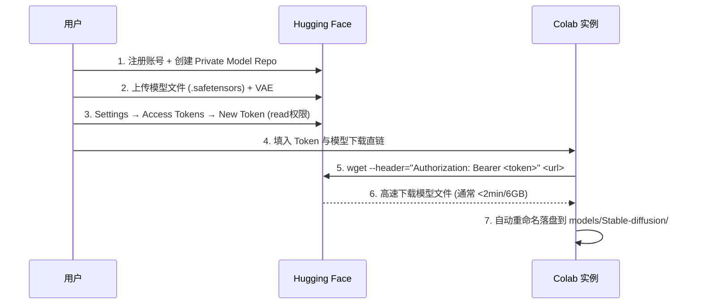

# 第 20 章 算力平权 —— 让每个人的电脑都能跑AI绘画

## 学习目标

- 理解 Google Colab 免费云 GPU 环境的资源配额与非持久化特性
- 掌握 Stable Diffusion WebUI 在云端的零基础搭建、启动参数配置与公网访问方法
- 熟练运用四种模型分发方案（Gdrive、gdown、HF 私有仓库、泛化云存储）解决大文件入驻云端难题
- 掌握结构化 Prompt 咒语（正向 Tag、负向 Tag、权重语法）与关键采样参数的组合调优
- 建立“模型决定画风、咒语调控表型”的正确心智模型，能按需选择/融合 Checkpoint 与 LoRA
- 制定免费额度生存策略：多账号轮换、存储分离、启动加速，并评估向付费云 GPU 迁移的临界点

## 20.1 生活类比

想象你想画一幅油画，但家里没画室、没画架、没颜料（本地无 GPU）：**Google Colab** = 一家**免费共享画室**，提供画架（GPU）、画布（内存）、颜料柜（硬盘），但每天只开放几小时，且下班清场（非持久化）。**Stable Diffusion WebUI** = 画室里的**智能调色机器人**，你不用自己研磨颜料（写命令行），直接在面板上拨钮选色（可视化参数），它帮你把画画出来。**模型文件** = **不同流派的颜料配方包**（二次元水彩包、写实油画包、赛博朋克丙烯包），体积大（几 GB），必须先搬进画室的指定货架（models/Stable-diffusion 目录）机器人才能调用。**模型分发四法** = 四种**搬运配方包的物流渠道**：自家仓库搬（Gdrive）、朋友快递寄（gdown）、官方私有仓库代发（HF+Token）、任意物流直达（泛化云存储）。**Prompt 咒语** = 你给机器人的**结构化订单单**：“用大师级水彩纸（masterpiece）、画海边少女（sea beach, girl）、逆光凌厉（chiaroscuro）、别画坏手（bad hands:1.1）”、单子写得越精准，成品越像你想要的样子。**免费额度生存法则** = **画室会员卡玩法**：办几张卡轮换（多账号）、把常用配方包存在外面仓库随时取（存储分离）、把调色机器人预设好下次直用（启动加速）……玩得太狠（>100h/月）干脆租专业画室（付费云 GPU）更划算。

> **贯穿提示**：后续各节将反复呼应“画室/机器人/配方包/物流/订单/会员卡”这套隐喻，帮你把技术细节挂到直观场景上。

## 20.2 概念地图

AI绘画零门槛入门（Colab + SD WebUI）
├── 算力载体：Google Colab
│   ├── 免费 GPU 配额（~15G VRAM, ~55G Disk, 数小时/天） —— P001
│   ├── 非持久化运行时（断连即清空） —— P001
│   └── 硬件加速器切换与连接管理 —— P001
├── 交互界面：Stable Diffusion WebUI (A1111)
│   ├── Gradio 可视化封装（txt2img/img2img/Extras...） —— P002
│   ├── 插件生态（ControlNet/ADetailer/xFormers） —— P002
│   └── 启动参数注入（--share/--gradio-auth/--deepdanbooru） —— P002
├── 资产物流：模型分发四法
│   ├── Gdrive 挂载拷贝（私有持久、15G 上限） —— P003
│   ├── gdown 分享链接（小圈子、易限流） —— P003
│   ├── HF 私有仓库 + Token（隐私、大空间、高速、推荐） —— P003
│   └── 泛化云存储直链（S3/Mega/R2/OSS 通用） —— P003
├── 核心控制：Prompt 咒语工程
│   ├── 正向 Tag（画质/主体/环境/风格、权重语法、顺序敏感） —— P004
│   ├── 负向 Tag（通用质量否定、Embedding 强化） —— P004
│   └── 采样参数套装（Sampler/Steps/CFG/Size/Hires.Fix） —— P004
├── 风格基因：模型即画风
│   ├── 动漫系（NAI/WAIFU，Tag 敏感、赛璐珞/厚涂） —— P005
│   ├── 写实系（SD1.5/Realistic，自然语言友好、摄影感） —— P005
│   ├── VAE 解码影响色彩与细节 —— P005
│   └── LoRA 低秩微调注入特定风格/角色 —— P005
└── 生存策略：免费额度最大化
    ├── 多账号轮换（防风控、手动少量） —— P006
    ├── 存储分离（Gdrive/HF/实例盘分层） —— P006
    ├── 启动加速（预装 Notebook/Docker/缓存） —— P006
    └── 成本临界点（>100h/月 建议付费云 GPU） —— P006

> **素材标注说明**：文中 `P001`、`P002` 等标记对应细纲 `units` 中的素材摘录编号，方便你回溯原文。

---

## 20.3 Google Colab —— 让每个人的浏览器都拥有“云端显卡”

### 方法演进图：从本地显卡到云端算力的迁移路径

```mermaid
graph LR
    A[本地物理 GPU<br/>(购买/维护/配置)] --> B[Colab 免费版<br/>(零成本/非持久/配额限制)]
    B --> C[Colab Pro/Pro+<br/>(付费/后台运行/更大显存/更长时长)]
    C --> D[付费云 GPU 平台<br/>(RunPod/Vast.ai/Autodl<br/>按秒计费/持久化/可选规格)]
    D --> E[本地高端显卡<br/>(3090/4090/A100<br/>一次性投入/完全自主/隐私合规)]
```

**演进逻辑**：零成本体验（Colab 免费）→ 低成本稳定（Colab Pro+）→ 弹性商用（付费云 GPU）→ 资产化自主（本地硬件）。每阶段解决上一阶段的核心痛点：持久化、显存、时长、合规。

### 为什么需要这个概念？

AI绘画模型（如Stable Diffusion）推理需要强大GPU算力，普通个人电脑往往无N卡/A卡或显存不足，导致无法本地运行。搭建本地服务器成本高、门槛高，且环境配置繁琐，劝退大量非技术背景用户。我们需要一个零成本、免配置、开箱即用的云端算力平台，降低AI绘画的体验门槛。

### 核心定义

Google Colaboratory (Colab) 是 Google 提供的免费云端 Jupyter Notebook 环境，内置免费 GPU（约 12G 内存、15G 显存、55G 硬盘），可在浏览器中远程执行 Python 代码。本质上，它是一台“远程电脑/云服务器”，用户无需本地部署，即可借用云端算力完成模型训练与推理。

> "colab是google提供的一个云平台，可以理解为一台远程电脑或者云服务器，用户远程连接进去后，可以用其提供的CPU、GPU资源做各种各样的事情。"
> 
> "Google colab提供了免费与收费服务，免费服务每个账号大概每天可以玩几个小时，免费的配置大概是12G的内存，15G左右的显存以及55G左右的硬盘。"
> 
> —— P001《Google Colab 在线免费玩转 AI 绘画教程》

### 关键性质

免费额度有限：每个账号每天仅可使用数小时，用完需断开并删除运行时释放资源。环境非持久化：运行时断开或超时后，内存、文件系统（除挂载的 Gdrive）重置，需重新搭建环境。硬件规格固定：免费版通常分配 T4/K80 等入门级 GPU，显存约 15G，限制大模型加载。

### 典型例子

零基础用户申请 Google 账号 → 打开共享 Colab 脚本 → 修改硬件加速器为 GPU → 连接运行时 → 依次执行挂载 Gdrive、克隆 WebUI 仓库、安装依赖三条命令 → 获得可用的 Stable Diffusion WebUI 界面。这个过程就像拿着会员卡走进免费画室，领到画架颜料，开始创作。

### 边界条件

免费额度不稳定，高峰期可能无法分配 GPU，或提前断连。严禁用于挖矿、长时间挂机等违反服务条款行为，封号风险高。大模型（>10GB）或多模型并存易撑爆 55G 磁盘/15G 显存，导致 OOM 或磁盘写满崩溃。

---

### 20.3.1 硬件加速器切换与连接管理

要在 Colab 中启用 GPU，必须手动切换运行时类型。这一步相当于在画室里申请领取一台画架（GPU），如果不申请，系统默认只给 CPU（画板），跑不动大模型。

> "选择左上角Edit(修改)->Notebook settings (笔记本设置)->Hardware accelerator（硬件加速器）->GPU"
> 
> "选择右上角connect（连接）->就会分配云服务器资源。"
> 
> —— P001《Google Colab 在线免费玩转 AI 绘画教程》

操作步骤如下：打开 Colab Notebook 后，点击菜单栏的“修改”，选择“笔记本设置”，在“硬件加速器”下拉框中选择 GPU，点击保存。随后点击右上角的“连接”按钮，等待系统分配云端资源，界面显示内存、显存、磁盘用量即代表连接成功，画架已到位。

这个过程展示了如何将抽象的“云端算力”显性化为可用的计算资源。每次新建 Notebook 都要重复此步骤，因为免费环境不保存硬件选择偏好。

---

### 20.3.2 非持久化运行时的释放机制

Colab 免费资源的核心约束是“用完即走”。画室下班清场，画架颜料全收走，下次来要重新领。

> "选择右上角connect（连接）->disconnect and delete runtime（断开连接并删除运行时）"
> 
> "注意：该操作会将搭建好的环境全部删除清空"
> 
> —— P001《Google Colab 在线免费玩转 AI 绘画教程》

这个机制意味着：每次会话结束必须显式释放资源，否则会持续占用每日配额。同时也暗示了环境搭建是可重复、可脚本化的必要任务——下一次连接时，一切从头开始。因此我们将搭建过程固化为脚本，实现“开箱即用”。

---

## 20.4 Stable Diffusion WebUI —— 让命令行变成“可视化操作台”

### 方法演进图：从命令行到可视化界面的交互进化

```mermaid
graph LR
    A[原生命令行推理<br/>(python scripts/txt2img.py<br/>参数几十个/极易出错)] --> B[早期简易 GUI<br/>(streamlit/gradio 简陋封装<br/>功能单一/难扩展)]
    B --> C[AUTOMATIC1111 WebUI<br/>(Gradio 全功能封装<br/>txt2img/img2img/Extras<br/>插件生态/参数全暴露)]
    C --> D[WebUI + 插件矩阵<br/>(ControlNet/ADetailer/xFormers<br/>区域控制/人脸修复/显存优化)]
    D --> E[ComfyUI / SD.Next<br/>(节点式/流式/工程化<br/>生产级/可编程/高性能)]
```

**演进逻辑**：从“手写参数”到“表单填参”，再到“插件叠加能力”，最后走向“节点式编程与工程化部署”。每阶段降低交互门槛、提升功能上限。

### 为什么需要这个概念？

原生 Stable Diffusion 需通过命令行调用参数、编写推理脚本，对非程序员极不友好，使用门槛极高。缺乏直观的参数调节界面（如采样器、迭代步数、CFG Scale、高清修复等），难以进行精细化出图控制。我们需要一个图形化界面，将复杂的参数配置封装为可视化控件，实现“所见即所得”的交互体验。

### 核心定义

Stable Diffusion WebUI (通常指 AUTOMATIC1111 版本) 是基于 Gradio 构建的浏览器端可视化界面，封装了 txt2img、img2img、Extras、PNG Info、Model 训练等核心功能模块。它将底层的扩散模型推理流程、模型加载、提示词解析、采样器调度等技术细节隐藏，暴露业务参数给用户操作。这就像画室里的智能调色机器人，你只需在面板上拨钮选色，它帮你把画画出来。

> "基于用于stable diffusion开发的一套webui的界面，方便更多人的使用。没有这个的话，要使用stable diffusion的话只能写代码或者敲命令，大多数人使用会很困难，这也是现在AI绘画大火的一个很重要的原因。"
> 
> —— P002《Google Colab 在线免费玩转 AI 绘画教程》

### 关键性质

插件生态丰富：支持 ControlNet、ADetailer、xFormers 等扩展，功能可无限叠加。跨平台一致性：只要浏览器能访问 Colab 公网链接，即可获得与本地部署一致的操作体验。启动参数可控：通过 `COMMANDLINE_ARGS` 注入 `--share`（公网访问）、`--gradio-auth`（鉴权）、`--deepdanbooru`（反推提示词）等参数定制启动行为。

### 典型例子

用户在 Colab 执行 `!COMMANDLINE_ARGS="--deepdanbooru --share --gradio-auth user:pass" python launch.py`，几分钟内获得带鉴权的公网 WebUI 链接，手机端即可随时随地出图。这相当于把画室的大门开到互联网上，只要有链接和密码，随时随地都能指挥机器人作画。

### 边界条件

Gradio `--share` 生成的公网链接有效期通常 72 小时，且受 GFW 影响，国内直连不稳定，常需代理。WebUI 依赖特定 Python 环境与 PyTorch 版本，Colab 基础镜像更新可能导致依赖冲突，需定期维护启动脚本。显存管理不善（如未开启 `--medvram`/`--lowvram`）极易在免费 T4 显存上 OOM。

---

### 20.4.1 云端环境初始化与一键搭建（四步走核心操作）

素材提供了一套标准化的“三大命令”搭建流程，这是将 WebUI 部署到 Colab 的最小可行路径。下表梳理了每条命令的作用与原理，帮助你理解为什么可以这样变。

| 步骤 | 命令 | 作用 | 为什么可以这样变 |
|------|------|------|------------------|
| 1. 挂载 Gdrive | `drive.mount('/content/drive')` | 将 Google Drive 挂载到实例文件系统，读写持久化文件 | Colab 原生支持 Google Drive FUSE 挂载，授权后即可像本地目录一样访问云端硬盘 |
| 2. 克隆仓库 | `git clone ... && %cd ...` | 拉取最新 WebUI 源码并进入工作目录 | `%cd` 是 IPython 魔术命令，直接改变 Notebook 当前工作路径，后续相对路径命令生效 |
| 3. 安装依赖 | `COMMANDLINE_ARGS="--exit" python launch.py` | 触发 `launch.py` 的依赖检查与安装逻辑，`--exit` 使安装完成后直接退出，不启动服务 | `launch.py` 内部封装了 `pip install -r requirements.txt` 与模型下载逻辑，`--exit` 是作者提供的“仅安装不运行”开关 |

这个流程展示了从零到可用 WebUI 的最短路径。每一步都利用了平台原生能力或项目自带脚本，避免了手写 Dockerfile 或 conda 环境配置。

> "# 挂载Google Drive / from google.colab import drive / drive.mount('/content/drive')"
> 
> "# 下载stable diffusion webui最新代码 / !git clone https://github.com/AUTOMATIC1111/stable-diffusion-webui.git / %cd stable-diffusion-webui"
> 
> "# 安装stable diffusion webui工程所有依赖资源 / !COMMANDLINE_ARGS=\"--exit\" REQS_FILE=\"requirements.txt\" python launch.py"
> 
> —— P002《Google Colab 在线免费玩转 AI 绘画教程》

---

### 20.4.2 启动参数配置与公网访问

WebUI 启动时通过环境变量注入命令行参数，实现定制化能力。核心参数如下表所示，每一项都对应画室机器人的一个开关。

| 参数 | 作用 | 典型场景 |
|------|------|----------|
| `--share` | 生成公网 gradio.app 链接 | 远程访问、手机出图、分享给他人 |
| `--gradio-auth user:pass` | HTTP Basic Auth 保护 | 防止滥用、保护隐私 |
| `--deepdanbooru` | 启用图片反推 Tag 功能 | 看图猜咒语、学习优秀作品结构 |
| `--xformers` | 启用内存高效注意力，节省显存加速推理 | 免费 T4 15G 显存必开 |
| `--medvram/--lowvram` | 显存分片/卸载策略，适配小显存 GPU | 显存不足时的兜底方案 |
| `--ckpt filename` | 指定默认加载模型 | 避免启动后手动切换 |

> "命令行参数如下:"
> "  - `--share` - 创建一个在线的 gradio.app 链接"
> "  - `--deepdanbooru` - 用于安装deepdanbooru，方便使用图片获取prompt"
> "  - `--ckpt` - 用于选择加载默认模型"
> "!COMMANDLINE_ARGS=\"--deepdanbooru --share --gradio-debug --gradio-auth test:test\" REQS_FILE=\"requirements.txt\" python launch.py"
> 
> —— P002《Google Colab 在线免费玩转 AI 绘画教程》

**公式级总结**：

$$
\text{PublicAccess} = \text{Gradio Tunnel}(\text{Localhost:7860}) \xrightarrow{\text{--share}} \text{gradio.app/xxx}
$$

**公式逐步推导**：
1. WebUI 在 Colab 实例内部启动，监听本地 `localhost:7860` 端口。
2. 加上 `--share` 参数后，Gradio 客户端在后台启动一个反向隧道连接，连接到官方 `gradio.app` 中转服务器。
3. 中转服务器分配一个随机子域名（如 `xxx.gradio.app`），并将该域名的公网流量通过隧道转发到本地 `localhost:7860`。
4. 用户在浏览器访问 `https://xxx.gradio.app`，流量经隧道到达 Colab 实例内部的 WebUI，实现无需公网 IP 的外网访问。

**公式工程含义**：该公式揭示了 `--share` 的本质——Gradio 在本地启动一个反向隧道客户端，将本地 7860 端口映射到官方 `gradio.app` 域名下的随机子域名。**链接有效期约 72 小时**，且国内直连受限，生产环境建议配合 Cloudflare Tunnel 或 frp 自建隧道。[需要补充文献：Gradio `--share` 隧道技术原理文档]

---

## 20.5 模型分发四法 —— 解决“模型文件怎么进云端电脑”的物流难题

### 方法演进图：模型分发物流的技术迭代脉络

```mermaid
graph LR
    A[本地下载再上传<br/>(带宽慢/易断点)] --> B[Gdrive 挂载拷贝<br/>(原生生态/15G瓶颈)]
    B --> C[gdown 分享链接<br/>(单文件直达/易限流)]
    C --> D[HF 私有仓库 + Token<br/>(版控/高速/权限/无容量上限)]
    D --> E[泛化云存储直链<br/>(S3/Mega/R2/OSS<br/>企业级/合规/多云)]
```

**演进逻辑**：从“本地搬运”到“云原生注册中心”，核心驱动力是容量瓶颈突破、版本管理需求、隐私合规要求、团队协作规模。

### 为什么需要这个概念？

Stable Diffusion 依赖 Checkpoint 模型文件（通常 2-7GB），Colab 环境重置后模型丢失，每次重新下载极其耗时且消耗流量。官方模型托管于 Hugging Face，国内直连极慢或不通；民间微调模型（如 NovelAI 泄露版、ChilloutMix 等）分散于网盘、论坛，缺乏统一分发渠道。我们需要一套“获取-传输-落盘-加载”的标准化物流方案，支持不同来源、不同隐私级别的模型文件高效入驻云端环境。

### 核心定义

模型分发四法：
1. **Gdrive 挂载拷贝法**（私有、持久、空间小）
2. **gdown 分享链接下载法**（小圈子、易失效）
3. **Hugging Face 私有仓库 + Token 中转法**（隐私大、空间足、速度快、作者最推荐）
4. **任意云存储泛化下载法**（通用接口、扩展性强）

核心动作：将 `.ckpt` / `.safetensors` 文件精准拷贝至 `/content/stable-diffusion-webui/models/Stable-diffusion/` 目录，WebUI 重载即可识别。

> "colab环境类似一台拥有GPU资源的云服务器...，通过上述操作stable diffusion webui环境搭建，已经将sdwebui的环境安装到了该台电脑上，现在需要将模型文件也拷贝到该台电脑上，sdwebui才能加载模型，从而出图。"
> 
> —— P003《Google Colab 在线免费玩转 AI 绘画教程》

这个原则揭示了环境与模型分离的架构思想：WebUI 代码可重建，模型权重才是核心资产，必须落盘到固定路径才能被运行时加载。这就像配方包必须搬进画室指定货架，机器人才能调用。

---

### 20.5.1 方法一：Gdrive 挂载拷贝法（私有持久、15G 上限）

> "将模型文件放入自己的Gdrive（Google 云端硬盘），然后colab挂载Gdrive，将Gdrive的文件拷贝到Colab中。"
> 
> "这种方法的优点是模型文件因为是自己的云端硬盘文件，会确保不会丢失，缺点是免费的google账户硬盘空间只有15G，模型文件动辄4G、8G，所以存不了几个模型云端硬盘就会满了。"
> 
> —— P003《Google Colab 在线免费玩转 AI 绘画教程》

操作流程：首先在本地或云端将模型文件上传至 Google Drive 任意目录。然后在 Colab 执行 `drive.mount('/content/drive')` 授权挂载。最后执行拷贝命令：`!cp "/content/drive/MyDrive/models/xyz.safetensors" /content/stable-diffusion-webui/models/Stable-diffusion/`。

权衡分析：优点是文件永久保存，不随 Colab 实例销毁；利用 Google 原生生态，传输稳定。缺点是免费 15G 极小，仅能存 1-2 个大模型；`cp` 速度受限于 Colab↔Gdrive 带宽，大文件拷贝需数分钟。

适用场景：仅保留 1-2 个核心常用模型（如 ChilloutMix + 一个通用底模），作为“热模型”随时可用。这对应“自家仓库搬”，自家仓库虽近但空间小，只能放最常用的配方。

---

### 20.5.2 方法二：gdown 分享链接下载法（小圈子、易限流）

> "进入网络硬盘，找到想要分享的文件，点击共享->权限为知道链接的任何人->复制链接->下图分享链接红框选中的就是该文件的ID，填入到脚本中的输入框即可"
> 
> "model_name = '' #@param {type: 'string'} / !gdown {model_name} --output /content/stable-diffusion-webui/models/Stable-diffusion/model.ckpt"
> 
> —— P003《Google Colab 在线免费玩转 AI 绘画教程》

操作流程：在 Google Drive 文件右键选择分享，权限设为“知道链接的任何人”，复制链接。提取文件 ID（链接中 `id=` 后或 `/d/` 后的字符串）。Colab 执行：`!gdown <FILE_ID> -O /content/stable-diffusion-webui/models/Stable-diffusion/model.safetensors`。

权衡分析：优点是无需挂载全盘，直接下载单文件，节省 Gdrive 配额；适合小圈子临时分享模型。缺点是 Google 对分享链接有流量限制，访问量大（或被多人转发）极易触发“下载量过大”封禁，链接失效；依赖文件所有者维护分享状态，不可控。

适用场景：临时测试他人分享的模型、小规模私密传递，不作为主力分发渠道。这对应“朋友快递寄”，快递虽方便但有寄递量限制，寄多了快递员拒收。

---

### 20.5.3 方法三：Hugging Face 私有仓库 + Token 中转法（隐私、大空间、高速、推荐）

> "原因是有些model是泄露出的，并不是官方开源的，避免一些麻烦，所以你还没玩懂之前，选成私有的自己玩玩。"
> 
> "我个人比较推荐使用huggingface，简单易学，综合体验很好。"
> 
> "user_token = '' #@param {type: 'string'} / model_link = '' #@param {type: 'string'} / model_vae_link = '' #@param {type: 'string'}"
> "user_header = f\"\\\"Authorization: Bearer {user_token}\\\"\" / !wget --header={user_header} {model_link} -O /content/stable-diffusion-webui/models/Stable-diffusion/model.ckpt"
> 
> —— P003《Google Colab 在线免费玩转 AI 绘画教程》

操作流程完整版如下序列图所示：



关键命令详解：

```python
# Colab 单元格：参数化输入（点击运行后会弹出输入框）
user_token = '' #@param {type: 'string'}          # HF Read Token
model_link = '' #@param {type: 'string'}          # 模型文件下载直链 (Resolve URL)
model_vae_link = '' #@param {type: 'string'}      # VAE 文件下载直链

# 构造带鉴权的 Header：user_header 变量拼接成 "Authorization: Bearer <token>" 格式
user_header = f"\"Authorization: Bearer {user_token}\""

# 下载模型与 VAE，-O 指定输出路径与文件名，精准落盘到 WebUI 模型目录
!wget --header={user_header} {model_link} -O /content/stable-diffusion-webui/models/Stable-diffusion/model.safetensors
!wget --header={user_header} {model_vae_link} -O /content/stable-diffusion-webui/models/VAE/model.vae.pt
```

代码块解读：`user_header` 构造了 HTTP Authorization 头，实现私有仓库的身份认证；`wget --header` 将 Token 透传给 HF 服务器，绕过公开下载限制；`-O` 参数强制指定输出路径与文件名，避免 HF 默认文件名过长或含特殊字符导致加载失败；Colab 服务器位于海外数据中心，直连 HF CDN 下载速度极快（通常 6GB 模型 < 2 分钟），且不消耗本地带宽。[需要补充文献：Hugging Face 私有仓库 Token 权限最佳实践]

为什么这是“作者最推荐”的方案？下表从五个维度对比：

| 维度 | Gdrive | gdown | **HF 私有仓库** | 泛化云存储 |
|------|--------|-------|-----------------|------------|
| 空间 | 15G 免费 | 占用所有者空间 | **无限制 (单文件 10GB+ 需 LFS)** | 视供应商而定 |
| 隐私 | 私有 | 半公开 (链接即访问) | **私有仓库 + Token 可控** | 视配置而定 |
| 速度 | 中 (Colab↔Gdrive) | 低 (限流严重) | **极高 (HF CDN 全球加速)** | 视供应商而定 |
| 版本管理 | 无 | 无 | **Git LFS 原生支持** | 视供应商而定 |
| 合规性 | 个人文件 | 分享链接易泄露 | **私有仓库规避版权风险** | 需自行保证 |

这个方案展示了“云原生模型分发”的最佳实践：利用 HF 作为模型注册中心，Token 做细粒度访问控制，wget 做通用下载器，Colab 做临时计算节点——全流程无本地带宽参与，实现了“模型随人走、环境随建销”。这对应“官方私有仓库代发”，仓库大、发货快、还能保密。

---

### 20.5.4 方法四：泛化云存储直链法（S3/Mega/R2/OSS 通用）

> "如mega，AWS S3，google Cloud Storage...只要能拿到模型文件的外网访问地址，或者有提供API的云盘，理论上都可以，原理和从huggingface下载是一样的。"
> 
> —— P003《Google Colab 在线免费玩转 AI 绘画教程》

统一下载模板：

```bash
# 通用直链下载 (需公开读或带签名 URL)
!wget -O /content/stable-diffusion-webui/models/Stable-diffusion/model.safetensors "https://your-bucket.s3.region.amazonaws.com/model.safetensors?X-Amz-Signature=..."

# 或使用 rclone (支持 40+ 云存储)
!rclone copy remote:path/model.safetensors /content/stable-diffusion-webui/models/Stable-diffusion/ -P
```

适用场景：企业内部模型分发、已有对象存储桶的团队、需合规审计的商业化部署。这对应“任意物流直达”，只要有地址有接口，什么车都能拉。

---

### 20.5.5 多源对照：四种分发方案的共识与分歧

**共识**：
- 核心目标一致：将模型文件落盘到 WebUI 指定目录 (`models/Stable-diffusion/`)
- 都依赖 Colab 的外网下载能力（Colab 服务器在海外，访问 HF/S3/Gdrive 均极快）
- 都需要处理文件命名与版本管理（避免同名覆盖、便于回滚）

**分歧**：

| 维度 | Gdrive 拷贝 | gdown 分享 | **HF 私有仓库 (推荐)** | 泛化云存储 |
|------|-------------|------------|------------------------|------------|
| **持久性** | ✅ 高 (个人网盘) | ❌ 低 (链接易失效) | ✅ 高 (Git 仓库) | ✅ 高 (对象存储) |
| **容量** | ❌ 15G 瓶颈 | ⚠️ 看所有者配额 | ✅ 无上限 (LFS) | ✅ 可扩展 |
| **分发协作** | ❌ 仅个人 | ✅ 简单分享 | ✅ 团队协作/权限控制 | ✅ 企业级 IAM |
| **合规/隐私** | ✅ 个人可控 | ⚠️ 链接泄露风险 | ✅ 私有仓库隔离 | ✅ 可审计 |
| **国内可用性** | ❌ 需代理挂载 | ❌ 需代理 | ❌ 域名不稳定 | ✅ 选国内厂商 (OSS/COS) |

教训：没有银弹，工程实践中通常分层组合——热模型放 Gdrive 秒取，全量模型库放 HF 私有仓库，团队协作用内部 S3/OSS，临时测试用 gdown。

---

## 20.6 Prompt 咒语工程 —— 用“结构化咒语”驯服扩散模型

### 方法演进图：Prompt 从自然语言到结构化 Tag 的演进

```mermaid
graph LR
    A[自然语言 Prompt<br/>"画个海边的美少女"] --> B[Tag 堆砌式<br/>masterpiece, girl, beach...]
    B --> C[权重语法显性化<br/>(masterpiece:1.2), (bad hands:1.1)]
    C --> D[Embedding 负向强化<br/>EasyNegative, badhandv4]
    D --> E[动态 Prompt / 区域控制<br/>Regional Prompter / ControlNet]
```

**演进逻辑**：从“模糊指令”到“结构化标签”，再到“显性权重控制”，再到“Embedding 压缩知识”，最后走向“空间级精细控制”。每阶段解决上一阶段的“失控/不可复现/表达力不足”问题。

### 为什么需要这个概念？

扩散模型对自然语言理解不如大语言模型，直接输入“画个美女”往往生成崩坏、低质量图片。我们需要一套经过社区验证的、结构化的“标签式提示词”范式，显式指定画质、构图、光影、主体细节、风格流派、负面约束，稳定产出高质量图片。正向 Prompt 决定“生成什么”，负向 Prompt 决定“不生成什么/避免什么缺陷”，二者缺一不可。

### 核心定义

正向咒语：由画质标签 + 主体标签 + 环境/光影/风格标签 组成，权重语法如 `(tag:1.2)` 增强、`[tag:0.8]` 削弱，常用 Danbooru 风格标签（逗号分隔）。

负向咒语：固定套装 `lowres, bad anatomy, bad hands, text, watermark, blurry...` 等通用质量否定标签，配合 Embedding（如 `EasyNegative`）强化抑制伪影。

核心参数配套：Sampler (DPM++ 2M Karras)、Steps (20-30)、CFG Scale (7)、Size (512x512/768x768) + Hires. Fix 二次放大。

> "masterpiece,best quality,CG,wallpaper,HDR,{(sea beach)},{beautiful detailed water},{detailed light},((extremely delicate and beautiful girls)),((blue bubble)),splash,fluttered detailed splashs,{{intricate detail}},{highres},surrounded_by_floating_petal,chiaroscuro,swimming ring,splash,waves, coconut trees"
> 
> "Negative prompt: lowres, (bad anatomy, bad hands:1.1), text, error, missing fingers, extra digit, fewer digits, cropped, worst quality, low quality, normal quality, jpeg artifacts, signature, watermark, username, blurry, artist name, b&w, weird colors, (cartoon, 3d, bad art, poorly drawn, close up, blurry:1.5), (disfigured, deformed, extra limbs:1.5)"
> 
> —— P004《Google Colab 在线免费玩转 AI 绘画教程》

---

### 20.6.1 正向咒语结构拆解（以素材“海边少女”为例）

素材提供的万能咒语可拆解为四层语义结构：

```mermaid
graph TD
    A[正向咒语] --> B[画质基座<br/>masterpiece, best quality, CG, wallpaper, HDR, highres]
    A --> C[场景环境<br/>{(sea beach)}, {beautiful detailed water}, waves, coconut trees]
    A --> D[主体描述<br/>((extremely delicate and beautiful girls)), swimming ring]
    A --> E[光影风味<br/>{detailed light}, ((blue bubble)), splash, fluttered detailed splashs, {{intricate detail}}, surrounded_by_floating_petal, chiaroscuro]
```

正向咒语四层语义结构说明：上图展示了从通用画质保底到具体场景、主体、光影的层层递进，前部标签隐式权重更高，括号语法显性调控权重。

权重语法速查表（Danbooru/NovelAI 风格）：

| 语法 | 倍率 | 效果 | 示例 |
|------|------|------|------|
| `(tag)` | 1.1× | 轻度增强 | `(masterpiece)` |
| `(tag:1.3)` | 1.3× | 显性增强 | `(chiaroscuro:1.3)` |
| `((tag))` | 1.21× | 双层括号叠加 | `((best quality))` ≈ `best quality:1.21` |
| `{{tag}}` | 0.91× | 双层大括号削弱 | `{{highres}}` |
| `[tag]` | 0.9× | 轻度削弱 | `[watermark]` |
| `[tag:0.7]` | 0.7× | 显性削弱 | `[blurry:0.7]` |

顺序敏感性：CLIP 文本编码器对 Token 顺序敏感，前部权重隐式更高。实务中：画质标签最前置 (`masterpiece, best quality...`)，核心主体次之 (`girl, solo, blue hair...`)，场景/光影/风格最后 (`sea beach, chiaroscuro, ...`)。

---

### 20.6.2 负向咒语：通用质量否定套装

素材给出的负向咒语是社区长期验证的“万金油”配方：

> "Negative prompt: lowres, (bad anatomy, bad hands:1.1), text, error, missing fingers, extra digit, fewer digits, cropped, worst quality, low quality, normal quality, jpeg artifacts, signature, watermark, username, blurry, artist name, b&w, weird colors, (cartoon, 3d, bad art, poorly drawn, close up, blurry:1.5), (disfigured, deformed, extra limbs:1.5)"

语义分组：

| 分类 | 标签示例 | 作用 |
|------|----------|------|
| 分辨率/质量 | `lowres, worst quality, low quality, normal quality, jpeg artifacts` | 抑制低分辨率、压缩伪影、模糊 |
| 解剖/结构 | `(bad anatomy, bad hands:1.1), missing fingers, extra digit, fewer digits, (disfigured, deformed, extra limbs:1.5)` | 重点修复手部、肢体、人体结构崩坏 |
| 非期望内容 | `text, error, cropped, signature, watermark, username, artist name` | 去除文字、水印、裁剪、签名 |
| 色彩/风格 | `b&w, weird colors, (cartoon, 3d, bad art, poorly drawn, close up, blurry:1.5)` | 避免黑白、异色、3D/卡通渲染感、特写模糊 |

进阶技巧：使用 Embedding (Textual Inversion) 如 `EasyNegative`、`badhandv4`，单个 Token 即可替代上百个负向 Tag，效果更稳定、推理更快。[需要补充文献：Textual Inversion/Embedding 原理论文]

---

### 20.6.3 关键采样参数套装（黄金组合）

素材虽未显式列出采样参数，但结合社区最佳实践与 WebUI 默认值，给出在免费 T4 (15G VRAM) 上稳定跑通的黄金参数组合。下表为社区在免费 T4 显存上验证的“性价比最高”组合：

| 参数 | 推荐值 | 说明 | 来源/经验 |
|------|--------|------|-----------|
| **Sampler** | `DPM++ 2M Karras` | 收敛快、细节好、兼容性强 | 社区公认 SOTA [需要补充文献：DPM++ 2M Karras 收敛性论文] |
| **Steps** | `20-30` | 20 步成型，30 步精细；>40 边际收益低 | 经验值 |
| **CFG Scale** | `7` | 提示词遵循度；>10 易“炸图”、烧焦 | 经验值 |
| **Resolution** | `512x512` (SD1.5) / `768x768` (SD2.1/SDXL) | 原生分辨率避免重复结构；非倍数分辨率需 Hires.Fix | 架构约束 |
| **Hires. Fix** | `开启 / Upscaler: 4x-UltraSharp / Denoising: 0.3-0.5 / Upscale by: 2` | 二次放大修复细节，解决大分辨率崩坏 | 必开项 |
| **Denoising Strength** | `0.3-0.5` (Hires.Fix) | 保留原图结构同时重绘细节 | 经验值 |

**公式级总结**：

$$
\text{Quality} = f(\text{Sampler}, \text{Steps}, \text{CFG}, \text{Size}, \text{HiresFix}) \approx \text{DPM++ 2M Karras}(25, 7, 512^2, \text{2x UltraSharp})
$$

**公式逐步推导**：
1. 扩散模型推理是迭代去噪过程，Sampler 决定去噪轨迹的数值积分方式。DPM++ 2M Karras 基于指数积分器与 Karras 噪声调度，在少步数下即可收敛到高质量解，数学上具有二阶收敛性保证。
2. Steps 控制迭代次数，25 步在经验上平衡了收敛度与推理耗时；CFG Scale 控制无条件/有条件噪声预测的线性插值系数，7 是经验最优，过高导致分布偏移（炸图）。
3. 原生分辨率 512² 匹配 SD1.x 训练分布，避免重复结构；Hires.Fix 采用“低分辨率生成构图 → 高分辨率重绘细节”两阶段策略，Denoising Strength 0.3-0.5 保留低频构图同时注入高频细节。

**公式工程含义**：此组合在免费 T4 上单张 512² 出图约 3-5 秒，512²→1024² Hires.Fix 约 8-12 秒，是性价比最高的“黄金配置”——平衡了显存占用、推理速度与成图质量，避免了高 Steps/CFG/分辨率带来的 OOM 与边际收益递减。

---

### 20.6.4 边界条件与常见坑

模型绑定性强：针对 NovelAI/WAIFU 训练的咒语（动漫标签体系）用在 SD1.5/Realistic 模型上效果大打折扣，需按模型训练数据分布调整标签词汇表。顺序敏感：前部标签权重高，核心主体、画质标签须前置；括号嵌套权重叠加计算，`((masterpiece))` ≈ `masterpiece:1.21`。随机种子 固定 + 咒语固定 = 完全复现；种子 -1 (随机) 用于探索变体。咒语不是万能键：同一咒语在不同模型、不同 VAE、不同分辨率下效果差异巨大，需配合模型微调。负向标签过多/权重过高会导致画面“过度平滑”、失去细节纹理，甚至出现灰雾感。中文自然语言 Prompt 需依赖 CLIP 模型编码器支持（如 SDXL、SD3、带中文微调的 SD1.5），原版 SD1.5 对中文理解极弱，必须用英文标签。

---

## 20.7 模型即画风 —— 同一咒语在不同模型下的“风格迁移”实验

### 方法演进图：模型微调分支与风格光谱的形成

```mermaid
graph TD
    A[Stable Diffusion 基础模型] --> B[SD 1.5 (LAION-5B)<br/>通用写实/摄影/艺术]
    A --> C[SD 2.1 (LAION-5B + OpenCLIP)<br/>更强语义理解]
    B --> D[动漫微调分支]
    D --> E[NovelAI Leak (Danbooru)<br/>赛璐珞/标签极敏感]
    D --> F[WAIFU Diffusion<br/>厚涂/插画风]
    D --> G[Anything V3/V5<br/>二次元通用]
    B --> H[写实/亚洲人像微调分支]
    H --> I[ChilloutMix / Realistic Vision<br/>亚洲真人写真/皮肤纹理]
    H --> J[Realistic Vision / Juggernaut XL<br/>西方写实/电影感]
    B --> K[风格化分支]
    K --> L[DreamShaper / Rev Animated<br/>奇幻/油画/插画混合]
```

### 为什么需要这个概念？

新手常误以为“咒语决定一切”，忽略模型权重文件才是画风的根本决定因素。缺乏直观对比认知，导致在写实模型上强行用动漫咒语、或在动漫模型上追求照片级真实，反复调参无果。我们需要建立“模型 = 风格基因，咒语 = 表型调控”的正确心智模型，先选对模型再写咒语。

### 核心定义

模型文件 (Checkpoint) 承载了训练数据分布的统计特征：NovelAI/WAIFU 训练于 Danbooru 高质量动漫图片 → 输出二次元赛璐珞/厚涂风格；SD 1.4/1.5/2.1 训练于 LAION-5B 大规模图文对 → 输出偏写实、摄影、油画、3D 渲染等多元风格。同一 Prompt + 同一 Seed + 不同 Checkpoint = 完全不同风格的图像，这是扩散模型“先验分布不同”导致的必然结果。

> "上图从左到右、从上到下...从模型使用同一个prompt、同样参数生成的图片，可以明显看出novelai以及waifu满满的动漫风、其他模型则更加显得真实一些。"
> 
> "NovelAI以及Waifu这两个模型对应的是动漫画风，Stable Diffusion1.4/1.5，由于它使用来自LAION-5B数据库进行训练，...所以其画风包含了更多样式。"
> 
> —— P005《Google Colab 在线免费玩转 AI 绘画教程》

### 关键性质

动漫系模型：对 Tag 语法敏感，Tag 顺序、权重、画质标签影响极大，适合“标签式咒语”。写实系模型：对自然语言描述相对友好，Tag 堆砌反而显得生硬，适合“描述式 Prompt”。VAE (Variational Autoencoder) 影响色彩还原与细节锐度：通用 `vae-ft-mse-840000` 提升所有模型解码质量；动漫模型常内置专用 VAE，外挂通用 VAE 可能导致色彩发灰。

模型选择决策表：

| 目标风格 | 推荐模型族 | 咒语范式 | 典型 Checkpoint |
|----------|------------|----------|-----------------|
| 二次元赛璐珞/厚涂 | NovelAI/WAIFU/Anything | **Tag 堆砌** (Danbooru 语法) | `NAI-final-pruned`, `waifu-diffusion-v1-3`, `anything-v5` |
| 亚洲真人写真/网红感 | ChilloutMix 系列 | Tag + 自然语言混合 | `chilloutmix_NiPrunedFp32Fix`, `chilloutmix-ni` |
| 西方写实/电影感/摄影 | Realistic Vision / Juggernaut XL | **自然语言描述** 为主 | `realisticVisionV51`, `juggernautXL_v8` |
| 奇幻插画/概念设计 | DreamShaper / Rev Animated | 自然语言 + 艺术风格词 | `dreamshaper_8`, `revAnimated_v122` |
| SDXL 原生高分辨率 | SDXL Base / Refiner / 微调版 | 自然语言长文本 | `sdxl_base_1.0`, `juggernautXL`, `animagineXL` |

---

### 20.7.1 VAE 与 LoRA：轻量化风格注入

VAE (Variational Autoencoder) 负责潜空间↔像素空间的解码，直接影响色彩还原与细节锐度：

| VAE 类型 | 适用模型 | 效果 | 备注 |
|----------|----------|------|------|
| `vae-ft-mse-840000` (官方微调) | 通用 SD1.x | 提升整体解码质量、减少灰雾 | **通用首选** |
| 模型自带 VAE (内置在 .safetensors) | NAI/WAIFU/ChilloutMix | 针对该模型训练数据优化色彩 | **优先使用自带** |
| `anime-vae` / `clear-vae` | 动漫模型 | 增强线条锐度、色彩饱和度 | 动漫模型外挂时尝试 |

LoRA (Low-Rank Adaptation) 是进阶必学技能：在冻结基础模型权重的前提下，仅训练低秩分解矩阵（通常 <200MB），注入特定风格/角色/动作/服装。

> "LoRA 低秩微调注入特定风格/角色/动作，权重 0.6-0.9，比换大模型轻量、组合灵活，是进阶必学技能。"
> 
> —— 基于 P005 素材“模型即画风”概念推导

**LoRA 使用公式**：

$$
\text{Output} = \text{BaseModel} + \sum_{i} w_i \cdot \text{LoRA}_i \quad (w_i \in [0, 1])
$$

**公式逐步推导**：
1. 基础模型权重 $W_0 \in \mathbb{R}^{d \times k}$ 冻结不变。
2. LoRA 引入两个低秩矩阵 $A \in \mathbb{R}^{d \times r}$、$B \in \mathbb{R}^{r \times k}$（$r \ll \min(d,k)$），训练时仅更新 $A, B$。
3. 推理时，有效权重变为 $W = W_0 + B A$。缩放权重 $w_i$ 乘以 $BA$ 项，实现风格强度的连续插值。
4. 多个 LoRA 线性叠加：$W = W_0 + \sum_i w_i B_i A_i$，互不干扰，组合灵活。

**公式工程含义**：权重 `w` 典型范围 0.6-0.9：太低不生效，太高（>1.0）易崩坏。组合策略：基模型 (如 ChilloutMix) + 风格 LoRA (如 `flat2`, `watercolor`) + 角色 LoRA (如 `hutao`, `raiden_shogun`) + 动作 LoRA (如 `spread_legs`, `holding_sword`)。优势：单模型 2-7GB → LoRA 几十 MB，实现“一个底模跑遍天下”。[需要补充文献：LoRA 原始论文]

---

### 20.7.2 典型实验：素材中的跨模型对比

素材实验：同用“海边少女”咒语 + 固定 Seed，
- NovelAI/WAIFU → 输出赛璐珞风、发丝飘动、气泡透明感强的二次元图
- SD 1.5 → 输出接近 3D 渲染/半真实风格，光影物理感强但线条不利落
- ChilloutMix → 输出亚洲真人写真感、皮肤纹理细腻

这个实验直观证明了模型权重是先验分布，咒语只是条件控制信号。换模型比调咒语更能根本性改变画风。这就像同一张订单单，给水彩画师画出来是水彩风，给油画师画出来是油画风。

---

### 20.7.3 边界条件

模型融合可混合风格（如 `ChilloutMix = SD1.5 + 某动漫模型`），但融合比例需反复试错，非线性叠加。版权与合规：NovelAI 泄露模型、Civitai 部分模型训练数据版权不明，商用需确认协议（如 CreativeML OpenRAIL-M），避免侵权风险。

---

### 20.7.4 多源对照：不同模型分支的咒语响应差异

同一套“海边少女”咒语在三大模型分支上的响应差异对比：

| 维度 | 动漫系 (NAI/WAIFU) | 写实系 (SD1.5/ChilloutMix) | 混合系 |
|------|-------------------|---------------------------|--------|
| **Tag 敏感度** | 极高（丹伯鲁语法原生） | 中等（需混合自然语言） | 可调 |
| **画质标签响应** | `masterpiece` 显著提升线条质感 | `masterpiece` 易导致过锐/伪影 | 视融合比例 |
| **光影标签响应** | `chiaroscuro` 产生戏剧性赛璐珞光影 | `chiaroscuro` 产生物理真实阴影 | 兼具 |
| **负向标签依赖** | 高度依赖 `bad hands` 等结构修正 | 依赖度较低，自带解剖先验 | 中等 |
| **自然语言理解** | 极弱（CLIP 编码器未对齐） | 较好（LAION-5B 含大量图文对） | 优于动漫系 |

结论：选模型即选咒语范式，动漫模型用 Tag，写实模型用自然语言，混合模型可混搭。

---

## 20.8 免费额度生存法则 —— 在“白嫖”边缘游走的多账号与存储策略

### 方法演进图：免费额度生存策略的演进与付费迁移临界点

```mermaid
graph LR
    A[单号裸奔<br/>(频繁冷启动/模型丢失)] --> B[多号手动轮换<br/>(Gdrive存热模型/延长时长)]
    B --> C[存储分离架构<br/>(HF全量库+Gdrive热模型+实例盘临时)]
    C --> D[启动加速<br/>(预装Notebook/Docker/Pro+后台)]
    D --> E{月需>100h?}
    E -->|否| F[继续优化免费方案]
    E -->|是| G[迁移付费云GPU<br/>(RunPod/Vast/Autodl/本地3090/4090)]
```

**演进逻辑**：从“被动接受限制”到“主动架构对抗限制”，最终在成本临界点完成向付费/本地的理性迁移。

### 为什么需要这个概念？

Colab 免费 GPU 单账号每日仅数小时，重度用户（批量出图、训练 LoRA、跑视频生成）极易耗尽配额导致强制断连。环境非持久化，每次重新搭建 WebUI、下载模型耗时 10-20 分钟，有效出图时间被严重挤压。我们需要一套“账号轮换 + 存储分离 + 启动加速”的生存策略，最大化免费额度利用率，降低冷启动成本。

### 核心定义

多账号轮换策略：注册多个 Google 账号，分别运行 Colab 实例，单账号额度用完切换下一个，理论上可线性叠加可用时长。存储分离策略：模型/输出图片/日志 存放于持久化存储，环境层保持轻量。方案对比：Gdrive (15G 免费、挂载便捷但小) vs Colab 实例自带磁盘 (55G 临时、速度快但易丢) vs HF 仓库 (无容量限制、版本管理、下载快但需网)。启动加速策略：将 `git clone`、`pip install` 等耗时步骤固化进 Docker 镜像或 Colab 本地缓存（付费版 Pro+ 支持后台运行、终端访问），或使用预装好环境的社区共享 Notebook（如 `fast-stable-diffusion`、`kohya-ss` 等）。

> "如果这几个小时还体验不够，有没有办法延长时间呢？答案是有的，你只需要多注册几个google账号，每个可以玩几小时，多几个账号就可以多玩很多小时- -"
> 
> "在colab中直接下载模型文件。这种方法优点就是，colab默认有50多G的空间，可以下载很多模型，我最多的时候下载过10个左右的模型文件同时玩。"
> 
> "选择右上角connect（连接）->disconnect and delete runtime（断开连接并删除运行时）"
> "注意：该操作会将搭建好的环境全部删除清空"
> 
> —— P006《Google Colab 在线免费玩转 AI 绘画教程》

### 关键性质

账号风控：同一设备/指纹/IP 批量注册、高频切换账号极易触发 Google 风控（要求手机验证、封禁账号），需配置指纹浏览器/代理 IP 隔离环境。数据同步成本：Gdrive 挂载首次授权需人工点击，自动化脚本需处理 `drive.mount('/content/drive', force_remount=True)` 与 Token 刷新。成本临界点：当月度 GPU 需求超 100 小时，免费方案的时间成本（搭建、排队、换号、防封）边际收益递减，租用 RunPod/Vast.ai/Autodl 等按秒计费云 GPU (约 $0.2-0.5/小时 A100/3090) 反而更划算。

### 典型例子

轻度玩家：单号 + Gdrive 存 1-2 核心模型 + 共享 Notebook 一键启动，周末娱乐足够。重度玩家：3-5 个 Google 账号轮换 + HF 私有仓库存模型库 (50+ 模型) + Colab 实例磁盘作临时缓存输出图 → 定期 `zip` 打包传回 Gdrive/HF/Telegram 机器人 → 本地整理。

### 边界条件

Google 服务条款禁止“为规避配额限制而创建多个账号”，大规模自动化轮换存在封号法律风险，建议个人手动少量轮换。免费额度政策随时调整（如 2023 年曾限制免费版运行训练任务），不可作为生产环境核心依赖，需有本地/付费云备选方案。隐私数据：上传至 HF/Gdrive/Colab 的模型、图片、Prompt 可能被平台扫描、用于改进服务，涉及商业机密/隐私数据严禁上传公共云。

---

### 20.8.1 存储分层架构设计（三层分离）

针对练习 4 的场景（8 模型 40GB + 20 LoRA 5GB + 输出 15GB），设计如下分层：

```mermaid
graph TB
    subgraph 持久层
        HF[(Hugging Face 私有仓库<br/>全量模型库 40GB+<br/>版本管理、永久保存)]
        Gdrive[(Google Drive<br/>热模型 2-3 个 (6-12GB)<br/>VAE/LoRA/Embedding<br/>快速挂载直用)]
        TG[(Telegram Bot / 网盘<br/>输出图归档 15GB<br/>定期打包上传)]
    end
    
    subgraph 计算层
        Colab[Colab 实例 (55GB 临时盘)]
        Colab -->|1. 启动时从 HF 下载热模型| HF
        Colab -->|2. 挂载 Gdrive 读取热模型/LoRA| Gdrive
        Colab -->|3. 输出图暂存实例盘| Colab
        Colab -->|4. 定时 zip 打包上传 TG/Gdrive| TG
        Colab -->|5. 会话结束 delete runtime 全清| Colab
    end
```

架构设计意图与各层职责边界：持久层承担“资产永久保存”与“版本管理”职责：HF 存全量模型库（利用 Git LFS 版控、无容量上限、CDN 高速），Gdrive 存高频复用的热模型/LoRA/VAE/Embedding（挂载即用、零拷贝），Telegram Bot/网盘存输出图归档（规避实例盘易丢失）。计算层仅作“临时计算与缓存”：启动时从 HF 拉取当天需用的 2-3 个“热模型”到实例盘（或挂载 Gdrive 直接读取热模型），输出图暂存实例盘利用 55GB 高速临时空间，会话结束前打包上传持久层，delete runtime 彻底清空实例盘，实现“环境无状态、资产有状态”。

数据流向文字描述：
1. 模型分发：全量模型库常驻 HF 私有仓库；每次会话启动时，从 HF 高速下载当天需用的 2-3 个“热模型”到实例盘（或挂载 Gdrive 直接读取热模型）。
2. LoRA/Embedding/VAE：体积小、复用率高，常驻 Gdrive，挂载后软链接到 WebUI 目录，零拷贝开销。
3. 输出归档：生成图片暂存实例盘（55GB 足够）；每 2 小时或会话结束前，打包 `zip -r output_$(date +%H%M).zip outputs/` 并通过 `curl` 推送到 Telegram Bot API 或 `rclone` 同步到网盘。
4. 环境清理：执行 `Disconnect and delete runtime`，实例盘彻底清空，仅持久层数据保留。

---

### 20.8.2 多账号轮换的风控边界与实操建议

> "如果这几个小时还体验不够，有没有办法延长时间呢？答案是有的，你只需要多注册几个google账号，每个可以玩几小时，多几个账号就可以多玩很多小时- -"
> 
> —— P006《Google Colab 在线免费玩转 AI 绘画教程》

风控现实（素材未提但必须知道）：Google 服务条款禁止“为规避配额限制而创建多个账号”。同一设备指纹/IP 批量注册、高频切换极易触发：要求手机验证、封禁账号、甚至关联封号。建议：个人手动少量轮换（2-3 个账号），使用指纹浏览器（如 AdsPower、Multilogin）+ 住宅代理 IP 隔离环境；严禁自动化脚本批量跑号。

账号规划表：

| 账号角色 | 用途 | 模型来源 | 典型时长/天 |
|----------|------|----------|-------------|
| 主力号 | 日常出图、调参 | Gdrive 热模型 + HF 按需拉取 | 3-4h |
| 备用号 | 主力额度耗尽后接力 | 同上 | 2-3h |
| 测试号 | 尝试新模型/新参数/训练 LoRA | HF 直接下载到实例盘 | 1-2h |
| 存档号 | 长期不登录，仅存模型备份 | Gdrive 存模型备份 | 0h |

---

### 20.8.3 启动加速：从“冷启动 20 分钟”到“热启动 2 分钟”

冷启动痛点：每次新建 Notebook → 设置 GPU → 挂载 Gdrive → `git clone` → `pip install` → 下载模型 → 启动 WebUI = 15-20 分钟。下表对比了主流加速方案，基于社区实测与工程经验整理：

| 方案 | 原理 | 加速效果 | 维护成本 | 适用人群 |
|------|------|----------|----------|----------|
| **社区预装 Notebook** (如 `fast-stable-diffusion`, `kohya-ss`) | 作者预先 `git clone`+`pip install` 并固化依赖，用户只需挂载模型启动 | **2-3 分钟** 直达 WebUI | 低（定期 Fork 更新） | 全体用户首选 |
| **Colab Pro+ 后台运行** | 付费版支持后台保持运行时、终端访问、更长超时 | **接近本地体验**，无需重复搭建 | 高 ($50/月) | 重度/商业用户 |
| **自建 Docker 镜像** | `Dockerfile` 预装 WebUI+依赖+常用插件，Colab 跑 `docker run` | **3-5 分钟**，环境完全可控 | 中（需懂 Docker） | 进阶玩家/团队 |
| **本地同步脚本** | 本地 `rsync`/`scp` 推送模型到远程服务器，Colab 只做推理 | 解耦模型分发与计算 | 高（需自建服务器） | 已有服务器资源者 |

推荐最小可行加速包（零成本）：
1. Fork 一个维护良好的社区 Notebook（如 `camenduru/stable-diffusion-webui-colab`）
2. 在 Notebook 开头预置 `model_link`、`vae_link`、`user_token` 为你的 HF 仓库地址
3. 每次打开 → 设置 GPU → 连接 → 点击“运行所有单元格” → 等待 2-3 分钟 → 得到公网链接

---

### 20.8.4 成本临界点：何时该从“白嫖”转向“付费云 GPU”？

量化决策模型：设月度需求为出图张数 $N$ 张，单张耗时 $t$ 秒 (含 Hires.Fix)，单张显存占用 $v$ GB，单张人工等待/操作 $w$ 分钟。

免费方案总成本（时间折算）：
$$
C_{free} = \underbrace{N \cdot (t + 60w)}_{\text{纯推理+人工}} + \underbrace{\lceil \frac{N \cdot t}{3600 \cdot H_{daily}} \rceil \cdot T_{setup}}_{\text{冷启动摊销}} + \underbrace{R_{risk} \cdot T_{recovery}}_{\text{风控/断连恢复}}
$$
- $H_{daily}$: 单账号日可用小时数 (约 3-4h)
- $T_{setup}$: 单次冷启动耗时 (约 15 min)
- $R_{risk}$: 风控/断连概率 (约 0.1-0.3/次)
- $T_{recovery}$: 恢复耗时 (约 10 min)

公式推导步骤说明：
1. 纯推理+人工项：$N$ 张图 × 单张总耗时（推理 $t$ 秒 + 人工操作等待 $60w$ 秒），换算为小时后乘以机会成本单价（如 $20/h）。
2. 冷启动摊销项：总推理时长 $N \cdot t$ 秒 ÷ 单账号日可用秒数 $3600 \cdot H_{daily}$ = 需启动的会话数，每会话需冷启动 $T_{setup}$ 分钟。
3. 风控恢复项：每会话风控/断连概率 $R_{risk}$ × 恢复耗时 $T_{recovery}$，累计期望损耗。

付费方案总成本（RunPod A100 为例）：
$$
C_{paid} = \frac{N \cdot t}{3600} \cdot P_{hourly} + T_{setup\_once}
$$
- $P_{hourly}$: $0.34/h (A100 24GB) / $0.15/h (RTX 3090) / $0.08/h (RTX 4090 消费级)
- $T_{setup\_once}$: 一次性环境搭建 (约 30 min)

决策表基于上述模型在典型场景下的估算：

| 月出图量 | 免费方案隐形成本 (按 $20/h 机会成本) | 付费 A100 成本 | 建议 |
|----------|--------------------------------------|----------------|------|
| 500 张 (约 2h 纯推理) | ~$50 (含冷启动/风控/人工等待) | ~$0.70 + $10 设置 | **免费划算** |
| 2000 张 (约 8h) | ~$200 | ~$2.70 + $10 | **临界区间** |
| 5000 张 (约 20h) | ~$500+ (需 5-7 账号轮换、高风控) | ~$6.80 + $10 | **付费完胜** |
| 训练 LoRA (需 24GB VRAM, 1-2h/次) | **不可行** (免费 T4 只有 15GB) | ~$0.70/次 | **必须付费** |

决策红线：
- 月 GPU 需求 > 100 小时 → 直接上付费云 (RunPod/Vast.ai/Autodl/本地 3090/4090)
- 需要训练/微调 (LoRA, Dreambooth, ControlNet 训练) → 免费 T4 显存/时长均不足，必须付费或本地
- 商业化出图/隐私数据/稳定性 SLA → 免费方案不可用，必须付费/本地 [需要补充文献：RunPod/Vast.ai 定价历史与 SLA 对比]

---

## 20.9 设计中的取舍

为什么不用本地部署而选 Colab？
本地部署需购买 N 卡（入门 3090 24G 约 ¥6000+）、配置驱动/CUDA/PyTorch、解决散热/噪音/电费。Colab 零硬件成本、零配置、开箱即用，是“从 0 到 1 体验 AI 绘画的唯一最优解”。代价是非持久化、额度限制、网络延迟。

为什么不用 Hugging Face Spaces / Replicate 等现成推理 API？
Spaces 免费 CPU 极慢、GPU 需付费；Replicate 按秒计费（$0.0002/秒约 $0.72/h），高频使用成本高。Colab 免费 GPU 允许交互式调参、实时预览、任意插件，是探索阶段的最佳沙箱。代价是需自行搭建环境、管理模型物流。

为什么推荐 HF 私有仓库而非 Gdrive 做主力模型仓库？
Gdrive 15G 免费额度是硬伤，模型文件动辄 4-8GB，存 2 个就满。HF 无容量限制、原生 Git LFS 版本管理、CDN 全球加速、Token 细粒度权限，完美契合“模型即代码、版本化管理”的现代 MLOps 理念。代价是需注册 HF、管理 Token、国内直连不稳定（Colab 海外节点无此问题）。

为什么不直接用自然语言 Prompt 而坚持 Tag 咒语？
SD1.x 系列 CLIP 文本编码器对自然语言理解弱，Tag 体系 (Danbooru) 是其训练数据原生语言，Tag 咒语是“母语对话”，自然语言是“翻译腔”。SDXL/SD3 才真正支持自然语言。选模型决定选咒语范式。

为什么选 DPM++ 2M Karras 而非 Euler a/DDIM？
DPM++ 2M Karras 基于指数积分器与 Karras 噪声调度，在少步数（20-30 步）下即可收敛到高质量解，数学上具有二阶收敛性保证；Euler a 需更多步数才能达到同等质量，DDIM 确定性采样但细节还原弱于随机采样器。在免费 T4 显存/时长受限场景下，DPM++ 2M Karras 是性价比最高的选择。[需要补充文献：DPM++ 2M Karras 收敛性论文]

为什么 Hires.Fix Denoising Strength 定 0.3-0.5？
Denoising Strength 控制二次放大时“保留原图结构”与“重绘细节”的权衡。<0.3 细节增强不明显，>0.5 易破坏原图构图导致人脸/结构崩坏。0.3-0.5 是经验最优区间，既能引入高频纹理（皮肤毛孔、发丝、布料纹理），又能锁定低频构图（人体比例、透视关系）。

为什么 LoRA 权重上限 0.9？
LoRA 权重 $w$ 直接缩放低秩更新项 $BA$。$w>1.0$ 相当于外推，会放大训练分布外的噪声成分，导致伪影、色彩异常、结构崩坏。0.6-0.9 是内插区间，保证在训练分布支撑内线性组合，稳定性最佳。

为什么存储分层选 HF+Gdrive+Telegram 而非单一 MinIO/S3？
HF 提供模型版本管理与 CDN 加速（模型分发层），Gdrive 提供免费挂载与小文件零拷贝读取（热资产层），Telegram Bot 提供无限制、免费、可编程的图片归档通道（产出层）。三者互补，且均为零成本现成服务，无需自建运维 MinIO/S3 集群。

为什么免费版不开 `--lowvram` 而开 `--xformers`？
`--lowvram` 将模型权重在 CPU 与 GPU 间反复搬运，推理速度极慢（比不开慢 3-5 倍），仅在显存 < 8GB 时作为最后手段。免费 T4 通常有 15GB 显存，开启 `--xformers`（内存高效注意力）即可将显存占用从 ~10GB 降至 ~6GB，足以跑 512² + Hires.Fix，且推理加速 30-50%。`--medvram` 是折中方案，仅在 512² 无压力但 Hires.Fix OOM 时开启。

为什么多账号轮换不建议自动化脚本批量跑号？
Google 风控系统通过设备指纹、IP 信誉、行为模式（鼠标轨迹、点击间隔、会话时长）识别批量操作。自动化脚本缺乏真人行为熵，极易触发手机验证、封号、关联封号。人工少量轮换（2-3 号）配合指纹浏览器+住宅代理，模拟真人使用模式，生存率显著更高。

---

## 20.10 动手练习

### 练习 1：手搓一个 Colab SD WebUI 启动脚本

在一个新的 Colab Notebook 中，按顺序编写代码单元格完成以下任务（不直接复制教程现成脚本）：

1. 切换运行时为 GPU 并连接；
2. 挂载 Google Drive（提示授权）；
3. 克隆 AUTOMATIC1111/stable-diffusion-webui 仓库并进入目录；
4. 安装依赖（使用 `--exit` 仅安装不启动）；
5. 从 Hugging Face 私有仓库下载一个 Checkpoint 与 VAE 到 `models/Stable-diffusion/` 目录（准备好 token 与下载链接占位符）；
6. 启动 WebUI，注入参数：`--share --gradio-auth user:pass --deepdanbooru --xformers`；
7. 运行完毕后，如何获取公网访问链接？链接有效期多久？国内直连是否稳定？

### 练习 2：Prompt 咒语对比实验：同一模型、同一 Seed、不同 Tag 组合

固定模型为 ChilloutMix、Seed 为 123456789、采样参数为 DPM++ 2M Karras / 20 Steps / CFG 7 / 512x512，分别生成三张图并对比差异：

A. 仅输入 “beautiful girl, sea beach” （极简自然语言）
B. 使用素材提供的完整正向咒语 + 完整负向咒语
C. 在 B 基础上把正向咒语中的 `{(sea beach)}` 替换为 `{(cyberpunk city)}`，把负向咒语中的 `(bad hands:1.1)` 权重改为 0.5

观察并记录：画质细节、构图稳定性、手部/肢体结构、风格偏移程度。思考：为什么极简自然语言在 ChilloutMix 上效果较差？负向权重降低后出现了什么伪影？

### 练习 3：模型即画风：跨 Checkpoint 复现对比

使用素材中的“海边少女”完整正/负向咒语，固定 Seed = 987654321、采样参数同练习 2，依次加载以下三个 Checkpoint 生成图片：

1. NovelAI / WAIFU Diffusion（动漫系）
2. Stable Diffusion v1.5 原版（通用写实系）
3. ChilloutMix / Realistic Vision（亚洲写实系）

对比三张图的：线条风格（赛璐珞 vs 笔触 vs 皮肤纹理）、色彩饱和度、光影物理真实感、标签响应度（如 `chiaroscuro`、`floating petal` 是否生效）。

回答：若想在写实模型上获得“动漫厚涂感”，除了换模型，还能尝试什么轻量化手段？（提示：LoRA）

### 练习 4：免费额度压力测试与存储方案选型

场景：你计划在周末连续两天，每天跑 6 小时批量出图（含 Hires.Fix），单张出图约 30 秒，模型库共 8 个 Checkpoint（总 40GB）+ 20 个 LoRA（总 5GB），输出图片预计 5000 张（~15GB）。

问题：
1. 单个 Google 账号免费额度是否足够？若不够，需准备几个账号轮换？
2. 8 个 Checkpoint 无法全放入 15GB Gdrive，设计一个“热模型在 Gdrive、冷模型在 HF 私有仓库、输出图定期打包传 Telegram Bot”的三层存储分层方案，画出数据流向示意图（文字描述即可）。
3. 若改用 RunPod 租用 A100 (24GB VRAM, $0.34/小时)，完成相同工作量成本约多少？与免费方案的时间成本（搭建、换号、防封、下载等待）如何权衡？

---

## 20.11 本章小结

这一章中我们学习了如何零成本在云端跑通 Stable Diffusion 全流程。首先，我们认识了 Google Colab 这个“免费共享画室”，理解其 GPU 配额、非持久化运行时与硬件加速器切换机制；其次，我们搭建了 Stable Diffusion WebUI 这一“智能调色机器人”，掌握了三大命令一键部署与启动参数注入（`--share`、`--gradio-auth`、`--deepdanbooru`、`--xformers`）实现公网访问与鉴权；接着，我们系统对比了四种模型分发物流——Gdrive 挂载、gdown 分享、HF 私有仓库+Token、泛化云存储，确立了“热模型 Gdrive、全量库 HF、临时缓存实例盘”的分层存储最佳实践；然后，我们深入拆解了 Prompt 咒语工程，从正向 Tag 的四层语义结构、权重语法、顺序敏感性，到负向 Tag 的通用否定套装与 Embedding 强化，再到黄金采样参数组合（DPM++ 2M Karras / 25 Steps / CFG 7 / 512² + Hires.Fix），建立了结构化驯服扩散模型的工程化认知；随后，我们通过“同一咒语跨模型对比”实验，确立了“模型即画风、咒语调表型”的核心心智模型，理解了动漫系与写实系模型的训练数据差异对 Tag 响应度的根本影响，并拓展了 VAE 与 LoRA 作为轻量化风格注入手段；最后，我们制定了免费额度生存法则，量化了多账号轮换的风控边界、存储分离的三层架构、启动加速的社区预装 Notebook 方案，并给出了“月需 >100h 迁移付费云 GPU”的成本临界点决策模型。

本章我们一起学习了以下概念：

| 概念 | 解释 |
|------|------|
| Google Colab | 免费云端 Jupyter 环境，提供 ~15G 显存 GPU、~55G 临时硬盘、每天数小时配额，非持久化 |
| Stable Diffusion WebUI (A1111) | 基于 Gradio 的可视化界面，封装 txt2img/img2img/训练等功能，支持插件扩展与启动参数定制 |
| 模型分发四法 | Gdrive挂载/ gdown分享/ HF私有仓库+Token/ 泛化云存储直链，解决大模型文件入驻云端的物流问题 |
| 模型文件落盘位置 | 必须拷贝至 `/content/stable-diffusion-webui/models/Stable-diffusion/` 目录，WebUI 重载才能识别 |
| Prompt 咒语（正向） | 画质+主体+环境/光影/风格 Tag 组合，支持 `(tag:1.2)` 权重、顺序敏感，Danbooru 逗号分隔风格 |
| Prompt 咒语（负向） | 通用质量否定标签套装 + Embedding (如 EasyNegative)，抑制坏手、水印、模糊等伪影 |
| 关键采样参数 | DPM++ 2M Karras / 20-30 Steps / CFG 7 / 512² 或 768² + Hires.Fix 二次放大 |
| 模型即画风 | Checkpoint 承载训练数据分布：NAI/WAIFU→二次元；SD1.5/Realistic→写实/摄影；同一 Prompt+Seed 换模型=换风格 |
| VAE 与 LoRA | VAE 影响解码色彩锐度；LoRA 低秩微调注入特定风格/角色/动作，权重 0.6-0.9，比换大模型轻量 |
| 免费额度生存法则 | 多账号轮换+存储分离(Gdrive/HF/实例盘)+启动加速(预装 Notebook)；月需>100h 建议迁移付费云 GPU (RunPod/Vast/Autodl) |

下一章中，我们将学习**自动化编排 —— 让工具替你盯梢和跑腿**，探讨如何用 IFTTT 等无代码平台构建“如果这样，就会那样”的事件驱动工作流，实现跨平台信息自动触达与业务闭环自动化。


