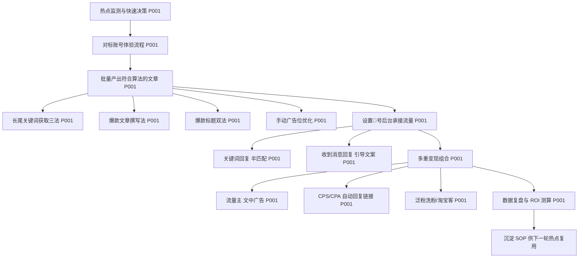
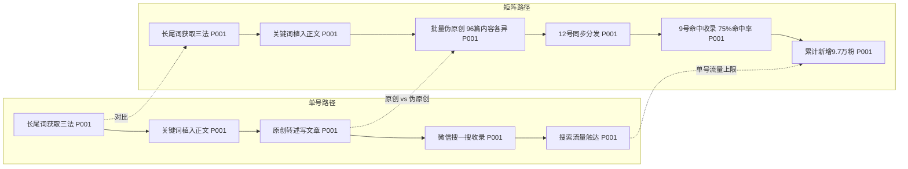
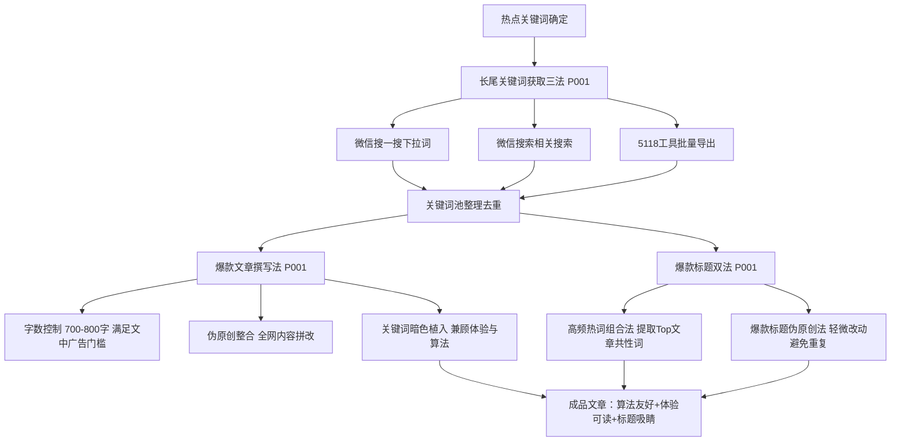
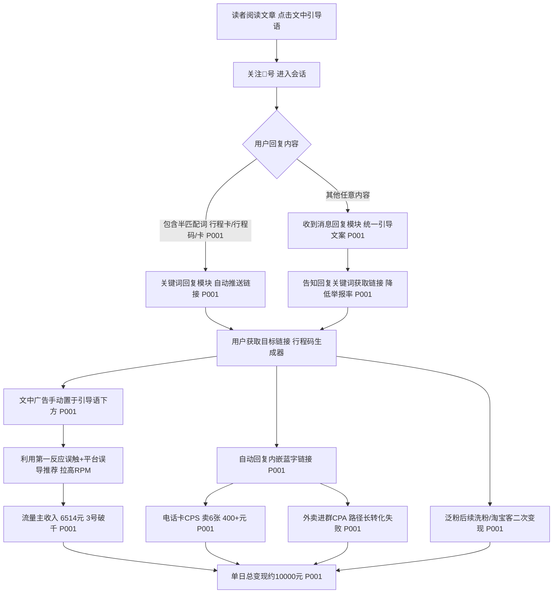

# 第 28 章 从“收割流量”到“沉淀资产”：内容生态的双轨打法
作者：龙哥

## 学习目标

- 掌握热点收割策略的概念与核心定义：从快速决策、批量产出到流量承接的完整闭环
- 理解搜索流量追热点与推荐流量追热点的区别，并能在实操中正确铺设长尾词
- 掌握👸号后台流量承接（关键词回复、收到消息回复）与降低取关率、举报率的技巧
- 了解批量做号矩阵的运作逻辑及其对内容差异性与账号储备的要求
- 能根据热点生命周期与自身前置能力，判断是否值得入局追热点，并计算单次追热点的投入产出比
- 掌握热点流量的多种变现路径（流量主、CPS/CPA、泛粉洗粉），并能根据账号类型与合规要求选择合适策略
- 掌握内容冷启动的差异化策略：从“做商品”到“做人群”的转型路径与“情、趣、用、品”四象限定位法
- 掌握RPA自动化工具在短视频爆款采集、内容生产与批量发布中的应用，理解“原创优于二剪优于搬运”的原则
- 了解批量做号与内容原创的边界条件，能评估矩阵策略与单号原创策略的适用场景
- 理解IP打造与热点收割两种内容商业模式的差异，能根据自身目标选择合适的内容战略
- 理解视频模板“元素化拆解”的核心抽象模型（背景/标题/内容/文案/字幕/音乐），能独立完成爆款视频的拆解与重组
- 掌握“混淆元素”与“随机取用”机制，能设计出通过平台原创审核且批量不同的自动化内容生产方案

## 28.1 生活类比：一家商场的四季经营图景

想象你是一位商场运营总监，需要在一栋大楼里经营四种截然不同却又相互支撑的业态，共同构建全年无淡季的盈利生态。第一季，你在商场一楼中庭迅速搭建起**限时快闪店区（热点收割策略）**：每当网红商品突然爆火（如“行程码下线”纪念版生成器），你在一天内开出 12 家同款快闪分店（批量👸号矩阵）。每家店陈列不同（内容与标题差异化），门口张贴多种指路牌（长尾关键词铺入正文），确保从不同小巷（搜索入口）都能找到店。店员手持标准话术单（半匹配关键词回复），顾客无论问“行程卡”“行程码”还是“卡”，都能秒回领取链接；收银台前放着促销海报（手动文中广告），顾客结账时顺手多看一眼；收银台旁放会员推荐卡（自动回复里的 CPS/CPA 蓝字链接），扫码注册店家拿佣金。快闪店必须在人潮散去前（热点生命周期内）跑完铺货、导流、收银全流程，单日变现约 1 万元，但顾客大多一锤子买卖（取关率 53.8%），难留长客。第二季，快闪店退场后，你将一楼改造为**特色美食街区（内容冷启动差异化）**。起初大家都卖同款网红小吃（做商品/搬运），竞争惨烈、同质化严重，还被城管（平台）查封（0 播放/限流）。你发现街上有一群特定食客：20-30 岁爱面子的白领（虚荣穷）、35-45 岁怀旧派、50+ 渴望亲情共情的女性。你不再跟风卖小吃，而是**为这群人做菜**（做人群替代做商品）：给白领做“高颜值轻食”（情/共情），给怀旧派做“复古老菜单”（趣/有趣），给阿姨们做“养生家常菜”（用/有用）。食材（素材）从全城集市（抖音/快手/小红书/TK）采买，按自家食谱（情趣用品四象限逻辑）二次烹饪（伪原创二创），端上桌的都是自家招牌菜。实测：精准食客虽少但复购高（A/B 账号千万播放变现 2 万+），大排长龙的网红店（C 账号破亿播放）食客杂、利润薄（仅 3 万）。第三季，美食街生意稳了，但手工出餐太慢（人工剪辑效率低），无法支撑开分店（矩阵化）。你建起**中央厨房与智能供应链（自动化内容生产线）**：将每道招牌菜拆解为 6 个标准半成品（视频六元素——背景/标题/内容/文案/字幕/音乐），建立半成品库（素材池）。写下 SOP（代码）：随机抽取半成品组装（素材随机取用）、随机切配时长（时间段随机取用）、最后撒上自家秘制酱料（混淆元素/自拍素材）。流水线跑起来，每分钟下线一道“原创新菜”（批量原创视频），自动配送到抖音、视频号各分店（自动发布多平台分发）。前厅分两条线：引流菜（流量视频）负责拉客打标，利润菜（带货视频）负责出单转化，双轨并行。第四季，中央厨房跑通后，你开始想：怎么让食客记住“味道”而非“菜单”？（从流量到品牌资产）。你确立**一道招牌母题**（如“女性安全/亲子关系”），这是文化传承的基因（护城河锚点）；注入**双层基因**——文化沉淀价值（风骨/非遗/案例库）+ 商业持续能力（变现阶梯）；让品牌在用户眼中经历**三重身份进化**：工具（解决功能问题/教做菜）→ 人（提供情绪价值/陪聊焦虑）→ 神（解决危机迭代/重塑认知/话语权）；打造**四级观感**——松弛感（尽在掌握）、对象感（只对你说）、获得感（超预期）、氛围感（沉浸无法自拔）；沉淀**五份资产**——用户、版权、实物、文化、生态。菜单（内容体系）升级为五件套：四级架构、独创理论（理想解法/节点法/词根法/母题法/核心法）、十年故事片、百问百答、点线面打通路径（产品→项目→产业链）。营收模型从 99 元体验课 → 3 万私教 → 20 万私董会 → 100 万合伙人 → 图书联合出品人 → 直播矩阵月入 400 万 → 咨询顾问年入百万，层层递进，离钱近、离痛点近、离易用近、离信任近（4 近原则）。最终构建以 S 级基因为核心的产业群组（星云 IP 计划），实现供应链整合、多维资源沉淀、信息差收窄的终极护城河。贯穿始终的生存法则（长期主义与风险意识）是：无论哪个季节，**选择比努力更重要**：赛道选错，越努力死得越快（前期资金规模决定关注赛道，留足容错率，切忌早期 All In）。**敬畏市场并与市场共舞**：熊市里活下来的老鸟都懂这句箴言；年轻团队领袖必须保护团队弹药，不被 FTX 式连环暴雷波及。**见好就收，有利必跑，狠心出货，切勿幻想，变现为王**——这是穿越周期的生存铁律。

---

## 28.2 概念地图

热点收割策略
├── 概念解析
│   ├── 追热点与搜索流量            —— P001
│   ├── 批量做号矩阵                —— P001
│   ├── 流量承接（关键词/自动回复）  —— P001
│   ├── 泛粉与洗粉                  —— P001
│   └── 热点生命周期与前置能力      —— P001
├── 核心方法
│   ├── 长尾关键词获取三法          —— P001
│   ├── 爆款文章撰写法（迎合算法）  —— P001
│   ├── 爆款标题双法（关键词/伪原创）—— P001
│   ├── 手动广告位优化              —— P001
│   └── 流量承接双模块设置          —— P001
├── 变现路径
│   ├── 流量主（手动广告位优先）    —— P001
│   ├── CPS/CPA落地（自动回复链接） —— P001
│   └── 泛粉二次变现（淘宝客/洗粉） —— P001
├── 内容创新方法论
│   ├── 做人群 vs 做商品            —— P022
│   ├── 情、趣、用、品四象限        —— P022
│   ├── 伪原创二创方法论            —— P022
│   └── 视频模板元素化拆解（六元素）—— P024
├── 自动化内容生产线
│   ├── 原创优于二剪优于搬运        —— P024
│   ├── 流量视频与带货视频双轨      —— P024
│   ├── RPA批量采集爆款素材         —— P017
│   ├── 混淆元素与随机取用（原创性） —— P024
│   └── 自动发布多平台分发          —— P024
└── 边界与限制
    ├── 时效性与快速决策            —— P001
    ├── 账号矩阵与工具前置储备      —— P001
    ├── 批量做号的内容差异性要求    —— P001
    ├── 取关率与流量质量局限        —— P001
    └── 批量矩阵 vs 单号原创        —— P001

---

## 28.3 热点收割策略 —— 让一次热点变成一场战役

### 为什么需要这个概念？

当“行程码下线”这种全国性热点突然爆发时，流量会在几小时内达到峰值，随后迅速衰减。如果你只是凭感觉发一篇文章、等推荐，大概率会错过红利期。你需要的是一套**标准化的作战流程**：从监测热点、快速决策、批量产出符合算法收录的内容、设置自动化流量承接，到组合多种变现手段——在热点生命周期内跑完全链路闭环。

> "我决定要追这个热点之后，把我手头上的👸号挨个登陆，就开始了下面的操作流程：1、找对标账号体验一遍流程；2、写一篇符合平台算法的文章；3、给文章起一个爆款标题；4、设置👸号后台接住流量。"
> 
> ——《P001: 火火-行程码热点复盘》

### 核心定义

**热点收割策略** 是一套系统化的操作流程：快速决策追踪热点、批量产出符合算法收录的内容、设置承接流量的后台规则，最后通过多种广告组合变现。其核心是“快”与“系统化”，在热点生命周期内完成全链路闭环。

### 关键性质

热点收割策略具有三个关键性质。首先是**时效性强**：热点生命力短，决策和产出必须快速闭环。其次是**流程可复制**：沉淀为 SOP 后可批量作用于不同热点。最后是**依赖前置能力**：账号矩阵、SEO 功底、变现通道需提前备齐。

### 典型例子

2022年12月14日“行程码下线”热点，作者用 12 个👸号批量发布 96 篇文章，单日净增近 4.5 万粉丝、变现约 1 万元。

### 边界条件

热点收割策略存在三个边界条件。对热点信息获取的时效性要求极高，过晚入局流量红利已稀释。批量做号需要提前储备账号矩阵与辅助工具，否则临时抱佛脚难以支撑。决策要果断，机会稍纵即逝。

### 关键方法或推导

```python
# 热点收割标准化作战流程伪代码
def hot_harvest_workflow(hot_topic, account_matrix, monetization_channels):
    """
    热点收割全链路闭环：监测 -> 决策 -> 产出 -> 承接 -> 变现 -> 复盘
    """
    # 1. 热点监测与快速决策
    if not is_within_golden_window(hot_topic):
        return "missed_window"
    
    # 2. 对标体验流程
    benchmark_flow = experience_benchmark_accounts(hot_topic)
    
    # 3. 批量产出符合算法的文章
    articles = []
    for account in account_matrix:
        for i in range(articles_per_account):
            article = generate_algorithm_friendly_article(
                hot_topic=hot_topic,
                benchmark_flow=benchmark_flow,
                long_tail_keywords=get_long_tail_keywords(hot_topic),
                title=generate_viral_title(hot_topic),
                word_count=700_800,
                pseudo_original=True
            )
            articles.append((account, article))
    
    # 4. 设置👸号后台承接流量
    for account in account_matrix:
        setup_traffic_capture(account, hot_topic)
    
    # 5. 多重变现组合执行
    revenue = execute_monetization(articles, monetization_channels)
    
    # 6. 数据复盘与 ROI 测算
    roi = calculate_roi(revenue, cost)
    save_sop_for_next_round(hot_topic, roi)
    
    return revenue, roi

# 核心子函数：批量文章生成的差异性保障
def generate_algorithm_friendly_article(hot_topic, benchmark_flow, long_tail_keywords, title, word_count, pseudo_original):
    content = ""
    if pseudo_original:
        # 整合全网相关内容拼改
        content = merge_and_rewrite(fetch_related_articles(hot_topic), target_words=word_count)
    else:
        # 单号原创转述
        content = original_rewrite(benchmark_flow, target_words=word_count)
    
    # 关键词隐形植入：调暗颜色，不影响阅读但被算法识别
    content = inject_keywords_stealth(content, long_tail_keywords, color="#999999")
    
    # 手动插入文中广告位于引导关注文案下方
    content = insert_manual_ad_below_guide(content)
    
    return Article(title=title, content=content)

# 核心子函数：流量承接双模块配置
def setup_traffic_capture(account, hot_topic):
    # 模块1：关键词回复（半匹配）
    variants = generate_keyword_variants(hot_topic)  # 如：行程卡、行程码、卡、纪念版
    account.set_keyword_reply_half_match(variants, reply_content=get_target_link(hot_topic))
    
    # 模块2：收到消息回复（兜底引导）
    account.set_default_reply(
        f"回复『{hot_topic.core_keyword}』三个字即可获取生成链接哦~"
    )
```

### 方法演进流程图



---

## 28.4 搜索流量与批量矩阵 —— 让算法替你找读者

### 为什么需要这个概念？

👸号推荐流量不可控，且随热点消退极快。搜索流量则不同：用户主动搜索“行程码纪念版”“行程卡生成”，意图极强，且流量持久。但单个账号命中搜索的概率有限，必须用**矩阵化**放大命中面。

### 核心定义

**搜索流量追热点**：在文章正文而非仅标题中铺设搜索长尾词，被微信“搜一搜”收录后，用户搜索热点词即可触达文章。

**批量做号矩阵**：同时运营多个👸号，每篇内容与标题各不相同，以增加被算法收录与命中搜索的概率。

> "我们做的是搜索流量，那相关的搜索长尾词、搜索下拉框词语都可以放进来。文章被收录之后，读者搜索相关长尾词会搜到我们这篇文章。"
> 
> "要注意的一点是我96篇文章，每一篇内容都不一样；并且标题都不一样；这样做能够更好的增加被👸号系统收录的概率。"
> 
> ——《P001》

### 关键性质

搜索流量追热点与批量矩阵策略具有三个关键性质。长尾词放入**文章正文**而非标题，是短期追热点区别于长期 SEO 的核心差异。矩阵策略依赖**内容差异性**：每篇内容、标题必须各不相同。账号有效命中率约 75%（12 个号中 9 个获流量），多数账号可获得搜索流量。

### 边界条件

仅 1-2 个账号追热点时，建议用自己的话转述做原创而非批量伪原创。矩阵策略需提前储备足够数量的👸号。

### 关键方法或推导

```python
# 单号路径 vs 矩阵路径的结构化对比
class SearchTrafficStrategy:
    def __init__(self, mode="matrix"):  # "single" or "matrix"
        self.mode = mode
    
    def execute(self, hot_topic, accounts):
        # 统一前置：获取长尾词池
        keyword_pool = self.get_long_tail_keywords(hot_topic)
        
        if self.mode == "single":
            return self._single_account_path(accounts[0], hot_topic, keyword_pool)
        else:
            return self._matrix_path(accounts, hot_topic, keyword_pool)
    
    def _single_account_path(self, account, hot_topic, keyword_pool):
        """单号路径：原创转述，追求收录权重与长期资产"""
        article = Article()
        article.title = self.generate_original_title(hot_topic)
        article.content = self.original_rewrite(hot_topic, keyword_pool, min_words=800)
        # 关键词自然融入正文，不刻意堆砌
        account.publish(article)
        return account.get_search_traffic()
    
    def _matrix_path(self, accounts, hot_topic, keyword_pool):
        """矩阵路径：批量伪原创，追求覆盖面与短期爆发"""
        all_articles = []
        for account in accounts:
            for i in range(8):  # 每号 8 篇
                article = Article()
                article.title = self.generate_variant_title(hot_topic, i)
                article.content = self.pseudo_original_merge(hot_topic, keyword_pool, 
                                                            variant_seed=i, min_words=700)
                # 确保每篇内容、标题完全不同
                assert article not in all_articles, "内容必须差异化"
                all_articles.append((account, article))
        
        # 批量分发
        for account, article in all_articles:
            account.publish(article)
        
        # 统计命中率
        effective_accounts = sum(1 for acc in accounts if acc.has_search_traffic())
        hit_rate = effective_accounts / len(accounts)
        return hit_rate, sum(acc.get_new_followers() for acc in accounts)

    def get_long_tail_keywords(self, hot_topic):
        """长尾关键词获取三法合并去重"""
        keywords = set()
        keywords.update(self.wechat_suggest_dropdown(hot_topic.core_keyword))
        keywords.update(self.wechat_related_search(hot_topic.core_keyword))
        keywords.update(self.tool_5118_long_tail(hot_topic.core_keyword))
        return list(keywords)
```

### 方法演进流程图



---

## 28.5 爆款内容生产 —— 让算法与读者都满意

### 为什么需要这个概念？

文章内容需同时满足**算法收录**（字数、原创度、关键词覆盖）与**读者阅读体验**（通顺、关键词不刺眼）。标题决定点击率，是流量转化的第一道关口。

### 核心定义与方法

#### 长尾关键词获取三法（来源：《P001》）

1. **微信搜一搜下拉词**：打开微信搜一搜，输入核心词，记录所有下拉推荐词。
2. **微信搜索栏相关搜索**：搜索结果页底部的“相关搜索”，覆盖用户真实检索习惯。
3. **5118 网站长尾词查询**：用工具批量导出长尾词库，补全人工遗漏词。

> "1、微信搜一搜下拉词：打开微信搜一搜，输入关键词，会有对应的下拉词弹出；把这些下拉词全部放入文章中。"
> 
> ——《P001》

#### 爆款文章撰写法（来源：《P001》）

爆款文章撰写法包含三个核心要点。第一，**字数控制**：写到 700-800 字，满足文中广告插入门槛，提高收录权重。第二，**伪原创整合**：把全网相关文章内容复制、拼接、改写，凑够字数且读起来流畅。第三，**关键词隐形植入**：将长尾词颜色调暗淡，不影响阅读体验，又能被算法识别。

> "我写追热点文章的时候，我会有意识的把文章内容写到七八百字左右；让文章更加容易被👸号收录，也能符合👸号在文中添加广告的要求。"
> 
> "为了阅读体验感好一些，我在文章中就把这些关键词的颜色调暗淡一些。"
> 
> ——《P001>

这个撰写法展示了如何在“迎合算法”与“顾及体验”之间找到平衡点：字数达标保收录，伪原创保效率，关键词变色保体验。

#### 爆款标题双法（来源：《P001》）

**方法一：高频热词组合法**  
把排名靠前文章的标题复制下来，提取共同高频词（如“火爆全网”“免费获取”），组合成新标题。

**方法二：爆款标题伪原创法**  
直接摘录爆款标题做轻微改动，不能完全一样，兼顾原创度与吸睛度。

> "方法1：提取关键词自己原创：把排名在前面阅读量比较好的文章标题全部copy下来当参考，找到共同的关键词...火爆全网、免费获取；然后再加上关键词个人行程卡。"
> 
> "方法2：找爆款标题伪原创：我搜对应关键词，直接把排名在前面的文章标题复制下来，轻微改动；但不能全部一样。"
> 
> ——《P001>

这个双法展示了标题设计的两个维度：**原创度助收录，吸睛度助点击**。

### 关键方法或推导

```python
# 爆款文章撰写流程伪代码
def write_viral_article(hot_topic, keyword_pool, mode="pseudo_original"):
    """
    产出：700-800字、关键词暗色植入、通顺可读、含文中广告位
    """
    # 1. 素材采集
    raw_materials = fetch_top_articles(hot_topic, top_n=10)
    
    # 2. 结构化写作
    article = Article()
    
    if mode == "pseudo_original":
        # 伪原创模式：拼接改写
        article.content = ""
        # 第一段：核心操作指引（如如何获取生成链接）
        article.content += write_core_guide(hot_topic)
        # 后续段落：整合其他文章内容
        for material in raw_materials:
            article.content += rewrite_paragraph(material.content)
        # 截断/补齐至 700-800 字
        article.content = adjust_word_count(article.content, 700, 800)
    else:
        # 原创模式：自己话术转述
        article.content = original_narrative(hot_topic, min_words=800)
    
    # 3. 关键词隐形植入（核心技巧）
    for kw in keyword_pool:
        article.content = inject_keyword_stealth(
            article.content, 
            kw, 
            color="#999999",  # 暗淡灰色
            max_occurrences=2  # 避免过度堆砌
        )
    
    # 4. 手动插入文中广告位（放在引导关注文案下方）
    guide_text = "点击关注下方👸号进入主页"
    article.content = insert_after(article.content, guide_text, 
                                   ad_slot=ManualAdSlot.IN_CONTENT)
    
    return article

# 爆款标题生成双法伪代码
def generate_viral_titles(hot_topic, top_articles=10):
    titles = fetch_top_article_titles(hot_topic, top_articles)
    
    # 方法一：高频热词组合法
    high_freq_words = extract_high_frequency_words(titles, min_freq=3)
    # 典型热词：火爆全网、免费获取、永久保存、一键生成
    title_method1 = combine_keywords(high_freq_words, hot_topic.core_keyword)
    
    # 方法二：爆款标题伪原创法
    title_method2 = []
    for t in titles[:3]:  # 取前3名
        variant = slight_modify(t)  # 替换同义词、调整语序、增减修饰词
        if similarity(variant, t) < 0.9:  # 确保不完全一样
            title_method2.append(variant)
    
    return {
        "method1_keyword_combination": title_method1,
        "method2_pseudo_original": title_method2
    }
```

### 方法演进流程图



---

## 28.6 流量承接与广告变现 —— 把流量装进自己的口袋

### 为什么需要这个概念？

流量进来后若无人承接，会快速流失并产生举报；不同广告类型的变现效率差异巨大，必须精细化运营每一个环节。

### 核心定义与方法

#### 流量承接双模块（来源：《P001》）

**模块 1：关键词回复（半匹配）**  
设置多个用户常用变体词（如“行程卡”“行程码”“卡”），只要回复包含任一词语，自动推送链接。

> "关键词回复有一个半匹配功能，意思就是读者回复半匹配中任意一个词语，👸号后台都会自动回复对应链接。"
> 
> ——《P001》

**模块 2：收到消息回复（引导文案）**  
兜底所有非关键词回复，告诉用户“回复‘行程卡’三个字获取链接”，降低举报率。

> "模块2：设置收到消息回复减少举报率：我还在收到消息回复这里也设置了文案，这里的作用是让读者不管回复什么消息，都能看到这句话；知道回复哪几个字才能拿到链接。"
> 
> ——《P001>

#### 手动广告位优化（来源：《P001》）

**核心动作**：将文中广告手动置于“引导关注文案”下方（如“点击关注下方👸号进入主页”）。

**底层逻辑**：
1. 读者第一反应点击文案下方内容，误触广告概率极高。
2. 平台推荐广告时，文中广告位直接推荐其他👸号，极具误导性。

> "我把广告添加在点击关注下方👸号进入主页这句话下面，很多读者第一反应就会直接点击广告，稍微带了一些诱导性质；另外平台推荐广告的时候，文中广告位直接就推荐其它👸号，很有误导性。这也是为啥我👸号这次追热点流量主收入那么高的原因。"
> 
> ——《P001》

这个策略展示了如何利用**用户行为心理**（第一反应）与**平台机制漏洞**（误导性推荐）叠加放大单价。

#### CPS/CPA 载体选择（来源：《P001》）

订阅号文章内链接不生效跳转，但**自动回复中可放可点击的蓝字链接**。因此 CPS/CPA 变现载体必须放在自动回复里，而非文章正文。

> "订阅号文章页面放链接不会生效跳转，但是它放在自动回复里面就可以实现。我在这次追热点的过程中，自动回复里放入两个链接；一个是电话卡销售CPS，一个是外卖进群加粉CPA。"
> 
> ——《P001>

### 关键方法或推导

```python
# 👸号后台流量承接配置伪代码
class WeChatTrafficCapture:
    def __init__(self, account):
        self.account = account
    
    def setup_capture(self, hot_topic):
        """配置双模块流量承接"""
        # 模块1：关键词回复（半匹配）
        self.setup_keyword_reply(hot_topic)
        
        # 模块2：收到消息回复（兜底引导）
        self.setup_default_reply(hot_topic)
        
        # 广告位优化（文章级配置，在此标记策略）
        self.account.set_ad_strategy(ManualAdStrategy.BELOW_GUIDE_TEXT)
    
    def setup_keyword_reply(self, hot_topic):
        """半匹配关键词：覆盖用户所有可能的回复变体"""
        core_kw = hot_topic.core_keyword  # "行程卡"
        variants = [
            core_kw,
            core_kw.replace("卡", "码"),  # "行程码"
            core_kw[-1],                   # "卡"
            core_kw[:2],                   # "行程"
            "纪念版",
            "生成",
            "链接",
            "获取"
        ]
        # 去重
        variants = list(set(variants))
        
        self.account.set_keyword_reply(
            match_type="half_match",
            keywords=variants,
            reply_content=AutoReply(
                text=f"您的{core_kw}纪念版生成链接：",
                link=get_target_link(hot_topic),
                link_style="blue_text"  # 蓝字可点击
            )
        )
    
    def setup_default_reply(self, hot_topic):
        """兜底引导文案：降低举报率"""
        guide_text = (
            f"亲，回复『{hot_topic.core_keyword}』三个字，"
            f"即可自动获取纪念版生成链接哦～\n"
            f"如有其他问题，欢迎留言～"
        )
        self.account.set_default_reply(guide_text)

# 手动广告位决策逻辑
class ManualAdStrategy:
    BELOW_GUIDE_TEXT = "below_guide_text"  # 置于引导关注文案下方
    SMART_INSERT = "smart_insert"          # 智能插入（平台自动）
    
    @staticmethod
    def calculate_expected_rpm(strategy, article_reads, guide_text_ctr=0.15, 
                                smart_ctr=0.02, misleading_boost=1.5):
        """
        估算不同策略下的文中广告 RPM
        guide_text_ctr: 引导文案下方的点击率（利用第一反应）
        smart_ctr: 智能插入的基础点击率
        misleading_boost: 平台误导性推荐带来的额外点击倍数
        """
        if strategy == ManualAdStrategy.BELOW_GUIDE_TEXT:
            # 第一反应点击 + 平台误导推荐叠加
            effective_ctr = guide_text_ctr * misleading_boost
        else:
            effective_ctr = smart_ctr
        
        # RPM = 阅读量 * 点击率 * 单价 / 1000
        return article_reads * effective_ctr * 0.5 / 1000  # 假设单价 0.5 元

# CPS/CPA 落地配置
class CPS_CPA_Landing:
    def __init__(self, account):
        self.account = account
    
    def configure(self, offers):
        """
        offers: [{"type": "cps", "name": "电话卡", "link": "...", "commission": 70},
                 {"type": "cpa", "name": "外卖进群", "link": "...", "reward": 5}]
        """
        # 关键：只能放在自动回复里，文章内链接不生效
        auto_reply_content = "您的专属福利：\n"
        for offer in offers:
            if offer["type"] == "cps":
                auto_reply_content += f'📱 <a href="{offer["link"]}">{offer["name"]}</a> 办理享佣金 {offer["commission"]}元/张\n'
            elif offer["type"] == "cpa":
                auto_reply_content += f'🍔 <a href="{offer["link"]}">{offer["name"]}</a> 进群领红包\n'
        
        # 追加到现有自动回复
        self.account.append_to_keyword_reply(auto_reply_content)
        self.account.append_to_default_reply(auto_reply_content)
```

### 方法演进流程图



---

## 28.7 热点生命周期与复盘 —— 算清每一场战役的账

### 核心定义

- **热点生命周期**：热度随时间衰减，需在生命周期内完成全链路闭环。
- **取关率**：本次追热点取关 52430 粉，取关率约 53.8%。
- **单粉估值**：按单粉一毛钱估算粉丝价值。

### 关键数据复盘（来源：《P001》）

下表展示了本次热点收割战役的核心运营数据，用于评估投入产出比与流量质量。

| 指标 | 数值 | 说明 |
|------|------|------|
| 有效账号数 | 9/12 | 3 个未上排名 |
| 累计新增粉丝 | 97,385 | |
| 取关粉丝 | 52,430 | 取关率 53.8% |
| 净增粉丝 | 44,955 | |
| 流量主收入 | 6,514 元 | 3 个单号破千 |
| 电话卡 CPS | 400+ 元 | 卖出 6 张 |
| 粉丝估值 | ~4,000 元 | 单粉 0.1 元 |
| **单日总变现** | **~10,000 元** | 流量主+粉丝价值+CPS |

### 边界条件

内容与粉丝预期不匹配是取关核心原因。追热点流量需结合后续运营承接才能沉淀价值。

---

## 28.8 内容冷启动差异化 —— 从“做商品”到“做人群”

### 为什么需要这个概念？

2022 年 7 月后，视频号打击搬运、大量账号 0 播放。纯粹做商品视频（搬运、混剪）同质化严重，成功概率极低，且极易触发风控。

### 核心定义（来源：《P022》）

**做人群替代做商品**：选择细分人群，以人群情感需求为出发点制作内容，避开红海竞争。

**情、趣、用、品四象限**：将短视频内容归纳为四类：
- **情（共情）**：喜怒哀乐，可延伸至不同年龄、性别、收入层级的细分共情点。
- **趣（有趣）**：反差、实验、猎奇（如 80 岁老人做口播）。
- **用（有用）**：教学、实用技能（做菜、PPT、电工）。
- **品（新奇特产品）**：稀罕物件、地域特产（北方人没见过的酸角糕）。

> "我把短视频内容分为'情趣用品'四个字... 所有短视频平台的爆款内容，都可以纳入其中。"
> 
> "这四个板块的分支的延伸可以细分到上千种。做好定位应该是每个内容创作者最初期的想法，但是往往想要的越多越陷入困境。这些成千上万的分支里面能扣到一个点，其实就够了。"
> 
> ——《P022》

### 伪原创二创方法论（来源：《P022》）

以全平台（抖音、快手、知乎、小红书、TK 等）为素材库，基于四象限底层逻辑，将爆款素材**不违规地二次创作**（拼接、换音乐、改文案）成自己赛道作品。

> "抖音，快手，优酷，知乎，小红书，甚至TK，所有的短视频平台都是你的素材库。通过这个底层逻辑，你会发现很多爆款都是有迹可循，我们要做的无非是把这些素材不违规的二创成自己赛道的作品。"
> 
> ——《P022》

### 典型案例：四账号差异化验证（来源：《P022》）

下表展示了四个差异化定位账号的实测数据，验证了“精准人群优于泛流量”的变现逻辑。

| 账号 | 人群定位 | 7天播放量 | 变现 |
|------|----------|-----------|------|
| A | 20-30岁白领（虚荣穷） | 破千万 | 2万+ |
| B | 35-45岁怀旧情怀 | 破千万 | 2万+ |
| C | 50+女性亲情共情 | 破亿 | 3万左右 |
| D | 纯带货 | 0反馈 | 放弃 |

**洞察**：大爆款（C）人群泛化、变现受限；精准小爆款（A/B）变现效率更高。

### 边界条件

抖音热度内容不一定在视频号爆，需观察目标平台人群特性调整。多赛道同时做需分时间段找素材，避免“脑裂”。警惕“知识的诅咒”：考虑太多远处困难会陷入精神内耗，不如定目标“一天一个账号 10 条视频”，只看一次后台。

---

## 28.9 自动化内容生产线 —— 让机器替你批量生产原创

### 为什么需要这个概念？

免费流量获取难度增大，需靠矩阵化批量产出提升爆单概率；手动剪辑效率低，无法支撑矩阵化内容供给。

### 核心定义（来源：《P024》）

**流量视频 vs 带货视频**：前者拉曝光、涨粉、打标签；后者直接促成销售转化。自动化生产需分别建模板。

**视频模板元素化拆解**：所有短视频可拆为 **6 个基本元素**——
1. 背景（图/视频）
2. 标题（主/副标题）
3. 内容（图/视频）
4. 文案
5. 字幕
6. 背景音乐

> "所有的视频都可以拆成以下元素：1. 背景：图或者视频 2. 标题：主、副标题 3. 内容：图、视频 4. 文案：5. 字幕：6. 背景音乐："
> 
> ——《P024》

**混淆元素机制**：在自动生成的视频中加入自己拍摄的照片/视频，保证通过平台原创审核。

> "每个视频的生成时都加一些混淆元素，用自己拍的照片和视频...再加上混淆元素，这样能保证做出来的视频都是原创视频，且每个视频生成的都不相同，在任何一个平台都能过原创。"
> 
> ——《P024>

### 关键方法与推导

#### Step 1：视频模板拆解法（来源：《P024》）

将任意爆款视频拆解为 6 要素，定位每个元素的具体形式。

```
举例：某中医流量视频模板
背景：一张中医大师照片，放大模糊
标题：请等一下，xxxx
内容：一张中医大师照片
文案：国医大师xxx
字幕：无
背景音乐：舒缓纯音乐
```

#### Step 2：相似素材搜集法（来源：《P024》）

针对每个元素寻找形式相似的替代素材库（背景图池、大师照片池、音乐池）。

#### Step 3：原创视频自动生成法（来源：《P024》）

基于元素与素材库编写代码自动生成，核心三手段保证差异性与原创性：

1. **素材随机取用**：每个元素从素材池随机抽取。
2. **时间段随机取用**：视频类素材随机截取不同时间段。
3. **混淆元素注入**：拼接自拍照/视频片段。

> "1、每个素材随机取用 2、如果模版视频有多个片段，那么每个片段素材内的时间段也随机取用 再加上混淆元素，这样能保证做出来的视频都是原创视频，且每个视频生成的都不相同"
> 
> ——《P024>

这段伪代码展示了自动生成的核心逻辑：通过三重随机化机制（素材随机、时间段随机、混淆元素注入），在保证每个视频结构一致（模板固定）的前提下，实现内容层面的充分差异化与原创性，从而通过平台审核并规避同质化判定。

```python
# 自动化视频生成核心逻辑伪代码
class AutoVideoGenerator:
    def __init__(self, template, material_pools, confusion_assets):
        """
        template: 视频模板结构，定义6要素的排布顺序与时长
        material_pools: {
            'background': [img1, img2, video1...],
            'title': [title_templates...],
            'content': [imgs, videos...],
            'copy': [copy_templates...],
            'subtitle': [styles...],
            'music': [tracks...]
        }
        confusion_assets: 自拍照/视频列表，用于混淆
        """
        self.template = template
        self.pools = material_pools
        self.confusion = confusion_assets
    
    def generate(self, count=100):
        videos = []
        for i in range(count):
            video = Video()
            
            # 1. 素材随机取用
            for element in self.template.elements:
                asset = random_choice(self.pools[element.name])
                video.add_element(element.name, asset)
            
            # 2. 时间段随机取用（针对视频类素材）
            for segment in video.video_segments:
                segment.trim(
                    start=random_uniform(0, segment.duration - 3),
                    length=random_uniform(3, 8)
                )
            
            # 3. 混淆元素注入（核心原创性保障）
            confusion_clip = random_choice(self.confusion)
            video.insert_at_random_position(confusion_clip, duration=1_3)
            
            # 4. 渲染输出
            video.render(output_path=f"output/batch_{i}.mp4")
            videos.append(video)
        
        return videos

# 底层工具模块抽取：从小时级开发缩短到分钟级
class ToolModuleRegistry:
    """可复用代码模块注册表"""
    modules = {
        'text_to_speech': TTSModule(),
        'subtitle_burner': SubtitleBurner(),
        'transition_effects': TransitionLib(),
        'watermark_remover': WatermarkRemover(),
        'format_converter': FormatConverter(),
        'platform_uploader': MultiPlatformUploader(['douyin', 'wechat_video'])
    }
    
    @classmethod
    def build_new_template(cls, template_config):
        """几分钟组装新模板"""
        pipeline = VideoPipeline()
        for step in template_config.steps:
            module = cls.modules[step.module_name]
            pipeline.add_step(module, step.params)
        return pipeline
```

#### Step 4：自动发布法（来源：《P024》）

开发自动发布工具，每天向抖音、视频号多账号自动分发，基本无需人工干预。

#### 底层工具模块抽取法（来源：《P024》）

将可复用代码封装为工具模块，新模板开发从“小时级”缩短到“分钟级”。

> "现在几分钟就能实现一个新的模板，抖音上看到的视频只要不是特效很多，基本都能做，只要拆解清楚就可以。"
> 
> ——《P024>

### 核心定理

下表总结了自动化内容生产线的核心定理，供设计生产方案时对照参考。

| 定理 | 来源 | 核心主張 |
|------|------|----------|
| 原创优于二剪优于搬运 | P024 | 质量底线与平台友好度排序 |
| 1比1模仿保底原则 | P024 | 模仿验证过的爆款模板，保证成品≥60分 |
| 差异化生成保障原创 | P024 | 随机取用+混淆元素=批量不同且过审 |

---

## 28.10 RPA 批量采集 —— 让机器人替你在爆款库里淘金

### 为什么需要这个概念？

找对标素材是短视频带货的基础工作，人工效率低；第三方数据工具（抖查查、蝉妈妈）不够精准且更新滞后。

### 核心定义（来源：《P017》）

**官方实时爆款视频库**：巨量百应创意中心的“爆款视频”“创意搜索”模块，比第三方更准确、更实时。

**黑马小达人**：粉丝量少但销量高的视频，更适合小达人学习（大达人有粉丝基础加成）。

**RPA 机器人**：基于影刀开发，可批量搜索、采集数据（GMV、粉丝量）、下载无水印视频。

> "这里上榜的,出成绩的,最新的,不就是最好的对标吗?... 这个是比抖查查蝉妈妈这些第三方要更准确的行业优秀爆款视频库."
> 
> "我的思路是找那种,粉丝量少,但是销量高的视频,做参考。这种黑马小达人更是我们小达人适合学习的对象。"
> 
> ——《P017>

### 采集机器人配置（来源：《P017》）

下表对比了两款 RPA 采集机器人的参数配置与产出效率，供根据业务场景选择使用。

| 机器人 | 入参 | 产出 | 耗时 |
|--------|------|------|------|
| 创意搜索采集 | 搜索词/商品名、滚动页数、GMV过滤阈值 | 数据表格+无水印视频 | 22秒/页 |
| 爆款视频库分类采集 | 大/子行业、作者等级、时间周期 | 数据表格+无水印视频 | 55秒/页 |

### 完整工作流（来源：《P017》）

```
官方Buyin创意中心获取实时竞品数据 
→ RPA(影刀)批量采集/下载 
→ 基于数据筛选(优先GMV高、粉丝少的黑马视频) 
→ 飞书妙记语音转文字提取脚本 
→ 完成脚本库积累与对标学习
```

这段工作流代码展示了从官方数据源获取实时竞品情报，到 RPA 自动化采集下载，再经数据筛选锁定高价值黑马样本，最后通过语音转文字提取脚本文案，形成可复用脚本库的完整闭环——实现了“对标→拆解→复用→积累”的标准化飞轮。

### 边界条件

RPA 脚本运行会**锁住电脑**，无法同时操作其他程序，需安排非工作时段运行。抖音上特效很多的视频无法用模板自动生成。

> "好的脚本大概率是不会过时的,一个脚本模板,改改文案换个产品推,成功率大概也比瞎原创要好一点吧.好记性不如烂笔头,不如全部下载保存起来吧."
> 
> ——《P017>

---

## 28.11 IP 的长线思维 —— 从“收割流量”到“沉淀资产”

### 为什么需要这个概念？

热点收割追求短期爆发，但流量随热点消散，难以沉淀长期价值。需要一套与短期收割互补的长期方法论，实现内容资产的持续增值。

### 核心定义（来源：《P004》）

**IP 打造五步法**：
1. 夯实地基（内部 30 任务 + 外部 12345 框架）
2. 内容体系规划（风骨体面）
3. 千万营收模型
4. 一年节点规划
5. 落地

**12345 外部打造框架**：
- **1 个母题**：文化传承性因子，护城河锚点（如“女性安全”“亲子关系”）。
- **2 层基因**：文化沉淀价值（风骨）+ 商业持续能力（变现）。
- **3 重身份**：工具（解决功能问题）→ 人（提供情绪价值）→ 神（解决危机迭代，承接再分配话语权）。
- **4 级观感**：松弛感、对象感、获得感、氛围感（至少具备两个，驱动感性消费）。
- **5 份资产**：用户、版权、实物、文化、生态资产。

**内容体系五件套**：四级内容架构、一套独有理论、一个十年故事、一份百问百答、一份点线面打通路径。

**千万营收模型**：从 99 元小课 → 私教 3万/3个月 → 私董会 5-20万 → 合伙/徒弟 20-100万 → 图书（一书一码/联合出品人）→ 课程直播（199小课+双播/月400万）→ 咨询 1K+/h → 轻顾问 3万起/重顾问 20万/年。

> "5大步骤分别是：夯实地基、做好内容体系规划（风骨体面）、做好千万营收模型（千万变现）、做好一年的节点规划、落地。"
> 
> "12345也就是1个母题、2层基因、3重身份、4级观感、5份资产。"
> 
> "注意一个底层逻辑就是4近，离钱近好变现，离痛点近好卖出，离易用近好留存，离信任近好复购。"
> 
> ——《P004>

### 关键方法论

#### 构建体系理论五大方法（来源：《P004》）

1. **理想解法**：基于 TRIZ/ARIZ 六步推导（最终目标→矛盾→资源→理想解→方案→评价）。
2. **节点法**：从实际服务流程抽取共性节点，形成标准化理论（如“水利私域理论”）。
3. **词根法**：提炼垂类优势词根，延展成理论体系。
4. **母题法**：延展/结合母题生成新理论。
5. **核心法**：直接提取自身内容体系核心点命名（如“内容经纪理论”）。

#### 十年故事创作法（来源：《P004》）

制作 5-8 分钟中视频：素材（前后对比/关键时刻：低谷/荣耀/转折）、故事主支线、文案（表达清晰/目的明确/契机合理）、音乐（体现品位）。

#### 点线面打通路径（来源：《P004》）

产品（文章/课程/账号） → 项目（培训/陪跑） → 产业链（理论端/执行端/变现端/IP端/政府支持/人才端齐备的产业群组）。

### 典型验证案例（来源：《P004》）

> "龙飞律师在婚姻方向的连麦上就是有一种松弛感的……这也是她的账号短短时间内就破千万的原因。"
> 
> ——《P004>

> "199小课，一天两播，一场6w，一个月400w~有点意思是吧……"
> 
> ——《P004>

> "我有一大批经过层层筛选的内容经纪人、还有一大批经过层层筛选的S级IP（80个报名星云计划的但没入选的那些至少也是A级以上的）……从理论端、执行端、变现端、IP端、政府支持、人才端都OK了之后我做什么不行呢？"
> 
> ——《P004>

### 核心定理与边界

下表总结了 IP 打造中的核心定理与边界条件，供决策时对照参考。

| 定理/边界 | 核心内容 | 来源 |
|-----------|----------|------|
| IP 是少数人的领地 | 直接复刻路径会遗漏关键情境，应拆解多模型取长补短 | P004 |
| 不要信“天道酬勤” | 无清晰前景与两周可验证变现的坚持基本归零 | P004 |
| 危机再分配效应 | 解决用户危机感即获得话语权，支撑“神”身份 | P004 |
| 用户资产幂次效应 | 品牌势能积累的 IP 边界更广、复利更强 | P004 |
| 定位不能代替内容 | 传统定位非从内容出发，无法延展护城河，需落到母题 | P004 |

---

## 28.12 长期主义与风险意识 —— 在周期的潮起潮落中活下来

### 核心定义（来源：《P006》）

**选择比努力更重要**：赛道选择取决于前期资金规模，且应给自己留足容错率，避免早期 All in 单一方向。

**敬畏市场并与市场共舞**：熊市中活下来的老鸟共同生存法则。

**保护团队弹药**：年轻团队领袖应保护团队免受市场崩塌连锁反应（如 FTX 暴雷）。

> "有句老话，选择比努力更重要。在看赛道之前，在于你前期资金规模有多大，再决定要关注什么赛道。"
> 
> "从金融的角度来说，要给自己一定的容错率，如果在早期仅仅是ALL IN在一个方向，风险并不是特别好控制。"
> 
> "真正活下来能够完成远航的老鸟，都懂一句话：'敬畏它，并且与它共舞'。"
> 
> ——《P006>

### 关键数据支撑（来源：《P006》）

> "Web3市场在10年内创造了3万亿美元的流动价值，已足以与传统投资基金投资的初创公司的总价值相媲美。"
> 
> "Polychain、Paradigm、a16z、Multicoin、3AC以及一些其他专精的公司各自管理着数十亿或数百亿美元的资金。"
> 
> "全球大量对冲基金正计划5年内将其资产的7%投入到web3的市场中，巨无霸养老基金也开始酝酿直投了。"
> 
> ——《P006>

### 生存箴言（来源：《P006》）

> "见好就收，有利必跑，狠心出货，切勿幻想，变现为王。"
> 
> "不要丢掉场外赚钱能力，小成本试错、不玩杠杆合约、保护资产，会卖比会买更重要，人声鼎沸时一定要跑。"
> 
> ——《P006>

---

## 28.13 多源对照：同一概念在不同素材中的异同

本章涉及的核心概念在多份素材中均有阐述，下表对比了不同素材对同一概念的侧重差异，帮助建立更立体的认知。

| 核心概念 | P001（👸号热点复盘） | P022（视频号带货实战） | P024（自动化生产线） | P017（RPA采集） | 综合洞察 |
|----------|------------------------|------------------------|----------------------|-----------------|----------|
| **原创优于二剪优于搬运** | 未直接提及，但暗示：单号追热点建议原创转述，批量矩阵用伪原创 | 隐含：伪原创二创是“不违规地二创”，区别于直接搬运 | **显性核心定理**：质量分层与平台友好度排序，1比1模仿爆款做原创是保底 | 隐含：脚本模板复用优于盲目原创，RPA采集是为原创/二创提供素材 | 平台差异决定策略：👸号搜索流量依赖关键词覆盖，伪原创效率高；短视频平台原创检测严（多模态），必须真原创或高质量二创 |
| **做人群 vs 做商品** | 未涉及 | **核心策略转型**：“大路上人太多，换条小路”，以人群情感需求为切入点 | 隐含：流量视频针对客户人群画像找对标，本质是做人群 | 未涉及 | 从“货找人”转“为人找货/造内容”，是平台打击同质化后的必然进化 |
| **混淆元素/差异化生成** | 未涉及 | 隐含：伪原创通过拼接、换音乐、改文案实现差异化 | **显性核心机制**：素材随机+时间段随机+自拍混淆=批量原创过审 | 未涉及 | 短视频平台多模态指纹检测极严，需技术手段保证像素/音频/语义层面的差异化 |
| **批量矩阵 vs 单号原创** | **显性对比**：矩阵需内容各异（96篇全不同）；单号建议原创转述 | 单人多号（4账号）差异化定位，验证精准人群优于泛流量 | 矩阵化是自动化生产的前提与目的，单号无法支撑规模化 | RPA采集为矩阵提供素材库支撑 | 资源禀赋决定策略：有账号矩阵+工具能力→批量矩阵收割流量；单账号+垂直深耕→原创沉淀SEO资产 |
| **流量视频 vs 带货视频** | 未涉及 | 隐含：账号前期做流量/涨粉，后期接直播/带货变现 | **显性双轨设计**：分别建模板、分别对标、分别自动化生成 | 采集时可按视频类型筛选（创意搜索/爆款库分类） | 双轨并行是矩阵化变现的关键：流量视频养号打标，带货视频精准转化，缺一不可 |

---

## 28.14 设计中的取舍

### 为什么不用“单号原创”去追热点？

因为热点生命周期极短（小时级），单号产能上限低，且推荐流量不可控。批量矩阵+搜索流量能在有限时间内最大化命中概率，用“量”换“确定性”。

**这种设计的 trade-off 是什么？**  
- **得**：短期现金流极强（单日万级）、快速积累种子粉丝、验证选品/文案能力。  
- **失**：粉丝质量低（取关率 53.8%）、账号易被打标“营销号”、无长期品牌资产沉淀、依赖持续有热点可追。

### 为什么短视频要“原创优于二剪”而👸号热点文却用“伪原创”？

短视频平台原创检测极严（指纹/语义/画面多模态），搬运/二剪极易限流；👸号搜索流量依赖关键词覆盖与收录速度，伪原创整合效率远高于纯原创，且半匹配回复等机制兜底了体验。

### 为什么 IP 打造要强调“母题”而非传统“定位”？

定位是静态坐标，无法指导内容细化延展；母题是动态文化原型，可生成“百变题型”，既能搭建护城河又能灵活调整边界，是内容视角的战略锚点。

### 批量矩阵 vs 单号原创的边界在哪里？

下表对比了批量矩阵与单号原创在关键维度上的适用边界，供策略选择时参考。

| 维度 | 批量矩阵（热点收割） | 单号原创（长期 SEO/IP） |
|------|---------------------|------------------------|
| **适用场景** | 突发性、全民关注、生命周期短（小时-天）的热点 | 持续性、长尾搜索需求强、生命周期长（周-年）的赛道 |
| **账号要求** | ≥5 个同质账号，历史定位可不一致 | 1 个垂直账号，历史内容高度一致 |
| **内容策略** | 伪原创整合，96 篇全不同，追求覆盖面 | 原创深度转述，追求权重累积与品牌资产 |
| **变现逻辑** | 流量主+CPS/CPA+泛粉洗粉，单次变现为主 | 广告分成+私域高客单+品牌溢价，复利为主 |
| **风险承受** | 账号被降权/封禁可接受，属于消耗品 | 账号是核心资产，容错率极低 |

### 伪原创 vs 原创的平台差异

下表梳理了主流内容平台的原创检测维度与伪原创可行性，指导跨平台内容策略制定。

| 平台 | 原创检测维度 | 伪原创可行性 | 推荐策略 |
|------|-------------|-------------|----------|
| 👸号（搜一搜） | 文本语义去重+关键词覆盖 | **高**——整合拼改+关键词植入即可收录 | 热点期：批量伪原创；长期：原创深度文 |
| 视频号/抖音 | 画面指纹+音频指纹+语义+元数据 | **低**——搬运/简单二剪极易判重限流 | 必须真原创或高质量二创（混淆元素+随机重组） |
| 小红书/知乎 | 图文语义+图片指纹+账号权重 | **中**——伪原创需深度改写+自有图片 | 伪原创为辅，原创为主 |

### 流量视频 vs 带货视频模板差异

下表对比了流量视频与带货视频在自动化模板设计上的核心差异，指导双轨并行的模板构建。

| 维度 | 流量视频模板 | 带货视频模板 |
|------|-------------|-------------|
| **核心目标** | 完播率、互动率、涨粉、打人群标签 | 点击率、转化率、GMV、ROI |
| **选标对标** | 同赛道高完播/高互动爆款 | 同品类高转化/高GMV爆款（优先黑马小达人） |
| **元素侧重** | 标题钩子、背景氛围、情绪触发、悬念留人 | 产品特写、痛点直击、权威背书、行动号召(CTA) |
| **混淆元素** | 自拍生活碎片、真人出镜建立信任 | 实测实拍、手持产品、对比实验、真实收货 |
| **发布节奏** | 高频（日更 3-5 条）维持账号活跃度 | 低频（日更 1-2 条）配合直播/促销节点 |

### 热点收割 vs IP 打造的资源分配

下表对比了短期热点收割与长期 IP 打造在核心资源维度上的配置差异，帮助根据战略目标分配有限资源。

| 资源维度 | 热点收割（短期战役） | IP 打造（长期战役） |
|----------|---------------------|---------------------|
| **时间分配** | 热点爆发期 7×24 小时全投入，平时维护矩阵 | 每日固定产出，按季度/年度规划节点 |
| **资金分配** | 账号采买/养号、RPA 工具、外包写手 | 内容团队、IP 运营、品牌建设、法务版权 |
| **人力分配** | 执行导向：采集、发文、改后台、盯数据 | 策略导向：母题挖掘、理论提炼、产品设计、生态招商 |
| **风险对冲** | 多账号分散风险、止损线明确（不追则已） | 单账号/核心IP风险集中，需建立护城河与多元变现 |
| **成功指标** | 单次 ROI、日变现额、粉丝获取成本 | 用户生命周期价值(LTV)、品牌资产估值、产业链成熟度 |

---

## 28.15 动手练习

### 练习 1：拆解一次完整的追热点流程

假设你运营 3 个👸号，今天突然爆发一个与「AI绘画免费工具」相关的热点，系统梳理你的追热点执行方案：

1. 列出你获取长尾关键词的至少 3 种渠道，并为该热点写出 5 个可铺设的长尾词
2. 设计一篇约 800 字的爆款文章结构：说明你将如何整合素材做伪原创、关键词将放在哪些位置（标题/正文）、颜色如何处理
3. 为该文章设计 2 个备选标题：一个用「高频热词组合法」，一个用「爆款标题伪原创法」
4. 规划👸号后台的流量承接设置：关键词回复的半匹配词应包含哪些变体？收到消息回复的引导文案应怎么写以降低举报率？
5. 列出你在这次追热点中计划使用的变现组合（流量主/CPS/CPA），并说明各自的操作要点

回答问题：
- 如果热点信息发布已经超过 12 小时，你还会选择入场吗？依据是什么？
- 当你只有 1 个账号而非矩阵时，你的策略应当做哪些调整？

### 练习 2：流量主广告位收益对比分析

假设你运营一个👸号，单日底部广告收入为 200 元，文中广告收入为 650 元（依托手动广告位策略），总阅读量为 10 万次

1. 计算：底部广告的千次阅读收益（RPM）和文中广告的千次阅读收益分别是多少？
2. 分析：为什么文中广告的 RPM 会显著高于底部广告？从用户行为与平台推荐机制两个角度解释
3. 推理：如果将手动广告位改成智能插入，文中广告收入可能发生什么变化？为什么？
4. 设计：除了将广告放在「引导关注文案下方」，你还能想到哪些符合用户体验与平台规则的高曝光广告位？

回答问题：
- 手动广告位存在哪些潜在违规风险？如何在提升收益与控制风险之间取得平衡？
- 如果一篇追热点文章只有 500 字，无法满足插入文中广告的字数要求，你会怎么处理？

### 练习 3：批量矩阵 vs 单号原创：策略抉择

请对比以下两种追热点策略的适用场景：
场景 A：你有 12 个👸号，希望最大化搜索流量命中概率
场景 B：你只有 1 个👸号，希望建立长期 SEO 内容资产

1. 分别列出两种策略在内容生产、标题设计、关键词铺设、流量承接四个环节的操作差异
2. 分析：在场景 A 中，为什么 96 篇文章必须做到「每篇内容都不一样、标题都不一样」？如果内容重复会有什么后果？
3. 结合素材中「9 个有效账号、3 个未上排名」的数据，计算本次矩阵操作的账号有效命中率，并讨论该命中率的商业意义
4. 分析：单个👸号追热点时，为什么作者建议尽量用自己的话转述做原创？原创与伪原创在微信收录机制上的差异是什么？

回答问题：
- 如果你只有 5 个👸号，且其中 2 个历史内容定位完全不同（如一个做美食、一个做科技），是否适合加入同一热点矩阵？为什么？
- 批量矩阵长期依赖伪原创是否可持续？请给出你的风险判断与优化建议

### 练习 4：单次热点变现投入产出比测算

基于素材中的真实复盘数据：12 个👸号、每个 8 篇共 96 篇文章，9 个有效账号累计新增 97385 粉、取关 52430 粉、净增 44955 粉，取关率约 53.8%，流量主收入 6514 元、电话卡佣金 400 余元：

1. 计算：该次追热点的单粉获取成本（假设个人时间成本不计，只算可变成本），若按单粉一毛钱估值粉丝价值，总粉丝价值是多少？
2. 拆解：取关率 53.8% 说明了什么？你认为导致高取关率的核心原因可能有哪些？（提示：从粉丝预期、内容匹配度、运营承接等角度分析）
3. 假设你并非全职运营，每天只有 2 小时可投入追热点，请设计一个「低成本单号」的追热点方案，并测算其可能的收益范围
4. 评估：追热点吸引的泛粉与通过 SEO 长尾词吸引的精准粉，在后续变现效率上可能有哪些差异？你会优先选择哪种流量？

回答问题：
- 如果同样投入 96 篇文章的精力，但只做 1 个垂直账号的内容深耕（不追热点），你认为长期哪个 ROI 更高？请说明判断依据
- 素材中电话卡 CPS 卖出 6 张、外卖进群 CPA 转化失败，请分析 CPA 失败的潜在原因，并提出优化方案

### 练习 5：热点生命周期与决策时机判断

观察以下四个热点事件类型，分别判断它们适合「批量矩阵追热点」还是「单号原创追热点」，并给出你的理由：
热点 A：某明星突发离婚声明（娱乐类，爆发快、消退快）
热点 B：国家出台某项惠企新政策（政策类，持续讨论数周）
热点 C：某款 AI 工具免费开放使用（工具类，长尾搜索需求强）
热点 D：某地突发自然灾害（事件类，信息敏感度高）

1. 针对每个热点，画出你预估的「搜索热度-时间」生命周期曲线，并标注最佳入局时间窗口
2. 分析：对于热点 D，除了商业变现，还需要考虑哪些道德与合规问题？是否应该追这类热点？
3. 选择其中一个你判断适合「批量矩阵」的热点，列出你的批量发文内容差异性规划表（至少 5 篇文章的标题与关键词差异化方案）
4. 设计一个「热点预判」机制：你平时如何提前发现潜在热点？列出至少 3 种信息监控渠道和预警信号

回答问题：
- 热点收割策略本质上依赖「快」，但快是否一定等于好？请分析追热点过快可能导致的运营风险（如内容质量下降、账号被降权）
- 如果你判断某个热点虽然流量大但与你账号的垂直定位严重不符，你会选择放弃还是借用热点做内容延伸？请给出你的决策框架

### 练习 6：从“做商品”到“做人群”：内容定位的差异化转型

2022年 7 月后视频号平台打击搬运、大量账号被 0 播放，假设你是一个视频号带货从业者，面临以下困境：

1. 分析：为什么纯粹做商品视频很难爆？平台打击搬运后，「用数量对抗概率」的策略为何失效？
2. 运用「情、趣、用、品」四象限模型（共情/有趣/有用/新奇特产品），为以下三个人群分别设计 1 个内容定位方向，并写出对应的选题示例：
   - 20-30 岁刚毕业的大学生白领群体
   - 80-90 年代怀旧人群
   - 50+ 女性亲情共情人群
3. 内容制作：从抖音、快手、知乎、小红书等平台各找一个符合你定位的爆款素材，说明你将如何对它「不违规地二创」（拼接、换音乐、改文案）成为自己赛道的作品
4. 对比分析：大爆款（破亿播放）带来的人群泛化与精准小爆款（千万播放）在变现效率上的差异，并说明你会优先追求哪种流量

回答问题：
- 「知识的诅咒与精神内耗」如何影响内容创作者的执行力？你会用什么方法克服？
- 如果要同时做两个不同人群定位的账号，你会如何安排内容制作流程以避免「脑裂」？

### 练习 7：设计一条自动化短视频内容生产线

假设你是一名短视频带货从业者，想通过自动化生产降低人工成本、提升内容产出效率：

1. 选择一个你熟悉的赛道（如中医养生、教辅、美妆），找一个该赛道的爆款视频，将其拆解为：背景、标题、内容、文案、字幕、背景音乐六个元素，并分别说明每个元素的替代素材来源
2. 设计「混淆元素」方案：你打算用哪些自己拍摄的照片或视频作为混淆元素，确保批量生成的视频能通过平台原创审核？
3. 如果使用影刀 RPA 工具采集巨量百应创意中心的爆款视频，请列出你需要的采集参数（搜索词、GMV 过滤阈值、下载需求等），并说明如何筛选「黑马小达人」（低粉高销）作为学习对象
4. 规划一条从「素材采集→视频生成→自动发布」的完整流水线，标注每个环节的工具与耗时，并评估该流水线的日产能

回答问题：
- 「原创优于二剪优于搬运」在自动化生产模式下如何体现？纯自动生成的视频算「原创」吗？
- RPA 脚本运行会锁住电脑，这一限制对个人创作者意味着什么？你如何规划运行时段以不干扰其他工作？
- 为什么说「流量视频和带货视频要双轨并进」？两者在自动化模板设计上有何不同？

---

## 28.16 本章小结

这一章中我们系统学习了内容生态中的两大主流打法：**短期热点收割**与**长期 IP 沉淀/自动化生产**，以及连接二者的核心方法论。

首先，我们拆解了**热点收割策略**的完整闭环：从搜索流量追热点（长尾词铺文、批量矩阵差异化）、爆款内容生产（三法获词、伪原创撰写、双法起标题）、流量承接双模块（半匹配关键词回复+收到消息引导）、手动广告位优化（利用第一反应与平台误导性推荐拉高单价）、CPS/CPA 落地（自动回复蓝字链接），到复盘数据（净增 4.5 万粉、单日变现约 1 万、取关率 53.8%），形成了一套可标准化复制的“快闪店”作战 SOP。

其次，我们对比了**内容冷启动的差异化路径**：当平台打击搬运、商品视频同质化严重时，转向“做人群”而非“做商品”，用“情、趣、用、品”四象限锁定细分人群情感需求，再以全平台为素材库做伪原创二创，实现低成本起量；并通过四账号实测验证了精准小爆款优于大爆款泛流量的变现效率。

接着，我们深入了**自动化内容生产线**的核心抽象模型：将视频拆解为背景/标题/内容/文案/字幕/音乐六大元素，配合随机取用、时间段随机、混淆元素三重机制，实现批量原创视频的自动生成与多平台分发；并引入 RPA 采集官方爆款库（巨量百应创意中心），筛选黑马小达人样本，形成“采集→拆解→生成→发布”的分钟级模板复用飞轮。

最后，我们升维到 **IP 长线思维与风险意识**：从母题、基因、身份、观感、资产的 12345 地基框架，到内容体系五件套、千万营收模型、4近原则，构建了风骨与变现并存的长期复利体系；并以 Web3 转型案例为镜，确立“选择比努力更重要、敬畏市场保护弹药、见好就收变现为王”的周期生存法则。

本章我们一起学习了以下概念：

| 概念 | 解释 |
|------|------|
| 热点收割策略 | 一套系统化的追热点操作流程：快速决策、批量产出、流量承接、多广告变现，在热点生命周期内完成全链路闭环 |
| 搜索流量追热点 | 将长尾词铺入文章而非仅标题，通过微信搜一搜被收录，从而在用户搜索热点词时获取持久搜索流量 |
| 批量做号矩阵 | 同时运营多个👸号、每篇内容与标题各不相同，以增加被算法收录与命中搜索的概率，实现流量规模化 |
| 半匹配关键词回复 | 👸号后台设置多个用户常用变体词为半匹配回复，只要回复包含任一词语即自动回复链接，提升读者体验并降低举报率 |
| 爆款标题双法 | 提取排名靠前标题的高频热词自行组合，或对爆款标题做轻微伪原创，兼顾算法收录所需的原创度与吸引点击的吸睛度 |
| 手动广告位优于智能插入 | 将文中广告手动置于引导关注文案下方，利用读者第一反应与平台误导性推荐显著拉高流量主单价，是变现高于同行的核心原因 |
| 自动回复CTA 是 CPS/CPA 落脚点 | 订阅号文章内链接不生效跳转，但自动回复中可放可点击蓝字链接，因此 CPS/CPA 变现载体必须放在自动回复而非文章内 |
| 泛粉与洗粉 | 追热点吸引的泛流量粉丝可通过低门槛淘宝客或筛选高价值粉丝（洗粉）进行二次变现，但需认识其高取关率与价值密度低的局限 |
| 时效性与前置能力 | 热点生命力短，需快速决策；同时依赖账号矩阵、👸号 SEO 功底、变现通道等前置能力储备，过晚入局或缺乏准备则难以收割 |
| 做人群 vs 做商品 | 当平台内商品搬运同质化严重时，转而以细分的人群情感需求为切入点制作内容，避开红海竞争，实现低成本流量获取 |
| 情、趣、用、品四象限 | 将短视频内容分为共情、有趣、有用、新奇特产品四类，分支可细分上千种，是内容定位与找素材的底层逻辑 |
| 原创优于二剪优于搬运 | 在平台打击搬运、内容同质化的背景下，内容创作质量分层为原创、二剪、搬运三档，直接 1 比 1 模仿当下爆款做原创是保底策略 |
| 视频模板元素化拆解 | 所有短视频可拆解为背景、标题、内容、文案、字幕、背景音乐六种元素，这是实现视频自动生成的核心抽象模型 |
| 流量视频与带货视频双轨 | 每个赛道的内容分为拉曝光涨粉打标签的流量视频与直接促成销售转化的带货视频两类，模板化复制时需分别对标 |
| RPA 机器人批量采集 | 基于影刀 RPA 工具开发采集机器人，实现巨量百应创意中心爆款视频的批量搜索、数据采集与无水印视频下载，替代人工与第三方工具 |
| 混淆元素与随机取用 | 通过素材随机取用、时间段随机取用和加入自拍混淆元素三个手段，确保自动生成的批量视频各不相同且能通过平台原创审核 |

下一章中，我们将学习如何把前面积累的项目拆解能力、流量获取能力、产品交付能力，整合为一套**可复制、可放大的商业操盘体系**——从 MVP 验证到矩阵复制、从招商加盟到股权顶层设计，带你完成从“单点盈利”到“系统增长”的跃迁。

感谢你读到了这里，恭喜你，你已经完成了内容生态双轨打法的核心认知构建！


