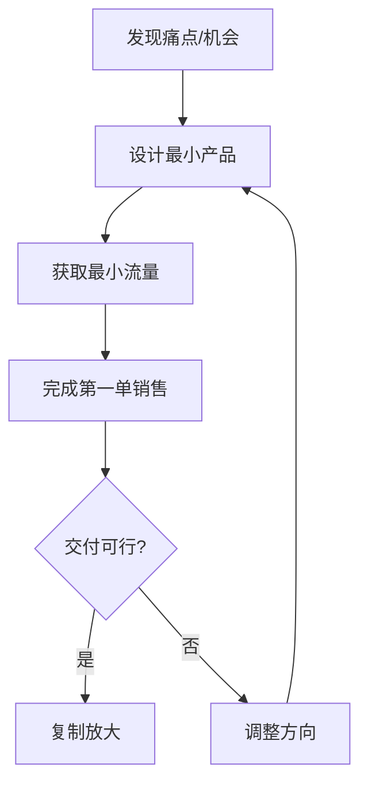
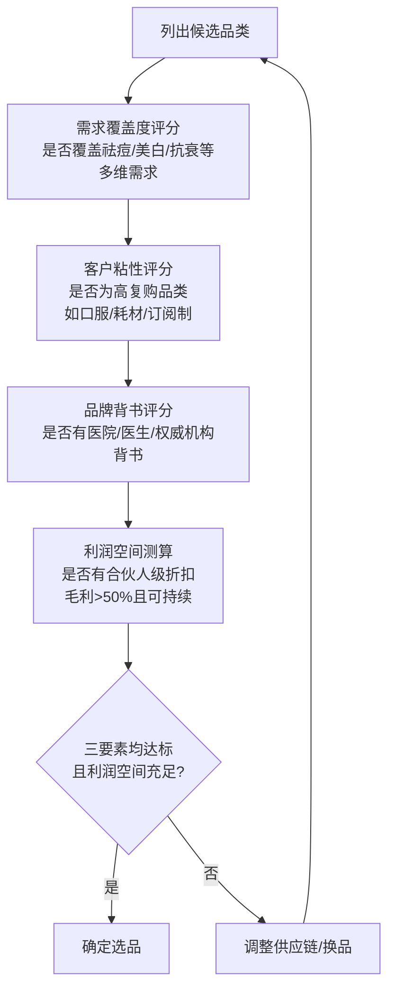
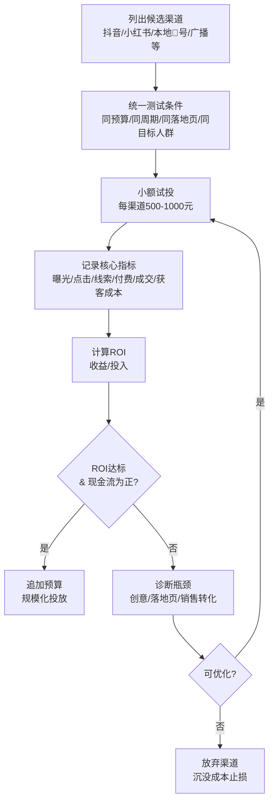
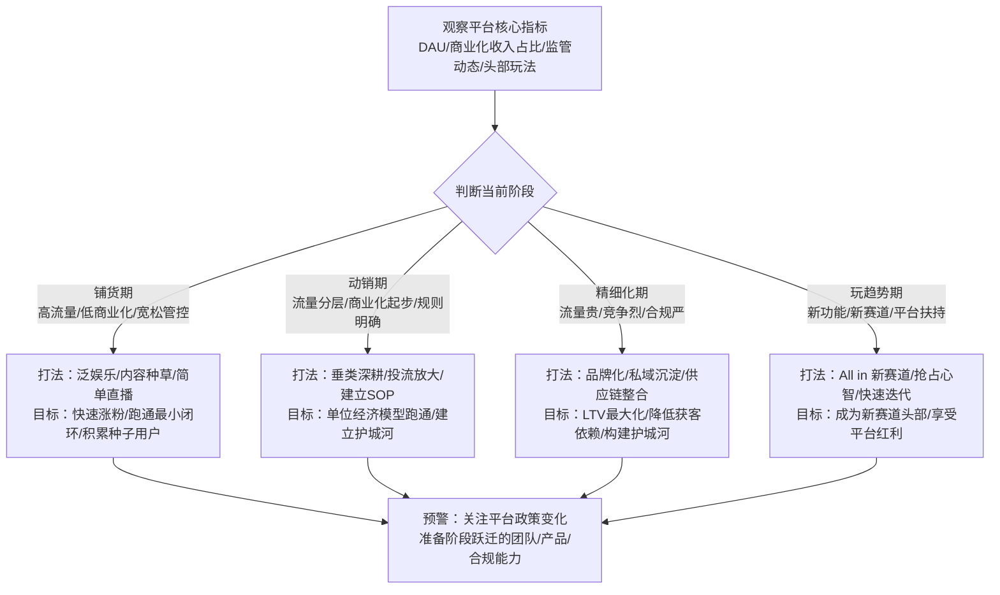
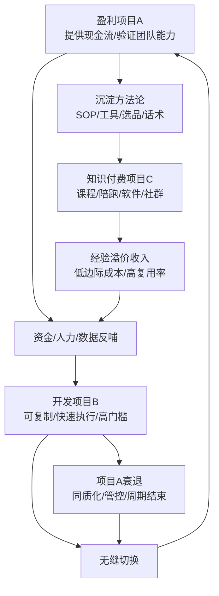
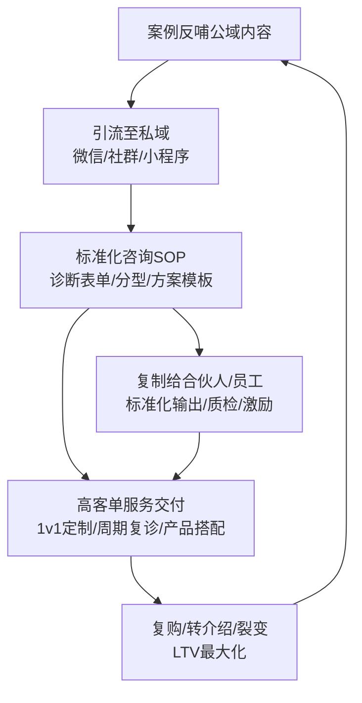
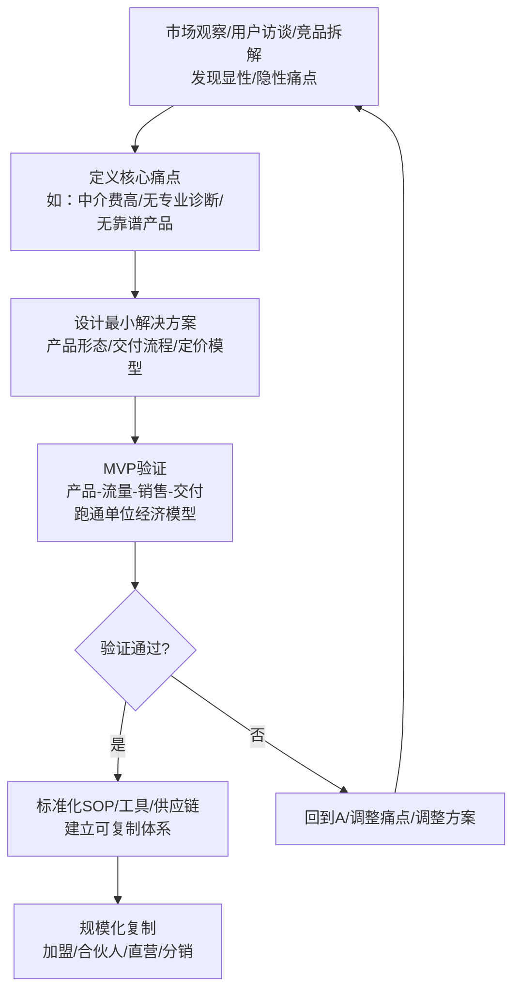

# 第 1 章 副业闭环实战 —— 从“最小验证”到“体系放大”

## 学习目标

- 理解最小可行产品（MVP）闭环的核心定义与验证目标
- 掌握选品决定论的核心逻辑与三要素
- 理解信息差在商业模式中的关键作用与价值创造机制
- 学会用投产比（ROI）量化评估不同渠道的营销效率
- 掌握平台演化周期的四阶段模型，能预判新平台红利期
- 理解1+1+1项目矩阵模式的构成与协同逻辑
- 掌握私域高客单策略的适用前提与核心价值
- 学会用逆向开发方法论从痛点反推产品与卖点

## 1.1 生活类比

想象商业验证是一场**渡河**。你站在岸边，望着对岸的商业机会，目标是过河。如果你一上来就想造一艘航母，投入几个月时间、几十万资金，那么一旦河对岸根本没有人需要你的产品，你会损失惨重。但如果你先造一艘独木舟，用最少的成本快速试水，验证船不沉、方向对，再回头造更大更稳的船，那么即使失败，损失也可控。这就是最小 MVP 闭环：用小成本快速试水，验证商业模式的可行性。

同样，渡河前你还要考虑用什么样的船、走哪条水路——这就好比选品决定论。好的种子自带生命力，差的种子即使加倍施肥浇水也难有好收成。选品不仅决定了你后续推销的难易，更决定了复购率与品牌资产的天花板。

而在选择水路时，如果你知道一条别人不知道的近路，你就能靠带路赚钱——这就是信息差。信息差的本质是：你知道而别人不知道的路径。但请注意，一旦地图公开、导航普及，这条近路就失去了稀缺价值。因此，靠信息差起家的生意，必须在信息差被消除前，建立起真实的服务壁垒或品牌壁垒。

当你决定在哪里下网捕鱼时，你会用探鱼器测量哪个区域鱼最多，而不是凭感觉撒网——这就是渠道投产比的量化思维。每一分推广预算，都要经过实测、对比、决策，而不是听谁吹牛就跟着投。

最后，如果你选在早春播种，土地尚未被瓜分，你的收成会远超等到夏天才入场的竞争者——这就是平台演化周期的红利窗口。平台的发展遵循“铺货→动销→精细化→玩趋势”的四阶段演进。早期高流量低商业化，是普通人最轻松拿结果的阶段；一旦进入精细化阶段，不仅竞争加剧，平台管控也会收紧，普通人的机会成本大幅上升。

这就好比三灶同炊：一个灶正煮着饭（盈利项目提供现金流），一个灶正备着菜（开发项目储备接班），一个灶正卖着菜谱（知识付费变现经验），保证任何时候都有饭吃——这就是 1+1+1 项目矩阵的生存智慧。

你手里捧着金饭碗（专业信任），却用来讨剩饭（做低价值团购），不如用它盛满满汉全席（高客单服务）——这就是私域高客单的核心告诫：端着金饭碗别讨饭。

先看到病人哪里疼（痛点），再决定开什么药（产品），而不是先研究各种药材（技术）再找谁需要——这就是逆向开发方法论的需求导向本质。

## 1.2 概念地图

```
最小MVP闭环
├── 核心目标
│   └── 验证"有人愿意付钱"和"交付可行" —— 《线上美业创业复盘》P001
├── 关键性质
│   ├── 低成本性：投入小，失败损失可控 —— 《线上美业创业复盘》P001
│   ├── 快验证性：最短时间判断模式是否成立 —— 《TikTok娱乐直播项目实战》P003
│   └── 可复制性：跑通后可无限放大 —— 《线上美业创业复盘》P001
└── 典型应用
    └── 线上美业：甲油胶代购一单挣2元起跑通闭环 —— 《线上美业创业复盘》P001
选品决定论
├── 核心主张
│   └── 产品好省一半心，自带转化力 —— 《线上美业创业复盘》P001
├── 选品三要素
│   ├── 深挖用户需求，涵盖面齐全 —— 《线上美业创业复盘》P001
│   ├── 口服保养是趋势，客户粘性强 —— 《线上美业创业复盘》P001
│   └── 与医院合作，强化品牌背书 —— 《线上美业创业复盘》P001
└── 边界条件
    └── 需验证利润空间：无利润空间不如不做 —— 《线上美业创业复盘》P001
信息差赚钱论
├── 底层逻辑
│   └── 生意的本质是信息差 —— 《胖龟找房创业复盘》P002
├── 核心概念
│   └── 中介费伪概念：信息差造成的智商税 —— 《胖龟找房创业复盘》P002
└── 关键性质
    ├── 广泛存在：互联网与线下均有 —— 《胖龟找房创业复盘》P002
    ├── 可被消除：技术进步可颠覆旧模式 —— 《胖龟找房创业复盘》P002
    └── 价值创造：撮合匹配解决需求产生良性循环 —— 《胖龟找房创业复盘》P002
渠道投产比（ROI）
├── 定义
│   └── 收益与投入成本的比值，衡量渠道效率 —— 《胖龟找房创业复盘》P002
├── 关键性质
│   ├── 可比较性：同一标准横向对比 —— 《胖龟找房创业复盘》P002
│   ├── 本地相关性：本地项目必投本地 —— 《胖龟找房创业复盘》P002
│   └── 差异巨大：最优与最差可能差数十倍 —— 《胖龟找房创业复盘》P002
└── 典型实测
    └── 抖音推广 > 本地自媒体 > 汽车广播 —— 《胖龟找房创业复盘》P002
平台演化周期
├── 四阶段模型
│   └── 铺货 → 动销 → 精细化 → 玩趋势 —— 《TikTok娱乐直播项目实战》P003
├── 关键窗口
│   └── 高流量低商业化阶段是普通人最佳切入 —— 《TikTok娱乐直播项目实战》P003
├── 核心性质
│   ├── 周期普遍性：所有平台底层逻辑相通 —— 《TikTok娱乐直播项目实战》P003
│   ├── 窗口有限性：红利被快速消耗 —— 《TikTok娱乐直播项目实战》P003
│   └── 风险递进性：后期需更合规精细 —— 《TikTok娱乐直播项目实战》P003
└── 典型应用
    └── TikTok睡播：判断平台早期主攻娱乐直播 —— 《TikTok娱乐直播项目实战》P003
1+1+1项目矩阵
├── 构成
│   ├── 1个在盈利：提供现金流 —— 《TikTok娱乐直播项目实战》P003
│   ├── 1个在开发：提前储备接班 —— 《TikTok娱乐直播项目实战》P003
│   └── 1个做知识付费：经验溢价变现 —— 《TikTok娱乐直播项目实战》P003
└── 关键性质
    ├── 现金流稳定 —— 《TikTok娱乐直播项目实战》P003
    ├── 储备项目延续性 —— 《TikTok娱乐直播项目实战》P003
    └── 经验溢价 —— 《TikTok娱乐直播项目实战》P003
私域高客单
├── 核心主张
│   └── 私域用户因专业而来，应服务高客单技术型需求 —— 《线上美业创业复盘》P001
├── 金饭碗比喻
│   └── 端着金饭碗讨饭是对专业价值的浪费 —— 《线上美业创业复盘》P001
└── 关键性质
    ├── 高信任度：用户因专业而来 —— 《线上美业创业复盘》P001
    ├── 高利润空间：技术型服务可收更高价格 —— 《线上美业创业复盘》P001
    └── 可持续性：专业信任带来更长客户生命周期 —— 《线上美业创业复盘》P001
逆向开发方法论
├── 核心链条
│   └── 发现痛点 → 定义产品形态 → 快速验证 → 复制放大 —— 《胖龟找房创业复盘》P002、《线上美业创业复盘》P001
├── 关键性质
│   ├── 需求导向性：从用户真实反馈出发 —— 《胖龟找房创业复盘》P002
│   ├── 高效执行性：无需开发完再找市场 —— 《胖龟找房创业复盘》P002
│   └── 信息差驱动性：常与信息差套利结合 —— 《胖龟找房创业复盘》P002
└── 典型应用
    └── 胖龟找房：先发现中介费痛点，再反向搭建平台 —— 《胖龟找房创业复盘》P002
```

## 1.3 最小 MVP 闭环 —— 从“挣 1 块钱”到“复制放大”

### 原文摘录

> "1.做生意从自己身边资源入手，从挣1块钱开始，选一个天花板比较高的，持续3——5年。 2.跑通自己的生意环节，最小mvp（产品——流量—销售—交付）。"
>
> ——《线上美业创业复盘》 P001

> "5.3 测试。快速测试，快速看到结果，产品方法论MVP真是让各行各业都能大放异彩啊。"
>
> ——《TikTok娱乐直播项目实战》 P003

### 核心定义

**最小 MVP 闭环** 是指以最小成本、最快速度跑通"产品→流量→销售→交付"的完整商业循环。它不追求完美，而是先完成第一单交易——哪怕只赚 1 块钱。

**最小 MVP 闭环公式**：

$$
\text{MVP闭环} = \text{产品} \rightarrow \text{流量} \rightarrow \text{销售} \rightarrow \text{交付}
$$

这个公式展示了最小可行产品闭环的完整链路。推导过程如下：

1. **起点：产品**。不需要完美的产品，只需要一个能解决用户核心痛点的最小版本（如夕子代购的医美面膜，老杨的睡播直播间）。
2. **第二步：流量**。不需要大规模推广，只需找到第一批种子用户（如夕子在知乎回答问题，老杨在 TikTok 开播）。
3. **第三步：销售**。不需要复杂的销售体系，只需完成第一笔交易，验证"有人愿意付钱"（如夕子一单挣 2 元，老杨下播即时到账）。
4. **第四步：交付**。不需要标准化 SOP，只需亲自完成第一单交付，验证"交付可行"（如夕子微信诊断+发货，老杨程序控制设备自动交互）。

**这段公式的作用**：它把"创业"这个看似宏大的命题，拆解为四个可执行、可验证的微动作。每个环节只做最小动作，目标是用最短周期（天级而非月级）跑通闭环。一旦跑通，才考虑放大；跑不通，果断调整或止损。

### 关键性质

**低成本性**：投入小，即使失败损失也可控。夕子仅用 2 万元起步，失败也只是损失这笔启动资金，不会倾家荡产。老杨测试一个新玩法只需几天、几千元硬件成本，而非几个月、几十万团队成本。

**快验证性**：能在最短时间内判断模式是否成立。老杨要求团队"快速测试，快速看到结果"，认为 MVP 方法论"真是让各行各业都能大放异彩"。验证一个新玩法只需几天而非几个月。

**可复制性**：跑通后可以无限放大。从月入 3000 的单个账号，复制 30 遍变成月入 9 万的矩阵；从单店跑通，复制到 30 家店。夕子将咨询 SOP 表格复制给联创合伙人后，她们的客单价、成交率、利润率都上来了。

### 典型应用

**线上美业**：夕子以 2 万资本起步，从代购医美面膜一单挣 2 元开始，逐步跑通了"产品-流量-销售-交付"这条链路，最终年利润过百万。她先用知乎引流、微信诊断、代购发货，跑通闭环后再自建品牌、开发小程序。

**TikTok 娱乐直播**：老杨用 MVP 方法快速测试睡播玩法，验证可行性后才批量复制。他先用简陋设备（手机+电脑+音响）测试，峰值在线破万，确认模式可行后，再开发程序控制设备、招募主播、建立批量复制 SOP。

### 边界条件

MVP 验证的目标不是追求利润最大化，而是确认"有人愿意付钱"和"交付可行"。如果 MVP 阶段连 1 块钱都挣不到，说明模式本身有问题，应果断调整而非加大投入。

### 设计取舍：为什么不用"先开发完再找市场"的传统方式？

传统方式的风险在于：你投入大量时间和资金做出的产品，可能根本没有人需要。MVP 的核心价值是把"开发-验证"的顺序倒置，先验证需求再开发产品。代价是：你无法一次性交付完美的产品，可能因为产品太简陋而错过早期用户。但在个人和小团队资源有限的现实约束下，这种取舍是理性的——用"可能错过追求完美的用户"换取"避免造出没人要的产品"，是正向期望值的选择。



这张图展示了 MVP 验证的完整决策流程。从发现痛点出发，设计最小产品，获取最小流量，完成第一单销售，随后在交付环节进行关键判断：若交付可行，则进入复制放大阶段；若交付不可行，则回到调整方向，重新设计最小产品。这种"小步快跑、快速试错"的循环结构，正是 MVP 方法论低成本、快验证特性的可视化体现。

## 1.4 产品好省一半心 —— 选品决定论

### 原文摘录

> "所以选品很关键，产品好省了一半的心，后续回购率也高。1.深挖用户需求，最好涵盖面齐全：比如说不仅祛痘、还有美白、抗衰等等。2.口服保养是趋势，一个人一单接受了某个品牌的口服，不会轻易更换牌子的。3.尽量能跟医院合作的产品，品牌背书这块强。"
>
> ——《线上美业创业复盘》 P001

> "果断花了1万6入了一批货，这个级别属于合伙人级别，折扣比较低，有利润空间。"
>
> ——《线上美业创业复盘》 P001

### 核心定义

**选品决定论**的核心主张是：选品重于销售。选择好的产品比销售技巧更重要，好产品自然带来转化和复购。

**选品三要素公式**：

$$
\text{选品} = \underbrace{\text{用户需求覆盖}}_{\text{祛痘+美白+抗衰}} + \underbrace{\text{客户粘性}}_{\text{口服保养}} + \underbrace{\text{品牌背书}}_{\text{医院合作}}
$$

这个公式展示了选品的三个核心维度。推导过程如下：

1. **用户需求覆盖**：深挖用户需求并涵盖面齐全。例如不仅祛痘，还有美白、抗衰等多条产品线，一次满足用户的多种诉求。这是"广度"维度——覆盖越全，用户留存越久。
2. **客户粘性**：选择高粘性品类。口服保养品一旦用户接受某个品牌，不会轻易更换，复购率自然高。这是"深度"维度——粘性越强，LTV（生命周期价值）越高。
3. **品牌背书**：尽量与医院等专业机构合作，强化品牌背书，用户信任度更高。这是"信任"维度——背书越强，决策门槛越低。

**这段公式的作用**：它把"选品"这个模糊的直觉决策，拆解为三个可评分、可对比的具体维度。每个候选品类在这三个维度打分，总分最高者即为最优选品。同时提醒：三要素缺一不可，且必须叠加利润空间验证。

### 关键性质

**自带转化力**：好产品能省掉一半销售精力。当产品本身解决用户核心痛点，且用户体验后能感知效果，成交就不再依赖高压销售话术。

**高复购率**：客户粘性强，接受后不轻易更换。口服保养品类的特性决定了用户建立信任后，切换成本极高。

**品牌背书强**：有专业机构背书，客户信任度更高。医院、医生背书在美业是最高级的信任背书，直接降低用户决策门槛。

### 典型应用

夕子选品时优先选择能涵盖祛痘、美白、抗衰等多种需求的产品线，而非单一的某个爆品；同时，她投入 1 万 6 千元入货，是因为该折扣级别属于合伙人级别，有足够利润空间。选品不仅是选"什么卖"，更是选"从谁拿、什么价、什么权益"。

### 边界条件

选品考察的是后端供应链和产品力，而非单一价格优势。需结合自身资源验证：没有利润空间的产品（如合伙人级别才能拿到低折扣）不如不做。

### 设计取舍：选品与利润的权衡

为什么有人选加盟，有人选城市合伙人？加盟模式的核心是把方法论产品化，通过收取加盟费快速回笼资金，代价是需要强大的培训体系和标准输出能力。城市合伙人制度则更依赖线下网络的铺设和总部与分部的协同，代价是扩张速度慢、管理复杂度高。选择哪种路径取决于你的核心资产：如果你强在标准化培训，选加盟；如果你强在区域化运营，选合伙人。同理，选品时如果你有强供应链资源，可选高客单高粘性品类；如果你只有流量能力，选高转化低客单品类更稳妥。



这张图展示了选品决策的标准化流程。从列出候选品类开始，依次经过需求覆盖度、客户粘性、品牌背书、利润空间四个评分维度，最终在决策节点判断：三要素均达标且利润空间充足则确定选品，否则回到调整供应链或换品。这个流程将主观的"选品感觉"转化为可执行、可复盘、可传授的标准动作，体现了"产品好省一半心"的工程化落地。

## 1.5 信息差就是金钱 —— 卖“你知道而别人不知道的路径”

### 原文摘录

> "生意的本质就是信息差，在互联网里也存在大量的信息差生意。以这个信息差为市场的切入点我们创办了胖龟找房的 1.0——没有中介费的个人房屋分享平台。我们不收中介费，是因为中介费本身就是个伪概念！为什么说是伪概念，因为是智商税，中介费为什么要收？就是因为买房及租房者不知道售房及出租转让业主的联系电话！"
>
> ——《胖龟找房创业复盘》 P002

> "如果买房者或者租房者知道房东电话！那么他们还会给中介公司掏中介费吗？nonononon，绝对不会！这叫什么？是不是信息不对等差造成的信息差？"
>
> ——《胖龟找房创业复盘》 P002

### 核心定义

**信息差赚钱论**认为：商业的本质是利用买卖双方对市场、产品、价格等信息的不对称，通过撮合、搬运或服务创造价值并获利。

**信息差公式**：

$$
\text{信息差} = \text{你知道而别人不知道的路径}
$$

这个公式展示了信息差的本质定义。推导过程如下：

1. **信息不对称的存在**：在二手房交易中，买方不知道房东联系方式，中介垄断了这个信息。
2. **信息差的价值量化**：中介费 = 信息垄断租金。买方愿支付中介费，是因为"不知道房东电话"的成本 > 中介费。
3. **信息透明化的颠覆**：平台公开房东电话，信息差归零，中介费失去存在基础。
4. **价值重新分配**：原本被中介拿走的"信息租金"，通过平台撮合服务，转化为更低成本的佣金或会员费，形成良性循环。

**这段公式的作用**：它揭示了"中介费伪概念"的底层逻辑——任何靠垄断信息赚钱的生意，本质都是信息差套利。一旦技术让信息流动成本趋近于零，该模式必然被颠覆。创业者的机会在于：发现尚未被技术消除的信息差，用平台/工具/服务将其透明化，在透明化过程中收取合理服务费。

### 关键性质

**广泛存在**：互联网和线下都存在大量信息差生意。无论是房产中介、闲鱼倒货，还是跨境电商选品，本质都是利用认知不对称获利。

**可被消除**：技术进步和模式创新能消除信息差，从而颠覆原有商业模式。胖龟找房用小程序公开房东电话，直接消除了中介赖以生存的信息差。

**价值创造**：平台撮合买卖双方匹配，解决需求及痛点，产生良性循环。消除信息差不是破坏价值，而是把原本被中介垄断的"信息租金"还给用户，并通过服务收取合理佣金。

### 典型应用

**胖龟找房**：不向租客收中介费，而是让二房东承担佣金（因为空置一天损失一天房租），本质是重新分配了"信息差红利"。通过"物业关系+水电费号+同行转化"三条渠道低成本获取房东电话，建立个人房屋分享平台，再以"店中店+合伙人"模式线下扩张。

**闲鱼套利**：利用不同平台间的价格信息差低买高卖。如从拼多多低价采购，在闲鱼以市场价出售，赚取信息差利润。

### 边界条件

信息差会随时间和技术进步被消除，需要持续寻找新的信息差或建立其他壁垒。单纯依赖信息差而无实际服务价值，容易被视为"智商税"并面临竞争者的颠覆。胖龟找房后续转型"店中店+合伙人+租房业务"，正是在信息差被消除前建立服务壁垒和品牌壁垒。

```mermaid
graph TD
    A[发现信息不对称场景<br/>如：租客不知房东电话] --> B[验证痛点强度<br/>用户愿为解决痛点付费?]
    B --> C[设计透明化/撮合方案<br/>如：小程序直连房东/二房东]
    C --> D[最小MVP验证<br/>跑通"获客-匹配-成交-结佣"]
    D --> E{单位经济模型<br/>跑通?}
    E -->|是| F[建立护城河<br/>品牌/服务/数据/网络效应]
    E -->|否| G[调整模式/寻找新信息差]
    F --> H[规模化复制<br/>城市合伙人/店中店/加盟]
    G --> A
```

这张图展示了信息差商业化的完整闭环。从发现信息不对称场景出发，验证痛点强度，设计透明化撮合方案，用最小 MVP 验证单位经济模型，跑通后建立护城河（品牌、服务、数据、网络效应），最后规模化复制。关键决策节点在于"单位经济模型是否跑通"——这是信息差生意能否从"套利"进化为"生意"的分水岭。

## 1.6 渠道投产比 —— 用数据说话，不凭感觉花钱

### 原文摘录

> "以此 抖音推广>本地自媒体>汽车广播 品牌营销这部分营销推广直接带来了 4000+的粉丝，付费会员大概在 100 多名，获客成本大概在 600 左右一名，投产比还不错。 招商版块推广带了 100+的意向客户，最后成交变成加盟客户 5 位，单个加盟商成本在 8000 左右。因为我们有个 1w 左右的利润，所以也是有盈余的。 汽车广播这个板块不建议大家做，薅羊毛的客户比较多~。这个版块我们大概扔进去 2w，水花都看不到。 投抖音的时候如果你是做本地项目，一定要投本地一定要投本地..."
>
> ——《胖龟找房创业复盘》 P002

### 核心定义

**渠道投产比（ROI）** 是某渠道带来的收益与投入成本的比值，是衡量营销渠道效率的核心指标。

**ROI 公式**：

$$
\text{ROI} = \frac{\text{渠道带来的收益}}{\text{投入成本}}
$$

这个公式展示了投产比的定义。推导过程如下：

1. **分子"收益"拆解**：转化付费用户数 × 单用户生命周期价值（LTV）。胖龟找房按"付费会员数"和"加盟商数"分别核算收益。
2. **分母"成本"拆解**：媒介投放费 + 内容制作费 + 人力运营费 + 试错沉没成本。胖龟找房实测时将 2 万元全部计入汽车广播成本。
3. **横向对比标准化**：同一业务、同一周期、同一落地页、同一目标人群，仅变渠道变量，计算各渠道 ROI。

**这段公式的作用**：它把"感觉这个渠道好"转化为"这个渠道 ROI=3.2，那个渠道 ROI=0.1"的可比数字。决策从"拍脑袋"变成"看数字"。胖龟找房的实测结论：抖音推广 > 本地自媒体 > 汽车广播，直接指导了后续预算分配。

### 关键性质

**可比较性**：不同渠道用同一标准（获客成本、付费转化数）横向对比。抖音投放用"获客成本 600 元/名、付费会员 100+名"，汽车广播用"投入 2 万、水花都看不到"，同维度对比才能得出结论。

**本地相关性**：做本地项目时投放必须选本地渠道，外地流量无效。胖龟找房强调"投抖音一定要投本地"，因为外地用户无法到店成交。

**差异巨大**：最优与最差渠道的回报可能相差数倍到数十倍。抖音投产比"不错"、汽车广播"水花都看不到"，两者效率差距极大。

### 典型应用

胖龟找房在抖音投放带来 4000+ 粉丝、100+ 付费会员，获客成本约 600 元/名；招商推广带来 5 位加盟商，单个成本 8000 元但利润 1 万+有盈余；汽车广播投入 2 万几乎看不到水花。这就是数据说话的威力。

### 边界条件

投产比受行业、地域、内容质量影响，需在自身业务场景中实测，不能直接照搬他人结论。投放效果有滞后性，需给短中期观察期后再评估是否追加或放弃。



这张图展示了渠道投产比实测的标准化 SOP。从列出候选渠道开始，通过统一测试条件、小额试投、记录核心指标、计算 ROI，在决策节点判断 ROI 是否达标且现金流为正。若达标则追加预算规模化投放；若不达标则诊断瓶颈，可优化则继续小额试投，不可优化则放弃渠道止损。这个流程体现了"用数据说话、不凭感觉花钱"的工程化执行逻辑。

## 1.7 平台演化周期 —— 从“以史为鉴”到“预判红利”

### 原文摘录

> "回观抖音的发展路径，第一阶段就是高流量低商业化阶段，这时候要做的并不一定要跟平台的指向，而是要看清平台的现状。按照抖音、映客花椒的发展路线图，初级阶段娱乐直播至少可以做2年的时间，在这段时间里面，不需要对某个项目进行深度的运营和挖掘，就可以赚到一桶金。对于大部分想要在tiktok上赚到钱的小伙伴，娱乐直播是最简单也是最容易拿到结果的方向。"
>
> ——《TikTok娱乐直播项目实战》 P003

### 核心定义

**平台演化周期**描述了互联网平台普遍经历的四个演进阶段：铺货 → 动销 → 精细化 → 玩趋势。早期高流量低商业化，是普通人最轻松拿结果的阶段。

**平台演化周期公式**：

$$
\text{平台演化} = \text{铺货} \rightarrow \text{动销} \rightarrow \text{精细化} \rightarrow \text{玩趋势}
$$

这个公式展示了平台演化的四阶段模型。推导过程如下：

1. **铺货期**：平台刚上线，内容/商品稀缺，只要上架就有流量。平台鼓励"多发、广撒"，审核宽松，商业化不成熟。此时做泛娱乐、简单直播、内容种草最容易拿结果。
2. **动销期**：流量开始分层，平台引入商业化机制（投流、橱窗、小黄车），头部玩家跑通单位经济模型，开始建立 SOP 和护城河。
3. **精细化期**：流量变贵、竞争变烈、合规变严。必须品牌化、私域沉淀、供应链整合，靠 LTV 最大化对抗高获客成本。
4. **玩趋势期**：平台推新功能、新赛道（如直播带货、短剧、AI 生成内容），扶持政策倾斜，All in 新赛道可抢占心智享受红利。

**这段公式的作用**：它提供了一个"判断平台所处阶段 → 匹配对应打法"的决策框架。老杨用抖音/映客/花椒的历史路径类比 TikTok，判断其处于"铺货/动销过渡期"，因此主攻娱乐直播而非带货直播，预判风口至少可持续 2 年。

### 关键性质

**周期普遍性**：所有平台演变的底层逻辑相通（淘系历史可类比视频号、抖音）。淘宝经历过的铺货期、动销期、精细化运营期、内容化/直播带货期，抖音、视频号、TikTok、TEMU 都在重演。

**窗口有限性**：每个阶段的红利被快速消耗，错过早期的简单模式就进入竞争激烈的精细化阶段。老杨预判娱乐直播风口至少 2 年，但也强调"所有项目生命周期 2-6 个月"，需持续开发新玩法。

**风险递进性**：后期平台管控加强，需要更合规、更精细的打法。早期可以"睡播"、无人直播、甚至擦边；后期必须实名、有资质、合规交付。

### 典型应用

**TikTok 睡播**：老杨判断 TikTok 处于抖音早期类似阶段，主攻娱乐直播而非带货直播，预判风口至少可持续 2 年。

**美团电商冷启动**：2022 年 8 月末发现机会，不到两个月从 0 跑通并扩展到 30 家店，验证了新平台初期红利效应。

### 边界条件

平台政策可能突变，早期蓝海也可能是"灰色地带"，需留意合规风险。平台生命周期判断需要结合多方数据（用户增长、监管政策、竞对动态），不能只看单一指标。

### 设计取舍：平台红利 vs 合规风险

平台早期的高流量低商业化阶段往往伴随着"灰色地带"机会。比如 TikTok 早期睡播、抖音早期无人直播、淘宝早期刷单。这些玩法能快速变现，但平台一旦收紧规则，账号、资金、甚至法律风险随之而来。取舍的关键在于：你是把早期红利当作"快速积累原始资本+验证团队能力"的跳板（然后转型合规），还是把它当作长期业务模式？前者是理性套利，后者是赌博。



这张图展示了平台阶段判断与打法匹配的决策树。通过观察平台核心指标判断当前阶段，每个阶段对应特定的打法组合和阶段性目标。所有阶段最终汇聚到"预警节点"：关注平台政策变化，准备阶段跃迁所需的团队、产品、合规能力。这体现了"以史为鉴、预判红利、动态调整"的动态博弈思维。

## 1.8 项目矩阵 —— 一个盈利、一个开发、一个变现方法论

### 原文摘录

> "有模式，我称之为1+1+1，1个在盈利，1个在开发，1个在知识付费。毕竟是免费流量，要像投流一样稳是不可能的，那么怎么做到一次又一次推流呢？就看直播运营能力了，另外同一个项目在不升级的情况下生命周期从2-6个月不等，所以在开发项目时必须要可复制，快速执行，门槛能有多高拔多高，不过也要看自己的人员配备现状。因为所有的项目都会有内容同质化或者平台管控的时候，这个时候没有项目开发运营能力，就不能升级项目，不能开发新项目，结果就被淘汰。"
>
> ——《TikTok娱乐直播项目实战》 P003

### 核心定义

**1+1+1 项目矩阵**是指同时运营三个层级的项目：1 个在盈利提供当前现金流，1 个在开发储备接班项目，1 个做知识付费将经验溢价变现。

**项目矩阵公式**：

$$
\text{项目矩阵} = \underbrace{1\text{个在盈利}}_{\text{现金流}} + \underbrace{1\text{个在开发}}_{\text{储备}} + \underbrace{1\text{个知识付费}}_{\text{经验变现}}
$$

这个公式展示了项目矩阵的构成。推导过程如下：

1. **盈利项目**：提供当前收入，支撑团队运转和新项目开发。要求：现金流健康、单位经济模型跑通、可批量复制。
2. **开发项目**：确保生命周期结束前有新项目接班。要求：可复制、快速执行、门槛尽量拔高、根据人员配备调整。
3. **知识付费项目**：将已验证的方法论打包变现。要求：建立在真实可验证成果之上、低边际成本、高复用率。

**这段公式的作用**：它解决了"单项目生命周期短"导致的"断粮"焦虑。通过三个项目的时间错位和资源互哺，形成"盈利项目反哺开发项目、开发项目接力盈利项目、知识付费沉淀方法论反哺两者"的飞轮效应。

### 关键性质

**现金流稳定**：盈利项目提供当前收入。睡播项目下播即时到账，现金流极其健康，支撑团队运转和新项目开发。

**储备项目延续性**：开发中的项目确保生命周期结束前有新项目接班。老杨团队在睡播盈利的同时，持续开发新的娱乐直播玩法（如"起床播""学习陪伴播"等）。

**经验溢价**：将已验证的方法论打包成知识付费产品。老杨公开方法论并批判高价售卖行为，本质是用"开源"建立权威，再通过社群/陪跑/软件服务变现。

### 典型应用

老杨的娱乐直播矩阵——一个睡播项目在盈利，同时开发新的娱乐直播玩法，并做知识付费输出方法论。

### 边界条件

项目开发必须可复制、快速执行、门槛尽量拔高（但也需根据人员配备现状调整）。知识付费需要建立在真实可验证的成果之上，否则伦理风险很高。



这张图展示了 1+1+1 项目矩阵的运营飞轮。盈利项目提供现金流反哺开发项目，开发项目跑通后成为新盈利项目接力；盈利项目同时沉淀方法论转化为知识付费项目，知识付费收入再反哺资金池；当盈利项目因同质化/管控/周期结束而衰退时，开发项目已准备好无缝切换。这种"三灶同炊"的动态平衡结构，是应对项目生命周期不确定性的最优解。

## 1.9 私域高客单 —— 端着“金饭碗”别讨饭

### 原文摘录

> "私域老师有句话点醒了我：“端着金饭碗在讨饭。”当时我兼着一个社群团购业务，就是吃喝拉撒的这些，我私域的用户更多奔着我专业，看皮肤来的，我居然做这种事情，真的在讨饭。私域的用户需要花费时间和精力去交流，这种需要技术的事情，就应该收高客单。"
>
> ——《线上美业创业复盘》 P001

> "一个私域老师3000粉变现300万，这个跟她后端变现产品有很大的关系。"
>
> ——《线上美业创业复盘》 P001

### 核心定义

**私域高客单**策略主张：私域用户因专业价值而来，应服务高客单、技术型需求，而非做低价值的社群团购。

**私域价值公式**：

$$
\text{私域价值} = \frac{\text{专业信任度} \times \text{服务深度}}{\text{客单价}}
$$

这个公式展示了私域高客单的底层逻辑。推导过程如下：

1. **分子"专业信任度 × 服务深度"**：这是私域的核心资产。用户因专业内容（如皮肤诊断、案例分享）而来，天然带着信任；服务深度指 1v1 定制方案、周期复诊、产品搭配等深度交付。
2. **分母"客单价"**：应与分子匹配——而非压低。高客单价是对专业信任的正确定价，低客单价是对信任资源的稀释和浪费。
3. **比值最大化**：私域运营的目标是最大化这个比值，即用相同的专业信任度和服务深度，承载更高的客单价。

**这段公式的作用**：它量化了"端着金饭碗讨饭"的损失——分母压低导致整体价值缩水。夕子砍掉团购业务、聚焦高客单皮肤诊断后，联创合伙人的客单价、成交率、利润率都上来了，正是分子不变、分母提升的结果。

### 关键性质

**高信任度**：用户因专业而来，天然带着信任。夕子的用户是看她皮肤诊断专业内容来的，这种信任是公域广告流量无法比拟的。

**高利润空间**：技术型服务可以收取更高价格。皮肤诊断、定制方案、医美产品搭配，客单价可达数百至数千元，毛利远超团购零食。

**可持续性**：专业信任带来的客户生命周期更长。夕子通过咨询 SOP 表格复制给联创合伙人后，她们的客单价、成交率、利润率都上来了。

### 典型应用

夕子曾被一个私域老师 3000 粉变现 300 万的案例触动，关键在于老师后端变现产品是高客单技术型服务。她随后梳理了咨询 SOP 表格，复制给联创合伙人后，她们的客单价、成交率、利润率都上来了。

### 边界条件

私域高客单的前提是专业能力能解决用户真实问题，否则高客单只是"割韭菜"。需要时间与精力深度交流，不适合追求"短平快"的运营者。

### 设计取舍：私域为什么不做"既收高客单又做团购"？

理论上可以并行，但现实是：私域用户的信任是稀缺资源，如果一边做专业诊断一边推团购，会稀释你的专业形象——用户会觉得"原来你也做团购"，从而怀疑你的专业纯度。夕子的经验是果断砍掉团购业务，专注高客单技术型服务。信任一旦被稀释，很难重建；高客单服务需要信任做支撑，团购则消耗信任。这是典型的"要么做专家，要么做超市，别试图两头占"的战略取舍。



这张图展示了私域高客单服务体系的构建闭环。公域内容展示专业度引流至私域，通过标准化咨询 SOP 交付高客单服务，实现复购/转介绍/裂变最大化 LTV，案例再反哺公域内容；同时将 SOP 复制给合伙人/员工标准化输出，形成规模化能力。这个飞轮结构体现了"专业信任→高客单交付→口碑裂变→专业信任强化"的正向循环。

## 1.10 逆向开发方法论 —— 从“问题”到“卖点”的转化路径

### 原文摘录

> "我们不收中介费，是因为中介费本身就是个伪概念！为什么说是伪概念，因为是智商税，中介费为什么要收？就是因为买房及租房者不知道售房及出租转让业主的联系电话！生意的本质就是信息差，在互联网里也存在大量的信息差生意。以这个信息差为市场的切入点我们创办了胖龟找房的 1.0——没有中介费的个人房屋分享平台。"
>
> ——《胖龟找房创业复盘》 P002

> "专业——流量——成交——深挖需求——复购，不断做好这个闭环。"
>
> ——《线上美业创业复盘》 P001

### 核心定义

**逆向开发方法论**是指从用户的真实痛点出发，反推产品应该是什么、怎么做、怎么卖，而非从技术或自我喜好出发。

**逆向开发核心链条公式**：

$$
\text{核心链条} = \text{发现痛点} \rightarrow \text{定义产品形态} \rightarrow \text{快速验证} \rightarrow \text{复制放大}
$$

这个公式展示了逆向开发的核心链条。推导过程如下：

1. **发现痛点**：通过市场观察、用户访谈、竞品拆解，发现显性/隐性痛点（如"中介费高且服务差""皮肤问题无专业诊断""平台早期无娱乐直播玩法"）。
2. **定义产品形态**：围绕痛点设计最小解决方案（产品形态/交付流程/定价模型），如胖龟找房的"小程序+线下门店+0中介费"，线上美业的"微信诊断+医美产品+咨询 SOP"。
3. **快速验证**：用最小 MVP 闭环跑通"产品-流量-销售-交付"，验证单位经济模型。
4. **复制放大**：标准化 SOP/工具/供应链，建立可复制体系（加盟/合伙人/直营/分销）。

**这段公式的作用**：它把"做产品"从"我有什么技术/资源"反转为"用户缺什么/痛什么"。胖龟找房不是先想"我要开中介公司"，而是先发现"中介费是信息差伪概念"这一痛点，再反向搭建平台。夕子不是先想"我要卖面膜"，而是先有自己的皮肤问题，发现"专业诊断+靠谱产品"的缺口，再反向整合供应链。

### 关键性质

**需求导向性**：一切从用户和市场的真实反馈出发。胖龟找房从"买房者想省中介费"出发；线上美业从"皮肤问题人群想要专业诊断+靠谱产品"出发。

**高效执行性**：围绕最小可行闭环快速迭代，无需先开发完产品再寻找市场。夕子先用知乎引流、微信诊断、代购发货，跑通闭环后再自建品牌、开发小程序。

**信息差驱动性**：常与信息差套利结合（发现别人用旧方法赚钱，用新方法做到更高效）。胖龟找房发现传统中介靠信息差赚钱，用互联网平台+线下门店把效率提升 10 倍。

### 典型应用

**胖龟找房**：先发现"中介费是信息差伪概念"的痛点，再反向搭建平台+线下门店，最终月入 15w。

**线上美业**：先观察到皮肤问题人群的需求，反向整合医美产品和医生品牌，再制作内容获客。

### 边界条件

逆向开发不等于"没产品也卖空气"，最终交付物必须真实解决用户问题。对信息差的依赖度高，需要持续保持对市场动态的敏感度。



这张图展示了逆向开发的全流程决策链路。从市场观察/用户访谈/竞品拆解发现痛点，定义核心痛点，设计最小解决方案，通过 MVP 验证跑通单位经济模型，在决策节点判断验证是否通过。通过则标准化 SOP/工具/供应链建立可复制体系并规模化复制；不通过则回到调整痛点或方案。这个循环结构体现了"需求导向、高效执行、信息差驱动"的逆向开发核心特质。

## 1.11 多源对照

本节对比三篇素材中关于"最小 MVP 闭环"和"逆向开发方法论"的共识与分歧。

### 共识

**三篇素材都强调先以最小成本、最快速度验证商业模式，再考虑复制放大。**

- 《线上美业创业复盘》P001：夕子从 2 元一单的代购开始，"跑通自己的生意环节，最小mvp（产品——流量—销售—交付）"。
- 《TikTok娱乐直播项目实战》P003：老杨用 MVP 方法"快速测试，快速看到结果"，认为"产品方法论MVP真是让各行各业都能大放异彩"，睡播玩法先用简陋设备测试，验证可行再批量复制。
- 《胖龟找房创业复盘》P002：胖龟找房先在洛阳实验跑通"获客-匹配-成交-结佣"闭环，首年营收 104.7 万、转化 287 名付费会员，验证模式后再扩张至杭州、上海、深圳。

**三篇素材都以真实痛点为出发点。**

- 《线上美业创业复盘》P001：夕子从自身皮肤病（荨麻疹、敏感肌）亲身经历出发，发现"专业诊断+靠谱产品"的缺口。
- 《TikTok娱乐直播项目实战》P003：老杨观察到 TikTok 早期"高流量低商业化"的平台窗口，以及用户对娱乐直播的情绪价值需求。
- 《胖龟找房创业复盘》P002：作者发现"中介费是信息差伪概念"的行业痛点，买房者因不知房东电话被迫支付高额中介费。

**三篇素材都强调"产品-流量-销售-交付"的完整闭环。**

- 《线上美业创业复盘》P001："专业——流量——成交——深挖需求——复购，不断做好这个闭环。"
- 《TikTok娱乐直播项目实战》P003：睡播项目从"程序控制设备→直播间互动→打赏变现→下播即时到账"形成完整闭环。
- 《胖龟找房创业复盘》P002："胖龟找房建立这个第三方平台撮合买方与卖方匹配，互利，解决需求及痛点，产生良性循环。"

### 分歧

**切入路径不同。**

- 《线上美业创业复盘》从"自身痛点"出发（自己的皮肤问题），强调资源禀赋匹配："做生意从自己身边资源入手"。
- 《TikTok娱乐直播项目实战》从"平台机会"出发，强调窗口判断："回观抖音的发展路径...这时候要做的并不一定要跟平台的指向，而是要看清平台的现状。"
- 《胖龟找房创业复盘》从"行业痛点"出发，强调信息差洞察："生意的本质就是信息差...以这个信息差为市场的切入点。"

**验证周期与时间视角差异。**

- 《TikTok娱乐直播项目实战》P003：强调项目生命周期 2-6 个月，需要快速迭代："同一个项目在不升级的情况下生命周期从2-6个月不等"。
- 《线上美业创业复盘》P001：强调"持续 3-5 年"的长期主义："选一个天花板比较高的，持续3——5年"。
- 前者看短期窗口红利，后者看长期复利积累。

**放大路径不同。**

- 《线上美业创业复盘》P001：通过加盟赋能复制，核心是标准和 SOP 的输出："我现在给到合作伙伴，直接是现成的脚本...给到录制视频的sop，以及提供3条视频的剪辑。"
- 《TikTok娱乐直播项目实战》P003：通过 1+1+1 项目矩阵复用方法论："1个在盈利，1个在开发，1个在知识付费"。
- 《胖龟找房创业复盘》P002：通过城市合伙人制度铺设线下网络："我们通过区域合伙人计划——城市管家，快速让合伙人上手。"

## 1.12 设计中的取舍

### 为什么放大路径有人选加盟，有人选城市合伙人？

加盟模式的核心是把方法论产品化，通过收取加盟费快速回笼资金，代价是需要强大的培训体系和标准输出能力。城市合伙人制度则更依赖线下网络的铺设和总部与分部的协同，代价是扩张速度慢、管理复杂度高。选择哪种路径取决于你的核心资产：如果你强在标准化培训（如夕子的脚本、SOP、剪辑标准化），选加盟；如果你强在区域化运营（如胖龟找房的线下门店、店中店、物业关系），选合伙人。

### 平台红利期的灰色地带怎么处理？

平台早期的高流量低商业化阶段往往伴随着"灰色地带"机会。比如 TikTok 早期睡播、抖音早期无人直播、淘宝早期刷单。这些玩法能快速变现，但平台一旦收紧规则，账号、资金、甚至法律风险随之而来。取舍的关键在于：你是把早期红利当作"快速积累原始资本+验证团队能力"的跳板（然后转型合规），还是把它当作长期业务模式？前者是理性套利，后者是赌博。

### 信息差被消除后如何建立护城河？

胖龟找房的经验是：在信息差被消除前，用"平台撮合匹配产生的良性循环"建立品牌认知，再通过"店中店+合伙人+租房业务"构建服务壁垒和网络效应。单纯依赖信息差而无实际服务价值，必然被颠覆；把信息差红利转化为服务溢价，才能在透明化后生存。

## 1.13 动手练习

### 练习 1：设计一个最小 MVP 验证方案

假设你想做一款"AI 智能食谱推荐"小程序，目标用户是忙碌的职场白领。请回答：

1. 用最小 MVP 闭环框架设计一个完整的验证方案（产品-流量-销售-交付），要求明确每个环节的"最小动作"和"最短周期"。
2. 你的 MVP 阶段"有人愿意付钱"的验证标准是什么？准备如何衡量"交付可行"？
3. 如果 MVP 跑通了，如何设计复制放大路径？请给出具体的放大倍数和资源需求估算。
4. 如果 MVP 阶段连 1 块钱都挣不到，你如何判断是模式问题还是执行问题？给出你的决策依据和止损条件。

### 练习 2：选品三要素评估练习

以下有三个候选产品，请用"选品决定论"的三要素（深挖需求涵盖面、客户粘性、品牌背书）为每个产品打分（1-10 分），并说明理由：

- 产品 A：一次性口罩（无品牌、低价走量）
- 产品 B：私人定制护肤方案（含祛痘、美白、抗衰三线组合，与皮肤科医生合作）
- 产品 C：通用果蔬清洗剂（品牌成熟、超市有售）

请回答：

1. 哪个产品最符合"产品好省一半心"的标准？为什么？
2. 如果让你优化产品 A 使其更具竞争力，你会如何调整？
3. 结合自身资源，你会选择哪个产品作为创业切入点？考虑你的投入资本和预期回本周期分析可行性。

### 练习 3：信息差地图绘制练习

选择一个你熟悉的行业（如餐饮、教育、本地生活），完成以下练习：

1. 列出该行业中至少 5 个"信息差"存在的场景（例如：消费者不知道的价格差异、服务差异、渠道差异）。
2. 对每个信息差，判断是"可持续信息差"还是"可被消除的信息差"，并给出理由。
3. 从中选择一个信息差，用"逆向开发方法论"设计一个商业切入点（痛点→产品形态→验证→放大）。
4. 与其他学员交换练习结果，互相找出对方方案中"信息差会被消除"的潜在风险点。

### 练习 4：渠道投产比实测设计

假设你的预算是 5000 元，要在抖音、小红书、本地微信👸号三个渠道中选择投放一个推广本地瑜伽工作室的广告。请设计一个投产比实测方案：

1. 定义每个渠道的"收益"指标（注意要可量化）和"成本"指标。
2. 设计一个公平的对比方法（时间周期、目标人群、落地页等如何统一）。
3. 根据你自己的经验或调研，预测三个渠道的投产比排序，并给出你的判断依据。
4. 如果测试结果与你的预期不符，你如何决定是"追加预算"还是"放弃该渠道"？给出具体的决策阈值。

### 练习 5：平台演化周期预判练习

选择一个你正在关注的新兴平台（如小红书电商、TEMU、视频号带货），回答：

1. 根据平台演化周期四阶段模型，判断该平台目前处于哪个阶段？给出至少 3 个判断依据（用户增长、平台政策、商业化程度等）。
2. 结合抖音的历史路径，预测该平台下一阶段可能发生的变化（竞争程度、平台管控、新玩法）。
3. 如果你是普通个体，现在入场应该采用什么打法？如果晚一年入场，打法需要如何调整？
4. 识别该平台当前可能存在"灰色地带"机会，并评估其合规风险。

## 1.14 本章小结

这一章中我们学习了副业闭环的八件核心武器，它们分别来自三个真实创业案例：线上美业、TikTok 娱乐直播和胖龟找房。

首先，我们理解了**最小 MVP 闭环**：以最小成本、最快速度跑通"产品-流量-销售-交付"完整循环，目标是确认"有人愿意付钱"而非追求利润最大化。正如渡河先造独木舟试水，而非一上来造航母。

其次，我们学会了**选品决定论**：好产品自带转化力，深挖用户需求、优选高粘性品类、强化品牌背书，选品重于销售。正如好种子自带生命力，省去加倍施肥浇水的辛苦。

接着，我们探讨了**信息差赚钱论**：生意的本质是信息差，中介费是信息差造成的伪概念，平台撮合匹配产生良性循环。正如知道一条别人不知道的近路，靠带路赚钱。

然后，我们掌握了**渠道投产比**：用收益与投入比值衡量渠道效率，需实测而非凭感觉，做本地项目必投本地渠道。正如撒网前先用探鱼器测鱼群，不凭感觉在风浪大处浪费时间。

接下来，我们理解了**平台演化周期**：平台经历铺货-动销-精细化-玩趋势四阶段，高流量低商业化早期阶段是普通人最佳切入窗口。正如早春播种土地未被瓜分，收成远超夏天入场者。

我们还学习了 **1+1+1 项目矩阵**：同时运营一个盈利项目、一个开发项目、一个知识付费项目，实现现金流、储备、溢价的良性循环。正如三灶同炊，保证任何时候都有饭吃。

此外，我们掌握了**私域高客单策略**：私域用户因专业而来，应服务高客单技术型需求而非低价值团购。端着金饭碗别讨饭，用专业信任承载高价值服务。

最后，我们学会了**逆向开发方法论**：从用户真实痛点反推产品形态与卖点，需求导向、高效执行、信息差驱动，而非自我喜好出发。正如先看病人哪里疼，再决定开什么药。

本章我们一起学习了以下概念：

| 概念 | 解释 |
|------|------|
| 最小MVP闭环 | 以最小成本、最快速度跑通“产品-流量-销售-交付”完整循环，目标是确认“有人愿意付钱”而非追求利润最大化 |
| 选品决定论 | 好产品自带转化力，深挖用户需求、优选高粘性品类、强化品牌背书，选品重于销售 |
| 信息差赚钱论 | 生意的本质是信息差，中介费是信息差造成的伪概念，平台撮合匹配产生良性循环 |
| 渠道投产比（ROI） | 用收益与投入比值衡量渠道效率，需实测而非凭感觉，做本地项目必投本地渠道 |
| 平台演化周期 | 平台经历铺货-动销-精细化-玩趋势四阶段，高流量低商业化早期阶段是普通人最佳切入窗口 |
| 1+1+1项目矩阵 | 同时运营一个盈利项目、一个开发项目、一个知识付费项目，实现现金流、储备、溢价的良性循环 |
| 私域高客单 | 私域用户因专业而来，应服务高客单技术型需求而非低价值团购，端着金饭碗别讨饭 |
| 逆向开发方法论 | 从用户真实痛点反推产品形态与卖点，需求导向、高效执行、信息差驱动，而非自我喜好出发 |

根据大纲安排，下一章中，我们将进入这本书的核心操作篇章——短视频带货。你会看到如何把本章学到的 MVP 验证、选品决定论和信息差思维应用到抖音、视频号等真实平台上，从流量获取到直播转化建立完整的闭环能力。

