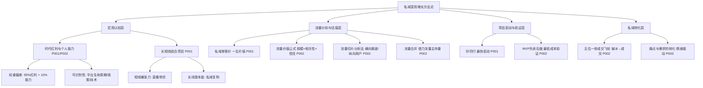
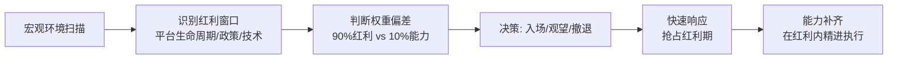
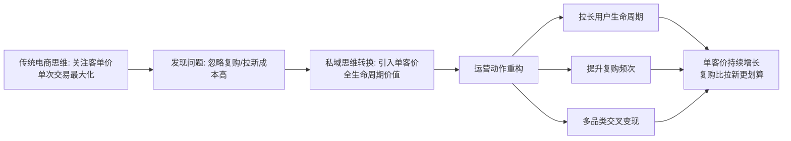
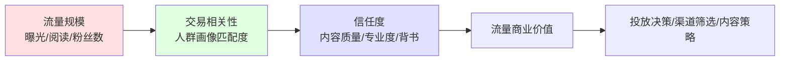
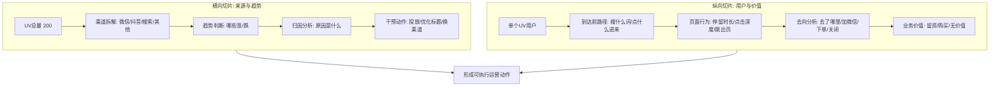
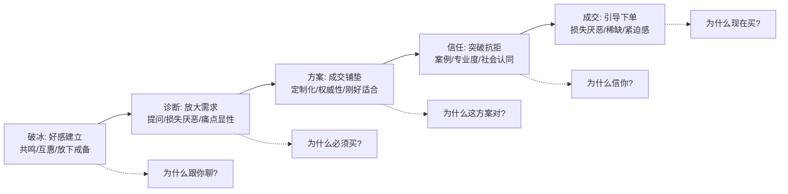
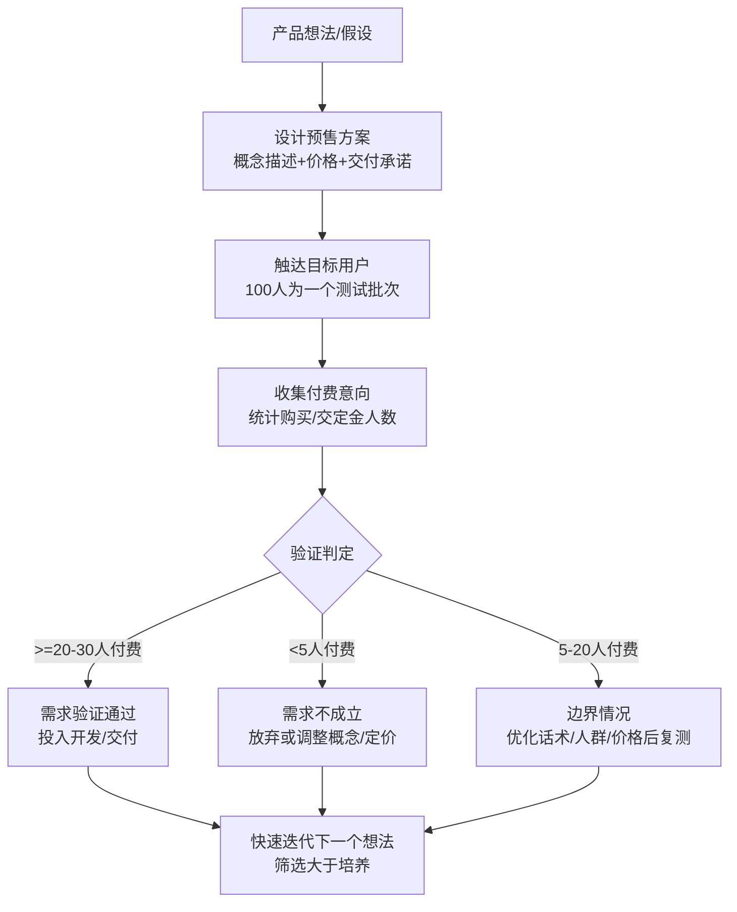
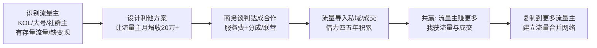
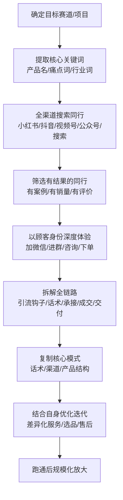

# 第 36 章 私域变现增长方法论 —— 从“认知底层”到“可量化的操作体系”

## 学习目标

- 理解时代红利与个人能力的权重关系，能识别当前红利窗口
- 掌握长短线结合项目的设计逻辑与 ROI 核算方法
- 掌握私域单客价、流量价值公式与流量切片分析三大核心分析工具
- 能应用五位一体成交飞轮完成私域一对一成交
- 掌握 MVP 先卖后做与抄同行的低成本验证与启动方法
- 理解流量合并的底层逻辑，知道如何借力流量主的存量流量

## 36.1 生活类比

想象私域变现是一个**经营一家永不关门的茶馆**：**时代红利** = 茶馆开在繁华地段，人流量大的红利远大于你泡茶的手艺；**单客价** = 一位熟客长期带来的消费总额，而非他单次买的一壶茶钱；**流量价值公式** = 进店人数（规模）× 是否是茶客（相关性）× 对你的信任（信任度）；**流量切片** = 分析客流从哪条街来（横向）、进店后坐多久点了什么（纵向）；**成交飞轮** = 从招呼入座（破冰）、聊出口渴偏好（诊断）、推荐合适茶品（方案）、展示老客好评（信任）到最终下单（成交）。就像茶馆老板要懂得选址借势（红利）、维护熟客（单客价）、分析客流动线（切片），才能让生意细水长流。

## 36.2 概念地图



## 36.3 时代红利与个人能力 —— 每一百块钱，九十块是时代的

### 为什么需要这个概念？

很多人误以为赚到钱全靠个人能力，一旦遇到瓶颈就拼命自我提升，却忽略了外部大环境的力量。如果不理解时代红利的权重，就容易在错误的方向上用力——在一个下行的赛道里再怎么努力也是事倍功半。副业操盘的第一步不是埋头苦干，而是先抬头看天：识别当前的红利窗口在哪里。

### 核心定义

> "可能所有夸张，我们所赚的每一百块钱，有九十块钱是时代红利，仅有十块钱是时代对我们个人能力的补偿，英雄只是时势的产物。"
> 
> ——《P001, p.1》

普通人赚取的绝大部分收入（约 90%）来自时代红利，仅少部分（约 10%）是对个人能力的补偿。商业英雄本质上是平台与市场红利的产物，而非纯粹的个人英雄主义。

### 关键性质

- **权重偏差**：主观上人们容易把成功归因于能力，客观上红利才是主导变量。
- **可识别性**：红利窗口往往与平台生命周期（增长期/存量期）、政策风向、技术革新强相关。
- **时效性**：红利窗口有明确的起止时间，错过就难以复制。

### 方法演进图



### 典型例子

**抖音本地生活的 10 倍增长空间**  
美团平台活跃商家数量达到 880 万家，基本覆盖全国全部地级市，而抖音本地生活仅覆盖了一线及新一线全部城市，但在二三线城市覆盖率较低，还有巨大的增长空间。同时外卖也会在 2023 年彻底打开，客单价 100 以上的外卖也会疯涨，两大块的组合才能完成 10 倍以上的增长。[P001, p.5]

**疫情平稳期带来的确定性消费复苏红利**  
春节国内旅游人次达 3 亿，恢复到 2019 年同期 88.6%；出境机票订单量上涨 258%、入境预定量上涨 632%、国际酒店预订量同比增长 177%——旅游行业春天将爆发。[P001, p.5]

### 边界条件

- 该概念适用于宏观层面的行业选择与时机判断，但不适用于微观的执行细节——具体项目做得好不好仍然取决于个人能力。
- 红利判断依赖数据推演（如香港疫情数据类比大陆），数据失真时判断也会失效。
- 红利窗口期转瞬即逝（如 ChatGPT 热点套利），响应速度决定能否吃到红利。

---

## 36.4 长短线结合项目 —— 既有爆发力，又有基本盘的生意

### 为什么需要这个概念？

互联网项目红利期越来越短，纯短线项目赚完一波就没了，纯长线项目又缺乏快速验证的反馈。创业者需要在两个看似矛盾的需求之间找平衡：短期的现金流爆发和长期的用户资产沉淀。单一依赖短线或长线都容易陷入被动——要么赚快钱但不可持续，要么熬长线但饿死在半路。

### 核心定义

> "近年来，因为现在信息传递越来越快了，项目红利期是越来越短的。所以我就在思考，怎么样能长短线结合，又有短期的爆发力，又有长期的基本盘。目前看，视频号直播+私域是有这个属性的。"
> 
> ——《P001, p.3》

长短线结合项目指一种既有短期爆发力（如直播带货的即时销售额）、又有长期基本盘（如私域用户的年产值）的业务模式。典型范式：视频号直播 + 私域——直播获得短期流量与营收，用户沉淀至私域实现长期复购。

### 关键性质

- **互补性**：短线的爆发力提供现金流和信心，长线的私域提供衰减周期较慢的年产值。
- **杠杆性**：同一份流量投入，既产生即时收入又沉淀长期资产，ROI 被放大。
- **可量化性**：可通过公式把私域产值计入综合 ROI，让决策有据可依。

### ROI 核算公式推导（来源：《P001, p.3-4》）

**符号定义**  
- $n$ = 客单价（单次成交金额）  
- $q$ = 毛利率（扣除成本后的利润占比）  
- $y$ = 广告投入（流量获取成本）  
- $z$ = 直播间除去退货后营业额（公域直接成交额）  
- 进线率 = 60%（合格线，指直播观众进入私域的比例）  
- $p$ = 私域月产值（元/人，单用户月均贡献营收）  

**推导步骤**：

1. **纯直播利润**：只看公域直接成交，利润 = 毛利收入 - 广告投入 = $q \times z - y$。  
   对应 ROI = $\frac{q \times z}{y}$。

2. **私域增量用户数**：直播间成交用户数 = $\frac{z}{n}$（总营业额 ÷ 客单价）。  
   进入私域的用户数 = $\frac{z}{n} \times 60\%$。

3. **私域月度增量营收**：单月私域新增营收 = 进入私域用户数 $\times$ 月产值 = $\frac{z}{n} \times 60\% \times p$。

4. **衰减建模**：私域用户价值随时间衰减，经验法则取前 3 个月按 80% 递减（即第 1 月 100%、第 2 月 80%、第 3 月 64%），后续视维护情况而定。  
   3 个月累计私域增量营收 = $\sum_{m=1}^{3} \left( \frac{z}{n} \times 60\% \times p \times 0.8^{m-1} \right)$。

5. **综合利润** = 纯直播利润 + 私域 3 个月累计增量营收 $\times$ 毛利率（简化按同毛利率计入）。  
   为直观对比 ROI，常直接将私域增量营收计入分子：  
   $$
   \text{ROI}_{\text{total}} = \frac{q \times z + \sum_{m=1}^{3} \left( \frac{z}{n} \times 60\% \times p \times 0.8^{m-1} \right) \times q}{y}
   $$

**公式作用说明**：该公式将“私域长期价值”显性化纳入投放决策模型。它揭示：单看直播间 ROI 可能仅 2.5（勉强及格），但若私域月产值达 15 元/人、进线率 60%，3 个月累计私域增量即可将综合 ROI 推至 3.5 以上；若进一步将月产值翻倍至 30 元，ROI 可达 4.5。这为“愿不愿意投资私域运营、投多少钱”提供了量化依据——只要边际私域运营成本低于私域带来的边际利润增量，就应持续投入。

### 典型例子

团队从抖音导流 2 万精准宝妈到私域，完成 7000 单胎毛纪念品变现，并结合副业培训、淘客实现总计超 100 万变现。[P001, p.4]

### 边界条件

- 私域进线率 60% 是合格线，低于此标准则长线价值有限。
- 年产值有衰减周期（通常前 3 个月按 80% 计算），需持续维护否则递减。
- 该模式依赖直播等公域引流能力，无流量获取能力时基本盘无从建立。

---

## 36.5 私域单客价 —— 从一次交易到一生价值

### 为什么需要这个概念？

电商传统思维只关注单次客单价，导致运营动作围绕“让这一次多买一点”展开，忽略了用户长期的重复购买价值。私域流量是一种长期关系资产，如果还用“一锤子买卖”的思维运营，等于端着金饭碗讨饭。理解了单客价，才会明白复购比拉新更重要，服务老客户比不断找新客户更划算。

### 核心定义

> "电商有个'客单价'的概念，而在私域流量运营的思维下，真正值得关注的不是'客单价'，而是'单客价'，就是一个消费者总共贡献了多少销售额。"
> 
> ——《P001, p.3》

私域单客价指一个消费者在私域流量池中，从首次接触到流失为止，累计贡献的总销售额。与传统的“客单价”（单次交易金额）相对，单客价关注的是用户全生命周期的总价值。

### 关键性质

- **时间累积性**：通过拉长用户生命周期和增加复购次数来提升总价值。
- **运营导向性**：单客价思维引导运营重心从“拉新”转向“养熟”，从“卖一次”转向“卖一辈子”。
- **与客单价互补**：客单价解决单次利润，单客价解决长期收入上限。

### 方法演进图



### 典型例子

**胎毛纪念品项目**：从抖音导流 2 万宝妈进私域，每个用户不只是买一次产品，后续还有副业培训、无货源、淘客等多重变现，单客价远超单次客单价。[P001, p.4]

### 边界条件

- 单客价提升的前提是用户对你有持续信任，无信任的私域只是“好友列表”而非“资产”。
- 不同品类的复购天然频率不同（如母婴用品复购高、房产复购低），单客价上限受品类约束。
- 过度追求单客价可能导致过度营销反而损耗信任，需要平衡“榨取”与“滋养”。

---

## 36.6 流量价值公式 —— 规模只是门票，相关性才是钱

### 为什么需要这个概念？

很多人被高阅读量、高粉丝数迷惑，以为流量大就等于赚钱多，结果空有流量没有转化。投放广告时只追求曝光量而忽略人群匹配度，导致费用浪费在无关人群上。需要一把尺子来衡量流量的真实商业价值，而不是被表面的数字唬住。

### 核心定义

> "流量价值=流量规模×交易相关性×信任度"
> 
> "有时候我们面对一篇阅读量很高的文章、一篇赞藏很高的小红书笔记、一个很火的抖音视频，会感到困惑或焦虑。因为我们只看到了表层的流量规模，有些慌张，但流量规模只解决连接的问题，不解决交易的问题。比流量规模更重要的是流量相关性…信任度怎么看？有的连接带来的价值有限，这和连接给UV带来的感受有关…不轻易连接，但连接必有价值。"
> 
> ——《P002, p.2-3》

流量价值 = 流量规模 × 交易相关性 × 信任度。其中规模解决“连接多少人”的问题，相关性解决“这些人是否可能买”的问题，信任度解决“他们敢不敢买”的问题。

### 关键性质

- **乘法效应**：三个因素是乘积关系，任何一项为零则整体为零。
- **权重差异**：规模和相关性解决“能不能转化”，信任度决定“转化率有多高”。
- **反直觉性**：一个 10 万阅读的泛内容，商业价值可能远低于 1 万阅读的精准内容。

### 方法演进图



### 典型例子

**微信捡漏群**：通过免费/付费引流将目标用户从各平台导入企业微信，再拉到 500 人大群，这些被筛选过的用户具备高交易相关性，配合 30-50 个演员营造氛围，单群产出远高于泛流量群。[P001, p.6]

### 边界条件

- 流量规模是基础门槛——规模为 0 时，相关性和信任度再高也无效。
- 信任度需要长期积累，无法短期速成，是新账号的天然短板。
- 相关性判断依赖对目标用户画像的清晰认知，用户画像模糊时难以筛选有效流量。

---

## 36.7 流量切片分析法 —— 把流量切成片，才能看出门道

### 为什么需要这个概念？

拿到一份流量数据（如 UV/PV），如果只看总量，根本不知道问题出在哪里——是渠道不行？还是内容不行？还是用户不对？没有切片的流量数据是一团迷雾，无法指导任何运营决策。需要一种方法把“流量”这个大而空的概念拆解成可操作的观察维度，才能形成具体的干预动作。

### 核心定义

> "横向你要看：这 200 个 UV 从哪里来？有哪些渠道？哪些涨了？哪些跌了？趋势如何？原因是什么？可干预的运营动作是什么？"
> 
> "纵向你要看：UV 的背后是用户，这个用户来到页面前经历了什么？有着怎样的需求？为什么要来？停留了多久？去向了哪里？离开的时候和刚进来有什么不同？能不能形成业务价值？"
> 
> "流量要切成片来看，才有可优化的空间，才能形成可执行的运营干预动作。"
> 
> ——《P002, p.3-4》

流量切片分析法指将流量数据按横向（来源渠道、涨跌趋势、干预动作）和纵向（用户需求、行为路径、业务价值）两个方向切成片逐一分析的方法。横向看“流量从哪来、怎么变、能做什么”，纵向看“用户是谁、经历了什么、产生什么价值”。

### 关键性质

- **双向切割**：横向解决渠道效率，纵向解决用户价值。
- **干预导向**：切片的目的不是分析本身，而是找到“可执行的运营干预动作”。
- **层层深入**：从来源 → 行为 → 价值逐层追问，直到洞察到问题本质。

### 方法演进图



### 典型例子

发现一个内容页面 200 个 UV：横向拆出渠道（微信/抖音/搜索）、趋势（涨/跌）、干预动作（投放/优化标题）；纵向拆出用户需求（搜什么词来的）、行为路径（停留多久、去了哪里）、业务价值（是否留资/购买）。作者宣称按此方法操盘，可让 C 端业务单日获得 1000 个有效咨询。[P002, p.4]

### 边界条件

- 切片的前提是有足够细粒度的数据，缺乏数据埋点或第三方统计工具时难以实施。
- 切片后需要能力把“洞察”转化为“动作”，否则分析只是纸上谈兵。
- 过度切片可能导致动作碎片化，需要结合全局战略判断优先级。

---

## 36.8 成交飞轮 —— 让客户从陌生到下单的五步舞曲

### 为什么需要这个概念？

私域一对一成交看似自由发挥，实则多数人不懂章法，要么一上来就推销惹人反感，要么聊了很久却迟迟不敢提成交。客户下不了决心，本质上是因为三个问题没解决：为什么必须买？为什么跟你买？为什么现在买？需要一个标准化的成交流程，让每一步都有明确目标和动作，而不是靠感觉和运气。

### 核心定义

> "私域成交有逻辑、有章法…我把整套成交逻辑整理成了五位一体成交飞轮：①破冰——好感建立、②诊断——放大需求、③方案——成交铺垫、④信任——突破抗拒、⑤成交——引导下单。"
> 
> "多数犹豫不决的客户，究其根本都是因为三个原因：为什么必须买？为什么跟你买？为什么现在买？"
> 
> "想解决这个问题…心理学领域，有一个专业的名词'损失厌恶'。"
> 
> ——《P002, p.5-6》

五位一体成交飞轮指私域一对一成交的五个标准步骤：
1. **破冰** —— 好感建立
2. **诊断** —— 放大需求
3. **方案** —— 成交铺垫
4. **信任** —— 突破抗拒
5. **成交** —— 引导下单

每一步解决一个心理关卡，层层递进直至成交。

### 关键性质

- **顺序性**：五步不可跳步，跳步会导致信任缺失或需求未被放大而成交失败。
- **心理驱动**：核心利用了“损失厌恶”等心理学机制，而非单纯的产品推销。
- **可 SOP 化**：标准流程可复制给团队，降低对人的依赖。

### 方法演进图



### 典型执行动作

以下表格总结了五位一体成交飞轮各步骤的核心动作、心理机制与解决的核心问题：

| 步骤 | 核心动作 | 心理机制 | 解决的核心问题 |
|------|----------|----------|----------------|
| 破冰 | 通过共鸣建立好感，让客户放下戒备 | 相似性吸引、互惠原则 | 为什么跟你聊？ |
| 诊断 | 通过提问放大用户痛点（如“你现在的方案让你损失多少客户？”） | 损失厌恶、稀缺性 | 为什么必须买？ |
| 方案 | 给出针对性方案，让客户感觉“这就是为我定制的” | 个性化匹配、权威性 | 为什么这方案对？ |
| 信任 | 分享案例、展示专业度，击破“我凭什么信你”的抗拒 | 社会认同、专家权威 | 为什么信你？ |
| 成交 | 用“损失厌恶”话术（如“再不做就错过了最佳时机”）引导下单 | 损失厌恶、紧迫感 | 为什么现在买？ |

### 边界条件

- 该流程适用于高客单价、需要一对一沟通的产品，不适合低客单价自助下单场景。
- 破冰和诊断的质量决定了后续成交率，这依赖销售人员的沟通能力而非纯话术。
- 飞轮强调“成交”是终点、“关系”是起点，若只想一锤子买卖则会破坏长期复购。

---

## 36.9 MVP 先卖后做 —— 卖空气是最高效的验证

### 为什么需要这个概念？

传统做产品思路是先开发后售卖，但开发周期长、成本高，做出一个没人要的产品是最大的浪费。很多创业者凭感觉做一个产品，做完才发现需求不存在，钱和时间都打了水漂。需要一种方法在投入大量资源之前，用最低的成本快速验证需求的真实性。

### 核心定义

> "比如最重要的是先卖产品的想法，而不是做产品。如果聊了 100 个人，只有几个人买，肯定有问题；如果 20-30 个人购买，交了预售金，那这个不确定因素就解决了。"
> 
> "这样我们就能够在短时间内测试几十个产品，最后得出一个正确选项，这是最好的验证方式。因为筛选大于培养，尝试次数多了就知道哪个是比较好的方案。"
> 
> ——《P002, p.5》

MVP 先卖后做指验证产品时应优先“卖产品的想法”而非先做产品，通过高意向付费人数来判断需求是否成立。操作方式：先向目标用户描述产品概念并收取定金/预售金，看有多少人愿意付费。

### 关键性质

- **低成本性**：无需开发产品，只需描述概念即可测试，单次测试成本极低。
- **数据驱动**：以付费人数（而非口头意愿）作为需求真实性的判定标准，避免“嘴上说想要”的假信号。
- **快速迭代**：可在短时间内测试几十个产品概念，筛选出最优选项。

### 方法演进图



### 典型例子

- 聊了 100 个人只有几个人买，说明需求有问题；如果 20-30 人购买并交了预售金，则需求验证通过。
- 聊天机器人/课程类产品：先发预售文案收钱，再开发/录制，验证成功后再交付。

### 边界条件

- 该方法适用于已验证场景但未验证产品的需求测试，不适用于需要实物体验的复杂产品。
- 预售需要有基本的信任基础，完全陌生且无信任时用户不会为“空气”付费。
- “卖空气”有道德边界，若长期不交付或不打算交付则滑向诈骗。

---

## 36.10 流量合并 —— 让你的生意装上别人的流量引擎

### 为什么需要这个概念？

自己建团队获取流量成本高昂且周期长，很多小团队根本养不起流量团队。市场上大量流量主（KOL、大号、社群主）手握流量但缺乏变现方法，流量在沉睡。需要一种“借力”思路，把别人的流量变成自己的生意引擎，而非一切从零开始。

### 核心定义

> "“我自己认为世界上流量按照所有权分类只有两类：一个是自己建团队获取流量，还有一类是整合别人的流量。”"
> 
> "谁能让流量主赚更多的钱，谁就拥有了这个流量主的流量。"
> 
> "我们假设有一个 KOL，积累了四五年的流量…现在如果我能想一个办法出来，让他卖我的货，一个月能赚二十万，那这个人四五年积累的流量就会为我服务…在这个世界里并不缺流量，真正缺少的是把流量价值最大化的方法。"
> 
> ——《P002, p.4-5》

流量合并指通过设计让流量主赚更多钱的方案来整合其流量，实现“流量不为我所有，但为我所用”。核心逻辑：谁能让流量主赚更多的钱，谁就拥有了该流量主积累的所有流量。

### 关键性质

- **所有权与使用权分离**：不买断流量，而是用“利他”方案换取流量使用权。
- **杠杆效应**：利用别人的积累（四五年粉丝）快速启动自己的变现，无需从 0 开始。
- **共赢结构**：流量主获得更高收入，你获得流量和成交，是正和博弈。

### 方法演进图



### 典型例子

- 假设一个 KOL 积累了四五年流量但变现一般，你设计一套方案让他卖你的货月赚 20 万，这四五年的流量就会为你服务。

### 边界条件

- 前提是你必须真正能让流量主赚到更多钱，否则合作不成立。
- 适合有成熟变现方案但缺流量的商家，不适合自己还没跑通变现模式的初创者。
- 依赖流量主的信任和合作意愿，需要较强的商务谈判能力。

---

## 36.11 抄同行 —— 最快的项目启动方式

### 为什么需要这个概念？

很多新手创业者总想“创新”，结果在没人验证过的方向上浪费大量时间和金钱。闭门造车做项目，连最基本的流量渠道、话术、转化链路都靠猜，成功率极低。需要一个捷径：找到已经跑通的成功案例，用“抄”的方式快速复制，避开多数弯路。

### 核心定义

> "同行就是最好的老师，抄同行永远是做项目最快的途径，能避开多数弯路和无用功。"
> 
> "每个项目都有关键词，通过关键词在各个推广渠道搜索这个项目的关键词就一定可以找到同行。"
> 
> "我们以客户的角度去思考如果我想要买这个产品，我会在哪去搜关键词，自然也可以找到同行的流量渠道。"
> 
> "多数情况下没有不赚钱的项目，只有不赚钱的人。凡是大一些的，能拿出来卖的项目就不会是一个纯坑。因为只有有一部分人操作这个项目挣到过钱，这个项目才会流出来，才会被拿出来卖。"
> 
> ——《P001, p.4-5》

抄同行指通过寻找有成熟结果的同行项目，以顾客身份套取话术与流量渠道，再复制其成功模式的最快启动路径。具体方法：通过关键词在各推广渠道搜索同行，以客户身份咨询套取话术与流量渠道，然后模仿复制。

### 关键性质

- **验证性**：能拿出来卖且有同行操作盈利过的项目，不会是纯坑——因为只有有人赚到钱，项目才会被拿出来卖。
- **效率性**：避开研发和试错环节，直接站在别人验证过的肩膀上起步。
- **迭代性**：抄是起点，抄完要优化和创新，“先模仿再超越”。

### 方法演进图



### 典型例子

- 每个项目都有关键词，通过关键词在各平台搜索一定能找到同行，以客户身份咨询即可套出话术和流量渠道。
- 美业线上变现：从模仿爆款笔记开始，先拆解达人账号再优化迭代，逐步起号。

### 边界条件

- 抄的是模式而非内容，直接搬运内容有侵权风险。
- 同行的方法可能已过时，需要结合当下平台规则做调整。
- 只会抄不会优化的人，永远跟在别人后面吃剩饭。

---

## 36.12 痛点与需求的转化 —— 从“我想要”到“我必须买”

### 为什么需要这个概念？

客户说“我需要”的时候往往不会掏钱，只有感到“我痛”的时候才会下单。很多销售把客户的理性需求当成购买信号，结果费尽口舌却成交不了。需要区分需求与痛点的本质差异，掌握把需求转化为痛点的销售技巧。

### 核心定义

> "需求和痛点的差别在什么呢？我以为我需要这个东西，它没有什么情绪的动力。"
> 
> "当客户很平静的时候，都是需求，不是痛点。"
> 
> "情绪动力是客户花钱的最根本的点，大客户也逃不掉。"
> 
> "你不用学那么多，你只要知道他最大的痛点就是失去掌控权，恐惧源于未知。"
> 
> "当你抓住了他的这个痛点以后，他第一感觉就是我得找你帮我解决这个事情，别人没发觉。"
> 
> ——《P003, p.1-2》；《P002, p.5-6》

需求是理性的、缺乏情绪动力的（“我以为我需要这个东西，它没有什么情绪的动力”）；痛点是带有强烈情绪驱动的（焦虑、恐惧、损失厌恶）。只有把客户的需求上升为痛点，才能促使其下决定购买。

### 关键性质

- **情绪驱动**：情绪动力是客户花钱的最根本的点，大客户也逃不掉。
- **状态判断**：当客户很平静时，都是需求，不是痛点——痛点必然伴随情绪波动。
- **可转化性**：通过提问和诊断，可以人为地帮助客户“感受”到痛点。

### 方法演进图

```mermaid
flowchart LR
    N1[客户表达需求\n"我想要/我需要..."\n平静/理性/无紧迫感] --> N2[销售诊断提问\n现状追问/后果推演/损失量化]
    N2 --> N3[需求升维为痛点\n焦虑/恐惧/损失厌恶\n"不解决会怎样?"]
    N3 --> N4[情绪动力驱动决策\n"我必须买/我现在就要买"]
    N4 --> N5[提供解决方案\n成交]
    
    style N1 fill:#ffe0e0
    style N3 fill:#fff0e0
    style N4 fill:#e0ffe0
```

### 典型例子

**视频号直播 + 私域案例**：观众看到直播内容感到“不加入就错过红利”的焦虑（痛点），而非“这个产品不错”的理性判断（需求）。

**高净值客户**：最大的痛点是“失去掌控权”，恐惧源于未知——抓住这个痛点，客户会觉得你懂他，形成依赖。[P003, p.2]

### 边界条件

- 放大痛点要有伦理边界，故意制造焦虑来促成交易可能损害长期信任。
- 不同品类的痛点强度天然不同（如保险强、日用品弱），策略需匹配品类。
- 痛点转化后必须给出解决方案，否则客户只会更焦虑而不购买。

---

## 36.13 多源对照：核心概念的跨素材印证

### 时代红利与个人能力

以下表格对比了两份素材中关于“时代红利与个人能力”概念的核心表述与侧重点：

| 素材 | 核心表述 | 侧重点 |
|------|----------|--------|
| P001 | “每一百块钱，九十块是时代红利” | 宏观权重判断，强调识别红利窗口比提升能力更紧迫 |
| P002 | “商业英雄是平台与市场红利的产物” | 结合财富积累四阶段，指出阶段跃迁需借势 |

**共识**：个人收入绝大部分源于外部红利，识别红利窗口是第一优先级。  
**分歧**：P001 强调“红利窗口的时效性与数据推演”，P002 更强调“阶段跃迁的路径依赖（打工→卖时间多份→买时间→钱生钱）”。

### 私域单客价 vs 客单价

以下表格对比了两份素材中关于“私域单客价”与“客单价”的核心表述与侧重点：

| 素材 | 核心表述 | 侧重点 |
|------|----------|--------|
| P001 | “真正值得关注的不是客单价，而是单客价” | 私域运营视角，强调全生命周期价值 |
| P002 | 财富积累第二阶段“一份时间多次卖” | 个人商业模式视角，强调杠杆化产出 |

**共识**：单次交易思维是陷阱，长期复利才是核心。  
**分歧**：P001 聚焦“用户端的累积价值”，P002 聚焦“供给端的杠杆放大”。

---

## 36.14 设计中的取舍

在选择流量获取方式时，我们放弃了全职自建流量团队，转而采用流量合并策略。因为自建团队需要 6-12 个月磨合期，固定成本高（人力、工位、工具），且平台规则变动风险全自担；流量合并只需设计“让流量主赚更多钱”的方案，边际成本极低，风险共担。代价是依赖流量主的合作意愿与稳定性，需具备商务谈判与方案设计能力。

在项目启动方式上，我们放弃了原创内容引流，选择抄同行话术与关键词截流。原创内容产出周期长、不确定性高，新号冷启动极难；抄同行直接复用已验证的高转化话术与关键词，把“不确定的创作”变成“确定的复制”。代价是同质化竞争激烈，需在细节（服务、选品、售后）建立差异化护城河。

在 MVP 验证阶段，我们坚持“先卖后做”而不是“先做原型再卖”。先做原型的沉没成本极高（开发周期、人力、服务器），且极易陷入“完美主义陷阱”无限打磨；先卖后做用真金白银的购买意向验证需求，筛选大于培养。代价是预售交付压力大，需极强的项目管理兜底能力。

---

## 36.15 动手练习

### 练习 1：核算你的私域综合 ROI

假设你经营一个直播带货项目，已知以下参数：  
客单价 n = 150 元，毛利率 q = 40%，直播间营业额 z = 100,000 元，广告投入 y = 40,000 元。  
私域进线率 60%，私域月产值 p = 15 元/人。

请计算：  
1. 只做直播的纯利润与 ROI。  
2. 加入私域产值后的综合纯利润（私域月递减前 3 个月按 80% 折算）。  
3. 若通过精细化运营将月产值 p 翻倍，ROI 提升至多少？  
4. 如果私域进线率只有 30%，对综合 ROI 的影响是什么？  
思考：为什么私域进线率 60% 是合格线？

### 练习 2：用流量价值公式评估两个投放渠道

你有两个渠道可选择投放：  
渠道 A：某泛娱乐公众号，单篇阅读 50,000，粉丝画像为 18-25 岁学生，无直接购物需求，信任度低。  
渠道 B：某母婴垂直社群，成员 1,000 人，均为 0-3 岁宝妈，对群主推荐信任度高。

请用『流量价值 = 流量规模 × 交易相关性 × 信任度』公式进行定性评估：  
1. 对两个渠道的『规模、相关性、信任度』分别打分（1-10 分）。  
2. 计算各渠道的流量价值乘积，判断哪个渠道更值得投放。  
3. 如果要提升渠道 A 的价值，最应该改变哪个因子？给出具体可操作的策略。

### 练习 3：设计一个『先卖后做』的 MVP 验证方案

假设你计划开发一个『给考研学生的一对一择校咨询』付费服务，售价 199 元/次。  
在不开发任何产品的前提下，设计一个 MVP 先卖后做方案：  
1. 写出你的目标用户是谁，以及你会通过哪个渠道触达这 100 个潜在用户。  
2. 设计预售话术：包括开场白、服务内容描述、交付形式、限时优惠机制。  
3. 设定验证标准：聊了多少人、多少人购买/交定金才算需求成立？  
4. 如果 100 人中只有 5 人购买，你会如何调整？是放弃还是调整产品定价/描述？

### 练习 4：抄同行：拆解一个竞品的成交流程

选择一个你感兴趣的副业赛道（如小红书资料号、抖音带货、视频号直播），找到 1 个你认为做得好的同行账号。  
以『顾客/粉丝』身份完整走一遍对方的引流-成交链路，记录：  
1. 同行通过什么关键词/渠道触达你？（搜索词、推荐流、转介绍）  
2. 从加好友到进入成交环节，对方用了哪些话术和钩子？  
3. 其流量承接载体是什么（公众号、企微、社群）？  
4. 拆解出其核心成交流程，并思考哪一步是你可以直接模仿的，哪一步需要结合自身优化。

---

## 36.16 本章小结

这一章中我们系统构建了私域变现增长的完整方法论体系。首先我们在宏观认知层确立了**时代红利与个人能力**的权重关系（9:1），指出识别红利窗口是第一优先级；并提出**长短线结合项目**设计，用视频号直播的短期爆发力配合私域的长期基本盘，通过 ROI 公式量化私域产值对综合回报的放大作用。其次在流量分析与估值层，我们掌握了三大核心工具：**私域单客价**将关注点从单次交易转移到用户全生命周期价值；**流量价值公式**揭示规模只是门票、相关性与信任度才是变现的真正杠杆；**流量切片分析法**提供横向渠道与纵向用户的双向拆解框架，让流量数据转化为可执行的运营动作。再次在项目启动与验证层，我们学习了**抄同行**这一最快启动路径（以顾客身份套取话术与渠道）与 **MVP 先卖后做**的最低成本验证法（用预售金验证真需求）。最后在私域转化层，我们掌握了**五位一体成交飞轮**（破冰→诊断→方案→信任→成交）的标准化 SOP，以及**痛点与需求转化**的核心心法——情绪动力是成交的根本，把理性需求升维为情绪痛点才能驱动下单。贯穿全章的主线是：用认知选方向、用数据算账、用流程跑通、用杠杆放大。

本章我们一起学习了以下概念：

以下表格汇总了本章的核心概念及其解释：

| 概念 | 解释 |
|------|------|
| 时代红利与个人能力 | 个人收入约 90% 来自时代红利，识别红利窗口比盲目提升能力更紧迫 |
| 长短线结合项目 | 用短线的爆发力提供现金流，用长线的私域提供衰减慢的产值，实现 ROI 放大 |
| 私域单客价 | 关注用户全生命周期总价值而非单次客单价，复购比拉新更重要 |
| 流量价值公式 | 流量价值 = 规模 × 交易相关性 × 信任度，规模只是门票，相关性和信任度决定转化 |
| 流量切片分析法 | 将流量按横向（来源/趋势）和纵向（用户/价值）切片，才能形成可执行的运营干预 |
| 流量合并 | 让流量主赚更多钱就能获得其流量使用权，是杠杆化的借力策略 |
| MVP 先卖后做 | 先卖想法而非产品，用付费人数验证需求，以最低成本快速筛选正确选项 |
| 抄同行 | 以顾客身份套取同行话术与渠道并复制其成功模式，是避开弯路的最快启动方式 |
| 五位一体成交飞轮 | 私域成交五步法：破冰→诊断→方案→信任→成交，解决为什么买/跟你买/现在买 |
| 痛点与需求的转化 | 需求理性无情绪动力，痛点伴随焦虑恐惧，把需求升维成痛点才能驱动下单 |

下一章中，我们将学习 **商业认知的底层逻辑 —— 从“赚钱思维”看懂商业世界**，进一步提升认知维度，建立对赚钱、交易、增长、战略等核心概念的系统性理解。


