# 第 43 章 商业认知的底层逻辑 —— 从“赚钱思维”看懂商业世界
作者：龙哥

## 学习目标

- 理解流量价值由规模、相关性、信任度三个维度乘积决定，能够解释"高流量低转化"现象
- 掌握流量流速的动态平衡原则，理解停留时间与规模效应之间的张力
- 掌握从"追求增长"到"价值创造"的视角切换方法，理解增长瓶颈怪圈的成因与破解路径
- 理解实时真实ROI的核算逻辑，能够将私域产值纳入投产比的综合评估
- 掌握捡漏群、演员氛围等社群精细化运营方法的底层机制与适用边界
- 理解财富积累四阶段的递进关系，能根据自身所处阶段制定对应策略
- 掌握基于自身优势制定战略的基本框架，理解"不做什么"在战略决策中的关键地位
- 理解事实与观点的本质区别，能够运用5WHY分析法和道术器用四层分析法诊断与拆解商业问题
- 掌握超垂直个人IP的SEO流量获取方法，能区分SEO思维与爆款思维的适用边界
- 能区分流量价值公式、流量流速悖论等概念作为定性框架与定量工具的适用边界

## 43.1 生活类比

想象你经营一家**街角杂货铺**，同时也是一名**侦探**，更像一位**在荒原上打井的矿工**。这三重身份交织，构成了商业认知的完整图景。

作为**杂货铺店主**，你每天看着门口川流不息的行人。**流量规模**是路过的人数；**流量相关性**是其中想买杂货的比例；**信任度**是街坊邻居相信你家货真价实的程度。若行人虽多皆是赶路的上班族，且对你缺乏信任——流水虽大，成交寥寥。就像精明的店主不会只盯着门口人流量，而是更关注"谁在买""为什么买"，流量运营也不能只看UV/PV，而要关注与交易的相关性和信任度。这就是**流量价值公式**的生活投影：价值 = 规模 × 相关性 × 信任度，任一项为零，生意归零。

作为**侦探**，你面对满桌线索。**事实**是脚印、指纹、监控录像——客观存在、可验证；**观点**是邻居猜测"凶手一定是强壮男人"——基于偏见、不可直接采信。你用**5WHY分析法**连追五问："为什么死者在仓库？"→"为什么门锁坏了？"→"为什么保安没巡逻？"……最终挖出真相。你手中的**商业画布**是案件卷宗：受害者是谁、作案手法、动机、时间线、证据、嫌疑人、关系网——每一页都指向破案方向。就像优秀侦探不会被表象迷惑，而是用证据和系统排查逼近真相，商业决策也必须区分主观判断与客观依据，用结构化工具穿透表象。

作为**矿工**，你在人迹罕至的荒原选点打井。别人涌向金矿（红海），你选少人知却富含矿藏的荒地——这是**蓝海赛道**；你按地质图精准标记钻孔点——这是**SEO长尾关键词**；你不断向深处挖矿石——这是**超垂直内容**；漫无目的乱挖碰运气——那是**爆款思维**。就像有经验的矿工按图索骥打井，超垂直IP用SEO思维提前布局搜索入口，才能旱涝保收地获得精准流量。

这三重隐喻贯穿全章：杂货铺教你算流量真账，侦探教你辨事实真相，矿工教你挖长期价值。

## 43.2 概念地图

商业认知
├── 流量认知
│   ├── 流量价值公式 —— P001
│   │   ├── 规模：解决连接问题
│   │   ├── 相关性：决定转化概率
│   │   ├── 信任度：影响成交深度
│   │   └── 乘积关系：任一项为0则整体为0
│   ├── 流量流速悖论 —— P001
│   │   ├── 过快：无法形成连接与停留
│   │   ├── 过慢：丧失规模效应
│   │   └── 平衡：增加停留时间+保持规模
│   ├── 交易目的论 —— P001
│   │   ├── 曝光≠价值：无反馈曝光是负价值
│   │   ├── 互动即信号：平台不给你流量
│   │   └── 终极锚点：一切动作服务交易转化
│   ├── 流量合并 —— P001
│   │   ├── 分类：自建团队 vs 整合别人
│   │   ├── 核心抓手：让流量主赚更多钱
│   │   └── 本质：价值交换而非单纯买量
│   └── 流量切片分析法 —— P001
│       ├── 横向：来源渠道/涨跌趋势/干预动作
│       └── 纵向：用户需求/行为路径/业务价值
├── 战略思维
│   ├── 战略=选择 —— P001/P004
│   │   ├── 本质是取舍与聚焦
│   │   ├── 最重要的是不做什么
│   │   ├── 目的：获得相对优势
│   │   └── 原则：形成自始至终的指导原则
│   ├── 战略发挥优势 —— P001/P004
│   │   ├── 先审视筹码（优势）再决定打法
│   │   ├── 发挥优势、补齐短板
│   │   └── 关注资源禀赋而非盲目对标
│   └── 增长瓶颈怪圈 —— P004
│       ├── 成因：被增长预期绑架
│       ├── 机制：投机跟风→计算利弊→抓取资源
│       └── 破解：价值创造视角（三勇气）
├── 内容与IP
│   ├── 超垂直个人IP —— P009
│   │   ├── 定义：极致细分领域的知识品牌
│   │   ├── SEO思维获取精准流量（vs 爆款思维）
│   │   ├── 四步路径：布局300-500长尾词→逐个写方案→多渠道发布→坚持更新
│   │   └── 长期主义变现：旱涝保收的复利
│   ├── 产品Idea五种构思法 —— P009
│   │   ├── 原生idea（最高成功率）
│   │   ├── 抄成功竞品做差异化
│   │   ├── 分析搜索关键词找未满足需求
│   │   ├── 预付费定制产品化
│   │   └── 生造idea（最低成功率）
│   ├── 平台电商四周期 —— P009
│   │   ├── 铺货期→动销期→精细化期→玩趋势期
│   │   ├── 以史为鉴预判新平台（美团/TEMU）
│   │   └── 主动拥抱早期红利窗口
│   ├── 内容价值金字塔 —— P001
│   │   ├── 给娱乐：情绪价值难变现
│   │   ├── 给工具：实用性可引流
│   │   └── 给方法：打造个人IP壁垒最高
│   └── 新平台红利期 —— P009
│       ├── 美团电商冷启动案例（单店月利润6k-12k）
│       ├── 完成比完美更重要
│       └── 平台生命周期与投放节奏调整
├── 分析工具
│   ├── 事实与观点 —— P002
│   │   ├── 事实：中性、可用数字和证据支撑
│   │   └── 观点：因人而异、基于立场与层次
│   ├── 5WHY分析法 —— P002
│   │   └── 连续追问探寻问题根因
│   └── 商业模式画布道术器用法 —— P002
│       ├── 道：商业模式的本质
│       ├── 术：解决方案的9个关键维度
│       ├── 器：载体工具平台
│       └── 用：执行力与业务流迭代
├── 私域变现
│   ├── 私域单客价 —— P001
│   │   └── 以单客总贡献替代单次客单价
│   ├── 实时真实ROI —— P001
│   │   └── 纳入私域产值后的综合投产比
│   ├── 捡漏群 —— P001
│   │   └── 1-3折商品+精细化运营的佣金变现
│   └── 演员氛围 —— P001
│       └── 用"托"营造抢购从众氛围
├── 财富增长
│   ├── 财富积累四阶段 —— P001
│   │   ├── 出卖劳动力
│   │   ├── 一份时间多次卖
│   │   ├── 购买他人时间
│   │   └── 钱生钱
│   └── 利他等于利己 —— P001
│       └── 分享不减少价值反而积累信任
└── 卓越策略师五大能力 —— P002
├── 调研能力
├── 归纳总结能力
├── 项目管理能力
├── 决断力
└── 双重叙事能力

---

## 43.3 流量价值公式 —— 给流量装上"规模×相关性×信任"的三维棱镜

### 为什么需要这个概念？

我们看到一篇10万+的文章、一个爆火视频，常常被表面的流量规模震撼。但高曝光不一定带来高成交，仅看流量数字容易产生焦虑和误判。我们需要一个综合框架来判断流量的真实商业价值，而不被规模表象迷惑。

> "流量价值=流量规模×交易相关性×信任度"
> 
> "有时候我们面对一篇阅读量很高的文章、一篇赞藏很高的小红书笔记、一个很火的抖音视频，会感到困惑或焦虑。因为我们只看到了表层的流量规模，有些慌张，但流量规模只解决连接的问题，不解决交易的问题。比流量规模重要的是流量相关性……信任度怎么看？有的连接带来的价值有限，这和连接给UV带来的感受有关……不轻易连接，但连接必有价值。"
> 
> ——《docs/202301-02/20230207_06.md》

### 核心定义与逐步推导

**流量价值公式**定义如下：

$$
\text{流量价值} = \text{流量规模} \times \text{交易相关性} \times \text{信任度}
$$

**逐步推导与解释**：

1. **第一步：拆解"流量"的商业含义**  
   流量不是目的，是手段。商业的终点是交易。流量规模（UV/PV）仅解决"让更多人看到"的**连接问题**，并不直接产生交易。

2. **第二步：引入"交易相关性"**  
   来的人是不是买这类东西的人？这决定了**转化概率**。泛娱乐流量进育儿号，相关性≈0，转化自然为零。

3. **第三步：引入"信任度"**  
   用户敢不敢买、会不会复购？这决定了**成交深度**。即使人来了、需求对上了，不信任你也不会掏钱。

4. **第四步：确立乘积关系**  
   三者是**乘积**而非加法关系：任一项为0，整体商业价值归零。这解释了为什么"高流量低转化"频发——规模再大，若相关性或信任度为0，价值依然为0。

我们逐层拆解这三个维度：

| 维度 | 核心作用 | 典型误区 |
|------|----------|----------|
| **流量规模** | 解决"连接"问题：让更多人看到你 | 误认为规模大就能直接变现，忽略后两个维度 |
| **交易相关性** | 决定"转化概率"：来的人是不是买这类东西的人 | 把泛流量当精准流量，内容与商品不匹配 |
| **信任度** | 影响"成交深度"：用户敢不敢买、会不会复购 | 认为有流量有相关性就能成交，忽视信任建设 |

### 公式作用说明

这个公式作为一个**定性思考框架**，帮你诊断"卡在哪个环节"，而非输入精确数字算出确切产值。它强制运营者从单一维度（曝光）转向三维评估（连接×匹配×信任），从而避免"刷流量、买水军"等唯规模论的无效动作。当平台数据造假或刷量时，规模维度失真，公式评估结果也会随之失真，因此使用时需结合数据真实性判断。

### 关键性质

1. **乘积关系**：这是一个"木桶效应"公式，短板决定整体价值。你可以有一亿曝光（规模=10000），但如果相关性=0.0001、信任度=0.1，价值仅为100；反之，规模=1000、相关性=0.5、信任度=0.8，价值=400，反而更高。
2. **定性框架而非定量工具**：该公式主要作为思考框架，帮你诊断"卡在哪个环节"，而非输入精确数字算出确切产值。
3. **数据造假失真风险**：当平台数据造假或刷量时，规模维度失真，公式评估结果也会失真。

### 典型例子

同一篇热门笔记，在精准育儿社群转发产生高转化，在泛娱乐大号转发仅带来围观。区别不在内容本身，而在**接收人群的相关性与信任度**不同。

### 方法演进图

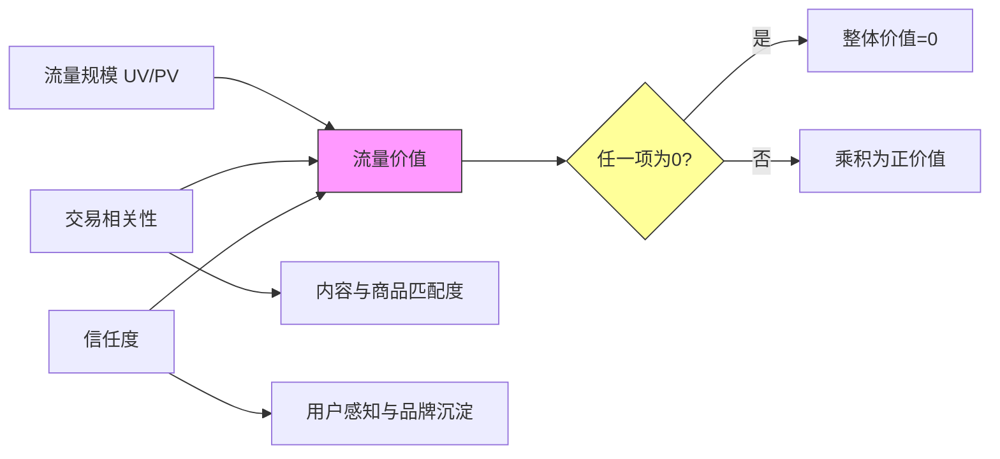

---

## 43.4 流量流速悖论 —— 让水流"不快不慢、持续不断"

### 为什么需要这个概念？

流量要么来得太快一闪而过，要么积压不动，两种极端都无法产生稳定价值。过快时用户来不及沉淀、来不及形成信任；过慢时缺乏规模效应。我们需要理解流量流动速度与停留时长之间的平衡。

> "流量的速度太快、没有停留、规模再大也没有用，流量一直停留不动也不行，等于没有了规模。"
> 
> "流量的核心是流和量，就要流动也要停留、不快不慢、持续不断，这样的流量价值才是最大的。"
> 
> "增加用户的停留时间。"
> 
> ——《docs/202301-02/20230207_06.md》

### 核心定义与推导逻辑

**流量流速悖论**揭示了流量价值最大化的动态平衡条件：

$$
\text{流量价值最大化} \iff \begin{cases}
\text{流速不快} & \text{(用户有时间形成连接与信任)} \\
\text{流速不慢} & \text{(维持规模效应，避免流量枯竭)} \\
\text{持续不断} & \text{(长期稳定的流动性)}
\end{cases}
$$

**推导逻辑**：流量的核心是"流"与"量"的统一。流速过快（如直播间爆发式进人、短视频刷过即走），用户停留时间不足以建立连接与信任，转化率极低；流速过慢（如死粉沉积、无新增流量），虽有停留却丧失规模效应，边际收益递减。最大价值点在于**动态平衡**：既要有持续的新增流量进入（保量），又要通过内容设计、互动钩子、社群运营增加用户停留时间（留人），形成"不快不慢、持续不断"的健康流态。

### 公式作用说明

该原则作为**运营节奏的定性判断指南**，指导你在不同业务阶段调整推送频次、直播间留人话术、长文阅读引导等动作。它不是一个可直接代入数值的定量公式，而是一个"既要又要"的动态平衡提醒：既要流动（获客），又要停留（转化）。不同业务对最优流速阈值不同——冲动消费品适合快流速，高客单价咨询适合慢流速，需结合业务实况判断。

### 关键性质

1. **动态平衡而非静态指标**：不同业务对最优流速的阈值不同——冲动消费品适合快流速，高客单价咨询适合慢流速。
2. **指导运营动作的调整**：控制推送节奏、设计停留钩子（如直播间留人话术、长文阅读引导）。
3. **定性判断原则**：难以精确量化"过快"与"过慢"的数值边界，需结合业务实况判断。

### 典型例子

直播间人流过旺但用户划走极快、停留短，成交率反而低；流量平缓时反而能聊出订单。这就是典型的"流速过快导致价值受损"。

### 方法演进图

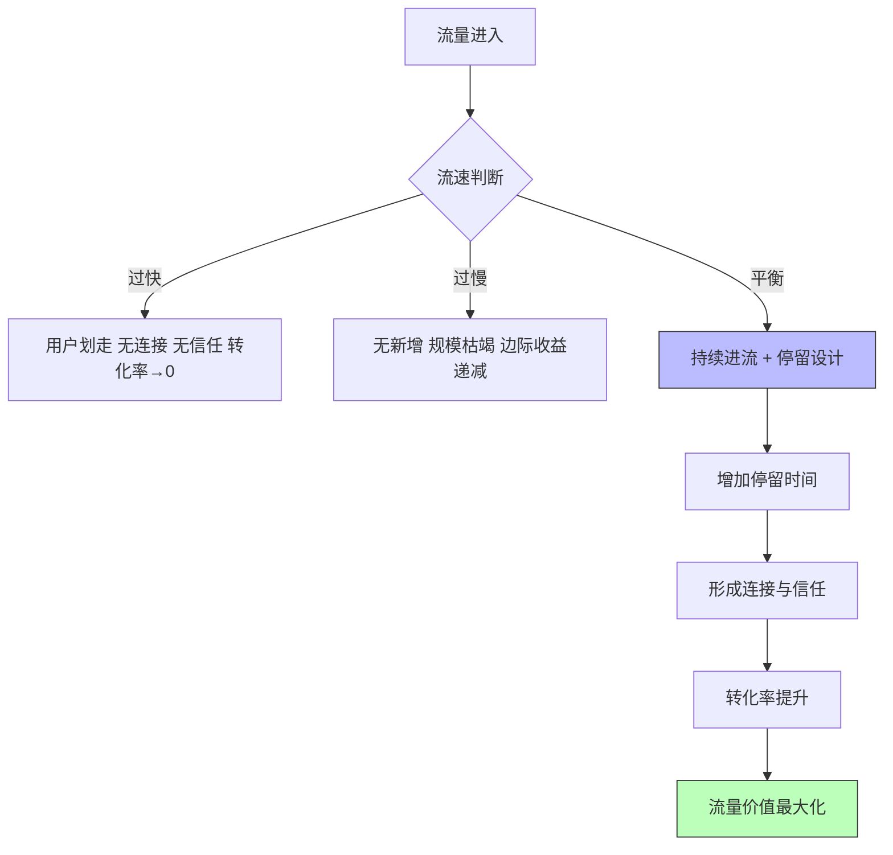

---

## 43.5 交易目的论 —— 从"有曝光"到"有交易"的价值校准

### 为什么需要这个概念？

运营者常陷入"唯曝光论"，关注UV/PV数字却忽略交易本质。无转化的曝光不仅无价值，甚至可能产生负价值（用户反感、平台降权）。我们需要从交易目的出发重新审视流量价值。

> "所以，从交易目的来看，单纯的页面曝光是没有太大价值的，如果是内容页面，有曝光无反馈反而是负价值。"
> 
> "让该来的来，让该走的走，多不重要，合适就好，我们的目的是交易"
> 
> "没有互动就没有价值，平台不给流量。"
> 
> ——《docs/202301-02/20230207_06.md》

### 核心定义与推导

**交易目的论**确立了运营的终极价值锚点：

$$
\text{运营动作价值} \propto \mathbb{I}(\text{促成交易或中间转化})
$$

其中 $\mathbb{I}$ 为指示函数：只有直接或间接服务于交易转化的动作才有正价值。

**三个核心推论**：
1. **曝光≠价值**：单纯的页面曝光（UV/PV）没有价值；有曝光无反馈的内容页面是负价值。
2. **互动即信号**：平台倾向将流量分配给有互动的内容，无互动则流量衰减。
3. **终极锚点**：一切流量手段最终需服务于交易转化。

### 公式作用说明

该公式以指示函数形式表达了**运营动作的零一性质**——要么服务交易（正价值），要么不服务交易（零/负价值）。它帮助运营者识别"自嗨式流量"：数据好看但无交易贡献。同时它隐含了"互动即信号"的平台算法机制：有互动→平台给流量→更多交易机会。对品牌曝光型或公益类内容，"交易"应广义理解，包括互动、加粉、咨询等中间转化，而非仅指下单付费。

### 关键性质

- 帮助运营者识别"自嗨式流量"：数据好看但无交易贡献。
- "交易"应广义理解，包括互动、加粉、咨询等中间转化，而非仅指下单付费。
- 对品牌曝光型或公益类内容，该理论不完全适用，需以长期心智积累为衡量。

### 方法演进图

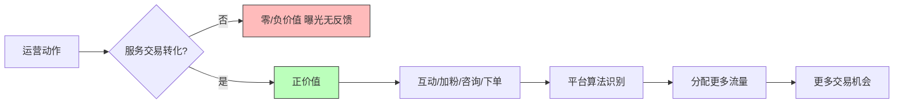

---

## 43.6 流量合并 —— 让"别人的鱼塘"变成"你的鱼塘"

### 为什么需要这个概念？

自建流量团队成本高、周期长，而市场上已有大量优质流量资产被闲置。我们需要一种方法将别人的流量转化为自己可用的资源，实现低成本扩张。

> "我自己认为世界上流量按照所有权分类只有两类：一个是自己建团队获取流量，还有一类是整合别人的流量。"
> 
> "谁能让流量主赚更多的钱，谁就拥有了这个流量主的流量。"
> 
> "我们假设有一个 KOL，积累了四五年的流量……现在如果我能想一个办法出来，让他卖我的货，一个月能赚二十万，那这个人四五年积累的流量就会为我服务……在这个世界里并不缺流量，真正缺少的是把流量价值最大化的方法。"
> 
> ——《docs/202301-02/20230207_06.md》

### 核心定义与推导

**流量合并**的核心逻辑是价值交换：

$$
\text{获得流量使用权} \iff \text{提供让流量主"赚更多钱"的方案}
$$

**两类流量所有权**：
1. **自建团队获取**：高成本、长周期、完全可控
2. **整合别人的流量**：低成本、快速见效、需利益绑定

**核心抓手**：不是"买流量"，而是"设计一套让流量主赚更多钱的商业模式"。

### 方法演进图

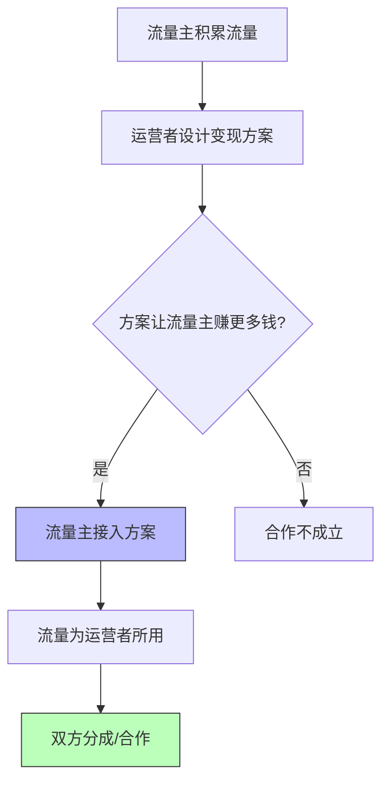

### 关键性质

- **可复用性高**：一个成功的合并方案可复用到多个流量主。
- **前置条件**：你必须有能让流量主"赚更多钱"的产品或方案，否则公平交换不成立。
- **边界限制**：部分流量主有排他性合约或自营商业，无法直接合并，需先界定合作边界。

### 典型例子

某KOL积累了四五年的精准粉丝，运营者设计一套"卖货月赚20万"的方案（选品+供应链+售后全包），KOL只需发内容带货，原本沉睡的流量瞬间激活为运营者的变现渠道。

---

## 43.7 流量切片分析法 —— 把流量"切开来"才能"吃得下"

### 为什么需要这个概念？

只看流量总量（如UV/PV）容易被表象迷惑，无法定位问题与机会。需要将流量数据拆分到可执行的粒度，才能形成精准干预动作。

> "横向你要看：这 200 个 UV 从哪里来？有哪些渠道？哪些涨了？哪些跌了？趋势如何？原因是什么？可干预的运营动作是什么？"
> 
> "纵向你要看：UV 的背后是用户，这个用户来到页面前经历了什么？有着怎样的需求？为什么要来？停留了多久？去向了哪里？离开的时候和刚进来有什么不同？能不能形成业务价值？"
> 
> "流量要切成片来看，才有可优化的空间，才能形成可执行的运营干预动作。"
> 
> ——《docs/202301-02/20230207_06.md》

### 核心定义与推导

**流量切片分析法**将流量数据按两个维度拆解：

| 切片维度 | 关注问题 | 可执行动作示例 |
|----------|----------|----------------|
| **横向** | 来源渠道、涨跌趋势、干预动作 | 调整渠道投放比例、复制增长动作、止损下滑渠道 |
| **纵向** | 用户需求、行为路径、业务价值 | 优化落地页内容、增加互动钩子、设计转化路径 |

只有切到"可优化的粒度"，流量分析才有指导意义。

### 方法演进图

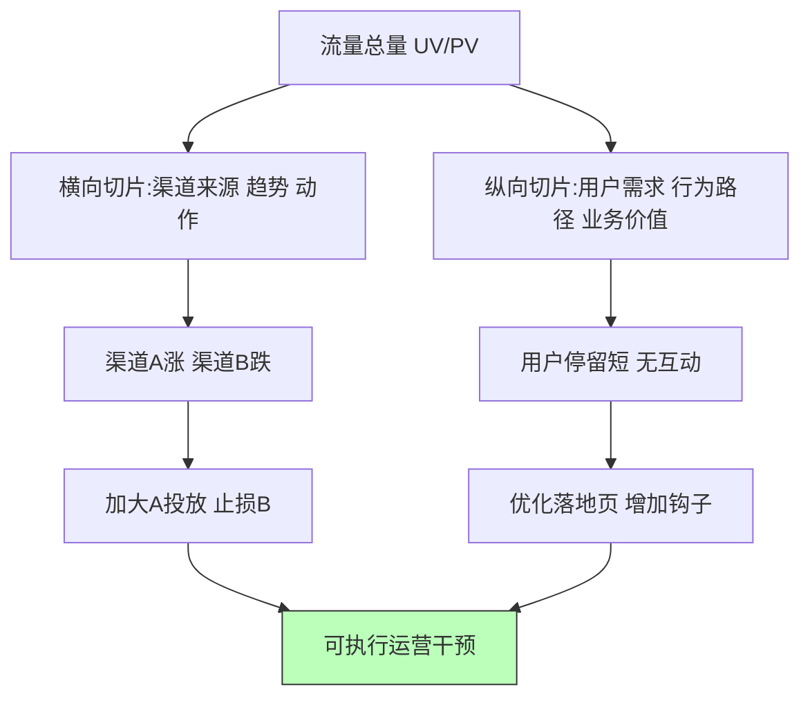

### 典型例子

某页面200个UV，横向拆开发现70%来自特定渠道且呈下滑趋势；纵向拆开发现用户停留时间短、离开前未产生任何互动——据此针对性优化该渠道投放与页面内容。

### 边界条件

- 依赖数据的完整性与准确性，数据缺失时结论可能失真。
- 分析粒度并非越细越好，需结合业务规模确定恰当的切片层级。

---

## 43.8 私域单客价 —— 从"一锤子买卖"到"一辈子生意"

### 为什么需要这个概念？

传统电商用客单价衡量单次交易价值，但在私域运营中，用户的终身价值远大于单次成交金额。过分关注客单价会忽略复购与转介绍带来的长期收益，低估私域价值。

> "电商有个'客单价'的概念，而在私域流量运营的思维下，真正值得关注的不是'客单价'，而是'单客价'，就是一个消费者总共贡献了多少销售额。"
> 
> ——《docs/202301-02/20230207_03.md》

### 核心定义与推导

**私域单客价**定义为：

$$
\text{单客价} = \sum_{t=1}^{T} \text{用户在第t次交易中的支付金额}
$$

其中 $T$ 为用户生命周期内的总交易次数。

**推导逻辑**：传统电商客单价（AOV）= 总营业额 ÷ 订单数，衡量单次交易效率。私域运营的核心是"连接-信任-成交-复购"闭环，用户不是一次性路人而是可长期经营的资产。单客价将时间维度拉长到用户生命周期，累计所有交易金额，真实反映私域用户的资产价值。

### 公式作用说明

该公式将**单次交易指标升级为生命周期资产指标**。它强制运营者关注复购率、留存率、客单价提升三个杠杆的组合效应，而非单一追求首单转化。可作为私域资产估值、用户分层运营、获客成本反推的核心依据。计算时需界定时间窗口（如12个月/24个月），不同品类周期差异大。

### 关键性质

- 强调复购与留存价值，与私域"连接-信任-成交-复购"闭环匹配。
- 可作为私域资产估值的基础指标。
- 计算需要时间窗口界定，不同品类时间跨度差异大。
- 单客价高不意味着毛利高，还需结合毛利结构综合评估。

### 典型例子

一个健身客户第一次只买99元体验课，但持续2年购买训练营、补剂，累计贡献2万元——单客价2万远高于单次客单价99元。

### 方法演进图

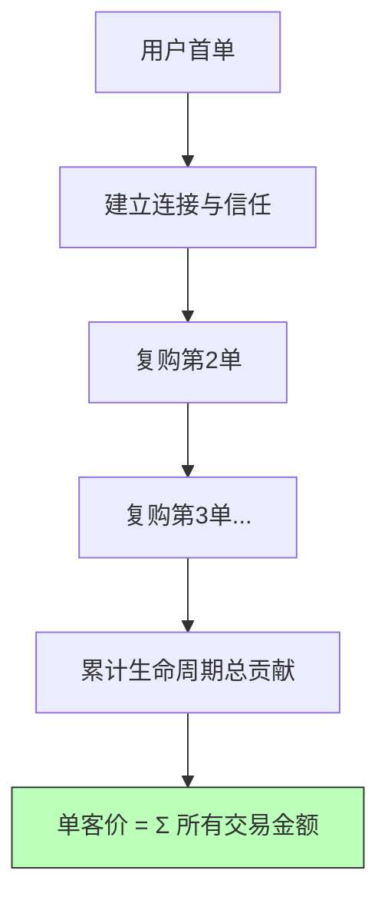

---

## 43.9 实时真实ROI —— 把私域产值也算进"投产账本"

### 为什么需要这个概念？

传统ROI只计算直播间/广告直接产生的营业额与投放成本之比，忽略了私域沉淀带来的额外产值。私域产值往往是长期复利，将其纳入核算才能真实反映投放的综合收益。

> "做一个公式：客单价 n 的产品，毛利率如果是 q，投入 y，直播间除去退货后营业额为 z。私域进线率 60%为合格，月产值为 p。那么你只做直播间纯利润就是 q*z-y；做私域后纯利润就是 q*z-y 每个月加上 z/n×60%×p，月递减前 3 个月按 80%算，后面看维护。"
> 
> "roi2.5 也就是我 100 万的营业额，需要有 40 万的广告投放，那么在这 40 万的投放算到私域中，我将额外有 100 万×60%×60/150=24 万的私域营业额，这一块是无需投放的……这么一算我的 roi 就从 2.5 提升到了 3.5。"
> 
> ——《docs/202301-02/20230207_03.md》

### 核心定义与逐步推导

**实时真实ROI**的核算公式：

$$
\text{综合ROI} = \frac{\text{直播间毛利} + \text{私域累计产值}}{\text{广告投入}}
$$

**逐步推导与为什么可以这样变的解释**：

1. **直播间毛利** = $q \times z - y$  
   解释：毛利率 $q$ 乘以除退货后营业额 $z$，减去广告投入 $y$，得到直播间直接纯利润。

2. **私域进线人数** = $\frac{z}{n} \times 60\%$  
   解释：营业额 $z$ 除以客单价 $n$ 得到成交客户数，乘以进线率 60%（合格线），得到进入私域的人数。

3. **私域月产值** = 进线人数 × $p$  
   解释：每个进线用户每月贡献 $p$ 元产值（典型值8-15元/人/月）。

4. **私域累计产值** = 前3个月每月按80%衰减累加 + 后续维护产值  
   解释：用户价值随时间衰减，前3个月按80%系数递减，之后视维护情况而定。

5. **综合ROI** = (直播间毛利 + 私域累计产值) ÷ 广告投入 $y$  
   解释：将私域长尾价值显性化纳入分子，分母不变，ROI自然提升。

其中关键参数：
- $n$ = 客单价
- $q$ = 毛利率
- $y$ = 广告投入
- $z$ = 直播间除退货后营业额
- 进线率 = 60%（合格线）
- $p$ = 私域月产值（典型值8-15元/人/月）
- 衰减系数 = 前3月80%，后续看维护

### 公式作用说明

该公式将**私域长尾价值显性化**，解释了为什么很多"广告ROI凑合但整体很赚"的业务能存活——私域产值是隐形的利润放大器。它指导运营者：不要只盯着直播间即时ROI，而要投入资源提升进线率、私域月产值、用户生命周期。参数敏感性分析显示：私域月产值翻倍可使ROI从3.5提升至4.5，是杠杆最大的变量。

### 关键参数与敏感性分析

以下表格展示核心参数对ROI的影响程度：

| 参数 | 合格线/典型值 | 对ROI影响 |
|------|---------------|-----------|
| 私域进线率 | ≥60% | 线性正相关 |
| 私域月产值 | 8-15元/人/月 | 线性正相关，翻倍可使ROI从3.5提升至4.5 |
| 衰减系数 | 前3月80% | 非线性，维护好可延长生命周期 |

### 典型例子

150客单价、进粉率60%、月产值8-15元条件下：
- 只做直播ROI = 2.5
- 计入私域产值后ROI = 3.5
- 若私域月产值翻倍至16-30元，ROI可达4.5

**洞察**：这解释了为什么很多"广告ROI凑合但整体很赚"的业务能存活——私域产值是隐形的利润放大器。

### 方法演进图

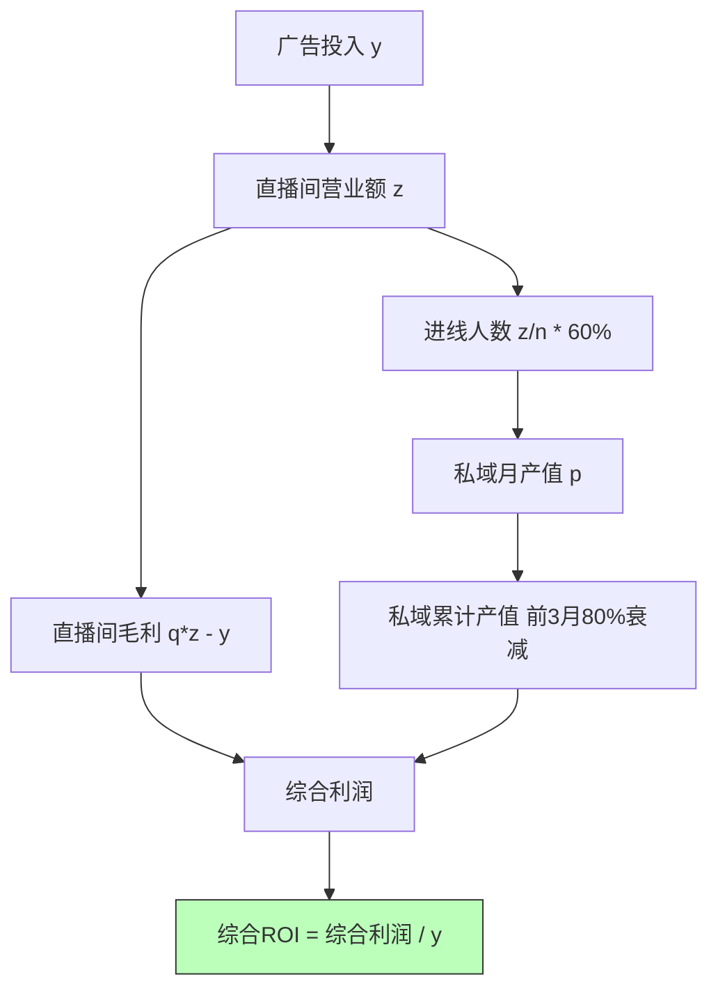

### 边界条件

- 私域产值具有估算性质，不同产品与客户的LTV差异大，参数需按实际业务校准。
- 该公式为半定量模型，客户复购衰减、维护成本等变量需运营者自行补充调整。

---

## 43.10 捡漏群 —— 用"1-3折商品+演员氛围"搭建的佣金变现引擎

### 为什么需要这个概念？

传统社群运营靠低价引流但难以持续变现，群活跃度差、转化率低。需要一种可复制、可规模化、且能高效变现的社群模式。

> "捡漏群：用户在我们的群里可以用原价的 1-3 折买到超高性价比的商品。…… 能通过售卖商品来产出佣金，实现变现。"
> 
> "核心要点：稳定的企微主体、靠谱且稳定的流量、精细化的社群运营、社群的规模大小，以及多重变现方式。"
> 
> "目前今年新起的盘不到 1000 个群，月佣在 100w+。"
> 
> "假设一个社群 7000 成本，3 个月回本，之后每个月可以产生 1000 的利润，21 个月还能产生 2.1W 的纯利润。"
> 
> ——《docs/202301-02/20230207_03.md》

### 核心定义与推导

**捡漏群**商业模式：

$$
\text{佣金收入} = \sum (\text{商品售价} \times \text{佣金率} \times \text{成交量}) - \text{运营成本}
$$

**推导逻辑**：以"原价1-3折"的超高性价比为核心锚点，通过精细化运营（每日精推1主品+配品、4-6次递进式催单、30-50演员营造氛围）维持高活跃与高转化。单群成本约7000元，2-3个月回本，回本后单群月利润约1000元，生命周期约2年。规模化后：1000群日利润3万，月利润90万；万群团队月佣数千万。

### 公式作用说明

该公式揭示了捡漏群的**单群经济模型**与**规模化收益曲线**：前期投入建群成本+运营成本，中期回本，后期长尾现金流。核心变量是"精推转化率"与"演员氛围强度"，二者直接决定成交量进而决定佣金收入。多重变现方式（淘客、自营、招商）提供抗风险缓冲。

### 关键性质

- **高性价比锚定用户心智**：原价1-3折，用户有"捡漏"的持续粘性。
- **演员是灵魂**：有演员和没演员的社群产出相差至少一倍以上。
- **生命周期模型**：约2年，2-3个月回本，单群月利润约1000元（回本后）。
- **规模化收益**：新起盘<1000群月佣100W+；头部团队群数过万，月佣数千万。

### 典型例子

某团队2023年新起盘不到1000个捡漏群，月佣金破百万。头部团队社群数量过万，月佣金数千万。单群投入7000元，3个月回本，后21个月每月净赚1000元，单群全周期纯利2.1万，ROI约3-4倍。

### 边界条件

- 需要稳定企业微信主体，防止封号风险。
- 对选品供应链要求较高，品选不好群活跃度迅速衰减。
- 演员氛围做不好会断崖式影响生命周期。

### 方法演进图

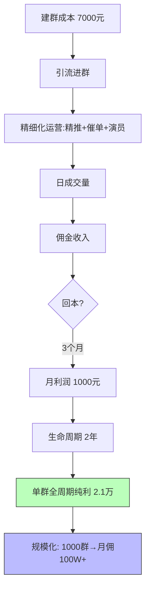

---

## 43.11 演员氛围 —— 用"托"点燃社群羊群效应

### 为什么需要这个概念？

空荡荡的社群难以激发用户购买冲动，用户会因"没人买"而观望犹豫。需要营造"大家都在抢"的从众氛围来提升转化率。

> "一个群必须有 20 个以上的演员，确保整个群的发品节奏。演员是捡漏群的灵魂，有演员和没演员的情况，社群产出起码相差一半以上。"
> 
> "演员目的：提高社群活跃度，可信度，爆单假象！一个群一般都要有 30-50 个托。"
> 
> "社群的演员氛围不好，死气沉沉的话，对社群的生命周期也会造成很大的影响。"
> 
> ——《docs/202301-02/20230207_03.md》

### 核心定义与推导

**演员氛围**是指在捡漏群等社群中配置20-50个"演员"（托），模仿真实用户抢购、晒单、追问等行为，营造爆单和紧迫氛围。

**演员配置标准**：

| 指标 | 标准值 | 说明 |
|------|--------|------|
| 演员数量 | 30-50个/群 | 少于20难成氛围，过多成本高且易穿帮 |
| 人设多样性 | 宝妈、上班族、学生等 | 覆盖核心用户画像，增强代入感 |
| 行为脚本 | 抢单→晒单→追问→催单 | 配合发品节奏执行 |

**推导逻辑**：羊群效应是社群转化的核心心理机制。演员通过脚本化行为（抢单3-5单→晒单图→追问"还有吗"→催单"手慢无"），在4-6次递进式催单节奏中制造稀缺感与从众压力，显著提升真实用户下单率。有演员与无演员的社群产出相差≥1倍，是捡漏群模型能否跑通的关键变量。

### 关键性质

- **效果显著**：有演员和没演员的社群产出相差≥1倍。
- **系统性工程**：演员需配合精推文案与催单节奏（4-6次递进刺激）共同发挥作用。
- **氛围维护**：演员死气沉沉会对社群生命周期造成很大负面影响。

### 边界条件与合规风险

- 演员数量过少（<20）难以形成氛围，过多则成本高且有穿帮风险。
- 需注意合规风险，过度使用虚假交易可能违反平台规则或消法。
- 该策略适用于高情绪驱动的低价商品，不适合所有品类的社群运营。

### 方法演进图

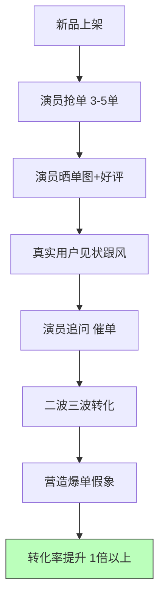

---

## 43.12 内容价值金字塔与技术杠杆 —— 从"给娱乐"到"给方法"的跃迁

### 为什么需要这个概念？

很多内容创作者把精力花在"搞笑""剧情"等娱乐内容上，数据虽好却难以变现。内容的价值不仅取决于数据，更取决于它能给用户带来什么——娱乐、工具还是方法。

> "①给娱乐：搞笑号、剧情号，他们的数据很好，用情绪价值交换了用户的注意力，但是很难变现。"
> 
> "②给工具：给工具满足更加实用性的需求……最常见的是给整合资料，帮用户节省时间……这就是当下很火的虚拟资料项目。"
> 
> "③给方法：通过给方法，解决问题，抢占专业认知，打造个人 IP。"
> 
> "《纳瓦尔宝典》里面也有一句话记忆犹新：想要获得财富，就必须充分利用杠杆效应。商业杠杆来自资本、劳动力和复制边际成本为零的产品（代码和媒体）。"
> 
> "Content is King！如果代码也算内容的一种形式。"
> 
> ——《docs/202301-02/20230207_06.md》与《docs/202301-02/20230207_03.md》

### 核心定义与推导

**内容价值金字塔**三层结构：

以下表格对比三层内容的核心差异：

| 层级 | 内容类型 | 用户价值 | 变现难度 | IP壁垒 |
|------|----------|----------|----------|--------|
| L1 给娱乐 | 搞笑、剧情、八卦 | 情绪价值 | 高（依赖广告/打赏） | 低 |
| L2 给工具 | 资料整合、模板、工具包 | 实用性/省时间 | 中（虚拟资料、引流） | 中 |
| L3 给方法 | 方法论、框架、认知升级 | 解决问题/认知跃迁 | 低（高客单课程/咨询） | 高 |

**核心逻辑**：价值交换——你给用户什么价值，用户就回报你什么。

**技术杠杆视角**：代码和媒体（内容）都是"复制边际成本为零的产品"，是普通人最容易获得的杠杆。

### 关键性质

- 与流量价值公式呼应：工具/方法内容天然自带"相关性"与"信任度"。
- 可指导创作者选择内容赛道与变现路径。
- "给方法"需要有真实的专业深度，否则难以持续输出。

### 方法演进图

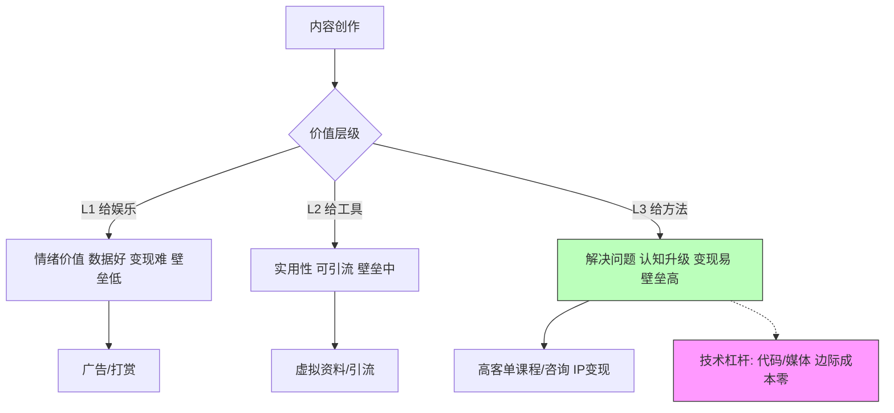

---

## 43.13 战略=选择 —— 明确"不做什么"比"做什么"更重要

### 为什么需要这个概念？

面对无限商业机会，盲目"什么都做"会导致资源分散、执行失焦。明确不做什么，才能集中资源在真正优势领域形成突破。

> "什么是战略呢？就是选择。选择，其最重要的就是不做什么，而不是做什么。"
> 
> "战略目的是让你能获得优势或者获得相对优势。"
> 
> "战略应该形成一种自始至终的指导原则。"
> 
> "战略需要发挥你的禀赋。你要是跟老乡鸡、南城香比卫生、标准化、品牌力，那就错了。你应该提升你的人情味、现炒等等。这就是不能选择你的劣势来做战略方向。"
> 
> ——《docs/202301-02/20230207_06.md》与《docs/202301-02/20230207_07.md》

### 核心定义与推导

**战略=选择**的三维描述：

1. **目的**：获得相对优势（而非绝对优势）
2. **形式**：自始至终的指导原则（而非朝令夕改的战术）
3. **基石**：发挥自身禀赋（劣势不能作为战略方向）

**推导逻辑**：战略不是目标设定（"帮助一万人赚钱"是目标非战略），而是**取舍决策**。资源稀缺、机会无限，列出"做什么"容易贪多嚼不烂；列出"不做什么"倒逼面对资源约束，做真正的聚焦。禀赋（优势）是战略的起点，而非愿望。中式快餐若与老乡鸡比标准化，是在用劣势打对手优势，必败；发挥"现炒、人情味"差异，才能获得相对优势。

### 公式作用说明

该框架以**三维描述替代单一定义**，将战略从"愿望清单"还原为"约束下的取舍体系"。它指导决策者：先盘点禀赋（筹码），再设定不做清单（护城河），最后在剩余空间内寻找相对优势突破口。目标是战略的对象/结果，而非战略本身。

### 关键性质

- 从资源禀赋出发，而非从愿望出发：以牌定打法，而非以打法定牌。
- 劣势不可作为战略方向选择，但可适当补足。
- 可用于个人定位、企业战略及国家战略分析等多个层面。

### 典型例子

中式快餐不与老乡鸡比标准化，而是发挥"现炒、人情味"差异优势。这就是典型的"不做标准化、做人情味"的战略选择。

### 方法演进图

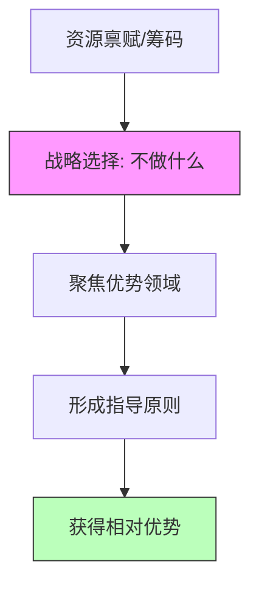

### 边界条件

- 明确不做什么的前提是你已清楚自己的禀赋和优势所在，否则无从取舍。
- 战略选择需伴随明确的目标，目标本身不是战略。

---

## 43.14 增长瓶颈怪圈 —— 被"想拥有的东西"绑架的恶性循环

### 为什么需要这个概念？

企业或个人在增长停滞时，越是拼命追求增长，反而越难实现增长。对增长的过度预期会使人陷入焦虑、投机和短视行为，形成恶性循环。

> "进入增长瓶颈的一个典型现象，就是越想要增长，却距离想要的增长越远。"
> 
> "如果用一句话来形容这种现象，那就是我们被我们想拥有的东西绑架了。"
> 
> "再进一步的恶性循环，就是觉得这些问题的原因是自己还不够狼性、不够拼搏，所以不断压榨自己、逼迫自己，让自己活在一个焦虑紧张和对失去的害怕中（业界常说的话就是 FOMO 心理），让自己更加难以去做自己热爱的事情，更加难以去专注，从而进一步失去优势。"
> 
> ——《docs/202301-02/20230207_07.md》

### 核心定义与推导

**增长瓶颈怪圈**的运作机制：

$$
\text{增长预期绑架} \rightarrow \begin{cases}
\text{投机跟风} & \text{替代开创性行动} \\
\text{计算利弊} & \text{替代关注用户} \\
\text{抓取资源} & \text{替代积累价值}
\end{cases} \rightarrow \text{距离增长越来越远}
$$

**推导逻辑**：当增长成为唯一KPI且被外部预期（投资人、对手、市场）绑架时，决策者失去主动权：不再做开创性事情（面向未来），转而跟随对手（投机）；不再关注用户真实需求（面向用户），转而算计短期ROI（计算利弊）；不再积累稀缺资产（积累价值），转而抓取流量/现金流（抓取资源）。这三种替代行为看似勤奋（战术勤奋），实则加速远离增长本质。

### 关键性质

- 增长问题的根源多在疫情前已存在，疫情只是加重而非本质原因。
- 大部分企业在大部分时间是不增长的，这是常态。
- 该概念主要适用于"曾经增长过但试图保持增长"的企业或个人，不适用于初创期从0到1阶段。

### 典型例子

某电商品牌GMV增速放缓，老板要求团队"不惜一切代价保增长"，团队开始：盲目跟风竞品打法（投机）、砍品牌预算买流量（计算利弊/抓取资源）、压榨员工加班（焦虑内耗）。半年后GMV微增但利润腰斩、核心人才流失、品牌心智受损，下一年彻底跌出第一梯队。

### 方法演进图

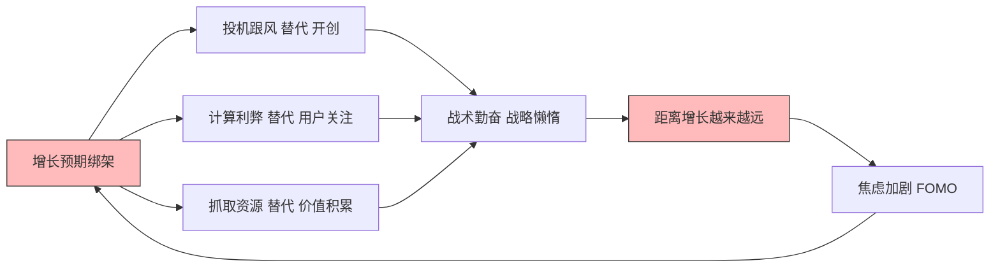

---

## 43.15 价值创造视角 —— 从"我如何得到增长"到"我如何值得被奖赏增长"

### 为什么需要这个概念？

"追求增长"视角让人被预期绑架，陷入焦虑和短视行为，反而阻碍增长。需要根本性的视角转换，从向外索取向内修炼。

> "我发现，破除增长焦虑唯一的方法，就是怎么从追求增长的视角，切换成价值创造的视角。"
> 
> "从一个'我如何得到增长'，变成'我如何成为一个值得被奖赏增长的人'。"
> 
> "真正要去摆脱这种视角，最难的不在于方法论，而是 3 种'勇气'：面向未来而非面向过去的勇气；面向用户而非计算利弊的勇气；积累价值而非抓取资源的勇气。"
> 
> "识别在我当前的环境中，最稀缺的、最不流动的是什么，如果整体的优化目标本着这些，就会形成正向的价值积累。"
> 
> ——《docs/202301-02/20230207_07.md》

### 核心定义与推导

**价值创造视角**的核心转换：

$$
\text{追求增长视角} \quad \xrightarrow{\text{视角切换}} \quad \text{价值创造视角}
$$

**推导逻辑**：增长是价值创造的**结果**（奖赏），而非可直接追逐的**目标**。当视角锁定"我如何得到"时，行为必然短视；当视角转为"我如何值得"时，行为必然长期。这需要三种勇气：
1. **面向未来**：相信未来的自己更大，敢于打破过去定型（柯达案例：自认成功源于高品质，实则源于开创低价便捷）。
2. **面向用户**：把"怎么算计转化率"换成"怎么解决用户问题"，答案更易找到。
3. **积累价值**：识别环境中"最稀缺、最不流动"的资产（品牌心智、数据壁垒、核心人才、用户信任）并集中资源积累，而非追逐无限流动的销售额/DAU/权力。

### 公式作用说明

该公式将**视角切换本身形式化**为一种映射关系：输入端是被绑架的"追求增长"行为模式，输出端是主动权回归的"价值创造"行为模式。它揭示了破局的关键不在方法论（如何做），而在认知论（怎么看）——三种勇气是认知层面的门槛。"识别稀缺不流动资产"是连接认知与行动的桥梁：茅台识别出品牌心智为稀缺资产，拒绝降价砸牌，长期获胜。

### 三种勇气的操作化定义

以下表格对比两种视角下的行为差异：

| 勇气 | 追求增长视角的行为 | 价值创造视角的行为 |
|------|-------------------|-------------------|
| 面向未来 | 用过去定义自己，固守旧模式 | 持续开创，相信未来的自己更大 |
| 面向用户 | 计算利弊、算计转化率 | 思考"如何解决用户问题" |
| 积累价值 | 抓取流量、薅羊毛 | 积累稀缺不流动资产（品牌、数据、人才、信任） |

### 典型例子

八项规定后大量中高端白酒降价砸牌，茅台坚持品牌为最重要资产，不牺牲品牌换销售额，长期赢得市场。茅台识别出的"稀缺不流动资产"=高端品牌心智。

### 方法演进图

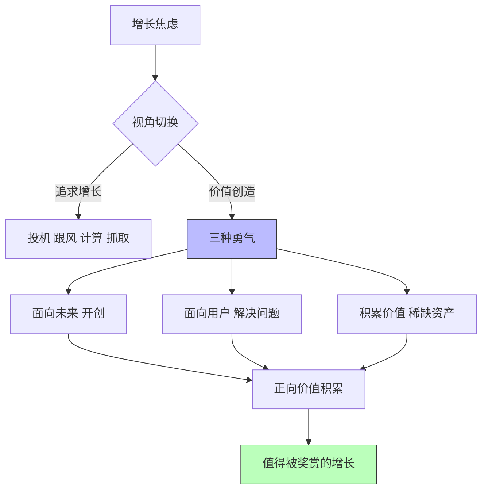

### 边界条件

- 需要企业有一定生存基础，完全生存无望时仍需先解决生存问题。
- "识别稀缺不流动资产"在不同行业与阶段差异较大，需要较强的行业洞察力。

---

## 43.16 财富积累四阶段 —— 出卖劳动力只能"温饱"，钱生钱才能"自由"

### 为什么需要这个概念？

很多人困在"出卖劳动力"的第一阶段，靠时间换钱，收入天花板极低。不理解财富进阶逻辑，甚至试图跳跃式致富，反而踩坑。

> "财富积累分为四个阶段，第一：出卖劳动力；第二：一份时间多次卖；第三：购买他人时间；第四：钱生钱。"
> 
> "第一阶段，出卖劳动力……第二阶段是一份时间多次卖……第三个阶段是什么？购买他人时间……第四个阶段，就是去钱生钱了……你就是投资。"
> 
> "人生四个阶段，第一阶段：初入职场（30 岁以前）……在这个阶段你要不断的长见识，要不断的去尝试不同的行业、不同的岗位、不同的职业……第二阶段，中年危机，在这个阶段一定要去做管理……第三个阶段的话，其实我就是你要开始在你的主业以外，你要去寻找自己的第二曲线……第四个阶段其实就是你在第二曲线找到了一个 MVP……然后组建团队给它放大。"
> 
> ——《docs/202301-02/20230207_06.md》

### 核心定义与推导

**财富积累四阶段**的递进关系：

以下表格梳理四阶段的核心要素：

| 阶段 | 核心动作 | 杠杆来源 | 对应人生阶段 | 核心任务 |
|------|----------|----------|--------------|----------|
| 1. 出卖劳动力 | 时间单次出卖 | 体力/技能 | 初入职场(≤30岁) | 扩广度、长见识、尝试不同赛道 |
| 2. 一份时间多次卖 | 知识产权化 | 内容/代码/课程 | 中年危机(30-40岁) | 做管理、建体系、拉高度 |
| 3. 购买他人时间 | 组织杠杆 | 团队/代理商 | 第二曲线(40-50岁) | 找MVP、组团队、复制放大 |
| 4. 钱生钱 | 资本杠杆 | 投资/资产包 | 复制商业放大(50岁+) | 配置资产、享受复利 |

**推导逻辑**：每个阶段解决上一阶段的天花板问题。阶段一受限于时间不可复制；阶段二将时间产品化（内容/代码/课程），实现"一份时间多次卖"；阶段三购买他人时间建立组织杠杆；阶段四用资本杠杆让钱生钱。**必须依次跃迁，不可跳跃**，比喻为"爬楼梯"，跳过一层将缺乏对应的能力与资源基础。

### 关键性质

- **不可跳跃铁律**：试图从阶段一直接跳到阶段四（如用积蓄炒股）极大概率亏损，因缺乏阶段二三积累的认知、人脉、资源基础。
- 阶段与人生周期对应但不绝对绑定，可通过副业提前布局下一阶段。
- "一份时间多次卖"的载体包括：内容（写书/课程）、代码（SaaS/工具）、媒体（IP/流量）。

### 典型例子

打工者（阶段一）→ 写书/录课作者（阶段二）→ 开公司雇人（阶段三）→ 投资理财（阶段四）

### 方法演进图

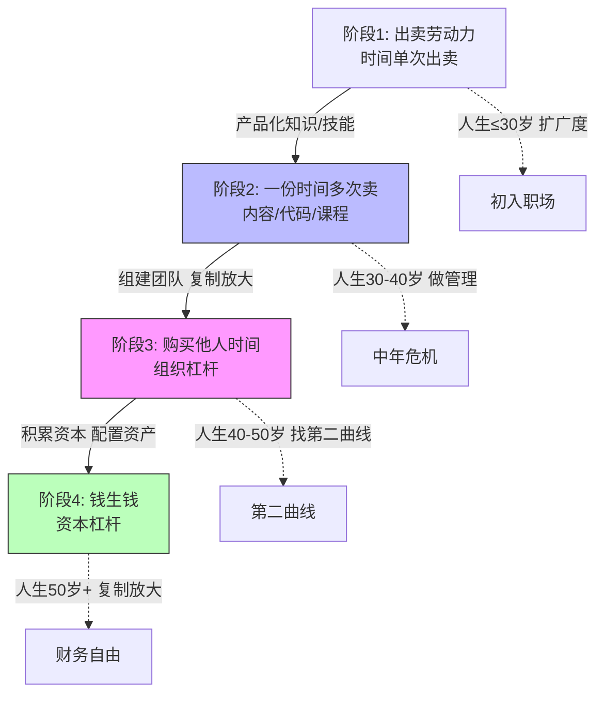

### 边界条件

- "不可跳跃"是理想的线性路径描述，实际中部分人能通过特殊机遇（如大厂期权）部分跳跃。
- 阶段之间没有绝对边界，一个人可同时处于多个阶段（如打工时做副业卖课）。

---

## 43.17 战略发挥优势 —— 手里有什么牌，再决定怎么打

### 为什么需要这个概念？

很多战略是从"我想要什么"出发，而非"我有什么"出发，导致方向偏离实际。忽视自身禀赋而盲目对标强者，选择劣势领域作战，注定失败。

> "战略就是先审视自己手里的筹码，也就是自己的优势，然后再决定自己怎么打牌，也就是如何运用自己的优势来获得你想要的结果。"
> 
> "在执行战略的时有个核心的思路，就是要发挥自己的优势。"
> 
> "因为苏联有几个弱点：国土面积太大（这在面对德国侵略时是优点，纵深比较好），防守成本很高，苏联还非常重视国土防空。"
> 
> "美国的战略就是，让苏联承受越来越多的费用和成本。"
> 
> ——《docs/202301-02/20230207_06.md》与《docs/202301-02/20230207_07.md》

### 核心定义与推导

**战略发挥优势**的思考框架：

$$
\text{战略} = f(\text{资源筹码}, \text{环境约束}, \text{目标})
$$

**推导逻辑**：战略不是"我想赢"，而是"我有这副牌怎么打能赢"。先盘点筹码（优势/禀赋），再结合环境约束，设计打法。美国对苏"强加成本"战略：苏联国土大、防空重、防守成本高是劣势（筹码反面），美国用低成本举措（毒刺导弹、压油价、星球大战）迫使苏联高成本应对，同时放血又破坏造血，最终拖垮苏联经济。商业上同理：中式快餐筹码是"现炒、人情味"，打法是差异化体验，而非比标准化。

### 公式作用说明

该公式将战略制定**显性化为函数映射**：输入端是"资源筹码"（优势禀赋）、"环境约束"（竞争格局/政策/技术）、"目标"；输出端是具体打法。它强制决策者先做盘点（我有什么牌），再做选择（怎么打），防止"以打法定牌"的本末倒置。劣势不可作为战略方向，但可适当补足（如快餐店补齐食安标准，但不做全标准化）。

### 关键性质

- 从资源禀赋出发，而非从愿望出发：以牌定打法，而非以打法定牌。
- 劣势不可作为战略方向选择，但可适当补足。
- 可用于个人定位、企业战略及国家战略分析等多个层面。

### 典型例子

1. **国家战略层面**：美国对苏"强加成本"战略——利用苏联国土纵深大、防空成本高的劣势，持续放血拖垮对方。
2. **商业战略层面**：中式快餐发挥"现炒、人情味"优势，不与连锁巨头比标准化。

### 方法演进图

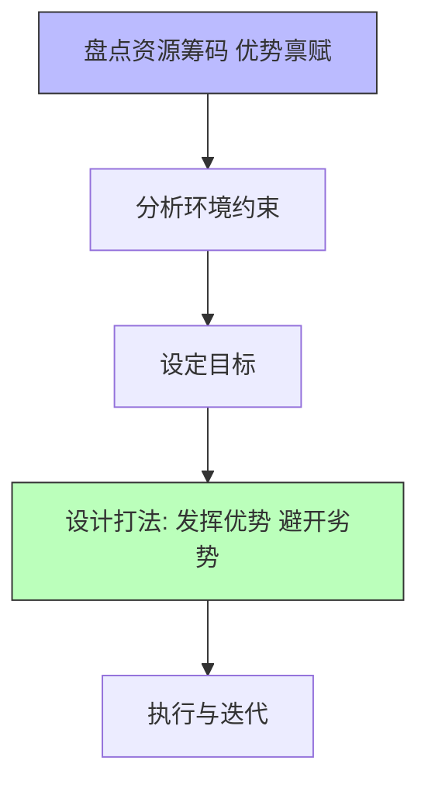

### 边界条件

- 发挥优势的前提是能清晰识别自身核心优势，优势识别本身有难度。
- 仅"发挥优势"不够，还需结合市场环境与客户需求的匹配度，优势不符合需求则无用。

---

## 43.18 利他等于利己 —— 越分享越幸运的商业"道"

### 为什么需要这个概念？

很多人顾虑分享赚钱信息会"教会徒弟饿死师傅"，担心竞争受损。但事实证明，越利他回报越大，信息是越分享越多的资源。

> "利他等于利己，越分享越幸运。"
> 
> "曾有朋友反问我，你就不怕你把赚钱的信息分享出去，别人抢了你的蛋糕？……事实证明，你越利他，你得到的回报会更大。现在最稀缺的就是信息……这市场这么大，蛋糕分的完吗？"
> 
> ——《docs/202301-02/20230207_06.md》

### 核心定义与推导

**利他等于利己**的底层逻辑：

$$
\text{分享信息} \not\to \text{存量减少} \quad \text{但} \quad \text{分享信息} \to \text{信任积累} + \text{信息回流} + \text{合作机会}
$$

**推导逻辑**：信息/知识是非竞争性资源，分享不减少自身存量。利他分享带来三重回报：(1) 信任资产累积——信任是成交前提；(2) 信息回流——分享出去的信息吸引同频者回馈更高质量信息；(3) 合作机会——展示能力与诚意吸引合伙人/客户。市场边界由价值创造决定，而非固定蛋糕，利他扩大价值创造边界。

### 公式作用说明

该公式以**非零和博弈**的数学表达，揭示了商业分享的正外部性：左侧分享不导致存量减少（非竞争性），右侧分享产生信任/信息/合作三重增量。它指导从业者：建立核心壁垒后，主动分享非核心方法论、行业认知、避坑指南，构建"利他飞轮"。边界在于：核心技术机密、绝对壁垒不可分享。

### 关键性质

1. 信息是稀缺资源，但分享不消耗存量反而带来增量。
2. 利他行为能积累信任资产，信任是成交的前提。
3. 市场足够大，不存在"蛋糕分完"的问题，价值创造的边界是无限的。

### 边界条件

- 利他分享需以自身核心壁垒稳固为前提，完全无壁垒的核心技术机密仍需保护。
- 利他不是无条件"白给"，而是建立在价值交换与长期共赢的逻辑上，需避免被白嫖。

### 方法演进图

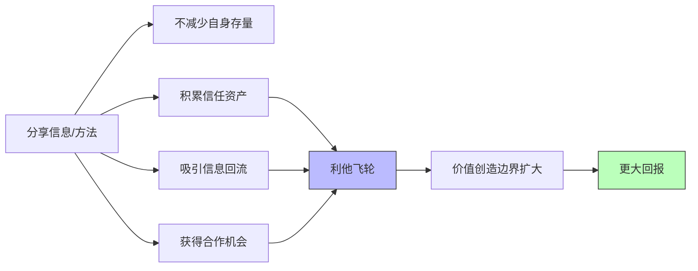

---

## 43.19 事实与观点 —— 给商业判断装上"客观滤镜"

### 为什么需要这个概念？

商业总结与决策中，主观感受与客观事实常被混为一谈，导致误判。观点因人而异、无法作为共同决策基础；事实才具备可验证性。

> "我们一定要知道自己和对方说出口的每一句话，到底哪一句是观点，哪一句是事实。我今年业绩做的不好，这句话是观点还是事实？----观点！"
> 
> "只有中性的，能够用数字和证据支撑的才是事实，例如：我今年完成了83%的年度业绩目标。"
> 
> "譬如10摄氏度的气温，对于一个常年生活在0摄氏度地方的人来说，会觉得'好温暖'；可对于一个常年生活在20摄氏度地方的人来说，会觉得'太冷了'。此时，假如双方进行辩论的话，就互相会觉得对方在胡说八道。"
> 
> ——《docs/202301-02/20230207_04.md》

### 核心定义与推导

**事实与观点**的严格区分标准：

| 维度 | 事实 | 观点 |
|------|------|------|
| 定义 | 中性的、可用数字和证据支撑的客观陈述 | 因人而异、基于立场和层次差异的主观表达 |
| 可验证性 | 高（可复现、可证伪） | 低（主观、不可统一衡量） |
| 示例 | "我完成了83%的年度业绩目标" | "我今年业绩做得不好" |

**合格的总结必须"要事实，不要观点"**。

### 关键性质

- 事实具备可验证性，观点无法统一衡量。
- 区分事实与观点是科学总结、5WHY分析和商业模式拆解的共同前提。
- 可用于评估信息质量：缺乏事实支撑的主张应谨慎采信。

### 方法演进图

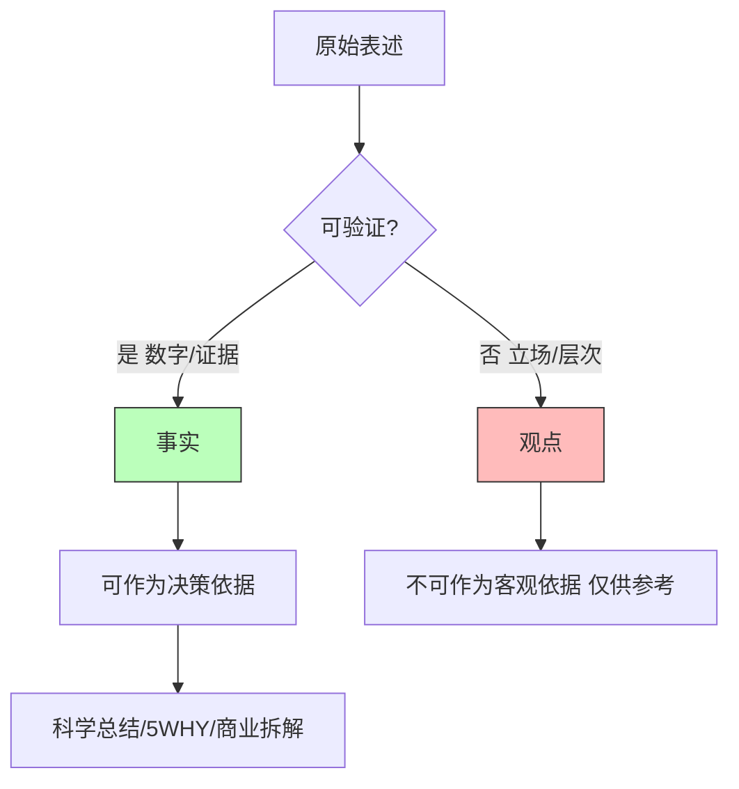

---

## 43.20 5WHY分析法 —— 连续追问剥开问题的"洋葱皮"

### 为什么需要这个概念？

面对问题（期望与现状的差距），停留在表面原因会错过根治机会。简单归因（如"老板对我有意见"）会引发情绪化误判。需要一种结构化方法逐层深挖，找到根因。

> "第一个方法，叫5WHY分析法，意思是每当遇到问题时，都可以连续用5个WHY来探寻其发生的真实原因。"
> 
> "1WHY：为什么老板骂我？因为我今天迟到了。2WHY：为什么我会迟到？因为我起床晚了。3WHY：为什么会起床晚？因为天杀的闹钟没响。4WHY：为什么闹钟没响？因为它没有电了。5WHY：为什么闹钟没电？因为我忘记了换电池。"
> 
> "1、期望和现状的差距，就是问题。不管是期望大于现状，还是现状大于期望。"
> 
> ——《docs/202301-02/20230207_04.md》

### 核心定义与推导

**5WHY分析法**的操作步骤：

1. **定义问题**：问题 = 期望与现状的差距（双向皆成立）
2. **连续追问**：对每一个答案再问"为什么"，直到找到可操作的根因
3. **验证根因**：根因必须是可控、可干预的

**问题定义公式**：
$$
\text{问题} = \text{期望} - \text{现状} \quad (\text{或 } \text{现状} - \text{期望})
$$

**推导逻辑**：表面原因往往是症状而非病灶。连续追问将因果链条延伸至可操作层面。上例中：老板骂人(现象)→迟到(直接因)→起床晚(行为因)→闹钟没响(工具因)→没电(维护因)→忘记换电池(根因/机制缺失)。根因对应对策：建立"定期检查闹钟电量"机制（如手机日历半年提醒）。

### 公式作用说明

问题定义公式将"问题"从模糊抱怨还原为**可测量的差距**，为后续追问设定锚点。5WHY追问链将因果关系显性化：每一层WHY都是对上一层答案的因果解释，直到触达可干预的机制/流程/习惯层面。追问次数不限于5次，以"找到可操作根因"为停止条件。

### 典型例子

```
1WHY: 为什么老板骂我？ → 因为我今天迟到了
2WHY: 为什么我会迟到？ → 因为我起床晚了
3WHY: 为什么会起床晚？ → 因为闹钟没响
4WHY: 为什么闹钟没响？ → 因为它没电了
5WHY: 为什么闹钟没电？ → 因为我忘记换电池
```

**根因**：没有建立"定期检查闹钟电量"的机制。
**对策**：设置手机日历提醒每半年换一次电池。

### 方法演进图

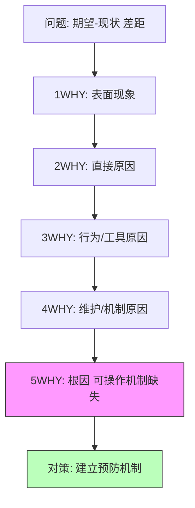

### 边界条件

- 有效性依赖回答者对真实情况的坦诚认知，回避或粉饰会让追问失效。
- 某些系统性问题的根因超出个人可控范围，需结合组织/环境因素综合判断。
- 与"事实与观点"结合使用效果最佳：先区分事实，再对事实层层追问。

---

## 43.21 商业模式画布的道术器用 —— 拆解项目的"四层透视镜"

### 为什么需要这个概念？

面对一个商业项目，大多数人只看到表面（做什么），却看不清其运作逻辑（为什么能赚钱）。需要一套系统工具将项目的商业本质、解决方案、工具载体和执行落地分层拆解。

> "1、道的层面： 一句话阐述商业模式：我用一个XX产品/服务，解决了XX客户的XX痛点，赚XX钱。"
> 
> "2、术的层面： ①解决谁的问题…… ②解决什么问题…… ③怎么让用户找到…… ④怎么和用户打交道…… ⑤我是谁，我有什么…… ⑥谁能帮我…… ⑦我要做什么…… ⑧我要付出什么…… ⑨我能得到什么……"
> 
> "3、器的层面：承载上述9个板块的有没有更便捷的工具；"
> 
> "4、用的层面：执行力、业务流的迭代； 为了确定这个工具，是否适合生财，花了6个小时，看完了《生财有术项目精选》的所有项目，并且将所有项目的商业模式画布都画出来。"
> 
> ——《docs/202301-02/20230207_04.md》

### 核心定义与推导

**道术器用四层分析法**：

以下表格展示四层分析的核心问题与产出物：

| 层级 | 核心问题 | 产出物 |
|------|----------|--------|
| **道** | 这个生意的本质是什么？ | 一句话商业模式：我用XX产品/服务，解决XX客户的XX痛点，赚XX钱 |
| **术** | 解决方案的九个关键维度是什么？ | 标准商业模式画布九宫格（客户、价值、渠道、关系、资源、伙伴、活动、成本、收入） |
| **器** | 用什么工具平台承载？ | 技术栈、SaaS工具、分发渠道、自动化脚本 |
| **用** | 怎么落地执行迭代？ | 执行力、业务流SOP、复盘优化机制 |

**推导逻辑**：道是根基（伪需求则术器用再好也白搭）；术是完整解决方案架构（九维度覆盖商业闭环）；器是效率放大器（工具选型决定边际成本）；用是实现函数（执行力决定理论能否落地）。作者用6小时拆解全量项目验证了工具的普适性。

### 关键性质

- **道是根基**：如果道的层面存在根本问题（伪需求），术器用做得再好也难以成功。
- **术的九维度**可完整刻画一个项目的商业逻辑，所有项目均可套用。
- **器与用决定落地效率**：工具选择和执行力度直接影响商业模式的实现程度。
- **适用边界**：适合"项目篇"而不适合"技能篇"（技能类内容难以用商业模式画布拆解）。

### 典型例子

用该工具拆解《生财有术项目精选》中的所有项目，逐个绘制商业模式画布，验证其普适性。作者花6小时完成全量拆解，确认工具适用性。

### 方法演进图

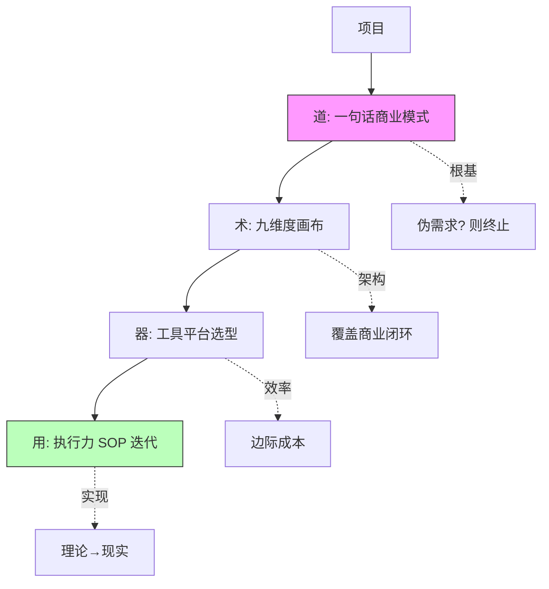

---

## 43.22 卓越策略师五大能力 —— 从"执行者"到"操盘手"的素养跃迁

### 为什么需要这个概念？

策略师常常陷入"坐在办公室头脑风暴"的陷阱，方案脱离一线。面对陌生行业和客户，缺乏系统性能力会导致策略质量低下。

> "1. 扎实的调研能力 不管是什么项目，不管你是多少年经验的营销从业者，在面对陌生的行业和客户时，都要下苦工去做充分的调研。"
> 
> "2. 清晰逻辑的归纳总结能力 不同于广告的'头脑风暴'，策略师更加将就基于事实的归纳。"
> 
> "3. 把控全局的项目管理能力 每一个项目都有着严格的提案时间，什么时候做访谈、什么时候要根据策略推动设计，这些都需要清楚的规划和时间意识。"
> 
> "4. 让人难以怀疑的决断力 策略师能够成为让客户可以依赖的人，而不只是简单的需求执行方。"
> 
> "5. 面向内外部的双重叙事能力 由于策略师特殊的身份，提案和汇报时会同时兼具面向客户和消费者的两种视角。"
> 
> "对调研的压倒性投入，就是对客户的负责。而每一次调研的背后，可能是十几个竞品分析，十几万字的消费者、店长和经销商访谈，不计其数的行业报告等等。"
> 
> "一句名言非常贴切：'搜尽奇峰打草稿'，这个典故是画家在画山峰时广泛收集各种不同的山峰，并不断练习打草稿。懂得搜奇峰是懂得妙理，多打草图是能用苦功。"
> 
> ——《docs/202301-02/20230207_04.md》

### 核心定义与推导

**卓越策略师五大能力**模型：

以下表格梳理五大能力的核心内涵与关键行动：

| 能力 | 核心内涵 | 关键行动 |
|------|----------|----------|
| **调研能力** | 对调研的压倒性投入 = 对客户的负责 | 竞品分析、深度访谈、行业报告研读、一线沉浸 |
| **归纳总结能力** | 策略不是头脑风暴，而是基于事实的归纳 | "搜尽奇峰打草稿"：广泛收集事实 → 反复推敲归纳 |
| **项目管理能力** | 严格的时间节点与里程碑管控 | 清晰规划、关键路径识别、风险预案 |
| **决断力** | 让客户可以依赖，而不只是执行需求 | 在不确定性中给出明确建议、担责 |
| **双重叙事能力** | 同时面向客户和消费者两种视角 | 内部汇报用商业逻辑，外部传播用用户语言 |

**推导逻辑**：调研是事实基础（搜尽奇峰），归纳是加工方法（打草稿），项目管理是交付保障，决断力是价值锚点，双重叙事是沟通桥梁。五者缺一不可，共同构成"可依赖的策略师"形象。

### 关键性质

- 五能力缺一不可，但不同项目对各能力的权重需求不同。
- 该框架主要适用于策略咨询类高要求岗位，对一般执行岗位部分能力要求可放宽。

### 方法演进图

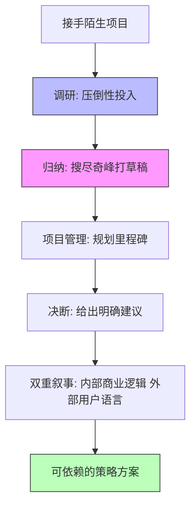

---

## 43.23 超垂直IP与SEO思维 —— 在"极致细分"中挖一口精准流量的深井

### 为什么需要这个概念？

大众赛道竞争激烈，普通人做个人IP难以在无限竞争中脱颖而出。追逐平台爆款的流量来得快去得也快，难以形成持久稳定的客户来源。

> "如果你选的是超垂直的细分领域，你如果坚持的是长期主义变现，那么还有一种流量比迎合平台推荐更有价值：那就是精准搜索的流量"
> 
> "长期主义者，大部分都用SEO思维在做流量，而追风者往往是用爆款思维组流量，彻底理解这一点，起码受益 10 年"
> 
> "一个用户愿意通过各种关键词找到你的信息，进而添加到你的私域里。这样来的1个人会比你平台推荐来的100个人更有价值。"
> 
> "用SEO思维去发布的内容，那怕3年5年你依然可以享受到这个内容的福利。"
> 
> "我在我的抖音和小红书里，就发了不到200篇内容，现在每天打开小红书和抖音，都有人主动的咨询。我们试过有大半个月一条内容都不更新，也是每天都有人过来咨询。"
> 
> ——《docs/202301-02/20230207_11.md》

### 核心定义与推导

**超垂直个人IP**：在极度细分领域深耕、坚持长期主义的个人知识品牌。

**SEO思维 vs 爆款思维**对比：

以下表格对比两种流量思维的核心差异：

| 维度 | SEO思维 | 爆款思维 |
|------|---------|----------|
| 核心逻辑 | 用户主动搜索找到你 | 平台算法推荐刷到你 |
| 流量特质 | 精准、高意向、长尾 | 泛泛、低意向、短爆发 |
| 见效周期 | 慢（1-3个月起效） | 快（可能几小时爆发） |
| 持续性 | 强（3-5年长尾福利） | 弱（几天即衰减） |
| 适合人群 | 长期主义者、专家型 | 追风者、泛娱乐型 |

**四步操作路径**：

```
1. 布局：根据细分领域，用心布局300-500个长尾关键词
2. 创作：每个关键词写一个解决方案（指南/攻略/短视频）
3. 发布：多渠道发布，关键词布局在标题、首段、图篇描述等关键位置
4. 坚持：约1个月后，每天都能收到精准咨询
```

### 关键性质

- 一个通过搜索来的精准用户，价值远超100个推荐来的泛流量用户。
- SEO内容具有长尾复利效应：发布后3-5年持续产出流量，旱涝保收。
- 需要耐心：见效周期比爆款思维长，约1个月开始见效，需坚持更新。

### 典型例子

作者在小红书/抖音发了不到200篇SEO内容，即使大半个月不更新，每天仍有人主动咨询。这就是"旱涝保收"的复利效应。

### 方法演进图

```mermaid
flowchart TD
    A[选定超垂直细分领域] --> B[布局300-500长尾关键词]
    B --> C[每词产出1个解决方案]
    C --> D[多平台发布 关键词布局标题/首段/描述]
    D --> E[坚持更新 约1月见效]
    E --> F[精准用户主动搜索找到]
    F --> G[加入私域 高转化 高复购]
    G --> H[长尾复利 3-5年持续收割]
    style F fill:#bfb,stroke:#333
    style H fill:#bbf,stroke:#333
```

### 边界条件

- 需要有效的细分赛道判断（避免选到无人搜索的死海）。
- 见效周期比爆款思维长，需要耐心与长期主义心态。

---

## 43.24 产品Idea五种构思法 —— 从"想到"到"注意到"的成功率排序

### 为什么需要这个概念？

大多数人构思产品靠"拍脑袋"或盲目跟风，成功率极低。不同产品构思方法的成功率差异巨大，需要一套可评估的排序框架。

> "构思产品idea的动词，应该是'注意到'，而不是'想到'。'我注意到，有这么一个问题，可以这么来解决' 而不是 '我想到了一个创业idea'。"
> 
> "我一共总结了五种常见的方法，他们的成功概率递减。它们分别是：一、原生idea；二、抄成功竞品，然后做出差异化的价值点；三、分析搜索关键词，找到尚未被满足的需求；四、有人愿意预付费找你定制某个需求，然后你将它产品化；五、生造的idea"
> 
> "在我看来，一个高成功率的产品idea，需要满足三个条件：1.有真实需求存在；2.你是这个领域的专家，即便是直面竞争，你也能比对手做得好；3.你能坚持下去，尤其是早期缺乏正反馈的时候"
> 
> ——《docs/202301-02/20230207_11.md》

### 核心定义与推导

**产品Idea五种构思法**（按成功率递减排序）：

以下表格按成功率从高到低排序：

| 排名 | 方法 | 核心动词 | 成功率 | 适用条件 |
|------|------|----------|--------|----------|
| 1 | **原生idea** | **注意到**（自己遇到的问题） | 最高 | 创业者=深度用户 |
| 2 | **抄竞品+差异化** | **模仿+微创新** | 高 | 有成功参照系 |
| 3 | **分析搜索关键词** | **挖掘**（未被满足需求） | 中 | 有搜索数据工具 |
| 4 | **预付费定制产品化** | **验证**（真金白银投票） | 中高 | 有B2B/高客单场景 |
| 5 | **生造idea** | **想到**（拍脑袋） | 最低 | 不推荐 |

**高成功率的三个必要条件**（缺一不可）：
1. 有真实需求存在
2. 你是该领域专家
3. 你能坚持下去（尤其是早期缺乏正反馈时）

### 典型例子

硅谷创业界推崇的"原生idea"：如Dropbox创始人在通勤路上反复忘记U盘，从而"注意到"云端同步的需求。

### 方法演进图

```mermaid
flowchart TD
    A[产品创意来源] --> B{方法选择}
    B -->|1 原生idea| C[注意到自己遇到的问题\n创业者=用户]
    B -->|2 抄竞品+差异化| D[模仿成功案例+微创新]
    B -->|3 分析搜索词| E[挖掘未被满足需求]
    B -->|4 预付费定制| F[真金白银验证需求]
    B -->|5 生造idea| G[拍脑袋 不推荐]
    C --> H[成功率最高]
    D --> I[成功率高]
    E --> J[成功率中]
    F --> K[成功率中高]
    G --> L[成功率最低]
    H -.-> M[需满足:真实需求+专家+坚持]
    I -.-> M
    J -.-> M
    K -.-> M
    style H fill:#bfb,stroke:#333
    style C fill:#bfb,stroke:#333
```

---

## 43.25 平台电商四周期 —— 用"历史规律"预判下一个红利平台

### 为什么需要这个概念？

普通人很难判断一个新平台是否值得投入、什么时机进入最佳。所有电商平台的发展演进存在相似的底层逻辑，可以以史为鉴。

> "从平台电商的历史出发，我把美团的发展分为了四个周期：铺货、动销、精细化、玩趋势。"
> 
> "所有平台演变的底层逻辑是相通的，刚过去的视频号……与抖音的历史进程何其相似。美团电商与淘系的发展也将大相径庭。"
> 
> "美团电商成长为团队的第二曲线，类目不同单店月利润6k-12k（零运营未优化），扭转了我们的淘宝店群的颓势。"
> 
> "第一家店跑通最小MVP仅仅花费了80元……截止到10月美团电商全类目商家仅2000多家，我们应该是百货类目入驻的全国前300名。"
> 
> ——《docs/202301-02/20230207_11.md》

### 核心定义与推导

**平台电商四周期**演进规律：

以下表格梳理四周期的特征与策略：

| 周期 | 平台特征 | 商家策略 | 红利窗口 |
|------|----------|----------|----------|
| **铺货期** | 商家少、竞争小、流量宽松 | 暴力铺货、覆盖SKU、抢占心智 | 最大（先入场者利） |
| **动销期** | 平台考核动销率、清理僵尸链接 | 精选商品、优化转化、保动销 | 中大 |
| **精细化期** | 竞争加剧、流量变贵 | 精细化运营（标题/主图/评价/客服） | 中 |
| **玩趋势期** | 平台成熟、流量贵、需造势 | 跟随趋势、直播/短视频/达人带货 | 小（需强运营能力） |

**推导逻辑**：所有平台演变的底层逻辑相通，可用淘系/抖音历史预判新平台（美团/TEMU/视频号等）。铺货期是红利最大、门槛最低、容错率最高的窗口，核心动作是"完成比完美更重要"——用最小MVP（80元）跑通闭环，再规模化复制。

### 典型例子

2022年8月末发现美团电商机会，不到两个月从0跑通并扩展到30家店，单店月利润6k-12k（零运营未优化）。第一家店跑通MVP仅花80元。验证了"完成比完美更重要"的执行力价值。

### 方法演进图

```mermaid
flowchart LR
    A[新平台上线] --> B[铺货期: 暴力铺货 抢心智]
    B --> C[动销期: 精选商品 保动销]
    C --> D[精细化期: 精细运营 优转化]
    D --> E[玩趋势期: 跟热点 上直播]
    B -.->|红利最大| F[先入场者利]
    F -.->|MVP跑通| G[规模化复制]
    style B fill:#bfb,stroke:#333
    style F fill:#f9f,stroke:#333
```

### 边界条件

- 每个周期的时间长度因平台而异，需结合具体平台发展速度判断。
- "四周期"是理想化模型，实际中可能叠加外部因素（如疫情、政策）。

---

## 43.26 多源对照

本章核心概念来自多份素材的交叉验证，以下梳理共识与分歧：

### 共识

以下表格展示多源素材达成共识的核心概念：

| 概念 | 支撑素材 | 核心共识 |
|------|----------|----------|
| 流量价值三要素 | P001, P006 | 规模×相关性×信任度决定流量真实价值 |
| 战略=选择/取舍 | P001, P004, P007 | 战略本质是聚焦，关键在于不做什么、发挥禀赋 |
| 价值创造>追求增长 | P004, P007 | 视角切换是破解增长瓶颈的根本路径 |
| 财富四阶段递进 | P001, P006 | 出卖劳动力→时间多次卖→买他人时间→钱生钱 |
| SEO思维优于爆款思维(长期) | P006, P009 | 长期主义者应选择精准搜索流量而非追逐热点 |

### 分歧

以下表格展示不同素材视角的差异及综合建议：

| 议题 | P001/P006视角 | P004/P007视角 | P009视角 | 综合建议 |
|------|---------------|---------------|----------|----------|
| **产品质量与盈利关系** | "不解决问题、不是好产品也不影响赚钱"（做局套话论） | 价值创造视角：积累稀缺资产、解决用户问题 | 原生idea强调解决真实需求 | **短期可"做局"变现，长期必须"给方法"建壁垒** |
| **执行力vs战略** | "执行力是值钱的、可变现的"、"先行动就对了" | "战术勤奋无法逃避战略探索"、"战略稳于执行" | "完成比完美更重要"（新平台红利期） | **早期靠执行力跑通MVP，后期靠战略定方向、防偏航** |
| **项目壁垒** | "没有壁垒的项目本质是付费买试错经验" | 战略发挥优势构建壁垒 | 健康单店模型+区域验证=加盟壁垒 | **无绝对壁垒不等于无相对壁垒，相对壁垒来自执行深度与资源积累** |

---

## 43.27 设计中的取舍

为什么不用"单一指标（如ROI/GMV/UV）"评估业务健康度？因为单一指标极易被刷、被误读、被局部最优化。比如只看UV会导致买水军刷流量；只看ROI会切掉长期价值的品牌投入；只看GMV会忽略利润与现金流。**多维框架（如流量价值公式、实时真实ROI、道术器用）强制你审视系统性权衡**。

为什么"战略=选择"强调"不做什么"而非"做什么"？因为资源永远稀缺，机会永远无限。列出"做什么"容易陷入贪多嚼不烂；列出"不做什么"倒逼你面对资源约束，做真正的取舍。**不做清单是战略的护城河**。

"演员氛围"这类灰色手段的伦理边界在哪里？**边界线**：是否欺骗用户做出违背真实意愿的购买决策。可接受：营造热烈氛围、展示真实好评、引导正常决策节奏。不可接受：虚假销量数据、伪造用户身份诱导高客单购买、销售劣质/不合规商品。建议将演员比例控制在群规模的5-10%以内，确保核心商品力（性价比/质量）是转化的根本原因。

"流量合并"模式下，如何避免被流量主反向绑架？**核心原则**：保持产品/方案的不可替代性。如果流量主离开你也能活，你才有谈判筹码。具体做法：建立标准化SOP、沉淀私域自有用户池、开发多渠道分发能力、**永远不要把单一流量主占比超过总流量的30%**。

---

## 43.28 动手练习

### 练习 1：用流量价值公式诊断一个"高流量低转化"案例

**背景**：一位小红书博主有5万粉丝，平均每篇笔记获赞500+，但通过笔记引流的私域咨询每周不足10人，成交几乎为零。她的笔记内容以"今日穿搭分享"为主。

**任务**：
1. 用流量价值公式拆解该案例中规模、相关性、信任度三个维度分别的表现
2. 判断哪一项是当前最薄弱的环节
3. 给出具体的优化建议（至少两条），并说明依据
4. 若她将内容改为"微胖梨形身材通勤穿搭指南"，公式中哪些维度会发生变化？为什么？

---

### 练习 2：核算一个包含私域产值的实时真实ROI

**已知某直播间数据**：产品客单价200元，毛利率50%，当月广告投放10万元，直播间除去退货后营业额50万元。私域进线率60%，私域月产值预估为8元/人/月。

**任务**：
1. 计算仅直播间的ROI
2. 计算加入私域产值后的综合ROI（衰减前3个月按80%计算）
3. 若私域月产值能翻倍到16元，综合ROI会变成多少？
4. 思考：如果你是该项目的运营者，你会为了提高"进线率"还是"私域月产值"投入更多资源？为什么？
**提示**：直播间营业额转为私域的人数 = 营业额 ÷ 客单价 × 进线率

---

### 练习 3：设计捡漏群的演员氛围脚本

**背景**：你运营一个捡漏群，今天下午3点即将上架一款原价199元的品牌保温杯，群内售价39.9元。当前群内有200名真实用户和20名演员。

**任务**：
1. 设计当天三个时间段（预告、秒杀、催单）的完整发品节奏
2. 为演员编写至少3条不同角色的晒单/评论话术（如"宝妈""上班族""学生"），要求符合人设且不显突兀
3. 设计4-6次递进式催单话术的框架（从第1次到第6次分别侧重什么心理）
4. 思考并列出：如果演员氛围过重导致真实用户察觉，会产生哪些负面影响？如何平衡？

---

### 练习 4：判断自己正处于财富积累的哪个阶段

**任务**：
1. 回顾你当前最主要的收入来源，对照财富积累四阶段：出卖劳动力、一份时间多次卖、购买他人时间、钱生钱。判断你目前处于哪个阶段，并给出判断理由
2. 描述你下一阶段的目标形态（例如：从"出卖劳动力"到"一份时间多次卖"），写出至少一个具体的跃迁路径
3. 分析：试图从第一阶段直接跳到第四阶段（如用积蓄炒股）可能遇到什么风险？
4. 对照"人生四阶段"，判断你现在的人生阶段对应的核心任务是否与你当前的财富阶段匹配？

---

### 练习 5：为个人知识IP设计一套SEO关键词布局方案

**背景**：你是一位即将在小红书/抖音起盘的知识博主，计划做"职场沟通技巧"的细分赛道，目标是吸引25-35岁的白领人群。

**任务**：
1. 用"三个为什么"与多角度思维，拆解你的目标用户最常搜索的10个长尾关键词
2. 为其中5个关键词各写一个300字的解决方案文案框架
3. 对比"SEO思维"与"爆款思维"两种流量获取方式的差异，并判断你的选题更适合哪种
4. 你认为这样做SEO多久能看到效果？如果3个月没有流量，你会坚持还是换赛道？为什么？
5. 尝试用"产品Idea五种构思法"评估一下，"职场沟通技巧"赛道是否存在"原生idea"的机会？

---

### 练习 6：应用"战略=选择"框架为一家小店制定战略

**背景**：一家开在社区的中式快餐店，周边有老乡鸡、南城香等标准化连锁品牌。店主厨艺精湛，擅长现炒菜品，价格略高于连锁店，但顾客评价"有锅气、像家里做的"。目前经营状况一般，老板正在纠结是否要模仿连锁品牌的标准化流程。

**任务**：
1. 用"战略=选择"框架，列出这家店"不做什么"的清单（至少3项）
2. 基于其禀赋优势（现炒、人情味），提出一套差异化战略方向
3. 用"战略发挥优势"方法，评估该店的劣势中哪些应该补齐、哪些应该避开
4. 该店的目标是"月营收达到连锁店平均水平"，但目标本身不是战略——请为它写出一句真正的战略陈述。

---

### 练习 7：判断新平台红利期：以美团电商为例

**背景**：假设现在是2023年，你决定认真评估是否进入一个新兴电商平台（如美团电商）的早期红利期。

**任务**：
1. 结合"平台电商四周期"理论，分析新平台在"铺货期"有哪些机会和风险
2. 用"完成比完美更重要"的原则，设计一个80元以内的最小可行MVP测试方案
3. 如果该平台半年内涌入大量竞争者，你的应对策略是什么？
4. 结合"模板化SOP"思维，思考如何将你在该平台的选品方法沉淀为可复制的流程？

---

### 练习 8：用"道术器用"四层分析法拆解一个熟悉的商业模式

**任务**：选择你熟悉的某个商业项目（例如：你所在公司的业务、一个你观察到的网红门店，或一个你正在考虑的副业）。
1. 用一句话写出它的"道"：我用XX产品/服务，解决了XX客户的XX痛点，赚XX钱
2. 按"术"的九个维度（客户、价值、渠道、关系、资源、伙伴、活动、成本、收入）进行拆解
3. 指出承载该模式的"器"（工具/平台）是什么
4. 评估其"用"（执行力）的现状，并给出至少一条迭代建议
5. 如果这个项目的"道"存在根本性问题（例如伪需求），后续三个层面做得好是否还能成功？为什么？

---

## 43.29 本章小结

这一章中我们学习/了解/讨论了商业认知的底层逻辑。首先我们建立了**流量认知的三维框架**——流量价值公式揭示规模×相关性×信任度的乘积关系，流量流速悖论指出动态平衡的重要性，交易目的论将运营锚点校准到转化而非曝光，流量合并与切片分析法提供了获取与优化流量的实操方法论。其次我们深入**私域变现的核心指标体系**——单客价替代客单价衡量用户终身价值，实时真实ROI将私域产值纳入投产核算，捡漏群与演员氛围展示了社群精细化运营的可复制模型。接着我们探讨了**战略思维的本质**——战略即选择（不做什么），发挥优势而非补齐劣势，增长瓶颈怪圈源于被预期绑架，破解之道在于价值创造视角的三种勇气。然后我们梳理了**财富增长的阶段地图**——四阶段递进不可跳跃，利他等于利己的长期主义心法。随后我们掌握了**三大分析工具**——事实与观点的严格区分、5WHY根因分析、道术器用四层商业拆解法。最后我们理解了**内容与IP的长期主义路径**——超垂直IP以SEO思维获取精准流量，产品Idea五种构思法按成功率排序，平台电商四周期以史为鉴预判红利窗口。

本章我们一起学习了以下概念：

| 概念 | 解释 |
|------|------|
| 流量价值公式 | 流量价值=规模×相关性×信任度，乘积关系决定流量真实商业价值 |
| 流量流速悖论 | 快慢失据皆受损，核心在于增加用户停留时间并保持持续不断的流动性 |
| 交易目的论 | 从交易目的出发，无转化的曝光无价值甚至负价值，互动才是平台给流量的信号 |
| 流量合并 | "流量不为我所有，但为我所用"，通过让流量主赚更多钱换取其流量使用权 |
| 流量切片分析 | 横向看渠道来源和趋势，纵向看用户需求与行为路径，才能形成可执行的运营干预 |
| 私域单客价 | 以单个用户生命周期的累计贡献值为指标，替代单次客单价衡量私域价值 |
| 实时真实ROI | 将私域产值纳入投放产出后综合计算投产比，反映真实的整体收益水平 |
| 捡漏群 | 以1-3折超高性价比商品+精细化社群运营驱动佣金变现的电商模式 |
| 演员氛围 | 用"托"营造抢购从众氛围，有演员与无演员的社群产出相差一倍以上 |
| 战略=选择 | 战略的本质是取舍，最重要的决策是明确不做什么，并发挥自身禀赋 |
| 增长瓶颈怪圈 | 被增长的预期绑架，越追求增长反而距离增长越远的恶性循环 |
| 价值创造视角 | 从"我如何得到增长"切换为"我如何值得被奖赏增长"，是破解增长焦虑的唯一方法 |
| 财富积累四阶段 | 出卖劳动力→一份时间多次卖→购买他人时间→钱生钱，依次跃迁不可跳跃 |
| 战略发挥优势 | 先审视手里的筹码，再决定怎么打牌；不能选择自己的劣势作为战略方向 |
| 利他等于利己 | 越分享越幸运，信息不因分享而减少，反而通过利他积累信任获得更大回报 |
| 事实与观点 | 事实是中性的、可用数字和证据支撑的客观陈述；观点是因人而异的立场表达，总结中必须严格区分 |
| 5WHY分析法 | 对问题连续追问五个"为什么"，从表面现象层层深挖到根因的分析方法 |
| 商业模式画布（道术器用） | 用道（本质）、术（九维度）、器（工具）、用（执行）四层拆解并运行任何项目 |
| 超垂直个人IP | 在极致细分领域坚持长期主义，以SEO思维获取精准搜索流量而非追逐爆款 |
| SEO思维 vs 爆款思维 | SEO思维侧重长期精准搜索流量积累，爆款思维侧重热点追逐，长期主义者应优先选择SEO |
| 产品Idea五种构思法 | 按成功率排序：原生idea、抄竞品差异化、分析搜索词、预付费定制、生造idea |
| 平台电商四周期 | 铺货→动销→精细化→玩趋势，所有平台演进规律相通，可预判新平台红利窗口 |
| 新平台红利期 | 在平台成长初期利用信息差和低竞争快速切入，靠"完成比完美更重要"的执行力获取红利 |
| 卓越策略师五大能力 | 调研、归纳、项目管理、决断、双重叙事五方面素养，决定策略质量 |
| 搜尽奇峰打草稿 | 先广泛收集事实（搜尽奇峰）再反复推敲归纳（打草稿），而非依赖头脑风暴 |
| 合格总结三要素 | 总结与目标比对、要事实不要观点、能够帮助发现问题，目的是发现问题 |

下一章中，我们将学习**选品方法论** —— 从"选什么"到"为什么能卖爆"，系统拆解跨境电商和国内电商的选品核心，掌握"四步打造百万爆款"的选品范式，从蓝海市场定位、合规平替、品牌光环到微创新差异化，构建一套可复制的选品决策框架。


