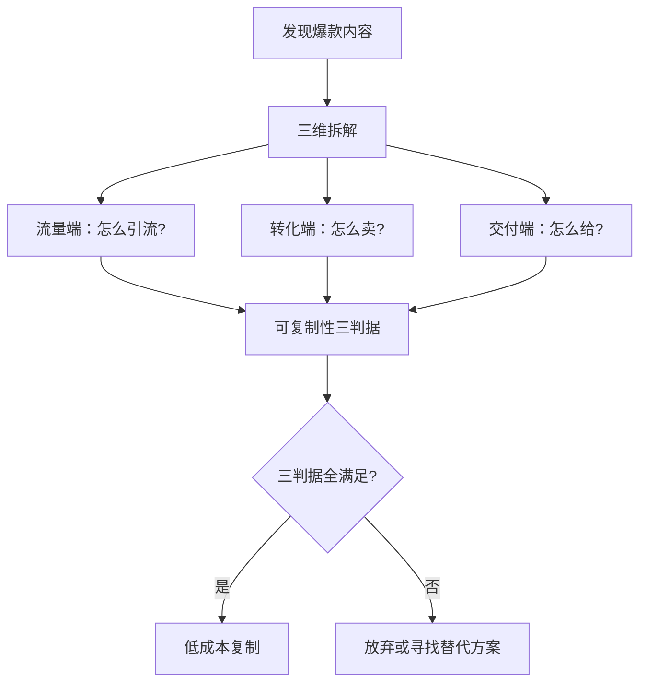
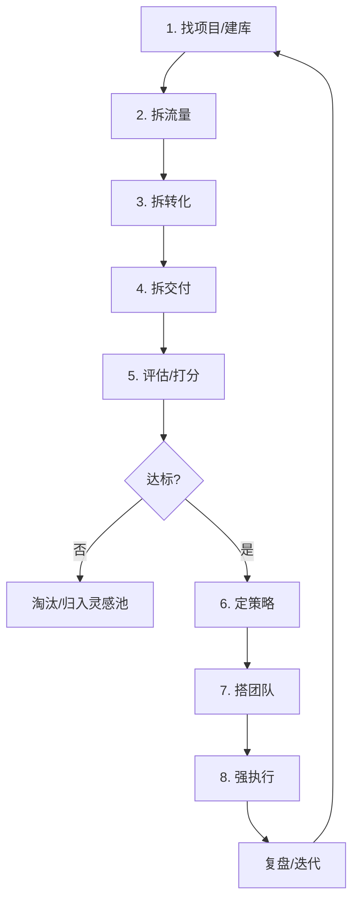
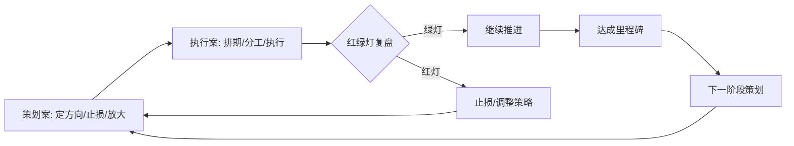
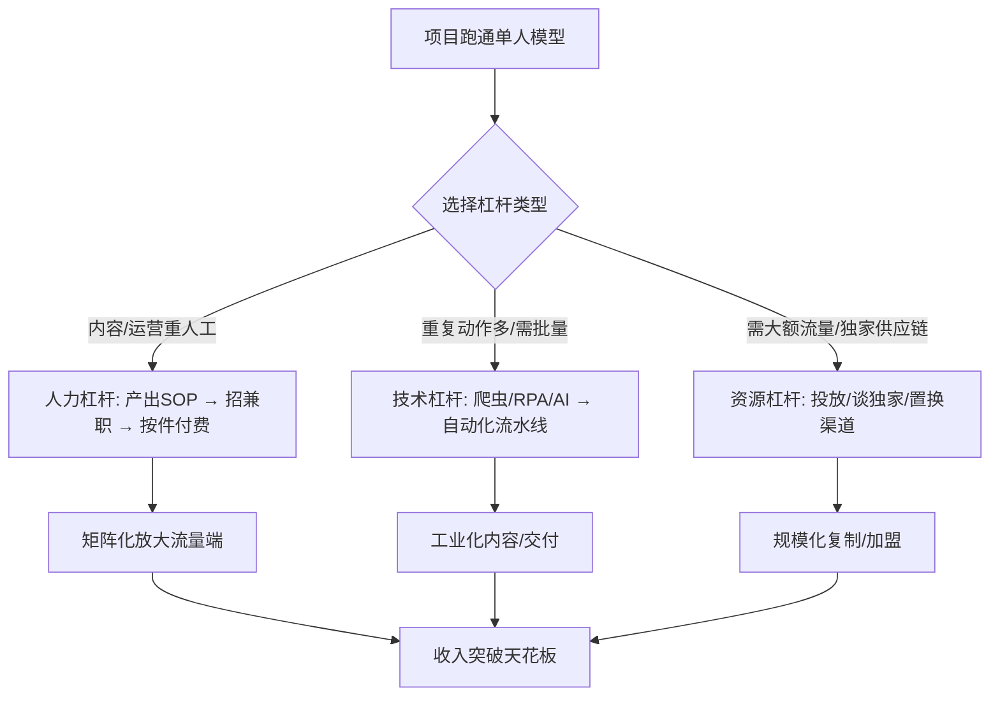

# 第 2 章 发现与筛选 —— 像猎人一样建立“项目情报库”
作者：龙哥

## 学习目标

- 理解私域运营的核心痛点在于前端流量而非私域技巧本身
- 掌握商业项目拆解的三维拆解法（流量、转化、交付）与可复制性三判据
- 熟练运用六维评估模型（流量效率、销转效率、交付效率、客单价、毛利率、复购率）给项目“算账”
- 建立“后发制人”认知：等同行验证3个月以上再入场复制，规避创新风险
- 识别跨平台信息差套利机会，掌握内容搬运/二次创作的平台原生化适配要点
- 能按八步法（找、拆流、拆转、拆交付、评估、定策、搭团、强执）建立个人项目库并筛选
- 理解“策划案+执行案”双案项目管理法与止损点设定原则
- 掌握人力/技术/资源三大杠杆放大副业收入的具体路径
- 辨析红海赛道的真实机会结构：竞争激烈≠无利可图，关键在微调已验证模型
- 掌握“喂养算法”与搜索挖掘双轨情报获取体系，建立持续商业雷达
- 学会用下拉词零成本捕捉用户真实痛点，指导选品与内容方向

## 2.1 生活类比

想象你要在陌生城市开一家餐厅（副业项目）。私域痛点定理就像选址（前端流量）比装修（私域运营）更重要：没人路过的巷子里，厨艺再好也没生意；必须先搞定“门口有人流”。商业项目拆解就像偷师对面爆款店的“菜单、引流海报、外卖打包流程”：不光抄菜品，要抄全套“获客-转化-交付”标准动作。六维评估模型就像给这家店算账：日均进店多少人（流量效率）、入座率多少（销转效率）、出餐快不快（交付效率）、客单价多少、毛利多高、回头率怎样。后发制人就像等对面店开半年还排队，你再开分店：别抢着做第一个吃螃蟹（且可能有毒）的人。信息差搬运就像把食神节目里火过的菜，改良后放到没看过节目的小区食堂卖：同一道菜，换个食客群体就是爆款。红海不红就像满街烧烤摊，依然能开出日入千元的那家：不是避开竞争，而是在验证过的模型上“微调”（更干净、更快、更懂常客口味）。八步筛选法就像加盟总部的“选址-试菜-算账-签约-装修-开业-推广-复盘”标准化 SOP。策划案+执行案就像“商业计划书”+“每日排班表”：一个定方向、定止损；一个管落地、管进度。三大杠杆就像请兼职跑腿（人力）、买自动点餐机（技术）、找供应链谈独家低价（资源）。喂养算法就像每天固定去同一家早餐店打卡、点赞老板推荐的菜单，久而久之老板就会主动给你推荐最赚钱的新品（算法推送商业情报）。下拉词挖需求就像站在菜市场入口听大妈们唠嗑“最近啥菜涨价了/啥海鲜最鲜”，这才是真实的市场需求信号。

## 2.2 概念地图

第2章：发现与筛选 —— 像猎人一样建立“项目情报库”  
├── 核心认知重塑  
│   ├── 私域痛点定理：前端流量是私域成败的关键  —— P001  
│   ├── 后发制人原则：等别人验证完再复制  —— P001  
│   ├── 信息差搬运论：A平台的“烂内容”就是B平台的爆款  —— P001  
│   └── 红海不红：红海赛道照样能赚几十万  —— P001  
├── 情报获取体系  
│   ├── 喂养算法：驯养信息猎犬  —— P001  
│   ├── 搜索挖掘：分辨真伪、泛读筛选、爬虫监测  —— P001  
│   └── 下拉词发现需求：从搜索框“淘金”  —— P002  
├── 项目拆解与评估  
│   ├── 商业项目拆解：把“赚钱的别人”拆成“可复制的零件”  —— P001, P002  
│   │   ├── 三维拆解：流量端/转化端/交付端  
│   │   └── 可复制性三判据：爆款偶然性/货源可获取性/场景验证性  
│   ├── 六维评估模型：给项目算“复制账”  —— P003  
│   │   ├── 效率三维：流量效率/销转效率/交付效率 → 判断可复制性  
│   │   ├── 财务三维：客单价/毛利率/复购率 → 判断收入天花板  
│   │   └── 补偿机制：效率短板可用财务指标补  
│   └── 案例对比标注：小说推文vs教育资料  —— P003  
├── 项目库建立与筛选  
│   ├── 项目库归档：按拆解逻辑整理  —— P001  
│   ├── 八步筛选法：找项目→拆流量→拆转化→拆交付→评估→定策→搭团→强执  —— P001  
│   └── 权重打分规则：按六维+个人资源匹配度量化  
├── 项目落地与管理  
│   ├── 策划案：产品货盘/运营策略/目标/里程碑/止损点/放大点  —— P001  
│   └── 执行案：时间/地点/事项/责任人/阶段目标表格化  —— P001  
└── 放大杠杆体系  
    ├── 人力杠杆：SOP+兼职按效果付费  —— P001  
    ├── 技术杠杆：爬虫批量搬运/二次创作/工业化流水线  —— P001  
    └── 资源杠杆：资金/人脉（非大多数人常规路径）  —— P001

## 2.3 私域痛点定理：前端流量是私域成败的关键

### 为什么需要这个概念？

你是不是也曾陷入过这样的误区：疯狂研究私域运营技巧——怎么设计欢迎语、怎么建群、怎么做裂变、怎么精细化运营用户——却发现好友列表里根本没几个精准客户？

秦汉唐在素材中直指要害：**“私域只是一个渠道，是帮助我们企业更好地跟客户建立关系和发展粘性的一个渠道，其实更重要的是前端的流量，你有没有打开流量，每个月是否有稳定的流量进来。”** [P001]

这段话揭示了一个残酷的因果倒置：绝大多数人把精力花在“果”（转化、运营）上，却忽略了“因”（流量来源）。没有前端流量持续流入，私域池子就是一潭死水，运营再精细也是空中楼阁。

> "私域只是一个渠道，是帮助我们企业更好地跟客户建立关系和发展粘性的一个渠道，其实更重要的是前端的流量，你有没有打开流量，每个月是否有稳定的流量进来。"
>
> ——《秦汉唐·私域运营实战复盘》 [P001]

### 核心定义与直觉理解

**私域痛点定理**（来源：《秦汉唐·私域运营实战复盘》 [P001]）

> **定义**：私域运营的成败，不取决于私域内部运营技巧的高低，而取决于前端流量渠道是否打通、是否每月有稳定流量持续流入。

这个定理的直觉非常简单：流量是因，转化是果。**无因必无果**。无论你卖货、卖课、卖服务，前端流量都是第一块拼图。

素材中给出了一个反面教材——秦汉唐案例：做了大量私域培训、SOP、员工考核，但因前端流量未打通，最终项目失败。反过来，儿童游乐项目：先通过爆款视频验证流量获取模型，再搭建后端转化，3个月变现40万。

### 关键性质

1. **因果倒置**：流量是因，转化是果；无因必无果
2. **通用性**：无论卖货、卖课、卖服务，前端流量都是第一块拼图
3. **先后序**：先搞定“从哪来”，再研究“怎么转”

### 边界条件

- 仅适用于需要持续获客的商业模式，不适用于纯存量运营或品牌维护场景
- 前端流量打通后，仍需最小可行转化链路承接，否则流量即浪费

---

## 2.4 商业项目拆解：把“赚钱的别人”拆成“可复制的零件”

### 为什么需要这个概念？

普通人缺乏从零发明商业模式的能力，但擅长模仿和复制。问题是，**直接模仿表面动作（发什么视频、用什么标题）容易踩坑，必须拆解到底层链路**。

素材指出：*“拆下来之后，我就发现很多时候有些项目是完全可以复制的，是不需要投入几十万也可以复制的。复制了之后，用跟他一样的内容生产方式、转化链路，你也能拿到一定的结果。”* [P001]

这是“后发制人”的战术层面落地：不做从0到1的发明，做从1到N的复制。

### 核心定义

**商业项目拆解**（来源：《秦汉唐·私域运营实战复盘》[P001] + 《DNGrd·个人开发者盈利思维》[P002]）

> 从爆款内容中发现商业案例，拆解其**流量获取、转化链路、产品交付**三大核心模块，复制已验证的商业模式底层逻辑，而非模仿表面内容。

### 三维拆解法（核心图纸）

素材将一个商业项目标准化为三个维度的“设计图纸”：

下表展示了三维拆解的核心问题与关键考察点：

| 维度 | 核心问题 | 关键考察点 |
|------|----------|------------|
| **流量端** | 怎么引流？ | 固定内容分享方式？投放？其他渠道？内容形式？发布频次？ |
| **转化端** | 怎么卖？ | 直播间直卖？引流私域社群转化？朋友圈+私聊？转化周期多久？ |
| **交付端** | 怎么给？ | 有形/无形产品？货物/课程/加盟？客单价？好不好卖？同行坚持3个月+？ |

> **原文摘录**：
> "2、拆流量。它是通过什么方式引流？是不是固定的内容分享方式去引流的？还是投放？市面上他们有没有其他的引流渠道？"
> "3、拆转化。它是通过什么转化？直接在直播间里面卖、还是引流到私域后通过社群转化？还是通过朋友圈+私聊？转化周期多久？"
> "4、拆产品交付。这个产品是有形的产品，还是无形的产品？是货物、还是课程，还是招商加盟的项目，客单价怎么样？好不好卖？有没有同行做了半年以上？"
> ——《秦汉唐·私域运营实战复盘》 [P001]

### 可复制性三判据（验收标准）

拆解完三维，还要做“验收测试”。素材给出了**可复制性三判据** [P001]：

1. **爆款非偶然**：该视频/内容爆发是否为偶然？是否有稳定的内容生产机制可复制？
2. **货源可寻**：核心货源/供应链是否为对方独家？我能否通过其他方式找到同质货源？
3. **场景验证**：该消费场景是否已被验证有真实需求？需求量是否足够大？

**三条均满足，即可低成本复制**。缺一不可。

### 典型例子

**文川手写Logo** [P001]：
- 流量端：固定“创意过程展示”视频持续供给
- 转化端：评论区咨询 → 私信加微信 → 599元/单
- 交付端：外包给大学生设计师（成本200-250），中间赚差价
- 三判据：创意生产固定可复制 ✓ / 设计师可招募 ✓ / 评论区大量咨询验证需求 ✓

**艺术签名** [P001]：
- 流量端：持续发签名过程视频/图文
- 转化端：引流微信，9.9元/单
- 交付端：免费素材网站/工具生成，零成本交付
- 三判据：内容形式固定 ✓ / 素材网站通用 ✓ / 咨询量大验证需求 ✓

### 方法演进图：商业项目拆解全流程

---

## 2.5 六维评估模型：给项目算一笔“复制账”

### 为什么需要这个概念？

凭感觉选项目容易被“包装好的假象”骗。我们需要一把**量化标尺**，既要看“能不能复制”（效率维度），又要看“能赚多少钱”（财务维度），还要支持团队对齐和项目库打分筛选。

素材系统提出：**“六维模型：流量效率、销转效率、交付效率、客单价、毛利率、复购率。用‘效率维度’判断可复制性，‘财务维度’判断收入天花板。”** [P003]

### 核心定义

**六维评估模型**（来源：《秦汉唐·私域运营实战复盘》[P001] + 《20230207_03·生财周报》[P003] + 《20230207_06·生财周报》[P006]）

> 一个商业项目的评估坐标系：
> - **效率三维**（判断可复制性）：
>   - **流量效率** = 获客容易度（内容生产/投放/SEO 对普通人可复制度）
>   - **销转效率** = 成交容易度（SOP成熟度、一对多 vs 一对一）
>   - **交付效率** = 履约容易度（标准化程度、人工依赖度）
> - **财务三维**（判断收入天花板）：
>   - **客单价** = 典型订单金额
>   - **毛利率** = (收入-直接成本)/收入
>   - **复购率** = 用户自然复购频次/比例

### 关键性质

#### 1. 效率维度判断“可复制性”

三效率越高，个人/小团队越容易跑通。这是“能不能干”的维度。

#### 2. 财务维度判断“收入上限”

单客终身价值 (LTV) 的计算逻辑如下：

$$
\text{单客终身价值 (LTV)} \approx \text{客单价} \times \text{复购次数} \times \text{毛利率}
$$

**逐步推导**：
1. **客单价** 决定了单次交易的收入规模。
2. **复购次数** 反映了用户生命周期内的交易频次（复购率 × 生命周期时长）。
3. **毛利率** 剥离了直接成本后的真实利润率。
4. 三者相乘，即可得到一个用户在整个生命周期内为项目贡献的净利润期望值。这是“能赚多少”的维度。

#### 3. 补偿机制：短板可用长板补

素材明确指出：**“效率不足时用财务补”** [P003]。例如：
- 交付效率低（重服务） → 提高客单价/复购率补偿
- 流量效率低（难获客） → 高客单价/高毛利补偿

### 典型例子：案例对比标注

素材用六维模型逐个标注对比 [P003]：

下表对比了三类典型项目在六维模型上的表现：

| 项目 | 流量效率 | 销转效率 | 交付效率 | 客单价 | 毛利率 | 复购率 | 天花板 |
|------|----------|----------|----------|--------|--------|--------|--------|
| **小说推文** | 高（内容易产出） | 高（自动化） | 高（数字化交付） | **极低**（几毛） | 高 | **无** | **低**（靠量，累且顶） |
| **教育资料/项目拆解IP** | 低（难获客） | 中（需信任） | 中（重服务） | **高**（百元-万） | 高 | **高** | **高**（靠价，稳且高） |
| **减肥食谱** | 中 | 中 | 高 | **极低** | 高 | **高** | 中（需走量） |

> **原文摘录**：
> "用六维模型逐个标注“小说推文”“教育资料1.0/2.0”“减肥食谱”等项目，演示模型的实际操作。揭示“客单价提升”如何改变项目量级。"
> ——《20230207_03·生财周报》 [P003]

**关键洞见**：小说推文看似“流量大、交付轻”，实则客单价极低、无复购，**商业模式天花板结构性更低**；教育资料/项目拆解IP虽前端难、交付重，但高客单价+强复购构建了高护城河、高天花板的模型。

### 边界条件

- 模型假设“已有同行验证”，不适用于0到1的创新型项目
- 权重需根据个人资源动态调整（如擅长交付者可承担低交付效率项目）

---

## 2.6 后发制人原则：等别人验证完再复制

### 核心定义

**后发制人原则**（来源：《秦汉唐·私域运营实战复盘》 [P001]）

> **定义**：不做从0到1的发明，做从1到N的复制。等别人已经做成、稳定做了几个月、验证可行后，再进入复制或二次创作。

> **原文摘录**：
> "有一个词叫做后发制人。就是你去做别人做过的事情，将其进行复制或者二次创作。"
> "我一定是看别人已经做成了，已经做了好几个月了，我才会选择做这个项目做这个赛道。"
> ——《秦汉唐·私域运营实战复盘》 [P001]

### 关键性质

1. **核心逻辑**：让别人替你交学费、跑流程、验证模型，你拿结果直接用
2. **非盲目跟风**：是“验证后跟进”，有明确进入标准——**同行坚持3个月以上**
3. **时间窗口**：太早（未验证）有风险，太晚（红海饱和）利薄，最佳窗口为“同行跑通3-6个月、平台仍有流量红利期”

### 典型例子

- **秦汉唐**：所有项目均源于拆解已跑通同行，从未凭空发明 [P001]
- **儿童游乐项目**：看到爆款视频数据（8.4w赞、3000评论）验证需求后，才决定投入 [P001]

---

## 2.7 信息差搬运论：A平台的“烂内容”就是B平台的爆款

### 核心定义

**信息差搬运论**（来源：《秦汉唐·私域运营实战复盘》 [P001]）

> **定义**：渠道间存在天然信息差。同一内容在不同平台表现截然不同。把在A平台做烂/做透的内容，优化后搬运到B平台，往往能瞬间爆火。

> **原文摘录**：
> "渠道其实是有信息差的，我们做过很多项目，其实吃的就是信息差，有些项目在抖音上做得很烂的，但是如果你搬到小红书上面，瞬间就爆了。有些项目在小红书上面做的人很多了，那你把同样的内容优化一下，搬到抖音上，也有可能把它做爆。"
> ——《秦汉唐·私域运营实战复盘》 [P001]

### 关键性质

1. **非抄袭，要“原生化”**：需针对目标平台调整标题、封面、话术、发布节奏等要素
2. **单向流动性强**：通常从成熟平台（抖音/知乎）向新兴/垂类平台（小红书/视频号）流动
3. **时间窗口**：每个平台对同类内容的红利期约6-12个月，需快进快出

### 典型例子

- **秦汉唐实操**：抖音上做烂的“艺术签名/手写Logo”搬到小红书，瞬间爆单 [P001]
- 反之，小红书成熟的“避坑指南/种草笔记”搬到抖音/视频号，同样高转化

### 边界条件

- 平台打击搬运力度升级时需进化为“二次创作/伪原创”
- 版权风险：避开强版权保护内容（影视、音乐、独家课程），优选工具类、知识类、素材类
- 不适用于强个人IP属性内容（如李子柒、罗翔），核心资产在“人”不在“内容”

---

## 2.8 红海不红：为什么红海赛道照样能赚几十万

### 核心定义

**红海不红**（来源：《秦汉唐·私域运营实战复盘》 [P001]）

> **定义**：任何一个红海赛道都不缺一个年赚几十万的人，关键是找到已验证项目做微调，而非盲目创新。

> **原文摘录**：
> "任何一个红海的赛道都不缺一个一年赚几十万的人，都不缺你一个一年赚几十万的人。"
> "所以你唯一能够要做的事情就是找到一个别人做过的事情，做了并且稳定有赚钱的项目。确定好赛道，给他们更匹配一点的调整就可以赚到钱。从 0 到100w，其实就是找到一个项目。"
> ——《秦汉唐·私域运营实战复盘》 [P001]

### 关键性质

1. **竞争激烈 ≠ 无利可图**：竞争激烈往往意味着市场大、需求真、流量足
2. **入场关键**：不是“避开竞争”，而是“找到已验证项目，做匹配调整”
3. **微调维度**：人群更细分、内容更垂直、服务更极致、交付更标准

### 典型例子

- **艺术签名/手写Logo/抓娃娃教学**：看似红海、低门槛，实则持续有人月入几万
- **秦汉唐**：专门挑同行做了3个月以上、有稳定流量的红海项目复制

### 多源对照：红海认知的共识与分歧

下表对比了不同素材对红海赛道的认知：

| 来源 | 观点 | 核心论据 |
|------|------|----------|
| **秦汉唐 [P001]** | 红海不怕，找验证项目微调即可 | 同行3个月+验证、需求真、模型成熟、可复制 |
| **20230207_02 [P004]** | 追求确定性而非彩票，避开低价平台 | 成功生意人追求可持续模式，非偶然爆单；低价平台卖家算来算去都亏 |
| **共识** | **红海=需求验证充分、模型跑通，适合后发制人复制** | |
| **分歧** | 秦汉唐强调“微调已验证模型”；20230207_02强调“避开低价/无壁垒红海” | 后者更强调项目筛选的门槛（如避开Temu式低价平台） |

---

## 2.9 喂养算法与情报挖掘：让平台成为你的商业雷达

### 为什么需要这个概念？

被动刷视频效率极低，算法默认推送娱乐内容而非商业情报。你需要**主动“驯化”算法**，建立持续、低成本的商业案例发现渠道。单靠算法不够，还需掌握主动搜索、爬虫监测等补强手段。

### 核心定义

**喂养算法**（来源：《秦汉唐·私域运营实战复盘》 [P001]）

> 通过主动点赞、收藏、评论、停留商业类内容，反向训练推荐模型，使其持续推送高价值商业情报。

**搜索挖掘**（来源：《秦汉唐·私域运营实战复盘》 [P001]）

> 关键词搜索 + 真伪分辨 + 泛读筛选 + 爬虫数据监测，主动捕猎情报。

> **原文摘录**：
> "无论是抖音还是小红书，还是今日头条，还是现在的👸号视频号，都是算法逻辑。我上面讲的几个案例、还有我自己拆过的几百个项目，很多都是通过喂养算法刷到的。"
> "我就不断的点赞收藏关注，然后坚持了一、两个月之后，它就不断地给我推送这些文章。"
> "其次，要学会搜索：1、你要学会分辨你搜索的这些信息源真伪和干货程度。2、你要学会泛读。3、需要有一定的技术实力，或者你认识一些比较靠谱的技术小伙伴，可以做一些爬虫、以及数据监测的开发。"
> ——《秦汉唐·私域运营实战复盘》 [P001]

### 关键性质

下表对比了两种情报获取方式的核心差异：

| 方法 | 核心动作 | 产出 | 门槛 |
|------|----------|------|------|
| **喂养算法** | 每天20-30分钟：搜关键词 → 点赞/收藏/评论/转发商业内容 | 算法画像重塑，信息流变为“商业雷达” | 低（需专用账号） |
| **搜索挖掘** | 关键词搜索 + 辨别广告/实操 + 泛读 + 爬虫监测 | 结构化项目情报库 | 中高（爬虫需技术） |

### 实操步骤：喂养算法 SOP

1. **新注册/清理专用账号**（抖音、小红书、视频号），避免个人兴趣标签干扰
2. **每天固定20分钟**：搜“副业/赚钱/项目拆解/行业案例/复盘”
3. **对前20条商业属性强内容**：点赞、收藏、评论（提问/复述痛点）、转发至文件传输助手
4. **坚持1-2周**，观察推荐流从“娱乐八卦”转为“项目拆解/行业复盘”

### 实操步骤：搜索挖掘三板斧

1. **分辨真伪**：区分“卖课广告”（夸大易复制性、隐瞒成本）与“实操复盘”（有数据、有细节、有反思）
2. **泛读筛选**：宽进严出，建立“赛道-渠道-变现模式”三级分类标签
3. **爬虫监测**（进阶）：对标账号/关键词设定自动采集，把“人工刷屏”升级为“机器巡逻”

---

## 2.10 通过下拉词发现需求：从搜索框里“淘金”

### 为什么需要这个概念？

选品/选题常陷入“自我感觉良好”的主观臆断。搜索下拉词是平台基于海量用户行为生成的**“需求清单”**，零成本、高真实度，能发现大词覆盖不到的长尾细分需求——往往对应蓝海机会。

### 核心定义

**下拉词挖需求**（来源：《DNGrd·个人开发者盈利思维》[P002] + 《20230207_04·生财周报》[P004]）

> 利用百度/微信/小红书/应用商店/Google等搜索框的下拉推荐词，反推用户真实搜索意图。
> **核心逻辑**：下拉词 = 高频搜索 = 强需求 = 潜在商机。

> **原文摘录**：
> "发现需求的方式也很简单，去应用商店找一些App名字，输入百度、微信、小红书，Google搜索框"
> "需求是抓住用户遇到问题,用户寻找解决办法产生的行为。围绕用户可能产生的行为场景，在行为中部署产品！"
> "细心留意，半个小时挖出十几个蓝海产品完全是没有问题的。"
> ——《DNGrd·个人开发者盈利思维》 [P002]
>
> "视频的好处在于我们所看到的场景和产品非常的直观，如果你细心留意，半个小时挖出十几个蓝海产品完全是没有问题的。"
> ——《20230207_04·生财周报》 [P004]

### 关键性质

1. **多平台互证**：同一词在多平台下拉均出现 → 需求强度更高
2. **长尾优先**：下拉词通常为长尾词 → 竞争小、转化精准
3. **动态更新**：下拉词随热点/季节变化 → 可作为趋势风向标

### 典型例子

- **秦汉唐**：通过应用商店搜“抖音去水印”发现下拉词“免费/在线/破解”，反推用户痛点开发工具类项目 [P001]
- **闲鱼套利案例** [P004]：搜“回收”下拉出“高价回收/上门回收”，验证同城回收需求旺盛
- **抖音选品发散** [P004]：刷半小时视频，从场景中挖出十几个蓝海产品（代金券、剧集同款、理发店设备、节日灯笼等）

### 边界条件

- 下拉词反映“搜索意图”而非“购买意图”，需结合转化数据二次验证
- 部分平台下拉词受商业推广干扰，需人工甄别广告词与自然词

---

## 2.11 建立项目库与八步筛选法

### 为什么需要这个概念？

情报不归档等于白刷；项目不筛选等于白拆；资源不匹配等于白干。我们需要一套从“看到”到“决定做”的标准化流程，避免冲动决策。量化打分能克服“觉得行”的主观偏见，提升决策命中率。

### 核心定义

**项目库**（来源：《秦汉唐·私域运营实战复盘》 [P001]）

> 按三维拆解逻辑（流量/转化/交付）归档每个拆解案例，形成个人案例资产库。

**八步筛选法**（来源：《秦汉唐·私域运营实战复盘》 [P001]）

> 找项目 → 拆流量 → 拆转化 → 拆交付 → 评估（六维+三判据） → 定策略 → 搭团队 → 强执行

> **原文摘录**（完整八步法）：
> "1、找项目。建立项目库。"
> "2、拆流量。它是通过什么方式引流？是不是固定的内容分享方式去引流的？还是投放？市面上他们有没有其他的引流渠道？"
> "3、拆转化。它是通过什么转化？直接在直播间里面卖、还是引流到私域后通过社群转化？还是通过朋友圈+私聊？转化周期多久？"
> "4、拆产品交付。这个产品是有形的产品，还是无形的产品？是货物、还是课程，还是招商加盟的项目，客单价怎么样？好不好卖？有没有同行做了半年以上？"
> "5、评估可复制性和可持续性。比如说他这个产品你需要投入五万十万的，那这个事情短期内复制不了；同行没有坚持三个月以上，持续不了，如果他坚持三个月以上说明他挣到钱了，那就可持续。"
> "6、定策略。你自己定你的产品，你的流量，你的转化，这三个端口怎么做？是复制全部还是通过你的擅长点进行微创新。"
> "7、定完策略之后要搭团队。你要把这个事情分为几个点，比如产品端、流量端，转化端是否是一个人就够了，还是需要两三个人？"
> "8、强执行。最重要的就是最后一步，如果你没有强执行，前面说的所有一切都是自嗨，没有用。"
> ——《秦汉唐·私域运营实战复盘》 [P001]

### 归档标准化字段

每个项目入库必含以下字段：

| 字段 | 说明 |
|------|------|
| 赛道/渠道/变现模式 | 一句话标签化 |
| 六维数据 | 流量/销转/交付效率(1-10)、客单价/毛利/复购 |
| 可复制性判据 | 爆款非偶然/货源可寻/场景验证 ✓/✗ |
| 个人资源匹配度 | 技能/资金/时间/人脉匹配程度(1-10) |
| 止损预估 | 最大时间/金钱/资源投入上限 |

### 权重打分规则

综合得分的计算采用加权公式：**综合得分 = 六维指标(40%) + 个人资源匹配(30%) + 可复制性判据(20%) + 直觉/偏好(10%)**。起号期权重向流量效率倾斜，规模期权重向交付效率倾斜；个人强项维度可额外加分。建议每周整理新项目，每月复盘 Top10，淘汰过期或失效项目，保持项目库的时效性与精准度。

### 典型例子

- **秦汉唐**：飞书表格建库，3个月积累几十个项目，筛选出儿童游乐/艺术签名等实操项目
- **个人实操**：按周整理群内精华帖，按月打分清洗，项目库成为“随时可开工”的菜单

### 方法演进图：八步筛选法流程

---

## 2.12 策划案+执行案：双案驱动项目落地

### 为什么需要这个概念？

有想法无计划等于白日梦；有计划无执行等于空中楼阁。副业时间碎片化，必须用结构化文档对齐目标、分工、进度、止损。**双案分离：策划案管“方向与边界”，执行案管“节奏与细节”**。

### 核心定义

**策划案**（来源：《秦汉唐·私域运营实战复盘》 [P001]）

> 产品货盘（引流品/盈利品/高客单）、运营策略（流/转/交）、目标里程碑、**止损点**、**放大点**。

**执行案**（来源：《秦汉唐·私域运营实战复盘》 [P001]）

> 周/日维度的甘特表——时间、地点、事项、责任人、阶段目标、完成状态（红绿灯）。

> **原文摘录**：
> "项目管理。我把它分为两个部分，一个叫策划案，一个叫执行案。"
> "策划案就是一个想法、规划、目标制定；执行案就是人员分工、分解执行、过程监控、结果复盘。"
> "一定要有目标，没有目标的话你自己是懵的。"
> "里程碑是什么意思呢？就是你在做这个项目的过程中，有一些对你来说有关键性的目标叫里程碑。"
> "止损点什么意思呢？就是你做这个事情不用继续了，你做这个事情的最大限度，你能够承担多大的损失。这个止损点包括你的时间成本、还有你的金钱投入、资源投入。"
> ——《秦汉唐·私域运营实战复盘》 [P001]

### 关键性质

下表对比了策划案与执行案的核心差异：

| 维度 | 策划案（周更/月更） | 执行案（日看/周复盘） |
|------|---------------------|------------------------|
| **核心职能** | 定方向、定边界、定止损 | 管节奏、管细节、管进度 |
| **关键要素** | 止损点（三条红线）、里程碑（可验证） | 红绿灯状态、责任人、完成日期 |
| **更新频次** | 一周一改（微调） | 一日一看、周复盘（只看红项） |

#### 止损点前置（核心创新）

策划案**必须**写明三条红线，触发即止损，杜绝沉没成本：
- **时间成本上限**（如：每周不超10小时）
- **金钱投入上限**（如：不超2000元）
- **关键指标底线**（如：连续2周日引流<5人）

#### 里程碑可验证化

拒绝模糊目标，必须可量化、可观测：
- ❌ “努力发视频”、“提升转化”
- ✅ “第1周跑通首单”、“第1月日单>10”、“第3月月入>5万”

### 典型例子

**秦汉唐儿童游乐** [P001]：
- 策划案：3个月招40加盟商、止损投入5万、放大点=人力/技术杠杆
- 执行案：周复盘“引流渠道/转化话术/交付SOP”进度，红绿灯标注

**个人副业模板**：
- 策略卡：周投10h/投2000元/连2周日引流<5人止损
- 周计划表：日历化“拍视频/回私信/发货”动作

### 方法演进图：双案驱动落地流程

---

## 2.13 三大杠杆：人力、技术、资源 —— 将收入从1放大到N

### 为什么需要这个概念？

单人单号天花板极低（时间/精力有限），必须用杠杆突破收入上限。三大杠杆门槛依次递增：**人力最低、技术中等、资源最高**，按能力配置。杠杆不是“甩手掌柜”，而是建立SOP/工具/渠道后的“复制放大”。

### 核心定义

下表定义了三大杠杆的核心指标与典型门槛：

| 杠杆 | 定义 | 核心指标 | 典型门槛 |
|------|------|----------|----------|
| **人力杠杆** | 将内容生产/客服/发货等标准化动作拆解为SOP，招兼职按件/效果付费 | SOP化程度、单件产出时间(5-10分钟/篇) | 低（管理成本随人数上升） |
| **技术杠杆** | 爬虫批量采集素材、RPA自动发布/搬运、AI二次创作/去重、自建工具矩阵 | 自动化率、半衰期(平台风控) | 中（需技术或外包） |
| **资源杠杆** | 资金投放换流量、独家供应链谈成本、人脉置换渠道/背书 | 杠杆率=撬动资源/自有投入 | 高（强依赖特定关系） |

> **原文摘录**：
> "人力杠杆。人力杠杆顾名思义是低成本的兼职。比如说要做小红书。我们招了很多兼职小伙伴，通过我们自己的内容生产模式，做成一个 SOP ，帮我们去做引流，5 到 10 分钟一篇笔记，引流加一个微信我给你多少钱。"
> "技术杠杆就是顾名思义通过软件释放你的双手。比如说你可以批量的把某一个领域的小红书笔记批量地扒一下，因为你要抄同行。...用这种工业化的流水线这种方式去完成。"
> "资源杠杆这边我就不多说了，其实就是资金、人脉，不太适合我们大多数人。"
> ——《秦汉唐·私域运营实战复盘》 [P001]

### 关键性质与边界

#### 人力杠杆
- **核心**：SOP化程度决定复制上限
- **边界**：管理成本随人数上升，超5人需引入中层/工具，否则效率反降

#### 技术杠杆
- **核心**：从“辅助人工”进化为“无人流水线”
- **边界**：平台反作弊升级快，技术杠杆半衰期短，需持续迭代维护

#### 资源杠杆
- **核心**：杠杆率 = 撬动资源 / 自有投入（如1万广告费撬动10万GMV则杠杆率10倍）
- **边界**：不可复制性强，仅作锦上添花非核心依赖

### 典型例子

- **秦汉唐小红书矩阵**：招兼职按“加1微信付X元”做引流，人力杠杆放大流量端
- **视频号无人直播** [P003]：自研硬件盒子规避检测+录播素材循环，技术杠杆单场百万销售额
- **胖龟找房** [P005]：城市合伙人模式复制门店，资源杠杆（品牌/房源库/流程）赋能合伙人

### 方法演进图：三大杠杆落地决策流程

---

## 2.14 多源对照：核心概念的共识与分歧

### 2.14.1 商业项目拆解：三维拆解的共识与差异

下表对比了不同素材对商业项目拆解维度的阐述：

| 素材 | 拆解维度 | 核心差异 |
|------|----------|----------|
| **秦汉唐 [P001]** | 流量端/转化端/交付端 + 可复制性三判据 | 强调“同行3个月+验证”、强调“货源非独家” |
| **DNGrd [P002]** | 内容生产/转化链路/交付方式 + “软文先行” | 强调“软件即软文”、“卖空气预售”、不一定要真开发 |
| **共识** | **三维拆解是标准动作：流量怎么来、转化怎么做、交付怎么给** | |
| **分歧** | 秦汉唐重“复制已验证”；DNGrd重“最小成本验证（卖空气/软文先行）” | 后者更激进，适合数字产品/软件类项目 |

### 2.14.2 六维评估模型的演进

下表梳理了六维评估模型在不同素材中的演进脉络：

| 素材 | 核心贡献 |
|------|----------|
| **秦汉唐 [P001]** | 提出六维框架雏形，效率/财务二维，补偿机制 |
| **20230207_03 [P003]** | 系统化定义六维指标，给出小说推文vs教育资料标注案例 |
| **20230207_06 [P006]** | 引入“单客价”替代“客单价”，强调私域LTV视角；提出“实时真实ROI”核算法 |
| **演进** | 从**项目筛选工具** → **运营复盘工具** → **投放决策工具** |

---

## 2.15 设计中的取舍

### 为什么不用“从0到1创新”而是“后发制人复制”？

**Q：创新不是更有竞争壁垒吗？**

A：对普通人/副业者，**创新成本太高、周期太长、失败率太高**。素材铁律：“我一定是看别人已经做成了，已经做了好几个月了，我才会选择做这个项目” [P001]。让别人替你交学费、跑流程、验证模型，你拿结果直接用。**创新留给有资源、有团队、能承受失败的主业创业者**。

### 为什么“红海赛道反而更适合普通人”？

**Q：红海不是竞争激烈、利润薄吗？**

A：**竞争激烈 = 需求真、流量足、模型跑通**。六维视角：红海通常“流量效率高、销转效率高”，只是财务维度需微调（提客单价/毛利/复购）。素材主张：“任何一个红海的赛道都不缺一个一年赚几十万的人” [P001]。关键是**找到已验证项目，做匹配调整（人群更细/内容更垂/服务更极致）**，而非硬碰硬。

### 为什么三维拆解选“流量/转化/交付”而非其他维度？

**Q：商业模式画布有9个模块，为什么只拆这三个？**

A：**这三个是普通人可操作、可复制、可量化的“执行三要素”**。“关键资源/关键合作/成本结构”是战略层，普通人副业期无法掌控。流/转/交直接对应“内容生产/销售话术/交付SOP”三大日常动作。DNGrd [P002] 同样将核心压缩为“内容生产/转化链路/交付方式”，印证此三维为副业落地的最小必要集。

### 为什么六维权重固定为 40/30/20/10？

**Q：能否根据项目类型动态调整？**

A：**基础权重固定是为了建立“统一度量衡”，但实操中必须动态调整**。固定权重作用：横向对比不同项目时，防止“想做哪个就给哪个加分”的主观偏见。动态调整原则：起号期→流量效率权重可升至50%；规模期→交付效率权重可升至40%；个人强项维度（如擅长技术→交付效率）可+10%。素材实操：秦汉唐 [P001] 明确“起号期权重向流量效率倾斜，规模期向交付效率倾斜”。

### 为什么止损点设三条红线而非更多？

**Q：只设时间/金钱/指标三条，会不会漏掉风险？**

A：**三条红线覆盖了副业者的三大核心约束资源，已是“必要且充分”的最小集合**。时间：副业最稀缺资源，不可再生。金钱：承担损失的硬底线，防止借贷/透支。指标：业务健康度的早期预警，防止“忙碌但无效”。额外红线（如精力/家庭关系/合规风险）通常内化于时间与指标红线中，单独列出易导致“止损清单”过长反而不执行。

### 为什么杠杆顺序定为人力>技术>资源？

**Q：技术杠杆边际成本更低，为何不放第一？**

A：**按“普通人可获得性”排序，而非“理论杠杆率”排序**。人力杠杆：零技术门槛，有SOP即可启动，周末即可招到兼职。技术杠杆：需懂代码或有外包预算，且平台风控导致半衰期短（常3-6个月失效），维护成本高。资源杠杆：强依赖特定人脉/资质/资金，非大多数人可复制路径。素材原话：“资源杠杆不太适合我们大多数人” [P001]。

### “喂养算法” vs “主动搜索”怎么取舍？

喂养算法与主动搜索是互补关系。起号期（0-2周）建议纯喂养算法：每天20分钟专用账号刷商业内容，建立画像。选题期（项目筛选）则采用喂养算法(70%)+ 搜索挖掘(30%)的组合：算法给广度，搜索给深度。深度拆解期以搜索挖掘为主、爬虫监测为辅，对标账号全量数据、关键词趋势全覆盖。长期维护则是算法维护(日常) + 定期搜索(周/月) + 爬虫自动化(持续)的三位一体体系。

---

## 2.16 动手练习

### 练习 1：实战——对一个感兴趣的副业项目做六维打分

**操作步骤**：
1. 在抖音/小红书找一个持续发布3个月以上、有明显商业变现迹象的账号（如：教PPT、卖资料、推好物、做咨询）。
2. 按六维模型为该项目打分（1-10分）：
   - 流量效率：其获客方式（发视频/投流/SEO）对普通人可复制度如何？
   - 销转效率：从加微信到成交的标准话术/SOP是否成熟？一对多还是一对一？
   - 交付效率：交付是否标准化（资料/软件/课程）？还是重人工服务（陪跑/定制）？
   - 客单价：典型订单金额？
   - 毛利率：扣除直接成本（货源/佣金/广告）后利润率？
   - 复购率：用户是否有自然复购理由（耗材/进阶/会员）？
3. 回答问题：
   - 该项目的“短板维度”是哪个？能否用“长板维度”补偿（如交付重但客单价高）？
   - 若你操盘，六维权重如何调整（如你擅长技术→可承担低交付效率）？
   - 该项目是否满足“可复制性三判据”？请逐条论证。

### 练习 2：实战——跨平台信息差搬运演练

**操作步骤**：
1. 在抖音搜索一个成熟赛道关键词（如“避坑指南”、“整理收纳”、“副业推荐”），找3条点赞10万+、发布时间超过1个月的爆款视频。
2. 在小红书/视频号/👸号搜索同主题，对比内容呈现差异：标题风格、封面排版、话术节奏、评论区引导方式。
3. 选择1条视频，制作“原生化改造版”：重写标题、重做封面、按目标平台话术改写文案/脚本、调整发布时间。
4. 回答问题：
   - 原视频的核心“卖点/钩子”是什么？改造时你保留/放大/削弱了哪些要素？
   - 目标平台用户对“硬广/引流”的容忍度如何？你如何设计“安全钩子”（如主页背景图/置顶笔记/私信回复关键词）？
   - 若该内容在目标平台已有大量同质化，你的“微调”差异化在哪里（人群更细/场景更真/福利更实）？

### 练习 3：实战——为一个拟开展项目写“策划案”骨架 & 设定“止损点”

**操作步骤**：
假设你决定复制练习1中的项目，按“策划案”模板填写：
1. **产品货盘**：引流品（免费/低价）、盈利品（主力）、高利润套餐/高客单（后端）的具体形态与定价。
2. **运营策略**：流量端（哪个平台、什么内容形式、日更几条）、转化端（加微信路径、话术框架、成交周期）、交付端（标准化交付物、SOP关键节点）。
3. **目标与里程碑**：第1周目标（跑通首单）、第1月目标（稳定日单量）、第3月目标（收入/规模）。
4. **止损点**：设定三条红线——时间成本上限（如每周不超10小时）、金钱投入上限（如不超2000元）、关键指标底线（如连续2周日引流<5人）。
5. **放大点**：人力杠杆（哪步可外包兼职）、技术杠杆（哪步可用工具/脚本）、资源杠杆（可复用的渠道/供应链/社群）。

**回答问题**：
- 你的止损点是基于“可承受损失”还是“预期收益”设定的？两者有何区别？
- 里程碑设定是否具备“可验证性”（如“日引流50人”优于“努力发视频”）？
- 若第1月未达标，你的“备选策略”（Plan B）是什么？是否已在策划案中预留？

### 练习 4：思辨——为什么“红海赛道反而更适合普通人后发制人”？

**素材主张**：任何红海赛道都不缺年赚几十万的人，关键是找到已验证项目做微调。

**请结合“六维模型”与“可复制性三判据”论证**：
- 红海赛道的“高竞争”在六维中主要体现在哪个/些维度？（提示：流量效率/销转效率）
- 为什么“已验证项目做微调”比“蓝海赛道从0创新”更符合普通人资源禀赋？
- 什么情况下红海赛道确实“不可做”？（提示：强个人IP/独家供应链/重资质/平台打击期）

**写出你的判断清单**：评估一个红海项目“是否值得入场”的5个核心判断项。

### 练习 5：工具——搭建你的“每日商业情报雷达”（喂养算法+搜索+下拉词）

**操作步骤**（建议连做14天形成习惯）：
1. 新注册/清理一个抖音号、小红书号、微信“文件传输助手”笔记。
2. 每天固定20分钟：在目标平台搜索“副业/赚钱/项目拆解/行业案例”等词，对前20条商业属性强的内容：点赞、收藏、评论（提问/复述痛点）、转发至文件传输助手。
3. 每周六汇总：打开收藏/转发内容，按“赛道/渠道/变现模式”分类，挑选3个符合“可复制性三判据”的项目，按八步法第2-4步（拆流量/拆转化/拆交付）做简易拆解记入项目库。
4. 每月月初：用百度/微信/小红书/应用商店搜索框输入核心赛道词（如“AI绘画/宠物/考研/露营”），记录下拉推荐词前10位，筛选出3个“搜索量大、竞品内容少”的长尾词作为下月选题/产品方向。

**回答问题**：
- 经过2周喂养，算法推荐内容的“商业浓度”是否显著提升？有何感知变化？
- 下拉词中发现的“用户真实痛点”与你原本设想的“卖点”有何冲突/偏差？
- 项目库中目前积累了多少个项目？通过权重打分，Top3分别是？为什么？

---

## 2.17 本章小结

这一章中我们学习了如何像猎人一样建立“项目情报库”，完成从“看到机会”到“筛选落地”的完整闭环。首先我们重塑了核心认知：**私域痛点不在私域而在前端流量**，没有稳定流量进来，后端运营再好也是空中楼阁；其次我们掌握了**商业项目拆解三维法**（流量/转化/交付）与**可复制性三判据**（爆款非偶然/货源可寻/场景验证），学会把“赚钱的别人”拆成可复制的零件；接着我们熟练运用**六维评估模型**（效率三维判可复制性、财务三维判天花板、支持补偿策略）给项目“算账”，通过小说推文vs教育资料的案例对比，揭示客单价与复购率对收入天花板的杠杆作用；然后我们建立了**后发制人原则**（等同行验证3个月+再入场）、**信息差搬运论**（跨平台内容套利）、**红海不红认知**（竞争≠无利可图）三大认知护城河；随后我们构建了**双轨情报获取体系**（喂养算法驯化推荐+搜索挖掘主动捕猎）与**下拉词零成本挖需求**技术；接着我们落地了**项目库归档标准**与**八步筛选法**（找、拆流、拆转、拆交、评、定、搭、执）及权重打分机制；接着我们掌握了**策划案+执行案双案管理法**（止损前置、里程碑可验证、红绿灯复盘）；最后我们理解了**三大杠杆**（人力SOP/技术自动化/资源置换）放大收入的具体路径与边界条件。

本章我们一起学习了以下概念：

| 概念 | 解释 |
|------|------|
| 私域痛点定理 | 私域只是渠道，成败取决于前端是否有稳定流量持续流入 |
| 商业项目拆解 | 从爆款内容中三维拆解流量/转化/交付链路，复制已验证商业模式而非模仿表面 |
| 可复制性三判据 | 爆款非偶然、货源可寻、消费场景验证有需求 —— 缺一不可 |
| 六维评估模型 | 效率三维（流量/销转/交付）判可复制性，财务三维（客单/毛利/复购）判天花板，支持补偿策略 |
| 后发制人原则 | 等同行跑通3个月以上再入场复制/二创，让别人替你交学费验证模型 |
| 信息差搬运论 | 渠道间存在天然信息差，把A平台做烂的内容优化搬运到B平台常成爆款 |
| 红海不红 | 任何红海赛道都不缺年赚几十万的人，关键是找到已验证项目做微调而非盲目创新 |
| 喂养算法 | 通过主动点赞/收藏/停留商业内容，驯化平台算法持续推送高价值商业情报 |
| 下拉词挖需求 | 利用百度/微信/小红书/应用商店搜索框下拉推荐词，零成本捕捉用户真实痛点 |
| 项目库与八步筛选法 | 按拆解逻辑归档项目，按八步（找、拆流、拆转、拆交、评、定、搭、执）权重打分筛选 |
| 策划案+执行案 | 策划案定方向/止损/放大点；执行案表格化管控时间/事项/责任人/进度，双轮驱动落地 |
| 止损点 | 预设最大投入界限（时间/金钱/资源），触及即停，避免沉没成本拖垮 |
| 三大杠杆 | 人力（SOP+兼职）、技术（爬虫/软件批量）、资源（资金/人脉），将收入从1放大到N |

下一章中，我们将学习**产品孵化**——“卖空气”与“软文先行”的最小化验证：如何在产品不存在时先卖想法验证需求，用非规范化生产快速捏出模型，用软文撰写技巧（复述问题、超长文、过审艺术）获取流量与信任，以及支撑赚钱的悖论（有效噱头与无效产品）的伦理边界。

