# 第 8 章 短视频带货 —— 从“内容”到“生意”的必修课

## 学习目标

-   理解短视频带货「流量→信任→成交」的底层链路与内容决定流量的全局观
-   掌握「做人群 vs 做商品」的差异化竞争策略，并能判断何时切换
-   能按客单价与痛点强度划分变现产品的双轨制，匹配对应成交路径
-   了解行业冠军联营打法的操作流程与适用条件
-   掌握「选品即定人群找需求」的选品核心原则，并能独立完成品类筛选
-   了解高客单非遗产品通过价值塑造与场景化直播实现溢价的方法
-   能综合运用本章方法为给定赛道制定内容与变现方案

## 8.1 生活类比

想象短视频带货就像在**美食街开一家属于自己的档口**。流量→信任→成交，就是先让路人试吃（内容），觉得好吃（信任），再掏钱买（成交）——如果试吃都没人尝，后面全白搭。做人群 vs 做商品，是别人都在卖同款炸串（商品红海），你专做“给健身人群的高蛋白小吃”（人群），避开同质化竞争。情、趣、用、品四象限，相当于档口的四大菜系：共情（妈妈的味道）、有趣（分子料理）、有用（营养搭配）、新奇（异域小吃），选一个方向做到极致。泛兴趣品 vs 精准痛点品，就像奶茶店（低客单走量）vs 私房定制宴（高客单重信任），前者开在人流大的地方，后者靠口碑和私域。行业冠军联营，则是你厨艺好但没本钱，找当地最火的餐厅合作，你出菜他出店面和客源，利润分成。选品即定人群找需求，是别先想“卖什么”，先想“给谁吃”——给熬夜加班的人，就做提神解压的；给宝妈，就做营养健康的。伪原创二创，是你观察街口那家爆火档口的招牌菜，把它的做法学到手，再用自己的食材和配方重新做一道差不多的新菜——不会原样照抄惹来麻烦，却能借着已验证的“好吃”逻辑吸引客人。对标账号筛选，则是你考察街口那家生意稳定的小摊，看它开了多久、卖了哪些品类、怎么摆盘，确认它的做法可以借鉴、素材可以持续，才决定要不要跟着学。

而在本章后面的内容中，我们将反复回到这个档口的比喻：当你掌握了如何布置档口的菜系与招牌（做人群与四象限定位），如何设计试吃与口碑（价值塑造与成交路径），如何借鉴别家档口已验证的爆款做法（伪原创二创与对标筛选），以及如何与街口最火的餐厅联营借力（行业冠军联营），你的档口——也就是你的短视频带货账号——就能走出自己的生意曲线。

## 8.2 概念地图

```
短视频带货的底层逻辑
├── 流量→信任→成交链路 —— P028《抖音IP矩阵，从0到1的全套搭建心法》
│   ├── 性质：内容种草→直播/私域收割 —— P028
│   └── 核心主张：前端内容决定流量、后端变现决定成败 —— P028
├── 后端变现效率决定项目成败 —— P028
│   ├── 抖音是开卷考试，前端内容趋同 —— P028
│   ├── 单一毛利高可拉高获客成本碾压对手 —— P028
│   └── ROI算不过来时不敢放预算 —— P028
差异化竞争与内容定位
├── 做人群 vs 做商品 —— P046《视频号带货：7天破亿播放的复盘》
│   ├── 核心逻辑：大路上人太多，换条小路走 —— P046
│   ├── 方法：以细分人群情感需求为出发点 —— P046
│   └── 典型例子：白领虚荣穷/80-90怀旧/50+亲情共情 —— P046
├── 情、趣、用、品四象限 —— P046
│   ├── 情(共情)、趣(有趣)、用(有用)、品(新奇特产品) —— P046
│   ├── 性质：所有平台爆款内容皆可纳入 —— P046
│   └── 原则：分支上千种，扣到一个点就够了 —— P046
├── 伪原创二创方法 —— P046
│   ├── 全平台素材库(抖音/快手/知乎/小红书/TK) —— P046
│   └── 基于底层逻辑不违规拼接换乐 —— P046
变现产品双轨制与成交路径
├── 泛兴趣品(0-50元) —— P028
│   ├── 特征：大流量、高转化、人群规模1亿+ —— P028
│   └── 成交：短视频直购 —— P028
├── 精准痛点品(1000+元) —— P028
│   ├── 特征：高客单价、强信任、刚需痛点 —— P028
│   ├── 路径一：直播间直接转化(强信任) —— P028
│   └── 路径二：引流私域成交(低转高打法) —— P028
选品方法论
├── 选品即定人群找需求 —— P012《视频号新号起号复盘》
│   ├── 人群导向：先锁定谁要再决定卖什么 —— P012
│   ├── 需求垂直：垂直刚需优于通用品 —— P012
│   └── 价格次要：需求匹配比价格更重要 —— P012
└── 对标账号筛选 —— P012
    ├── 标准：粉丝<5W、视频>200、垂直、画面干净 —— P012
    └── 目的：规避搬运重复、获取可持续素材 —— P012
高客单价值塑造
└── 非遗高客单产品 —— P039《竹庐拓艺：高客单非遗的抖音实践》
    ├── 产品思维：八层装裱工艺塑造品质感 —— P039
    ├── 场景化直播：佛堂/玄关/茶室/书房 —— P039
    └── 人群定位：新锐白领、资深中产 —— P039
放大打法
└── 行业冠军联营 —— P028
    ├── 筛选：当地最大机构(行业冠军) —— P028
    ├── 操作：冷电话+见面洽谈 —— P028
    └── 模式：服务费+分成，借预算/背书/体系 —— P028
```

## 8.3 短视频带货的底层逻辑 —— 让「内容」成为生意的引擎

很多新手做短视频带货，只盯着“怎么拍视频”或“怎么挂链接”，却忽略了整条链路。短视频带货是当前最主流的电商形态之一，但它的成功不是靠单一技巧，而是靠一套完整的链路：**流量→信任→成交**。不理解这条链路，你就无法在不同环节做出正确决策。这就好比你的档口不能只研究“怎么做菜”，还得想清楚客人怎么被吸引过来、怎么愿意坐下、怎么掏钱——任何一个环节断了，生意都做不成。

> “抖音是开卷考试，前端内容一定是趋同的，而真正决定了项目成败的，是我们的后端变现效率。”
>
> ——《抖音IP矩阵，从0到1的全套搭建心法》（素材 P028）

这段话点出了一个反直觉的核心：前端内容只是表象，**后端变现效率**才是决定项目成败的真正因素。前端内容决定了你能获取多少流量，后端变现决定了你能把流量变成多少钱。

> 后端变现效率**定义**（来源：《抖音IP矩阵，从0到1的全套搭建心法》，素材 P028）

$$
\text{后端变现效率} = \frac{\text{单客毛利}}{\text{单位流量成本}}
$$

这个公式的用途在于：它将“后端变现”这一抽象概念量化成了一个可比较的比值——**单位流量能贡献多少毛利**。有了这个比值，你就能客观评估自己的项目在同等流量下是否比对手更能赚钱、更敢投入。它帮助你跳出“只看播放量”的误区，把注意力拉回到真正决定生死的变现能力上。

为什么“后端变现效率”可以这样表达？我们可以逐步推导：

首先看分子——单客毛利。在抖音的“开卷考试”里，前端内容趋同，流量规模往往相差不大。此时，真正拉开收入差距的，是每个客户能贡献多少毛利。一个客户多贡献500元毛利，在同等流量下，你的总收入就高出对手一大截。再看分母——单位流量成本（即获取一个单位流量所需付出的投放或运营费用）。抖音的流量成本必然持续升高（素材 P028），当流量成本上升时，谁能承受更高的获客成本，谁就能持续投放、持续放大；算不过来ROI的人只能收缩预算，退出竞争。两者合起来看：用“单客毛利”除以“单位流量成本”，得到的就是每一单位流量能为你创造的毛利净额。

之所以用除法而非减法，是因为除法天然适合衡量“效率”：它衡量的是“投入一单位流量能产出多少毛利”的比例关系，能够跨账号、跨时期进行比较，而不受绝对规模的影响。好比你的档口和隔壁档口卖的都是炸串，你的档口一天来100个客人赚500元，隔壁来200个客人赚600元——单看总收入你输了，但用“每位客人贡献的毛利”这个比值来衡量（5元 vs 3元），你其实是更高效的。这个比值越大，你就越敢于投放，形成正向循环；比值小，则流量越买越亏，最终出局。

当别人一个客户贡献1000元毛利，而你只能做到500元时，别人就可以通过投放、矩阵，把获客成本拉到900元——他依然赚钱，而你已经亏了。

作者随后给出了更具体的对比场景：

“同样的减肥粉，别人设计好了完善的变现体系，一个客户可以贡献1000块的毛利，而你只能做到500块，那么别人就可以通过投放，通过矩阵，把获客成本拉到900块。”——《抖音IP矩阵，从0到1的全套搭建心法》（素材 P028）

这段描述揭示了“开卷考试”的特性：抖音前端内容必然趋同（这是平台机制使然，任何热门品类都会迅速涌入大量效仿者），真正的差异藏在后端。高毛利账号可以承受更高的投放成本，形成对低毛利账号的碾压式竞争。需要说明的是，这一论断主要适用于抖音平台生态，在内容差异化空间更大的平台（如早期视频号）其适用性会有所减弱（素材 P046）。

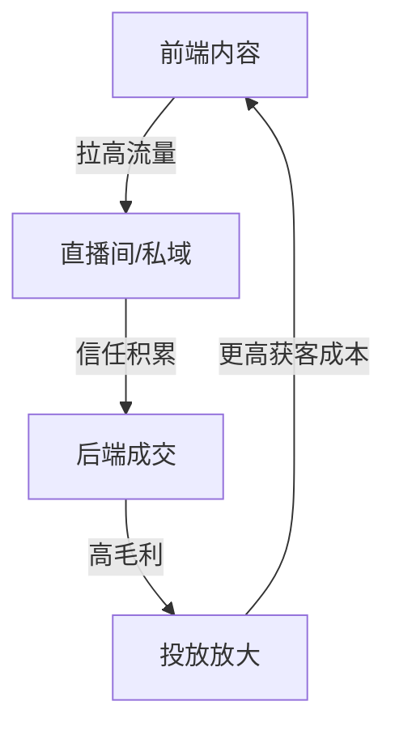


方法演进图展示了本章内容的内在递进关系：从建立底层链路认知开始，逐层推导出差异化定位、内容分类工具、素材供给方法、成交路径设计、选品实操，一直到高客单价值塑造和联营放大——每一步都建立在前一步的基础上，最终形成从“内容”到“生意”的完整方法论体系。

## 8.4 做人群 vs 做商品 —— 从「跟在红海后面」到「换一条小路」

平台打击搬运、同行激增，纯商品视频越来越难爆。当所有人在同一条赛道上挤破头时，你需要一个差异化的突破口。这就像美食街的档口：当整条街都在卖同款炸串时，你与其挤进去打价格战，不如换一个品类——专做“给健身人群的高蛋白小吃”，用特定人群的特定需求避开同质化竞争。

> “做商品类型的种草视频成功概率太小了，并且还有很多有船的大佬，现在都开始付费了，像我这样的单打独斗打不过。大路上的人太多了，我换条小路。”
>
> ——《视频号带货：7天破亿播放的复盘》（素材 P046）

“做人群”的核心理念是：**选择细分人群，以人群的情感需求为出发点制作内容**，而不是从商品功能出发。先锁定“谁”，再决定“卖什么”。

> 做人群**定义**（来源：《视频号带货：7天破亿播放的复盘》，素材 P046）

```
1. 选定细分人群（年龄、身份、情感特征）
2. 挖掘该人群的情感需求（虚荣、怀旧、亲情共情等）
3. 以情感共鸣为内容出发点制作视频
4. 通过内容吸引精准人群，再匹配相应变现产品
```

上述流程的意义在于：它把“做人群”从一个抽象口号变成了可执行的四步操作。第一步解决“为谁做”的问题，第二步解决“做什么内容”的问题，第三步解决“怎么做”的问题，第四步解决“怎么变现”的问题——每一步环环相扣，缺一不可。这套流程的核心价值在于：通过情感共鸣获取精准流量，而非通过商品功能吸引泛流量。

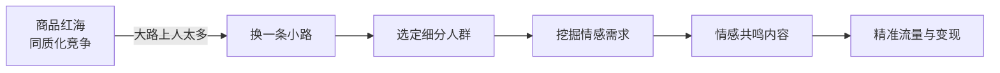

作者的实际案例验证了这一策略的有效性：

> “做了四个账号。A:20岁-30岁，刚毕业的大学生白领群体，特征：虚荣心强但穷。B:35岁-45岁，80-90年代的怀旧情怀。C:50+的女性，亲情共情。D:还有一个带货账号。”
>
> ——《视频号带货：7天破亿播放的复盘》（素材 P046）

四个账号的差异化定位带来显著效果：AB账号2天破百万播放，7天破千万播放并变现2W+；C账号7天破亿播放。但值得注意的是，C账号破亿播放的变现仅约3万元，说明**大爆款的人群较泛，变现效率可能低于精准人群**。

### 共识

“做人群”与“做商品”并非互相排斥，而是同一账号在不同阶段的策略选择。所有素材都认同：前端内容决定流量规模，后端变现决定收入高低。

### 分歧

-   《P046》认为做人群的核心价值在于“避开红海”，用情感共鸣以低成本获取流量。
-   《P012》则更强调从“定人群找需求”出发选品，从品类源头解决竞争问题。该素材提出：“选品其实就是定人群然后找需求，大家能理解这句话，就很好选品了。年纪大了就想身体好，年纪大了就想重返青春，所以运动锻炼类的品和有关保养方面的品，都可以考虑。”——《视频号新号起号复盘》（素材 P012）。可见，《P012》的切入点是选品源头，而非仅在内容层面差异化——即通过选择“对的人群+对的需求”对应的垂直品类，从根源上避开红海竞争。

## 8.5 情、趣、用、品四象限 —— 给内容创作装上「导航仪」

内容创作最常陷入的困境是“不知道做什么”。面对海量素材和无数选题方向，你需要一套分类模型来理解爆款内容产生的底层逻辑。这就像一个档口需要确定自己的菜系——是做妈妈的味道，还是分子料理？四大菜系各有拥趸，关键是你得先想清楚自己主打哪一味，才能把招牌立起来。

> “我把短视频内容分为‘情趣用品’四个字。情-共情（举例：喜怒哀乐）；趣-有趣（有意思的实验，80岁老人做口播）；用-有用（你教会我做菜了）；品-新奇特的产品（北方人大多数没见过酸角糕）。所有短视频平台的爆款内容，都可以纳入其中。”
>
> ——《视频号带货：7天破亿播放的复盘》（素材 P046）

> 情、趣、用、品四象限**定义**（来源：《视频号带货：7天破亿播放的复盘》，素材 P046）

$$
\text{内容} \in \{\text{情（共情）}, \text{趣（有趣）}, \text{用（有用）}, \text{品（新奇特）}\}
$$

这个分类公式的实用价值在于：它给内容创作者提供了一张“地图”。当你不知道该做什么内容时，不需要从零开始苦想创意，只需要对照四个象限检查——我的内容是否触及了某一类情感？是否足够有趣或有反差？是否对观众有用？是否展示了新奇的产品？任何一个象限的命中，都可能成为爆款的起点。它让“找选题”从一个开放性的探索问题，变成了一个有坐标的筛选问题。

每个象限的分支可以延伸上千种——情的分支下有小朋友的喜怒哀乐、男人的、女人的、有钱男人的、没钱女人的；趣的分支下有反差、实验、口播；用的分支下有教做菜、教做PPT、教做电工；品的分支下有酸角糕、彼岸花盆栽。

使用这个模型的要点是克制：

> “这些成千上万的分支里面能扣到一个点，其实就够了。”
>
> ——《视频号带货：7天破亿播放的复盘》（素材 P046）

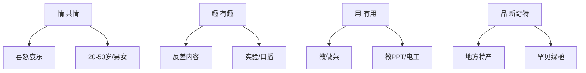

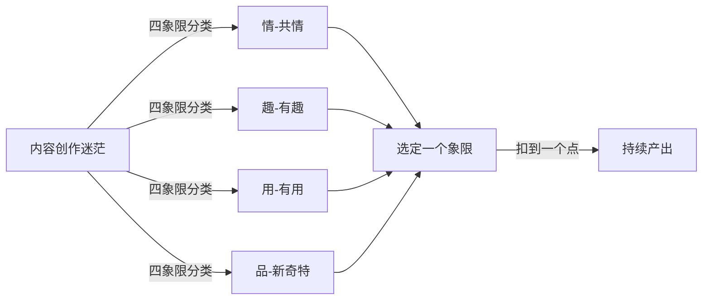

演进图展示了四象限模型如何将“不知道做什么”的迷茫状态，转化为“从四个方向中选一个深耕”的结构化决策过程。它从问题出发（内容创作迷茫），通过分类工具拆出四个方向，最终收敛到“扣到一个点就够了”的执行原则——这正是四象限作为“导航仪”的核心价值所在。

## 8.6 伪原创的二创方法 —— 让别人的爆款变成「你的原创」

纯搬运会被平台限流，原创成本又太高。伪原创的二创方法，是一条兼顾效率与过审的中间路线。这就像你看到街口那家档口的招牌菜排队排到了巷尾，你不会傻到原样照搬人家的菜谱（那是抄袭），但你可以用心琢磨：它为什么吸引人？是味道特别、卖相好看，还是名字起得妙？然后用自己的食材、自己的配方、自己的摆盘，做出一道“思路一样但做法不同”的新菜——借它已验证的吸引力逻辑，做你自己的生意。

> “抖音，快手，优酷，知乎，小红书，甚至TK，所有的短视频平台都是你的素材库。通过这个底层逻辑，你会发现很多爆款都是有迹可循，我们要做的无非是把这些素材不违规的二创成自己赛道的作品，进行发布。”
>
> ——《视频号带货：7天破亿播放的复盘》（素材 P046）

> 伪原创二创方法（来源：《视频号带货：7天破亿播放的复盘》，素材 P046）

```
1. 建立全平台素材库（抖音/快手/优酷/知乎/小红书/TK）
2. 基于情、趣、用、品四象限，拆解爆款的底层规律
3. 将不同素材的片段、音乐进行合适拼接
4. 确保"不违规"：不直接侵犯原创权益
```

这套流程的操作意义在于：它把“参考别人的爆款”从一种模糊的“抄袭焦虑”中解放出来，变成了有章可循的创作方法。第一步解决“素材从哪来”的问题——全平台都是你的素材库；第二步解决“怎么判断什么是好素材”的问题——用四象限拆解爆款的底层规律；第三步解决“怎么变成自己的东西”的问题——拼接与重组；第四步解决“怎么安全发布”的问题——不违规是底线。四步合起来，就是一个可以长期复用的内容生产线。

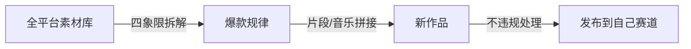

作者的经验是，经过几十条作品的制作后，你会开始留意那些没上热门但画面或音乐很好的视频，脑海里面会自然给它做一个合适的拼接。

用这个素材库思维，还需配合“搬运去重”的操作细节：放大→翻转→BGM处理→加字。其中“加字引导”被认为是出单的关键——针对产品特色/作用/需求，给它整个一两句话，然后弄个醒目的颜色加上去。这是因为有时候出单可能不是因为视频本身，而是你加的字抓住了用户心理。比如一个拖把产品，配文“今天惹老伴生气了，罚我做一天家务，还好有这个拖把”——这句带场景感的文案，比干巴巴的产品展示更能触发用户的共鸣和购买欲。作者特别建议，如果多赛道同时做，尽量分时间段去找素材，否则真的很容易“脑裂”（素材 P046）。

## 8.7 变现产品的双轨制 —— 从「走量」到「走心」的两条成交路径

不同客单价的产品，其成交逻辑完全不同。这就像档口里的奶茶店与私房定制宴：前者靠大流量走量，后者靠口碑与私域走心。奶茶店开在人流最大的街口，靠的是每天几百上千杯的走量；私房定制宴藏在巷子深处，靠的是熟客口碑和预约制——两种生意都能赚钱，但玩法完全不一样。低客单需要大流量和高转化率，高客单需要强信任和精准人群。如果你把高客单产品当低客单卖，流量会被浪费。

> “什么样的变现产品适合做IP呢？我认为有两种：一种是低客单价（0-50）的泛兴趣产品（比如书单号，低价知识付费课程）；还有一种是高客单价（1000+）的精准痛点产品（比如高考志愿填报）。”
>
> ——《抖音IP矩阵，从0到1的全套搭建心法》（素材 P028）

> 变现产品双轨制**定义**（来源：《抖音IP矩阵，从0到1的全套搭建心法》，素材 P028）

$$
\text{成交路径} = \begin{cases}
\text{短视频直购} & \text{if } \text{客单价} \in [0, 50] \\
\text{直播间转化 或 私域成交} & \text{if } \text{客单价} \in [1000, \infty)
\end{cases}
$$

这个公式的实践意义在于：它用一个清晰的分叉结构告诉你——**先看你的客单价落在哪个区间，再决定你的成交路径**。如果你的产品是9.9元的手机支架，你不需要花大量精力经营信任，直接挂小黄车等短视频流量转化即可；如果你的产品是2000元的非遗拓片，你就不可能靠一条短视频让人冲动下单，必须走直播间深度讲解或私域长期培育。这个公式帮你避免“用错路径”的致命错误——把高客单当低客单卖，流量来了也接不住；把低客单当高客单卖，投入产出比又完全不划算。

泛兴趣产品因为客单价低，必须选择大流量、高转化产品，比如书单号、揭秘人性的厚黑学，产品针对的用户人群规模在1亿+。而精准痛点产品（如高考志愿填报）解决刚需，客单价高，成交路径有两种：一种是直播间直接成交，需要用户对IP有非常强的信任；第二种是引流私域成交，需要低转高打法——前端卖低价产品，后端再往几千块上万块导流。

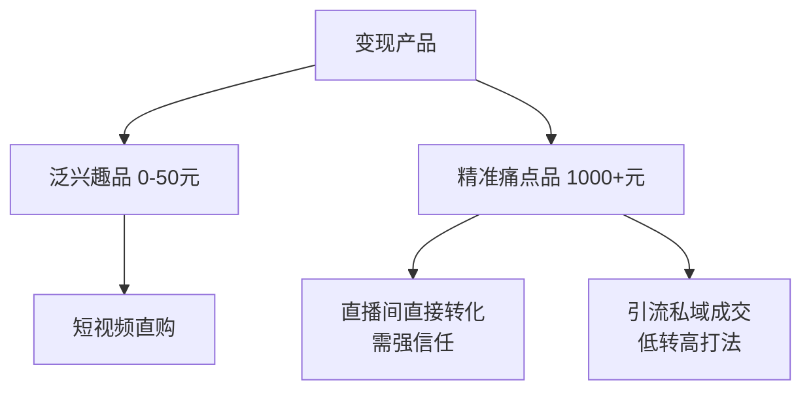

下表整理了双轨制的关键差异，帮助你快速判断自己的产品应该匹配哪条成交路径：

| 维度 | 泛兴趣品 | 精准痛点品 |
|------|----------|------------|
| 客单价 | 0-50元 | 1000+元 |
| 面向人群 | 1亿+泛人群 | 精准刚需人群 |
| 成交路径 | 短视频直购 | 直播间转化或私域成交 |
| 核心要求 | 大流量、高转化 | 强信任、精准匹配 |
| 典型例子 | 书单号、低价课程 | 高考志愿填报 |

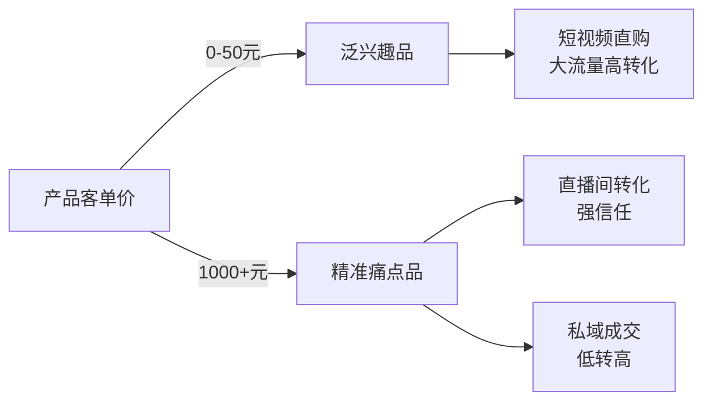

演进图展示了从产品客单价出发，如何分叉出两条截然不同的成交路径。路径的核心分叉逻辑是：客单价越低越依赖流量规模，客单价越高越依赖信任深度——两条路径没有优劣之分，只有匹配与否。

## 8.8 行业冠军联营 —— 借「大象的力气」撬动你的杠杆

个人或小团队资源有限，难以与头部玩家正面竞争。行业冠军联营，是借力放大的一种合作打法。这就像你的档口厨艺很好但没本钱——与其自己硬撑等客上门，不如找街口那家天天排队的餐厅合作。你出招牌菜和烹饪手艺，他出店面、客流和品牌背书，卖出去的利润按比例分成。你不需要自己攒开店的本钱，就能吃到那家店的客流量红利；他也因为你的加入多了一道吸引人的招牌菜——双方共赢。

> “所以就搜、找朋友问，哪家机构是我们当地最大的，也就是行业冠军，然后企查查、boss直聘查老板电话，直接一个cold call打过去，也很顺利，约见面两次后，谈成联营合作，每月的服务费+项目分成。”
>
> ——《抖音IP矩阵，从0到1的全套搭建心法》（素材 P028）

> 行业冠军联营方法（来源：《抖音IP矩阵，从0到1的全套搭建心法》，素材 P028）

```
1. 筛选：当地最大机构（有预算、有背书、变现体系完整）
2. 查电话：通过企查查、BOSS直聘找到老板联系方式
3. Cold Call：直接电话约见，30秒内体现对方利益
4. 见面洽谈：约见面两次，谈成联营合作
5. 收费模式：每月服务费 + 项目分成
```

这套操作流程的价值在于：它把一个看似“高不可攀”的合作（跟当地最大的机构谈合作）拆解成了五个可执行、可复制的步骤。每个步骤都有明确的目标：筛选解决“找谁谈”的问题，查电话解决“怎么联系上”的问题，Cold Call解决“怎么让对方愿意见面”的问题，见面洽谈解决“怎么达成合作”的问题，收费模式解决“怎么持续共赢”的问题。对初创操盘手而言，这套流程最大的意义是：你不需要有资源、有人脉、有关系，只需要有一套清晰的话术和足够的行动力。

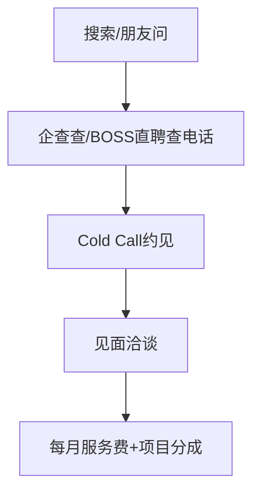

行业冠军的好处是有预算、有背书、变现体系完整，这种是更适合抖音放大的好企业。作者的实战案例是两个月高考志愿号精准涨粉10万+，私信爆满（素材 P028）。


演进图展示了从“个人单打独斗”到“借力放大”的路径演进：单打独斗受制于资源有限，通过筛选行业冠军、达成联营合作，最终实现用别人的资源放大自己的流量能力。这套打法的关键启示在于：在资源不足时，与其硬碰硬地竞争，不如找到有资源的一方，用你的能力换他的资源。

## 8.9 选品即定人群找需求 —— 先锁定「谁要」，再决定「卖什么」

盲目选品容易陷入同质化竞争，导致视频流量差、转化低。不同人群的需求差异巨大，只有精准匹配才能提高成交率。这就像开档口之前，先想清楚“给谁吃”——给熬夜加班的人做提神解压的小吃，给宝妈做营养健康的便当——而不是先把自己会做的菜全列出来，再发愁谁来买。

> “选品其实就是定人群然后找需求，大家能理解这句话，就很好选品了。年纪大了就想身体好，年纪大了就想重返青春，所以运动锻炼类的品和有关保养方面的品，都可以考虑。”
>
> ——《视频号新号起号复盘》（素材 P012）

> 选品即定人群找需求**定义**（来源：《视频号新号起号复盘》，素材 P012）

$$
\text{选品} = \text{定义人群标签} \rightarrow \text{挖掘特定需求} \rightarrow \text{选择垂直品类}
$$

这个公式的实操价值在于：它把“选品”这个看似凭感觉的决策，变成了一个三段式推理链。第一步“定义人群标签”解决“卖给谁”的问题——比如视频号的核心用户是中老年人+下沉城市；第二步“挖掘特定需求”解决“他们想要什么”的问题——中老年人想要身体好、重返青春；第三步“选择垂直品类”解决“卖什么”的问题——运动锻炼类、保养类。整个过程是先锁定“谁要”，再决定“卖什么”，而不是反过来。

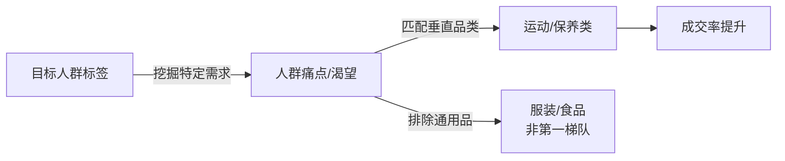

这个公式展示了选品的核心逻辑：先锁定“谁要”，再决定“卖什么”。视频号用户以中老年人+下沉城市为主，他们的特定需求是“身体好、重返青春”，因此运动锻炼类和保养类产品优先考虑。相反，服装、食品等通用品因需求普遍（是所有人的需求，而非目标人群的特定需求），不作为第一梯队。

> “我个人的想法……价格什么的反而不是特别的重要，重点在于我觉得这玩意对我有用。”
>
> ——《视频号新号起号复盘》（素材 P012）

选品后还需结合蓝海判断：做的人多（尤其视频号也少），可以考虑测；做的人多则谨慎考虑。这位操盘手的判断原则是：抖音快手没什么人做的品类也不考虑——一个是素材难找，另一个是“我们这是找蓝海，不是找死海”（素材 P012）。具体操作是直接搜品名，找真人出镜的账号点开主页看其运营状况。

## 8.10 选品与对标实操 —— 从蓝海判断到快手对标筛选

明确人群和需求之后，还需要一套落地的操作：如何判断品类是否值得做、如何找到可参照的对标账号。这就像你决定了档口要做“高蛋白小吃”之后，还得考察一下：这条街上已经有多少家在做？生意怎么样？有没有哪家小摊的做法可以借鉴又不至于直接照搬？

> 蓝海判断与对标筛选方法（来源：《视频号新号起号复盘》，素材 P012）

```
1. 蓝海判断：在抖音/快手/拼多多搜索品类，对比在做人数量
2. 视频号验证：抖音快手做的人多，再去视频号搜一下看
3. 决策标准：视频号不多可以考虑测；做的人多则谨慎
4. 对标筛选：在快手搜品名，找真人出镜号，点开主页看
5. 筛选条件：粉丝<5W、视频>200、垂直品反复带、画面干净
```

这套实操流程的用途在于：它把选品和对标从“凭感觉”变成了“有标准”的决策。蓝海判断解决“这个品类值不值得做”的问题——做的人太多就是红海，没人做可能就是死海，只有中间地带才是值得测试的蓝海；对标筛选解决“素材从哪来、怎么避免搬运重复”的问题——选对了对标号，你就有了源源不断的可借鉴素材。

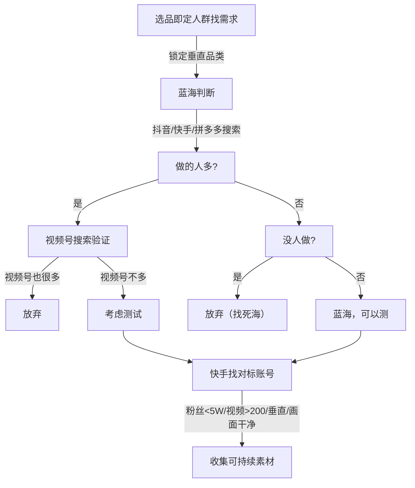

对标账号筛选的标准有其底层逻辑：**粉丝在5W以下**，代表这个号被搬运过的几率小，而且号主本人同时在发视频号的几率也小，能规避重复风险；**视频在200条以上**，代表素材多，可以支撑长期发布和筛选；**一直围绕几个品反复带**，代表账号垂直度高，内容方向清晰；**视频画面不是自己加很多字的**，代表画面干净，便于二次处理；**有一定的非带货视频**，比纯带货号更像真人运营，平台判断更友好（素材 P012）。这些标准组合起来，核心目的就是两个：规避搬运重复、获取可持续素材。

## 8.11 高客单非遗产品的价值塑造 —— 用「工艺与场景」撑起价格

高客单价产品无法靠低价促销成交，必须通过价值塑造让用户觉得“值”。非遗类产品自带文化价值，但需要正确的呈现方式才能转化为溢价。这就像你的档口要卖一碗 200 元的私房汤——不能靠便宜，得靠食材、炖煮工艺、用餐环境，让顾客觉得“这一碗值这个价”。

> “第一层实木框，这个实木框我们尝试了20多个材质，最后选择了俄罗斯黑松木材质。第二层有机玻璃，第三层卡纸，第四层拓片，第五层背纸，第六层龙骨架，第七层整张封板，第八层防尘封条。”
>
> ——《竹庐拓艺：高客单非遗的抖音实践》（素材 P039）

> 高客单价值塑造方法（来源：《竹庐拓艺：高客单非遗的抖音实践》，素材 P039）

```
1. 八层装裱工艺（黑松木实木框+有机玻璃+卡纸+拓片+背纸+龙骨架+封板+防尘封条）
2. 场景化直播（佛堂/玄关/茶室/书房）
3. 人群定位（新锐白领/资深中产）
4. 漏斗模型（线上平价入门获客→私域沉淀→线下展厅高客单成交）
```

这套方法的操作意义在于：它证明了高客单产品不需要靠“全网最低价”来成交，而是可以通过三个维度的价值塑造让用户主动觉得“值”。产品工艺解决“这个东西值不值这个价”的问题——八层装裱的匠心让产品品质感远超同价位商品；场景化直播解决“这个东西配不配得上的问题”——佛堂、茶室、书房的场景让用户立刻想象出产品挂在自己家里的样子；人群定位解决“谁会买”的问题——锁定新锐白领和资深中产，他们既有购买力又有审美需求。

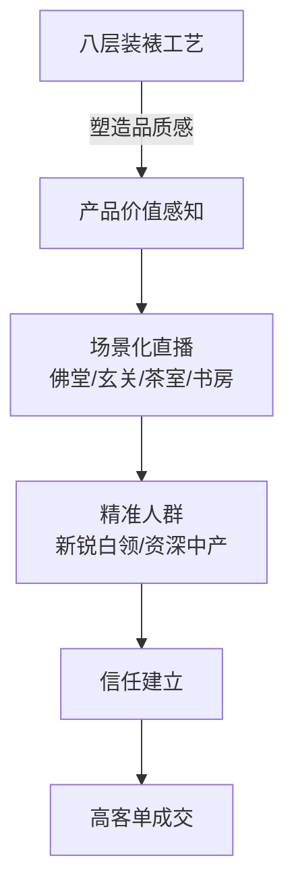

竹庐拓艺的直播间1小时场观500人，但千次成交4000-6000GMV，高的时候1-2万。抖音客单价1000-1200元，单一平台年销售额几百万（素材 P039）。客户订单手机尾号全是连号（88888、6666、00000、9999），还有大明星单次消费数万元——这些特征都验证了客群的高净值属性。

高客单产品必须线上引流、线下承接成交变现——线上平价入门获客，线下展厅服务高客单复购人群，客单价几万、几十万。

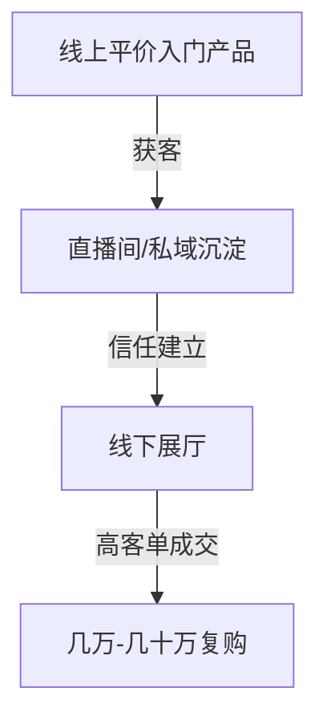

## 8.12 设计中的取舍

本章的每一个关键设计，都是在多个可能方案中做出的取舍。以下用问答形式梳理几组最重要的取舍。

**问：为什么不用低价促销策略来做高客单产品？**

低价促销会破坏产品在用户心中的价值感知。当用户习惯了用低价购买你，就很难再接受高价。高客单产品必须通过价值塑造（工艺、场景、人群定位）来支撑价格，而不是用降价来换取订单。竹庐拓艺的八层装裱工艺，本质是在向用户传递“你花的钱买到了工艺品质”，而非“我们便宜”。高客单路线的代价是场观低、客群窄，成交依赖强信任和精准人群；低客单路线虽然流量大，但需要极高转化率和规模支撑。选择高客单意味着放弃“大流量”的效率，换取“单位流量更高毛利”的确定性。

**问：“做人群”和“做商品”应该怎么选？**

做商品的门槛低、复制快，但同质化严重，竞争激烈，适合有供应链优势或投放预算的团队；做人群的门槛较高，需要内容创作能力，但一旦建立人群认知，流量获取成本远低于商品赛道。关键判断标准是：如果你能在商品赛道做到差异化（如独家货源、极致性价比），可以做商品；如果你没有这些优势，做人群是更稳妥的突围路径。做人群的代价是内容生产难度高、起量慢，但换来的是更精准的流量和更低的竞争压力。

**问：双轨制中，应该优先做低客单还是高客单？**

这取决于你的资源和信任积累。低客单产品对信任要求低、起点快，适合新号冷启动，但利润率薄，需要持续的大流量供给。高客单产品利润丰厚，但需要强信任基础，不适合没有粉丝积累的新号直接做。合理路径是从低客单起步获取流量和粉丝，再逐步向高客单导流——这正是“低转高”打法的底层逻辑。

**问：联营和自营怎么选？**

联营的本质是用“能力”换“资源”——你出流量操盘能力，对方出预算、背书和变现体系，风险共担。自营则是全部自己来，利润独享但风险也独担。对初创操盘手而言，联营更有利：你不需要自有资金和资源就能放大业务，还能借对方的行业背书快速建立信任；代价是要分出一部分利润，并且需要说服对方相信你的能力。自营适合已有成熟流量能力和稳定现金流的团队。

**问：场景化直播和叫卖式直播怎么选？**

场景化直播适合高客单、重审美、重体验的产品（如非遗拓片、高端家居），通过营造使用场景让用户“看见”产品在自己生活中的样子，支撑高价；叫卖式直播适合低客单、功能型产品（如日用品、食品），靠价格刺激和紧迫感驱动冲动消费。选择场景化直播意味着放弃“短平快”的直播节奏，接受更低的场观和更慢的节奏，换取更高的成交效率和客单价。

## 8.13 动手练习

1.  **为给定赛道设计内容定位与变现双轨方案**
    假设你要在视频号运营一个带货账号，产品方向已定为“中老年健康养生”：
    1. 用“选品即定人群找需求”原则，写出你定义的目标人群标签及其核心需求（至少3个）
    2. 从“情、趣、用、品”四象限中，为这个人群各设计1个内容选题方向，共计4个
    3. 根据“变现产品双轨制”，为这个账号设计低客单（泛兴趣）和高客单（精准痛点）两档产品及其对应成交路径
    回答问题：
    - 你会选择“做商品”还是“做人群”策略？为什么？
    - 如果你的内容走“情”（共情）路线，目标人群会泛，你如何控制变现效率的下降？

2.  **行业冠军联营：为一家“当地最大健身房”设计抖音合作方案**
    假设你是一名短视频操盘手，想与当地最大的一家健身房（3000+会员）达成联营合作：
    1. 列出你筛选这家“行业冠军”时考察的3个关键维度及其理由
    2. 设计一个联营方案：你的服务内容、你的收费模式（服务费+分成比例）、健身房的获益点
    3. 写出你cold call约见老板时第一段话术（30秒内，体现对方利益而非你的诉求）
    回答问题：
    - 如果健身房老板担心“你们做不起来怎么办”，你怎么回应？
    - 联营与合作（比如付费代运营）的本质区别是什么？为什么联营对初创操盘手更有利？

3.  **高客单非遗产品：为“陶艺手作”设计价值塑造方案**
    假设你要在抖音销售一款客单价2000元的非遗陶艺花瓶：
    1. 参考竹庐拓艺的“产品思维”，设计该产品的“价值塑造点”（工艺、材质、装裱/包装、文化故事等，至少4点）
    2. 设计3个直播间场景方案（参考佛堂/茶室/书房）及每个场景对应的人群画像
    3. 设计线上引流+线下承接的转化路径：线上用什么产品获客、线下如何承接高客单
    回答问题：
    - 为什么高客单产品必须“线上引流、线下承接”而不能全靠线上成交？
    - 如果直播间场观只有500人，你会如何提升成交效率而非追求流量？

4.  **从爆款拆解到伪原创二创：为你的赛道设计3条内容**
    假设你已选定“35-45岁80后怀旧”这个人群赛道：
    1. 在抖音/快手各找1条该人群的高赞爆款视频，拆解其属于“情、趣、用、品”哪个象限，并记录其画面、BGM、文案结构
    2. 按“伪原创二创方法”，将这两个素材重新拼接设计成1条新视频，写出：画面片段顺序、BGM选择理由、加字引导文案
    3. 设计这条视频的“加字引导”文案（一两句话，针对怀旧人群心理）
    回答问题：
    - 你如何判断拆解的素材“可复制”（可参考的标准：爆得偶然/货源非独家/场景有需求）？
    - 如果这条二创视频发布后播放量只有200，你会如何调整：换素材、改文案、还是换赛道？依据是什么？

## 8.14 本章小结

这一章中我们学习了短视频带货从“内容”到“生意”的完整闭环。首先建立了“流量→信任→成交”的底层链路认知，明白前端内容决定流量、后端变现决定成败；其次掌握了“做人群 vs 做商品”的差异化竞争策略，理解了为何在红海竞争中选择细分人群的情感需求切入；接着我们学习了“情、趣、用、品”四象限内容分类模型，知道如何为内容创作装上导航仪；然后我们掌握了“伪原创二创方法”，学会让别人的爆款变成你的原创；随后我们了解了变现产品的双轨制，知道低客单泛兴趣品走短视频直购、高客单精准痛点品走直播间或私域成交；我们还学习了“行业冠军联营”打法、“选品即定人群找需求”的选品原则，以及“对标账号筛选”的实操标准；最后我们通过竹庐拓艺的案例，理解了高客单非遗产品如何通过价值塑造与场景化直播实现年销数百万。

本章我们一起学习了以下概念：

| 概念 | 解释 |
|------|------|
| 流量→信任→成交链路 | 短视频电商的基本链路：以内容种草获取流量，通过内容建立信任，最终在直播间或私域完成成交；前端内容决定流量，后端变现决定成败 |
| 后端变现效率 | 抖音前端内容趋同，真正决定成败的是后端对单位流量的变现能力；高毛利可拉高获客成本碾压对手 |
| 做人群替代做商品 | 以细分人群的情感需求为出发点制作内容，避开同质化商品视频的竞争红海，实现低成本流量获取 |
| 情、趣、用、品四象限 | 将所有爆款内容归纳为共情、有趣、有用、新奇特产品四类，是内容定位与选材的底层逻辑 |
| 伪原创二创方法 | 以全平台为素材库，基于底层逻辑将爆款素材不违规地拼接、换乐，变成自己赛道的作品 |
| 泛兴趣品与精准痛点品双轨制 | 低客单泛兴趣产品(0-50元)走短视频直购，高客单精准痛点产品(1000+元)走直播间转化或私域成交，两类产品匹配不同成交路径 |
| 行业冠军联营 | 筛选当地行业头部机构，以冷电话+见面洽谈达成联营合作（服务费+分成），借其预算、背书与完整变现体系放大流量 |
| 选品即定人群找需求 | 选品核心是从目标人群的特定需求出发选择垂直品类，而非从通用产品出发；优先选择垂直刚需而非通用品 |
| 对标账号筛选 | 以粉丝<5W、视频>200、垂直度高、画面干净为标准筛选可借鉴的对标账号，规避搬运重复并获取可持续素材 |
| 高客单非遗产品的价值塑造 | 通过极致产品工艺（八层装裱）、场景化直播（佛堂/茶室）和精准人群定位（新锐白领/资深中产）支撑高客单价，实现年销数百万 |

下一章中，我们将进入“爆款内容生产线”，学习如何从“搬运”到“自动化原创”，建立可持续的内容供给能力。

