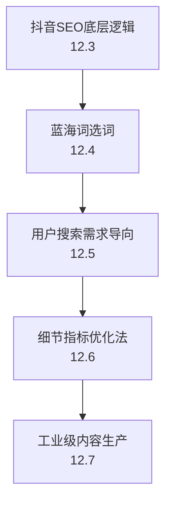
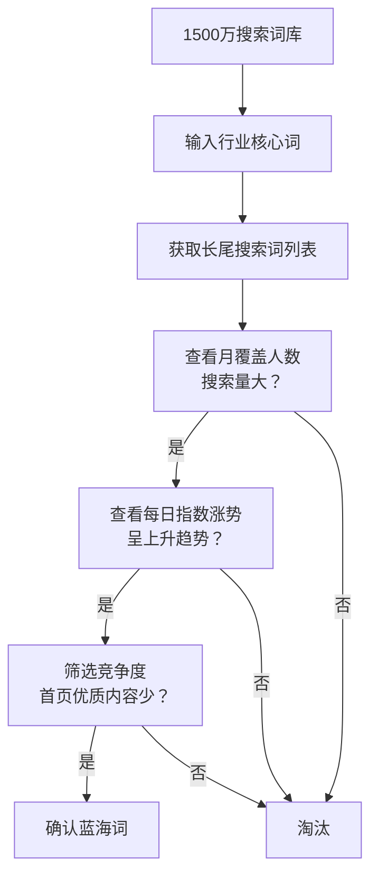
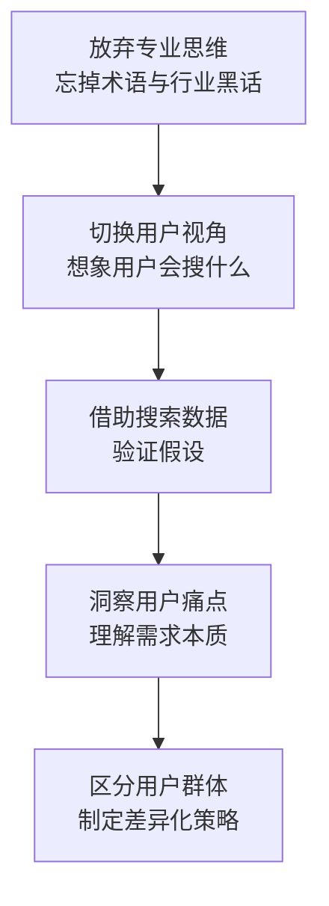
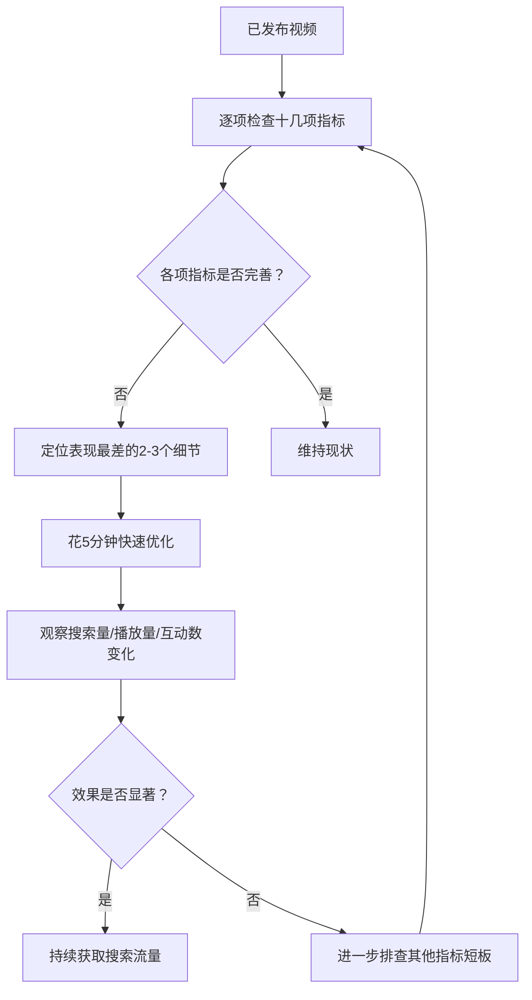
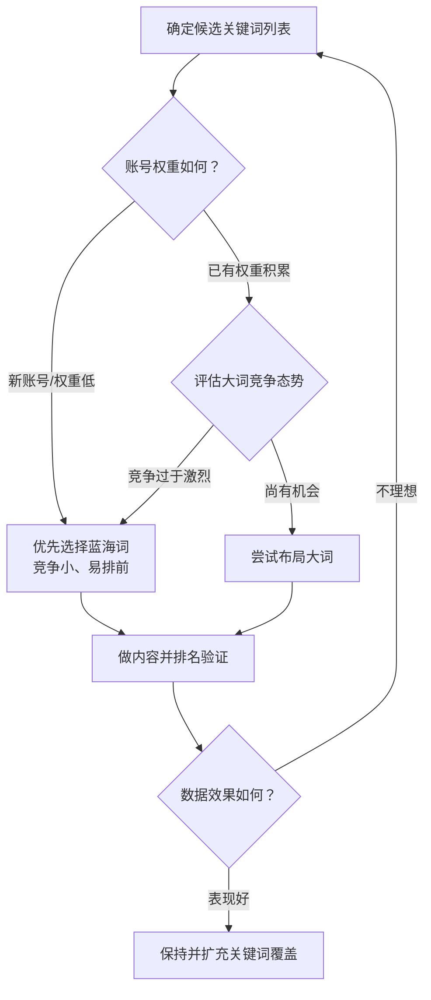

# 第 12 章 搜索流量蓝海 —— 用抖音SEO精准获客
作者：龙哥

## 学习目标

- 理解抖音搜索（SEO）与推荐算法的本质区别，识别其精准、持久、低成本的特点
- 掌握蓝海词的定义、识别标准与基于搜索词库的选词方法
- 学会从用户搜索需求而非自身专业视角出发进行内容定位与选题
- 掌握细节指标优化法，能够对已发布内容进行低成本微调快速见效
- 了解工业级内容生产方式，通过素材库替代灵感枯竭实现持续产出
- 能够评估抖音SEO的适用边界，判断业务是否具备从0到1的基础

## 12.1 生活类比

想象你是一座大型图书馆的管理员。抖音的推荐算法就像图书馆门口那个精心布置的“热门书架”——摆什么书、放在哪个位置，都由图书管理员（平台算法）决定，读者只能被动接受这些被推送到眼前的书。而抖音SEO则完全不同：它对应的是读者主动走到检索台前，输入关键词寻找自己想看的书。这些读者的意图极其明确——他们不是闲逛，而是带着问题来找答案，其“心理账户”已经打开，转化意愿远高于被动刷到内容的用户。

在这个图书馆里，“蓝海词”就像是很多人频繁检索、但书架前却鲜有书籍排到前排的主题。其他管理员（从业者）都挤在畅销书区争抢显眼位置，却忽略了检索台背后那片巨大的需求空白。“用户搜索需求导向”则提醒你：不要按你擅长的学术分类法去编目，而要按读者真正会输入的日常用语去整理。“细节指标优化”就像把旧书重新贴上更醒目的标签、调整排架位置，每一项指标都相当于一本书可被标注的多个字段——分类号、书名、作者、封面、摘要、关键词——花五分钟优化这些字段，就能让一本被遗忘的书重新被读者发现。“工业级素材库”则是一个自动化的采购系统：图书管理员每天设定几个主题词，系统便自动从各地图书馆收集昨天的畅销书单和读者留言簿，确保你的书架永远有读者想看的书。

就像优秀的图书馆员既懂得把书放在显眼位置，也懂得收藏读者真正需要的冷门好书，抖音SEO的本质就是理解用户主动寻找的行为，让内容出现在最合适的位置。

> 本章生活类比覆盖的概念范围为：抖音SEO、蓝海词、用户搜索需求导向、细节指标优化法、工业级内容生产。对应素材来源索引：`docs/202301-02/CZPydiVmgo2odMx0nWecf3DTn6e.md`（P002/P003/P004/P005）。

## 12.2 概念地图

> 本章的概念体系如下，图中编号（P002/P003/P004/P005）对应素材来源 `docs/202301-02/CZPydiVmgo2odMx0nWecf3DTn6e.md`，后文将逐一展开。

```
抖音SEO
├── 底层逻辑
│   ├── 与推荐算法的区别 —— P005
│   ├── 精准性：用户主动搜索需求明确 —— P005
│   ├── 持久性：长期稳定流量 —— P005
│   └── 低成本：无需日更 —— P005
├── 核心概念
│   ├── 蓝海词 —— P002
│   │   ├── 定义：流量大竞争小 —— P002
│   │   ├── 占比：1500万词库70% —— P002
│   │   ├── 误区：大词过泛/无效长尾 —— P002
│   │   └── 决定成败：90%成功率 —— P002
│   └── 用户搜索需求导向 —— P003
│       ├── 数据驱动而非直觉 —— P003
│       ├── 客户导向：定位越清晰越精准 —— P003
│       └── 差异化：避免低价竞争 —— P003
├── 方法论
│   ├── 选词方法 —— P002
│   │   ├── 1500万搜索词库 —— P002
│   │   ├── 月覆盖人数判断 —— P002
│   │   └── 每日指数涨势分析 —— P002
│   ├── 细节指标优化法 —— P004
│   │   ├── 底层原理十几项指标 —— P004
│   │   ├── 对已发布内容微调 —— P004
│   │   └── 快速见效：5分钟/8小时 —— P004
│   └── 工业级内容生产 —— P005
│       ├── 自动收集全网爆款 —— P005
│       ├── 关键词设定触发 —— P005
│       └── 评论挖掘隐性需求 —— P005
└── 适用边界
    ├── 业务需跑通0-1 —— P005
    ├── 信息差红利随认知提升缩小 —— P002
    └── 内容质量影响优化效果 —— P004
```

## 12.3 抖音SEO —— 让作品被“搜”出来而不是“刷”出来

### 为什么需要这个概念？

许多创作者都有过这样的体验：辛辛苦苦做了一条视频，发布后却石沉大海，全靠推荐算法赏饭吃。在短视频平台上，内容的命运几乎完全由推荐算法主宰——作品能否被看到，取决于账号权重、完播率、互动率等一系列你无法完全掌控的因素。

然而，还有另一条被 99% 的创作者忽视的流量通道：用户主动搜索。当用户点击搜索框、输入关键词的那一刻，他的需求已经极其明确——他就是想找解决某个问题的方法、某个品类的推荐、某个话题的解读。这种带着明确意图而来的流量，远比刷到时顺手划过的推荐流量更精准、更值钱。搜索行为本身意味着用户已经准备好接受信息，因此转化意愿天然更高。

> “在抖音平台内，针对用户搜索行为进行内容与关键词优化，使作品被有需求的用户精准搜索到的过程。”
>
> ——《抖音SEO陪跑计划课程复盘》（`docs/202301-02/CZPydiVmgo2odMx0nWecf3DTn6e.md`，P005）

### 核心定义

我们来给抖音SEO下一个精确的定义。它包含三个动作：**理解用户搜索行为**、**优化内容与关键词**、**让作品被精准搜索到**。它与推荐算法的本质区别在于：推荐算法是“平台给你什么你看什么”，而抖音SEO是“用户要找什么你提供什么”。

下表从六个关键维度对比了推荐算法与抖音SEO的差异，帮助读者直观地理解两者的本质区别。理解这个区别是打开搜索流量蓝海的第一把钥匙。

| 维度 | 推荐算法 | 抖音SEO |
|------|---------|---------|
| 流量触发方式 | 平台主动推送 | 用户主动搜索 |
| 用户意图 | 模糊（刷到什么看什么） | 明确（带着问题来找答案） |
| 流量价值 | 泛流量，转化率低 | 精准流量，转化率高 |
| 持久性 | 爆火后快速沉寂 | 长期稳定获取 |
| 内容更新要求 | 需要持续日更 | 3~10条视频即可 |
| 竞争程度 | 极其激烈 | 竞争者少，存在大量机会 |

> 本表为作者根据素材 `docs/202301-02/CZPydiVmgo2odMx0nWecf3DTn6e.md`（P005）内容整理。

### 关键性质

**精准性。**

搜到作品的人大概率是有明确需求的潜在客户。他们不是闲逛，而是来解决问题的。正如素材所展现的，用户主动搜索意味着其需求已明确表达，这部分流量价值远高于泛流量（来源：`docs/202301-02/CZPydiVmgo2odMx0nWecf3DTn6e.md`，P005）。

**持久性。**

搜索作品不像推荐作品那样瞬间爆火后快速沉寂。素材中举例说明：

> “蹭到搜索流量，一年不更新视频，依旧每月流量稳定。”
>
> ——《抖音SEO陪跑计划课程复盘》（`docs/202301-02/CZPydiVmgo2odMx0nWecf3DTn6e.md`，P005）

这意味着你的一次优化投入，可以持续获得回报。

**低成本。**

素材指出，只需准备3~10条与关键词匹配的内容，无需日更即可获得持续流量（此为课程方宣称数据，未提供统计样本或对照数据，来源：`docs/202301-02/CZPydiVmgo2odMx0nWecf3DTn6e.md`，P005）。相比推荐算法下“日更才能维持权重”的持续投入，SEO的边际成本极低。

**典型例子**：一位线下课学员在早上按照老师的方法，只花了5分钟对已发布的视频做SEO优化（该案例隶属于“细节指标优化法”的范畴，可对应素材P004）。结果一个月前的视频突然新增了3万+的搜索量，评论区多了几十条客资。截止到第二天，累计新增11万播放、2000个点赞、150条潜在客资（来源：`docs/202301-02/CZPydiVmgo2odMx0nWecf3DTn6e.md`，P004）。这就是搜索流量的威力——它能让旧内容重新焕发生命。

### 方法演进图

下图展示了抖音SEO整体方法论的概念数据流图，涵盖本章各节的关系。如图所示，抖音SEO的操作始于对底层逻辑的理解（推荐算法与搜索算法的区别），进而通过蓝海词选词确定内容方向，再以用户搜索需求为导向进行内容定位，配合细节指标优化法对内容进行微调，最终由工业级内容生产实现可持续产出。



### 边界条件

我们也要清醒地看到抖音SEO的适用边界。想要最大发挥抖音SEO的效用，前提是业务从0到1已经跑通。素材直言：

> “很多老板的痛点，不是缺流量，而是流量来了，也接不住，转化率低，核心原因是，自身业务定位不清晰。”
>
> ——《抖音SEO陪跑计划课程复盘》（`docs/202301-02/CZPydiVmgo2odMx0nWecf3DTn6e.md`，P005）

如果你的产品、转化、交付链路还没跑通，搜索流量来了也接不住，反而浪费了这一蓝海机会。此外，素材指出“搜索出来的作品，远没有推荐的作品优质，搜索存在大量的机会”（来源：`docs/202301-02/CZPydiVmgo2odMx0nWecf3DTn6e.md`，P005）。这既是机会——你容易排上去；也是提醒——这个领域可能确实还没人做好内容。

## 12.4 蓝海词 —— 搜索流量大但竞争小的“金词”

### 为什么需要这个概念？

知道了抖音SEO的价值，接下来最核心的问题就是：**选什么词？** 选词之所以比内容更重要，是因为它决定了你努力的方向。素材对此有明确的强调：

> “做抖音SEO最重要的是选词，找到蓝海词，才能保证90%的成功率，词选的好，靠运气也能获得搜索流量。”
>
> ——《抖音SEO陪跑计划课程复盘》（`docs/202301-02/CZPydiVmgo2odMx0nWecf3DTn6e.md`，P002）

很多从业者拿到工具就开干，结果只会挑两类词：一类是“大词”，比如“美容”“教育”这种泛到极致的行业词——词太泛，加了等于没加，你根本排不上去；另一类是“无效长尾词”，比如某个你自认为很专业的术语——写了等于没写，因为根本没人搜。

### 核心定义

**蓝海词**，指搜索流量大但竞争小、容易被排上名的关键词。这一定义同时涵盖了“流量”与“竞争”两个维度，且“容易被排上名”暗示了竞争度低这一关键特征。它就像图书馆里被很多人频繁检索、但书架前却少有书排到前排的主题——需求旺盛，供给稀缺。

> 蓝海词**定义**（来源：《抖音SEO陪跑计划课程复盘》`docs/202301-02/CZPydiVmgo2odMx0nWecf3DTn6e.md`，P002）

$$\text{蓝海词} = \{ w \mid \text{SearchVolume}(w) \uparrow, \text{Competition}(w) \downarrow \}$$

在展开推导之前，我们先回答一个前提问题：**为什么“搜索量”和“竞争度”这两个维度就足以定义蓝海词？** 这背后的逻辑是：一个关键词能否带来可观的流量收益，本质上由两个条件同时决定。第一，必须有人搜——搜索量代表了需求的存在，如果没人搜，内容排到第一名也没有流量价值；第二，必须容易排上去——竞争度代表了供给的稀缺程度，如果首页已被大量优质内容占据，即使需求旺盛，新入场者也难以获得曝光。两者缺一不可：只有搜索量高而竞争度低时，“付出少量努力即可获得大量精准流量”这一蓝海词的核心价值才能成立。因此，这两个维度共同构成了蓝海词的充分必要条件。下面我们逐步推导这个公式的度量方式与判断依据：

**第一步：度量搜索量。** 搜索量可以通过搜索词库工具（如极客抖音SEO工具）中的“月覆盖人数”来度量，即在一个月内搜索过该关键词的独立用户数量。判断标准为：月覆盖人数越高，说明需求规模越大，$\text{SearchVolume}(w) \uparrow$ 越可能成立。

**第二步：度量竞争度。** 竞争度可参考搜索结果首页中优质内容的数量与排名难度。判断标准为：如果搜索结果中优质内容稀少、新发布的内容容易进入首页前列，则 $\text{Competition}(w) \downarrow$ 成立。

**第三步：综合判断。** 当且仅当“月覆盖人数较高”且“搜索结果首页内容质量不高、容易排上前列”两个条件同时成立时，该词即为蓝海词。值得注意的是，这里的公式是概念性的而非精确的数学模型，其核心思想是：高搜索量保证了需求的存在，低竞争度保证了供给的稀缺，两者缺一不可。

### 选词方法：从搜索词库到蓝海词确认

基于上述定义，我们可以将选词流程拆解为以下具体步骤：

1. **打开工具**：使用抖音SEO工具（如极客抖音SEO工具），进入包含1500万搜索词的数据库。
2. **输入行业词**：输入你所在领域的核心词（如“美容”），工具会返回与该词相关的长尾搜索词列表。
3. **查看月覆盖人数**：关注每个词的“月覆盖人数”，人数越多，说明该词被搜索的频率越高，需求越大。
4. **观察每日指数涨势**：查看该词的“每日关键词指数涨势”，如果呈上升趋势，说明需求正在增长，值得提前布局。
5. **筛选竞争度**：在搜索量达标的前提下，优先选择搜索结果首页内容质量不高、竞争度低的词。
6. **确认蓝海词**：综合以上指标，锁定“搜索量大+竞争小”的词作为内容选题方向。

通过这套流程，你可以将抽象的“蓝海词”定义转化为可操作的具体行动。

### 关键性质

**高性价比。**

蓝海词流量大、竞争小，投入产出比高。你不需要和成千上万的竞争者争夺排名，只需做好内容，就能轻松排到搜索结果前列。

**普遍存在。**

素材中给出了一个令人振奋的数据——“我们1500万个搜索词中，70%是蓝海词，绝大多数一个领域，都可以找到属于自己的蓝海方向。”（此数据为课程方统计口径，建议读者在所在领域自行验证，详见12.8节的分歧讨论。来源：`docs/202301-02/CZPydiVmgo2odMx0nWecf3DTn6e.md`，P002）这意味着蓝海词不是凤毛麟角的稀缺资源，而是普遍存在于每一个行业、每一个细分领域中。

**决定成败。**

选词定生死。词选得好，“靠运气也能获得搜索流量”——因为竞争太小，你的内容只要不差，就能排上去；词选错了，即使内容再好，也无人问津。

### 方法演进图

下图展示了蓝海词从筛选到确认的数据流图。如图所示，选词流程是一个层层筛选的过程：先以月覆盖人数判断需求规模，再以涨势判断需求趋势，最后以竞争度判断供给稀缺性，只有三项条件全部通过，才能确认蓝海词。



### 典型例子与两大误区

素材中以世界杯为例说明选词过程：

> “以世界杯为例，可以快速找到大量与世界杯相关的蓝海词及对应的月覆盖人数、每日关键词指数涨势。”
>
> ——《抖音SEO陪跑计划课程复盘》（`docs/202301-02/CZPydiVmgo2odMx0nWecf3DTn6e.md`，P002）

通过搜索词库可以快速找到大量与世界杯相关的蓝海词，同时能看到每个词对应的**月覆盖人数**和**每日关键词指数涨势**。**月覆盖人数**指的是在一个月内搜索该关键词的独立用户数量，它反映了该词的需求规模；**每日关键词指数涨势**则反映了该词搜索热度的变化趋势，涨势上升说明需求在增长。这些数据帮你判断：这个词的搜索量有多大？是在涨还是在跌？值不值得投入？

下面这张表格展示了两大常见选词误区的表现与后果。理解这两个陷阱，能帮助你在选词时避开最常见的弯路。

| 误区 | 表现 | 结果 |
|------|------|------|
| 只挑大词 | 选“美容”“教育”等泛行业词 | 词太泛，加了等于没加 |
| 挑无流量长尾词 | 选“专业术语”等生僻词 | 写了等于没写 |

这个表格揭示了两大误区的本质：大词竞争激烈，你排不上去；无流量长尾词根本没人搜，写了也白写。避开这两个陷阱，你才能找到真正的蓝海词。

### 边界条件

蓝海之所以是蓝海，是因为99%的抖音达人并不懂搜索逻辑。这构成了一种**信息差壁垒**：由于竞争对手根本看不透你的流量来源，他们难以针对性地模仿或抄袭你的内容策略。即使他们看到你的视频火了，也不明白为什么这些看似冷门的话题能带来精准客户，因此无法复制你的成功路径。

> “蓝海之所以是蓝海，是因为流量大，竞争小。而之所以竞争小，是因为99%的抖音达人并不懂搜索逻辑，更别谈运用搜索逻辑。”
>
> ——《抖音SEO陪跑计划课程复盘》（`docs/202301-02/CZPydiVmgo2odMx0nWecf3DTn6e.md`，P002）

这种信息差红利也会随从业者认知提升而缩小：当越来越多人掌握了抖音SEO的方法论，蓝海词的竞争会逐渐加剧。（作者注：此推断基于市场竞争的一般规律，素材P002未直接论述，本节结尾处的讨论为作者引申。）所以，抓住当下的窗口期，比什么都重要。

## 12.5 用户搜索需求导向 —— 别写“你会的词”，要写“用户搜的词”

### 为什么需要这个概念？

现在你知道了要选蓝海词，那么应该从什么角度去选呢？答案是：**用户搜什么，你写什么**。

听起来很简单，但大多数从业者恰恰栽在这里。因为人最容易从自己的专业经验出发，认为用户应该搜索行业术语，而忽略了用户的实际认知与搜索习惯。素材直言：

> “有的老板会从自己专业角度出发，写一些专业的词，但是假如面向的是小白用户，大家根本不懂，也不会搜这个词，那这种词就没有意义，因为无法让用户搜索到你。而从用户的搜索需求我们就可以看出，用户会搜什么，从而避免这个情况。”
>
> ——《抖音SEO陪跑计划课程复盘》（`docs/202301-02/CZPydiVmgo2odMx0nWecf3DTn6e.md`，P003）

### 核心定义

**用户搜索需求导向**，指站在用户搜索习惯与搜索量数据出发选词和做内容定位，避免从自身专业视角出发，用数据洞察用户痛点、区分用户群体，从而确定运营策略。具体来说，其核心是一个持续的思维切换过程——从“我要表达什么”转变为“用户会搜索什么”。实现这一转变，可以遵循以下步骤：

> 用户搜索需求导向**方法**（来源：《抖音SEO陪跑计划课程复盘》`docs/202301-02/CZPydiVmgo2odMx0nWecf3DTn6e.md`，P003，步骤框架为作者根据素材整理）

```
1. 放弃专业思维：忘掉你擅长的术语、行业黑话
2. 切换用户视角：想象目标用户会输入什么词来找答案
3. 借助搜索数据：用搜索量数据验证你的假设
4. 洞察用户痛点：从搜索词背后看到用户真实需求
5. 区分用户群体：不同人群搜索不同词，对应不同运营策略
```

上述五步构成了用户搜索需求导向的完整操作闭环：它始于“放弃专业思维”这一认知上的前提准备，接着通过“切换用户视角”进行换位思考，再用“搜索数据”将主观假设转化为客观验证，进而“洞察痛点”理解需求本质，最终“区分用户群体”将需求落地为差异化策略。在整套方法论中，这个五步流程扮演着承上启下的关键角色——承上，它承接了12.4节“蓝海词选词”的方向指引，将选词标准转化为具体的人群视角；启下，它确定了12.6节“细节指标优化法”的优化对象，只有内容定位正确，细节微调才有意义。简言之，这是一个“先放弃专业立场，再用用户视角检验，最后落到痛点与人群”的递推过程，而非一次性的动作。

### 关键性质

**数据驱动。**

基于搜索量等客观数据而非主观直觉做判断，即通过搜索量数据验证用户需求假设，而非依赖个人直觉或经验。素材中的实体店老板反馈：

> “以前只会凭直觉，现在靠数据支撑，更清晰了。学会用数据分析的方法，从用户的角度看问题，视野真的开阔多了。”
>
> ——《抖音SEO陪跑计划课程复盘》（`docs/202301-02/CZPydiVmgo2odMx0nWecf3DTn6e.md`，P003）

**客户导向。**

客户定位越清晰，靠内容吸引的客户就越精准。素材反复强调这一主张：“你对客户的定位越清晰，你靠内容吸引的客户就越精准。”（来源：`docs/202301-02/CZPydiVmgo2odMx0nWecf3DTn6e.md`，P003）

**差异化。**

避免陷入低价竞争，从用户痛点入手做内容。素材中的一个案例很典型：一位走高端路线的女性实体店老板，因疫情压力做低价引流，结果转化很差。团队结合她的人群定位，建议她与别人做出差异化，做好客户的痛点分析，“从用户痛点入手来做内容，避免传统的低价竞争”（来源：`docs/202301-02/CZPydiVmgo2odMx0nWecf3DTn6e.md`，P003）。

### 方法演进图

下图展示了用户搜索需求导向从“专业思维”到“用户思维”的转换流程。如图所示，该方法的核心是从放弃专业立场开始，经过用户视角的代入、数据验证、痛点洞察，最终落到人群区分与策略制定，形成一条完整的思路递进链条。



### 典型例子：从“凭直觉”到“靠数据”

以下案例来自《抖音SEO陪跑计划课程复盘》（`docs/202301-02/CZPydiVmgo2odMx0nWecf3DTn6e.md`，P003）。素材中讲述了这样一个案例：一位与合伙人开店的老板，面向女性群体，走高端路线。疫情之下迫于压力做了段时间的低价引流，结果吸引来大量用户但转化效果很差。

团队帮助她：

> “从用户的搜索量来分析用户痛点，区分用户群体，确定接下来的运营策略。”
>
> ——《抖音SEO陪跑计划课程复盘》（`docs/202301-02/CZPydiVmgo2odMx0nWecf3DTn6e.md`，P003）

此外，团队还结合她的人群定位，建议她与别人做出差异化。这位老板事后反馈：“以前只会凭直觉，现在靠数据支撑，更清晰了。学会用数据分析的方法，从用户的角度看问题，视野真的开阔多了。”

这个案例展示了用户搜索需求导向的核心价值：**数据不是冷冰冰的数字，而是用户真实痛点的映射**。搜索量高的词，背后是大量未被满足的需求；搜索量低的词，可能意味着需求小众，也可能是你写错了词。

### 边界条件

若面向小白用户，不应写专业词。这是因为用户的搜索行为与其认知水平紧密相关：当用户对某个领域缺乏专业知识时，他们只会用自己熟悉的日常用语去搜索。如果创作者使用行业术语，用户既不会主动搜索这个词，即使偶然看到内容也难以理解，导致流量和转化双双失败。

同时，流量来了接不住、转化率低的根因往往是业务定位不清晰。需要先明确自身定位，再做搜索流量。否则就像往漏水的桶里倒水——来的越多，漏得越快。

## 12.6 细节指标优化法 —— 5分钟让旧视频起死回生的“微调术”

### 为什么需要这个概念？

许多人误以为必须先发布新内容才能优化SEO，但实际上，对已发布内容做细节微调同样能获得巨大搜索流量。这大大降低了SEO的启动门槛——你不用重新创作，只需优化已有的作品。但课程作者提出了一个完全不同的思路：

> “关键词的一环就是做好抖音细节。之前我们课程介绍里也有提过，抖音SEO底层原理包含十几项指标，我们在实操的时候，就是要把各项指标都完善好。”
>
> ——《抖音SEO陪跑计划课程复盘》（`docs/202301-02/CZPydiVmgo2odMx0nWecf3DTn6e.md`，P004）

### 核心定义

**细节指标优化法**，指在底层原理包含的十几项指标基础上，对已发布视频的细节进行完善以快速见效的方法。

> 细节指标优化法**方法**（来源：《抖音SEO陪跑计划课程复盘》`docs/202301-02/CZPydiVmgo2odMx0nWecf3DTn6e.md`，P004）

```
1. 理解底层原理：掌握抖音SEO的十几项指标
2. 逐项自查：对已发布视频逐项检查各项指标表现
3. 找出短板：定位表现最差的2-3个细节
4. 快速优化：用5分钟完成对短板的修改
5. 验证效果：观察搜索量、播放量、互动数的变化
```

它的核心逻辑是：不是从头开始，而是在原有内容基础上**查漏补缺**——先理解底层原理，再逐项自查找出短板，然后有针对性地快速优化，最后通过数据验证效果。这是一种“微调术”——用最小的改动，换取最大的流量回报。

这里的“十几项指标”是素材中的概括性说法，具体包括哪些项目素材未逐一列出。（根据行业实操经验补充，素材P004未逐一列出。）根据抖音SEO的实操经验，这些指标通常涵盖：**账号标签、视频标题、话题标签、封面文字、视频字幕、关键词密度、完播率、点赞/评论/转发率、评论关键词**等维度。读者在实操中可结合平台规则进行推断和测试。

### 关键性质

**快速见效。**

素材给出了惊人的数据。在本次线下课上，课程方宣称直接打破了历史最快记录，“结果当场就有老板出结果了！只用了不到8个小时的时间，流量直接起飞。”而历史最快记录是18小时。相比传统的“内容发布-等待推荐”的模式，SEO优化的见效速度简直是光速。（此为课程方宣称数据，未提供统计样本或对照数据。来源：`docs/202301-02/CZPydiVmgo2odMx0nWecf3DTn6e.md`，P004）

**低成本。**

仅需少量时间投入，无需制作新内容。案例中的老板只花了5分钟，就为一条一个月前的视频带来了3万+的新增搜索量（来源：`docs/202301-02/CZPydiVmgo2odMx0nWecf3DTn6e.md`，P004）。

**基于底层原理。**

需要将十几项指标都完善好。素材强调：“我们实操的时候，就是要把各项指标都完善好。”（来源：`docs/202301-02/CZPydiVmgo2odMx0nWecf3DTn6e.md`，P004）这是“细节决定成败”的具体落实——不是某一个指标决定成败，而是所有指标的合力。

### 方法演进图

下图展示了细节指标优化法的数据流图。如图所示，细节指标优化法是一个循环迭代的过程：先对已发布视频逐项检查，找出短板后进行针对性优化，再通过数据验证效果。如果效果不显著，则回到指标检查环节继续排查其他短板，直至达到预期效果。



### 典型例子：5分钟让旧视频起死回生

下面这张表格汇总了细节指标优化法的实际效果数据，展示了这一“微调术”的杠杆效应。

| 项目 | 数据 |
|------|------|
| 优化用时 | 5分钟 |
| 优化对象 | 一个月前已发布的视频 |
| 新增搜索量 | 3万+ |
| 新增客资 | 评论区几十条 |
| 累计播放（次日） | 11万 |
| 累计点赞（次日） | 2000 |
| 累计潜在客资（次日） | 150条 |

该表中的每个数据都体现了杠杆效应：学员的原始反馈是“我早上对已经发布的内容，按照老师的方法做了调整，一个月前的视频突然多了3w+的搜索量，评论区多了几十条客资。”（来源：`docs/202301-02/CZPydiVmgo2odMx0nWecf3DTn6e.md`，P004）。仅仅5分钟的投入，就能让一条沉寂了一个月的视频重新获得大量搜索流量和精准客资。这就是“微调术”的杠杆效应——你用极小的改动，撬动了巨大的流量回报。（本表为作者根据素材P004整理。）

### 边界条件

需要先理解抖音SEO底层原理包含的十几项指标，否则不知道优化哪些细节。如果你连指标是什么都不知道，自然无从优化。

同时，该方法是基于原有内容的完善，若原有内容质量过低，优化效果亦有限。换句话说：内容本身是基础，细节优化是放大器。基础太差，放大效果也有限。

## 12.7 工业级内容生产 —— 用“素材库”替代“灵感枯竭”

### 为什么需要这个概念？

做内容的都知道：**选题比创作更痛苦**。日更是对创意的不间断消耗，灵感的枯竭是每个内容创作者都绕不开的坎。但课程方提供了一套系统化的解决方案：

> “只需设定几个关键词，就能够自动收集全网的爆款内容，每日自动收集全网昨天的爆款内容，大大节省人力了。”
>
> ——《抖音SEO陪跑计划课程复盘》（`docs/202301-02/CZPydiVmgo2odMx0nWecf3DTn6e.md`，P005）

有了这样一套系统，你只需设定几个关键词，它就能自动收集全网的爆款内容、自动整理选题、自动抓取高赞评论——你的选题困境就迎刃而解了。

### 核心定义

**工业级内容生产**，指全自动收集全网爆款素材与评论的工业化内容生产方式。只需设定关键词，系统自动收集昨天的爆款内容和选题及评论，用于降低选题难度并挖掘隐性需求。

> 工业级内容生产**方法**（来源：《抖音SEO陪跑计划课程复盘》`docs/202301-02/CZPydiVmgo2odMx0nWecf3DTn6e.md`，P005）

```
1. 设定关键词：输入你所在领域的核心词（如"美容"、"留学"）
2. 自动采集：系统每日收集全网昨天的爆款内容
3. 自动整理选题：从爆款内容中提取可复用的选题方向
4. 自动抓取评论：收集高赞数评论，洞察用户隐性需求
5. 人工二次创作：基于素材进行个性化和差异化调整
```

这套流程的核心价值在于：**把“找选题”这个最耗神的工作自动化**。基于“选题的本质是发现需求缺口”这一逻辑，系统先将素材的广度最大化，再从爆款中提取选题保证方向的有效性，接着通过评论挖掘更深层的需求，最后人工介入进行二次创作以保证内容的独特性——让内容创作者从“灵感枯竭”中解放出来，专注于最有价值的创作环节。

### 关键性质

**自动化。**

只需设定关键词，系统自动收集全网爆款内容，大大节省人力。你不再需要每天刷几个小时竞品账号找灵感，系统替你完成。这里强调的是人力成本的节省。

**需求洞察。**

系统不仅收集选题，还会自动收集选题下的评论，素材指出这能“方便深度洞察高点赞数的评论背后的隐形需求”（来源：`docs/202301-02/CZPydiVmgo2odMx0nWecf3DTn6e.md`，P005）。高赞评论往往揭示了用户最关心的痛点，这是比选题本身更金贵的洞察。

**时效性。**

每日自动收集全网昨天的爆款内容，确保素材的新鲜度。昨天的爆款，今天就能变成你的灵感来源——你永远踩着行业的最前沿。当然，这也意味着素材存在一定的创作滞后性，需要人工二次创作来弥补。

### 方法演进图

下图展示了工业级内容生产的自动化数据流图。如图所示，工业级内容生产是一个自动化闭环：设定关键词后，系统自动完成从采集、选题提取到评论洞察的全流程，最后由人工进行二次创作并输出新内容，新内容的数据表现又反哺到关键词设定环节，形成一个持续优化的生产循环。

```mermaid
graph TD
    A[设定关键词<br>如"美容"、"留学"] --> B[系统每日自动采集<br>全网昨日爆款内容]
    B --> C[自动整理选题方向]
    C --> D[自动抓取高赞评论]
    D --> E[深度洞察隐性需求]
    E --> F[人工二次创作<br>个性化与差异化调整]
    F --> G[输出新内容]
    G --> A
```

### 典型例子：设定关键词，自动获取爆款

为了让这个概念更具体，我们来看一个操作示例：假设你经营一家美容院，你可以在工业级素材库系统中设定关键词“美容院”“抗衰”“水光针”。系统会自动返回昨天抖音上这些关键词下点赞最高的10条爆款视频，并附带每条视频前50条高赞评论的分析报告。你由此可以快速了解：昨天什么选题最火？用户在这些视频下最关心什么？哪些需求还没有被充分满足？然后你可以基于这些信息进行二次创作，制作出既符合热门趋势又有差异化优势的内容。

### 边界条件

素材库虽能提供选题灵感，但内容依旧需要人工进行二次创作与个性化调整。系统解决的是“找什么写”的问题，而“怎么写好”依然需要你的判断力和创作力。

另外，依赖平台数据接口，若平台规则调整可能影响采集的稳定性。（编者按：此句为作者基于行业常识的补充提醒，素材原文未直接提及此风险。）这意味着工业级内容生产不是一劳永逸的——你需要关注平台动态，随时调整采集策略。

## 12.8 多源对照

本章的核心素材来自同一篇课程复盘文章（《抖音SEO陪跑计划课程复盘》，来源：`docs/202301-02/CZPydiVmgo2odMx0nWecf3DTn6e.md`），因此本节并非严格意义上的多源对照，而是将课程方的核心主张与外部常见观点进行对比分析，帮助读者更全面地理解这些主张的适用范围与局限性。

### 共识

**共识一：搜索流量是蓝海。**

素材指出，由于99%的抖音创作者不了解搜索逻辑（来源：`docs/202301-02/CZPydiVmgo2odMx0nWecf3DTn6e.md`，P002），导致搜索端流量大而内容供给严重不足，形成了巨大的蓝海空间。这一点在行业中有广泛共识：随着抖音搜索功能的普及，用户主动搜索行为的频次在持续增长，而大量创作者仍将精力集中在推荐算法的内容优化上，忽视了搜索端的机会。用户搜索习惯的增长与创作者对搜索关键词设置的普遍忽视，共同造成了这一供需缺口（此句为作者根据行业观察所做的推断，素材原文未直接论述此因果关系）。这意味着早期布局搜索SEO的创作者能以较低成本获取大量精准流量。

**共识二：选词定生死。**

无论是课程作者还是从业者，都普遍认同选对蓝海词是SEO成功的前提。素材反复强调“找到蓝海词，才能保证90%的成功率”（来源：`docs/202301-02/CZPydiVmgo2odMx0nWecf3DTn6e.md`，P002）。词选错了，后续努力都是白费。这一观点符合信息检索的基本规律：关键词是内容与用户需求之间的桥梁，桥搭错了方向，再好的内容也无法抵达目标用户。

**共识三：用户需求导向。**

从业者普遍认同“从用户需求出发”这一原则，但对于如何具体衡量“用户需求”（如是否应以搜索量为唯一标准）则存在不同看法。素材强调从用户的搜索习惯出发而非自身专业视角（来源：`docs/202301-02/CZPydiVmgo2odMx0nWecf3DTn6e.md`，P003），这是大多数从业者认可的方法论起点。但在具体操作中，搜索量是否是衡量用户需求的唯一指标、如何处理搜索量小但商业价值高的长尾需求等问题，仍有讨论空间。

### 分歧

**分歧一：关于“蓝海词占70%”的比例。**

素材声称“我们1500万个搜索词中，70%是蓝海词”（来源：`docs/202301-02/CZPydiVmgo2odMx0nWecf3DTn6e.md`，P002）。但这一数据是课程方的宣称，未提供具体统计口径与方法，应视为商业宣传而非独立可验证的证据。对比外部行业分析，巨量算数发布的《2022抖音搜索趋势报告》（巨量引擎旗下巨量算数，2022年，发布于巨量算数官网/巨量引擎官方平台）显示，用户搜索行为确实在持续增长，但并未给出蓝海词占比的量化数据。建议读者自行使用抖音搜索词工具，从自己所在行业随机抽取100个长尾关键词，观察搜索结果首页的竞争情况来粗略验证此比例的真实性。

**分歧二：关于SEO效果的持久性。**

素材宣称“蹭到搜索流量，一年不更新视频，依旧每月流量稳定”（来源：`docs/202301-02/CZPydiVmgo2odMx0nWecf3DTn6e.md`，P002）。这是课程方的经验和判断，但不同行业、不同竞争环境下，搜索流量的持久性会存在显著差异。例如，在一些竞争激烈的热门领域（如美妆、教育），搜索排名的波动会更大，一年不更新的视频很可能被后来者超越。（作者注：此推断基于搜索排名的一般规律，素材未直接论述。）建议读者可参考不同行业/竞争度下的实证数据或案例研究，以验证此持久性在不同场景下的适用程度。

## 12.9 设计中的取舍

### 为什么不用大词（行业词）而是蓝海词？

大词如“美容”“教育”，搜索量确实大，但竞争也极其激烈。在你没有账号权重、没有内容积累的情况下，这些词的搜索结果前几页早已被头部账号占据，你发布的内容几乎不可能排上名次。蓝海词则相反：搜索量虽不如大词，但竞争极小，你只需做好内容就能排到前面。“宁做鸡头，不做凤尾”——用SEO术语来说，就是优先选择竞争度低、但排名靠前的关键词。排在蓝海词第一页的第一条，远比排在大词第五页无人问津有价值得多。

### 这种设计的 trade-off 是什么？

选择蓝海词的代价是**流量上限有限**。大词虽然难排，但一旦排上，流量是蓝海词的十倍甚至百倍。选择蓝海词，意味着你要接受一个相对较小的流量池，即使做到第一，绝对流量也有限。但我们可以用“杠杆思维”来理解蓝海词的价值——蓝海词的流量是可以“叠加”的：你可以在一个领域找到十几个蓝海词，每个词都做一条内容，加起来的总流量远超单一大词。有实操案例表明，SEO从业者通过覆盖多个长尾关键词，在百度等搜索引擎的流量总量可接近甚至超过单一热门关键词的效果（参考Moz发布的《The Beginner‘s Guide to SEO》，可在Moz官网`https://moz.com/beginners-guide-to-seo`获取，其中论述了长尾关键词覆盖策略的价值）。素材中的“1500万词库70%是蓝海词”（来源：`docs/202301-02/CZPydiVmgo2odMx0nWecf3DTn6e.md`，P002）也间接支持了这一策略的可行性，这意味着可供你“叠加”的词足够多。因此，在SEO实施的初期，优先选择蓝海词是更务实的选择；当账号权重提升后，再逐步尝试竞争更激烈的大词。

### 蓝海词 vs 大词的取舍决策流程

下图展示了在“蓝海词”与“大词”之间进行取舍时可以参考的决策流程。如图所示，决策的第一步是评估自身账号权重：如果你是新账号或权重较低，蓝海词是首选；如果已有一定权重积累，则可以评估大词的竞争态势后再做选择。无论选择哪条路径，最终都要通过数据验证效果，并根据结果动态调整策略。



### 为什么不能等业务完全跑通0-1后再做SEO？

表面上看，既然业务跑通0-1是做SEO的前提，那么等业务完备后再做SEO似乎更合理。但SEO有一个信息差窗口期：蓝海之所以是蓝海，是因为99%的创作者不懂搜索逻辑。随着越来越多的人掌握这套方法论，蓝海会逐渐变红海。等到你的业务完全跑通、万事俱备时，你发现的那个蓝海词可能已经被同行占领。（作者注：此推断基于市场竞争的一般规律，素材P002/P005未直接论述此时间窗口问题。建议读者关注各平台搜索流量白皮书与行业竞争数据以验证此推论，或将其视为待验证的合理假设。）因此，正确的策略是：在业务基本跑通0-1但尚未完备时，就开始布局SEO，利用信息差窗口期建立先发优势。

## 12.10 动手练习

### 练习1：模拟选词实战——从你的业务领域锁定蓝海词

假设你经营一家本地高端女性美容院，需要制定一份抖音SEO的选词方案：

1. 列出10个你认为目标用户会搜索的关键词
2. 站在用户角度重新审视：哪些词是“专业思维”的词，哪些是“用户思维”的词？
3. 用“搜索量大但竞争小”的标准筛选出3个潜在的蓝海词
4. 为每个蓝海词写出对应的内容选题方向

回答问题：

- 用户搜索需求导向的核心是什么？为什么要规避从自身专业角度出发选词？
- 蓝海词的两大误区是什么？如何避免陷入这些误区？

### 练习2：设计一次5分钟的细节优化实验

选取你账号上最近发布但表现一般的1条视频，进行细节指标优化实验：

1. 列出你猜测的抖音SEO底层原理包含的十几项指标（尽量回忆课程中提到的细节维度）
2. 逐项检查这条视频在这些指标上的表现，找出至少3个可优化的细节
3. 按优先级排序，用5分钟完成前2项优化
4. 记录优化前后的数据（搜索量、播放量、互动数、评论中的客资线索）

回答问题：

- 为什么细节指标优化法能够“5分钟让旧视频起死回生”？
- 如果优化后效果不明显，可能是哪些原因导致的？如何排查？

### 练习3：评估你的业务是否适合做抖音SEO

对照以下问题评估你当前业务适合投入抖音SEO的程度：

1. 你的业务是否已经跑通了“从展现到成交”的完整闭环（0-1）？请用数据说明
2. 你能否清晰描述你的目标客户画像（年龄段、消费能力、痛点）？
3. 如果流量明天翻10倍，你的承接能力（客服、产品、交付）是否跟得上？
4. 你是否规划了至少3-10条与蓝海词匹配的内容选题？

回答问题：

- 抖音SEO的适用前提是什么？为什么业务未跑通0-1时做SEO是浪费资源？
- 结合“蓝海之所以是蓝海”的原理，分析为什么竞争对手难以抄袭你的搜索流量策略？

## 12.11 本章小结

这一章中，我们系统地学习了抖音搜索流量的底层逻辑与操作方法。首先，我们理解了抖音SEO与推荐算法的本质区别——推荐算法是平台推给你的“被动流量”，而抖音SEO是用户主动搜索的“精准流量”，后者更精准、更持久、成本更低。其次，我们掌握了蓝海词的定义与选词方法——利用1500万搜索词库，找出搜索量大但竞争小的关键词，这是SEO成功的90%保障。接着，我们学会了从用户搜索需求而非自身专业视角出发进行内容定位与选题，用数据洞察用户痛点、区分用户群体。然后，我们了解了细节指标优化法——基于底层原理的十几项指标对已发布内容进行微调，可以5分钟让旧视频起死回生。最后，我们探讨了工业级内容生产方式——通过自动采集全网爆款素材和评论，替代灵感枯竭实现持续产出。

下表整理了本章涉及的核心概念及一句话总结：

| 概念 | 解释 |
|------|------|
| 抖音SEO | 在抖音平台内针对用户搜索行为进行内容与关键词优化，使作品被有需求的用户精准搜索到的过程 |
| 蓝海词 | 搜索流量大但竞争小、容易被排上名的关键词，是抖音SEO成功的关键入口 |
| 用户搜索需求导向 | 站在用户搜索习惯与搜索量数据出发选词和做内容定位，而非从自身专业视角出发 |
| 细节指标优化法 | 基于底层原理的十几项指标对已发布内容进行微调，可低成本快速见效的方法 |
| 工业级内容生产 | 全自动收集全网爆款素材与评论的工业化内容生产方式，替代灵感枯竭的持续产出机制 |
| 选词定生死原则 | 选对蓝海词保证90%成功率，词选得好靠运气也能获得搜索流量 |
| 内容定位精准度 | 内容定位越清晰、吸引的客户越精准，流量转化率越高 |
| 信息差红利 | 99%抖音达人不懂搜索逻辑导致蓝海空间，红利随认知提升而缩小 |
| 0-1跑通前提 | 抖音SEO要最大发挥效用，前提是业务从0到1已经跑通，否则流量来了也接不住 |

可以看出，所有这些概念都围绕着一个核心主线：**从被动的推荐算法中走出来，主动拥抱用户搜索需求**。无论是选蓝海词、以用户需求为导向、做细节微调，还是建立工业级素材库，本质上都是在建立一套“让用户能找到你”的主动获客体系。理解了这条主线，你就能将本章的各个知识点串联成一个完整的认知框架。

下一章（第13章）中，我们将进入IP矩阵与团队搭建的世界，学习如何从“个人作战”走向“工业化复制”。你将了解到短视频IP团队的五岗位架构、剪辑到运营的人才培养路线，以及如何通过标准化内容生产流程实现团队的快速复制，把一个能赚钱的个人能力变成一个能放大的组织能力。

