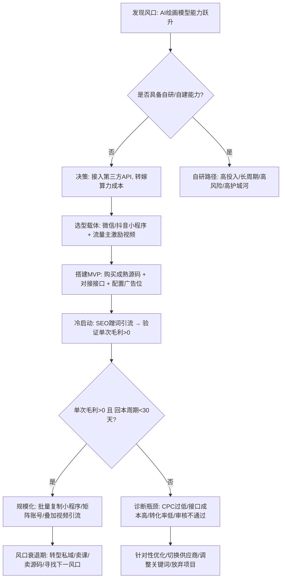
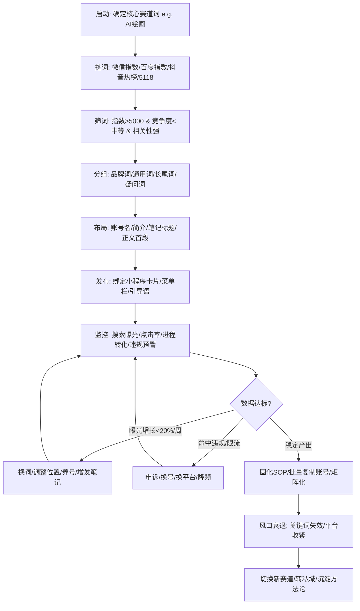
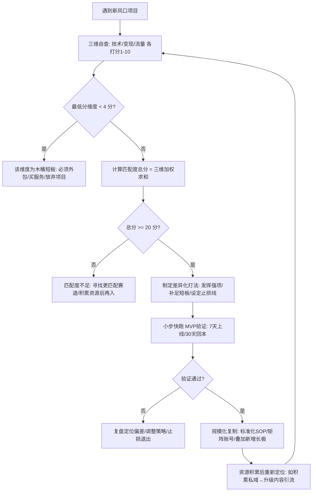
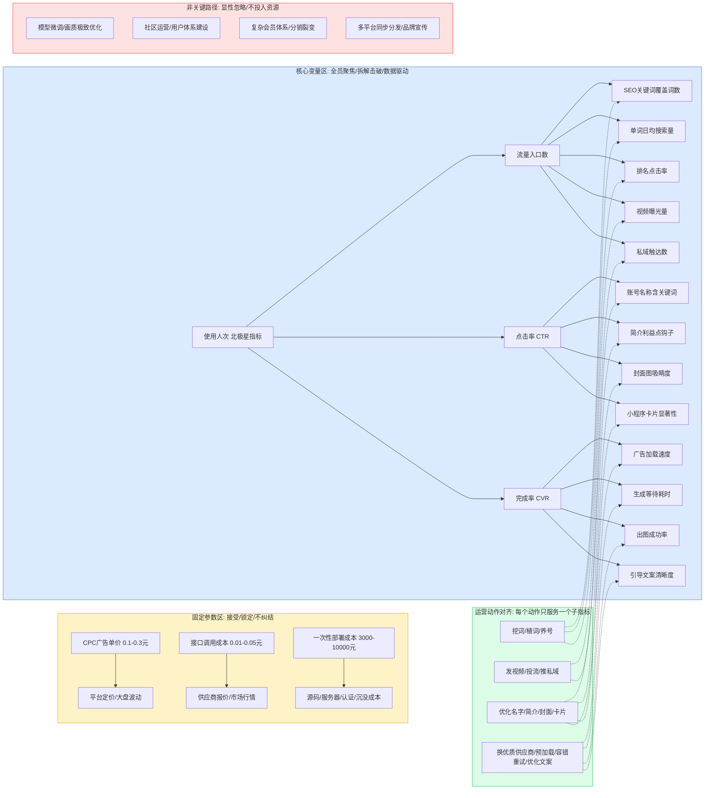
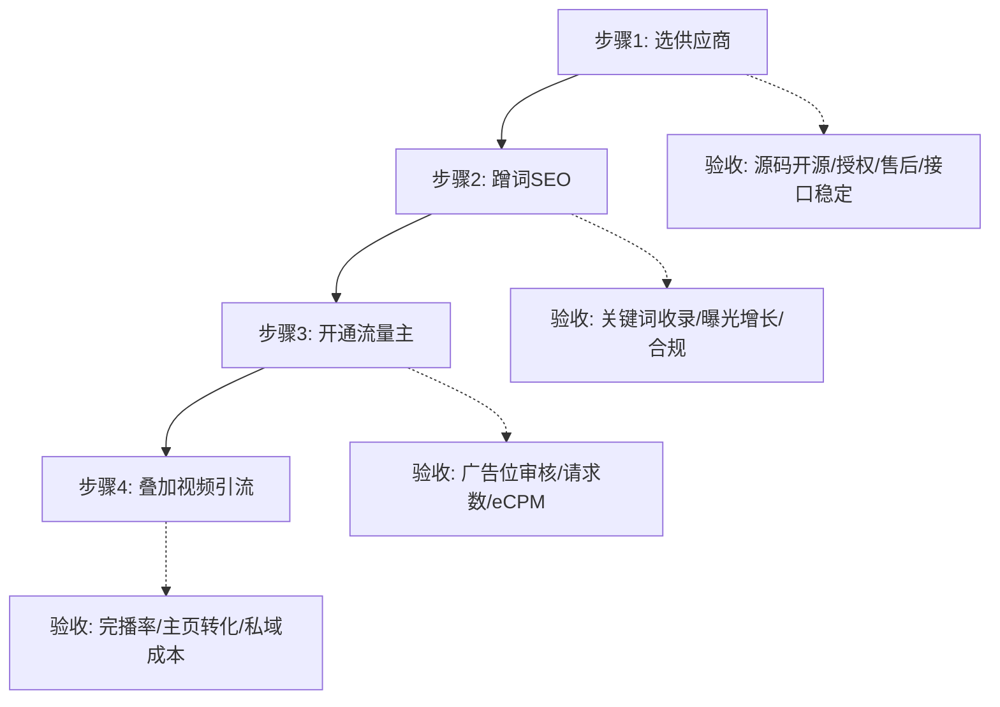
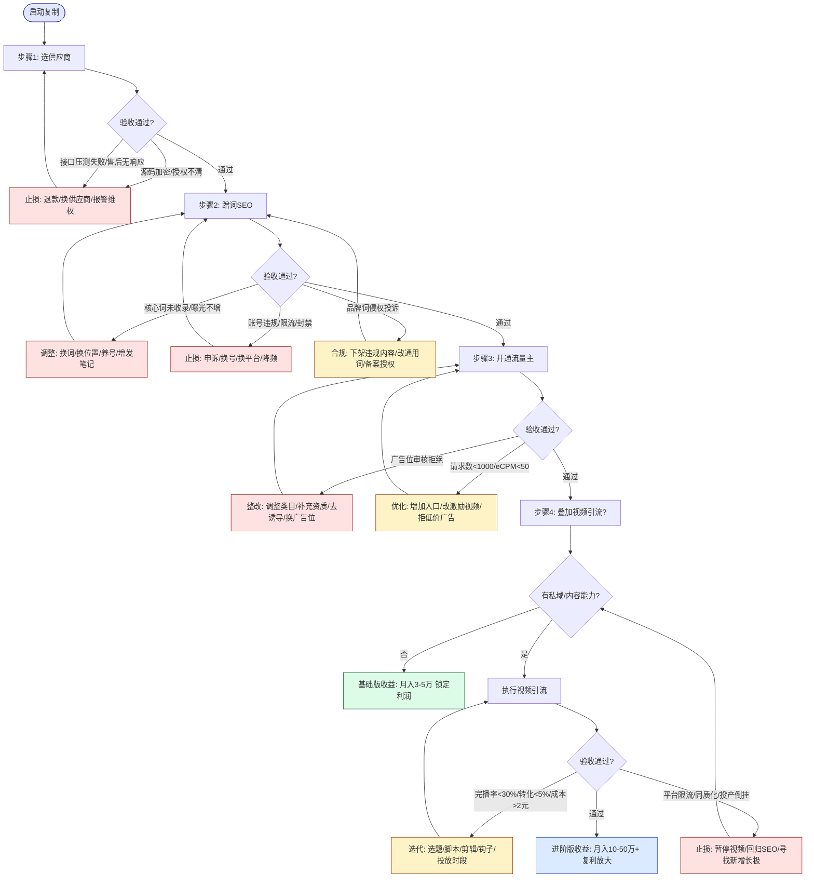

# 第 22 章 AI绘画小程序的生意经

## 学习目标

- 理解AI绘画小程序变现的核心商业模式：赚取广告CPC与接口调用成本的差价
- 掌握蹭关键词SEO流量法：利用平台搜索机制零成本获取精准流量
- 掌握风口项目定位分析法：从技术、变现、流量三维度判断个人资源匹配度
- 理解核心变量聚焦原则：在固定参数下，一切运营动作服务于最大化"使用人次"
- 掌握风口项目四步复制法：选型供应商、蹭词SEO、开通流量主、叠加内容引流
- 了解风口项目的边界风险：平台政策收紧、供应商质量、同质化竞争、法律合规

## 22.1 生活类比

想象AI绘画小程序生意是一座**'过路费收费站'**：**接口成本** = 修路养路的固定成本（每过一辆车成本极低）；**广告CPC单价** = 政府规定的通行费标准（平台定价，相对固定）；**使用人次** = 通过收费站的车流量（唯一能让你多赚钱的变量）；**蹭关键词SEO** = 在高速公路入口前竖起巨大广告牌（'前方最近加油站'），引导司机主动驶入你的收费站；**四步复制法** = 标准化的收费站建设套装：买现成收费亭(供应商)、挂招牌(SEO)、开通ETC(流量主)、派发传单(视频引流)。就像收费站老板不需要造车、修引擎（不用自研AI模型），只需守住路口、把路修平、把牌挂亮，车流来了钱就来。

## 22.2 概念地图

AI绘画风口变现实战
├── 核心商业模式
│   ├── 差价模型：收益 = 使用人次 × (CPC广告单价 - 接口成本) - 一次性投入  —— P001
│   ├── 变现载体：微信/抖音小程序 + 流量主激励视频广告  —— P001
│   └── 成本结构：接口调用费(0.01-0.05元/次) + 部署成本 + 充值收入摊薄  —— P001
├── 流量获取策略
│   ├── 蹭关键词SEO法：植入高指数词至账号名/简介，拦截搜索流量  —— P002
│   ├── 效果验证：98%流量来自小程序搜索，长尾效应显著  —— P002
│   └── 平台杠杆：借用小红书/抖音域名权重与用户池  —— P002
├── 决策与定位框架
│   ├── 三维定位法：技术能力 / 变现渠道 / 流量获取  —— P003
│   ├── 资源匹配度 > 项目天花板：匹配度80分小项目优于匹配度20分大风口  —— P003
│   └── 认知变现：项目感觉源于大量案例阅读积累  —— P003
├── 运营聚焦原则
│   ├── 核心变量论：广告单价/接口成本固定时，唯一可控变量为"使用人次"  —— P004
│   ├── 单一指标对齐：全链路动作拆解为流量入口×点击率×完成率  —— P004
│   └── 极致聚焦：忽略模型微调/画质极致/社区运营等非关键路径  —— P004
└── 标准化复制路径
    ├── 四步复制法：选供应商 → 蹭词SEO → 开通流量主 → 叠加视频引流  —— P005
    ├── 门槛分层：前三步人人可做(月入3-5万)，第四步拉开差距(10-50万+)  —— P005
    └── 边界风险：平台政策/供应商坑/同质化内卷/版权合规  —— P005

## 22.3 AI绘画变现生意模式 —— 赚接口成本与广告单价的差价

> "所以这个生意对于我来说，收益 = 使用人次 * （ CPC的广告价格 - 接口调用费用） - 一次性投入 ，其实这里边还有个充值积分的钱，可以平摊到接口调用费用中。"
> 
> ——《Zjr6dgbHIoxcp0x21SVcrwlqn8d.md》

### 为什么需要这个概念？

AI绘画技术爆发期，普通人缺乏算力与技术开发自有模型。你需要一种低门槛、可快速落地的商业闭环变现路径。传统SaaS或卖软件模式决策链长，不适合个人快速试错。素材作者在2023年2月捕捉到Stable Diffusion/Midjourney等模型能力跃升的窗口期，发现个人开发者无法自建GPU集群训练模型，但可以极低成本接入第三方API，把"算力门槛"转化为"接口调用成本"，再通过微信/抖音小程序的流量主激励视频广告变现，形成"用户看广告→平台分成→扣除接口成本=净利"的完整闭环。

### 核心定义

**AI绘画小程序差价变现模型**（来源：《Zjr6dgbHIoxcp0x21SVcrwlqn8d.md》）

$$
\text{收益} = \text{使用人次} \times (\text{CPC广告单价} - \text{接口调用成本}) - \text{一次性部署成本}
$$

其中：
- **使用人次**：完成"进小程序→看广告→生成图片"闭环的用户总次数
- **CPC广告单价**：平台激励视频广告的单次展示收益，微信/抖音小程序约 0.1-0.3 元/次
- **接口调用成本**：第三方AI绘图API（如Stable Diffusion托管服务）的单次调用费用，约 0.01-0.05 元/次
- **一次性部署成本**：小程序源码购买/授权费、服务器域名备案费、认证费等沉没成本
- **充值积分收入**：用户付费购买生成次数/会员的收入，可摊薄接口调用成本，提升实际毛利

#### 逐式解释：为什么这个公式能精准描述生意本质？

**第一步：拆解单次交易单元经济模型**  
每一次用户完整生成图片的行为，都是一个独立的微观交易：用户付出"观看30秒广告"的时间成本，平台支付CPC广告分成（约0.1-0.3元），开发者支付接口调用费（约0.01-0.05元）。单次毛利 = CPC - 接口成本 = 0.05-0.25元。这是一个**标准化、可复制、边际成本极低**的交易单元。

**第二步：规模化放大**  
当这个交易单元被验证跑通后，总收益自然等于"单次毛利 × 成功交易次数"。这里的"成功交易次数"即为**使用人次**——完成全链路闭环的有效用户数。这揭示了生意的**线性放大特性**：没有复杂的网络效应、没有指数级边际递增，纯粹是单次利润的线性累加。

**第三步：扣除沉没成本得到净利**  
一次性部署成本（源码购买、服务器、认证费）是启动生意的"入场券"，属于沉没成本。只有当累计毛利覆盖这笔投入后，生意才真正进入盈利区。公式中的"- 一次性部署成本"精准刻画了**回本周期**的概念。

**第四步：充值收入的双重杠杆作用**  
素材中提到"充值积分的钱，可以平摊到接口调用费用中"。这引入了第二收入流：用户直接付费购买生成次数/会员。这笔收入不扣除CPC（用户不看广告也能生成），直接抵扣接口成本，等效于**降低了边际成本**，甚至当充值收入 > 接口成本时，单次交易变为纯利润。这也是为什么公式注脚强调充值收入可"摊薄接口成本"的数学本质。

> **公式作用概述**：这个公式将看似复杂的"AI+广告+小程序"生意，抽象为**三个固定参数（CPC、接口成本、沉没成本）与一个核心变量（使用人次）的线性组合**。它告诉创业者：不用纠结模型好坏、画质细节、界面美观，只需盯住"怎么让更多人跑完闭环"这一件事。这就是"差价思维"的数学具象化。

### 变现载体与成本结构

**变现载体**：微信小程序/抖音小程序 + 流量主激励视频广告（用户主动观看30秒广告换取生成机会）。

**成本结构分层**：

| 成本类型 | 典型数值 | 性质 | 备注 |
|----------|----------|------|------|
| 接口调用费 | 0.01-0.05 元/次 | 变动成本 | 随使用人次线性增长 |
| 小程序源码/授权 | 2000-10000 元 | 一次性固定成本 | 买断制或年费制 |
| 服务器/域名/备案 | 500-2000 元/年 | 固定成本 | 随规模微增 |
| 微信认证费 | 300 元/年 | 固定成本 | 必需项 |
| 充值收入摊薄 | - | 收入抵扣 | 降低实际边际成本 |

### 方法演进图：商业模式验证与迭代决策流

### 典型例子

作者2023年2月接入Stable Diffusion/Midjourney类接口，用户点击生成→观看30秒激励视频广告(单价0.1-0.3元)→获得图片。接口调用成本约0.01-0.05元/次，单次毛利可达0.05-0.25元。作者宣称月收益5W+，虽未公开完整账单，但该模型在风口期已被大量复制验证。

### 边界条件

- **平台审核依赖**：小程序类目受限（工具类易过审，娱乐类严），流量主开通需满粉丝/内容合规要求；
- **供应商稳定性风险**：官方限流、涨价或跑路直接导致业务停摆，无自研模型兜底；
- **广告单价波动**：受季节/大盘影响大，非标品广告填充率不稳定；
- **风口红利衰退**：晚入场者面临关键词竞争加剧、获客成本上升，模型边际收益递减。

---

## 22.4 蹭关键词SEO流量法 —— 在水流湍急处下网

> "流量方面我首先采用的是蹭关键词的方法：这个是当前当下AI绘画关键词的微信指数，所以简单的设置下小红书的名字和简介就能够蹭来很多流量。几乎百分之98的流量都来源于小程序搜索，所以关键词SEO这块目前非常重要。"
> 
> ——《Zjr6dgbHIoxcp0x21SVcrwlqn8d.md》

### 为什么需要这个概念？

个人开发者无预算投放信息流广告，也缺乏内容团队做长视频引流。公域平台搜索流量精准度高、用户主动意图强、转化率远超推荐流。新小程序冷启动期缺乏社交裂变种子用户，需外部流量注入。作者发现：与其在推荐算法的"大海捞针"中博弈，不如利用用户主动搜索的"精准意图"，在搜索入口处拦截流量。

### 核心定义

**蹭关键词SEO流量法**（来源：《Zjr6dgbHIoxcp0x21SVcrwlqn8d.md》）

操作步骤：
1. **挖词**：用微信指数/百度指数/抖音热榜/5118工具，找到"搜索指数高、竞争度中低"的长尾词（如"AI绘画生成""AI头像制作""Midjourney中文版"）；
2. **植词**：在小红书/👸号/视频号的**账号名称**、**简介**、**笔记标题**、**正文首段**自然植入关键词；
3. **截流**：用户搜索关键词→看到账号/笔记→点击主页/菜单栏小程序卡片→进入小程序生成图片。

关键公式：
$$
\text{搜索流量} = \sum_{i=1}^{n} (\text{关键词}_i \text{搜索指数} \times \text{排名点击率}_i \times \text{账号权重}_i)
$$

#### 逐式解释：搜索流量从哪里来？怎么最大化？

**第一项：关键词覆盖面（n）与单词热度（搜索指数）**  
公式求和符号$\sum_{i=1}^{n}$表示：你布局了多少个关键词（n），每个词自带的搜索热度（指数）是多少。**挖词的核心就是最大化 n × 指数**。作者"蹭品牌词+通用词"组合拳，本质是在低成本扩大 n，同时蹭高指数品牌词提升单词热度。

**第二项：排名点击率（排名点击率$_i$）**  
同一个关键词，排第1名可能获取50%点击，排第10名不足1%。**植词位置决定排名权重**：账号名称 > 简介 > 笔记标题 > 正文。作者"简单设置下小红书的名字和简介"，正是抓住了权重最高的两个位置，以最小动作换最大排名收益。

**第三项：账号权重（账号权重$_i$）**  
平台给账号打分（注册时长、违规历史、互动率、粉丝量）。新号权重低，老号权重高。作者"比较早蹭了一个已经火起来的平台名字"，隐含了**账号养成/收号/借权重**的操作空间。这解释了为什么同样的词、同样的位置，别人有流量你没有。

> **公式作用概述**：该公式将"玄学SEO"拆解为**三个可量化、可操作、可复盘的工程变量**。它指导实操：想要更多流量，要么多挖词（增n）、要么挖更热的词（增指数）、要么优化植词位置提升排名（增点击率）、要么养号/买老号提升权重。不再靠"感觉"做SEO，而靠"公式"做SEO。

### 关键性质

- **零成本**：无需付费推广，仅需内容运营操作；
- **长尾效应**：一次布局，内容长期留存，持续获得被动流量；
- **高精准度**：搜索用户带有明确需求，转化率远高于推荐流泛流量；
- **平台杠杆**：借用头部平台（小红书）的域名权重与用户池，冷启动极快。

### 方法演进图：SEO关键词全生命周期操作流

### 典型例子

作者蹭热门AI绘画平台品牌词+通用词，设置小红书昵称/简介。操作门槛低："简单的设置下小红书的名字和简介就能够蹭来很多流量"。实测数据：项目98%流量来自小程序搜索，验证SEO为主导引流手段。

### 边界条件

- **算法规则依赖**：平台打击营销号/关键词堆砌会导致限流封号；
- **热点生命周期短**：热点关键词生命周期短（1-3个月），需持续追踪新热词更新布局；
- **侵权风险**：品牌词蹭流量存在侵权风险，平台侵权投诉机制完善后易被下架；
- **边际收益递减**：竞争者增加，核心词排名靠前难度指数级上升。

---

## 22.5 风口项目定位决定成败论 —— 先找位置再开枪

> "任何技术的革新都会带来新的机会，不过冷静下来，还是要找好自己在这个事情中的定位，定位错了，方向就迷失了。首先分析自己的定位：技术/变现/流量"
> 
> ——《Zjr6dgbHIoxcp0x21SVcrwlqn8d.md》

### 为什么需要这个概念？

技术风口期机会多但噪音大，普通人极易陷入"全都想做、全都做不成"的贪婪陷阱。资源有限（时间/精力/资金）的个人必须集中优势兵力打歼灭战。盲目跟风导致在不擅长的赛道硬拼，沉没成本高且挫败感强。作者强调：入场前必须完成三维定位自查，定位即选择战场，只打自己有把握赢、且资源匹配度高的仗。

### 核心定义

**三维定位法**（来源：《Zjr6dgbHIoxcp0x21SVcrwlqn8d.md》）

| 维度 | 核心问题 | 作者自评 | 决策依据 |
|------|----------|----------|----------|
| **技术能力** | 能否独立完成核心交付/对接维护？缺口如何补？ | 一般 | 选择买成熟源码/接口，不自研模型、不微调 |
| **变现渠道** | 是否已有广告主资源/私域用户池/分销网络/付费社群？ | 有经验 | 熟悉流量主广告变现、CPS分佣、私域转化 |
| **流量获取** | 擅长SEO/内容创作/投放广告/裂变/地推中的哪一种？ | 擅长SEO | 过往项目验证SEO低成本高转化，擅长蹭热词 |

**定位原则**：
- **资源匹配度 > 项目天花板**：一个匹配度80分的小项目，优于匹配度20分的大风口；
- **认知变现**：项目成功背后是"在生财阅读无数文章后积累的项目感觉"，即通过大量案例阅读建立的模式识别能力；
- **动态调整**：定位非一成不变，需随资源积累（如积累出私域流量）升级打法（如增加视频引流）。

### 方法演进图：三维定位雷达图决策流

### 典型例子

**正面案例**：作者自述技术一般、擅长SEO、有变现经验 → 选择"小程序+SEO+广告"轻模式，月收益5W+。

**反面教训**：技术小白强行自研小程序/微调模型，耗时3个月上线错过风口窗口期，沉没成本高、收益为零。

**进阶打法**：有私域/内容能力者，可叠加"发视频引流"作为流量第二增长极（作者第四步）。

### 边界条件

- **主观偏差**：定位分析存在主观偏差，易高估强项低估短板，需引入外部反馈校准；
- **信息不完全**：早期风口信息不全，定位基于的假设可能失真（如预估接口成本过低）；
- **资源动态性**：个人资源随时间变化，静态定位易过期，需建立定期复盘机制（月度/季度）。

---

## 22.6 AI绘画C端变现核心变量论 —— 只管把人拉来，其它都是定数

> "收益 = 使用人次 * （ CPC的广告价格 - 接口调用费用） - 一次性投入。使用人次越多成为唯一变量。"
> 
> ——《Zjr6dgbHIoxcp0x21SVcrwlqn8d.md》

### 为什么需要这个概念？

创业者易陷入微优化陷阱：纠结提示词微调、界面配色、模型版本等非核心细节。资源有限时，必须识别"约束条件"与"优化变量"的本质区别，实现极致聚焦。避免"假装努力"：在固定参数上耗费精力，而非攻克唯一增长瓶颈。

### 核心定义

**核心变量论**（来源：《Zjr6dgbHIoxcp0x21SVcrwlqn8d.md》）

在商业模型确定后，将所有参数分为两类：

| 参数类型 | 典型代表 | 可控性 | 策略 |
|----------|----------|--------|------|
| **固定参数** | CPC广告单价(平台定价)、接口调用费(供应商报价)、一次性部署成本(沉没成本) | 不可控/极难控 | 接受、锁定、不纠结 |
| **核心变量** | **使用人次**（DAU/MAU） | 可控 | **一切运营动作服务于最大化此指标** |

**分解公式**：
$$
\text{使用人次} = \text{流量入口数} \times \text{点击率} \times \text{完成率}
$$

- **流量入口数**：SEO关键词覆盖词数 × 单词曝光量 + 视频引流曝光 + 私域推送触达
- **点击率**：账号权重、标题吸引力、封面图、小程序卡片显著性
- **完成率**：广告加载速度、生成耗时、出图成功率、引导文案清晰度

#### 逐式解释：如何把"搞流量"变成精确工程？

**分子端：流量入口数**  
= Σ(关键词覆盖数 × 单词日均搜索量 × 排名点击率) + 视频曝光量 + 私域触达数。  
这告诉你：**SEO做得好不好，直接看"覆盖了多少词 × 每个词带来多少曝光"**。作者"蹭品牌词+通用词"，本质是用极低成本最大化"关键词覆盖数 × 单词热度"。

**中间环：点击率 (CTR)**  
用户看到了你的账号/笔记，点不点进小程序？取决于：账号名是否含关键词（相关性）、简介是否有钩子（利益点）、封面图是否吸睛、小程序卡片位置是否显眼。作者"设置名字和简介"，本质在优化CTR。

**分母端：完成率 (CVR)**  
用户进了小程序，能不能跑完"看广告→出图"？取决于：广告加载快不快（技术指标）、生成等待时间长不短（接口性能）、出图成功率高不高（供应商稳定性）、引导文案清不清晰（产品设计）。**任何一环卡住，前面的流量入口和点击率全归零**。

> **公式作用概述**：这个分解公式把模糊的"搞流量"拆解为**三个可独立优化、可分工协作、可数据复盘的工程指标**。它揭示了作者全链路动作的底层逻辑：选型锁定成本（固定参数）→ SEO蹭词拉升流量入口数 → 开通流量主锁定单价（固定参数）→ 优化广告位/引导提升完成率。所有动作指向同一个北极星——**使用人次**。这就是"极致聚焦"的数学证明。

### 方法演进图：使用人次分解漏斗与动作对齐图

### 典型例子

数据验证：98%搜索流量 + 广告变现 = 单一变量模型在风口期的极致跑通。作者将精力100%聚焦在"怎么让更多人搜到、点进来、看完广告、生成成功"，而非"怎么让图更好看"。

### 边界条件

- **模式局限**：仅适用于"广告变现+标品接口"的标准化模式，非标定制/高客单/重服务模式不适用；
- **体验底线**：忽视用户体验底线（广告过多、出图失败率高）会导致留存崩塌，模型失效；
- **黑天鹅事件**：平台政策突变（取消流量主、限制AI类小程序）属于模型无法预测的外部冲击。

---

## 22.7 风口项目四步复制法 —— 照猫画虎也能成精

> "1、选一个靠谱的小程序供应商 2、照猫画虎一样的去蹭SEO关键词 3、开通流量主，设置广告 4、如果有私域流量和做内容的能力，可以自己发布视频引流量"
> 
> ——《Zjr6dgbHIoxcp0x21SVcrwlqn8d.md》

### 为什么需要这个概念？

普通人缺乏从0到1创新能力，但具备从1到N复制执行能力。成熟风口项目已有验证案例，复制成功率远高于原创探索。需要一套标准化、去技能化、可外包的执行清单，降低决策疲劳。

### 核心定义

**四步复制法**（来源：《Zjr6dgbHIoxcp0x21SVcrwlqn8d.md》）

**步骤详解**：

| 步骤 | 核心动作 | 验收标准 | 典型坑点 | 成本/周期 |
|------|----------|----------|----------|-----------|
| **1·选供应商** | 找成熟小程序供应商（源码/部署/售后一体化），避坑自研 | 源码可读/授权明确/售后响应<2h/接口稳定性测试通过 | 源码加密/接口失效/售后消失/二次转手加价 | 2000-10000元 / 1-3天 |
| **2·蹭词SEO** | 照猫画虎式SEO，抄作业式植入热词，无需原创内容生产 | 核心词TOP3收录/日搜索曝光增长>20%/账号无违规 | 品牌词侵权投诉/关键词失效/账号封禁/堆砌判定 | 0元 / 1-7天见效 |
| **3·开通流量主** | 按平台流程开通流量主、配置激励视频/插屏/格子广告位 | 广告位审核通过/单日广告请求>1000/eCPM>50元 | 诱导点击判定/类目资质不符/广告填充率低 | 0元 / 1-3天审核 |
| **4·叠加视频** | 有私域/内容能力者，发视频/图文做二次引流，无则不强求 | 视频完播率>30%/主页转化率>5%/私域沉淀成本<2元 | 内容同质化/平台限流/投产比倒挂 | 视频制作成本 / 持续运营 |

### 关键性质

- **标准化程度高**：每步骤均有明确验收标准，可外包、可SOP化；
- **容错率高**：单步骤失败成本可控（换供应商/换词/换广告位/不做视频），不影响主流程；
- **复利结构**：前三步建立资产（小程序账号/关键词排名/流量主权限），第四步放大资产收益；
- **门槛分层**：前三步人人可做（月入3-5万），第四步拉开差距（月入10-50万+）。

### 方法演进图：四步验收决策树与风险分支流程

### 典型例子

作者实操路径：购买成熟AI绘画小程序源码 → 小红书蹭品牌词/通用词 → 开通流量主挂广告 → 后期发视频补充流量。供应商模式：几千元买断源码/授权，包部署包售后，作者"照猫画虎"即可上线。效果验证：作者月收益5W+，并称"这个流程门槛低、可复制性强"。

### 边界条件与风险

- **供应商质量参差**：源码加密、接口失效、售后消失是常见坑，需实地考察/小额测试；
- **平台政策收紧**：微信打击"套壳小程序"、"诱导看广告"、"低质内容"，模板化产品首当其冲；
- **同质化竞争红海化**：同一供应商源码部署上百个小程序，流量内卷导致单程序收益下降；
- **法律合规风险**：AI生成内容版权归属未明、广告法违规宣传、用户隐私合规等隐性雷区。

---

## 22.8 多源对照

本章核心概念均源自单一素材 `Zjr6dgbHIoxcp0x21SVcrwlqn8d.md`，暂无其他素材对同一项目进行直接佐证或反驳。但我们可将其方法论与书中其他章节的通用原则对照：

### 共识：跨章节验证的核心原则

以下表格展示了本章方法论与书中其他章节通用原则的共识点，说明这些原则在不同业务场景下的普适性：

| 原则 | 本章体现 | 其他章节印证 |
|------|----------|--------------|
| **MVP先卖后做** | 买成熟源码不自研，7天上线跑通闭环 | 第3章"卖空气/软文先行"、第10章"MVP先卖后做" |
| **流量主动权在搜索** | 98%流量来自搜索，SEO为主导 | 第4章"抖音搜索是蓝海"、第13章"超垂直IP+SEO思维" |
| **核心变量单一聚焦** | 只盯使用人次，忽略非关键路径 | 第6章"交易目的论：曝光≠价值"、第10章"剥离式拆解问题法" |
| **风口定位先行** | 三维定位决定成败，匹配度>天花板 | 第1章"六维评估模型"、第5章"创业项目匹配度" |
| **标准化复制放大** | 四步复制法可批量复制 | 第6章"人力杠杆/技术杠杆"、第10章"盈利验证与放大法" |

### 分歧/补充视角：单一素材视角的局限与补全

以下表格展示了基于单一素材可能存在的盲区，以及书中其他章节提供的补充/反面视角，帮助读者建立更立体的风险认知：

| 观点 | 本章隐含立场 | 可能的反面/补充 |
|------|--------------|-----------------|
| **技术护城河必要性** | 不需要，买源码接接口即可 | 第1章"算力平权"显示技术门槛在降，但长期看自研/微调能力决定能否逃离同质化红海 |
| **品牌词蹭流量合规性** | 早期红利期可蹭，作者实操蹭了品牌词 | 第7章"抄袭与二次创作灰色地带"、第9章"平台内容合规审核"提示侵权风险随时间放大 |
| **广告变现可持续性** | 风口期CPC高、填充好，单次毛利可观 | 第3章"支撑赚钱的悖论"指出无效产品靠噱头赚快钱，长期需转向"给方法/建IP"提升LTV |
| **单一变量模型极限** | 使用人次触达天花板后模型失效 | 第5章"客单价与毛利率补偿策略"、第6章"复购率魔力"提供第二增长曲线思路 |

---

## 22.9 设计中的取舍

**为什么不用自研模型/自建GPU服务器？**
- 成本门槛高：单张A100日租金>100元，团队维护成本高，个人无法承担；
- 时间窗口短：风口期3-6个月，自研/部署周期长，极易错过红利期；
- 核心能力错位：个人优势在"流量获取+商业模型设计"，而非"模型训练/推理工程"。

**为什么不用信息流投放/达人合作做流量？**
- ROI不可控：前期无数据模型支撑投放，极易亏损；达人报价不透明，坑多；
- SEO边际成本为零：蹭词只需人力操作，长尾效应强，风口期搜索流量红利期长；
- 验证速度快：SEO 1-7天见流量，投放/达人需谈周期、出素材、跑数据，周期长。

**为什么不做复杂的用户体系/社区/会员体系？**
- 违背"单一核心变量"原则：风口期唯一目标是最大化使用人次，复杂体系分散精力、降低完成率；
- 开发维护成本高：用户系统、支付对账、客服工单、内容审核均需人力，个人团队承担不起；
- 退出成本低：模板化小程序本质是"消耗品"，风口过后弃之无损，无需建设重资产。

---

## 22.10 动手练习

### 练习1：手算一笔AI绘画小程序账

假设某AI绘画小程序：日活用户(DAU) 500人，人均每日生成3次，广告填充率80%，CPC单价0.2元，接口调用成本0.03元/次，小程序源码购买成本3000元，服务器域名年费500元。

1. 计算日毛利 = DAU × 人均生成次数 × 填充率 × (CPC - 接口成本)
2. 计算月毛利(按30天)及扣除分摊固定成本后的净利润
3. 若想将月净利润提升至5万元，在CPC和接口成本固定的前提下，需要将DAU提升至多少？

**回答问题**：
- 为什么说"使用人次"是唯一核心变量？如果CPC单价波动到0.1元会怎样？
- 充值积分收入如何摊薄接口成本？设计一个简单的充值套餐数学模型。

### 练习2：为你的副业项目做三维定位自查

选择一个你正在考虑或正在操作的副业项目（不限于AI绘画），按以下三维度打分(1-10分)并书面论证：

1. **技术能力**：你能否独立完成核心交付/对接维护？缺口如何补（学习/外包/买源码）？
2. **变现渠道**：你是否已有广告主资源/私域用户池/分销网络/付费社群？冷启动难度如何？
3. **流量获取**：你擅长SEO/内容创作/投放广告/裂变/地推中的哪一种？历史最佳单日获客成本多少？

**回答问题**：
- 你的最低分维度是哪个？它是否会成为项目的"木桶短板"？
- 如果该项目匹配度总分<20分，你是否应该放弃并寻找更匹配的赛道？

### 练习3：设计一个"蹭关键词SEO"实操清单

针对某个热点赛道（如：AI写作、宠物经济、银发经济、出海跨境），完成以下操作：

1. 使用微信指数/百度指数/抖音热榜/5118工具，挖掘出10个"搜索指数>5000且竞争度<中等"的长尾关键词
2. 设计3组小红书/👸号/视频号的『账号名称+简介』组合方案，自然植入上述关键词，不显营销痕迹
3. 制定『内容发布-关键词布局-数据复盘』的周度SOP表格，包含：发布频次、标题关键词、正文植入位置、搜索曝光量、点击率、进小程序转化率

**回答问题**：
- 如何判断一个关键词是"蓝海词"而非"红海词"？有哪些量化指标？
- 平台打击"关键词堆砌/营销号"的红线在哪里？如何在合规边界内最大化SEO效果？

### 练习4：风口项目四步复制法·避坑演练

假设你决定复制'AI生成头像/壁纸/二维码'小程序项目，请针对四步各列出3个核心验收标准及1个典型坑点：

**步骤1·选供应商**：验收标准(如：源码开源/授权模式/售后响应时长/接口稳定性测试报告) + 典型坑(如：源码加密/接口失效/售后消失)

**步骤2·蹭词SEO**：验收标准(如：关键词收录排名/搜索曝光增长率/账号违规风险) + 典型坑(如：品牌词侵权投诉/关键词失效/账号封禁)

**步骤3·开通流量主**：验收标准(如：广告位审核通过率/单日广告请求数/eCPM达标) + 典型坑(如：诱导点击判定/类目资质不符/广告填充率低)

**步骤4·叠加视频引流**：验收标准(如：视频完播率/主页转化率/私域沉淀成本) + 典型坑(如：内容同质化/平台限流/投产比倒挂)

**回答问题**：
- 如何用最低成本(<500元)在7天内完成步骤1-3的最小验证闭环(MVP)？
- 当步骤2的SEO流量触达天花板(日搜索流量不再增长)时，应启动何种"第二增长曲线"策略？

---

## 22.11 本章小结

这一章中我们学习了如何在AI绘画技术风口期，利用小程序+流量主广告模式快速落地变现。首先我们拆解了核心商业模式：收益 = 使用人次 × (CPC广告单价 - 接口成本) - 一次性投入，明确了赚取差价的本质；其次我们掌握了蹭关键词SEO流量法，通过在平台账号名/简介植入高指数词，零成本拦截精准搜索流量，实测98%流量来自搜索；接着我们建立了三维定位法，从技术、变现、流量三维度自查资源匹配度，避免方向迷失；然后我们提炼了核心变量论，在固定参数下极致聚焦"使用人次"这一北极星指标，拆解为流量入口×点击率×完成率逐个击破；最后我们归纳了四步复制法（选供应商→蹭词SEO→开通流量主→叠加视频引流）及其边界风险，形成可标准化执行的操作手册。

### 本章核心概念速查表

以下表格汇总了本章六大核心概念的定义与要点，供快速复习与检索：

| 概念 | 解释 |
|------|------|
| 差价变现模型 | 收益 = 使用人次 × (CPC广告单价 - 接口调用成本) - 一次性部署成本 |
| 蹭关键词SEO流量法 | 在平台账号名/简介植入高搜索指数词，利用搜索机制零成本获取精准长尾流量 |
| 三维定位法 | 入场前必查技术能力、变现渠道、流量获取三维资源匹配度，定位错则方向迷失 |
| 核心变量论 | 固定参数下，唯一增长杠杆是"使用人次"，一切运营动作均服务于最大化此指标 |
| 四步复制法 | 选靠谱供应商 → 照猫画虎蹭SEO → 开通流量主配广告 → 有能力则叠加视频引流 |
| 风口边界风险 | 平台政策收紧/供应商跑路/同质化内卷/AI版权合规，模板化产品首当其冲 |

下一章中，我们将学习 **第 23 章：自动化编排 —— 让工具替你盯梢和跑腿**，探讨如何用 IFTTT 等无代码平台搭建"如果这样，就会那样"的自动化工作流，把重复性操作交给机器，释放人力专注于高价值决策。

