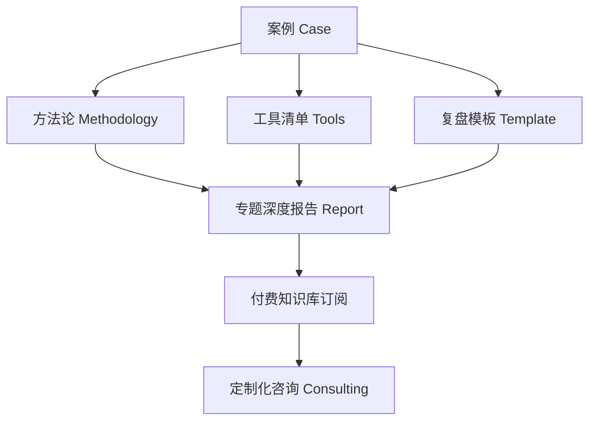

# 第 8 章 副业案例集 —— 从“经验分享”到“可复用的知识库”

## 学习目标

- 理解副业案例汇编从碎片信息到系统知识的转化价值
- 掌握“主题+平台+数据结果”高点击率标题的结构化撰写公式
- 学会建立周期性情报编纂机制，打造个人商业雷达站
- 掌握从单纯索引进化为多维知识库的路径与关键动作
- 能识别案例集编纂中的幸存者偏差、时效性衰减等边界陷阱

## 8.1 生活类比

想象副业案例集的建设像是**为一片未知海域绘制航海图**：**单篇复盘文章** = 水手零散的“见岛日志”（只记录某次发现陆地的坐标与收获）；**周报索引** = 按航次整理的“航海日志汇编”（按时间序串联，能看出大致航线）；**结构化标题** = 日志封面上的“关键坐标标注”（一眼看到：哪里、什么岛、多少金银）；**周期性编纂** = 固定频次的“测绘船队出海”（制度化保证情报持续更新、不缺档）；**知识库进化** = 最终绘成的“标注了洋流、暗礁、补给港、贸易航线”的**总航海图** —— 支持按“目的地（赛道）”“船型（平台）”“季节（阶段）”快速查阅，标注了“哪里有暗礁（避坑）”“哪里顺风快（爆款打法组合）”，新航海者（读者）拿到图，就能避开死海、直奔富饶群岛，而非盲目漂流。

## 8.2 概念地图

副业案例集与情报编纂体系
├── 核心载体：龙哥赚钱周报
│   ├── 形态定义：定期汇编的索引合集，按日期编号组织  —— P001
│   ├── 覆盖维度：多平台（👸号/抖音/小红书/视频号/TikTok）× 多赛道（AI/Web3/私域/电商）  —— P001
│   └── 核心功能：降低检索成本，将离散灯塔串联为导航图谱  —— P001
├── 标题工程：数据钩子设计
│   ├── 结构公式：主题 + 平台 + 量化结果（涨粉/变现/ROI/成本/周期）  —— P002
│   ├── 信任锚点：具体数字替代模糊形容词，传递可复制性与收益预期  —— P002
│   └── 检索友好：结构化标题可直接解析入库，支持多维筛选  —— P002
├── 编纂机制：周期性情报雷达
│   ├── 节奏设定：固定周期（双周/月）更新，形成阶段性情报快照  —— P003
│   ├── 加工流程：筛选 → 分类 → 重标题 → 打标签 → 汇总发布  —— P003
│   └── 双重价值：对外立人设（专业度背书），对内辅决策（选品/选赛道依据）  —— P003
└── 进化路径：从索引到知识库
    ├── 维度重构：按平台/赛道/阶段三维打标，从“时间序”转“问题域”检索  —— P004
    ├── 四层关联：案例 ↔ 方法论 ↔ 工具 ↔ 模板，支持模式挖掘  —— P004
    ├── 产出升级：定期输出专题深度报告（横向对比/避坑白皮书/趋势洞察）  —— P004
    └── 变现阶梯：免费周报引流 → 付费知识库订阅 → 定制化咨询  —— P004

## 8.3 副业案例汇编 —— 从“碎片灯塔”到“导航图谱”

### 为什么需要这个概念？

当你在👸号、小红书、抖音、即刻等平台刷到一篇篇“副业复盘”时，你会发现一个共性：**单个案例像散落海面的灯塔，只能照亮一隅。** 作者 A 告诉你“视频号带货 10 天变现 6000”，作者 B 分享“小红书资料号一周涨粉 1200”，作者 C 复盘“AI 绘画小程序月入 5 万”。这些经验是真实的、有价值的，但它们是离散的：

- **检索成本高**：你想找“视频号冷启动前 3 天做了什么”，得一个个点开文章、在长文里用 Ctrl+F 硬找。
- **难以建立知识闭环**：看完 10 篇，你依然不知道“视频号选品”的通用套路是什么，只记得 10 个孤立的故事。
- **无法迁移复用**：别人赚钱的路径里，哪些是“平台红利”（不可复制），哪些是“方法论”（可迁移），混在一起没人帮你拆解。

我们需要一种**结构化载体**，把这些离散的灯塔串联成一张**可检索、可迁移的导航图谱** —— 这正是“龙哥赚钱周报”这类周期性汇编的诞生逻辑。

> "+   [龙哥赚钱周报 202301-02](README.md)
> +   [龙哥赚钱周报 20221113-20230207](20230207_00.md)"
>
> ——《SUMMARY.md》

### 核心定义

**“龙哥赚钱周报”**是一种**定期汇编的索引合集**，按日期编号（如 `202301-02`、`230207`）组织，覆盖副业、自媒体、电商、AI 应用等方向。它的本质是**“信息的二次加工”**：从原始内容中提取标题、平台、数据结果，重组为高密度导航索引。

> "本目录列出约40篇独立文章，覆盖👸号、抖音、小红书、视频号、TikTok等平台，以及AI绘画、Web3、私域裂变等主题"
>
> ——《SUMMARY.md》

### 关键性质

| 性质 | 说明 | 素材佐证 |
|------|------|----------|
| **周期性更新** | 按固定时间窗口（如半月/月）发布，保持情报时效性 | 文件命名 `202301-02`、`20230207_00`、`230207`、`230202` 显示双周/周节奏 |
| **结构化标题** | 采用“主题+平台+数据结果”格式，实现“不点开也能判断价值” | `👸号追热点复盘：通过行程码一天涨粉4万+，直接变现6K+` |
| **结果导向** | 标题层面即暴露涨粉数、变现额、成本等关键指标，传递“可复制性”与“收益预期” | `线上美业，不到2万成本到变现过百万`、`单直播间日进800美金-小时均100美金` |

### 典型例子

以下三条目录条目展示了不同“颗粒度”的索引价值：

1. **项目级复盘**  
   `单直播间日进800美金-小时均100美金，价值8800可矩阵的tiktok娱乐直播项目`  
   → 标题直接给出：单场 GMV、小时产出、课程售价、可复制性判断（可矩阵）。

2. **低成本高产出反差**  
   `线上美业，不到2万成本到变现过百万`  
   → 用“低成本-高产出”反差建立项目吸引力，隐含“高 ROI”信号。

3. **方法论封装**  
   `初创公司如何科学量化股权分配？股权分配五步法教你不再踩坑！！！`  
   → 将通用管理难题封装为标准化方法论条目（五步法），便于直接检索复用。

### 边界条件

- **索引 ≠ 内容**：周报本身不包含实操细节，仅提供入口链接，深度学习仍需跳转原文。
- **幸存者偏差**：收录多为“成功/有结果”案例，失败教训、避坑细节可能被标题掩盖。  
  ⚠️ **文献补充建议**：可参考内容平台生态研究或创作者经济报告中关于“成功案例过度代表性”的实证数据（如某平台备案的商业化案例库中成功/失败比例统计），或引入“反面教材库”建设方法论文献（如《失败学》相关研究），以平衡认知偏差。
- **时效性衰减**：平台规则、流量红利随时间失效，半年前的“爆款打法”可能今日已不可用。  
  例如 `TikTok娱乐直播项目` 在 2023 年初可行，但如今平台风控收紧，复制难度指数级上升。

---

## 8.4 案例标题工程 —— 用“数据钩子”捕获读者注意力

### 为什么需要这个概念？

在信息过载时代，读者只有 **2 秒** 决定是否点击。普通标题（如《我的副业心得》《视频号带货避坑指南》）无法传递具体价值，导致优质内容被埋没。我们需要一套**标准化的标题生成规范**，让每篇案例自带流量属性，同时为后续入库检索打下结构化基础。

### 核心定义

采用 **“主题 + 平台 + 数据结果”三段式结构**：

$$
\text{Title} = [\text{做什么}] + [\text{在哪个平台}] + [\text{量化结果}]
$$

**必须包含至少一个核心数字**：涨粉数、变现金额、ROI、成本、转化率、时间周期等。  
**隐含“可复制性”暗示**：通过“复盘”“保姆级教程”“可矩阵”等词标注方法论属性。

> "[👸号追热点复盘：通过行程码一天涨粉4万+，直接变现6K+](AmKRdF2Z9oQjDExxxuAc18a5nbb.md)"
>
> ——《SUMMARY.md》

这个公式之所以采用三段式组合，是因为它对应了读者决策的三个核心问题：**“这事儿靠谱吗？”**（主题/动作）、**“我在哪能复制？”**（平台）、**“能有多大收获？”**（量化结果）。三个变量缺一不可：缺主题不知做啥、缺平台不知去哪、缺数据不知值不值得点。同时，这种固定结构天然具备**检索友好性**——标题可直接用正则或大模型解析为结构化字段（`platform`、`project_type`、`period`、`follower_gain`、`revenue`、`cost`、`replicability_tag`），无需人工二次标注即可入库，支持 SQL/向量检索与多维筛选。

### 关键性质

这个公式展示了标题如何在一行内承载六大维度信息：

| 维度 | 标题中的体现 | 作用 |
|------|--------------|------|
| 赛道 | “👸号追热点”“小说推文”“AI绘画” | 精准定位读者兴趣圈层 |
| 平台 | “👸号”“视频号”“小红书”“TikTok” | 决定流量获取手段的可迁移性 |
| 动作 | “追热点复盘”“精细化运营”“从零到一” | 暴露核心打法类型 |
| 投入 | “不到2万成本”“10天时间” | 降低读者心理门槛 |
| 产出 | “涨粉4万+”“变现6K+”“变现过百万” | 建立收益预期，触发点击 |
| 可迁移性 | “可矩阵”“保姆级教程”“五步法” | 承诺方法论可复制，而非单纯运气 |

**信任锚点效应**：具体数字（`4万+`、`6K+`、`2万成本`、`百万`）比形容词（“大量”、“赚钱”、“不错”）可信度高数量级。读者潜意识会把“带数字的标题”归类为“实操干货”，把“无数字标题”归类为“鸡汤/水文”。

**检索友好性**：结构化标题可直接用正则/大模型解析入库，字段包括 `platform`、`project_type`、`period`、`follower_gain`、`revenue`、`cost`、`replicability_tag`，后续支持 SQL/向量检索。

### 典型例子

| 原始标题（模拟） | 重构后标题（素材实例） | 信息增量 |
|------------------|------------------------|----------|
| 我的👸号热点追踪心得 | 👸号追热点复盘：通过行程码一天涨粉4万+，直接变现6K+ | +平台 +动作 +周期 +涨粉 +变现 |
| 视频号带货新手教程 | 实操复盘：10天时间，视频号从0到变现6000+，到场观过万，我做了什么？ | +周期 +平台 +起号结果 +变现 +流量 +求知欲钩子 |
| 小说推文怎么做才稳 | 小说推文进阶玩法，精细化运营所带来的稳定出单 | +阶段 +方法论 +结果稳定性 |
| AI绘画赚钱了 | 追逐风口，AI绘画目前收益5W+ | +阶段性 +当前收益 |

### 边界条件

- **标题党风险**：若内容无法支撑标题数据（如“5W+”实为累计非月均），会透支信用。  
  ⚠️ **文献补充建议**：可补充内容营销伦理或平台治理规范类文献，如微信公众平台/抖音/小红书官方发布的《标题党治理细则》《商业化内容标注指引》，以及学界关于“标题-正文一致性检测”的 NLP 技术论文（如基于 BERT 的点击诱饵检测模型），建立“标题-正文一致性”自查清单与合规底线。
- **隐私与合规**：真实收益截图可能涉及平台保密协议，标题公开数据需脱敏处理（如用区间“5W-10W”替代精确值）。
- **适用范围**：仅适用于“结果导向型”实操分享，不适用于纯理论推演、观点类内容。

---

## 8.5 周期性情报编纂 —— 建立个人的“商业雷达站”

### 为什么需要这个概念？

单次灵感不可持续，商机发现需要**制度化、节奏化**的情报收集机制。个人精力有限，无法实时监控全网动态，需建立“低维护、高信噪”的定期扫描流程。将碎片化阅读转化为结构化资产，实现“读过即获、用时即查”。

### 核心定义

以固定周期（如双周/月）为节奏，从公域平台、付费社群、同行案例中采集高价值实操内容，经 **“筛选 → 分类 → 重标题 → 打标签 → 汇总发布”** 五步加工，输出一份可检索的周报文档。核心产出：Markdown 格式索引文件（`SUMMARY.md`）+ 归档原文链接库。

> "+   [230207 龙哥赚钱周报](20230207_01.md)
> +   [230202 龙哥赚钱周报](20230207_02.md)"
>
> ——《SUMMARY.md》

### 关键性质

| 性质 | 说明 | 实操要点 |
|------|------|----------|
| **低成本维护** | 依赖现有阅读习惯，不需额外采集工程，仅在分享/收藏时多做结构化记录 | 建立“收藏即入库”肌肉记忆：看到好文 → 复制链接 → 粘贴到 Inbox 表单 → 自动同步到 Notion/Airtable |
| **复利效应** | 单期周报价值有限，但 10 期、20 期积累后形成个人专属的“赛道知识图谱” | `20221113-20230207` 跨度 3 个月，40 篇 → 单期约 6-7 篇，年化约 160 篇 |
| **双重价值** | 对外是个人 IP 展示（专业度背书），对内是决策参考库（选品/选赛道依据） | 发布到👸号/知识星球 → 引流私域；自己做选品决策时 → 在库里按“赛道+平台”筛选 Top 5 参考 |

### 典型例子

**龙哥赚钱周报 202301-02**：覆盖 2022.11-2023.02 三个月窗口，40 篇文章，形成阶段性情报快照。

**同类实践对照**：

| 实践者 | 形态 | 节奏 | 核心差异 |
|--------|------|------|----------|
| 生财有术“周报” | 社群精华帖汇总 | 周 | 依赖社群内部优质讨论，信噪比极高，但非公开 |
| 独立开发者“周刊” | 技术/产品趋势精选 | 周 | 侧重技术前沿与产品灵感，商业变现案例较少 |
| 知识付费社群“精华帖” | 付费内容二次分发 | 月 | 门槛高、更新慢，但深度远超公域周报 |

### 编纂最小化 SOP（可直接落地）

```
1. 素材采集（日常 5 分钟）
   - 来源：👸号“稍后读”、小红书收藏、即刻/推特书签、付费社群精华区
   - 动作：看到高价值实操文 → 转发给自己的“收集机器人”（微信文件传输助手/飞书机器人/Notion Web Clipper）

2. 初筛与结构化录入（每期发布前 30 分钟）
   - 字段：原标题、链接、平台、赛道、核心数据（涨粉/变现/成本/周期）、可复制性自评（1-5分）
   - 重标题：按“主题+平台+数据结果”公式改写
   - 打标签：平台/赛道/阶段/关键动作 四维标签

3. 汇总发布（10 分钟）
   - 按平台分组 → 按可复制性降序 → 生成 Markdown 目录
   - 文件名：YYYYMMDD-YYYYMMDD.md（如 20230201-20230214.md）
   - 同步发布：👸号/知识星球/Notion 公开页/GitHub Pages

4. 归档入库（自动化）
   - 同步写入 Notion Database / Airtable / 飞书多维表格
   - 触发向量化嵌入（可选），支持语义检索
```

### 边界条件

- **依赖源头质量**：若订阅源多为营销号/二手搬运，周报必然“信噪比极低”。  
  → 对策：建立“白名单来源库”（如生财有术、船长副业、各大平台官方案例库、头部实操博主）。
- **缺乏深度分析**：周报本质是“目录”，不包含跨案例的横向对比、底层逻辑提炼，需配合专题复盘使用。  
  → 对策：每季度产出 1 篇《横向对比深度报告》（见 8.6 节）。
- **维护动力**：无即时反馈（如订阅数、变现），长期坚持依赖内驱力或外部承诺机制。  
  → 对策：公开承诺“双周更”，或将周报作为付费社群权益，倒逼自己产出。

---

## 8.6 从索引到知识库 —— 案例集的进化路径

### 为什么需要这个概念？

纯索引只解决“找到”，不解决“懂得”与“用上”。随着积累越来越厚，反而越来越难用：想找“视频号选品案例”，得在 20 期周报里一个个翻。读者需要：

- **跨案例的模式识别**：“所有爆款都用了钩子”“矩阵号+无人直播=低成本高爆单概率”
- **方法论的显性提取**：“爆款标题公式”“私域转化 SOP”沉淀为可复用条目
- **决策时的直接调用**：输入“我在做视频号冷启动”，自动调取 Top 5 相关案例并生成摘要

必须从“目录管理”进化为“知识工程”，引入分类体系、标签系统、关联链接、专题综述。

> "讨论此类周报如何从单纯索引扩展为分析工具，例如按平台（抖音、小红书）、赛道（AI绘画、私域裂变）分类，支持深度复盘与趋势洞察。"
>
> ——《SUMMARY.md》

### 核心定义：三维重构 + 四层关联

#### 1. 三维标签体系（从“时间序”转“问题域”）

| 维度 | 标签示例 | 查询场景 |
|------|----------|----------|
| **平台** | 抖音 / 小红书 / 视频号 / 👸号 / TikTok / 快手 | “我只做视频号，给我看视频号案例” |
| **赛道** | AI绘画 / 私域裂变 / 小说推文 / 知识付费 / 电商选品 / 本地生活 | “我想做 AI 变现，有哪些实操案例？” |
| **阶段** | 冷启动 / 流量获取 / 转化变现 / 放大矩阵 / 避坑合规 | “我正处于冷启动期，前 3 天做什么？” |
| **关键动作**（补强维度） | 矩阵号 / SEO / 无人直播 / 软文先行 / 卖空气 / 裂变 / 公转私 | “我想用‘软文先行’验证产品，有先例吗？” |

#### 2. 四层关联图谱



- **案例层**：原始复盘文章，含完整实操细节
- **方法论层**：从案例中抽离的通用打法（如“爆款标题三段式”“五位一体成交飞轮”）
- **工具层**：案例中用到的具体工具（如“影刀 RPA”“5118 关键词挖掘”“企业微信群机器人”）
- **模板层**：可直接套用的文档模板（如“选品评分表”“直播话术表”“周报编纂模板”）
- **专题报告层**：跨案例横向对比、避坑白皮书、趋势洞察（如《2023 上半年视频号带货 100 案例横向对比》）

### 关键性质

| 性质 | 说明 | 技术实现提示 |
|------|------|--------------|
| **检索维度扩展** | 支持按“我在做视频号选品”直接调取所有相关案例，而非按时间翻页 | Notion Database 多选属性 + 关联筛选；或 PostgreSQL + 全文检索；或 向量数据库 |
| **模式挖掘** | 通过高频标签共现发现隐性打法组合 | 简单版：Excel 数据透视表统计标签共现频次；进阶版：Apriori 算法 / 图数据库挖掘关联规则 |
| **变现形态升级** | 免费周报引流 → 付费知识库订阅 → 定制化选题咨询 | 知识库上锁（Notion 付费访问/知识星球专属/自建会员站），咨询按次/按月收费 |

### 典型例子

1. **Notion/Airtable 搭建的“副业项目库”**  
   每条记录含：平台、赛道、投入、产出、关键动作、可复制性评分、源链接、时效标记（🟢/🟡/🔴）。

2. **语雀/飞书文档构建的“方法论维基”**  
   将“爆款标题公式”“私域转化 SOP”沉淀为可复用条目，支持块级引用、版本管理。

3. **结合向量数据库的智能问答**  
   输入“视频号冷启动怎么破”，自动检索 Top 5 相关案例并生成摘要（RAG 架构）。

### 边界条件

- **结构化维护成本高**：需人工或 AI 辅助做实体抽取、关系建立，边际成本随数据量线性增长。  
  → 对策：引入 LLM 自动抽取（Prompt：从文章中提取 platform/project/cost/revenue/key_actions/tags），人工复核仅 10% 样本。
- **版本管理难题**：平台规则变更导致旧案例失效，需引入“时效性标记”（如 🟢有效/🟡参考/🔴失效）。  
  → 对策：每季度跑一次“失效扫描脚本”，自动标记含“已失效/封号/下架/规则变更”关键词的案例为 🔴。
- **核心壁垒非索引**：真正护城河是“独家案例源”“深度复盘能力”“社群讨论质量”，而非目录本身。  
  → 启示：不要把精力只花在“整理目录”上，要花在“搞到独家一手案例”“写深度复盘”“运营高质量讨论区”上。

---

## 8.7 多源对照：周期性汇编的不同流派

### 共识

| 维度 | 共识点 |
|------|--------|
| **周期性节奏** | 固定频次（周/双周/月）是建立读者预期与编纂者纪律的基石 |
| **结构化标题** | “主题+平台+数据”三要素是高点击、可检索的最小必要集 |
| **索引→知识库进化** | 纯目录是起点，多维标签+方法论沉淀+专题报告是终局 |
| **双重价值** | 对外立人设、对内辅决策，是坚持产出的核心动力 |

### 分歧

| 维度 | 流派 A：极简主义（龙哥模式） | 流派 B：深度加工派（生财有术/付费社群模式） | 流派 C：工具自动化派（RPA+LLM 全自动） |
|------|-------------------------------|---------------------------------------------|------------------------------------------|
| **加工深度** | 仅重标题、分类、汇总，不写导读、不做横向对比 | 每期配 2000-5000 字“卷首语/深度复盘”，提炼跨案例规律 | 仅做自动采集+AI摘要+入库，不做人工筛选 |
| **人工成本** | 低（30-60 分钟/期） | 高（3-5 小时/期，需资深编辑） | 极低（除模型调优外近乎零人工） |
| **信噪比** | 依赖源头质量，中等 | 极高（人工深度过滤+解读） | 低（AI 难判断“水文/营销号/过时内容”） |
| **适用阶段** | 个人 IP 起步期、副业探索期 | 成熟付费社群、商业咨询品牌期 | 规模化运营期、多账号矩阵期 |

> **你的选择建议**：  
> - 0-1 阶段：用流派 A，建立“动起来”的肌肉记忆，先积累 20-30 期原始素材。  
> - 1-10 阶段：引入流派 B 的“卷首语”，开始提炼方法论，产出首份专题报告。  
> - 10+ 阶段：接入流派 C 的自动化管线（RPA 采集 + LLM 抽取 + 向量入库），人工聚焦“独家案例挖掘+深度复盘+社群运营”。

---

## 8.8 设计中的取舍

**为什么不直接用“收藏夹/稍后读”代替周报？**  
收藏夹是“写时只读”，检索时全靠记忆和关键词匹配，不支持结构化筛选（如“给我看所有视频号+冷启动+可复制性≥4 的案例”）。周报强制你在录入时完成结构化，把“检索成本”前置到“录入成本”，长期看 ROI 更高。

**为什么不一开始就上 Notion/Airtable 做数据库，而要先出 Markdown 周报？**  
Markdown 周报是**最小可行性产品（MVP）**：  
- 0 门槛、0 成本、即写即发、版本可控（Git 管理）  
- 能直接发👸号/知识星球获取外部反馈（订阅数、转发量、咨询线索）  
- 验证“有人愿为这份索引付费/关注”后，再迁移到数据库不迟。  
过早上数据库容易陷入“配置字段、调视图、搞自动化”的工具折腾陷阱，延迟核心价值交付。

**时效性标记（🟢/🟡/🔴）要不要加在标题里？**  
建议**不加在标题**，加在**数据库字段/正文开头**。标题要保持“诱惑力”，时效性提示属于“风控提示”，混在标题里会降低点击率。读者点进来第一眼看到“⚠️ 此案例平台规则已变更，仅供参考”即可。

---

## 8.9 动手练习

### 练习 1：标题重构实战：给模糊标题装上“数据钩子”

以下是某副业实操文章的原始标题，请按“主题+平台+数据结果”公式改写：

1. 原标题：《我做小红书资料号的一周心得》  
   已知数据：投入 7 天，发布 21 篇笔记，涨粉 1200，私域引流 300 人，变现 980 元，客单价 9.9 元。  
   任务：写出 3 个不同侧重点的新标题（侧重涨粉/侧重变现/侧重低成本）。

2. 原标题：《视频号带货新手避坑指南》  
   已知数据：测试 5 个品，亏损 2000 元后单品日出单 20 单，利润 30%，回本周期 10 天。  
   任务：写出一个体现“避坑后结果”的标题。

**回答问题**：
- 为什么标题里的“980元”比“变现四位数”更可信？
- 标题里若不带平台名（如小红书/视频号），会损失什么检索价值？

---

### 练习 2：设计你的首期“赚钱周报”原型

假设你过去一个月在公域平台（👸号/小红书/抖音/知乎/即刻）收藏了 15 篇高质量副业/副业复盘文章。

请完成：
1. 建立一个 Notion/飞书文档/Excel 表格，字段含：原标题、来源链接、平台、赛道、核心数据（涨粉/变现/成本/周期）、可复制性自评（1-5分）、你的重标题。
2. 按“平台”分组，筛选可复制性≥3分的条目，按“核心数据”降序排列。
3. 输出一份 Markdown 格式的周报草稿，文件名按“YYYYMMDD-YYYYMMDD”命名。

**回答问题**：
- 这 15 篇中有多少篇原标题已包含核心数字？缺失数字的篇幅占比说明了什么？
- 若坚持每双周发一期，你需要建立什么“素材采集-加工-发布”的最小化 SOP？

---

### 练习 3：知识库进化演练：从索引到“问题域”检索

基于练习 2 产出的周报数据，执行“知识库化”改造：

1. 为每个案例新增三个标签维度：
   - 赛道标签（如：AI绘画/私域裂变/小说推文/知识付费/电商选品）
   - 阶段标签（冷启动/流量获取/转化变现/放大矩阵/避坑合规）
   - 关键动作标签（如：矩阵号/SEO/无人直播/软文先行/卖空气/裂变/公转私）

2. 模拟三个真实查询场景，用筛选器/数据库查询/向量检索任意方式，在 5 秒内调取相关案例：
   - 场景 A：我要做视频号冷启动，有哪些可参考的“前 3 天动作”案例？
   - 场景 B：我想用“软文先行”验证一个知识付费产品，有成功先例吗？
   - 场景 C：近期抖音打击“无人直播”了吗？有最新避坑案例吗？

3. 尝试提炼 1 个“隐性打法组合”（如：矩阵号+无人直播+素材去重=低成本高爆单概率）。

**回答问题**：
- 纯时间序索引无法直接回答上述场景，根本原因是什么？
- 维护三维标签的边际成本随案例量如何增长？如何用 AI（如嵌入向量+聚类）降低人工标注负担？

---

## 8.10 本章小结

这一章中我们学习了如何将分散的副业实操分享转化为可复用的知识资产。首先，我们理解了**龙哥赚钱周报**这类周期性汇编的核心价值：它像航海图一样，把零散的“见岛日志”串联成可导航的图谱，大幅降低学习者的检索成本。其次，我们掌握了**案例标题工程**的“主题+平台+数据结果”三段式公式，用具体数字做信任锚点，同时让标题具备数据库化检索的结构化特质。接着，我们拆解了**周期性情报编纂**的最小化 SOP：从日常素材采集、结构化录入、重标题打标签，到汇总发布与自动化归档，形成低成本可持续的“个人商业雷达站”。然后，我们探讨了**从索引到知识库**的进化路径：引入平台/赛道/阶段/关键动作四维标签体系，建立案例-方法论-工具-模板四层关联，输出专题深度报告，最终实现变现阶梯跃升。最后，我们识别了**幸存者偏差**（仅收录成功案例）与**时效性衰减**（平台规则失效）两大边界陷阱，并给出了对应的缓解策略。

本章我们一起学习了以下概念：

| 概念 | 解释 |
|------|------|
| 龙哥赚钱周报 | 定期汇编的副业实操索引合集，用结构化目录将碎片灯塔串联成导航图谱 |
| 案例标题工程 | “主题+平台+数据结果”三段式标题，用具体数字做钩子传递可复制性与收益预期 |
| 周期性情报编纂 | 固定节奏的筛选-加工-发布流程，低成本维护个人商业雷达站，实现对外立人设、对内辅决策 |
| 索引到知识库进化 | 从时间序目录进化为平台/赛道/阶段三维知识库，建立案例-方法论-工具-模板四层关联，输出专题深度报告 |
| 幸存者偏差 | 周报多收录成功案例，失败教训易被标题掩盖，需引入失效标记与反面教材平衡认知 |
| 时效性衰减 | 平台规则与流量红利随时间失效，旧案例需打🟢/🟡/🔴时效标记，避免误导实操 |

下一章中，我们将学习**短视频带货**的系统方法论 —— 从赛道选择、内容生产、账号运营到变现转化，带你建立从内容到生意的完整闭环。
