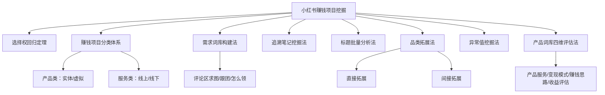
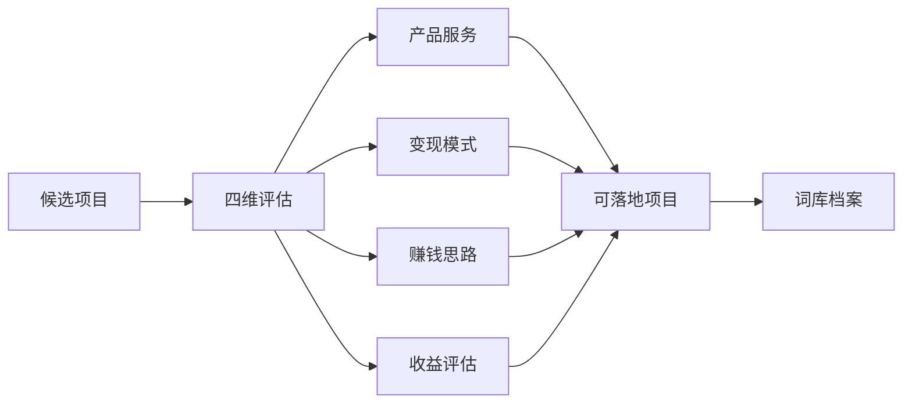

# 第 3 章 小红书赚钱项目挖掘——把评论区需求变成选品指南针

## 3.0 学习目标

- 理解选择权回归定理：掌握主动挖掘项目的能力而非被动等待风向标
- 掌握小红书赚钱项目两大类四小项分类体系
- 学会从评论区高频需求词构建需求词库
- 掌握追溯笔记挖掘法：用需求词逆向找商机笔记
- 掌握标题批量分析法及其数据洞察
- 掌握品类拓展法（直接拓展与间接拓展）
- 掌握异常值挖掘法：从数据异常中找隐藏玩法
- 掌握产品词库四维评估法

## 3.1 生活类比——想钓鱼，先学会制作鱼竿

把挖掘项目比作钓鱼。需求词库是你的鱼竿，没有它你连杆子都握不住；追溯笔记是放线入水，你只有把线放下去才知道水里有没有鱼；品类拓展是钓到一条鱼后试着用同样的饵料换不同的钓点，看能不能钓上来更多品种；异常值挖掘是发现某个深水区的暗流——大家都说那里没鱼，结果有人专门盯着那儿钓上来一桶；产品词库四维评估则是鱼上钩之后的事，你要验一验这条鱼能不能吃、值不值得带回。这样一盏灯下，你会很清楚一件事：**不能总等别人送你鱼**。别人告诉你"这儿有鱼"的时候，你顶多算是拿到了一个过期情报；只有自己掌握做鱼竿、选钓位、找鱼群的方法，你才能在任何水域、任何季节都掌握选择权。

## 3.2 概念地图



## 3.3 选择权回归定理——为什么必须主动挖掘项目

> [P151] "当别人告诉你什么赚钱你就去做的时候，你的选择权其实已经被没收了。"

这句话是整章的第一原理。我们先把它的因果链条拆开：**被动接收信息 → 行动方向由他人决定 → 结果好坏取决于他人情报的准确性**。在这种情况下，你能不能赚钱，本质上不取决于你的能力，而取决于消息源的判断。哪怕消息源每次都对，你也在逐步训练自己"不思考、只跟风"的肌肉记忆，长此以往你会丧失独立判断能力。

**选择权回归定理**（来源：《151_小红书挖掘项目》）

$$
ChoiceRight = f(\text{主动挖掘能力}, \text{信息前置程度})
$$

这个公式展示了选择权与你主动挖掘能力之间的正相关关系：主动挖掘能力越强，你越是能在别人还没看到机会时提前进场，选择权就越大；反之，信息越是前置到别人手里，你的选择权就越小。它把"机会是否属于你"这件事从运气问题转化成了能力问题。

一个典型案例就是**小红书风向标**。在原始素材中记录了这样一个数据点：风向标合集中共有 2000 多条信息，其中小红书相关的仅 200 多条，占比约 10%[P151]。如果你只是等着看风向标再去行动，你要么会错过大量非小红书赛道的机会，要么会在小红书信息已经泛滥后扎堆入局——那时的竞争烈度和蓝海程度已经完全不同。主动挖掘的意义正在于此：不等风向标告诉你哪里有机会，而是自己从数据里找出下一个机会所在地。

## 3.4 赚钱项目分类体系——从产品到服务的二维框架

> [P151] "小红书赚钱项目分两大类：产品类（实体和虚拟）和服务类（线上和线下）。"

素材原文用一句话就完成了对小红书赚钱项目空间的全景式切割。但这个框架很容易被当作"废话"跳过——请你不要轻视它，因为**分类的维度决定了你后续挖掘时搜索的方向**。

**赚钱项目分类体系**（来源：《151_小红书挖掘项目》）

| 大类 | 子类 | 典型形态 |
|------|------|----------|
| 产品类 | 实体 | 花艺、植物、手作、壁纸实物打印 |
| 产品类 | 虚拟 | 壁纸素材包、模板、电子书、资料 |
| 服务类 | 线上 | 线上改图、咨询、陪跑、社群 |
| 服务类 | 线下 | 线下活动组织、交友活动、市集摆摊 |

这个表格展示了赚钱项目在二维空间中的四个象限。之所以把它叫做"二维框架"，是因为**维度一决定交付物形态（产品 vs 服务），维度二决定交付场景（线上 vs 线下）**。

四条赛道对应四类需求词。比如"求图"通常是虚拟产品需求，"跟团"往往是线下服务需求，"怎么领"可能是实体产品的引流入口。**需求词-项目映射原理**（来源：《151_小红书挖掘项目》）指出：

$$
\text{需求词类型} \xrightarrow{\text{映射}} \text{项目赛道}
$$

这个映射关系展示了：当你收集到一条需求词时，你是可以通过它的语言形态快速归类到四大赛道中的哪一条的。这也意味着，**需求词库不仅仅是一个词表，更是一张"藏宝图"的分区索引**——每个词都告诉你该去哪个片区挖矿。

## 3.5 需求词库构建法——从评论区提取用户心声

> [P151] "从评论区留言构建需求词库：【求图】【跟团】【怎么领】是用户留下的需求。"

评论区的留言往往被当作"闲聊"，但在做小红书项目挖掘的视角下，它们是一处处**未被满足需求的公开告白**。注意这里的关键词："公开"+ "未被满足"。当一个用户在笔记下方留言"求图"时，她大概率是因为自己需要但一时找不到；当多位用户在同一个评论区或同类评论区反复留言相似的内容时，你就可以确定这是一个**高频、未满足、有支付意愿**的需求信号。

**需求词库构建法**（来源：《151_小红书挖掘项目》）

```
1. 打开千瓜数据，选择"笔记评论"搜索功能
2. 输入一个初始关键词（如"壁纸"），检索相关评论
3. 阅读评论内容，提取高频出现的需求句式：
   求图、跟团、怎么领、哪里有、求链接
4. 将高频需求词去重、归类、入词库
5. 将这类搜索词作为"反向检索词"，继续搜索更多笔记和产品
```

这段伪代码展示了需求词库的完整构建流程。它的核心要从第 5 步理解：你不再用"项目名"去搜索（比如"壁纸生意"），而是用"需求词"去搜索（比如"求壁纸"），这会让千瓜为你呈现出一批你之前根本搜不到的笔记——因为它们本身就不是用"生意"语言写的，而是用"需求"语言写的。

我们来看一组实际案例：下面这些词全部可以在真实评论中找到原型——"求图""跟团""怎么领""求链接""发我一份""求教程"。

| 需求词 | 可能对应项目类型 |
|--------|------------------|
| 求图 | 虚拟产品（壁纸、素材） |
| 跟团 | 线下服务（拼团、结伴） |
| 怎么领 | 实体产品（赠品引流） |
| 求链接 | 电商导购（选品） |

这个表格展示了需求词的"语义指纹"：同一个需求词背后往往关联着固定的商业模式，你在收集词库的时候就要顺手记下它对应的赛道类型。

## 3.6 追溯笔记挖掘法——用需求词逆向找商机笔记

> [P151] "追溯笔记挖掘大量赚钱项目。"

上一节我们完成了需求词的收集，这一节要回答的问题是：拿到需求词之后，去哪里找对应的赚钱项目？

**追溯笔记挖掘法**（来源：《151_小红书挖掘项目》）

```
1. 取需求词库中的一个词（如"跟团"）
2. 在千瓜中用"笔记评论搜索"检索
3. 筛选出评论区出现该需求词的所有笔记
4. 记录这些笔记的账号、形式、主题
5. 分析这些笔记之间的共性特征 → 识别赛道规律
```

这段伪代码的关键逻辑是**反转**：大多数人的搜索习惯是从"笔记"找"需求"（看到了内容才知道别人想要什么），追溯法反向而行，从"需求"找"笔记"（先知道需求，再去发现满足这些需求的笔记）。需求词是地图，笔记是金矿；地图先于金矿存在，但大多数人从来不看地图。

实际执行中，你可能会拿到几百篇笔记的标题。这时候就需要进入下一节——标题批量分析法——来处理这批数据。

## 3.7 标题批量分析法的实证——图文与达人号主导

> [P151] "导出1000条数据清洗去重得636条。"

素材记录了一个真实操作的数据流水线：用千瓜导出 1000 条笔记数据，清洗去重后得到 636 条有效数据，然后对标题做批量分析。我们按维度拆开看。

**标题批量分析法**（来源：《151_小红书挖掘项目》）

| 分析维度 | 数据结果 | 洞察 |
|----------|----------|------|
| 笔记形式 | 图文 495 / 视频 141 | 图文笔记占 78% |
| 账号属性 |  Christened企业号 181 / 达人号 440 | 达人号占 69% |

这个表格展示了两个维度的分布情况。**图文占 78%** 意味着在小红书的赚钱笔记中，绝大多数玩家走的是"低成本高产出"的内容路线——图文制作成本低、更新频率快、可批量复制。**达人号占 69%** 则揭示了一个更深层的规律：小红书变现的主力并非企业官方，而是个人 IP 和达人种草。

这两个数据放在一起，揭示的小红书变现主力形态是：**"图文 + 达人 + 批量"**。这也是为什么个人创作者更适合先从小红书切入，而非其他重视频平台。

## 3.8 品类拓展法——一条赛道如何长出更多分叉

> [P151] "品类拓展法：直接拓展、间接拓展。"

你已经通过追溯笔记找到了一个赛道，比如"壁纸"。问题来了：你能不能从这个赛道自然延伸出更多品类？这就是品类拓展法要解决的核心问题。

**品类拓展法**（来源：《151_小红书挖掘项目》）

**直接拓展**的玩法是：把你已有的某品类笔记标题批量投喂给 ChatGPT，让它提炼相关的营销产品和卖点。比如你输入"壁纸笔记标题 50 条"，ChatGPT 会返回"桌面壁纸、手机壁纸、情侣壁纸、节气壁纸、治愈系壁纸"等细分品类，你再逐一验证。

**间接拓展**的玩法是：从导航网站的证书列表反推细分品类。比如去一个垂直导航站看到"心理咨询师证书"和"健康管理师证书"，你就可以反推出"证书备考 + 小红书图文分享"是一条潜在赛道——因为证书对应的是考证需求，考证需求对应的是资料与课程产品。

你还可以用**笔记标签辅助提炼产品**：在千瓜中查看同类笔记的标签，高频标签就是下一批候选品类。

直接用 ChatGPT 的例子如下：

```
输入指令："以下是小壁纸类笔记的爆款标题，请帮我提炼出更多细分品类方向：
1. 治愈系手机壁纸合集
2. 极简风桌面壁纸分享
3. 情侣高清壁纸推荐"
输出：节气壁纸、韩系壁纸、古风壁纸、蜡笔小新壁纸、学习专注壁纸
```

这个例子展示了 AI 辅助拓展的效力：它不直接给你答案，但能帮你把一个品类拆散成 10 个子品类，然后再由你自己去验证哪些子品类有真实需求。

## 3.9 异常值挖掘法——盯住数据异常账号找出非常规玩法

> [P151] "异常值挖掘法，进主页翻到底研究。"

在数据分布中，大多数点是聚集的，但总有一些点会"离群"。这些离群点要么是无效噪音，要么是**尚未被大众理解的隐藏打法**。异常值挖掘法就是有意识地主动抽查这些离群点。

**异常值挖掘法**（来源：《151_小红书挖掘项目》）

```
1. 在千瓜数据中按"互动量"排序，找出数据异常高的账号
2. 排除掉常规运营账号（企业号 + 高频更新）
3. 标记出"账号数据很高但更新很少/内容简陋"的账号
4. 进入这类账号主页，从最早一篇笔记翻到最新一篇
5. 研究它的运营节奏、变现钩子、内容策略
6. 提炼出可复用的非常规玩法
```

这段伪代码展示了异常值挖掘的完整路径。第 4 步是核心："翻到底"。大多数人只看了这个账号最近 3 篇笔记就下结论，但**真正有价值的通常是它最早的第 5-20 篇**——那是玩法成形前的摸索期，透露出的信息量最多。

素材中的典型案例是：**大粉号做资料引流**。一个拥有几十万粉丝的账号，本该正常卖课或接广告，却选择做"资料引流"，这在常规认知里属于"废号操作"。但你翻到它最早期的笔记后会发现，它本质上是在利用大粉号为私域导流，再通过私域里的资料包、课程或服务进行二次变现。这个打法的精髓在于：**用踩低账号价值的方式获取更大的私域收益**，这在常规运营逻辑里不会出现，但数据异常恰恰暴露了它。

## 3.10 产品词库四维评估法——给项目验明正身

> [P151] "用【产品服务】【变现模式】【赚钱思路】【收益评估】分析。"

前面所有方法的目的都是帮你找到一批候选项目。但要回答"这个项目值不值得做"，你需要一套评估体系。素材给出了四维框架。

**产品词库四维评估法**（来源：《151_小红书挖掘项目》）

| 维度 | 核心问题 | 案例 |
|------|----------|------|
| 产品服务 | 你卖的是什么？实物/虚拟/服务？ | 花植艺（实体产品） |
| 变现模式 | 你靠什么收钱？一次性还是分佣？ | 公益赠书（分佣模式） |
| 赚钱思路 | 你的差异化在哪里？ | 壁纸（无本万利） |
| 收益评估 | 真实能赚多少钱？ | 交友活动（单次赚一两千） |

这个表格展示了四维评估的操作框架。四个维度分别回答：做什么、怎么收钱、为什么有人买、实际赚多少。

我们用素材中的四类典型案例来完整走一遍评估流程。

**案例 1：花植艺（实体产品类）**

```
产品服务：高端花艺/植物礼盒
变现模式：单品售卖 + 定制服务
赚钱思路：颜值经济 + 送礼场景
收益评估：单场活动卖 3w
```

这个案例展示了实体产品的高客单价路径：它卖的不只是植物，而是"有仪式感的礼物"。

**案例 2：壁纸（虚拟产品类）**

```
产品服务：高清壁纸素材包
变现模式：付费下载 / 会员制
赚钱思路：零边际成本，一次制作无限售卖
收益评估：无本万利，毛利率近 100%
```

这个案例展示了虚拟产品的极致模型：成本几乎只有制作一次的时间，之后每卖一次都是净赚。

**案例 3：公益赠书（服务类线上）**

```
产品服务：公益赠书活动（用户付邮费领书）
变现模式：邮费差价 + 后续选品分佣
赚钱思路：借用公益名义降低信任门槛
收益评估：靠累积下单和分佣复利
```

这个案例展示了服务类项目的流量逻辑：真正的利润不在赠书本身，而在沉淀用户后的二次变现。

**案例 4：交友活动（服务类线下）**

```
产品服务：线下同城交友/兴趣活动
变现模式：活动报名费
赚钱思路：同城社交需求旺盛、复购率高
收益评估：单次活动赚一两千
```

这个案例展示了线下服务小而美的模型：复杂度低、启动快、现金流即时到账。

把每个项目用四维评估法走一遍之后，你就能为它建立一份"词库档案"——记录维度信息、数据来源、验证日期，后续可以反复回访对比。



这个流程图展示了评估体系与最终落地的关系：四维评估不是"审核关卡"，而是"体检报告"。每个维度都可能不完美，但只要四个维度合在一起能构成一个自洽闭环，项目就可以进入你的执行清单。

## 3.11 方法论边界与扩展

我们用一个设计取舍的思路来分析这套方法论的边界。

**为什么必须用评论区的高频需求词，而不是直接看销量榜单？**

销量榜单反映的是已经被满足的需求，竞争已充分。而评论区高频词表达的是尚未被满足或被满足得不够好的需求——它的**信息价值密度**远高于销量榜。

**这套方法论在非小红书平台真的有效吗？**

从素材来看，这套方法论的核心是"评论区需求 → 需求词库 → 逆向追溯"，它在任何一个有评论区、有搜索工具的 UGC 平台上都成立。抖音的"求同款"、豆瓣的"求推荐"、微信社群里的"求资源"，全都是同一类信号。方法论可以迁移，但每个平台的**账号属性基线**与**内容形态偏好**需要你重新跑一遍数据才能确定。

## 3.12 动手练习

- 练习 1：选择你感兴趣的一个行业，在小红书搜索一个相关关键词，进入 5 篇高互动量笔记的评论区收集 10 个需求词，并标记每个词对应的项目赛道（产品类/服务类 的 4 象限）。
- 练习 2：用收集到的需求词在千瓜中做一次"笔记评论"检索，导出 TOP 50 篇笔记，按标题批量分析法统计图文/视频比例与企业号/达人号比例，对比素材中的基线数据。
- 练习 3：选择你已验证的一条赛道，用"直接拓展法"（投喂 ChatGPT）与"间接拓展法"（导航站反推）各列 3 个延伸品类，并用四维评估法分别打分。
- 练习 4：在千瓜中找到 1 个"数据异常"账号（更新少但互动高），进入主页翻到最早的第 5 篇笔记，总结它的运营与变现逻辑，写出 100 字内的"异常值研究报告"。

## 3.13 本章小结

这一章我们一起走完了从"被动等风向标"到"主动挖项目"的完整栈路。首先，我们从选择权回归定理出发，明白了"别人告诉你能赚钱"其实是选择题权的丧失；接着建立了小红书赚钱项目的二维分类体系——产品类（实体/虚拟）与服务类（线上/线下）四大象限；然后我们一起构建了需求词库，学会了把评论区高频留言变成反向检索词；接下来用追溯笔记挖掘法拿到了批量商机笔记，并用标题批量分析法处理了 1000 条数据的实证案例，看到图文笔记占 78%、达人号占 69% 这两个关键基线；随后通过品类拓展法把单条赛道变成多条分叉，再用异常值挖掘法找到了真正隐藏在数据裂缝中的非常规玩法；最后用产品词库四维评估法给所有候选项目做了"验明正身"。这一整套工具链走完，你再也不需要等别人告诉你"这里能赚钱"了——你已经拥有自己发现机会的能力。

本章我们一起学习了以下概念：

| 概念 | 解释 |
|------|------|
| 选择权回归定理 | 当别人告诉你什么赚钱时你的选择权已被没收，唯有主动挖掘才能掌握选择权 |
| 需求词库 | 从评论区高频需求留言中提取关键词构成的用户需求集合 |
| 赚钱项目分类体系 | 产品类（实体/虚拟）与服务类（线上/线下）两大类四小项 |
| 追溯笔记挖掘法 | 以需求词为入口通过评论检索获取批量商机笔记 |
| 标题批量分析法 | 对笔记形式、账号属性、笔记类型进行数据维度分析 |
| 品类拓展法 | 直接拓展与间接拓展扩充项目品类 |
| 异常值挖掘法 | 从数据异常账号中发现非常规变现模式 |
| 产品词库四维评估法 | 从产品服务、变现模式、赚钱思路、收益评估四维分析 |

下一章中，我们将把这些挖掘出来的项目放入更广阔的赛道视角中，学习如何从一个已经验证的赚钱项目中抽象出可复制的"模式化运作"方法，把单点成功升级成系统打法。

