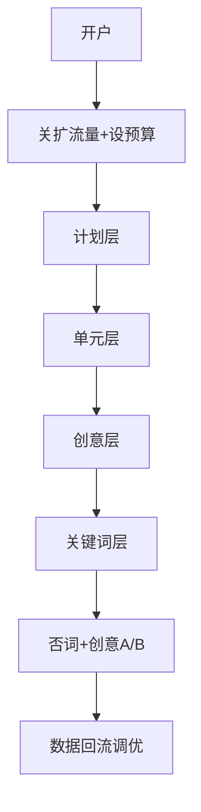

# 第 5 章 竞价投放——从花钱买客户到搜索流量变现

## 学习目标

- 理解人找货vs货找人及搜索广告精准度逻辑
- 掌握百度竞价冷门项目的完整商业模型
- 掌握选品三方法
- 掌握产品三验证法
- 掌握投放控制与分层策略
- 掌握私域承接页面法
- 理解投放思维普适定理
- 理解平台模型可复用性及边界

## 5.1 生活类比：在鱼市开一家渔铺

想象你在一个热闹的鱼市里开了一家渔铺。传统零售像是"货找人"：你站在摊位前大声吆喝，拉着路过的人介绍今天的海货，但大多数人只是随便看看，真正掏钱的少。而竞价投放则像"人找货"：顾客是带着明确的购买意图走进鱼市的，他们会主动走到你的摊位前问"今天有新鲜的鲈鱼吗？"——这种主动上门的顾客成交率高得惊人。

选品三方法就是决定你该卖什么鱼、哪些鱼利润高；产品三验证法则是确认这些鱼确实有人买、你能稳定出货、而且卖得动；投放分层策略是你在决定要不要花重金租下市场入口的好摊位——刚开始先租个小角落试水，验证效果好再逐步扩大；私域承接页面则是把那些来问过价的顾客拉到你的熟客微信群里，慢慢培养成回头客。这套开渔铺的逻辑，搬到任何集市——无论是抖音还是小红书——都依然成立，这就是"投放思维普适定理"的朴素版本。

## 5.2 概念地图

```
竞价投放：人找货vs货找人、百度竞价冷门项目、选品三方法、产品三验证法、投放控制分层、私域承接页面、投放思维普适、平台模型可复用
```

## 5.3 人找货 vs 货找人——为什么搜索广告更精准

> [172_百度竞价] "搜索广告（人找货）比信息流广告（货找人）更精准"

这句话看似简单，却道破了搜索广告的底层逻辑。我们先用直觉理解：当你打开百度搜索"祛斑霜哪个牌子好"时，你已经暴露了自己的需求；而当你刷抖音看到一条祛斑霜广告时，你只是被动接收了一个推荐。前者是"你去找它"，后者是"它来找你"。

**搜索广告优于信息流定理**（来源：《百度竞价》）

$$
购买意图强度: \text{搜索（人找货）} \gg \text{信息流（货找人）}
$$

这个定理展示了购买意图强度的差异：搜索广告依托用户主动搜索行为，用户在搜索那一刻已经明确表达了自己的需求，因此转化率天然更高。信息流广告依赖平台算法的推荐匹配，用户处于"浏览"而非"寻找"状态，意图弱得多。

为了让你更直观地感受这两种流量模式的差异，我们用一张表对比：

| 维度 | 搜索广告（人找货） | 信息流广告（货找人） |
|------|------|------|
| 用户意图 | 主动搜索，需求明确 | 被动浏览，需求模糊 |
| 转化率 | 高 | 低 |
| 竞价模式 | 按词竞价 | 按人群定向 |
| 适用场景 | 高客单、刚需产品 | 低客单、种草型产品 |

这种对搜索流量价值的直觉至关重要——它是整个百度竞价冷门项目的基石。没有这个认知，你会在投放时选错渠道、浪费预算。

## 5.4 百度竞价冷门项目——花钱买客户的商业模型

> [172_百度竞价] "百度竞价冷门项目就是花钱去购买客户"

理解了搜索广告的精准性后，我们可以把它"商业化"——把这种精准流量变成一门生意。

> **百度竞价冷门项目**定义（来源：《百度竞价》）

$$
净利润 = \underbrace{\text{百度精准客户}}_{由搜索广告获得} \times \underbrace{\text{冷门高利润产品}}_{价格不透明} - \underbrace{\text{广告成本}}_{可复投放大}
$$

这个公式展示了项目的核心模型：用百度搜索广告获取精准客户，卖冷门、价格不透明、高利润的产品，赚到的钱再复投到广告中放大规模。它的精妙之处在于"冷门"——竞争少、点击成本低、利润空间大。

这个模型不是理论，而是被实证验证过的：

- **年净利润 30W+**，门槛极低，核心是执行力；
- 冷门高利润品类举例：**虚拟资料、滋补品、玉石、檀香**；
- 团队实际运营验证了模型可行性。

为什么选择"冷门"而非热门？因为热门品类竞争激烈，CPC（单次点击成本）被推高，利润被广告费吞噬；而冷门品类搜索量虽小，但点击成本低、客户购买意愿强、同行少。**选价格不透明且同行不如自己的产品**，这是本项目最核心的选品准则。

## 5.5 选品三方法——如何发现冷门高利润产品

> [172_百度竞价] "选品3方法：淘宝搜索关键词、商家店铺、5118长尾词"

任何投放项目，**选品重于投放**。你可以投放技术差一点，但产品选对了，依然能赚钱；反过来，产品选错，投放技术再好也是烧钱。这就是**选品优先级定理**。

> **选品三方法**方法（来源：《百度竞价》）

```
1. 淘宝搜索关键词：搜"虚拟资料"等大词，看哪些产品销量好、利润高
2. 看商家店铺：找到一家卖得好的店铺，顺藤摸瓜看它店里的其他产品
3. 用5118长尾词：利用长尾词挖掘工具，发现用户搜索多但竞争少的产品
```

这段伪代码展示了选品的核心路径：先通过淘宝发现已有需求的产品，再从商家店铺扩散到同类型产品，最后用长尾词工具验证搜索量。难度递增，精准度也递增。

让我们逐一展开：

**方法一：淘宝搜索关键词**。打开淘宝搜索"虚拟资料"、"滋补品"等大类关键词，按销量排序，观察排在前面的产品。这些产品已经被验证有需求，且大多是实物或虚拟资料，边际成本低，利润高。

**方法二：看商家店铺**。找到一家卖得好的店后，进入店铺首页，查看它的全部商品——往往你会发现同类型、同风格的其他高利润产品。这是一种"顺藤摸瓜"式的拓展法，成本几乎为零。

**方法三：5118长尾词**。5118 是关键词挖掘工具，能告诉你某个词根有多少人搜。用于发现"搜索多、竞争少"的长尾词，这些词对应的是用户真实需求，但还没有人低价竞争。

下表总结了三种方法的适用场景与产出：

| 方法 | 侧重点 | 产出 |
|------|------|------|
| 淘宝搜词 | 验证已有需求 | 发现热门产品 |
| 商家店铺 | 拓展品类 | 发现同类型产品 |
| 5118长尾词 | 挖掘蓝海 | 发现冷门高利润词 |

## 5.6 产品三验证法——交叉确认项目盈利性

> [172_百度竞价] "验证产品：淘宝购买人数、百度长期投放、关键词搜索量"

选品三方法回答"卖什么"，三验证法则回答"能不能赚"。我们继续用商业直觉理解：你在鱼市看到隔壁摊卖鲈鱼卖得很好，就决定自己也卖鲈鱼——但你在决定租大摊位前，至少要确认三件事：顾客真的会买吗？卖这个能养得起租金吗？来了多少客人够我赚钱吗？

> **产品三验证法**方法（来源：《百度竞价》）

$$
\begin{aligned}
\text{验证①需求} &: \text{淘宝购买人数} \rightarrow \text{证明有人买} \\
\text{验证②盈利} &: \text{百度长期投放} \rightarrow \text{证明能赚钱} \\
\text{验证③规模} &: \text{关键词搜索量} \rightarrow \text{决定赚多少}
\end{aligned}
$$

这三个公式展示了完整的盈利验证链条：淘宝购买人数证明"这是个真实需求"，百度长期投放证明"这需求在搜索端已经被验证能盈利"（因为有同行在持续投放），关键词搜索量则决定了"这个市场能养多大的盘子"。

**关键洞察：同行持续投放必然盈利定理**。这是整个验证法中最锋利的一把刀：如果某个关键词有同行在长期投放（你可以在百度搜索该词，看广告是否有持续投放几个月以上的同行），那么这个领域**必然赚钱**。因为广告主是逐利的，赔本的买卖没人会持续做。

三验证法的具体操作如下：

| 验证项 | 工具 | 判断标准 |
|------|------|------|
| 淘宝购买人数 | 淘宝搜索 | 月销≥数百（有真实需求） |
| 百度长期投放 | 百度搜索看广告 | 同行持续投放（能赚钱） |
| 关键词搜索量 | 百度关键词规划师 | 日搜量≥几百（规模大） |

## 5.7 投放控制与分层策略——从开户到否词的精细运营

> [172_百度竞价] "投放策略从计划到单元到创意到关键词分层；否词很关键"

产品验证通过后，正式进入投放环节。投放不是"充钱—等结果"，而是一套严谨的分层控制系统。

> **投放控制与分层策略**方法（来源：《百度竞价》）

```
1. 开户先关"扩大流量"功能
2. 设置预算（防止跑飞）
3. 按计划 → 单元 → 创意 → 关键词 四级分层
4. 否词（排除无效搜索词）
5. 创意多写4-5条A/B测试
```

这套流程分为防御与进攻两个部分。防御是前两步——关掉百度的"扩流量"功能并设好预算；进攻是后三步——精细分级、否词、优化创意。

**为什么先关"扩大流量"并设预算？** 因为百度的"扩流量"功能会帮你匹配更多搜索词，但这些词往往不精准，浪费预算。你需要在验证模型成立前，把流量控制在小而准的范围内，防止预算被无效点击消耗。

**否词**是这套系统里最容易被忽略但最关键的环节。你买的是"祛斑霜"这个词，但用户可能搜的是"祛斑霜副作用"（负面意图）或者"祛斑霜多少钱"（比价意图）。通过否词，你可以排除这些不精准的流量，让每一分钱花在刀刃上。

**创意多写 4-5 条**是为了做 A/B 测试。不同创意文案对应不同的点击率和转化率，用数据选出最优创意，然后逐步淘汰差的。这套"分-测-优"循环是流量运营的通用方法论。



## 5.8 私域承接页面法——从搜索点击到成交转化

> [172_百度竞价] "低价单页成交高客单需落地页（人物故事简介恐慌干货客户反馈实景加微信领优惠）"

广告点击只是第一步，真正决定成交的是**落地页**。你花钱把一个精准客户带到你的"店门口"，页面决定了他是否购买。

> **私域承接页面法**方法（来源：《百度竞价》）

```
低价产品（<300元）：单页直接成交，减少操作步骤
高客单产品（>300元）：搭建八大元素落地页
  ① 人物故事 ② 简介信任 ③ 恐慌制造 ④ 干货价值
  ⑤ 客户反馈 ⑥ 实景展示 ⑦ 加微信领优惠 ⑧ 渐进成交
```

为什么低价和高客单要区别对待？逻辑在于用户的决策成本。低价产品用户冲动消费，页面越简单越好，直接"加入购物车"式成交；高客单产品用户需要信任，你需要用故事、反馈、实景来降低风险感知，最终引导加微信——进入私域。

八大元素落地页的心理学逻辑是"信任递减→风险感知降低"：

| 元素 | 作用 | 心理学原理 |
|------|------|------|
| 人物故事 | 建立共鸣 | 叙事传输 |
| 简介信任 | 权威背书 | 权威效应 |
| 恐慌制造 | 放大痛点 | 损失厌恶 |
| 干货价值 | 给予前置价值 | 互惠原则 |
| 客户反馈 | 社会证明 | 从众心理 |
| 实景展示 | 真实性 | 感知可信度 |
| 加微信领优惠 | 获取私域 | 锚定效应 |
| 渐进成交 | 降低门槛 | 登门槛效应 |

**尽量减少用户操作步骤**是通用原则。每多一步，流失率就上升一个量级。你用 30W 年净利润验证了这套方法论的有效性——精准流量 + 信任落地页 + 私域承接，是一个完整的变现闭环。

## 5.9 多源对照

本章八个核心概念均出自同一篇素材《172_百度竞价》（原创），因此我们进行**概念内部的多源对照**：同一素材中不同概念之间的互证关系。

### 共识

**选品先于投放**是最强共识。选品三方法（5.5节）和产品三验证法（5.6节）都在回答同一个问题：如何在启动投放前降低不确定性。两方法共用同一底层信念——"同行持续投放必然盈利"——作为决策锚点。

**人找货优于货找人**是贯穿全章的信念。正是这一信念支撑了"百度竞价冷门项目"的成立（5.4节），也是后续落地页设计（5.8节）必须围绕"精准客户"展开的原因。当你确认自己拿到的是高意图流量时，你的落地页策略也随之升级。

### 分歧

**同一素材内部也存在隐性分歧**：选品三方法与三验证法在"范围"上存在张力。选品三方法强调"发现冷门产品"，鼓励大胆尝试新品类；而三验证法则强调"必须有同行在投放"，这天然偏向已有竞争者的品类。如何处理这种张力？答案是**阶段性应用**：选品阶段敢想敢试，验证阶段以同行投放为门槛过滤。

**另一个分歧**在投放思维普适与平台特性适配之间（见5.10）。"投放思维普适定理"强调底层逻辑可迁移，而可复用性局限部分承认"平台算法不完全可控"。两者并非矛盾，而是同一枚硬币的两面——思维可以复用，但执行必须适配平台特性。

## 5.10 设计中的取舍

- **为什么不用信息流广告而非要用搜索广告？**

信息流广告的获客成本低、量级大，但意图弱、转化低。搜索广告虽然每次点击更贵，但意图强、转化率极高。对于冷门高利润产品来说，你不需要海量的流量，你只需要**精准的少量流量**。冷门产品市场规模小，信息流的大规模推荐反而用不上；而搜索广告的精准流量恰好匹配。

- **为什么选冷门而不是热门品类？**

热门品类市场大，但竞争激烈，CPC 可能高达数十元，利润被广告费吞噬。冷门品类 CPC 低（几毛到几块钱）、转化高、同行少，虽然天花板有限，但净利润率远超热门。一个是赚大钱辛苦，一个是赚小钱轻松——对个体或小团队而言，后者更现实。

- **为什么先做私域承接而不是直接规模化投放？**

直接规模化的风险是：一旦广告模型未验证，浪费的预算是不可回收的。先做私域承接、用低预算验证模型，再逐步放量，相当于用最小成本拿到最确定的收益曲线。代价是慢——但在这个领域，慢就是快。

## 5.11 动手练习

- 用淘宝搜索"虚拟资料"，按销量排序，记录前 10 个产品的销量、价格、利润区间。
- 打开百度搜索你选中的关键词，截图记录持续投放广告的同行数量，验证"同行持续投放必然盈利定理"。
- 用 5118 长尾词工具挖掘你的产品词根，找出长尾词中搜索量 top 5 的词并评估竞争度。
- 用百度关键词规划师查询你产品的"日搜索量"，估算整个市场的月度规模。
- 设计一份 8 元素落地页的草稿，用你选的产品写出每一元素的文案。

## 5.12 本章小结

这一章我们学习了百度竞价冷门项目从选品到投放再到私域承接的完整方法论。首先，我们从**人找货 vs 货找人**的对比中理解搜索广告的精准度优势——用户主动搜索意味着购买意图远强于被动浏览，这是整个项目的基石；其次，我们介绍了 **百度竞价冷门项目** 的核心商业模型——用精准投放购买客户、卖冷门高利润产品、私域变现并复投放大；接着，我们讲解了 **选品三方法**——通过淘宝搜词、商家店铺、5118 长尾词发现冷门高利润产品，并强调选品重于投放的优先级定理；然后，我们介绍了 **产品三验证法**——通过淘宝购买人数、百度长期投放、关键词搜索量交叉验证项目盈利性，并推导出同行持续投放必然盈利定理；在此基础上，我们梳理了 **投放控制与分层策略**——从开户设预算到按计划单元创意关键词四级分层再到否词优化；随后我们讲解了 **私域承接页面法**——低价单页直接成交、高客单搭建八大元素落地页引导加微信；最后，我们讨论了 **投放思维普适定理** 和 **平台模型可复用性**——这套"花钱买客户"的逻辑可以迁移到生活决策以及抖音、小红书等平台，但执行时需适配平台特性。

本章我们一起学习了以下概念：

| 概念 | 解释 |
|------|------|
| 人找货vs货找人 | 搜索广告依托用户主动搜索购买意图更强更精准 |
| 百度竞价冷门项目 | 选择冷门价格不透明高利润产品花钱买精准客户私域变现 |
| 选品三方法 | 淘宝搜索关键词、商家店铺、5118长尾词发现冷门高利润产品 |
| 产品三验证法 | 淘宝购买人数、百度长期投放、关键词搜索量交叉验证 |
| 投放控制与分层 | 开户先关扩大流量设预算按计划单元创意关键词分层 |
| 私域承接页面法 | 低价单页成交高客单搭建八大元素落地页 |
| 投放思维普适 | 花钱买客户的投放思维可迁移到生活场景 |
| 平台模型可复用 | 百度竞价的选品验证分层逻辑可复用于抖音小红书 |

这一章的选品、验证、投放、落地页四步法构成了一个完整的流量变现闭环。下一章中，我们将进一步探讨如何将这套"人找货"的精准流量逻辑，应用到更广泛的内容电商和社交电商场景中，理解不同平台的特有玩法与适配策略，让每一分广告费都花在刀刃上。

