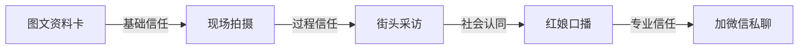

# 第 6 章 私域产品方法论——从流量思维到信任资产

## 6.1 学习目标

- 理解私域产品的本质与信任是唯一交付物
- 掌握四类内容账号矩阵的获客方法
- 掌握三级阶梯产品体系的信任构建逻辑
- 理解精准流量优于泛流量的转化逻辑
- 掌握付费投流的性价比逻辑
- 理解轻资产小而美的团队模型
- 理解长期主义与信任壁垒
- 掌握流量平台性别绑定定律

## 6.2 生活类比：自建鱼塘而非公海捞鱼

想象一下，你在经营一座鱼塘。公域流量就像一片公海，人人都可以撒网，但捞到的鱼全凭运气，且今天捞完明天可能一无所有。而私域产品是自己挖的鱼塘——你掌握了水源（信任）、养料（内容）、鱼种（客户），鱼儿的来去都尽在掌控之中。在这个鱼塘中，信任是水质：水质好，鱼自然繁衍生息；水质差，投入再多鱼苗也会流失殆尽。四类内容账号矩阵如同投放不同饵料——图文资料卡吸引精打细算的鲫鱼，现场拍摄吸引喜欢围观的鲤鱼，街头采访吸引好奇心强的鲈鱼，口播讲解吸引急于脱单的黑鱼。三级阶梯产品体系则是从喂小鱼到钓大鱼：先用低价低门槛的鱼食让小鱼靠近，逐步换成更有吸引力的饵料，最后才下重钩钓最贵的大鱼。精准流量是只投贵但必咬钩的鱼饵，100个精准鱼饵的收获胜过1000个泛撒的网。付费投流是用小成本换高价值鱼，鱼塘利润足够高时，每投放100元的鱼料带回一条大鱼依然划算。轻资产小而美是养小塘不养大塘，但每一条鱼都精养、每条鱼都熟悉习性，5个人就能管好一个高产的小塘。最后，长期主义是水好鱼自然来——你不需要每天撒大网，只需持续维护水质，鱼群会口口相传，自动游向你的鱼塘。这一章，我们将拆解这套"鱼塘经营法"的每一个环节。

## 6.3 概念地图

```
私域产品方法论
├── 私域产品本质：不依赖公域分配，直接建立用户信任
├── 信任是唯一交付物：无实体交付行业的核心命题
├── 四类内容账号矩阵
│   ├── 图文资料卡
│   ├── 现场拍摄
│   ├── 街头采访
│   └── 红娘口播讲解
├── 三级阶梯产品体系
│   ├── 入门级低客单线下活动
│   ├── 互动型产品
│   └── 高客单一对一服务
├── 精准流量：100个精准胜过1000个泛流量
├── 付费投流性价比：高毛利支撑百元加微不亏损
├── 轻资产小而美：从20+人精简至5人
├── 长期主义与信任壁垒：售后保障是最深护城河
└── 流量平台性别绑定：平台受众性别匹配业务
```

## 6.4 私域产品的本质：不依赖公域分配的自建渠道

> [P155, p.1] "同城相亲是一个很好的私域产品"

当我们讨论"私域产品"时，首要问题并非功能或定价，而是**渠道关系的根本转变**。公域产品依赖平台分配流量——比如在婚恋App上，用户刷到你的页面取决于平台算法；而私域产品则绕开这一层，直接与用户建立联系。同城相亲之所以被评价为"很好的私域产品"，正是因为它不依赖公域平台的分配，而是通过内容矩阵和微信号沉淀用户，形成自建渠道。

> **私域产品**定义（来源：《同城相亲私域实践》）

我们将私域产品定义为满足以下条件的商业形态：

1. 获客渠道完全或部分自建（如内容账号、个人微信、社群）
2. 用户关系由你直接管理，不经过第三方平台撮合
3. 具备高毛利和高复购的特征，支撑精细化运营成本

这一定义展示了私域产品的核心三重属性：渠道自主性、关系直达性、经济可行性。渠道自主性决定了你不受平台规则变动的影响——平台可以封号、限流，但你的微信通讯录不会因此消失；关系直达性意味着每一次触达都不需要付费竞价，可以对老客户反复触达；经济可行性则是私域运营的隐性约束——自建渠道需要持续投入内容成本，因此产品必须有足够毛利覆盖。

同城相亲案例中有两个关键数字：客单价200元，积累了1万+会员，单红娘一个月转化接近10万。[P155, p.3] 这三个数字结合起来，完美诠释了私域产品的高毛利高复购特征：

$$\text{单客户年贡献} = \text{客单价} \times \text{复购频次} \approx 200 \times 5 = 1000 \text{元}$$

这个公式展示了私域模型的经济效率所在：公域模型需要不断花钱买新客，而私域模型通过复购摊薄了获客成本。假设一个客户一年复购5次，即便第一次成交时亏本50元拉新，全年看依然是高利润客户。

## 6.5 为什么信任是唯一交付物：无实体行业的信任即产品

> [P155, p.2] "相亲是没有实体产品做交付的行业，解决信任问题最重要"

我们不妨思考一个极端情境：你买了一瓶矿泉水，拿到手的一瞬间，产品交付就完成了。但相亲服务呢？用户付了钱，拿到的不是一罐饮料、一台手机，而是"一个安排"和"一个承诺"。这种无实体交付的行业，用户无法通过手感、观感、试用来判断产品质量，唯一能感知的要素就是——你是否值得信任。

> **信任即产品**定理（来源：《同城相亲私域实践》）

$$
\text{产品价值} = f(\text{信任程度}), \quad \text{其中无实体交付行业} \frac{\partial \text{价值}}{\partial \text{功能}} = 0
$$

这个借用偏导符号的公式展示了无实体交付行业的极端特性：功能维度的边际价值趋近于零（用户无法触碰功能），而信任维度成为唯一自变量。当你想提升产品价值，不可能通过包装、配方、硬件配置来实现，只能通过信任的累积来撬动。信任是所有行动的总和：你的内容展示是否真实、你的红娘是否靠谱、你的活动是否如期举办。

这一洞察解释了为什么同城相亲需要四类内容账号矩阵，而不像传统电商那样主打优惠券和折扣：

| 传统电商信任要素 | 相亲私域信任要素 |
|------|------|
| 商品实拍图 | 真实的单身用户资料 |
| 销量评价 | 线下活动视频证据 |
| 退换货保障 | 红娘人设背书 |
| 七天无理由 | 售后跟踪服务 |

你也许会发现，传统电商的信任建立在"商品标准化"之上，而相亲私域的信任建立在"人设可信度"之上。前者可以被价格战瓦解，后者却因无法复制而成为壁垒。[P155, p.4]

## 6.6 四类内容账号矩阵：信任背书与获客引流的分工体系

> [P155, p.2] "四类账号：图文资料卡片类、活动现场自我介绍拍摄类、街头采访类、红娘口播讲解类"

假设你从零开始运营一个同城相亲项目，你期望单个账号完成所有任务——既要展示用户资料、又要体现现场氛围、还要输出专业红娘形象，这就像让一个厨师同时担任收银员和服务员。单一账号要么内容杂乱导致账号标签不清晰，要么信任维度单一无法覆盖多场景决策。同城相亲给出的答案是**四类账号矩阵**，各自承担不同维度的信任构建。

> **四类账号矩阵**方法（来源：《同城相亲私域实践》）

```
账号一：图文资料卡片类 → 建立基础信任（我是谁、用户长什么样）
账号二：活动现场自我介绍拍摄类 → 建立过程信任（活动真实举办）
账号三：街头采访类 → 建立兴趣信任（随机路人的态度反馈）
账号四：红娘口播讲解类 → 建立专业信任（专家人设与行业见解）
```

这段分工展示了四类账号分别对应的"信任层级"：图文资料卡回答"这些人是否真实存在"，通过展示真人照片与基本信息，让潜在用户确认资源的真实性；现场拍摄回答"活动是否真的举办"，用视频证据对抗"这会不会是骗局"的疑虑；街头采访回答"其他人怎么看"，通过路人的即兴反馈传递社会认同；红娘口播回答"你专不专业"，通过行业知识输出建立专家权威。

从数据流视角看，这四类账号构成一个完整的信任转化漏斗：



这个数据流图展示了信任逐层加固的过程：每经过一个账号的内容触点，用户的心理防线就降低一层。值得注意的是，四类账号之间并非互斥，而是可以互相引用——红娘口播时展示现场拍摄画面，图文资料卡引用街头采访的正面反馈，形成交叉验证的信任叠加效应。

## 6.7 三级阶梯产品体系：从低客单到高客单的信任阶梯

> [P155, p.3] "产品一入门级低客单价线下活动、产品二互动型、产品三一对一"

试想一个从未听说过你的用户，第一天你就向他推销9888元的一对一VIP服务——他会立刻关闭对话甚至拉黑你。为什么？因为信任不是一蹴而就的，它需要逐步验证。用户的潜在疑虑是递进式的：起步阶段他怀疑"你们是不是骗子"；中间阶段他犹豫"你们的活动值不值这个价"；最终他才考虑"一对一服务是否真的懂我"。三级阶梯产品体系正是顺着这条疑虑链条逐级拆除障碍。

> **三级阶梯产品体系**方法（来源：《同城相亲私域实践》）

```
第1级：入门级低客单价线下活动（≈50-100元）
第2级：互动型产品（≈200-500元，深度互动与匹配）
第3级：高客单一对一服务（≈2000-10000元）
```

这套阶梯设计的精妙之处在于每一级都在回答上一级遗留的信任问题：线下活动通过"看得见摸得着"的体验消除"是否真实"的怀疑；互动型产品通过深度接触建立"是否懂我"的感知；一对一服务则是前两级验证完成后的信任变现。每一级的客单价并非随意设定，它必须低于用户对该级信任水平的心理阈值。

$$\text{转化率} \propto \frac{\text{已有信任程度}}{\text{所需信任门槛}}$$

这个公式展示了转化的比例关系：当已有信任程度超过产品所需门槛时，转化自然发生；反之则产生犹豫。三级阶梯的本质操控变量不是产品本身，而是**门槛**——通过降低每次跃迁所需的信任增量（50元→200元→5000元的递进远小于0→5000元的跳跃），使得总转化路径变得平坦可走。

## 6.8 精准流量优于泛流量：100个精准胜过1000个泛流量

> [P155, p.3] "100个精准流量比1000个泛流量好"

我们要理解一个违背直觉的结论：为什么100个精准用户比1000个泛流量更有价值？数学上可以用转化率来解释。泛流量虽然基数大，但由于需求匹配度低，转化率可能仅有0.5%；而精准流量的匹配度高，转化率可达20%甚至更高。

$$\text{有效客户} = \text{流量规模} \times \text{转化率}$$

$$\text{泛流量} = 1000 \times 0.5\% = 5 \text{人}, \quad \text{精准流量} = 100 \times 20\% = 20 \text{人}$$

这个对比公式展示了"数量VS质量"的终极答案：精准流量以五分之一的规模取得了四倍的客户数。但更关键的是，精准流量的价值不仅体现在首单转化，还体现在后续的复购率与裂变率——精准用户更可能介绍同圈层朋友，而泛流量用户往往一次成交后就沉寂。

同城相亲的数据印证了这套逻辑：粉丝不到一万时，竟然积累了一万多个微信好友。[P155, p.4] 粉丝数极低却客户量反超，这在数学上只有一个解释——**粉丝本身就是受众**，而非泛泛的围观者。这意味着内容的精准触达极大地压缩了从关注到成交的距离，粉丝群体的需求定向性几乎达到了百分之百。

## 6.9 付费投流的性价比逻辑：高毛利支撑百元加微不亏损

> [P155, p.3] "投入同城100块钱一个加微信都不会亏钱"

付费投流在很多人看来是"烧钱买流量"，但在同城相亲的语境下，百元加一个微信竟然"不会亏钱"。我们需要拆解这笔账：

$$\text{单个加微成本} = 100 \text{元}$$

$$\text{单客户首购贡献} = 200 \text{元（客单价）}$$

$$\text{净利润（首单）} = 200 - 100 = 100 \text{元，不亏损}$$

这个等式展示了付费投流的可行性条件：只有当客单价高于获客成本时，付费投流才是合理的。更准确地说，高毛利是付费投流的必要支撑——若产品毛利低至50元，百元加微就变成每单亏50元的赔本生意。

但这里的"不会亏钱"是保守估计。考虑到一级阶梯产品本身就是为了后续高客单转化做铺垫：

$$\text{预期CLV} = \text{首购} + \text{复购数} \times \text{客单价} + \text{升级概率} \times \text{高客单价}$$

$$\approx 200 + 4 \times 200 + 0.1 \times 5000 = 200 + 800 + 500 = 1500 \text{元}$$

从这个公式可以看出，100元的加微成本即便只算首购也不亏钱，而算上复购与升级路径后，单个精准用户的预期价值远超获客成本约15倍。这正是"高毛利支撑高投流"的底层逻辑——只要有足够的利润空间，付费获客可以成为一种高效的流量杠杆。

## 6.10 轻资产小而美的团队模型：从20+人精简至5人

> [P155, p.4] "轻资产、小而美、长期主义、低门槛、高情商，从20+人减到5人"

多数创业者有一个错觉：团队人数多等于服务能力强。同城相亲在五年实践中经历了从20+人到5人的收缩，这不是退步，而是一次认知升级。多人的规模意味着多人的管理成本、多人的服务质量方差、多人的培训负担。更重要的是，在信任型业务中，规模越大未必越可信——一个小而精的团队反而可以做出高一致性的服务体验。

> **轻资产团队模型**约束（来源：《同城相亲私域实践》）

系统效率提升的核心在于约束条件：

1. 团队成员必须高情商（能与客户建立情感信任）
2. 服务流程标准化（每个客户得到一致体验）
3. 人力结构精简至多岗位复用（一人多能）

为什么"高情商"而非"高学历"或"高颜值"成为硬性条件？因为高情商人才天然具备两项能力：快速建立信任、处理客户情绪。在无实体交付行业中，服务人员的情绪劳动就是产品的一部分。五个人若能各自独当一面，其效能远高于二十个人的低效协作——因为信任行业的边际成本不在产能而在情感质量。

$$\text{有效服务力} = \text{人数} \times \text{单人信任建立效率} \times \text{服务一致性}$$

当人数从20降到5，但单人信任建立效率由于素质筛选提升了3倍，服务一致性因为流程标准化提升了2倍，总括信任力：

$$\text{有效服务力} = 5 \times (3 \times \text{原单人效率}) \times (2 \times \text{原一致性}) = 30 \times \text{原基准} > 20 \times \text{原基准}$$

这个公式展示了轻资产并非"做得少"，而是"做得精"。五人精英团队的总信任产出反而高于20人的泛化团队，这就是同城相亲敢于砍掉四分之三团队的底层逻辑。

## 6.11 多源对照：信任壁垒与长期主义的不同理解

> [P155, p.5] "信任售后才是行业最大壁垒"

关于"信任壁垒"的构建方式，同一素材内部存在两种侧重——一种是**运营层面的信任积累**（通过持续线下活动、售后跟踪），另一种是**规模层面的信任克制**（拒绝逼单、拒绝过度扩张）。

**共识**：

- 行业最大壁垒是信任而非规模
- 信任需要通过时间与持续互动积累
- 售后保障是信任的闭环环节

**分歧**：

- 一种倾向认为信任来自高情商团队的一对一服务，通过"人对人"的连接建立深度信任；
- 另一种观点认为信任来自标准化流程的长期输出，通过稳定一致的交付积累口碑。
- 同城相亲案例中优先选择了前者——从20人精简至5人正是为了强化"人对人"的服务质量，而非追求标准化的复杂流程。

## 6.12 流量平台性别绑定定律：选对赛道事半功倍

> [P155, p.5] "小红书微博女性占90%，抖音快手男性占80%"

每个内容平台都有其独特的受众结构，而业务的需求人群性别与平台受众的性别匹配程度，直接决定了获客效率。同城相亲的目标用户是渴望婚恋的单身男女，但不同性别的用户对内容的消费习惯不同，因此渠道选择本身就是一种分拣器。

> **流量平台性别绑定定律**（来源：《同城相亲私域实践》）

$$
\text{获客效率} \propto \text{平台受众中目标性别占比}
$$

这条定律直观却常被忽略：女生占比90%的小红书与男生占比80%的快手，对于相亲业务的匹配度截然不同。若同城相亲的核心决策者以女性为主（女性在婚恋消费中常为主动决策方），那么小红书和微博的高女性占比理论上更为匹配。选对渠道，比在错误渠道拼命优化内容效率高出十倍。

$$\text{同城相亲匹配度（小红书）} = 90\% \text{女性，高相关}$$

$$\text{同城相亲匹配度（快手）} = 20\% \text{女性，低相关。若女性是决策方则该平台效率衰减} 75\%$$

这个公式展示了"平台性别绑定"的量化后果：选错渠道会导致75%的流量浪费，而此时无论内容多优质，转化率的天花板都被大幅压低。因此，私域产品在冷启动阶段的第一决策不是内容策略，而是**渠道策略**——先选对有性别红利与需求红利的平台，再谈内容创意。

## 6.13 设计中的取舍：信任积累为何慢而不快？

**为什么不在平台投放大量广告快速起量？**

你可能会想，既然同城相亲毛利高到百元加微不亏，为何不投放大量广告迅速积累用户？原因是信任类业务的获客速度受制于口碑验证速率。广告能带来注册量，却无法带来信任量——信任需要时间验证"你的活动是否真实""你的介绍是否靠谱"。快速扩张往往伴随服务稀释，当红娘无法顾及每一个客户时，信任出现裂缝的速度快于积累速度。同城相亲宁愿从20人精简到5人，也不愿快速扩张稀释服务质量。

**这种设计的trade-off是什么？**

慢增长换来了高复购与高裂变，但代价是市场覆盖面有限。同城相亲注定无法像平台型产品那样拥有百万用户——但它的护城河恰恰在于"以少胜多"：一万个深度信任客户的价值远胜于百万泛用户。管理的取舍本质是选择**信任密度**而非**用户数量**。

## 6.14 动手练习

- 回顾你所在行业的产品交付是否涉及实体？如果无实体，画一张"信任价值链"草图，标出用户从接触到付费的全路径，找出关键的信任真空点。
- 模仿四类账号矩阵，为你的目标客户设计四类内容账号的定位海报，每类账号写出3个示例选题。
- 用"100个精准对比1000个泛流量"的公式为你当前业务中两种流量渠道算一笔账，并给出渠道重心建议。
- 计算你当前业务的"百元加微盈亏线"：用客单价和预估转化率算出最高可承受的获客成本。
- 列出5人精简团队的岗位配置方案：如果只保留5人，你如何设计角色，使各岗位互相补充无重复？

## 6.15 本章小结

这一章中我们了解了私域产品方法论——从流量思维到信任资产的完整路径。首先我们定义了私域产品的本质，它不依赖公域分配、直接与用户建立信任、具备高毛利高复购特征。其次我们分析了为什么在无实体交付行业中信任是唯一交付物，一切商业动作都围绕信任展开。接着我们学习了四类内容账号矩阵的分工体系，它们分别承担基础信任、过程信任、社会认同与专业信任的角色。然后我们掌握了三级阶梯产品体系，通过从低客单到高客单的阶梯式设计逐步加深信任、最终实现转化。再往后我们论证了精准流量优于泛流量的数学逻辑、付费投流的高毛利支撑条件、轻资产小而美的效率模型，以及长期主义与信任壁垒、流量平台性别绑定定律这两条行业规律。

本章我们一起学习了以下概念：

| 概念 | 解释 |
|------|------|
| 私域产品 | 无需依赖公域平台分配直接建立用户信任实现转化的产品 |
| 信任是唯一交付物 | 没有实体交付的行业一切围绕解决信任问题展开 |
| 四类内容账号矩阵 | 图文资料卡、现场拍摄、街头采访、口播四类账号分工 |
| 三级阶梯产品体系 | 低客单活动到互动型到高客单一对一逐步加深信任 |
| 精准流量 | 100个精准胜过1000个泛流量 |
| 轻资产小而美 | 控制人力成本、高情商人才、流程化服务 |
| 长期主义与信任壁垒 | 行业生命力在于长期信任积累与售后保障 |
| 流量平台性别绑定 | 内容平台受众性别构成与业务匹配度相关 |

下一章中，我们将跳出案例本身，进入更高阶的私域产品设计通用框架——如何将同城相亲的模式迁移到其他无实体交付行业，我们将讨论一套跨行业适用的信任构建工具箱，以及如何在不同品类的私域产品中复用这套方法论。

