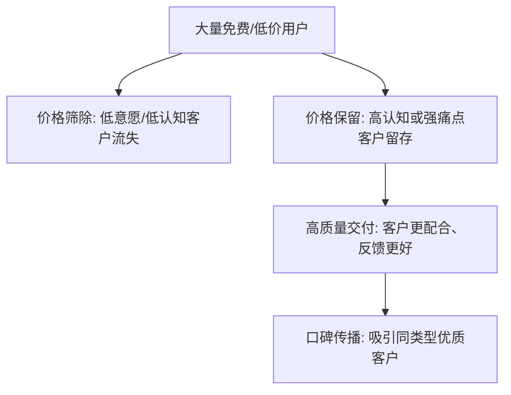

# 第 7 章 高客单知识付费——从卖课到交付改变

## 学习目标

- 掌握三圈交集定位法确定创业赛道
- 掌握家长付费能力分层
- 理解产品供应链能力是高客单门槛
- 理解从知道到做到的知识IP本质
- 掌握优势梳理三步法
- 掌握六步沟通主线转化话术
- 理解价格筛选器定理
- 理解私域小规模高转化实证
- 理解高客单完整服务定理
- 掌握朋友圈专栏思维

## 7.1 生活类比

把做知识付费比作开办私厨餐厅，你会发现高客单价产品的经营逻辑变得异常清晰。三圈交集定位是决定做什么菜系——你爱做的、你做得好的、市场想吃的，只有这三者的交集处才是你的招牌菜；家长付费能力分层是区分只看菜单不点菜的、愿意点招牌菜的、愿意包月深度学习的，不同顾客需要不同的服务方式。从知道到做到是顾客看菜谱是一回事、真正动手做成菜是另一回事，你的价值不在于递上菜谱，而在于手把手教他把菜做出来。价格筛选器是只服务愿意为品质付费的老饕，而不是讨好每一个路过的人。朋友圈专栏则是每天展示餐厅的食材新鲜度、后厨卫生和顾客好评，日复一日地积累口碑，让高客单顾客慕名而来。

## 7.2 概念地图

```
高客单知识付费：三圈交集定位、家长付费能力分层、产品供应链能力、从知道到做到、优势梳理三步法、六步沟通主线、价格筛选器、私域小规模高转化、高客单完整服务、朋友圈专栏思维
```

## 7.3 三圈交集定位法

> [P161, 家庭教育] "三圈交集定位法"

定位，是任何高客单生意的起点。我们首先要回答一个根本问题：你凭什么做这件事？

作者给出的答案是"三圈交集定位法"：**热爱**、**优势**与**市场需求**三个圈层相交的区域，才是你的最优赛道 [P161, 家庭教育]。

- **热爱圈**：你长期愿意投入精力、不计短期回报的方向。它保证你在冷启动期不会轻易放弃。
- **优势圈**：你比大多数人做得好的能力。它决定了你的交付质量是否有竞争力。
- **市场需求圈**：有真实付费意愿的人群规模。它决定了你的生意天花板。

三者缺一不可。只凭热爱入场，容易陷入自嗨；只凭优势入场，可能没有足够的市场；只凭市场需求入场，你会发现自己做不好也做不久。三圈交集定位法的价值在于，它帮你**避免盲目入场**——这是大多数知识付费创业者最大的失败原因 [P161, 家庭教育]。

```
三圈交集定位法（来源：《161_家庭教育》）

1. 写下你热爱的 3-5 个方向
2. 列出你具备优势的 3-5 个能力
3. 调研市场需求：搜索指数、社群讨论热度、竞品定价
4. 寻找三圈的交集区域
5. 用小规模付费测试验证定位（1-3 个付费客户即可）
```

这段伪代码展示了定位方法的完整操作路径：先内省（热爱与优势），再外察（市场），最后用付费测试来闭环验证 [P161, 家庭教育]。你需要注意的是，前三步是静态分析，真正让定位成立的其实是第五步——付费测试，因为**市场只认钱不认感觉**。

## 7.4 家长付费能力三层分级

> [P161, 家庭教育] "家长付费能力分层"

知道了自己在哪，下一个问题是：你的客户是谁，他们愿意为你付多少钱？

作者将家长按付费意愿分为三类 [P161, 家庭教育]：

| 层级 | 客户画像 | 付费特征 | 对应产品策略 |
|------|----------|----------|--------------|
| 第一类 | 自助解决型 | 只买书、看免费内容 | 低价引流课或免费内容 |
| 第二类 | 价格敏感型 | 愿意买课但反复比价 | 标准化的中价课程 |
| 第三类 | 高认知深度型 | 愿意付高客单求深度陪伴 | 一对一咨询、深度训练营 |

层级分级的价值在于，它提醒你**不要试图服务所有人**。第一类客户适合用免费内容做漏斗顶部，第二类客户适合用标准化课程做转化，而第三类客户才是高客单产品的目标人群 [P161, 家庭教育]。

这三层之间并非截然分开，而是存在流动。一个家长可能因为孩子问题加重，从第一类跃迁到第三类；也可能因为一次成功的课程体验，从第二类升级为第三类 [P161, 家庭教育]。你的产品线需要为这种流动设计通道——比如低价课学员可以在结课时获得高价咨询的折扣券。

需要注意，**高认知型家长与问题严重型家长是高客单的两大主力画像** [P161, 家庭教育]。前者认同你的理念，后者痛点极其强烈。理解这一点，你才能在不同场景下运用不同的成交话术。

## 7.5 产品供应链能力

> [P161, 家庭教育] "产品供应链能力"

做低价课程的门槛不高——录一套课、挂到平台上、定价 99 元，几乎不需要额外的能力。但做高客单价产品，你需要一种常被忽略的综合能力：**产品供应链能力** [P161, 家庭教育]。

```
产品供应链能力（来源：《161_家庭教育》）

产品供应链能力 = 持续迭代产品的能力 + 不断解决实际问题的能力
```

这个公式展示了高客单生意与低价生意的本质分水岭。低价课是一次性交付：你提供一个"产品"就够了；高客单是持续交付：你需要一个"供应链"来支撑 [P161, 家庭教育]。

具体来说，供应链能力包含三个层面：

- **迭代循环**：根据学员反馈持续改进服务流程，而不是一个模板用到死。
- **问题库存**：你积累的真实案例越多，越能在学员遇到新问题时快速给出针对性解法。
- **交付团队**：当你无法亲自服务所有人时，能否培训和复制交付能力。

作者明确提醒，**这是低门槛与高客单的分水岭** [P161, 家庭教育]。很多人做不好高客单，不是不会卖，而是交付跟不上——接了一个高价单，服务却还是低价课的水平，复购和转介绍自然归零。

## 7.6 从知道到做到

> [P161, 家庭教育] "从知道到做到"

知识IP 的本质是什么？作者给出了一个极简的定义：**帮助客户从知道到做到** [P161, 家庭教育]。

这不是文字游戏，而是一种认知上的范式转换。传统的知识付费卖的是"知道"——你看了课、懂了道理，但行为没有改变。而高客单品类的核心交付物，恰恰是**行为改变**。

我们可以用一个简单的框架来理解：

```
从知道到做到转化路径（来源：《161_家庭教育》）

认知: 信息接收 → 理解
行为: 实践尝试 → 反馈 → 调整 → 内化
结果: 行为改变 → 问题解决
```

这个路径展示了知识付费的两个层次：**信息层**（知道）与**行为层**（做到） [P161, 家庭教育]。低价课通常止步于信息层，而高客单产品的交付必须穿透到行为层——否则客户不会觉得"值"。

这意味着你的产品设计逻辑需要反转：不是先设计课程再想怎么卖，而是先明确"我要帮客户完成什么样的行为改变"，再倒推需要什么知识、什么陪伴、什么反馈机制 [P161, 家庭教育]。知识是手段，行为改变才是目的。

## 7.7 优势梳理三步法

> [P161, 家庭教育] "优势梳理三步法"

要做出高质量的交付，你首先得知道自己的武器库有什么。作者给出了一个可操作的优势梳理三步法 [P161, 家庭教育]：

```
优势梳理三步法（来源：《161_家庭教育》）

1. 盖洛普优势测试：用标准化工具识别你的主题优势
2. 成就事件回忆：回顾近 20 年让你有成就感的经历，提取共性能力
3. 优势观察日记：连续记录一周，观察你日常中不自觉做得好、做得快的的事
```

第一步用科学工具建立基线，第二步用真实经验交叉验证，第三步用日常观察做动态修正。三步完成后，你需要将抽象的优势**具体化为可营销的卖点** [P161, 家庭教育]。

例如，"共情力强"这个抽象描述不能直接卖钱，但"能快速识别家长在育儿中的隐性焦虑，并给出具体安抚策略"就是一个可交付、可定价的能力。优势梳理的终点不是"我知道自己优势是什么"，而是"我能用一句话让客户相信你能解决他的问题" [P161, 家庭教育]。

## 7.8 六步沟通主线

> [P161, 家庭教育] "六步沟通主线"

有了产品能力，还需要成交能力。作者提供了一个完整的免费咨询转化话术框架——**六步沟通主线** [P161, 家庭教育]。

```
六步沟通主线（来源：《161_家庭教育》）

1. 梳理问题：让客户完整描述他遇到的具体困难
2. 归因分析：帮客户找到问题的深层原因（而非表面现象）
3. 强化痛点：放大问题不解决带来的后果
4. 植入需要：让客户意识到他需要的是学习+指导，而非简单信息
5. 方案呈现：展示你的产品如何针对性地解决归因后的问题
6. 明确行动：给出下一步的具体行动指令（付费/预约）
```

每一步都承前启后：没有归因就强化痛点，客户会觉得你在吓唬人；没有痛点强化就植入需要，客户感受不到紧迫性 [P161, 家庭教育]。前四步的核心目的只有一个——**让客户自己得出结论：我需要被指导**。

这段流程的精妙之处在于，它不直接卖课，而是先建立一个认知框架：客户原来以为"我知道该怎么做但做不到"，经过归因后意识到"我缺的不是知识，而是持续的指导和反馈"。这时你的产品就不再是"课"，而是"解决方案" [P161, 家庭教育]。

## 7.9 价格筛选器定理

> [P161, 家庭教育] "价格筛掉无效客户"

在转化之后，价格扮演着最后一道关卡。作者提出了一个与常理相悖的观察：**高客单价本身就是有效的客户筛选机制** [P161, 家庭教育]。



这个数据流图展示了价格筛选的长期机制。如果客单价过低，你会同时遭遇两类问题：一是大量只是"随便问问"的客户占用你的精力，二是低付费客户的配合度差、效果不好，反而伤害口碑 [P161, 家庭教育]。

留存的客户有两大特征:高认知或痛点强烈 [P161, 家庭教育]。高认知客户能理解你的方法论并主动配合,痛点强烈的客户有足够的执行动力。两类人都有较高的"完成率",而**完成率才是高客单口碑的基石**。

需要注意的是,价格筛选并非越高越好,而是在"能筛掉低质客户"和"不至于筛掉潜在优质客户"之间找一个平衡点。这个平衡点需要通过实践逐步试探 [P161, 家庭教育]。

## 7.10 私域小规模高转化实证

> [P161, 家庭教育] "私域 2000+ 人实现 25 万营收"

价格筛选器的理论配合一个实证案例,才能让你确信这并非空谈。作者给出了一个极具说服力的数据：**仅 2000+ 人的私域,实现了 25 万营收** [P161, 家庭教育]。

我们来算一笔账：如果客单价为 1 万元，那么只需要 25 个付费客户就能达到这个营收。你不需要 10 万粉丝,只需要 2000 个精准粉丝就够了。

这与"流量思维"形成了鲜明的对照：

| 维度 | 流量思维 | 高客单私域思维 |
|------|----------|----------------|
| 核心指标 | 粉丝数、浏览量 | 信任度、付费率 |
| 冷启动 | 投流、追热点 | 深度内容+1V1沟通 |
| 变现路径 | 低价课/广告 | 高客单咨询/训练营 |
| 客户关系 | 单次、短链 | 长期、复购 |

这组对照揭示了两种完全不同的增长模型 [P161, 家庭教育]。低价模型靠规模摊薄成本,高客单模型靠深度提升单价。

同时这个实证也回应了另一种担忧——"私域做得慢"。2000 人的规模确实比"三个月涨粉 10 万"慢,但**高客单生意的复利在信任深处**,而非流量表面 [P161, 家庭教育]。私域小规模高转化的前提是前面所有的环节——定位、分层、供应链、转化话术——都做到了位。

## 7.11 高客单完整服务定理

> [P161, 家庭教育] "高客单完整服务定理"

价格筛选器让我们知道了"该收多少钱",但还没有回答"收了钱之后该做什么"。作者给出了一个关键定理：**高客单价能够成立,关键在于提供完整的服务闭环,而非价格本身** [P161, 家庭教育]。

```
高客单完整服务闭环（来源：《161_家庭教育》）

诊断 → 方案 → 执行 → 反馈 → 迭代 → 交付结果
  ↑___________________________________|
```

这个闭环展示了服务为何必须是"闭环"而非"单点"。低价课只做到"方案"这一步就结束了,而高客单必须完整走完整个循环,直到**客户的问题被解决** [P161, 家庭教育]。

"完整服务闭环"也意味着你的交付不是一次性的,而要持续解决客户真实问题。客户因为孩子问题来找你,你在咨询中给了方案,然后呢？如果两个月后客户孩子问题复发,他第一个想到的还是你——这就是复购与转介绍的来源 [P161, 家庭教育]。

高客单完整服务定理告诉我们,价格越高,对闭环完整度的要求越高。**敢于收高价,就要敢于承诺过程,而不只是承诺知识** [P161, 家庭教育]。

## 7.12 朋友圈专栏思维

> [P161, 家庭教育] "朋友圈专栏思维"

在私域运营的日常执行中,作者建议将朋友圈当作一份**专栏**来经营,而非随手发的生活记录 [P161, 家庭教育]。

```
朋友圈四类内容矩阵（来源：《161_家庭教育》）

1. 晒案例: 展示学员从"知道"到"做到"的转变故事
2. 建信任: 展示你自己的实践过程、方法论思考
3. 链感情: 分享你对教育的价值观判断、个人生活侧面
4. 专栏化: 固定栏目周期,形成稳定的预期(如每周一案例、每周三理念)
```

这个矩阵的关键不是内容的数量,而是**结构化的稳定输出** [P161, 家庭教育]。晒案例解决"你行不行"的问题,建信任解决"你可不可信"的问题,链感情解决"你和我是不是一类人"的问题。三个维度叠加,逐步构建出客户付费决策所需要的信任基础。

专栏思维区别于朋友圈刷屏的分水岭在于内容发出去有没有积累。刷屏型朋友圈是单点触达,看完就没了;专栏型朋友圈是资产沉淀——半年前的一条观点,今天被新客户翻到时仍然在为你建立信任 [P161, 家庭教育]。

这种日复一日的积累,最终让你在客户心中形成一个稳定、清晰、可信赖的专业形象。当客户决定为高客单付费时,他买的不仅是你的能力,更是他在你朋友圈看了一个月、半年甚至一年积累下来的信任感 [P161, 家庭教育]。

## 7.13 设计中的取舍

- **为什么不用低价走量,而要做高客单？**

低价走量的核心难题是供应链的重压:当你只有 99 元客单价,你必须卖出极大的量才能维持收入,这意味着你需要持续获客、持续运营、持续客服。而高客单走的是"少而精"的路线——服务 25 个客户与服务 2500 个客户,前者对个人IP的负担小得多 [P161, 家庭教育]。

- **高客单的代价是什么？**

高客单的代价是极高的信任门槛和交付门槛。你必须用完整服务闭环持续解决客户真实问题,这要求你具备产品供应链能力,而非仅靠一两次爆款内容 [P161, 家庭教育]。如果你收了一万元却只交付一门课,客户只会评价两个字——"骗子"。

- **私域增长慢,如何平衡耐心和规模？**

私域小规模高转化模式的本质是"深度变现"而非"规模变现"。2000 人实现 25 万营收的前提是高客单、高信任、高完成率,三者缺一不可。你可以用小规模的深度运营验证商业模型,再逐步放大,而不是一开始就追求流量规模 [P161, 家庭教育]。

## 7.14 动手练习

- 用三圈交集定位法写出你所在领域的热爱、优势与市场需求三张清单,找到交集。
- 访谈 3 位目标客户,将他们按三层付费能力归类,并为每层设计对应的产品线。
- 写下你最近 30 天实际为学员解决的问题清单,评估你的产品供应链能力。
- 回顾你最近一次咨询或销售过程,用六步沟通主线逐条对照复盘。
- 制定你的朋友圈四类内容矩阵,并连续运营 14 天,观察互动与转化变化。

## 7.15 本章小结

这一章中我们学习了高客单知识付费的完整打法。首先我们理解了三圈交集定位法——热爱、优势与市场需求三圈交集处才是最优赛道,避免盲目入场;其次我们掌握了家长付费能力三层分级,理解了不同层级对应不同产品策略;接着我们揭示了产品供应链能力是高客单的门槛,它由持续迭代产品能力和解决问题能力构成;然后我们重新定义了知识IP的本质——从知道到做到,帮客户完成行为转化;在此基础上,我们学习了优势梳理三步法将抽象优势具体化为卖点,掌握了六步沟通主线这个免费转付费的话术框架;随后我们理解了价格筛选器定理——高客单价本身就是有效筛选机制,并通过私域小规模高转化的实证看到了深度变现的可行性;最后我们论证了高客单完整服务定理,并学会了用朋友圈专栏思维进行结构化信任经营。

本章我们一起学习了以下概念：

| 概念 | 解释 |
|------|------|
| 三圈交集定位法 | 热爱、优势、市场需求三圈交集处为最优赛道,避免盲目入场 |
| 家长付费能力分层 | 按付费意愿分自助型、价格敏感型、高认知深度型三类客群 |
| 产品供应链能力 | 持续迭代产品+解决问题的能力,是高客单门槛与分水岭 |
| 从知道到做到 | 知识IP的本质是帮客户完成认知到行为转化的过程 |
| 优势梳理三步法 | 盖洛普测试、成就事件回忆、优势观察日记三步将优势显性化 |
| 六步沟通主线 | 从梳理问题到明确行动的六步转化话术框架 |
| 价格筛选器 | 高客单价本身就是有效的客户筛选机制 |
| 私域小规模高转化 | 仅2000+人私域即实现25万营收,高客单不需要大规模流量 |
| 高客单完整服务 | 高客单成立关键在于提供完整服务闭环而非价格本身 |
| 朋友圈专栏思维 | 晒案例、建信任、链感情三类内容专栏化结构化运营 |

下一章中,我们将把视角从个体IP的高客单打法扩展到一个更大的话题——如何从单次产品交付走向系统性服务设计,探索如何在你的业务中构建一个可持续、可复制的服务体系。

