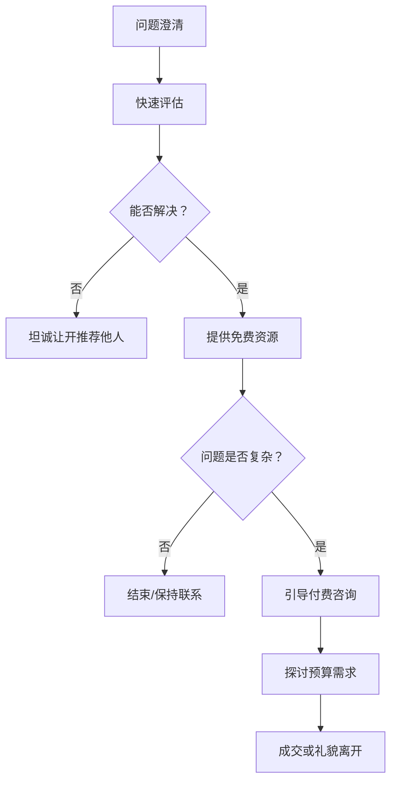
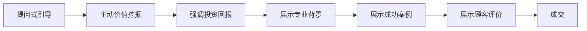
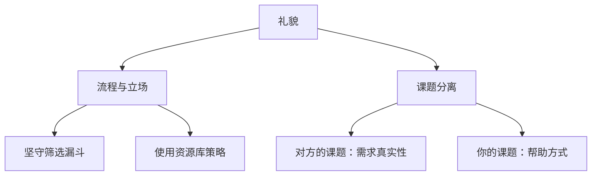

# 第 9 章 免费咨询的应对之道——从防白瞟到筛选客户

## 学习目标

- 理解免费咨询困扰的本质是客户筛选而非防白瞟
  
- 掌握三条第一原理：付费即价值、免费成本最小化、求助匹配
  
- 掌握五步筛选漏斗
  
- 掌握五信号识别法
  
- 掌握从给答案到给产品的资源库策略
  
- 掌握代价意识引导与付费意愿增强
  
- 理解礼貌等于流程与立场加课题分离的心法

## 9.1 生活类比

把应对免费咨询比作开餐馆让人看菜单：客户筛选机制是菜单本身就是筛子，Skin in the Game是让看菜单的人先点一道便宜的先证明饥渴，边际成本为零的产品是免费小菜让饿的人先试吃，求助匹配是只给真正能吃辣的人上辣菜，课题分离是你可以看菜单但我不会因为你看了就免单，心法总结是像开门做生意允许别人看菜单但菜单就是菜单。

## 9.2 概念地图

```
免费咨询应对
├── 问题重构：不是防白瞟而是客户筛选
├── 三条第一原理
│   ├── 付费即价值（Skin in the Game）
│   ├── 免费成本最小化
│   └── 求助匹配
├── 五步筛选漏斗
│   ├── 问题澄清
│   ├── 快速评估
│   ├── 免费资源
│   ├── 付费咨询
│   └── 预算探讨
├── 五信号识别法
│   ├── 针对性
│   ├── 态度
│   ├── 认知度
│   ├── 主动性
│   └── 紧迫性
├── 从给答案到给产品
├── 案例拆解
└── 心法总结：礼貌等于流程与立场+课题分离
```

## 9.3 问题重构——不是防白瞟而是筛选客户

> [P001, p.1] "本质上我们面对的不是防止白瞟，而是如何有效设计客户筛选机制"

这段话直接颠覆了我们对免费咨询困扰的直觉判断。大多数人面对没完没了的免费咨询，第一反应是"怎么防白瞟"——怎么礼貌地拒绝、怎么少花时间、怎么不让人觉得好欺负。但这个框架认为，这个问题的正确问法不是"怎么防"，而是"怎么筛"。

你不需要把自己变成一个防御工事，而应该把自己变成一个筛子。筛子的目的不是挡住所有人，而是让合适的人留下来。这正是我们整套方法论的出发点。

我们可以把这个思考过程形式化：

> **问题重构**（来源：《038_如何有礼貌的收钱》）

```
旧问题：如何防止别人白瞟我的时间和专业？
新问题：如何设计一套机制，让真正有价值的客户和问题浮现出来？
```

这个重构展示了三个关键转变：第一，从"消极防御"到"主动设计"——你不再是挡箭牌，而是规则的制定者；第二，从"防所有人"到"筛一部分人"——你的目标是精准匹配而非全面拒绝；第三，从"每次应对都是消耗"到"每次沟通都是投资"——一次真正有价值的咨询，其回报远超你在筛选上的投入。

这个重构的威力在于，它把我们的情绪从"被占便宜的愤怒"切换到"在做生意的清醒"。

## 9.4 三条第一原理——价值、成本与匹配

> [P001, p.2] "第一条第一原理：对方要付出代价（Skin in the Game绑定结果）"

如果把应对免费咨询看作一门生意，那么这门生意有三个底层规律。这三条规律是整套方法论的基石。

### 第一原理一：付费即价值判据

> **付费即价值判据**（来源：《038_如何有礼貌的收钱》）

$$
\text{问题价值} = \begin{cases}
\text{高价值} & \text{如果对方愿意付出代价（时间、金钱、行动）}\\
\text{低价值} & \text{如果对方只愿意免费索取}
\end{cases}
$$

这个公式展示了一个残酷但有效的判断标准：**产品的真实价值只能通过付费行为验证**。一个人嘴里说"这个问题对我很重要"，但他连一百块钱都不愿意出，那这个问题对他的重要性就要打问号。

这就像你在菜市场买菜，摊主说"这瓜特别甜"，但你说"能不能免费尝一口"，他如果爽快答应，说明这瓜可能一般；如果他说"你先买一个试试"，那至少说明他对自己的瓜有信心。

### 第一原理二：免费服务成本最小化

> **免费服务成本最小化**（来源：《038_如何有礼貌的收钱》）

$$
\text{你的成本} = \sum_{\text{每次免费沟通}} \text{时间消耗} + \text{精力消耗} \rightarrow \min
$$

这个公式展示了你在应对免费咨询时的优化目标：**让每一次免费服务的成本趋近于零**。最好的实现方式是只提供边际成本为零的预制资源——比如一份写好的攻略文档。写一次，用无数次。

这和开餐馆的逻辑一样：免费小菜可以给，但你不能为每个客人单独炒一盘菜。你可以把今天的例汤做好放在那里，谁来都能盛一碗，但"点菜"是付费服务。

### 第一原理三：求助与帮助的匹配性

> **求助与帮助的匹配性**（来源：《038_如何有礼貌的收钱》）

$$
\text{匹配性} = \begin{cases}
\text{匹配} & \text{你能解决且愿意解决} \\
\text{不匹配} & \text{你无法解决或不愿意解决}
\end{cases}
$$

这个公式展示了在伸出援手之前要做的前置检查：**帮助前需确认自己能解决，否则坦诚让开**。如果你不懂法律却给人法律建议，那是害人；如果你懂但不想免费做，那也是你的权利。

这三条第一原理的共同点在于：它们都不是教你怎么拒绝，而是教你怎么判断。

## 9.5 五步筛选漏斗——从提问到付费的标准化流程

> [P001, p.3] "问题澄清到快速评估到免费资源到付费到预算"

有了三条第一原理做地基，我们就可以搭建一个可操作的筛选流程。这个五步漏斗的核心逻辑是：**每一步都在检验前一条原理**——检验问题是否真实、检验你的成本是否可控、检验对方是否愿意付出代价。

> **五步筛选漏斗**（来源：《038_如何有礼貌的收钱》）

```
Step 1: 问题澄清 —— 让对方把问题说清楚（检验问题真实性）
Step 2: 快速评估 —— 判断自己能否解决（检验匹配性）
Step 3: 提供免费资源 —— 给出预制文档/攻略（成本最小化）
Step 4: 引导付费咨询 —— 如果问题复杂，提出付费选项（检验付费意愿）
Step 5: 探讨预算需求 —— 了解对方预算，给出报价（明确代价）
```

这段伪代码展示了筛选漏斗的完整逻辑：它像一个水位逐级下降的水坝，每过一级，水中的杂质就少一点。走完五步还愿意付费的人，大概率是真心求助者。

这个漏斗的核心设计思想是**渐进式承诺**：你不需要一开始就要求对方付费（那会吓跑很多人），但你需要逐步提高"代价门槛"。从"花三分钟说清问题"到"花三分钟读完文档"到"花三百块买一次咨询"，每一级都在验证对方的诚意。

我们也可以用流程图来看这个过程：



这个数据流图展示了五步漏斗的决策分支：每一步都有"继续"和"退出"两个出口，这让整个流程既温和又高效。

## 9.6 五信号识别法——快速判断真心求助者

> [P001, p.4] "5个信号：针对性/态度/认知度/主动性/紧迫性"

五步漏斗是流程，五信号识别法是**快速雷达**。你不可能对每个人都走完五步，有时候三句话就得判断这个人值不值得继续聊。

> **五信号识别法**（来源：《038_如何有礼貌的收钱》）

```
信号1: 针对性 —— 问题是否具体而清晰，还是泛泛而谈？
信号2: 态度 —— 是否尊重你的时间和专业？
信号3: 认知度 —— 是否了解你的背景和擅长领域？
信号4: 主动性 —— 是否主动做了功课，而不是甩锅给你？
信号5: 紧迫性 —— 是否有明确的时间压力和真实需求？
```

这段伪代码展示了快速识别真心求助者的五个维度。你可以把这五个信号当作五个"测试题"，得分高的人值得投入时间，得分低的人用免费资源打发即可。

| 信号 | 高分表现 | 低分表现 |
|------|----------|----------|
| 针对性 | "我的公众号涨粉到瓶颈，想请教你选题策略" | "帮我看看怎么做自媒体" |
| 态度 | "知道你很忙，所以我把背景整理好了" | "在吗？问你个事" |
| 认知度 | "我看了你写的关于增长黑客的文章" | "你是做什么的来着？" |
| 主动性 | "我先尝试了XX方法，效果不好" | "你直接告诉我答案吧" |
| 紧迫性 | "下周要上线，所以比较急" | "有空的话随便聊聊" |

这张表格给出了具体的判断标准。你可以用这个表格给每个免费咨询者打分：3 分以下的，直接送资源包；3-4 分的，可以聊十分钟；5 分的，值得认真对待甚至主动促成付费。

## 9.7 从给答案到给产品——应对免费提问的资源库策略

> [P001, p.5] "用边际成本为零的产品（攻略文档）应对免费问题"

我们已经有了筛选机制和识别信号，但还有一个操作层面的问题：**当筛出的人确实值得帮助但又不该免费手把手教时，你给什么？**

答案是：给产品，而不是给答案。

> **资源库策略**（来源：《038_如何有礼貌的收钱》）

```
策略核心：建立一份可复用的预制资源库（攻略/文档/模板/课程）
执行规则：
  1. 免费问题 → 发资源库链接（成本趋零）
  2. 深度问题 → 资源库 + 邀请付费咨询（转化导向）
  3. 付费客户 → 根据需求定制（高价值服务）
```

这段伪代码展示了从"给答案"到"给产品"的转换逻辑。它的核心收益是**对抗时间黑洞**——如果每次免费咨询你都亲手答疑，你的时间就是无限稀释的；但如果你有一个石蕊试纸一样的资源库，你就可以在保持善意的同时守住时间。

这个策略的妙处在于它同时服务了两个目标：**维持善意**（你没有拒绝，你给了东西），**避免消耗**（你只花了一秒钟发链接）。同时，它为后续转化埋下伏笔——对方用了你的攻略觉得好，自然愿意为更深入的服务付钱。

这就像医生开的"科普手册"：你没挂号就来找我，我可以给你一本《常见感冒自诊手册》——这既不是拒绝，也不是给你做手术，但你需要手术的时候，你知道得挂号。

## 9.8 案例拆解——如何有礼貌地收钱

> [P001, p.6] "提问式引导/主动价值挖掘/强调投资回报"

理论说完了，我们来看具体怎么"有礼貌地收钱"。这里面有两个核心技术，我们分开讲。

### 技术一：代价意识引导法

> **代价意识引导法**（来源：《038_如何有礼貌的收钱》）

```
Step 1: 提问式引导 —— 用提问让对方自己意识到问题的严重性
  "你说的这个情况，考虑过如果不解决会有什么损失吗？"
Step 2: 主动价值挖掘 —— 帮对方算出问题带来的成本
  "按你现在的转化率，这个bug每天大概流失30个用户。"
Step 3: 强调投资回报 —— 把服务价格和问题损失做对比
  "我的咨询费是500块，但你一天就少赚3000块。"
```

这段伪代码展示了"代价意识引导法"的三步结构。核心逻辑是**让对方自己算出问题的价值**——你不需要说"我很贵"，你需要让对方看清"这个问题很大"。

这个方法心理学上的机制是**损失厌恶**：人对损失的敏感程度是收益的两倍。当你让对方意识到"不解决的代价是每天3000块"时，500块的咨询费就变成了小钱。

### 技术二：付费意愿增强法

> **付费意愿增强法**（来源：《038_如何有礼貌的收钱》）

```
Step 1: 展示专业背景 —— 证明你懂行
  "我在这个领域做了7年，服务过30家同类型企业。"
Step 2: 展示成功案例 —— 证明你能解决
  "上个月一个类似情况的客户，我们帮他把转化率翻了一倍。"
Step 3: 展示顾客评价 —— 证明别人觉得值
  "这是他给我写的评价，你可以看看。"
```

这段伪代码展示了"付费意愿增强法"的三步结构。它和第一种方法的区别在于：代价意识引导法是在**抬高问题的重要性**，付费意愿增强法是在**抬高你的解决方案的可信度**。

这两种方法可以搭配使用：先让对方意识到问题严重（代价意识），再让对方相信你能解决（付费意愿增强）。当"问题足够大"和"你足够行"同时成立时，付费就是自然结果。

我们可以把这两个技术放在整个案例拆解的流程中看：



这个流程图展示了从"让对方觉得问题大"到"让对方觉得你行"再到"成交"的完整链路。它是一个组合拳，不是单一技巧。

## 9.9 心法总结——礼貌等于流程与立场加课题分离

> [P001, p.7] "礼貌=流程与立场+课题分离"

最后，我们把所有技巧凝结成一个心法。

> **礼貌公式**（来源：《038_如何有礼貌的收钱》）

$$
\text{礼貌} = \text{流程与立场} + \text{课题分离}
$$

这个公式是本章的收束点：**真正的礼貌不是有求必应，而是尊重对方的求助权利，同时坚守自己的流程与立场**。

我们可以把"课题分离"拆开看：对方的课题是他有没有真实需求、愿不愿意付出代价；你的课题是你是否愿意帮助、用什么方式帮助。这两者要分开处理。你不需要因为对方"很真诚"就打破自己的规则，也不需要因为自己"不想帮"而感到愧疚。

每次沟通都当作一次匹配尝试——就像开门做生意，你允许别人看菜单，但"看了菜单"不等于"免单"。



这个架构图展示了"礼貌"这个心法的内部结构：它由流程与立场（可操作的部分）和课题分离（心态的部分）共同构成。前者给你行动框架，后者给你内心平静。

## 9.10 设计中的取舍

### 为什么不让免费咨询者直接进入付费环节？

如果目标是筛选客户，那直接挂个"咨询收费 500 元/小时"的牌子不就行了吗？这是一个自然的疑问。但现实中，直接亮价码会吓退大量潜在客户——因为在对方还没有认识到问题严重性之前，价格看起来就是纯粹的"索取"。这就是为什么第一步是"问题澄清"而不是"报价"：你要先让对方看到问题的价值，价格才会显得合理。

### 提供免费资源会不会反而助长白瞟？

你可能会担心：我建了资源库，那大家是不是都来白瞟我的攻略？这其实是个权衡问题。资源库策略的代价是**你可能被"白瞟"你的文档**，但收益是你**保护了自己的时间**。一个文档被 100 个人白瞟，你的成本是 0；如果这 100 个人里有 3 个人因此转化为付费客户，你就赚了。这个 trade-off 是：你用可复制的内容换取了不可复制的时间，而时间是唯一真正稀缺的资源。

### 五步漏斗会不会让真心求助者觉得太麻烦？

这是流程设计的最大风险：过度筛选让真正有需求的人感到被刁难。所以五步漏斗的每一步都设计得**轻量**——澄清问题只要三句话，看资源库只要三分钟，每一步的"代价门槛"都很低。这个权衡是：你宁可流失几个着急但不愿意走完流程的客户，也要保护自己不被大量无效咨询淹没。筛选机制本身就筛掉了没有耐心的人，而这种人往往也不是好的长期客户。

## 9.11 动手练习

- 回顾过去一个月你遇到的免费咨询，用五信号识别法给每个咨询者打分，找出高分和低分的分布规律

- 设计你自己的"边际成本为零"产品：写一份你在某个领域的攻略文档（100-200 字即可），测试用它可以应对哪些常见免费问题

- 和朋友进行一次角色扮演：一个扮演"免费咨询者"，一个扮演"有礼貌的收钱者"，练习代价意识引导法的三步话术

- 拆解一个你曾经免费帮助过的人，用五步漏斗倒推：他在哪一步应该被筛掉，而你当时为什么没有筛

- 完成一次"课题分离"心理练习：写下最近一次你觉得"不帮不好意思"的求助，分别列出对方的课题和你的课题，然后重新审视你的决策

## 9.12 本章小结

这一章中我们学习了如何应对免费咨询的困扰——它不是防白瞟的防御战，而是一套客户筛选的主动设计。首先我们做了问题重构，把"怎么拒"变成"怎么筛"；其次我们建立三条第一原理：付费即价值、免费成本最小化、求助匹配；接着我们搭建了五步筛选漏斗，让每一步都在检验代价与匹配性；然后我们学习了五信号识别法作为快速雷达，以及从给答案到给产品的资源库策略来保护时间；在此基础上，我们通过案例拆解掌握了代价意识引导法和付费意愿增强法，最后以"礼貌等于流程与立场加课题分离"的心法收束。

本章我们一起学习了以下概念：

| 概念 | 解释 |
|------|------|
| 客户筛选机制 | 主动设计规则筛选真正有价值的客户与问题而非防止白瞟 |
| Skin in the Game | 真问题与真价值必须通过对方愿付出代价来验证 |
| 边际成本为零的产品 | 用预制攻略文档类产品应对免费咨询实现我方成本最小 |
| 求助与帮助的匹配性 | 帮助前需确认自己能解决否则坦诚让开 |
| 五步筛选漏斗 | 问题澄清到快速评估到免费资源到付费到预算的标准漏斗 |
| 五信号识别法 | 通过针对性态度认知度主动性紧迫性识别真心求助者 |
| 礼貌等于流程与立场 | 真正的礼貌是尊重求助权利但坚守自身流程与立场加课题分离 |

下一章中，我们将进一步探讨在更复杂的商业关系和团队协作中，如何把这套筛选逻辑放大到组织层面——不是"如何有礼貌地收钱"，而是"如何有礼貌地让整个组织都学会收钱"。
