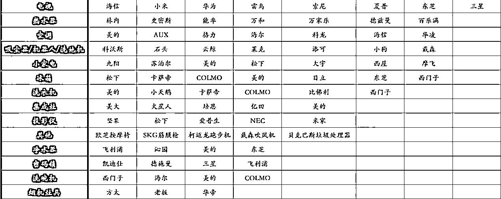

# 《家电代下单实操：我从零做到300万营收的经历复盘》

> 原文：[`www.yuque.com/for_lazy/thfiu8/kbgrkxogr73ba2vq`](https://www.yuque.com/for_lazy/thfiu8/kbgrkxogr73ba2vq)

## 78赞 《家电代下单实操：我从零做到300万营收的经历复盘》

作者：阿辉
日期：2023-03-28

## 开场白

大家好，我是阿辉，目前还在警校读大二。 
去年尝试的第一个副业就从家电代下单起步，个人累计流水做到300万，整个小团队的规模突破了1000万，今年我打算继续把这条线做深做大。

前两天有朋友在聊天时提到，星球里很多人都在问家电代下是怎么玩的，索性就把自己摸索的路径整理出来，和大家聊聊。第一次写这种分享文，表达上可能不够精炼，还请多指正。

## 一、我是怎么入局的

### 1.从普通代下单开始
高中的时候就在朋友圈刷到过京东代下单的广告，价格明显低于平台价。那会没时间研究，就一直记在心里。 
大一下学期适应了校园节奏，看到同寝室的同学在得物搬砖月入几千，心里也痒痒，正好又刷到京东代下的信息。直接问原发帖人能不能带徒弟，对方没理我。后来在知乎上找到一个在收徒的，花了599块买了入门课。

学完发现本质是利用新人券下单，赚取的差价有限。当时脑子一热就自己也去收徒，想先把学费赚回来。

过年期间偶然刷到闲鱼，搜索京东代下，发现已经有人在做。我直接借鉴了人家的文案去发帖，没想到咨询量一下子起来了，接连不断有人来问怎么下单，也因此赚到第一笔零花钱，运气成分很大。

### 2.转向家电代下
在做普通代下期间，经常有人问我能不能下家电。起初以为是客户说错了，后来私信越来越多，我就意识到这块需求很集中。怕走弯路，又花了599跟另外一个人系统学了一遍家电的玩法。

学会后开始发家电单，订单量很快起来，又吃到一次甜头。

做了一段时间后我觉得单打独斗天花板太低，于是开始搭团队走向规范化。开始招代理，代理费本身赚得不多，但接触到各种各样的人，认识了不少有思路的伙伴。

半年时间下来，虽然做不到月入十万的那种爆发，但已经是一个不错的副业收入，自信心和方向感都更清晰了。

## 二、家电代下到底在做什么是？

### 1.简单定义
家电代下，字面意思就是帮客户下单家电。通过特殊渠道拿到内部价格，帮助买家省钱，我们从中赚取价差。

### 2.优惠的来源
京东家电在全国有大量的线下加盟门店，这些门店拥有京东的内部采购账户，可以以内部进货价拿货，业内俗称令牌价。

令牌价并不是固定不变的，会随京东政策波动。

举个例子，TCL 85Q10G 电视，京东自营前台标价是16999元，而通过令牌价下单只需要8999元左右，差不多是官网价的一半。

拿到这个价格后，我们可以根据客户的议价能力加价转售，比如卖9999元，单台利润就能做到1000元。

下单成功后会提供京东官方订单号、物流跟踪信息，到货后还能开具正规发票。

### 3.怎么查到令牌价
我们会用专门的查询网站来核对当前产品的令牌价，方便代理快速报价。

如果某个型号没有令牌价，就会走仓库现货或工厂直采的价格表来对接。

另外家电涉及区域保护，不同城市的拿货价可能不一样，实际报价需要结合地区。

### 4.货品的质量和售后问题
所有下单的机器都是全新的原封原包，由京东自营物流配送，品牌方负责上门安装。

售后走400官方通道，服务体验和京东自营完全一致。合作品牌覆盖范围很广：

基本能满足各类家电的需求，从大家电到小家电基本都有。

### 5.现阶段的打法
我现在主要用的是代理分销模式，把货源和报价体系开放给代理，由他们去对接C端客户。我这边负责提供运营建议和价格支持，让代理有足够的利润空间去成交，实现双赢。

线上做家电只是第一步，如果能把小区、楼盘、装修群等线下资源盘活，转化效率会非常高。

### 6.未来规划
第一步，2023年重点还是深耕数码家电赛道，品类继续扩充。对接手机、电脑、家具等资源，实现从家电到家具的一体化供应。把团队从现在的110人扩大到500人，搭建一个面向C端用户的线上家电家具商城，同时完善运营制度，探索更多玩法。

第二步，进军二手数码家电领域，结合闲鱼平台做布局。模式依然是团队化发展，一人带一个群，1对1实操复制。

## 三、最后一句话

如果你对这个方向感兴趣，欢迎一起交流探讨。有资源的朋友也可以合作共赢。

我挺喜欢那句“读奇书，交奇友，创奇事”。做别人还没大量做的事，就是我理解的奇事。读书也好、走路也好，本质都是在打磨自己，等待合适的时机发光。

十年磨一剑，一朝露锋芒。

希望还在努力的朋友不要着急，先把剑磨好，总有一天会见光。

祝愿赚钱圈的各位，都能早日成为那个曾经的自己，也祝那个未来的自己能笑得开心。

完

评论区参考：
书情小跟班 : 不错，感谢分享 鹿鹿姐姐 : 怎么联系呀 魔方 : 怎么联系 阿辉 : MMMXXXAH 欢迎前来交流[呲牙] 魔方 : +你了 李凤 : 怎么联系呀 nickki : 是直接找代理下嘛，还是要先成为代理呢 何道平 : 其实这一块是抢了京东线下线上的生意，京东会不会改变政策，倾向保护他的线下加盟店，