# ('《通过四大行无风险套利 7 天赚回一倍赚钱的门票》', (2, 27))

《在四大行玩“月末资金过桥”，7天把门票钱赚回好几倍？》

大家好，我是老胡。

之前发过一篇关于银行大额存单套利的分享，没想到评论区直接炸出一堆问题：小银行会不会取不出钱？存款保险限额偿付到底怎么算？操作安全吗？利息怎么返还？操作周期要多久？自己能做吗？打新债近两年是不是还要注册？……

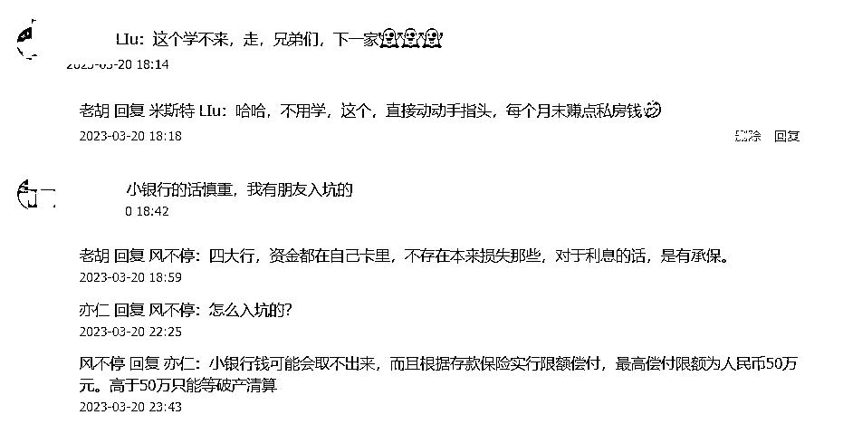

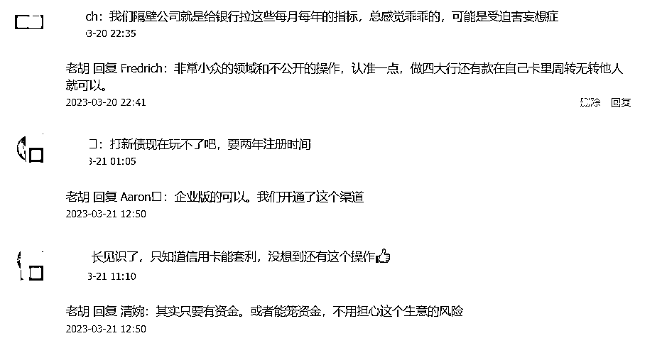

这里统一回应一下：我们做的套利，只碰工行、农行这类国有四大行，和小银行没有任何关系。而且资金始终在自己名下的银行卡之间互转，不转给任何第三人，所以安全这块完全不用慌。

操作窗口基本在每个月末那几天。按流程走完，钱只需要在账户里躺24小时，返利就会自动打到你个人账上。利息来源是正规银行操作，不必担心。至于打新债，近两年的确只有企业版能做，我们之所以能做，是因为企业端已经打通了这个渠道。

如果你手头有愿意配合的银行渠道，其实完全可以自己去操作。但也要提醒一句：银行未必能长期给你口子，这背后需要资源；而且自己动手时，千万别去碰小银行的项目。

今天这篇文章，就是上次发文之后，一些圈友在7天内用四大行做资金拆借套利，实实在在赚到钱的案例。对项目感兴趣的话，可以查看原文：

（https://articles.zsxq.com/id_co0lkxpaewcd.html）

老话说，物以类聚，人以群分。真的要谢谢龙哥，创造了赚钱有术这个圈子。

赚钱的第一步，很多时候就是获取信息差。但同样是看到一条信息，不同圈层的人，反应可能完全不同。

一、赚钱的群体

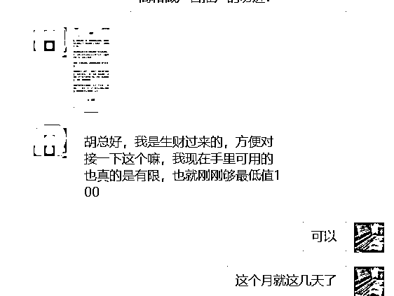

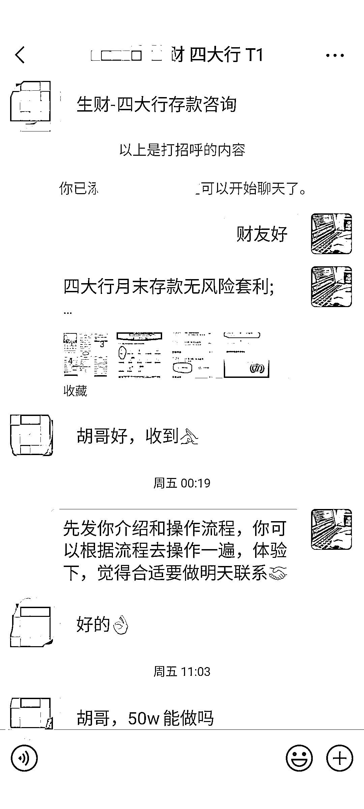

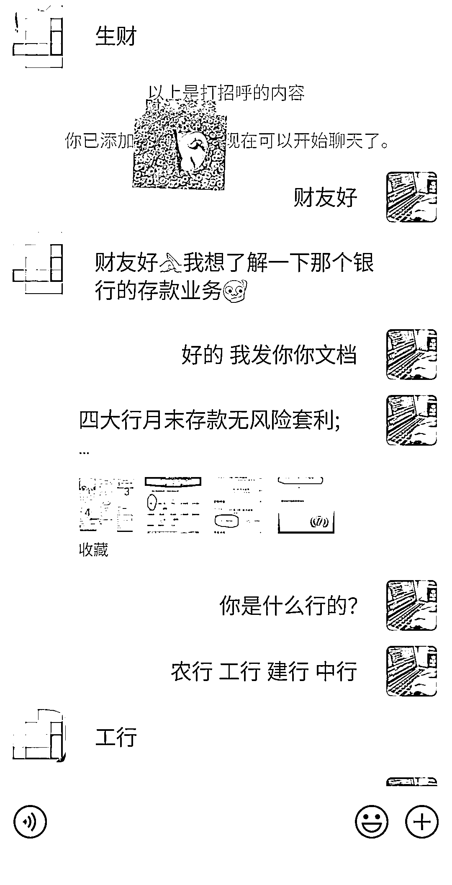

二、其他社群的群体

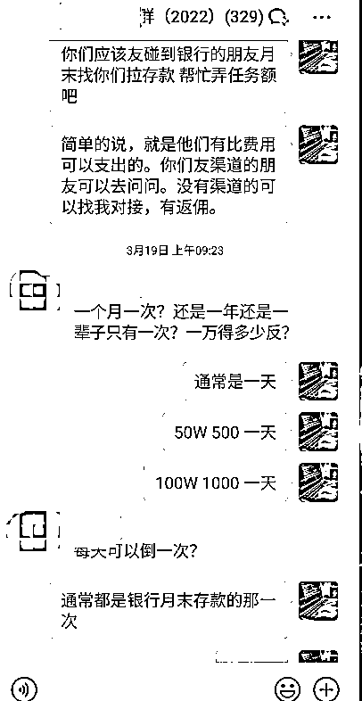

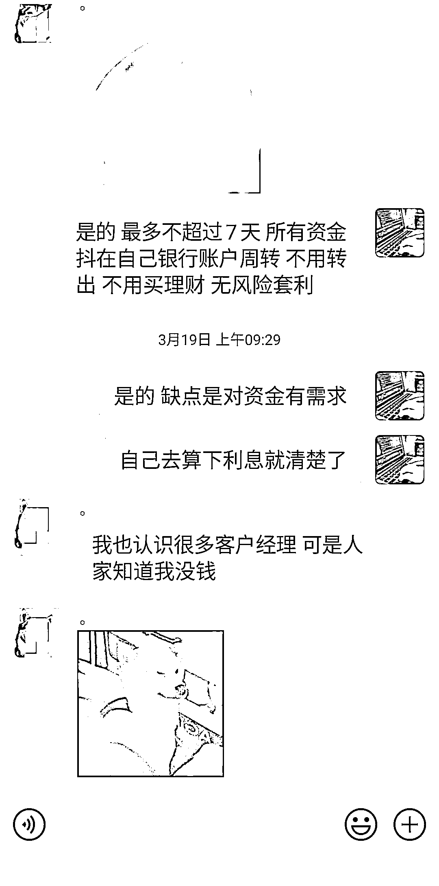

所以，面对同一个信息差，有人只顾打嘴炮，有人盯着困难不放，还有人想当然。而赚钱的圈友呢？

（1）会主动加过来求证；
（2）会想办法解决当下的困难；
（3）亲自验证无误后，马上投入行动。

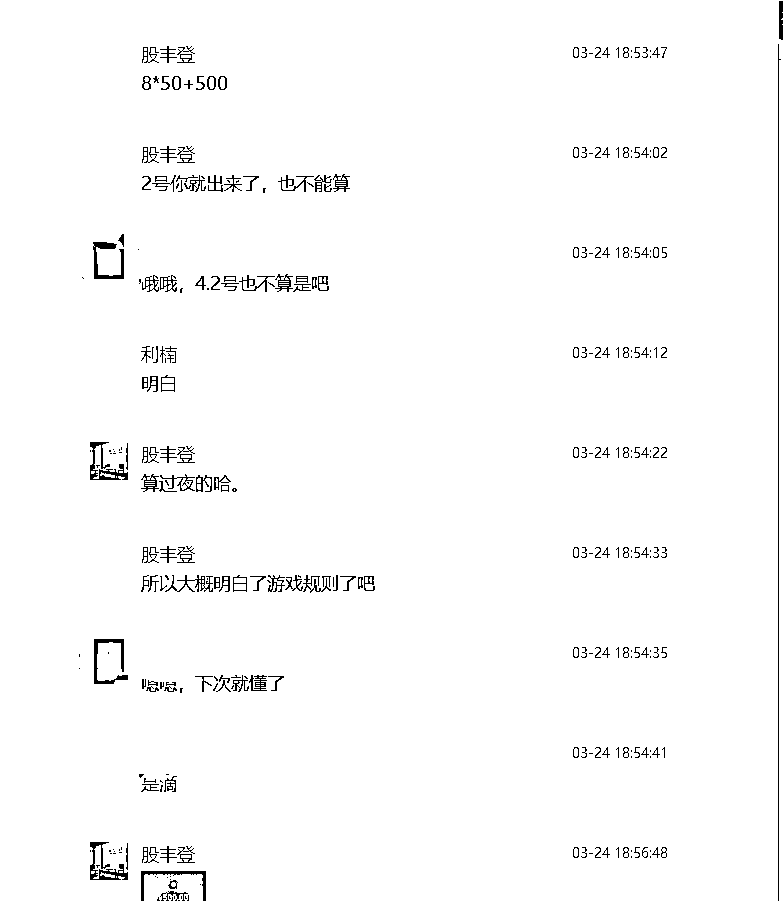

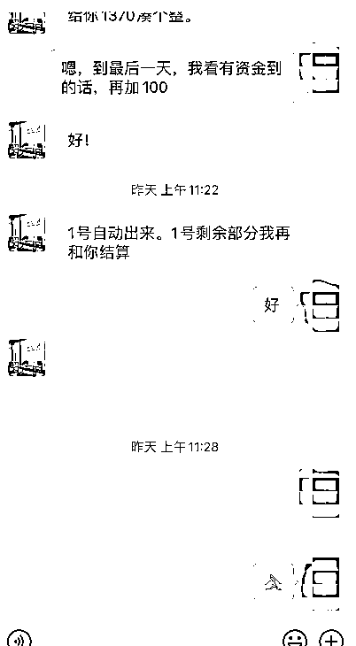

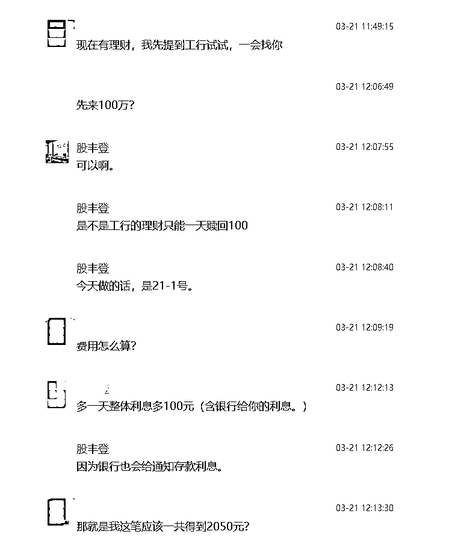

（这里不是鼓励无脑投资，而是想说：遇到信息差，先思考，再求证，别只用嘴下结论。）

透过这些案例，真的能感觉到，赚钱的圈友不但谨慎，还特别敢求证、敢探索。难怪能“赚钱有术”！

三、7天验证的结果

（1）截止2023年3月26日，感兴趣的圈友一共22位（已经扣除我们自己的3位服务人员）。

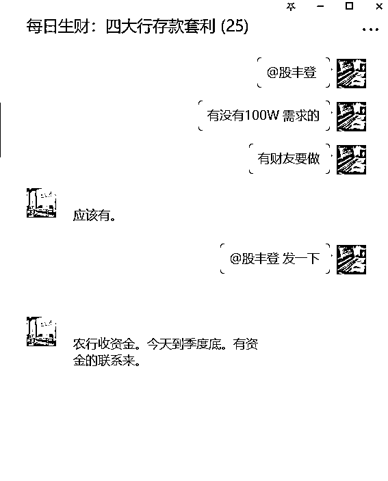

（2）这22位中，8位报名，4位已经打卡，4位预订了日期。

算一下：8÷22，有效率约36.36%。

圈友的执行力，确实很高。这里就不一一列举了。

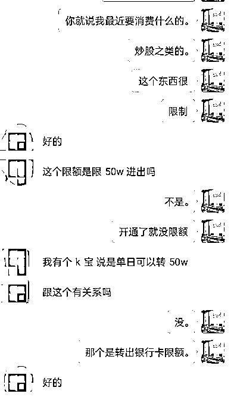

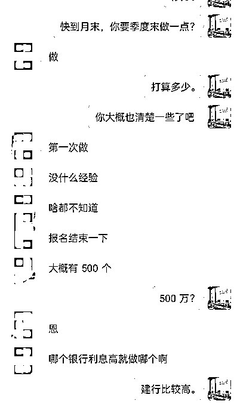

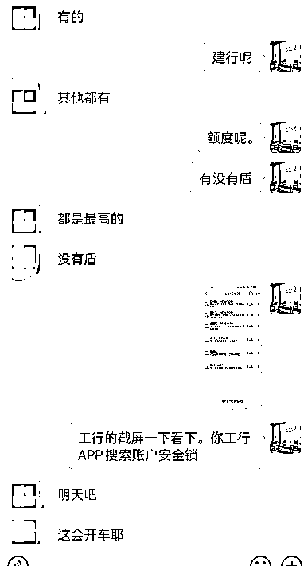

（3）再说收益：目前最高已经接近3倍的社群门票回报。因为部分收益要等到4月1日结算，所以还不是最终数据。

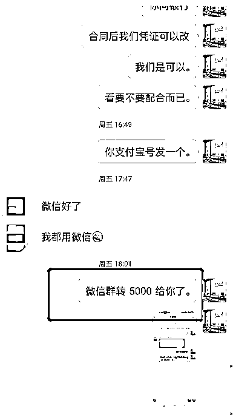

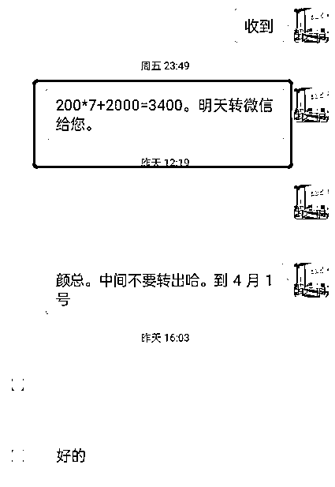

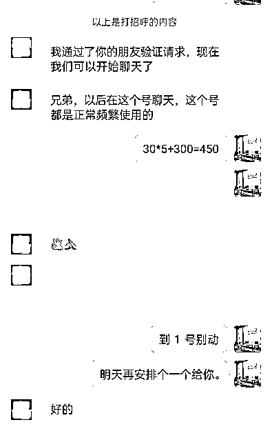

收益少的，一天也能拿几百；多的，已经5000元到手，月末结算后还会更多。从这个角度说，基本等于赚回了近3倍的门票钱。

从3月20日发文，到3月26日统计，算上休息日刚好7天。

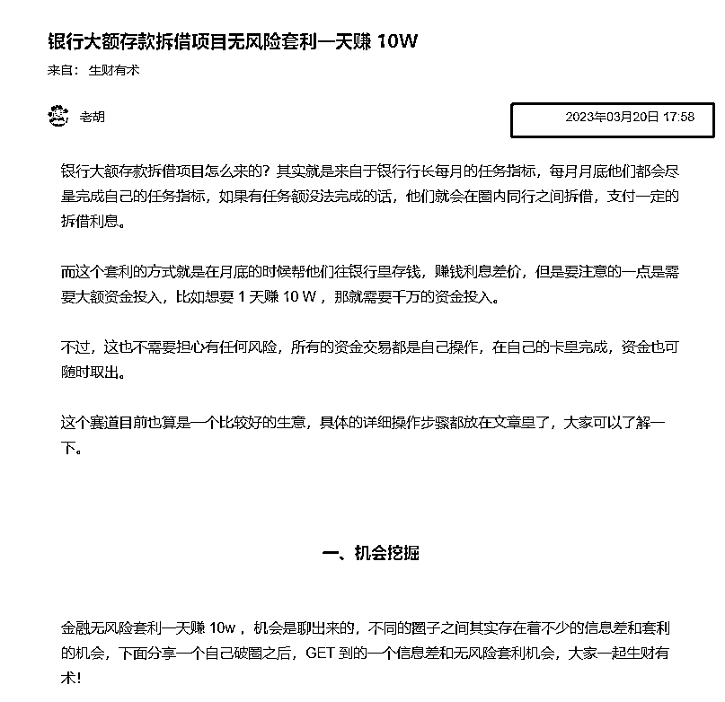

之前发布的文章链接：
https://articles.zsxq.com/id_co0lkxpaewcd.html

事要躬亲，反复验证求索。
财不嫌多少，胜在安全累积。

再次感谢龙哥创造了这个社群。
（看得出龙哥团队眼光很准，大航海计划已经扬帆起航，未来这批航海家聚在一起，能量相当可观！）

也非常感谢圈友们的信任和支持！
（再次强调：建议大家找银行系统的专业人士求证，在确保安全的前提下再投入，不要拍脑袋做决定。）

祝：一起，赚钱有术！

最后写个期许：我给自己定了个小目标，期待能给100位甚至更多的圈友，链接到经过验证的无风险套利信息交流；最终，能形成一个无风险套利板块。有这方面资源和想法的朋友，欢迎一起探讨。

如果对这篇文章还有疑问，可以看这里的解答：四大行月末存款无风险套利。
https://shengcaiyoushu01.feishu.cn/docx/FXPZdOCdwodVhix7joJcifnKn0g