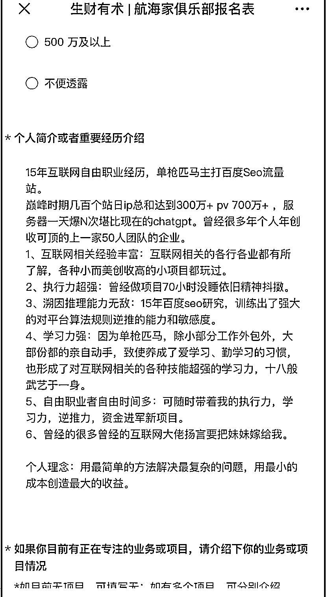
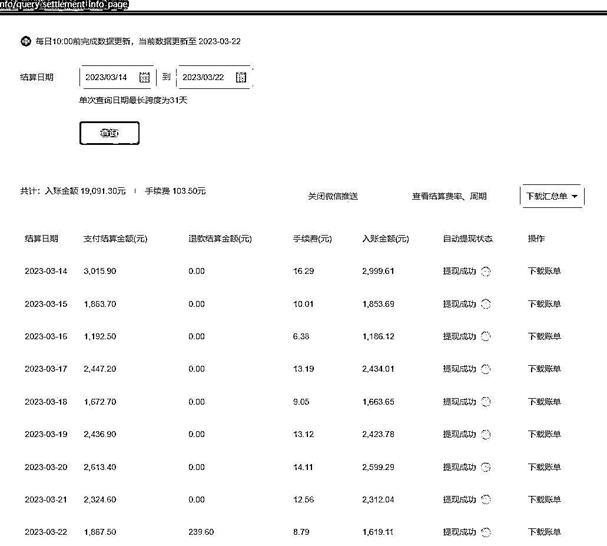
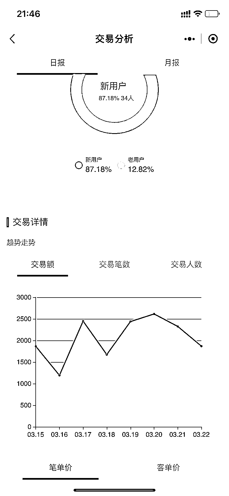

# 用几百个小站点换来的几年被动现金流复盘

前段时间在星球里翻到自己随手写的一段流水账，意外被推成了精华。那篇本质上是零散的回忆拼贴，重读起来非常糙。现在把当时的体感抽出来再整理一遍，供给还在单干、琢磨副业的同行做另一种参考。

## 我的来历

十多年前入局，正好赶上个人站长的尾声，属于靠 PC 流量活下来的那批人。

那段岁月里，主流生意摸索过五六十种，擦边玩法接触过上百种，各类野路子和奇技淫巧的截图至今还在手机。说这些不是炫耀，只是给后面的判断做坐标：下面所有内容都是浸泡十几年圈子的人的主观体会，非二手复述。

## 行业下行前的三种预警

我们那代人运气不错，吃到了 PC 红利的末段。红利来得猛，去得也快。

衰退期到来后，一年多的时间里陆续发生了三件事，印象很深。

第一件事，外面的培训机构突然开窍，各种自称绝活的打法被拿出来公开展示，十八般武艺式的套路遍地开花。

要直说一句：当一个赛道的独门招式开始泛滥，不是成熟的标志，是没落的开端。

红利期里真正赚到钱的人，从不把核心手法外泄。哪怕收了学费，也只带你入门，后面全靠自悟。值钱的东西，花钱也买不到。

等到秘籍人手一份，招式迅速同质化。老玩家清楚自己的护城河在被填平，新玩家以为捡到宝，实则踩进了退潮的沙滩。

第二件事，圈子里几位开山级人物，开始出现不顾体面的操作。具体不展开，但冲击感极强。

第三件事，我加入的多个核心群，慢慢演变成了股市聊天室。

当时大家确实都赚到钱，手里有点本金，可因种种原因没能及时换赛道、走出去，闲钱无处安放，只能在市场里漂流。

三件事叠加后，心里的弦松了。十几年高强度运转，以前从未觉得疲惫，那年却第一次出现强烈的倦怠。过去能连续七十二小时不睡觉毫无压力，那段时间睡不满十小时就浑身难受。

于是我选择收敛，进入一种接近躺平的状态。

## 看似停摆，实际上仍在运转

休整期里翻看自己的点子库，里面还有上百个未启动或风口已过的方向。

折腾惯的人静不下来，绝不会坐吃山空。

于是从库里挑了几个操作轻、能维持基本现金流的小生意，自己动手搭起来。

先罗列几个当时验证过的方向，描述出来很容易对应上：

**简历自动生成加上在线修改。**进站可以免费编辑，等到要导出时弹出收款码。

**自动取名、算命类小工具。**程序成本几十元，如今同类竞争已是当年几十倍。

**线上祭祀、纪念馆。**赶上特殊时期，清明前后流量暴涨。玩法类似直播打赏，为故人或名人建线上纪念空间，上香、送花、点歌、献祭品都要付费。每当公众人物离世，后台就会来一波转发高峰。看着有点惊悚，后续广告主也进场了。

**成人考证题库。**K12 早被巨头占据，我切的是成考、自考、职业教育这条线。看题后点答案解析就弹出二维码收少量费用。

**冷门资源下载站。**把几百兆的资料打包成几 G，用户下载完解压时要密码，旁边放着付款码，扫码自动获取。沉没成本在那，大多数人会付。

**美女图片解锁站。**关键部位遮挡，放二维码提示扫码解锁完整图。

**微信群二维码聚合站。**当年微商遍地，都是这种需求。

总结起来，这些生意的密码都在竞价推广里。

最终我只保留简历和题库两个合规方向长期运营。其余要么违背个人底线，要么已触及法律边界，没必要为那点收益冒险。

另外还有四个绝对正道却不起眼的王牌方向，听起来很普通，赚钱有术里甚至有人提过，但没掀起水花。原因很简单：真正干活的人不善社交，输出平淡，不会渲染。

所以提醒自己也提醒他人：别只刷精华贴，普通帖子里常藏着宝藏。

## 我想分享的其实是让项目躺下的打法

与其说找被动项目，不如说把普通项目改造为被动形态。

**第一条逻辑：把每个项目当作一家小公司运营。**

单兵作战，但思维要公司化。技术投入算精力股，资金投入算现金股，根据投入产出比决定加码或斩仓。

网站做到一定体量后，马太效应会减弱，反而面临官方与同行的各种人工干预。

因此别执着于把水烧到一百度。烧到一百度所需精力与烧到三十度完全不同。

目标只定三十度，花三分力气就能达标。手里有三十杯三十度的水，总收益不一定低于一杯一百度的水，且容错率更高。

这次复出，我的策略就是分散、轻体量。用数量换稳定性。网站边际成本低，非常适合这种玩法。

那段时间每个方向开五十个站点，花近两个月完成搭建或改版，借助特殊手段给每个站引来少量流量，后续基本不用管，偶尔看一下微信商户处理投诉即可。

**第二条逻辑：把转化链路压缩到最小。**

常见的成交路径是：流量→注册→售前→成交→售后→裂变。

我极度厌恶复杂流程，目标是省心，所以把路径压到：流量→成交，即付即用，走人。

以简历站为例，无需注册，直接编辑。编辑完成后想导出时弹出付款码，不付之前的工作就作废。转化率相当可观。

无客服、无售前，有争议直接退款，投诉率并不高。

**第三条逻辑：用低客单价换取信任。**

没有背书没有客服，用户凭什么付？低价。

价格低到让用户懒得计较是否被骗。永远比竞争对手便宜一点，因为我的流量基本免费，对手靠投放我不需要。

## 必须提前说清楚的几件事

被动能赚大钱吗？想多了。躺了还想要暴富，天理难容。

单一被动项目利润普遍不高，想放大收益只能做组合。且被动有明确时效性，流量会衰减、玩法会过时、对手会增加、问题会积累。更像是出租房屋，需要定期修补，而非一劳永逸。

本质上，被动是多年积累的资源与技能的延迟变现方式。

## 冷门好项目从哪里来

我的体感是，这类机会通常具备工具化、自助化、充值型、自动化特征。顺着这条线索找，撞见概率会提升。

但靠方法论硬找冷门几乎不现实。真正的冷门不会出现在任何榜单或数据里，能看到的都是红海。安静的项目看到时也容易被忽略。

更多需要靠圈内互通。

举个例子：一位转做外贸的朋友，第一年没挣到钱，第二年莫名其妙赚了近七十万。他的爆品不是靠大数据选的，是亲戚透露的冷门品。用的平台也不是主流平台，网上信息极少。这就是信息差。

别总盯着热门平台，小众平台做到头部反而更容易。

此篇没配图，账单也早已不复当年风光。但那段日子确实过得轻松。

## 最后掏心窝子

与其到处搜被动项目，不如先把自己打造成一把顺手的兵器。

练硬技能、沉淀绝活、建立项目库、缩小信息差，这些才是根本。

下一步我也要开启新阶段，方向已定，欢迎频率相近的人交流。

—— —— ——

补充说明：

文章发出后，很多朋友私信问有没有付费社群或培训。

统一答复：没有。长期单干的人没精力分身教学，赚钱社区已足够丰富。

也有人发红包问有没有灰色暴利项目。

直接拒绝。别加我，别影响我的一身正气。经验告诉我，与非正道者靠得太近会损耗气运。正道长远。

若你也是个体，欢迎就效率成长交换想法，灰色产业相关勿扰。